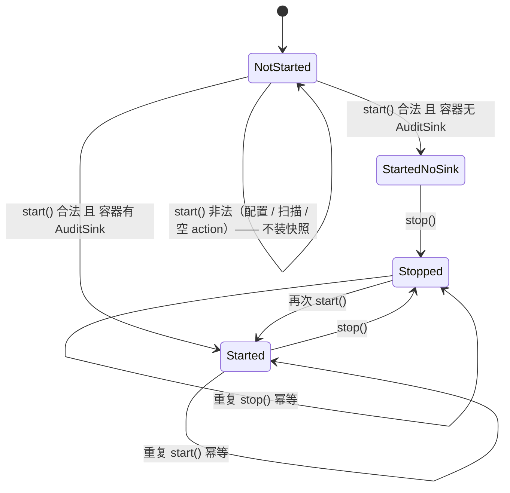
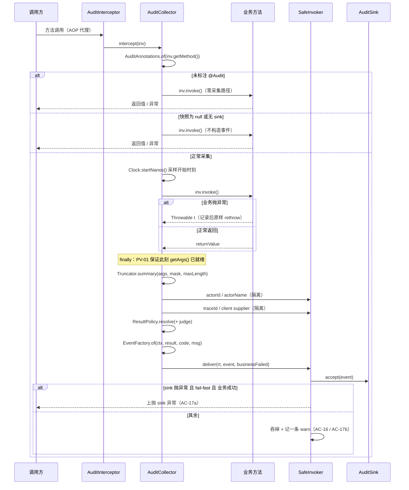
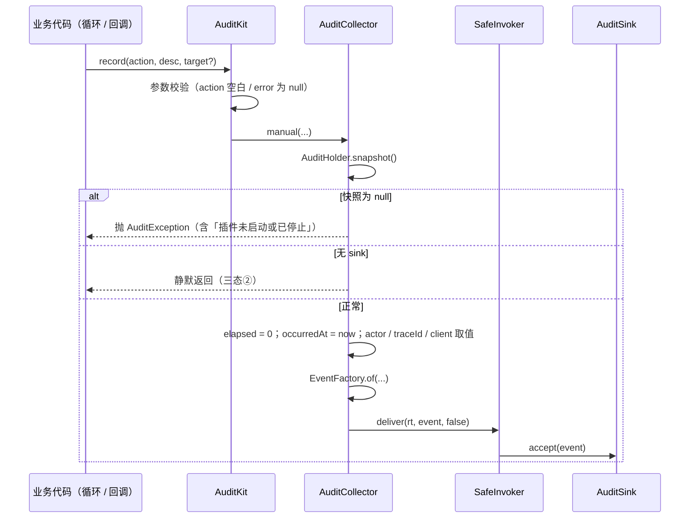

# aifei-audit 设计文档（契约事实来源）

> 版本：v1.0｜系统架构师：**贾苟思**｜日期：**2026-11-18**
> 输入：`docs/需求/aifei-audit.md`（任务输入，最高权威）、`aifei-audit/docs/prd.md`（需求关已通过）
> 坐标与基线：`io.github.gollyhu:aifei-audit:1.0.0`；包名 `cn.hg.aifei.audit`；Java 8（class major 52）；`cn.aifei:aifei-all:1.1.2` 为 `provided`；零第三方 compile / runtime 依赖
> 本文口径：需求 §二 非目标、§三 五条已定档前提、§五 契约口径**原样承接**；公共面逐字签名、配置键名、异常职责、不可变实现方式、门禁方法级判据均由本文定稿。**本文与需求冲突时以需求为准**，并须走需求回写流程。

---

## 0. 一页结论

| 项 | 结论 |
| --- | --- |
| 交付形态 | 库模块 `aifei-audit`（Plugin + AOP 拦截器 + 静态门面 `AuditKit`）+ 示例工程 `aifei-audit-demo`（端口 18160，8 场景） |
| 公共面 | 根包顶层 public 类型 **4** 个（`Audit` / `AuditEvent` / `AuditKit` / `AuditException`，`Result` 为 `AuditEvent` 嵌套枚举）；`spi` 包 **3** 个；`aifei` 包 **2** 个 |
| 运行期状态 | 单一 `volatile` 不可变快照（`AuditRuntime`），热路径无锁无分配表；三态 = 快照为 `null`（①未启动 / ③已停止）/ 快照非空但 `sink == null`（②）/ 快照完整 |
| 采集时机 | 拦截器内 **先 `inv.invoke()`，在 `finally` 中构造并交付事件**（PV-01 实证：AOP 路径的 `args` 只有在 `invoke()` 之后才就绪） |
| 拦截器位置 | 必须**首个注册**（PV-02 实证：拦截器数组下标 0 即最外层） |
| 启动期注解校验 | 可行且采用（PV-03 实证：框架自带 `cn.aifei.scanner.Scanner`，不依赖容器启动）；**不触发需求回写** |
| sink 切换 | 框架不容许同类型二次注册（PV-04 实证），故「运行期切换落点」只能在消费方用**可切换委托 sink** 实现，模块不开新 API |
| 门禁 | `ArchitectureBoundaryTest` 14 条（`G-01`~`G-13` + `G-14` = AC-26 的 Java 8 兜底），另追加 1 条加固门禁 `G-15`（时钟 / 事件号白名单）；`G-03` 白名单**精确等于 1 条**（`internal/SafeInvoker.java` ← `cn.aifei.log.`） |
| 实现偏差裁决 | **§21**：11 条逐条裁决（8 条接受并回写、1 条退回返工、2 条确认非契约问题）。**`G-03` 取方案 A**：`internal` 框架引用面收敛为 0，框架能力经 `AuditInvocation` / `AuditEnvironment` 两个端口下沉到 `aifei` 包 —— 需开发返工（预估 0.5 人天，不改任何 AC 与 demo 行为） |
| 待明确事项 | 3 条（U-01 要素「13 vs 表中 14 行」口径澄清；U-08 / U-09 为可选加固，均不影响实现与 AC 措辞） |

---

## 1. 前置实证记录（PV）

### 1.1 执行环境与命令

模块骨架（即 T01 产物）建好后，在 `aifei-audit` 目录内执行：

```bat
cd aifei-audit
mvn -o clean test
```

最终输出（真实执行）：

```
[INFO] Running cn.hg.aifei.audit.pv.Pv01ArgsProbeTest
[INFO] Tests run: 3, Failures: 0, Errors: 0, Skipped: 0
[INFO] Running cn.hg.aifei.audit.pv.Pv02InterceptorOrderProbeTest
[INFO] Tests run: 3, Failures: 0, Errors: 0, Skipped: 0
[INFO] Running cn.hg.aifei.audit.pv.Pv03AnnotationScanProbeTest
[INFO] Tests run: 3, Failures: 0, Errors: 0, Skipped: 0
[INFO] Running cn.hg.aifei.audit.pv.Pv04ContainerLookupProbeTest
[INFO] Tests run: 2, Failures: 0, Errors: 0, Skipped: 0
[INFO] Tests run: 11, Failures: 0, Errors: 0, Skipped: 0
[INFO] BUILD SUCCESS
```

探针位置：`aifei-audit/src/test/java/cn/hg/aifei/audit/pv/`（4 个用例类，保留为 PV 证据；不含任何业务实现类）。

### 1.2 实证结论表

| 编号 | 问题 | 手段 | 关键输出 | 结论 |
| --- | --- | --- | --- | --- |
| `PV-01` | 拦截器能否读到被拦截方法的实际入参 | `Pv01ArgsProbeTest`：分别用 Proxy 构造器 `Invocation(target, method, args, interceptors, callback)` 与 routes 真实形态 `Invocation(new Action(...), target, null, null)` 驱动同一个探针拦截器 | ① Proxy 路径：进入前 `getArgs()` = `[a1, b2]`；② Action 路径：进入前 `getArgs()` = `null`、`getArg(0)` 抛 `NullPointerException`，`invoke()` 之后 `getArgs()` = `[a1, b2]`，异常路径同样可读 | **是（有条件）**：入参可读，但**只能在 `inv.invoke()` 之后读**。框架 `Invocation#invoke` 在拦截器链全部走完后才由 `Argument#getValue` 解析实参并赋给 `args`（`aifei-all` 源码 `cn/aifei/aop/Invocation.java:78-95`）。**不需要降级 `R-02`，不触发需求回写**；改为在设计上把采集放进 `finally`（见 §7.2） |
| `PV-02` | 多拦截器时谁在外层 | `Pv02InterceptorOrderProbeTest`：`[audit, biz]` 与 `[biz, audit]` 两种数组顺序，`biz` 在推进前抛异常 | `[audit, biz]` → 步骤序列 `audit:enter, biz:enter, biz:veto, audit:caught:IllegalArgumentException, audit:exit`；`[biz, audit]` → `audit:enter` 从未出现 | **是**：数组下标 0 = 最外层（`Invocation#invoke` 逐个 `interceptors[index++].intercept(this)`）。审计拦截器**必须首个注册**；顺序颠倒时审计完全失效（不是"少记字段"而是"一条都不记"） |
| `PV-03` | `AuditPlugin.start()` 内能否枚举全部被标注方法 | `Pv03AnnotationScanProbeTest`：不启动容器，直接 `new cn.aifei.scanner.Scanner().scan("cn.hg.aifei.audit.pv")`；另扫 jar 内包 `cn.aifei.scanner` | 目录形态命中探针类、恰 2 个标注方法、其中 1 个 `action` 空串、未标注方法不计入；jar 形态命中 `Scanner.class`；子包扫描生效 | **是**：框架自带 `cn.aifei.scanner.Scanner`（`aifei-all:1.1.2` 内，`scan(String)` / `scan(String, Predicate)`），**不依赖 `Aifei.start`**；`Aifei.doStart` 的顺序是 `config(Settings)` → `config(Plugins)` + `startPlugins` → `config(Routes)`，故插件 `start()` 早于路由扫描、classpath 已完全可用。**`AC-29` 的「启动期校验」口径成立，不触发需求回写** |
| `PV-03a` | 扫描能力的边界（同批实测发现的硬约束） | 同一用例首轮未装日志工厂即执行，失败后补装重跑 | 未装时：`java.lang.ExceptionInInitializerError ... Caused by: java.lang.IllegalStateException: LogFactory not configured.`（`Scanner` 静态字段 `Log log = Log.get(Scanner.class)` 触发）；补装 `RecordingLogFactory` 后全部通过 | **约束成立**：框架默认 `NoLogFactory` 在取日志时**直接抛异常**（不是空实现）。由此推出两条设计纪律：① 单测必须 `@BeforeClass` 装配日志工厂（需求 §六 已有此条）；② 模块内 `Log` **必须惰性获取**且获取失败要被隔离（见 §5.3 `SafeInvoker#log`）。应用侧无此问题：`Settings#setLogFactory` 直接写 `LogKit`（`aifei-all` 源码 `cn/aifei/config/Settings.java:63-65`），而 `config(Settings)` 早于 `startPlugins`，故 `AuditPlugin.start()` 内扫描时日志工厂已就绪 |
| `PV-04`（设计关自加，非需求指定三项） | 「从容器按类型取 SPI」的真实语义（`Q14` 定档依据） | `Pv04ContainerLookupProbeTest`：`Aop.get(未注册接口)`、`AopKit.addSingletonObject` 注册后取值、同类型二次注册 | ① 未注册接口 → 抛 `RuntimeException`（**不返回 null**）；② 注册后 `Aop.get` 返回同一实例；③ 二次注册 → `RuntimeException: Singleton object already exists for type : ...`，原实例继续生效 | **结论**：① 「无 sink」判定只能靠"探测异常 → 视为未装配"；② 框架按类型**唯一**注册且**运行期不可换**，故场景 4 的落点切换必须由消费方的委托 sink 承担（§9.2） |

### 1.3 由实证推导的设计约束（写进实现纪律）

| # | 约束 | 来源 |
| --- | --- | --- |
| D-01 | 采集必须在 `inv.invoke()` 之后（`finally`）执行；拦截器内不得读取入参做前置判断 | `PV-01` |
| D-02 | 审计拦截器必须第一个传入 `routes.scan(...)`；README 顶格警告 | `PV-02` |
| D-03 | 启动期注解校验采用 `cn.aifei.scanner.Scanner`（**经 `AuditEnvironment#scan` 端口调用，`internal` 不直接引用 `Scanner`**，§21 裁决 1），扫描范围由消费方给出（包名 / 类清单），模块不自造 | `PV-03` |
| D-04 | 模块内不持有 `static final Log`；`Log` 惰性获取，获取失败（`IllegalStateException`）与写日志失败都不影响业务 | `PV-03a` |
| D-05 | SPI 探测 = `AuditEnvironment#lookup(type)`（`aifei` 包实现内即 `Aop.get(type)`）包在 `internal/AuditSpi` 的 try/catch 内，异常即"未装配"；模块**不往容器注册任何对象**（无半装配回滚面）；`catch` 必须留在 `internal`，故端口不可省 | `PV-04` / §21 裁决 1 |
| D-06 | 运行期换 sink 不是模块能力；模块保证的是"容器里只有一个生效 sink"，切换由消费方委托实现完成 | `PV-04` |

---

## 2. 决策表（定档，含被否方案）

| 编号 | 决策点 | 选项 | 结论 | 依据 |
| --- | --- | --- | --- | --- |
| D-10 | 采集构件形态 | ① 自写 HIO Handler（`TraceHandler` 式）② AOP 拦截器 `cn.aifei.aop.Interceptor` | **②拦截器** | 需求 §5.2「采集须在业务方法外层」；`TraceHandler` 只能覆盖 Web 入口，覆盖不到 Service 方法；`SentinelInterceptor` / `SaAnnotationInterceptor` 已有同构实证 |
| D-11 | 事件不可变实现 | ① 全 final 标量 + 全参构造器 ② 可变对象 + 交付前拷贝 ③ Builder + freeze | **①** | 需求 §5.1 全字段标量（无集合），final 标量天然不可变，AC-05 的"反射置值抛异常"直接成立；无拷贝开销 |
| D-12 | 事件号 | ① `UUID` 去横线 ② 雪花（依赖 `aifei-id`）③ 时间戳 + 计数 | **①** | 需求 Q8 默认假设；零依赖、无线程争用；`AC-06`（4 线程 100 次无重复）成立 |
| D-13 | 发生时刻 / 耗时 | ① `currentTimeMillis`（发生时刻）+ `nanoTime` 差（耗时）② 全用 `currentTimeMillis` | **①** | 需求 Q9；`nanoTime` 单调，不受系统时间回调影响 |
| D-14 | 注解是否建运行期索引 | ① start() 建 `Map<Method, Audit>` ② 调用时 `method.getAnnotation(Audit.class)` | **②** | JDK 反射注解查找有内部缓存，热路径无锁；**不建索引 ⇒ 无共享可变状态 ⇒ 无需清理面、无内存泄漏、多实例天然安全**。`AC-29` 中"已登记的注解索引须清除"在本设计下是空集（见 §8.3） |
| D-15 | 配置校验用什么读值 | ① `Prop#getBoolean` / `Prop#getInt` ② 只读 `getProperty` 原始串，自行严格解析 | **②** | `Prop#getBoolean` 非法值抛 `RuntimeException("The value can not parse to Boolean : " + value)`（**消息不含键名**，不满足 `AC-19`）；`getInt` 抛 `NumberFormatException` 同样不含键名 |
| D-16 | SPI 获取通道 | ① 容器按类型取 ② 配置类名反射 ③ 装配期 setter 注入 | **①**（+ ②③ 不提供） | 需求 Q14；`JobPlugin` / `MqPlugin` 同通道；`audit.spi.*` 类名反射会扩大配置校验面且引入类加载失败路径，收益为零 |
| D-17 | 扫描范围必填性 | ① 必填（至少一项） ② 可选，为空则跳过校验 | **①必填** | `AC-29` 的校验面必须有确定输入，否则「空 `action` 不得静默成功」无法机械保障；与 `job.scan.packages`（`aifei-job` 同类必填）同构；仅用手动埋点的消费方传自身包名即可（一行配置） |
| D-18 | `audit.enabled=false` 的语义 | ① 等价三态①（不装快照，手动埋点抛异常）② 装"禁用快照"（手动埋点静默） | **①** | 静默丢弃会让"审计写错了"无法被感知；①与「未启动」共用一条消息，`AC-09b` 措辞不变 |
| D-19 | `args` 注解开关与全局开关的关系 | ① OR（`全局 \|\| 注解`）② 注解覆盖全局 | **①OR** | 需求 §5.3「全局配置开关打开，**或**注解 `args=true` 逐方法打开」 |
| D-20 | 入参摘要格式 | ① `#0=v;#1=<masked>` ② JSON 数组 | **①** | 目标只有一个"可读且能验证剔除"，JSON 需要转义逻辑（易出错、易泄漏）；格式常量集中在 `Truncator` |
| D-21 | judge 判定失败的 `errorCode` | ① `null` ② 固定 `BUSINESS_CODE_FAILURE` | **②** | 让"业务码失败"与"异常失败"在下游可区分（事件模型要素「错误码与消息」的语义更足） |
| D-22 | `AuditEvent` 是否覆写 `equals` / `hashCode` | ① 覆写 ② 不覆写 | **②** | 事件是流水记录，无业务等价语义；覆写会掩盖"同一动作两条事件"的事实。`AC-05` 只要求不可变 |
| D-23 | demo 落点切换 | ① 模块开 `audit.sink` 配置键 ② demo 侧委托 sink | **②** | 需求 §5.4「同一时刻只有一个生效 sink」；`PV-04` 证明容器二层注册直接被拒，故切换必须在实现内部完成；模块不为 demo 需求开公共 API |

---

## 3. 公共面逐字签名（定稿）

### 3.1 根包 `cn.hg.aifei.audit`（顶层 public 类型 4 个）

#### 3.1.1 `Audit`（注解）

```java
package cn.hg.aifei.audit;

@Documented
@Retention(RetentionPolicy.RUNTIME)
@Target(ElementType.METHOD)
public @interface Audit {

    /** 动作码，必填且不得为空白；空串属启动期配置错误（AC-29）。 */
    String action();

    /** 人读描述，缺省为空串。 */
    String desc() default "";

    /** 是否记录本方法入参（与全局 audit.args.enabled 取 OR，见 D-19）。 */
    boolean args() default false;

    /** 不记录原文的参数位（0-based 下标），越界下标在采集期忽略、不抛错。 */
    int[] mask() default {};
}
```

约束：注解属性只接受字面量（非目标 §二-10）；`@Retention` 必须 `RUNTIME`（`AC-29` 编译用例断言运行期可读）。

#### 3.1.2 `AuditEvent`

```java
package cn.hg.aifei.audit;

public final class AuditEvent {

    /** 结果二值枚举；作为事件字段的承载类型，不计入根包顶层类型（Q17 已裁决）。 */
    public enum Result {
        SUCCESS,
        FAILURE;

        /** @return 失败为 true */
        public boolean isFailure() { return this == FAILURE; }
    }

    /**
     * 全参构造器。仅供模块内部（EventFactory）与测试构造，消费方不应自行 new 事件。
     *
     * @throws IllegalArgumentException eventId / action 为空，或 result 为 null
     */
    public AuditEvent(String eventId, long occurredAt, String action, String module, String desc,
                      String actorId, String actorName, String target, String argsSummary,
                      Result result, String errorCode, String errorMessage, long elapsedMillis,
                      String traceId, String client) { /* 全 final 字段直赋 */ }

    public String getEventId();
    public long getOccurredAt();
    public String getAction();
    public String getModule();
    public String getDesc();
    public String getActorId();
    public String getActorName();
    public String getTarget();
    public String getArgsSummary();
    public Result getResult();
    public String getErrorCode();
    public String getErrorMessage();
    public long getElapsedMillis();
    public String getTraceId();
    public String getClient();

    /** 覆写：输出全部要素标识（AC-13 依赖；不得沿用 Object#toString）。 */
    @Override
    public String toString();
}
```

要素与字段映射（对齐需求 §5.1 表逐行，其中「错误码与消息」在实现上拆为两个字段，故共 **15 个字段**）：

| # | 要素（需求 §5.1 行） | 字段 | 类型 | 可空 | 取值来源 |
| --- | --- | --- | --- | --- | --- |
| 1 | 事件号 | `eventId` | `String` | 否 | `internal.EventIds#next()` |
| 2 | 发生时刻 | `occurredAt` | `long` | 否（`> 0`） | `internal.Clock#epochMillis()`，取**动作开始时刻** |
| 3 | 动作码 | `action` | `String` | 否 | 注解 `action` / 手动埋点入参 |
| 4 | 业务模块 | `module` | `String` | 是 | `audit.module`，未配置为 `null` |
| 5 | 描述 | `desc` | `String` | 是 | 注解 `desc`（空串归一为 `null`）/ 手动埋点入参 |
| 6 | 操作人 id | `actorId` | `String` | 是 | `AuditActorProvider#actorId()` |
| 7 | 操作人名 | `actorName` | `String` | 是 | `AuditActorProvider#actorName()`（`actorId == null` 时不调用） |
| 8 | 目标对象标识 | `target` | `String` | 是 | 手动埋点入参（注解路径恒 `null`，非目标 §二-10） |
| 9 | 入参摘要 | `argsSummary` | `String` | 是 | `internal.Truncator`（默认 `null` = 不记录） |
| 10 | 结果 | `result` | `AuditEvent.Result` | 否 | `internal.ResultPolicy` |
| 11 | 错误码 | `errorCode` | `String` | 是 | 异常类全名 / `BUSINESS_CODE_FAILURE` |
| 12 | 错误消息 | `errorMessage` | `String` | 是 | `Throwable#getMessage()` |
| 13 | 耗时毫秒 | `elapsedMillis` | `long` | 否（`>= 0`） | `internal.Clock#elapsedMillis(long)`；手动埋点恒 `0` |
| 14 | `traceId` | `traceId` | `String` | 是 | 装配期注入的 `Supplier<String>` |
| 15 | 客户端标识 | `client` | `String` | 是 | `audit.client.enabled=true` 时由注入的 `Supplier<String>` 取值 |

> **口径澄清（见 §18 待明确项 U-01）**：需求正文写「13 个要素」，§5.1 表实际 14 行（操作人 id / 名 分列，错误码与消息同行）。本设计提供 **15 个字段**（错误码与消息拆成两个 getter），`AC-04` 按 15 个 getter 逐一断言；需求的 13 要素口径不变（字段更细，不少一个）。

`toString()` 定稿格式（单一事实来源，供 AC-13 断言）：

```
AuditEvent{eventId=<id>, occurredAt=<millis>, action=<action>, module=<module|null>, desc=<desc|null>,
 actorId=<id|null>, actorName=<name|null>, target=<target|null>, argsSummary=<summary|null>,
 result=SUCCESS|FAILURE, errorCode=<code|null>, errorMessage=<msg|null>, elapsedMillis=<n>,
 traceId=<trace|null>, client=<client|null>}
```

必含 `eventId` 与 `action`；`argsSummary=null` 时不出现任何入参原文（`AC-13` 的 `SECRET-XYZ` 断言依赖此点）。

#### 3.1.3 `AuditKit`（有状态门面，不得改名 `AuditUtil`）

```java
package cn.hg.aifei.audit;

public final class AuditKit {

    private AuditKit() { }

    /** 成功事件，无目标对象。 @throws AuditException 插件未启动或已停止 */
    public static void record(String action, String desc);

    /** 成功事件 + 目标对象标识。 @throws AuditException 插件未启动或已停止 */
    public static void record(String action, String desc, String target);

    /** 失败事件，错误码取异常类全名、消息取 getMessage()。 @throws AuditException 插件未启动或已停止 */
    public static void recordFailure(String action, String desc, String target, Throwable error);

    /** 失败事件，错误码与消息由调用方给出。 @throws AuditException 插件未启动或已停止 */
    public static void recordFailure(String action, String desc, String target,
                                     String errorCode, String errorMessage);
}
```

契约：

| 项 | 约定 |
| --- | --- |
| 参数校验 | `action` 空白 → `IllegalArgumentException`（先于状态检查）；`error` 为 `null` → `IllegalArgumentException` |
| 状态语义 | 快照为 `null`（未启动 / 已停止 / `enabled=false`）→ `AuditException`，消息含「插件未启动或已停止」；快照非空但无 sink → **静默返回**，不抛（三态②） |
| 耗时 | 恒 `0`（模块不知道手动埋点动作的起止） |
| 目标对象 | 由调用方显式给出；模块不从入参推导 |
| 异常隔离 | sink 异常按 `fail-fast` 处理（与注解路径同一策略） |

#### 3.1.4 `AuditException`

```java
package cn.hg.aifei.audit;

/** 模块唯一异常类型：启动期配置 / 扫描非法、运行期手动埋点不可用。 */
public class AuditException extends RuntimeException {

    public AuditException(String message);

    public AuditException(String message, Throwable cause);
}
```

职责定档：**只在这两处抛出** — ① `AuditPlugin#start()`（键名 + 原值 / 扫描范围缺失 / 空 `action`）；② `AuditKit` 四个方法（未启动或已停止）。运行期 sink / provider / judge 异常**不得**包装成 `AuditException`（要么吞，要么原样上抛）。

### 3.2 `cn.hg.aifei.audit.spi`（顶层 public 类型 3 个）

```java
package cn.hg.aifei.audit.spi;

import cn.hg.aifei.audit.AuditEvent;

/** 落点：接管单条事件。实现须线程安全、不得抛受检异常、不得回调业务方法（避免递归采集）。 */
public interface AuditSink {

    /** @param event 已构造完成、不可变的事件；不为 null */
    void accept(AuditEvent event);
}
```

```java
package cn.hg.aifei.audit.spi;

/** 操作人提供者。返回 null 表达「无操作人」（此时 actorName 不会被调用）。 */
public interface AuditActorProvider {

    /** @return 操作人 id；null 或空串表示无操作人 */
    String actorId();

    /** @return 操作人可读名称；可为 null */
    String actorName();
}
```

```java
package cn.hg.aifei.audit.spi;

/** 业务码失败判定：只放宽"正常返回也可能是失败"这一种情况，不改异常语义。 */
public interface AuditResultJudge {

    /**
     * @param action 动作码
     * @param returnValue 业务方法返回值（可能为 null）
     * @return 判定为失败时 true
     */
    boolean isFailure(String action, Object returnValue);
}
```

三个 SPI 的共同底线（与需求 §5.5 逐条一致）：实现须线程安全；模块不加锁、不做 `init` / `close` 回调；不得返回 `null` 事件占位；实现内异常由模块隔离，模块不重试、不补偿；**不得在实现里回调业务方法触发再次采集**（README 声明）。

### 3.3 `cn.hg.aifei.audit.aifei`（2 个，非承诺 API）

```java
package cn.hg.aifei.audit.aifei;

public class AuditPlugin implements cn.aifei.plugin.Plugin {

    /** @param prop 配置源；null → IllegalArgumentException（构造期只持引用，不解析、不校验） */
    public AuditPlugin(cn.aifei.util.Prop prop);

    /** 追加扫描包（`start()` 前调用；与 audit.scan.packages 合并去重） */
    public AuditPlugin addScanPackages(String... packages);

    /** 追加扫描类（`start()` 前调用；用于 jar / fat-jar 场景兜底） */
    public AuditPlugin addScanClasses(Class<?>... classes);

    /** 注入 traceId 取值（如 TraceKit::getTraceId）；null 表示不采集 */
    public AuditPlugin setTraceIdSupplier(java.util.function.Supplier<String> supplier);

    /** 注入客户端标识取值；仅 audit.client.enabled=true 时被调用 */
    public AuditPlugin setClientSupplier(java.util.function.Supplier<String> supplier);

    @Override public synchronized void start();

    @Override public synchronized void stop();
}
```

```java
package cn.hg.aifei.audit.aifei;

public class AuditInterceptor implements cn.aifei.aop.Interceptor {

    /** 无状态：运行期状态全部从 internal.AuditHolder 读取（无参构造，消费方直接 new）。 */
    public AuditInterceptor();

    @Override public void intercept(cn.aifei.aop.Invocation inv) throws Exception;
}
```

`AuditInterceptor` 保持无状态的原因：消费方在 `config(Routes)` 里 `new` 它，而该回调发生在 `startPlugins` **之后**（`Aifei.doStart` 顺序），若在构造期抓状态会拿到半装配值；改为调用期读快照后，`start()` / `stop()` 立即对所有已注册拦截器生效，且不需要重新 `routes.scan`。

---

## 4. 配置键与校验（`audit.*`）

唯一定义点：`internal.AuditConfig`（键名常量、默认值常量、解析与校验）。其它类不得硬编码键名字面量。

| 键 | 类型 | 默认 | 合法值 | 非法判定 | 错误消息（含键名与原值） |
| --- | --- | --- | --- | --- | --- |
| `audit.enabled` | boolean | `true` | `true` / `false`（大小写不敏感，去空白） | 其它 | `audit.enabled 取值非法: 'yes'（只接受 true / false）` |
| `audit.fail-fast` | boolean | `false` | 同上 | 其它 | `audit.fail-fast 取值非法: '1'（只接受 true / false）` |
| `audit.args.enabled` | boolean | `false` | 同上 | 其它 | `audit.args.enabled 取值非法: 'on'（只接受 true / false）` |
| `audit.args.max-length` | int | `512` | `>= 0` | 非整数 / 负数 | `audit.args.max-length 取值非法: '-1'（要求 >= 0）` |
| `audit.client.enabled` | boolean | `false` | 同上 | 其它 | `audit.client.enabled 取值非法: 'x'（只接受 true / false）` |
| `audit.module` | String | 空（→ `null`） | 任意，去空白；空串归一为 `null` | 无 | — |
| `audit.scan.packages` | String | 无 | 逗号分隔、每项非空 | 含空项 | `audit.scan.packages 取值非法: 'a..b,,'（每项须为非空包名）` |
| `audit.scan.classes` | String | 无 | 逗号分隔全限定类名、每项非空 | 含空项 / 类加载失败 | `audit.scan.classes 取值非法: 'com..Foo'（每项须为全限定类名）` |

补充定档：

1. **扫描范围必填**（D-17）：`audit.scan.packages` / `audit.scan.classes` / `addScanPackages` / `addScanClasses` 合并去重后必须非空，否则 `AuditException("未提供注解扫描范围：请配置 audit.scan.packages 或 audit.scan.classes，或调用 AuditPlugin#addScanPackages / addScanClasses")`。
2. `audit.enabled=false`：**仍解析并校验全部已出现的键**（配置写错照样启动失败，一致性优先），但**不装运行期快照**（D-18）。
3. `audit.spi.*` 类名反射配置**不提供**（D-16）。
4. 键缺省（未配置）一律取默认值，不报错；键存在但空白视同缺省。
5. 校验顺序固定：`enabled` → `fail-fast` → `args.enabled` → `args.max-length` → `client.enabled` → `module` → `scan.packages` → `scan.classes` → 扫描范围非空 → 注解扫描校验。顺序即错误优先级，便于稳定断言。

**校验分两段：配置语法段与扫描段（§21 裁决 4）**：

| 阶段 | 落点 | 判据 | 失败表现 |
| --- | --- | --- | --- |
| ① 配置语法段 | `internal/AuditConfig#parse`（`AuditPlugin#start()` 第一段） | 布尔取值合法、非负整数逐字符合法、逗号项非空、`module` 去空白归一 | `AuditException`，消息含**键名 + 原值 + 规则** |
| ② 扫描段 | `internal/AuditScanner#validate`（`start()` 第二段，语法段通过后） | 扫描范围非空 → `audit.scan.classes` 逐项 `Class.forName` → 范围内方法的空 `action` 校验 | `configInvalid(SCAN_CLASSES_KEY, 类名, ...)` / `scanRangeMissing()` / `emptyAction(签名)` |

因此 `audit.scan.classes` 的「**类加载失败在扫描段报 `configInvalid`**」是本设计的定档口径：它不属语法段（类名格式本身可能完全合法，只是 classpath 上不存在），但仍在 `start()` 内、仍在快照安装之前，故 `AC-19` / `AC-29` 的「启动失败 + 无残留态」不变。两段的键名与原值都进消息，`AC-19` 的断言不受影响。

---

## 5. 包结构、内部类型与唯一定义点

### 5.1 包结构

```
cn.hg.aifei.audit             根包：Audit / AuditEvent(+Result) / AuditKit / AuditException
cn.hg.aifei.audit.spi         AuditSink / AuditActorProvider / AuditResultJudge
cn.hg.aifei.audit.aifei       AuditPlugin / AuditInterceptor        （接入层，cn.aifei.* 允许）
cn.hg.aifei.audit.internal    （非承诺 API，见 §5.2）
```

### 5.2 `internal` 类型清单与职责（17 个，含 §21 返工新增的 2 个端口）

> **可见性定档（§21 裁决 3）**：`internal` 全部类型为 `public`。根包（`AuditKit`）与接入包（`AuditPlugin` / `AuditInterceptor`）与 `internal` 处于不同包，Java 中 `package-private` 跨包不可见，故 `public` 是编译必需而非设计偏好。`internal` 属**非承诺 API**：README / AGENTS 必须声明「消费方不得引用 `internal.*`，模块不保证其兼容性」；`G-01` / `G-02` 只约束根包与 `spi` 包的 public 类型集合，`internal` 不计入。
>
> **框架零引用定档（§21 裁决 1，方案 A）**：`internal` 全部类型**零 `cn.aifei.*` 出现**，唯一例外为 `SafeInvoker` 的 `cn.aifei.log.Log`（§5.5）。需要框架能力的两个地方一律经**端口接口**由 `aifei` 包注入实现：`AuditInvocation`（调用现场）与 `AuditEnvironment`（容器查找 + 包扫描）。

| 类型 | 职责（唯一） | 关键方法签名（内部） |
| --- | --- | --- |
| `AuditConfig` | 配置域常量、默认值、解析与校验 | `static AuditConfig parse(Properties props)`；`boolean enabled()` / `failFast()` / `argsEnabled()` / `int maxLength()` / `boolean clientEnabled()` / `String module()` / `List<String> scanPackages()` / `List<String> scanClasses()` |
| `AuditErrors` | **全部错误消息文本**（键名 + 原值、扫描范围、空 action、未启动） | `static AuditException configInvalid(String key, String raw, String rule)` / `scanRangeMissing()` / `emptyAction(String signature)` / `notStarted()` |
| `Clock` | 时钟采样唯一（发生时刻 / 单调耗时） | `static long epochMillis()` / `static long startNanos()` / `static long elapsedMillis(long startNanos)` |
| `EventIds` | 事件号生成唯一 | `static String next()`（`UUID` 去横线，32 位十六进制） |
| `Truncator` | **脱敏与截断唯一实现** | `static String summary(Object[] args, int[] mask, int maxLength)`；`static String truncate(String text, int maxLength)` |
| `SafeInvoker` | **运行期 / 装配期失败隔离唯一实现 + 模块日志唯一写入点** | `static void deliver(AuditRuntime rt, AuditEvent event, boolean businessFailed)`；`static AuditEvent capture(Supplier<AuditEvent> builder)`；`static String actorId(AuditRuntime rt)` / `actorName(...)`；`static boolean judge(AuditResultJudge judge, String action, Object returnValue)`；`static String supply(Supplier<String> supplier)`；`static Class<?> loadClass(String className)`；`static void warn(String message)`；`private static Log log()` |
| `AuditSpi` | 启动期从容器探测 SPI（异常即未装配）；容器访问全部经 `AuditEnvironment` 端口，本类**零 `cn.aifei.*`** | `static AuditSink sink(AuditEnvironment env)` / `actorProvider(AuditEnvironment env)` / `judge(AuditEnvironment env)` |
| `AuditEnvironment` | **框架能力端口**（§21 R-01 新增，非承诺 API）：容器按类型取 + 包扫描；唯一实现在 `aifei` 包（`AuditPlugin` 内匿名类或 `aifei/AuditAifeiEnvironment`） | `<T> T lookup(Class<T> type)`（取不到须抛，由 `AuditSpi` 捕获）；`Set<Class<?>> scan(String packageName)` |
| `AuditAnnotations` | **注解属性读取唯一** | `static ActionSpec of(Method method)`；`static final class ActionSpec { String action(); String desc(); boolean args(); int[] mask(); }` |
| `AuditScanner` | 扫描范围展开 + 空 `action` 校验；包扫描经 `AuditEnvironment` 端口，本类**零 `cn.aifei.*`** | `static void validate(AuditConfig config, List<String> extraPackages, List<Class<?>> extraClasses, AuditEnvironment env)` |
| `AuditContext` | 采集现场值对象（不可变） | 构造器收 11 个已取值字段（action/desc/module/target/argsSummary/occurredAt/elapsed/actorId/actorName/traceId/client）+ getter |
| `AuditInvocation` | **调用现场端口**（§21 R-01 新增，非承诺 API）：`aifei/AuditInterceptor` 用匿名适配器把框架 `Invocation` 转成本接口，`internal` 只认本接口 | `Method method()`；`void proceed() throws Exception`；`Object[] args()`（`proceed()` 之后才就绪，`PV-01`）；`Object returnValue()` |
| `EventFactory` | **事件构造唯一** | `static AuditEvent of(AuditContext ctx, AuditEvent.Result result, String errorCode, String errorMessage)` |
| `ResultPolicy` | **成败判定兜底唯一** | `static AuditEvent.Result resolve(Throwable businessFailure, Object returnValue, String action, AuditResultJudge judge)` |
| `AuditRuntime` | 运行期不可变快照 | 构造器收 `AuditConfig` + 5 个可空契约；`AuditConfig config()` / `AuditSink sink()` / `AuditActorProvider actorProvider()` / `AuditResultJudge judge()` / `Supplier<String> traceIdSupplier()` / `Supplier<String> clientSupplier()` |
| `AuditHolder` | 运行期状态唯一持有者（`volatile` 快照） | `static void install(AuditRuntime rt)` / `static void clear()` / `static AuditRuntime snapshot()` |
| `AuditCollector` | **采集编排唯一入口**（注解路径 + 手动埋点共用）；注解路径只收 `AuditInvocation` 端口，**零 `cn.aifei.*`** | `static void intercept(AuditInvocation inv) throws Exception`；`static void manual(String action, String desc, String target, AuditEvent.Result result, String errorCode, String errorMessage)` |

### 5.3 唯一定义点清单（需求 §六 逐条对应）

| 需求要求「只有一处定义」的项 | 唯一实现位置 | 其它位置被禁止的证据 |
| --- | --- | --- |
| 事件构造 | `internal/EventFactory#of` | `AuditEvent` 只做字段直赋与 `toString`；`AuditCollector` 不 new 事件 |
| 脱敏与截断 | `internal/Truncator#summary` / `#truncate` | 全 main 源码只有本文件出现 `length() >` 与 `substring(`（G-08） |
| 成败判定兜底 | `internal/ResultPolicy#resolve` | judge 的**调用**在 `SafeInvoker#judge`，兜底判断只在本类 |
| 失败隔离 `catch` | `internal/SafeInvoker`（运行期）+ `internal/AuditSpi`（启动期探测）+ `internal/AuditCollector#intercept`（业务异常观察，必 rethrow） | 其它 main 源码零 `catch (`（G-09） |
| 事件号生成 | `internal/EventIds#next` | `UUID` 只在本文件出现（G-15） |
| 耗时采样 | `internal/Clock` | `System.nanoTime` / `System.currentTimeMillis` 只在 `Clock.java`（G-15） |
| 配置域常量与默认值 | `internal/AuditConfig` | 其它类不出现 `"audit.` 字面量（G-15 追加断言） |
| 注解属性读取 | `internal/AuditAnnotations#of` | 其它类不出现 `Audit.class` 的 `getAnnotation` 调用（G-15 追加断言） |

### 5.4 `G-08` / `G-09` 方法级白名单（门禁判据，逐条定稿）

**G-08（脱敏与截断唯一定义点）** — 判据：

1. `src/main/java` 中同时出现 `length() >` **与** `substring(` 的文件，只能是 `internal/Truncator.java`；
2. `length() >` 与 `substring(` 各自都只在 `internal/Truncator.java` 出现（两条独立断言，避免"同文件但方法分散"）；
3. `internal/Truncator.java` 存在且包含 `static String summary(` 与 `static String truncate(`；
4. 索引剔除标志 `<masked>` 常量只在 `Truncator` 定义（断言字符串 `"<masked>"` 只在 Truncator.java 出现）。

**G-09（失败隔离 `catch` 白名单，按「文件 + 语义」三档）** — 判据：

| 文件 | 允许的 `catch` | 语义 |
| --- | --- | --- |
| `internal/SafeInvoker.java` | 全部方法：`deliver` / `capture` / `actorId` / `actorName` / `judge` / `supply` / `loadClass` / `warn` / `log`（§21 裁决 2 定档的完整清单） | 运行期与装配期隔离的唯一落点：吞异常 + 记一条模块日志（`capture` 隔离模块内部缺陷，`loadClass` 隔离扫描类加载，`warn` 供 `AuditPlugin` 启动告警，`log` 惰性获取） |
| `internal/AuditSpi.java` | 仅 `sink()` / `actorProvider()` / `judge()` | 启动期探测：容器异常 = 未装配 |
| `internal/AuditCollector.java` | 仅 `intercept(...)` | 观察业务异常以生成失败事件，**必须 rethrow** |

可执行断言（三条）：

1. `src/main/java` 中出现 `catch (` 的文件必须属于上表三个路径，其余文件命中即失败；
2. `internal/AuditCollector.java` 内每个 `catch` 块必须在 200 字符内出现 `throw`（正则 `catch\s*\([^)]*\)\s*\{[^}]{0,200}?throw`，`DOTALL`），否则失败 —— 防止"catch 后静默继续"；
3. 根包 / `spi` 包 / `aifei` 包**零** `catch (`。

### 5.5 `G-03` 白名单（`cn.aifei.*` 允许出现的 `internal` 点，逐条登记）

| 文件 | 允许的框架类型 | 允许的方法 / 出现位置 | 用途 |
| --- | --- | --- | --- |
| `internal/SafeInvoker.java` | `cn.aifei.log.Log` | 仅 `private static Log log()`（`cn.aifei.log.` 只允许出现在该文件的 `import` 行，正文经 `Log` 类型名间接使用） | 模块日志唯一写入点（惰性获取 + 获取失败隔离） |

除此之外：`internal` 其余 **16** 个类型**零** `cn.aifei.*`；`cn.aifei.*` 仅允许出现在 `aifei` 包（`Plugin` / `Prop` / `Interceptor` / `Invocation` / `Aop` / `Scanner` 等）。

**本表不含任何"其它 internal 类型"的开口（需求 §6.1 `G-03` 原文：不得为其它 `internal` 类型开口子）**。实现期曾把 `AuditSpi`→`cn.aifei.aop.Aop`、`AuditCollector`→`cn.aifei.aop.Invocation`、`AuditScanner`→`cn.aifei.scanner.Scanner` 三个文件登记进门禁白名单，属**门禁放宽**，已按 §21 裁决 1 退回返工（方案 A）：

| 原引用点 | 收敛方式（返工后） | 框架类型的新落点 |
| --- | --- | --- |
| `AuditCollector` ← `cn.aifei.aop.Invocation` | 采集编排只依赖 `internal/AuditInvocation` 端口 | `aifei/AuditInterceptor`（匿名适配器，`Invocation`→`AuditInvocation`） |
| `AuditSpi` ← `cn.aifei.aop.Aop` | 探测经 `AuditEnvironment#lookup`，`try/catch` 仍留在 `internal/AuditSpi` | `aifei` 包内 `AuditEnvironment` 实现 |
| `AuditScanner` ← `cn.aifei.scanner.Scanner` | 包扫描经 `AuditEnvironment#scan` | `aifei` 包内 `AuditEnvironment` 实现 |

由此 `internal` 的框架引用面收敛为**一个文件、一个类型、一个方法**（`SafeInvoker#log`），与需求 §6.1 的例外条款逐字对应。

---

## 6. 三态状态机与半装配

### 6.1 状态模型



状态承载：**唯一的 `AuditHolder.CURRENT`（`volatile AuditRuntime`）**

| 状态 | 快照 | 注解路径 | `AuditKit.record*` | 模块日志 |
| --- | --- | --- | --- | --- |
| ① 未启动 / `start()` 失败 / `enabled=false` | `null` | 直接 `inv.invoke()`，不采集、不抛 | 抛 `AuditException`（消息含「插件未启动或已停止」） | 不记（避免每次调用刷屏） |
| ② 已启动、容器无 sink | 非空且 `sink() == null` | 不构造事件、直接 `inv.invoke()` | 同左，静默返回 | `start()` 阶段**恰一条** `warn`；运行期不重复 |
| ③ 已停止 | `null` | 同 ① | 同 ① | 同 ① |

> 「①与③共用 `null`」是刻意的：两者的可观测行为逐条相同（需求 §5.4.1 前两列完全一致），用两种内部状态区分只会多一个易错分支。

### 6.2 `stop()` 后的行为落点

`stop()` 只做 `AuditHolder.clear()`：已注册的 `AuditInterceptor` 仍在路由链上，但读到的快照为 `null` → 走 ①（零采集）。因此**停止不需要重新 `routes.scan`**，`AC-18` 的"停止后注解路径不再产事件且业务方法不受影响"自然成立。

### 6.3 半装配清理清单（`start()` 失败时）

| 可能残留 | 本设计是否有残留面 | 处置 |
| --- | --- | --- |
| 静态运行期引用（快照） | **有** | `AuditHolder.install` 是 `start()` 的**最后一步**，之前的任何失败都不会写入；写入后无失败路径 |
| 容器注册对象 | **无** | 模块不向容器注册任何对象（`PV-04`） |
| 注解索引 | **无** | 不建索引（D-14），只有调用期反射读注解 |
| 插件内部标志 | **有** | `started` 只在全部校验与安装成功后置 `true` |
| 已建连接 / 线程 | **无** | 零线程、零连接 |

结论：失败后状态与"从未启动"完全等价，再次以合法配置 `start()` 可正常工作（`AC-19` / `AC-29` 的后半段）。

---

## 7. 采集链路

### 7.1 注解路径（`AC-01`/`02`/`03`/`21`）



`AuditInterceptor#intercept` 的**唯一实现形态**（伪码，用于约束实现顺序；§21 R-01-6 后为"薄适配"）：

```java
@Override
public void intercept(final Invocation inv) throws Exception {
    // 只做字段搬运：零逻辑判断、零 catch（G-09 判据 3）
    AuditCollector.intercept(new AuditInvocation() {
        public Method method()        { return inv.getMethod(); }
        public void proceed() throws Exception { inv.invoke(); }
        public Object[] args()        { return inv.getArgs(); }        // PV-01：proceed() 之后才就绪
        public Object returnValue()   { return inv.getReturnValue(); }
    });
}
```

`AuditCollector#intercept` 的关键结构（伪码，只认 `AuditInvocation` 端口，零 `cn.aifei.*`）：

```java
static void intercept(AuditInvocation inv) throws Exception {
    ActionSpec spec = AuditAnnotations.of(inv.method());
    AuditRuntime rt = AuditHolder.snapshot();
    if (spec == null || rt == null || rt.sink() == null) {
        inv.proceed();                      // 零采集路径：三态①②与"未标注"共用
        return;
    }
    long start = Clock.startNanos();
    long occurredAt = Clock.epochMillis();
    boolean businessFailed = false;
    try {
        inv.proceed();                      // 业务正常返回
    } catch (Throwable t) {                 // 仅"观察"，必须 rethrow（AC-03 assertSame）
        businessFailed = true;
        throw t;
    } finally {
        deliver(rt, spec, inv, occurredAt, start, businessFailed);   // 采集在 finally（D-01）
    }
}
```

> 精确重抛的编译前提：`AuditInvocation#proceed()` 声明 `throws Exception`，与框架 `Invocation#invoke()` 的签名同形，故 `catch (Throwable t) { throw t; }` 在 `-source 8 -target 8` 下成立（**已实测编译通过**，§21 裁决 1 依据 ⑥）。

`deliver(...)` 内部顺序（**顺序断言点，AC-17a**）：

```
1. 计算 elapsed / argsSummary / actor / traceId / client / result
2. EventFactory.of(...)        ← 事件已构造完成
3. SafeInvoker.deliver(...)    ← 事件已交给 sink（sink 内部先记录再抛的替身可证）
4. 若 sink 抛异常 且 fail-fast 且 业务未失败 → 上抛 sink 异常
```

### 7.2 为什么采集必须在 `finally`

`PV-01` 证明 AOP 路径的 `args` 只有在 `invoke()` 走完拦截器链后由 `Argument#getValue` 填充。因此：

- 入参摘要只能在业务执行后计算 → 放 `finally`；
- 业务异常路径同样在 `finally` 采集（此时 `args` 也已就绪）；
- `finally` 中抛异常会**覆盖**正在传播的业务异常，故 `deliver` 只在 `businessFailed == false` 时才允许上抛 sink 异常（`AC-17b`）。

### 7.3 手动埋点路径（`AC-07`）



与注解路径的**共用面**：同一 `AuditEvent` 类型、同一 `EventFactory`、同一 `Truncator`（手动埋点不带入参，故 `argsSummary` 恒 `null`）、同一 `SafeInvoker`、同一 sink、同一 `fail-fast` 策略。

差异面（须在 README 写明）：① 入参摘要恒空（手动埋点不接受入参值）；② 耗时恒 `0`；③ 目标对象只能由调用方给出；④ 业务异常要由调用方自己 `catch` 后再埋（模块不替手动埋点捕获异常）。

### 7.4 嵌套采集

被标注方法 A 调用被标注方法 B：B 的事件先交付（B 的 `finally` 先执行），A 的随后。不做去重、不建父子关系（非目标）。

---

## 8. 失败隔离矩阵落地

### 8.1 五项 × 两态（与需求 §5.6 逐格对应）

| 环节 | 异常时 `fail-fast=false`（默认） | 异常时 `fail-fast=true` | 实现位置 |
| --- | --- | --- | --- |
| `AuditSink#accept` | 吞 + `warn` 一条；业务返回值 / 异常不变（`AC-16`） | 业务**正常返回**：先交付、后上抛 sink 异常（`AC-17a`）；业务**已抛异常**：业务原异常优先，sink 异常吞 + `warn` 一条（`AC-17b`） | `SafeInvoker#deliver` |
| `AuditActorProvider` | 吞 + `warn`；操作人字段为 `null`，事件照出（`AC-11`） | **不受 `fail-fast` 影响**（恒不阻断） | `SafeInvoker#actorId/#actorName` |
| `AuditResultJudge` | 吞 + `warn`；退回「异常=失败 / 返回=成功」（`AC-12`） | 同上 | `SafeInvoker#judge` + `ResultPolicy` |
| 模块内部缺陷（事件构造 / 脱敏截断 / 时钟） | 吞 + `warn`，**不产事件**、业务不变 | 同左（`fail-fast` 只覆盖 sink 契约违约） | `SafeInvoker` 包裹后的 `deliver` |
| 业务方法自身异常 | 原样上抛（`AC-03` `assertSame`） | 同左 | `AuditCollector#intercept`（`throw t`） |

### 8.2 「先交付后上抛」的顺序断言点（`AC-17a`）

| 步骤 | 断言方式 |
| --- | --- |
| 事件已构造完成 | 测试 sink 的 `accept` 收到的 `event` 非 null、`event.getAction()` 等于注解值 |
| 已交付 sink | sink 替身「先写入收集列表，再抛 `RuntimeException`」→ 调用方捕获异常后断言收集列表 `size == 1` |
| 上抛的是 sink 异常本身 | `assertSame(sinkThrown, caught)` |

### 8.3 模块日志口径（`AC-09`/`11`/`12`/`16`/`17b` 的"恰一条"）

| 项 | 约定 |
| --- | --- |
| 通道 | `cn.aifei.log.Log`，**惰性获取**（`SafeInvoker#log`：首次调用时 `Log.get(SafeInvoker.class)`，缓存到 `volatile` 字段） |
| 获取失败 | `Log.get` 在应用未装配 `LogFactory` 时抛 `IllegalStateException`（`PV-03a` 实证）→ 吞掉，放弃本次日志，**不得**改用 `System.err`（G-10 禁止） |
| 计数口径 | 一次失败 = 一条 `warn`；同一失败不得在多处重复记 |
| 级别 | 隔离类失败一律 `warn`；装配阶段"已启用但无 sink"也是 `warn` 一条 |
| 严禁 | `System.out` / `System.err` / `printStackTrace`（G-10）；任何日志绑定（G-11） |

---

## 9. SPI 装配与落点切换

### 9.1 探测语义（`Q14` 定档）

| 情形 | `Aop.get(type)` 结果 | 模块处理 |
| --- | --- | --- |
| 消费方已 `AopKit.get().addSingletonObject(MySink.class, ...)` 或以 `@Implement` 扫描注册 | 返回实例 | 采用 |
| 容器无该类型 | 抛 `RuntimeException`（`PV-04` ①） | `AuditSpi` 捕获 → 返回 `null` = 未装配（不启动失败，`Q7`） |
| 同类型注册两个实现 | 框架第二次注册即抛 `Singleton object already exists`（`PV-04` ③） | 消费方侧启动期就失败，模块无需检测 |

由此定档：**模块不做"多实现检测"**（框架层不可表达），README 声明「同一时刻只能注册一个实现；需要按动作分发时由消费方在自己的 sink 内分发（P1）」。—— 这是对需求 `Q14`「同一类型多实现视为配置错误并启动失败」的**实证化落地**：该错误由框架在注册那一刻抛出，早于 `AuditPlugin.start()`。

### 9.2 场景 4（落点切换）的定稿方案

| 方案 | 结论 | 理由 |
| --- | --- | --- |
| 模块提供 `audit.sink=xxx` 配置键 | **否** | 违背「落点职责只到 SPI」（§三-1），且需要类名反射（D-16 已否） |
| 运行期重新向容器注册新 sink | **不可行** | `PV-04` ③：同类型二次注册直接被拒 |
| **消费方注册一个「可切换委托 sink」** | **采用** | 容器里始终只有一个 `AuditSink`（`SwitchableAuditSink`），其内部 `volatile` 持有当前真实落点（内存 / 控制台 / mq），由 demo 的 HTTP 端点切换。模块零改动、零新 API，且完全符合「同一时刻只有一个生效 sink」 |

---

## 10. 门禁实现方案（`ArchitectureBoundaryTest`）

扫描根：`src/main/java`（默认）、`src/test/java`（G-05 / G-06）、demo 目录（G-13）。测试须在**模块根目录**执行（`surefire` 的 `workingDirectory` 已固定为 `${project.basedir}`）。源码文本扫描前先剥离注释（复用 `aifei-http` 的状态机实现），避免版权头 / 注释误报。

| 编号 | 断言 | 扫描范围 | 判据（可机械执行） |
| --- | --- | --- | --- |
| `G-01` | 根包顶层 public 类型精确 = 4 | `src/main/java` 根包直接子文件 + 反射 | 文件名集合 `== {Audit.java, AuditEvent.java, AuditKit.java, AuditException.java}`；且四个类型 `Modifier.isPublic`；`AuditEvent.Result` 为嵌套枚举（断言 `AuditEvent.class.getDeclaredClasses()` 含 `Result` 且 `isEnum()`） |
| `G-02` | `spi` 顶层 public 类型精确 = 3 | `src/main/java/.../spi/` | 文件名集合 `== {AuditSink.java, AuditActorProvider.java, AuditResultJudge.java}` |
| `G-03` | `aifei` 包存在两构件；`cn.aifei.*` 只在该包与白名单 | `src/main/java` | 文件存在断言 + 文本扫描：`cn.aifei.` 出现在 `aifei/` 之外的文件必须**同时**满足「文件 == `internal/SafeInvoker.java`」且「该处 fqn 以 `cn.aifei.log.` 开头」；且白名单登记项**精确等于 1 条**（集合等值，多一条即失败，防"实现顺手扩名单"） |
| `G-04` | 零存储 | `src/main/java` | 文本含 `java.sql.` 即失败 |
| `G-05` | 零 `cn.aifei.vip.` | `src/main/java` + `src/test/java` | 文本含 `cn.aifei.vip.` 即失败 |
| `G-06` | 零生态模块引用 | `src/main/java` + `src/test/java` | 文本含 `cn.hg.aifei.satoken` / `.mq` / `.trace` / `.cache` / `.lock` / `.sentinel` / `.weixin` / `.oss` / `.job` / `.http` / `.id` / `.excel` / `.websocket` 任一即失败 |
| `G-07` | 零线程 / 线程池 / 定时器 | 仅 `src/main/java` | 文本含 `new Thread(` / `Executors.` / `ThreadPoolExecutor` / `ForkJoinPool` / `java.util.Timer` / `ScheduledExecutorService` 任一即失败 |
| `G-08` | 脱敏与截断唯一定义点 | 仅 `src/main/java` | §5.4 四条判据 |
| `G-09` | 失败隔离 `catch` 白名单 | 仅 `src/main/java` | §5.4 三条判据 |
| `G-10` | 零 `System.out` / `System.err` / `printStackTrace` | 仅 `src/main/java` | 三处字面量任一命中即失败 |
| `G-11` | 零日志绑定 | 仅 `src/main/java` | 文本含 `org.slf4j.` / `log4j` / `logback` 任一即失败 |
| `G-12` | 公共面实现无关 + 命名纪律 | `src/main/java` | ① 根包与 `spi` 包文件的 import 只允许 `java.` / `javax.` / `cn.hg.aifei.audit.`（禁任何具体实现类型与第三方）；② 存在 `AuditKit.java`；③ 全模块不存在 `AuditUtil` 类型名（文件名与文本双查） |
| `G-13` | demo 离线 | `aifei-audit-demo/src/**`（含 `webapp` 静态资源） | URL 正则命中后 host 只能是 `127.0.0.1` / `localhost`；demo 目录不存在时跳过（本门禁在 demo 建好后才生效，**断言方式为：若目录存在则必须全绿**） |
| `G-14` | Java 8 双约束兜底（`AC-26`） | `src/main/java` + `src/test/java` | 文本含 `var ` / `record ` / `"""` / `List.of(` / `Map.of(` / `Set.of(` / `sealed ` 任一即失败（编译期 `source/target=1.8` 是主防线） |
| `G-15`（**设计关追加加固**，不改变需求 14 条口径） | 时钟 / 事件号 / 配置键 / 注解读取唯一定义点 | `src/main/java` | ① `System.nanoTime` 与 `System.currentTimeMillis` 只在 `internal/Clock.java`；② `UUID` 只在 `internal/EventIds.java`；③ `"audit.` 字面量只在 `internal/AuditConfig.java`；④ `getAnnotation(Audit.class)` 只在 `internal/AuditAnnotations.java` |

> 口径说明：需求 §6.1 正文说"14 条断言"，表内为 `G-01`~`G-13` 共 13 条；本设计把 `AC-26` 的 Java 8 文本兜底编为 `G-14`，正好 14 条。`G-15` 是**额外加固**（只会更严，不放宽任何既有断言），如需与需求表格严格一一对应，`G-15` 可作为附加用例保留。

**门禁实现的两点口径登记（§21 裁决 5，均不构成放宽）**：

1. **门禁自身豁免（登记，非放宽）**：`ArchitectureBoundaryTest` 的 `javaFiles(...)` 跳过门禁文件自身。理由：该文件把全部被禁字面量（`System.out` / `catch (` / `cn.aifei.vip.` …）作为断言字符串持有，自扫必然失败；豁免对象是**门禁实现**而非产品代码，不进入交付 JAR，且对门禁实现的任何修改都在评审可见面。**其余 `src/test/java` 仍全量扫描**（`G-05` / `G-06` / `G-12` 类型名断言），故未放宽对被测代码的约束。
2. **`G-14` 判据形态**：`var` / `record` / `sealed` 由字面量改为**语法模式**（`\bvar\s+[A-Za-z_$]\w*\s*=`、`\brecord\s+[A-Z]\w*\s*\(`、`\bsealed\s+(class|interface)\b`），原因是字面量 `record ` 会误伤冻结的测试支撑 `support/RecordingLogFactory#contains` 中的 `for (String record : RECORDS)`（实测命中）。该改法**更精确而非更宽松**；`AC-26` 的主防线是编译期 `source/target=1.8` 与 `javap` 的 class major 52，`G-14` 只是兜底（需求 §6.1 已写明「门禁是兜底不是主防线」）。`"""` / `List.of(` / `Map.of(` / `Set.of(` 四个字面量判据**不变**。

`AC-26` 的 class major 断言不由文本门禁承担：由 `docs/testing.md` 的构建检查项以 `javap -verbose` 批量断言 `major version: 52`（属发布前自检，不进 `mvn test`）。

---

## 11. 测试支撑与测试策略要点

### 11.1 测试支撑（`src/test/java/cn/hg/aifei/audit/support/`）

| 类 | 用途 |
| --- | --- |
| `RecordingLogFactory`（**已随 T01 落地**） | 记录型 `LogFactory`：`install()` / `restore()` / `count(level)` / `total()` / `contains(fragment)`。既解决 `PV-03a`（默认 `NoLogFactory` 抛异常），又支撑 `AC-09`/`11`/`12`/`16`/`17b` 的"恰一条"断言 |
| `CountingSink` | 计数 + 收集事件；`failMode` 开关（不抛 / 先记录再抛） |
| `InMemorySink` | 内存落点（供 `AC-08` 切换 sink 对照） |
| `FailingSink` | 恒抛 `RuntimeException`（`AC-16` / `AC-17a` / `AC-17b`） |
| `StubActorProvider` | 固定 id / 名 / 抛异常三态 |
| `StubResultJudge` | 固定成功 / 固定失败 / 抛异常三态 |

纪律：

1. 每个测试类 `@BeforeClass` 装 `RecordingLogFactory`，`@AfterClass` 还原（`PV-03a` 已实证必要性）。
2. 断言"模块日志恰一条"用 `RecordingLogFactory.count("warn")`，不用 `System.out` 抓取。
3. 耗时断言宽松（`>= 0` 且与人为延迟同数量级），禁秒级 `sleep` 堆叠（需求 §六）。
4. `AC-06` 的 4 线程用例在测试内建线程池（`G-07` 只覆盖 `src/main/java`，不冲突）。
5. 单测驱动注解路径用 `new Action(..., new Interceptor[]{new AuditInterceptor()}, ...)` + `new Invocation(action, target, null, null)`（`PV-01` / `PV-02` 已给出可复用的装配写法），不需要启动 HTTP。

### 11.2 契约测试基类

`AuditSink` / `AuditActorProvider` / `AuditResultJudge` 属"公共接口 + 多实现"，按仓库底线提供共同契约说明（写入 README 与 `docs/testing.md`）；"允许差异清单"不适用（单实现职责）。

---

## 12. `aifei-audit-demo` 设计

### 12.1 形态

| 项 | 定稿 |
| --- | --- |
| 坐标 | `io.github.gollyhu:aifei-audit-demo:1.0.0`（示例工程，不发布） |
| 端口 | **18160**（`-Dundertow.port=18160`），WebSocket / mq / job / http / trace / id / excel 端口均不占用 |
| 结构 | 与 `aifei-http-demo` 同构：`DemoApp` → `Aifei.start(DemoAppConfig)`；自写 HIO（`cn.aifei.demo.common.arch` 11 个文件逐字拷贝自 `aifei-http-demo`）；`service` 包声明 `@Path`；`webapp` 静态页；`start-demo.bat` / `stop-demo.bat` |
| 依赖 | `aifei-all`(compile) + `aifei-audit`(compile) + `aifei-trace` + `aifei-sa-token` + `aifei-mq`（示例工程行为，`Q16` 定档）。**模块 pom 不得出现这些** |
| 离线 | 页面与源码零外网 host（`G-13`），无构建工具（纯 HTML/CSS/JS） |

### 12.2 装配（`DemoAppConfig`）

```java
public void config(Settings settings) {
    p = PropKit.use("app-config.txt");
    settings.setLogFactory(new Log4jLogFactory());
    settings.setServer(new UndertowServer(), new IoDispatcher())
            .addHandler(new TraceHandler<>())        // trace 在 Handler 链首（demo 内部顺序）
            .addHandler(new IoHandler(true, "view"));
}

public void config(Routes routes) {
    // 审计拦截器必须第一个传入：PV-02 实证「下标 0 即最外层」
    routes.scan("cn.hg.aifei.audit.demo.biz", new AuditInterceptor());
    routes.scan("cn.hg.aifei.audit.demo.service");
}

public void config(Plugins plugins) {
    plugins.add(new MqPlugin(p));           // mock/memory 后端：供 mq sink 投递
    plugins.add(new SaTokenAifeiPlugin(p)); // 操作人来源（仅 demo）
    plugins.add(new AuditPlugin(p)
            .addScanPackages("cn.hg.aifei.audit.demo.biz")
            .setTraceIdSupplier(TraceKit::getTraceId));   // trace 只出现在 demo（AC-20）
}
```

关键顺序说明：`biz` 包（被审计的业务动作）单独 `routes.scan` 并挂审计拦截器；`service` 包（demo 端点）**不挂**审计拦截器，否则页面自身的查询请求也会产事件、干扰计数。

容器内唯一的 `AuditSink` 由 `config(Settings)` 阶段注册：

```java
AopKit.get().addSingletonObject(AuditSink.class,
        new SwitchableAuditSink(new MemoryAuditSink(feed), new ConsoleAuditSink(feed), new MqAuditSink(feed)));
AopKit.get().addSingletonObject(AuditActorProvider.class, new SaTokenActorProvider());
```

### 12.3 落点三实现与切换（场景 4）

| 实现 | 行为（页面可见差异） |
| --- | --- |
| `MemoryAuditSink` | 写入 demo 的事件环形缓冲（上限 200）→ 页面"最近事件"与"内存落点计数"变化 |
| `ConsoleAuditSink` | `System.out` 打印一行摘要（demo 允许，模块禁止）→ 页面只看到"控制台落点计数"变化 |
| `MqAuditSink` | `ProducerKit.send("aifei.audit.events", event.toString())`（memory 后端）→ demo 侧 `AuditMqSubscription` 收到后计数，页面显示"mq 投递 / mq 消费"两个计数 |
| `SwitchableAuditSink` | `volatile AuditSink delegate` + `switchTo(name)`；容器里始终是它一个 |

页面读模型与落点解耦：三实现都先写入 `EventFeed`（页面统一可见），再各自执行本落点行为。`SinkCounters` 记录每个落点被调用的次数。

### 12.4 操作人 / traceId / 客户端

| 项 | demo 做法 | 模块侧 |
| --- | --- | --- |
| 操作人 | `SaTokenActorProvider` 用 `StpUtil.isLogin()` / `getLoginIdAsString()`；页面提供"登录为 alice / bob"与"登出"。**登录态回传口径（§21 裁决 8）**：`/login` 在 `actor` 之外额外返回 `tokenName` / `token`（`StpUtil.getTokenValue()`），页面把同名头回传（`audit-demo.js` 的 `view.token`）；原因是 sa-token 的 undertow 桥接以响应头下发 token、页面为纯 `fetch` 单页，不依赖 cookie 自动回传。属 demo 内部机制，**不进模块 README 的用法示例** | 零 sa-token 依赖（`AuditActorProvider` 接口只有 `String`） |
| `traceId` | `TraceHandler` 绑定 + `plugin.setTraceIdSupplier(TraceKit::getTraceId)` | 零 trace 依赖（`AC-20` 的 `TraceKit` 引用只出现在 demo） |
| 客户端标识 | **不演示**（`audit.client.enabled=false`）：要素列展示 `-` 占位；supplier 注入点存在但不使用，避免为演示引入 Undertow 依赖 | 模块不读 HTTP 上下文 |

### 12.5 场景 ↔ 端点 ↔ 可观测点（`AC-30`）

| # | 场景 | 触发端点（`@Path("/audit/demo")` 下） | 可观测点 |
| --- | --- | --- | --- |
| 1 | 注解采集 | `GET /annotated`（`@Audit(action="order.cancel", desc="取消订单")`）与 `GET /unannotated`（无注解） | 前者事件 +1，后者不变（对照） |
| 2 | 手动埋点 | `GET /manual?times=3`（循环 3 次 `AuditKit.record`） | 一次调用产 3 条，字段形状与场景 1 一致（`elapsedMillis=0`） |
| 3 | 脱敏对照 | `GET /masked`（`@Audit(args=true, mask={1})`）与 `GET /masked/off`（同动作、注解不开启入参记录）；两请求参数均为 `keep=VISIBLE-OK&secret=SECRET-XYZ`。注解属性编译期固定，**同一条方法无法在运行期切换 `args`**，故拆两个端点表达两种配置（§21 裁决 6） | 前者摘要含 `VISIBLE-OK`、不含 `SECRET-XYZ`（第二参数换成 `<masked>`）；后者摘要为 `-` |
| 4 | 落点切换 | `GET /sink/switch?name=memory\|console\|mq` | 切换后计数落在对应落点；业务代码零改动 |
| 5 | 业务异常失败 | `GET /failure`（必抛 `IllegalStateException("order-cancel-rejected")`）触发；`GET /failure/evidence` 取证 | 事件 `result=FAILURE`、错误码含异常类名。因框架把未捕获异常收敛为 `code=20000`，`/failure` 的响应体不含异常细节，故 `sameInstance` 由**观察型拦截器**（`ThrownCaptureInterceptor`，注册在审计拦截器**内层**）比对冒泡实例与业务抛出实例得出，页面读 `/failure/evidence`（§21 裁决 7） |
| 6 | `traceId` 关联 | 任意页面请求（`TraceHandler` 已绑定）+ 页面顶部展示 `state.traceId` | 事件卡片 `traceId` 与顶部一致 |
| 7 | 空态 | `GET /reset` 后进入页面 | 列表显示占位文案「还没有采集到事件」 |
| 8 | 错误态 | `GET /sink/fail?on=true` 后触发场景 1 | 业务返回原值、页面提示「已按失败隔离吞掉并记一条模块日志」，与成功态视觉区分 |

---

## 13. Web UI 数据契约（只定契约，不定视觉）

页面：`src/main/webapp/view/audit/index.html` + `assets/js/audit-demo.js` + `assets/css/audit-demo.css`（单页、零外网、零构建）。视觉与交互由开发使用 **`.codebuddy/skills/ui-ux-pro-max`** 技能实装，本文只约束以下契约。

响应统一包装（沿用自写 HIO 的 `Out`）：`{"code":0,"msg":"ok","data":{...}}`，HTTP 恒 200；错误用 `{"code":<非0>,"msg":"<可读消息>","data":null}`。

### 13.1 `GET /audit/demo/state`

```json
{
  "code": 0, "msg": "ok",
  "data": {
    "sink": "memory",
    "sinks": ["memory", "console", "mq"],
    "config": { "argsEnabled": false, "maxLength": 512, "failFast": false, "clientEnabled": false, "module": "aifei-audit-demo" },
    "counters": { "delivered": 12, "memory": 7, "console": 3, "mq": 2, "mqConsumed": 2 },
    "sinkFailMode": false,
    "traceId": "3f7c1a9e5b2d4c60",
    "actor": { "id": "alice", "name": "Alice" }
  }
}
```

字段约束：`sink` ∈ `sinks`；`actor.id` 未登录时为 `null`（页面显示「未登录」）；`traceId` 可为 `null`。

### 13.2 `GET /audit/demo/events?since=<seq>`

```json
{
  "code": 0, "msg": "ok",
  "data": {
    "seq": 13,
    "events": [{
      "seq": 13,
      "eventId": "9b2c...e1",
      "occurredAt": 1763500000123,
      "action": "order.cancel",
      "module": "aifei-audit-demo",
      "desc": "取消订单",
      "actorId": "alice",
      "actorName": "Alice",
      "target": null,
      "argsSummary": null,
      "result": "SUCCESS",
      "errorCode": null,
      "errorMessage": null,
      "elapsedMillis": 3,
      "traceId": "3f7c1a9e5b2d4c60",
      "client": null
    }]
  }
}
```

约束：`result` ∈ `SUCCESS` / `FAILURE`；`seq` 单调递增（供增量轮询）；空态时 `events` 为 `[]` 且 `seq` 不倒退。页面轮询间隔 1s（`since` 传上一次的 `seq`）。

**null 字段口径（§21 裁决 10）**：HIO 的 `Json.of(out).toJson(...)` 走 fastjson2 默认 writer，**值为 `null` 的键不出现**。实测（fastjson2 `2.0.66`，即 `aifei-all:1.1.2` 所带版本）：`JSON.writeTo(System.out, map)` 与 `JSON.toJSONString(map)` 对 `{code=0, target=null, actor=null}` 均输出 `{"code":0}`。故上文示例里的 `"target": null` 一类**不得理解为"必须出现且为 null"**：页面一律按「**键缺失 == null**」渲染（`show()` 对 `undefined` 与 `null` 同处理为 `-`，空值走 `is-null` 样式）。契约语义不变，只把「null 如何出现在 JSON 里」写实；若未来要求显式 `null`，须改 HIO 的 writer 并回写本节。

### 13.3 其余端点

| 端点 | data 关键字段 | 场景 |
| --- | --- | --- |
| `GET /audit/demo/sink/switch?name=` | `{ "sink": "console" }`；`name` 非法 → `code=400` | 4 |
| `GET /audit/demo/sink/fail?on=true\|false` | `{ "sinkFailMode": true }` | 8 |
| `GET /audit/demo/annotated` | `{ "returnValue": "cancelled-<n>" }` | 1 |
| `GET /audit/demo/unannotated` | `{ "returnValue": "no-audit-<n>" }` | 1 |
| `GET /audit/demo/manual?times=3` | `{ "recorded": 3 }` | 2 |
| `GET /audit/demo/masked?keep=&secret=` | `{ "recordArgs": true, "returnValue": "ok" }`（注解 `args=true, mask={1}`） | 3 |
| `GET /audit/demo/masked/off?keep=&secret=` | `{ "recordArgs": false, "returnValue": "ok" }`（同一动作、注解不开启入参记录） | 3 |
| `GET /audit/demo/failure` | 必抛业务异常的触发表；框架把未捕获异常收敛为 `{"code":20000,...}`（`OutCode.SERVER_ERROR`），异常细节**不在此响应里** | 5 |
| `GET /audit/demo/failure/evidence` | `{ "thrown": { "type": "java.lang.IllegalStateException", "message": "order-cancel-rejected", "sameInstance": true }, "lastFailure": { ...事件视图 } }` | 5 |
| `GET /audit/demo/login?userId=alice` / `GET /audit/demo/logout` | `{ "actor": { "id": "alice", "name": "Alice" }, "tokenName": "audit-demo-token", "token": "..." }` / `{ "actor": null }` | 操作人 |
| `GET /audit/demo/reset` | `{ "seq": 0 }` | 7 |

### 13.4 页面分区（可见性要求，非视觉规范）

| 分区 | 必须可见 |
| --- | --- |
| 顶部状态条 | 当前 sink、四个配置项、`traceId`、当前操作人 |
| 动作面板 | 8 个场景的触发按钮（场景 1 必须成对出现「已标注 / 未标注」）；sink 下拉；sink 抛异常开关 |
| 事件列表 | 每条事件卡片展示 14 个字段（空值显示 `-`）；`FAILURE` 与 `SUCCESS` 视觉可区分 |
| 计数面板 | 交付总数 + 三个落点计数 + mq 消费计数 |
| 空态 / 错误态 | 空态占位文案；错误态提示「已按失败隔离吞掉、记一条模块日志」并展示业务返回值未变 |

---

## 14. 文件清单（每个文件恰好归属一个任务）

### 14.1 模块 `aifei-audit`

| # | 文件（相对仓库根） | 任务 |
| --- | --- | --- |
| 1 | `aifei-audit/pom.xml` | T01 |
| 2 | `aifei-audit/src/test/java/cn/hg/aifei/audit/support/RecordingLogFactory.java` | T01 |
| 3 | `aifei-audit/src/test/java/cn/hg/aifei/audit/pv/Pv01ArgsProbeTest.java` | T01 |
| 4 | `aifei-audit/src/test/java/cn/hg/aifei/audit/pv/Pv02InterceptorOrderProbeTest.java` | T01 |
| 5 | `aifei-audit/src/test/java/cn/hg/aifei/audit/pv/Pv03AnnotationScanProbeTest.java` | T01 |
| 6 | `aifei-audit/src/test/java/cn/hg/aifei/audit/pv/Pv04ContainerLookupProbeTest.java` | T01 |
| 7 | `aifei-audit/src/main/java/cn/hg/aifei/audit/Audit.java` | T02 |
| 8 | `aifei-audit/src/main/java/cn/hg/aifei/audit/AuditEvent.java` | T02 |
| 9 | `aifei-audit/src/main/java/cn/hg/aifei/audit/AuditException.java` | T02 |
| 10 | `aifei-audit/src/main/java/cn/hg/aifei/audit/spi/AuditSink.java` | T03 |
| 11 | `aifei-audit/src/main/java/cn/hg/aifei/audit/spi/AuditActorProvider.java` | T03 |
| 12 | `aifei-audit/src/main/java/cn/hg/aifei/audit/spi/AuditResultJudge.java` | T03 |
| 13 | `aifei-audit/src/main/java/cn/hg/aifei/audit/internal/AuditConfig.java` | T04 |
| 14 | `aifei-audit/src/main/java/cn/hg/aifei/audit/internal/AuditErrors.java` | T04 |
| 15 | `aifei-audit/src/main/java/cn/hg/aifei/audit/internal/Clock.java` | T05 |
| 16 | `aifei-audit/src/main/java/cn/hg/aifei/audit/internal/EventIds.java` | T05 |
| 17 | `aifei-audit/src/main/java/cn/hg/aifei/audit/internal/Truncator.java` | T05 |
| 18 | `aifei-audit/src/main/java/cn/hg/aifei/audit/internal/SafeInvoker.java` | T06 |
| 19 | `aifei-audit/src/main/java/cn/hg/aifei/audit/internal/AuditSpi.java` | T06 |
| 20 | `aifei-audit/src/main/java/cn/hg/aifei/audit/internal/AuditAnnotations.java` | T07 |
| 21 | `aifei-audit/src/main/java/cn/hg/aifei/audit/internal/AuditContext.java` | T07 |
| 22 | `aifei-audit/src/main/java/cn/hg/aifei/audit/internal/EventFactory.java` | T07 |
| 23 | `aifei-audit/src/main/java/cn/hg/aifei/audit/internal/ResultPolicy.java` | T07 |
| 24 | `aifei-audit/src/main/java/cn/hg/aifei/audit/internal/AuditScanner.java` | T08 |
| 25 | `aifei-audit/src/main/java/cn/hg/aifei/audit/internal/AuditRuntime.java` | T08 |
| 26 | `aifei-audit/src/main/java/cn/hg/aifei/audit/internal/AuditHolder.java` | T08 |
| 27 | `aifei-audit/src/main/java/cn/hg/aifei/audit/internal/AuditCollector.java` | T09 |
| 28 | `aifei-audit/src/main/java/cn/hg/aifei/audit/AuditKit.java` | T09 |
| 29 | `aifei-audit/src/main/java/cn/hg/aifei/audit/aifei/AuditInterceptor.java` | T10 |
| 30 | `aifei-audit/src/main/java/cn/hg/aifei/audit/aifei/AuditPlugin.java` | T10 |
| 31 | `aifei-audit/src/test/java/cn/hg/aifei/audit/support/CountingSink.java` | T11 |
| 32 | `aifei-audit/src/test/java/cn/hg/aifei/audit/support/InMemorySink.java` | T11 |
| 33 | `aifei-audit/src/test/java/cn/hg/aifei/audit/support/FailingSink.java` | T11 |
| 34 | `aifei-audit/src/test/java/cn/hg/aifei/audit/support/StubActorProvider.java` | T11 |
| 35 | `aifei-audit/src/test/java/cn/hg/aifei/audit/support/StubResultJudge.java` | T11 |
| 36 | `aifei-audit/src/test/java/cn/hg/aifei/audit/ArchitectureBoundaryTest.java` | T12 |
| 37 | `aifei-audit/src/test/java/cn/hg/aifei/audit/AuditEventTest.java` | T13 |
| 38 | `aifei-audit/src/test/java/cn/hg/aifei/audit/ConfigAndLifecycleTest.java` | T13 |
| 39 | `aifei-audit/src/test/java/cn/hg/aifei/audit/AnnotationCollectTest.java` | T14 |
| 40 | `aifei-audit/src/test/java/cn/hg/aifei/audit/ManualRecordTest.java` | T14 |
| 41 | `aifei-audit/src/test/java/cn/hg/aifei/audit/MaskingTest.java` | T14 |
| 42 | `aifei-audit/src/test/java/cn/hg/aifei/audit/IsolationTest.java` | T15 |
| 43 | `aifei-audit/src/test/java/cn/hg/aifei/audit/SinkDeliveryTest.java` | T15 |
| 44 | `aifei-audit/src/test/java/cn/hg/aifei/audit/TraceSupplierTest.java` | T15 |
| 45 | `aifei-audit/README.md` | T16 |
| 46 | `aifei-audit/AGENTS.md` | T16 |

### 14.2 示例工程 `aifei-audit-demo`

| # | 文件 | 任务 |
| --- | --- | --- |
| 47 | `aifei-audit-demo/pom.xml` | T17 |
| 48 | `aifei-audit-demo/src/main/java/cn/hg/aifei/audit/demo/DemoApp.java` | T17 |
| 49 | `aifei-audit-demo/src/main/java/cn/hg/aifei/audit/demo/common/DemoAppConfig.java` | T17 |
| 50 | `aifei-audit-demo/src/main/java/cn/aifei/demo/common/arch/ActionPrinter.java` | T17 |
| 51 | `aifei-audit-demo/src/main/java/cn/aifei/demo/common/arch/Code.java` | T17 |
| 52 | `aifei-audit-demo/src/main/java/cn/aifei/demo/common/arch/ContentType.java` | T17 |
| 53 | `aifei-audit-demo/src/main/java/cn/aifei/demo/common/arch/CorsHandler.java` | T17 |
| 54 | `aifei-audit-demo/src/main/java/cn/aifei/demo/common/arch/In.java` | T17 |
| 55 | `aifei-audit-demo/src/main/java/cn/aifei/demo/common/arch/InParser.java` | T17 |
| 56 | `aifei-audit-demo/src/main/java/cn/aifei/demo/common/arch/IoDispatcher.java` | T17 |
| 57 | `aifei-audit-demo/src/main/java/cn/aifei/demo/common/arch/IoHandler.java` | T17 |
| 58 | `aifei-audit-demo/src/main/java/cn/aifei/demo/common/arch/Out.java` | T17 |
| 59 | `aifei-audit-demo/src/main/java/cn/aifei/demo/common/arch/OutCode.java` | T17 |
| 60 | `aifei-audit-demo/src/main/java/cn/aifei/demo/common/arch/TargetFactory.java` | T17 |
| 61 | `aifei-audit-demo/src/main/resources/app-config.txt` | T17 |
| 62 | `aifei-audit-demo/start-demo.bat` | T17 |
| 63 | `aifei-audit-demo/stop-demo.bat` | T17 |
| 64 | `aifei-audit-demo/src/main/java/cn/hg/aifei/audit/demo/feed/EventFeed.java` | T18 |
| 65 | `aifei-audit-demo/src/main/java/cn/hg/aifei/audit/demo/feed/SinkCounters.java` | T18 |
| 66 | `aifei-audit-demo/src/main/java/cn/hg/aifei/audit/demo/sink/MemoryAuditSink.java` | T18 |
| 67 | `aifei-audit-demo/src/main/java/cn/hg/aifei/audit/demo/sink/ConsoleAuditSink.java` | T18 |
| 68 | `aifei-audit-demo/src/main/java/cn/hg/aifei/audit/demo/sink/MqAuditSink.java` | T18 |
| 69 | `aifei-audit-demo/src/main/java/cn/hg/aifei/audit/demo/sink/SwitchableAuditSink.java` | T18 |
| 70 | `aifei-audit-demo/src/main/java/cn/hg/aifei/audit/demo/actor/SaTokenActorProvider.java` | T18 |
| 71 | `aifei-audit-demo/src/main/java/cn/hg/aifei/audit/demo/mq/AuditMqSubscription.java` | T18 |
| 72 | `aifei-audit-demo/src/main/java/cn/hg/aifei/audit/demo/biz/AuditedOrderService.java` | T19 |
| 73 | `aifei-audit-demo/src/main/java/cn/hg/aifei/audit/demo/biz/PlainOperationService.java` | T19 |
| 74 | `aifei-audit-demo/src/main/java/cn/hg/aifei/audit/demo/service/AuditDemoService.java` | T20 |
| 75 | `aifei-audit-demo/src/main/webapp/view/audit/index.html` | T21 |
| 76 | `aifei-audit-demo/src/main/webapp/assets/css/audit-demo.css` | T21 |
| 77 | `aifei-audit-demo/src/main/webapp/assets/js/audit-demo.js` | T21 |
| 78 | `aifei-audit-demo/README.md` | T16 |

### 14.3 实现期清单修订（§21 裁决 11 + 文件清单对齐）

上表编号保持不变，本节只登记**实现期新增的两份测试支撑**与**返工将新增的两个端口**（避免重排 §14.1 / §14.2 的既有编号）：

| 文件（相对仓库根） | 性质 | 归属任务 | 依据 |
| --- | --- | --- | --- |
| `aifei-audit/src/test/java/cn/hg/aifei/audit/support/AuditTestSupport.java` | **测试支撑（仅测试期，不进 JAR）**：构造 `routes.scan` 同形 `Invocation`、配置、运行期快照与快照安装 | T11（测试替身） | §21 裁决 11；6 个用例类共用，属 §11.1 测试支撑清单的自然延伸 |
| `aifei-audit/src/test/java/cn/hg/aifei/audit/AcceptanceSupplementTest.java` | **测试用例（补测）**：AC-04 全要素 / AC-07 同 sink / AC-09b 启动失败态 / AC-13 `toString` 真覆写 / AC-14 0-based / AC-15 上限 0 / AC-18 幂等 / AC-29 注解四属性 | T13–T15（用例通道） | 与 `docs/testing.md` 的 AC↔用例映射一致，不新增 AC |
| `aifei-audit/src/main/java/cn/hg/aifei/audit/internal/AuditInvocation.java` | **返工新增（端口）** | T09（采集编排）/ T10（接入适配） | §5.2 / §5.5 / §21 R-01 |
| `aifei-audit/src/main/java/cn/hg/aifei/audit/internal/AuditEnvironment.java` | **返工新增（端口）** | T06（探测）/ T08（扫描） | §5.2 / §5.5 / §21 R-01 |

`aifei-audit/src/main/java/.../aifei/AuditInterceptor.java` 由「3 行薄委托」变为「薄适配（匿名 `AuditInvocation` 实现，零逻辑、零 `catch`）」，仍归 T10；文件清单不增不减。

---

## 15. 任务列表（有序，T01 → Tnn 每步可构建）

| 任务 | 内容 | 依赖 | 完成判据（可执行） |
| --- | --- | --- | --- |
| **T01** | 项目基础设施：`pom.xml`（`aifei-all` provided + junit test，surefire 固定 `workingDirectory`）、`RecordingLogFactory`、4 个 PV 探针保留 | — | `mvn -o clean test` 11 例全绿（已达成） |
| **T02** | 公共值类型：`Audit` / `AuditEvent`(+`Result`+`toString`) / `AuditException` | T01 | `mvn -o clean test` 仍全绿；`javap` 看到 15 参构造器与全 getter |
| **T03** | SPI 契约：`AuditSink` / `AuditActorProvider` / `AuditResultJudge` | T02 | 编译通过；`spi` 包恰好 3 个文件 |
| **T04** | 配置与错误：`AuditConfig`（键常量 + 严格解析）、`AuditErrors`（消息构造） | T02 | 单测可断言非法值消息含键名与原值（随 T13 固化） |
| **T05** | 内部基础件：`Clock` / `EventIds` / `Truncator` | T02 | `Truncator.summary` 对空 mask / 越界 mask / 超长输入均有确定行为 |
| **T06** | 隔离与探测：`SafeInvoker`（惰性日志 + 四类隔离 + fail-fast 交付）、`AuditSpi`（容器探测） | T03 T04 T05 | 无 sink 时 `AuditSpi.sink()` 返回 `null` 不抛 |
| **T07** | 注解与事件构造：`AuditAnnotations` / `AuditContext` / `EventFactory` / `ResultPolicy` | T02 T05 T06 | `EventFactory.of` 产出事件 `toString` 含 eventId 与 action |
| **T08** | 扫描与运行期状态：`AuditScanner`（`cn.aifei.scanner.Scanner` + 空 action 校验）、`AuditRuntime`、`AuditHolder` | T04 T07 | 空 `action` 类触发 `AuditException`，消息含 `类名#方法名` |
| **T09** | 采集编排与门面：`AuditCollector`（注解 + 手动两入口）、`AuditKit`（4 方法） | T05 T06 T07 T08 | 手工跑通「标注方法 → 计数 sink 收 1 条」；未启动时 `record` 抛 `AuditException` |
| **T10** | 接入构件：`AuditInterceptor`（薄委托）、`AuditPlugin`（装配 + 三态 + 幂等） | T08 T09 | `start()` / `stop()` 幂等；`enabled=false` 不装快照 |
| **T11** | 测试替身：`CountingSink` / `InMemorySink` / `FailingSink` / `StubActorProvider` / `StubResultJudge` | T03 | 编译通过 |
| **T12** | 架构门禁：`ArchitectureBoundaryTest`（`G-01`~`G-15`） | T10 | `mvn -o clean verify` 门禁全绿 |
| **T13** | 事件与生命周期用例：`AuditEventTest`（AC-04/05/06/13-toString）、`ConfigAndLifecycleTest`（AC-18/19/29 配置部分） | T10 T11 | 对应用例全绿 |
| **T14** | 采集用例：`AnnotationCollectTest`（AC-01/02/03/21/29）、`ManualRecordTest`（AC-07/09b/18b）、`MaskingTest`（AC-13/14/15） | T11 T13 | 对应用例全绿 |
| **T15** | 隔离与交付用例：`IsolationTest`（AC-10/11/12）、`SinkDeliveryTest`（AC-08/09/16/17a/17b）、`TraceSupplierTest`（AC-20） | T11 T13 | 对应用例全绿 |
| **T16** | 模块文档：`README.md`（能力边界 / 三态 / 慢 sink 警告 / 拦截器必须首个注册 / 消费方自带 `aifei-all`）、`AGENTS.md`（开发约束）、`aifei-audit-demo/README.md` | T12 T15 | README 含 §5.4.1 三态表与 `PV-02` 接线要求 |
| **T17** | demo 骨架：`pom.xml`、`DemoApp`、`DemoAppConfig`、11 个 HIO 文件、`app-config.txt`、两个 bat | T16 | `mvn -o clean package` 通过；`start-demo.bat` 能起 18160 |
| **T18** | demo 落点与协作件：`EventFeed` / `SinkCounters` / 3 个 sink / `SwitchableAuditSink` / `SaTokenActorProvider` / `AuditMqSubscription` | T17 | 页面切 sink 后计数变化；mq 消费计数增长 |
| **T19** | demo 业务动作：`AuditedOrderService`（含必抛异常动作）/ `PlainOperationService` | T17 | 被 `routes.scan(..., new AuditInterceptor())` 覆盖后产事件 |
| **T20** | demo 端点：`AuditDemoService`（§12.5 全部端点 + §13 契约） | T18 T19 | 各端点返回 §13 约定的 JSON |
| **T21** | demo 前端（用 `.codebuddy/skills/ui-ux-pro-max`）：`index.html` + `audit-demo.css` + `audit-demo.js` | T20 | 8 场景均可见；零外网 host；空态 / 错误态正确 |
| **T22** | 联调验收（无新文件）：`mvn -o clean verify`（模块）+ demo 手工走查 8 场景 + `AC-30` 实测 | T21 | 记录 AC 编号 ↔ 实测结果 |

> **§21 R-01 返工的任务归属**：任务编号与依赖链**不变**，只有三个任务的完成判据各加一条硬条件 —— `T06` / `T08` 加「`internal/AuditSpi` 与 `internal/AuditScanner` 零 `import cn.aifei.`」；`T09` / `T10` 加「`internal/AuditCollector` 零 `import cn.aifei.`，`AuditInterceptor` 承担 `Invocation`→`AuditInvocation` 适配且零 `catch`」；`T12` 加「`G-03` 白名单集合精确等于 1 条」。返工不新增任务、不改 AC。

---

## 16. 跨文件约定（工程师与 QA 共同遵守）

| # | 约定 |
| --- | --- |
| C-01 | 命名：`Audit*` 前缀；门面必须是 `AuditKit`（禁止 `AuditUtil`）；`internal` 类不加 `Audit` 前缀的仅 `Clock` / `EventIds` / `Truncator` / `SafeInvoker` |
| C-02 | 空值：所有可空字段用 `null` 表达"无"，**不用空串**；`desc` 空串在采集期归一为 `null`；`module` 空串归一为 `null` |
| C-03 | 占位符常量只在 `Truncator` 定义：`<masked>` / `<injected>` / `<null>` / `[args omitted]` / `...` |
| C-04 | 错误消息：配置类固定 `"<键名> 取值非法: '<原值>'（<规则>）"`；扫描类固定 `"未提供注解扫描范围：..."`；空 action 固定 `"@Audit(action) 不能为空串: <全限定类名>#<方法名>"`；未启动固定 `"审计插件未启动或已停止，无法手动埋点"` |
| C-05 | 日志：一律 `warn`，一条失败一条日志；文案前缀 `[aifei-audit]` |
| C-06 | 时间：`occurredAt` 用 epoch 毫秒；`elapsedMillis` 用 `nanoTime` 差，`< 0` 归一为 `0` |
| C-07 | 线程安全：热路径无锁；唯一共享状态是 `AuditHolder` 的 `volatile` 快照；`AuditRuntime` 与 `AuditEvent` 不可变 |
| C-08 | 门禁白名单是**唯一事实来源**：改 `internal` 结构必须同步 §5.4 / §5.5 / §10 三处 |
| C-09 | `src/main/java` 禁止：`java.sql.` / `cn.aifei.vip.` / 生态模块包 / `System.out` / `System.err` / `printStackTrace` / 日志绑定 / 线程创建 / `catch (`（白名单外） |
| C-10 | 测试：每个测试类 `@BeforeClass` 装 `RecordingLogFactory`；断言日志条数用 `count("warn")`；禁真实网络与秒级 sleep 堆叠 |

---

## 17. 依赖清单（精确到 artifact）

### 17.1 模块 `aifei-audit/pom.xml`

| artifact | version | scope | 说明 |
| --- | --- | --- | --- |
| `cn.aifei:aifei-all` | `1.1.2` | `provided` | 不传递，消费方必须自带（README 声明） |
| `junit:junit` | `4.13.2` | `test` | 唯一测试依赖；**test scope 也不得出现任何日志绑定**（`AC-25`） |
| `org.apache.maven.plugins:maven-compiler-plugin` | `3.15.0` | build | `source`/`target` = 1.8 |
| `org.apache.maven.plugins:maven-surefire-plugin` | `3.2.5` | build | `workingDirectory=${project.basedir}`（门禁用相对路径） |

零第三方 compile / runtime；零日志绑定（test 亦无）。

### 17.2 demo `aifei-audit-demo/pom.xml`

| artifact | version | scope | 说明 |
| --- | --- | --- | --- |
| `cn.aifei:aifei-all` | `1.1.2` | compile | 应用工程自带 |
| `io.github.gollyhu:aifei-audit` | `1.0.0` | compile | 被演示的模块 |
| `io.github.gollyhu:aifei-trace` | `1.0.0` | compile | 场景 6 |
| `io.github.gollyhu:aifei-sa-token` | `1.0.0` | compile | 操作人来源 |
| `io.github.gollyhu:aifei-mq` | `1.0.0` | compile | 场景 4（memory 后端） |
| `io.undertow:undertow-core` | `2.2.40.Final` | compile | **§21 裁决 9 回写**：与 `aifei-sa-token` 的 `provided` 版本对齐（`aifei-sa-token/pom.xml` 属性 `undertow.version=2.2.40.Final`），本 demo 直接依赖 sa-token 的 undertow 桥接（`SaTokenUndertowDispatcher` / `SaResponseForUndertow`），同版本避免桥接层与容器实现版本漂移。`aifei-http-demo` 声明的 `2.2.39.Final` 属另一示例工程的取值，不作为本 demo 基准 |
| `org.apache.logging.log4j:log4j-core` | `2.26.0` | compile | demo 的日志实现（模块侧不得引入） |

`maven-compiler-plugin` 需 `<parameters>true</parameters>`（`@Para` 参数名反射注入）。

---

## 18. 待明确事项与假设

| # | 事项 | 影响 | 处置建议 |
| --- | --- | --- | --- |
| U-01 | 需求正文「13 个要素」与 §5.1 表 14 行不一致（操作人 id / 名 各占一行） | `AC-04` 的逐项断言数量 | 本文按 **15 个字段**（§5.1 的 14 行 + 错误码与消息拆两字段）提供 getter，`AC-04` 按 getter 逐一断言；「13 要素」口径理解为「操作人 id+名 合为 1 个要素」。**不改需求文档**，建议在 `docs/testing.md` 注明 |
| U-02 | `AC-29` 中「已登记的注解索引须清除」在本设计下为空集（D-14 不建索引） | 该条 AC 的后半段无可观测物 | 由"再次以合法配置 `start()` 可正常工作"覆盖；建议 `docs/testing.md` 用例名写「无残留态（快照未装 / 无容器注册 / 无索引）」 |
| U-03 | `Q14`「同一类型多实现视为配置错误并启动失败」在框架层不可表达 | 模块无对应检测代码 | 已实证：框架在**第二次注册**时抛 `Singleton object already exists`（早于插件启动）。README 写明"只能注册一个实现"，不建议为此新增模块侧检测 |
| U-04 | `audit.module` 是否必填 | 事件要素「业务模块」可空 | 保持可空（需求 §5.1 已标可空） |
| U-05 | `docs/testing.md` 与 34 条 AC 的映射表 | 属测试关产出 | 本文 §15 已给出 AC ↔ 任务分组，测试工程师据此写用例清单 |
| U-06 | `AC-26` 的 class major 断言需 `javap`，不进 `mvn test` | 构建期自检项 | 写入 `docs/testing.md` 的「构建前自检」章节 |
| U-07 | `G-15` 为设计关追加的加固门禁 | 需求 §6.1 表外 | 若需与需求表格严格 1:1，可将其视为"附加用例"保留；不放宽任何既有断言 |
| U-08 | `G-14` 的 `record` 语法模式 `\brecord\s+[A-Z]\w*\s*\(` 不覆盖泛型记录（`record Foo<T>(...)`）与小写类型名记录 | 理论漏检面；`AC-26` 主防线（编译期 + `javap`）不受影响 | **不阻塞交付**。可选加固：模式改为 `\brecord\s+[A-Za-z_$]\w*\s*[<(]`；如改，须同步 §10 第 2 点登记文字。建议与 `docs/testing.md` 的兜底门禁说明一起处理 |
| U-09 | `audit.scan.classes` 类加载失败的消息规则文本为「每项须为全限定类名」，而失败原因可能是"格式合法但 classpath 不存在" | 运营可读性（不涉及 AC，`AC-19` 只断言键名与原值） | **不阻塞交付**。可选：扫描段专用规则文本改为「每项须为 classpath 上可加载的全限定类名」，改动落在 `AuditScanner.RULE_CLASS`（`internal/AuditConfig.RULE_CLASS` 保持语法段语义） |

---

## 19. 需求 ↔ 设计 ↔ 门禁溯源

| 需求 | 设计落点 | 承载体 |
| --- | --- | --- |
| `R-01` 事件模型 | §3.1.2 `AuditEvent` + §5.2 `EventFactory` / `EventIds` / `Clock` | `AC-04`/`05`/`06`；`G-01`/`G-15` |
| `R-02` 注解采集 | §3.1.1 `Audit` + §7.1 采集链路 | `AC-01`/`02`/`03`/`21`/`29`；`G-03` |
| `R-03` 手动埋点 | §3.1.3 `AuditKit` + §7.3 | `AC-07`/`09b`/`18b`；`G-12`（`AuditKit` 命名） |
| `R-04` 落点交付 | §3.2 `AuditSink` + §9 装配与切换 | `AC-08`/`09`/`16`/`17a`/`17b`；`G-02` |
| `R-05` 操作人 | §3.2 `AuditActorProvider` + §8.1 | `AC-10`/`11`；`G-02` |
| `R-06` 脱敏截断 | §5.2 `Truncator` + §5.4 `G-08` 判据 | `AC-13`/`14`/`15`/`28`；`G-08` |
| `R-07` 失败隔离 | §8 矩阵 + §5.4 `G-09` 判据 | `AC-11`/`12`/`16`/`17a`/`17b`；`G-09`/`G-10`/`G-11` |
| `R-08` 装配与配置 | §4 配置表 + §6 状态机 | `AC-18`/`18b`/`19`/`29`；`G-01`/`G-03` |
| `R-09` trace 协同 | §3.3 `setTraceIdSupplier` + §12.4 | `AC-20`；`G-06` |
| 零存储 / 零线程 / 零生态 | §10 `G-04`/`G-07`/`G-05`/`G-06`/`G-11` | `AC-24`/`25` |
| Java 8 | §17.1 + `G-14` | `AC-26` |
| demo 8 场景 | §12.5 + §13 | `AC-30`；`G-13` |

---

## 20. 本次交付说明

- 本设计为**新增模块**，对既有模块零改动：不触碰 `aifei-http` / `aifei-mq` / `aifei-job` / `aifei-trace` / `aifei-sa-token` 等任何文件，无接口 / 数据兼容性影响。
- 已落盘并保留：`aifei-audit/pom.xml`、`aifei-audit/src/test/java/cn/hg/aifei/audit/support/RecordingLogFactory.java`、`aifei-audit/src/test/java/cn/hg/aifei/audit/pv/*`（4 个 PV 用例类，共 11 例全绿）。
- 未写任何业务实现类（`Audit*` / `internal/*` 全部留给开发工程师）；探针用例只用匿名内部类与固定值 `Argument` 模拟，不预置实现。

---

## 21. 实现偏差裁决记录（2026-11-18）

> 输入：交付负责人转来的开发回传 11 条偏差 + 实现现状（`aifei-audit/src/main/java` 45 个 java 文件，测试 70 例 `@Test`，其中门禁 `G-01`~`G-15` 共 15 例）。
> 纪律：**先读代码再裁决**；凡"框架必须如此"的断言均附源码位置或命令输出；涉及门禁的条目必须写明「不算放宽」或「确实放宽、须用户裁决」。
> 实证材料：`aifei-all:1.1.2` 源码包（`D:\Apache\MavenRepository\cn\aifei\aifei-all\1.1.2\aifei-all-1.1.2-sources.jar` 解出的 `cn/aifei/aop/*`、`cn/aifei/scanner/Scanner.java`、`cn/aifei/json/JsonObject.java`）+ 本地最小编译/运行验证。
> **本节只裁决与回写设计，不改需求文档 `docs/需求/aifei-audit.md` / `docs/prd.md`，不改任何 `src` 代码与测试。**

### 21.1 裁决总表（11 条）

| # | 偏差 | 结论 | 依据（实证） | 影响面 |
| --- | --- | --- | --- | --- |
| 1 | **`G-03` 白名单扩到 4 个 `internal` 文件**（`AuditSpi`→`Aop`、`AuditCollector`→`Invocation`、`AuditScanner`→`Scanner`） | **退回开发返工（方案 A）**。现状 = **门禁放宽**：需求 §6.1 `G-03` 原文「不得为其它 `internal` 类型开口子」，实现却去改门禁迁就实现 | ① `ArchitectureBoundaryTest:58-65` 的 `INTERNAL_FRAMEWORK_ALLOWED` 4 条即为放宽现场；② 框架 `Interceptor#intercept(Invocation)` 签名（`cn/aifei/aop/Interceptor.java:23`）决定**适配只能发生在 `aifei` 包**；③ `Invocation` 的 `getMethod()/invoke()/getArgs()/getReturnValue()`（`Invocation.java:72-188`）可被适配器一次性转出；④ `Scanner#scan(String)` 返回 `Set<Class<?>>`（`Scanner.java:73`）；⑤ `Aop.get` 对未注册类型抛 `RuntimeException`（`Aop.java:93` → `AopFactory.java:49-55`），故 `try/catch` 必须留在 `internal`；⑥ 编译验证：经自定接口 `void proceed() throws Exception` 的 `catch (Throwable t) { throw t; }` 在 `-source 8 -target 8` 下编译通过 | `G-03` / `AC-23`；**需求不改**（§21.2.5 的 B 草案仅登记） |
| 2 | `SafeInvoker` 增 `capture(Supplier<AuditEvent>)` / `warn(String)` / `loadClass(String)` | **接受并回写** §5.2 / §5.4 | 全 main 源码 `catch (` 共 13 处，全落在 `SafeInvoker`(9) / `AuditSpi`(3) / `AuditCollector`(1) 三个白名单文件；`warn` 供 `AuditPlugin` 记启动告警（aifei 包无 catch 权限，`AuditPlugin:125` 只能调它）；`loadClass` 承载 `audit.scan.classes` 的 `Class.forName` 失败隔离（`AuditScanner:54`），否则要在 `AuditScanner` 再开一个 catch；`capture` 是 §8.1「模块内部缺陷」的隔离载体（`AuditCollector:48,86` 用它包住事件构造） | §5.4 白名单方法清单（已列全 9 个方法）；`AC-28` 判据不变 |
| 3 | `internal` 类型全部 `public` | **接受并回写** §5.2 | Java 硬约束：`package-private` 跨包不可见，而根包 `AuditKit` 与接入包 `AuditPlugin`/`AuditInterceptor` 必须调用 `internal`；`G-01`/`G-02` 只约束根包与 `spi` 包，`internal` 不计入。「非承诺 API」声明**足够**的前提：README + AGENTS 明写「消费方不得引用 `internal.*`、不保证兼容」，设计 §5.2 同步声明 | §5.2 可见性条目；README / AGENTS（T16） |
| 4 | `audit.scan.classes` 类加载失败在**扫描阶段**报 `configInvalid` | **接受并回写** §4 | 阶段划分本就如此：`AuditConfig#parse` 只做语法（`parseItems` 仅校验逗号项非空），`AuditScanner#validate:54` 才 `Class.forName`；两段都在 `AuditPlugin#start()` 内、都在 `AuditHolder.install` 之前 | §4 新增「语法段 / 扫描段」两段表；`AC-19`/`AC-29` 不变；`U-09` 记文案可选优化 |
| 5 | 门禁自身豁免文本扫描；`G-14` 的 `var`/`record`/`sealed` 改语法模式 | **接受并回写** §10；**结论：不算放宽** | ① 豁免对象是门禁文件自身（它把 `System.out`/`catch (`/`cn.aifei.vip.` 当作断言字符串持有，自扫必失败），不属产品代码、不进交付 JAR；`src/test` 其余文件仍全量扫（`assertAbsent(TEST, …)`）；② `G-14` 字面量 `record ` 实测会误伤 `support/RecordingLogFactory:104` 的 `for (String record : RECORDS)`，改语法模式**更精确**；③ 需求 §6.1 已明写「编译期 `source/target=1.8` 是主防线，`AC-26` 的门禁是兜底」 | §10 新增两点登记；`AC-25`/`AC-26` 口径不变；残留漏检面记 `U-08` |
| 6 | demo 脱敏拆 `/masked` 与 `/masked/off` | **确认（非契约问题）+ 回写** §12.5 / §13.3 | 注解属性是编译期常量（需求 §二-10 明列"注解取值表达式"为非目标），同一方法无法运行期切换 `args`；两端点仍共用唯一 `Truncator`（`G-08` 唯一定义点不变） | 场景 3 可演示性成立；`AC-14` 不变 |
| 7 | demo 业务异常证据走 `/failure/evidence`（框架收敛为 `code=20000`） | **确认 + 回写** §12.5 / §13.3 | `OutCode.SERVER_ERROR(20000,"服务端错误")`（`OutCode.java:59`）证明未捕获异常被收敛；`ThrownCaptureInterceptor` 注册在审计拦截器**内层**（`DemoAppConfig:83-84`），记录冒泡实例后原样 rethrow，外层审计观察到**同一实例**，故 `sameInstance` 有意义 | `AC-30` 场景 5 成立（页面证据链：`/failure` 触发 + `/failure/evidence` 取证） |
| 8 | `/login` 额外返回 `token` / `tokenName`，页面手动回传同名头 | **确认非契约问题 + 回写** §12.4 / §13.3 | sa-token 的 undertow 桥接具备 `setHeader`（`aifei-sa-token/.../SaResponseForUndertow.java:62-65`），demo 为纯 `fetch` 单页、不依赖 cookie 自动回传；页面 `api()` 写同名头（`audit-demo.js:60-65`） | demo 内部机制；**须禁止**写入模块 README 用法示例（避免误导演示消费方需手动传 token） |
| 9 | demo undertow `2.2.40.Final`（设计写 2.2.39） | **确认并回写** §17.2 | `aifei-sa-token/pom.xml:20` 属性 `undertow.version=2.2.40.Final`（provided）；本 demo 直接依赖其桥接类。`aifei-http-demo/pom.xml:20` 的 `2.2.39.Final` 是另一示例工程取值 | §17.2 表格；模块 pom 无 undertow 依赖，零影响 |
| 10 | demo HIO JSON 省略 `null` 字段 | **确认并回写** §13.2 | 实测 fastjson2 `2.0.66`（`aifei-all:1.1.2` 所带版本）：`JSON.writeTo(System.out, map)` 与 `JSON.toJSONString(map)` 对 `{code=0, target=null, actor=null}` 均只输出 `{"code":0}`；页面 `show()`（`audit-demo.js:96-100`）把 `undefined` 与 `null` 同处理为 `-` | §13.2 增 null 口径段；字段语义不变 |
| 11 | 额外测试支撑 `support/AuditTestSupport`（设计清单外） | **确认并加入** §14.3 | 文件存在，被 `TraceSupplierTest` / `SinkDeliveryTest` / `MaskingTest` 等 6 个用例类共用；仅测试期、不进 JAR；`G-12` 对 TEST 的命名断言仍生效 | §14.3；另补记开发回传未列但实际存在的 `AcceptanceSupplementTest`（补测 8 组断言，不新增 AC） |

### 21.2 `G-03` 最终方案：方案 A（收敛实现，不动需求）

#### 21.2.1 结论

**方案 A 可行**，属「可行但需返工」，**不是「不可行」**。三件"看起来必须碰框架"的事 —— 拦截器内读 `Invocation`、探测 `Aop`、启动期 `Scanner` 扫描 —— 都能在 `internal` 零 `cn.aifei.*` 的前提下实现。因此**不采用方案 B**，需求 §6.1 与 `AC-23` 一字不改（B 的字句草案只登记在 §21.2.5，供用户否决 A 时取用）。

#### 21.2.2 收敛机制（端口下沉）

| 原职责 | 为何必须接触框架 | 收敛机制（本设计定稿） | 框架类型的新落点 |
| --- | --- | --- | --- |
| 采集编排需 `Method` / 入参 / 返回值 / 推进拦截器链 | 只有 `Invocation` 能推进链并携带实参（`Invocation.java:72-95`） | 端口 `internal/AuditInvocation`：`method()` / `proceed() throws Exception` / `args()` / `returnValue()` | `aifei/AuditInterceptor` 内的匿名实现，四个方法直连 `inv.getMethod()` / `inv.invoke()` / `inv.getArgs()` / `inv.getReturnValue()` |
| 启动期按类型取 SPI | 只有 `Aop.get`，且**取不到时抛 `RuntimeException`**，必须有 `catch` | 端口 `internal/AuditEnvironment#lookup(Class<T>)`；`catch` 仍留在 `internal/AuditSpi` | `aifei/AuditPlugin` 内的 `AuditEnvironment` 实现 |
| 启动期按包枚举 classpath | 只有 `cn.aifei.scanner.Scanner#scan(String)` | 同上端口的 `#scan(String)` | 同上 |

两条硬约束的落地证明：

- **`G-09` 白名单不失效**：`proceed()` 声明 `throws Exception`，`catch (Throwable t) { throw t; }` 的精确重抛成立（**已实测**：`javac -source 8 -target 8` 编译通过），`AC-03` 的 `assertSame`（异常原样上抛）语义不变；`catch` 仍在 `internal/AuditCollector`，"200 字符内必须 `throw`" 的可执行断言不变。
- **`aifei` 包仍零 `catch`**（`G-09` 判据 3）：`AuditInterceptor` 只做四个字段搬运，不含判断、不含异常处理。

#### 21.2.3 精确返工清单（R-01，共 9 项）

| 序 | 文件 | 改法 | 归属任务 |
| --- | --- | --- | --- |
| R-01-1 | `internal/AuditInvocation.java` | **新增**接口（4 个方法，见 §5.2） | T09 |
| R-01-2 | `internal/AuditEnvironment.java` | **新增**接口（`lookup` + `scan`，见 §5.2） | T06 / T08 |
| R-01-3 | `internal/AuditCollector.java` | 删 `import cn.aifei.aop.Invocation`；`intercept(Invocation)` → `intercept(AuditInvocation)`；4 处调用改名（`getMethod()`→`method()`、`invoke()`→`proceed()`、`getArgs()`→`args()`、`getReturnValue()`→`returnValue()`）；`try/catch/finally` 结构、`failure[0]` 观察位、`SafeInvoker.capture` 包裹**一律不动** | T09 |
| R-01-4 | `internal/AuditSpi.java` | 删 `import cn.aifei.aop.Aop`；三个方法各加 `AuditEnvironment env` 形参；`Aop.get(X.class)` → `env.lookup(X.class)`；`try/catch → return null`（未装配语义）不动 | T06 |
| R-01-5 | `internal/AuditScanner.java` | 删 `import cn.aifei.scanner.Scanner`；`validate(...)` 加 `AuditEnvironment env` 形参；`new Scanner().scan(pkg)` → `env.scan(pkg)` | T08 |
| R-01-6 | `aifei/AuditInterceptor.java` | `intercept` 内构造 `AuditInvocation` 的 **`static final` 适配器**（4 个方法直连 `inv.*`）后调 `AuditCollector.intercept(adapter)`；**零 `catch`、零逻辑判断**（G-09 判据 3） | T10 |
| R-01-7 | `aifei/AuditPlugin.java` | 持一个 `AuditEnvironment` 实例（`lookup`→`Aop.get`；`scan`→`new Scanner().scan(pkg)`），传给 `AuditScanner.validate(..., env)` 与 `AuditSpi.sink/actorProvider/judge(env)` | T10 |
| R-01-8 | `ArchitectureBoundaryTest.java` | `INTERNAL_FRAMEWORK_ALLOWED` 删 3 条、只留 `internal/SafeInvoker.java → cn.aifei.log.`；并加断言「登记项集合**精确等于 1 条**」（防再次顺手扩名单） | T12 |
| R-01-9 | `ConfigAndLifecycleTest.java:86` + `support/AuditTestSupport.java` | `AuditSpi.sink()` → `AuditSpi.sink(<测试 env>)`；`AuditTestSupport` 增一个 helper 返回「容器无该类型」的 `AuditEnvironment`（`lookup` 抛 `RuntimeException`） | T11 / T13 |

**返工量级与风险**：

| 项 | 评估 |
| --- | --- |
| 代码 | 2 个新接口（约 20 行）+ 6 个文件局部改动（约 60–100 行）；**零行为变更** |
| 测试 | 仅 R-01-9 一处调用点 + 1 个 helper。其余 69 例不用改 —— 已 grep 确认 `AuditCollector` / `AuditScanner` 在 `src/test` 中**零直接引用**，注解路径用例一律经 `new AuditInterceptor()` + `AuditTestSupport.invocation(...)` 驱动，适配器对测试透明 |
| demo | **零改动**（demo 只用 `AuditPlugin` / `AuditInterceptor` 公共面） |
| 工作量 | 约 **0.5 人天**（含重跑 70 例 + 15 条门禁） |
| 风险 | 低。唯一成本：每被拦截调用多一个短生命周期适配器（`static final class`、不逃逸、可被 JIT 标量替换）；未标注方法仍走「不进 `Clock`、不构造事件」的零采集路径，需求 §5.2「零开销路径」口径不变 |
| 验收 | `mvn -o clean verify` 70 例 + 15 条门禁全绿；`G-03` 白名单集合 == 1 |

#### 21.2.4 未采用的替代路径（被否理由）

| 替代 | 否因 |
| --- | --- |
| 把 `AuditSpi` / `AuditScanner` 挪进 `aifei` 包 | `AuditSpi` 必须有 `catch`，而 `G-09` 规定失败隔离 `catch` 只在 `internal`；挪包等于改需求口径 |
| 把三个 `internal` 文件的 `catch` 也登记进 `G-09` 白名单 | 同上；且 `G-09` 明写「`spi` / 根包实现类不得自行 `catch` 后静默继续」 |
| 用 `AopKit` 的非抛异常查询 API 替代 `Aop.get` | **无此 API**：`AopFactory.singletonCache` 是 `protected`，`AopKit` 未暴露只读查询；`PV-04` ① 实测未注册类型直接抛 `RuntimeException` |
| 让 `AuditInterceptor` 自己 `catch` 业务异常再交给 `internal` | 违反 `G-09` 判据 3（`aifei` 包零 `catch`），且会让"异常原样上抛"的 `assertSame` 依赖两个 catch 点的实现一致性 |

#### 21.2.5 方案 B 的需求回写字句草案（**仅登记，未采用；不得据此改需求文档**）

> 用途：仅供用户裁决「宁可放宽、不要返工」时取用。**本裁决未采用，需求文档一字未改。**

需求 §6.1 `G-03` 改写为：

> `G-03` | `aifei` 接入包存在 `AuditPlugin` 与 `AuditInterceptor`；`cn.aifei.*` 只允许出现在该包，**例外**为 `internal` 中经 `design.md` 逐条登记（文件 + 框架类型 + 方法名）的登记点：① 失败隔离实现文件中的 `cn.aifei.log.*` 日志记录点；② 容器探测实现文件中的 `cn.aifei.aop.Aop`；③ 采集编排实现文件中的 `cn.aifei.aop.Invocation`；④ 注解扫描实现文件中的 `cn.aifei.scanner.Scanner`。除上述登记点外，不得为其它 `internal` 类型开口子 |

需求 §6.1「零生态依赖」行末句改写为：

> `cn.aifei.*` 只允许出现在 `aifei` 接入包，**或**出现在 `internal` 的登记点（白名单由 `design.md` 逐条登记「文件 + 框架类型 + 方法名」，清单与 `G-03` 保持一致）

需求 §七 `AC-23` 改写为：

> `AC-23` | `G-02` / `G-03` | `spi` 包顶层 public 类型集合精确等于 3 个；`aifei` 包存在 `AuditPlugin` 与 `AuditInterceptor`；`cn.aifei.*` 出现位置仅限 `aifei` 包与 `design.md` 白名单登记的 **4** 个 `internal` 点（`SafeInvoker` 的 `cn.aifei.log.*`、`AuditSpi` 的 `cn.aifei.aop.Aop`、`AuditCollector` 的 `cn.aifei.aop.Invocation`、`AuditScanner` 的 `cn.aifei.scanner.Scanner`）

B 的代价（须在裁决时一并接受）：`G-03` 从「`internal` 零框架引用」退化为「4 个受控例外」；`internal` 与 `aifei-all` 版本硬耦合（`Invocation` / `Scanner` / `Aop` 任一 API 变动，`internal` 直接编译失败）。

### 21.3 需向用户报备的事项

| # | 事项 | 性质 |
| --- | --- | --- |
| 1 | **`G-03` 口径二选一**：本裁决取方案 A（返工约 0.5 人天、需求不动）；若用户倾向零返工，须明确裁决方案 B 并接受 §21.2.5 的三处需求改写。**不能"默许现状"** —— 现状的 4 条白名单已违反需求 §6.1 原文 | **须裁决** |
| 2 | 门禁实现两点口径（门禁文件自扫豁免、`G-14` 语法模式替代字面量），结论为**不算放宽**（§10 已登记） | 报备 |
| 3 | `internal` 全 `public` + 「非承诺 API」声明（Java 跨包硬约束，非设计选择）；README / AGENTS 须同步 | 报备 |
| 4 | demo 侧四处实现取舍（拆 `/masked`、`/failure/evidence` 取证、`/login` 回传 token 头、undertow `2.2.40.Final`）：模块容器与 AC 零影响 | 报备 |
| 5 | `U-08`（`G-14` 对泛型 / 小写类型名记录的漏检面）、`U-09`（扫描段错误文案）为可选加固，不阻塞交付 | 提示 |
| 6 | 返工后请重跑 `mvn -o clean verify`（期望 70 例 + 15 条门禁全绿），并在 `docs/testing.md` 记「`AC-23` ↔ `G-03` 白名单集合 == 1」的实测结果 | 提示 |
