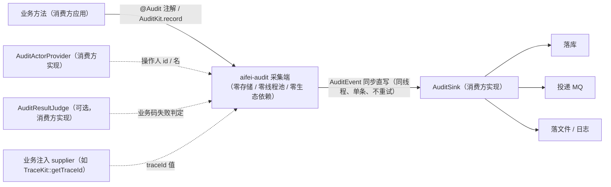
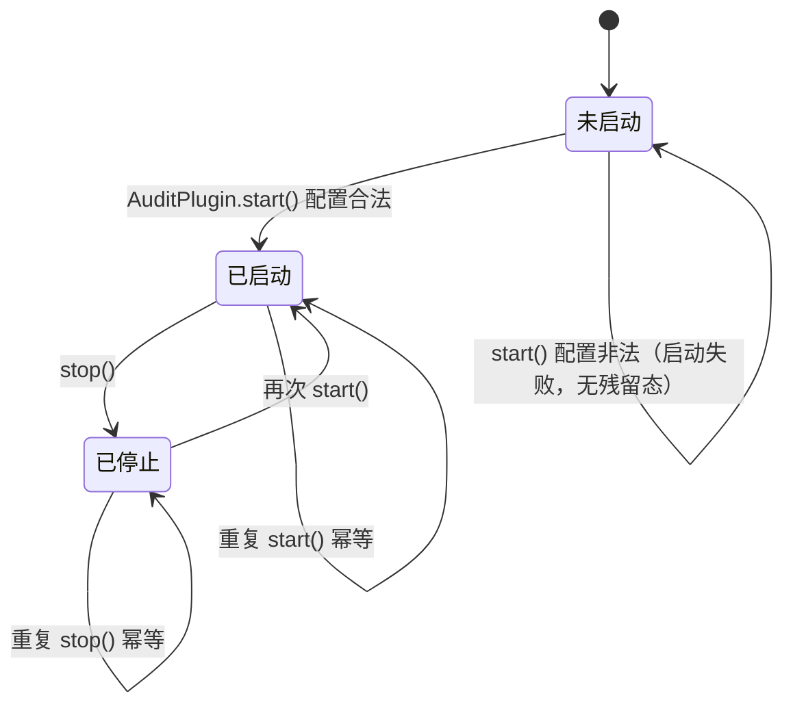

# PRD：aifei-audit（注解式操作审计 SDK）

> 版本：v1（待评审）｜需求分析师：**芬西施**｜日期：**2026-11-18**
> 依据：`docs/需求/aifei-audit.md`（唯一权威输入，含 R-01~R-09 / AC 34 条 / PV 3 条）
> 交付物性质：**库模块（可被应用依赖的 SDK）+ 示例工程 `aifei-audit-demo`**，不是业务应用工程
> 坐标与基线：`io.github.gollyhu:aifei-audit:1.0.0`；包名 `cn.hg.aifei.audit`；Java 8（class major 52）；`cn.aifei:aifei-all` 为 `provided`；零第三方 compile / runtime 依赖

**本文口径声明**：需求文档 §二 非目标、§三 五条已定档前提、§五 契约口径**原样承接、不得推翻**。公共面逐字签名（根包 4 类 / `spi` 3 类 / `aifei` 2 类）、包内分布、异常类型职责、事件不可变实现方式、配置键名一律由架构师在 `aifei-audit/docs/design.md` 定稿，**本文不代写签名**。

---

## 1. 产品目标

**一句话**：`aifei-audit` 把「谁在何时对什么做了什么、结果如何」采集为一条结构化事件，交给消费方自己实现的落点（`AuditSink`）——给 aifei 应用开发者与平台维护者用，模块自身**零存储、零线程池、零生态依赖**。

**成功标准（可判定）**：

| # | 成功标准 | 判定方式 |
| --- | --- | --- |
| 1 | 9 条 P0 需求（R-01~R-09）全部落地，34 条验收标准逐条有对应已执行用例 | `docs/testing.md` 的「AC 编号 ↔ 用例 ↔ 结果」三列映射全绿 |
| 2 | 声明式采集可用：未标注方法**零事件**、标注方法**每次调用恰 1 条**、异常场景仍出 1 条失败事件 | AC-01 / AC-02 / AC-03 |
| 3 | 采集链路不伤业务：sink / actor provider / judge 任一处异常都不改业务返回值与异常语义 | AC-11 / AC-12 / AC-16 |
| 4 | 能力边界可机械守护：零 `java.sql`、零线程创建、零生态模块引用、零日志绑定 | AC-24 / AC-25 / AC-28 门禁 |
| 5 | 模块目录内 `mvn clean verify` 0 failure / 0 error | AC-27 |
| 6 | `aifei-audit-demo` 端口 **18160** 可启动，8 个演示场景均可见且离线可跑 | AC-30 |

**事件流总览**：

实线为代码依赖方向（只从 audit 指向消费方 SPI 实现）；虚线为「由消费方注入的值」，不构成模块间代码依赖。

---

## 2. 用户角色与用户故事

### 2.1 角色清单

| 角色 | 关注点 | 与模块的关系 |
| --- | --- | --- |
| **业务开发者** | 不想在方法体里手写留痕代码，也不想漏写 | 标注解 / 调 `AuditKit.record` |
| **平台维护者** | 要能把「谁对哪个订单做了什么、成败与耗时」做成可查询的结构化流水 | 消费统一事件模型 |
| **应用集成者** | 落点要能沿用既有存储与消费链路，不被模块绑定 | 实现 `AuditSink` / `AuditActorProvider` / `AuditResultJudge` |
| **线上排障者** | 要把一次操作与同链路日志、消息串起来 | 读事件上的 `traceId` |

### 2.2 用户故事（与需求 §1.3 同源，细化为可验收粒度）

| # | 作为 | 我希望 | 以便 | 对应需求 |
| --- | --- | --- | --- | --- |
| U1 | 业务开发者 | 在业务方法上标一个 `@Audit(action, desc)` 就自动留痕 | 不用在方法体手写记录代码，也不会漏写 | R-02 |
| U2 | 业务开发者 | 未标注的方法**完全不被采集** | 不需要审计的方法没有额外开销 | R-02 |
| U3 | 业务开发者 | 业务方法抛异常时审计仍记录失败事件，且异常原样抛给我 | 失败操作也有痕迹，且我的异常处理逻辑不受影响 | R-02 / R-07 |
| U4 | 业务开发者 | 异步回调、批处理循环等注解覆盖不到的代码能手动埋点 | 与注解路径落到同一份流水，形状一致 | R-03 |
| U5 | 平台维护者 | 每条事件有统一字段（谁 / 何时 / 对什么 / 做了什么 / 结果 / 耗时 / 链路） | 能按维度建索引与过滤，而不是解析自由文本 | R-01 |
| U6 | 平台维护者 | 每次采集的事件号唯一 | 下游去重与串接不会撞号 | R-01 |
| U7 | 平台维护者 | 事件对象交给落点后不可再被改动 | 消费方无法在落点里篡改流水内容 | R-01 |
| U8 | 应用集成者 | 落点由我自己实现（落库 / 投 MQ / 落文件），模块只给 SPI | 沿用既有存储与消费链路，换落点不改业务代码 | R-04 |
| U9 | 应用集成者 | 同一时刻只有一个生效 sink，切换实现只改装配 | 迁移落点时不触碰业务代码 | R-04 |
| U10 | 应用集成者 | 操作人由我自己提供（不绑定鉴权实现） | 不用 sa-token 的应用也能审计 | R-05 |
| U11 | 应用集成者 | 没提供操作人 provider 时事件照样记录 | 接入成本可以分步走，不因可选件缺失而阻断 | R-05 |
| U12 | 合规 / 安全负责人（平台维护者侧） | 默认不记录任何入参值；开启后能按参数位剔除敏感参数，超长自动截断 | 审计流水不成为泄密渠道，也不会因超长入参而报错 | R-06 |
| U13 | 平台维护者 | 采集链路的任何故障都不影响业务 | 可观测设施不制造线上事故 | R-07 |
| U14 | 业务开发者 | 插件装配 + 配置即完成接入，配置写错在**启动时**就报错并指出键名与原值 | 不在运行期才发现审计静默失效 | R-08 |
| U15 | 线上排障者 | 事件带 `traceId`，且模块不强依赖 `aifei-trace` | 不用 trace 的应用不受影响，用 trace 的应用能串链路 | R-09 |

---

## 3. 功能需求（需求池 P0：R-01~R-09）

需求池分级沿用需求文档：**R-01 至 R-09 全部为 P0**（缺一不算交付）；P1 清单见 §5.2。编号固定，只允许在其后追加。

### 3.1 R-01 审计事件模型（P0）

**需求要义**：一条事件承载 **13 个要素**——事件号、发生时刻、动作码、业务模块、描述、操作人 id / 名、目标对象标识、脱敏后入参摘要、结果（成功 / 失败）、错误码与消息、耗时毫秒、`traceId`、客户端标识。要素语义、可空性、取值来源见需求 §5.1；事件为**值对象**，交给 sink 后调用方不可再改。事件号仅需**模块内唯一**（不承诺跨实例全局唯一，非目标 §二-11）；发生时刻取**动作开始时刻**；耗时 `≥ 0` 且不计采集自身耗时；结果承载为**枚举**（`AuditEvent.Result` 嵌套枚举，2026-11-18 已裁决，见 Q17）。

**用户故事**：作为平台维护者，我希望每条审计事件都有同一套结构化字段，以便「谁对哪个订单做了什么、成败与耗时」能作为查询维度，而不是从自由文本里捞。

| 编号 | Given | When | Then | AC |
| --- | --- | --- | --- | --- |
| G-01-1 | 一个标注 `@Audit(action="order.cancel", desc="取消订单")` 的方法、已配置 `audit.module`、容器内有 actor provider、已注入 `traceId` supplier | 调用该方法并正常返回 | sink 收到的事件 13 要素逐项成立：事件号非空；发生时刻 > 0；动作码 == `action`；业务模块 == 配置值；描述 == `desc`；操作人 id / 名 == provider 返回值；目标对象标识可空；入参摘要按参数记录开关取值；结果非空；错误码与消息为空；耗时 ≥ 0；`traceId` 可空；客户端标识可空 | AC-04 |
| G-01-2 | 一条已构造完成的事件对象 | 反射枚举其 setter 与字段并尝试置值 | 不存在 setter；全部字段为 `final`；置值尝试抛异常（构造后不可变） | AC-05 |
| G-01-3 | 一个计数 / 收集型 sink；4 个线程各采集 25 次（共 100 次，测试代码内建线程） | 全部采集完成 | 收集到的 100 个事件号去重后 `size == 100` | AC-06 |

**契约承接（无独立 AC，随实现固化）**：事件全部字段为标量，当前不存在集合字段，故不设「集合活视图」断言；若 `design.md` 后续引入集合字段，须回写需求 §5.1 与 AC-05 并补不可变断言。

### 3.2 R-02 注解式采集（P0）

**需求要义**：提供 `@Audit(action / desc / args / mask)`；被标注方法执行时产出**一条**事件；**未标注的方法不产事件**（零开销路径，不做「先采集再丢弃」）。`args` 为该方法的参数记录开关，`mask` 为被剔除的参数位。方法抛异常时**仍产出**一条失败事件，且异常**原样上抛**（不捕获、不包装、不替换类型、不改消息）。同一方法被多次调用（循环 / 重试）每次各出一条（动作码相同、事件号不同）。嵌套采集（被标注方法调用被标注方法）各出一层事件，内层先出、外层后出，不做去重、不做父子关系建模。采集构件须位于业务方法**外层**才能读到「结果 + 异常 + 耗时」。

**用户故事**：作为业务开发者，我希望在方法上标一个注解就完成留痕，且业务失败时异常语义完全不变，以便不必为审计改动业务逻辑。

| 编号 | Given | When | Then | AC |
| --- | --- | --- | --- | --- |
| G-02-1 | 同一测试类中一个**未标注**方法 + 一个**已标注**方法，已装配计数 sink | 先调未标注方法、再调标注方法 | 未标注方法 → sink 收到 **0** 条；标注方法 → **恰 1** 条（同批次断言，排除「sink 未装配导致的 0」） | AC-01 |
| G-02-2 | 标注方法返回 `"ok"`，容器内有返回固定 id / 名的 actor provider | 调用该方法 | sink 恰收 1 条；结果为成功；操作人 id / 名 == provider 返回值；耗时 ≥ 0；错误码与消息为空 | AC-02 |
| G-02-3 | 标注方法抛 `IllegalStateException("boom")` | 调用该方法 | sink 恰收 1 条、结果为失败、错误码含 `IllegalStateException`、消息含 `boom`；调用方捕获到的异常与原始抛出实例 `assertSame` | AC-03 |
| G-02-4 | 采集构件注册在链首；内层拦截器抛异常 | 调用被采集方法 | 仍产出 1 条失败事件（证明采集在外层、能捕获异常与返回值）；该顺序依赖的用例随实现固化 | AC-21 |
| G-02-5 | `@Audit` 具备 `action` / `desc` / `args` / `mask` 四属性；另有一个 `action` 为空串的标注方法，装配时提供扫描范围（包名 / 类清单） | 编译含注解的类并 `AuditPlugin.start()` | 四属性均可在运行期读取；存在空 `action` 时 `start()` 抛模块异常、**启动失败**，消息含 `类名#方法名`（全限定类名 + `#` + 方法名）；失败后无半装配状态，改用合法配置可再次启动并采集生效 | AC-29 |

**契约承接（无独立 AC）**：`PV-03` 结论为否时，G-02-5 的「启动失败」降级为「**首次采集发现 `action` 为空串即抛模块异常且不产事件**」，须回写需求 §5.2 / §5.7 / AC-29（只改校验时机，不放宽「空 `action` 不得静默成功」）。

### 3.3 R-03 手动埋点（P0）

**需求要义**：`AuditKit.record(...)` 供无法加注解的场景（异步回调、非 AOP 覆盖的代码、批处理循环）使用，**与注解共用同一事件模型与同一 sink**，字段口径一致；不要求方法上有注解；**业务异常场景由调用方自行在 catch 内埋点**（模块不替手动埋点捕获异常）。`AuditKit` 属 **Kit**（有状态门面，需先装配才能干活），不得改名为 `AuditUtil`。

**用户故事**：作为业务开发者，我希望在注解覆盖不到的位置手动埋一条，且产出的形状与注解路径完全一致，以便流水里不出现两种口径。

| 编号 | Given | When | Then | AC |
| --- | --- | --- | --- | --- |
| G-03-1 | 已启动插件、已装配计数 sink；调用点所在方法**无** `@Audit` | 调 `AuditKit.record(...)` 并赋动作码 / 描述 / 结果 | 产生 1 条事件，与注解路径落到**同一个 sink**、同一 `AuditEvent` 类型、动作码 / 描述 / 结果可赋同值（字段口径一致） | AC-07 |
| G-03-2 | 插件**已 stop()** | 调 `AuditKit.record(...)` | 抛模块异常，消息含「插件未启动或已停止」；同状态下注解路径不产事件、业务返回值不变 | AC-18b |
| G-03-3 | 插件**从未 start()**（或 `start()` 因配置非法失败） | 调 `AuditKit.record(...)` | 抛模块异常，消息含「插件未启动或已停止」；同状态下注解路径不产事件、业务返回值不变 | AC-09b |

### 3.4 R-04 落点交付 `AuditSink`（P0）

**需求要义**：事件经 `AuditSink` SPI 交给消费方；**同一时刻只有一个生效 sink**，切换实现不改业务代码。sink 在**业务方法所在线程同步调用**，无线程池、无内部队列、无异步派发；调用时机在业务已产生结果（正常返回或抛出）之后；sink 返回值**不被业务使用**（通知型 SPI）；**单条交付**，不攒批、不重试、不入死信。**慢 sink 即慢业务**——已定档取舍，README 必须显式警告。

**插件三态**（需求 §5.4.1，实现者不得把「未启动 / 已停止」与「已启动但无 sink」混为一谈）：

| 状态 | 注解路径 | 手动埋点 `AuditKit.record` | 模块日志 |
| --- | --- | --- | --- |
| ① 未启动 / `start()` 失败 | 不采集、不抛异常、返回值不变 | **抛模块异常**（消息含「插件未启动或已停止」） | 注解路径不记；手动埋点由异常本身告知 |
| ② 已启动、容器内无 `AuditSink` | 不构造事件、直接返回、返回值不变 | 同左，不抛异常 | `start()` 阶段**恰记一条**启动告警，运行期不重复记 |
| ③ 已停止 | 不再产事件、返回值不变 | **抛模块异常**（消息含「插件未启动或已停止」） | 同 ① |

**用户故事**：作为应用集成者，我希望落点由我自己实现且只改装配就能换，以便审计沿用既有存储与消费链路，不被模块绑定。

| 编号 | Given | When | Then | AC |
| --- | --- | --- | --- | --- |
| G-04-1 | 两个计数 sink A / B，先装配 A | 跑 N 次被采集调用；改为装配 B 后同样跑 N 次（业务代码零改动） | 第一次：A 计数 == N、B 计数 == 0；第二次：事件全进 B，业务代码未改 | AC-08 |
| G-04-2 | 插件已启动、容器内**无** `AuditSink` 实现 | 调用被标注方法与 `AuditKit.record(...)` | 不构造事件、业务方法返回原值、无异常外泄；`start()` 阶段有且仅有一条启动告警；运行期不重复记日志 | AC-09 |
| G-04-3 | 插件未启动（未 `start()` 或 `start()` 因配置非法失败） | 调用被标注方法与 `AuditKit.record(...)` | 注解路径不产事件、返回值不变；`record` 抛模块异常且消息含「插件未启动或已停止」 | AC-09b |

### 3.5 R-05 操作人 SPI（P0）

**需求要义**：`AuditActorProvider` 提供操作人 id / 名；provider **缺失时事件仍记录、不阻断**，操作人字段为空。模块**不依赖 `aifei-sa-token`**，provider 接口不得出现 sa-token 类型（demo 演示从 sa-token 取当前登录身份）。provider 实现须可被多线程并发调用（模块不为其加锁）。

**用户故事**：作为应用集成者，我希望操作人由我自己提供、缺失也能照常审计，以便审计能力不与鉴权方案绑死。

| 编号 | Given | When | Then | AC |
| --- | --- | --- | --- | --- |
| G-05-1 | 容器内**无** `AuditActorProvider` | 调用被标注方法并正常返回 | 事件仍产生 1 条、操作人 id / 名为空、业务返回值不变 | AC-10 |
| G-05-2 | 容器内 provider 每次调用都抛 `RuntimeException` | 调用被标注方法 | 事件仍产生 1 条、操作人字段为空、业务返回值不变、模块日志一条告警 | AC-11 |

### 3.6 R-06 脱敏与截断（P0）

**需求要义**：**默认不记录入参**（`args=false`）；开启后按 `mask` 剔除指定**参数位（下标，0-based）**，其余参数可见；入参摘要设长度上限，超限**截断而非抛错**；脱敏与截断是**唯一定义点**，注解采集与手动埋点共用。`mask` 不做按名匹配（Java 8 编译期参数名不可靠）。不做嵌套对象遍历、集合元素级剔除、正则规则库、字段注解（非目标 §二-9）。默认不记录时**事件上不出现参数原文**（不得「先拼好再清空」留下残留）。

**用户故事**：作为合规 / 安全负责人（平台维护者侧），我希望默认零入参、按位可剔除、超长自动截断，以便审计流水不成为泄密渠道，也不会因超长入参中断业务。

| 编号 | Given | When | Then | AC |
| --- | --- | --- | --- | --- |
| G-06-1 | 默认配置（`args=false`、上限 512）；业务方法参数含哨兵串 `SECRET-XYZ`；事件类**覆写了 `toString()`** | 调用被标注方法 | 事件入参摘要为空；`toString()` 输出**不含** `SECRET-XYZ`，且含要素标识（如动作码 / 事件号） | AC-13 |
| G-06-2 | 开启参数记录；`mask={1}`（剔除索引 1 即第二个参数）；两个参数各含不同哨兵串 | 调用被标注方法 | 摘要**不含**第二个参数原文、**仍含**第一个参数原文（两个哨兵串分别断言） | AC-14 |
| G-06-3 | 单个参数 10000 字符、上限 512 | 调用被标注方法 | 摘要长度 ≤ 512、方法正常返回、事件仍产出 1 条、无异常 | AC-15 |
| G-06-4 | 同一模块内注解路径与手动埋点路径均需脱敏截断 | 静态检查源码 | 脱敏与截断逻辑只在一处实现（`internal` 单一实现文件），两条路径都走它，无复制实现 | AC-28 |

### 3.7 R-07 失败隔离（P0）

**需求要义**：`sink` / `actorProvider` / `resultJudge` 任一处抛异常**一律吞掉**并记模块日志，业务方法的返回值与异常语义不变。`fail-fast=true` 时例外：业务**正常返回**时上抛 sink 异常（覆盖原返回值）；业务**本就抛异常**时**业务原异常优先**、sink 异常吞掉记一条日志。actor provider / judge 的异常**不受 `fail-fast` 影响**（附属信息恒不阻断业务）；模块内部缺陷（事件构造 / 脱敏截断）同样吞掉不外抛。**一次失败只记一条模块日志**（避免刷屏）；日志走 `cn.aifei.log.Log`（惰性获取、晚于 `LogFactory` 装配），不引日志绑定、不用 `System.err`。

**用户故事**：作为平台维护者，我希望审计链路的任何故障都被就地隔离，以便可观测设施不会制造线上事故。

| 编号 | Given | When | Then | AC |
| --- | --- | --- | --- | --- |
| G-07-1 | sink 每次调用抛 `RuntimeException`；`fail-fast=false` | 调用被标注方法并正常返回 | 业务返回值与无 sink 时**完全相同**、无异常外泄、模块日志**恰一条**告警（不重复记录） | AC-16 |
| G-07-2 | `fail-fast=true`、业务方法正常返回、sink 抛 `RuntimeException` | 调用被标注方法 | 调用方收到该 sink 异常；且事件已构造完成并已交付 sink（先交付、后上抛的顺序可断言） | AC-17a |
| G-07-3 | `fail-fast=true`、业务方法抛业务异常、sink 同时抛异常 | 调用被标注方法 | 调用方 `assertSame` 收到**业务原异常**；sink 异常被吞掉并记一条模块日志 | AC-17b |
| G-07-4 | judge 抛 `RuntimeException` | 调用被标注方法 | 事件仍产生；结果按「异常 = 失败、正常返回 = 成功」兜底；业务返回值不变；模块日志一条告警 | AC-12 |

### 3.8 R-08 装配与配置（P0）

**需求要义**：`AuditPlugin` 完成装配（与 `MqPlugin` / `JobPlugin` / `HttpPlugin` 同构：构造期只持配置源引用，解析与校验全部在 `start()`），配置前缀 `audit.*`；配置非法**启动即失败**（消息含**键名与原值**）；**半装配禁止**（启动失败须清除已写入静态引用 / 已注册对象 / 已登记注解索引，再次以合法配置可正常启动）；重复 `start()` / `stop()` **幂等**。采集构件的注册（AOP 拦截器 / 路由链）由消费方在自身 `AppConfig` 内完成；SPI 实现从容器按类型取。

**用户故事**：作为业务开发者，我希望装配 + 配置两步行完成接入，且配置写错在启动时就报错并指出键名与原值，以便不在运行期才发现审计静默失效。

| 编号 | Given | When | Then | AC |
| --- | --- | --- | --- | --- |
| G-08-1 | 合法配置、已装配 sink | `start()` → 采集 → `stop()` → 再采集；并各重复 `start()` / `stop()` 一次 | `start()` 后注解路径采集生效；`stop()` 后注解路径不再产事件且业务方法不受影响；重复 `start()` / `stop()` 均无异常、状态不叠加 | AC-18 |
| G-08-2 | `stop()` 之后 | 调 `AuditKit.record(...)`，并同时调用被标注方法 | `record` 抛模块异常（消息含「插件未启动或已停止」）；注解路径同步不产事件、业务返回值不变 | AC-18b |
| G-08-3 | 摘要上限传 `-1`（或 `fail-fast` 传非法值） | 调 `AuditPlugin.start()`；随后改用合法配置再 `start()` | 首次 `start()` 抛模块异常、消息含**键名与原值**；失败后无残留态，合法配置可正常启动并采集生效 | AC-19 |
| G-08-4 | 装配时提供扫描范围（包名 / 类清单），范围内存在 `action` 为空串的 `@Audit` 方法 | `AuditPlugin.start()` | 抛模块异常、**启动失败**，消息含 `类名#方法名`；静态引用 / 已注册对象 / 注解索引已清除；改用合法配置再 `start()` 可正常采集 | AC-29 |

**运行模式与生命周期**：`AuditPlugin` 的 `start()` 负责配置解析与校验、SPI 解析（容器按类型取）、注解索引建立与静态引用写入；`stop()` 清除引用并停止采集。三态行为见 §3.4 表。

### 3.9 R-09 与 `aifei-trace` 协同（P0）

**需求要义**：事件带 `traceId`；建议由业务注入 supplier（如 `TraceKit::getTraceId`），**模块零 `aifei-trace` 依赖**；未注入时字段为空且不抛异常。模块**不 import** `TraceContext`；**模块单测同样不得 import** `cn.hg.aifei.trace.*`（G-06 / AC-25）——单测注入返回固定字符串的 lambda，`TraceKit::getTraceId` 只出现在 `aifei-audit-demo` 的集成验证。

**用户故事**：作为线上排障者，我希望事件带 `traceId`，以便把一次操作与同链路的日志、消息串起来定位。

| 编号 | Given | When | Then | AC |
| --- | --- | --- | --- | --- |
| G-09-1 | 注入返回固定串 `trace-fixed-001` 的 supplier lambda | 调用被标注方法 | 事件 `traceId` 与该字符串逐字符相等 | AC-20 |
| G-09-2 | 未注入 supplier | 调用被标注方法 | 事件 `traceId` 为空且不抛异常 | AC-20 |
| G-09-3 | 模块源码与单测源码 | 静态扫描 | `src/main/java` 与 `src/test/java` 均无 `cn.hg.aifei.trace.*` 引用；`TraceKit::getTraceId` 只出现在 demo | AC-25 / AC-20 |

### 3.10 非功能与门禁类验收标准（跨需求）

以下 AC 不对应单个功能需求，而是对上述 R-01~R-09 的**共同硬约束**，由门禁或命令承载：

| AC | 需求/来源 | 一句话判定条件 | 承载通道 | 主要约束的需求 |
| --- | --- | --- | --- | --- |
| AC-22 | G-01 / §5.9 | 根包顶层 public 类型集合**恰好等于** `design.md` 定稿名单（`Result` 为嵌套枚举不计入） | 门禁 `G-01` + 反射 | R-01 |
| AC-23 | G-02 / G-03 | `spi` 包顶层 public 类型恰 3 个；`aifei` 包存在 `AuditPlugin` / `AuditInterceptor`；`cn.aifei.*` 仅限该包与白名单 `internal` 日志点 | 门禁 | R-04 / R-05 / R-08 |
| AC-24 | 零存储 / `G-04` / `G-07` | `src/main/java` 无 `java.sql.`、无线程与线程池创建字面量；`dependency:tree` 无 `aifei-db` | 门禁 + `dependency:tree` | R-04 |
| AC-25 | 零生态依赖 / `G-05` / `G-06` | `main` + `test` 无 `cn.aifei.vip.` 与其它生态模块包引用；除 `aifei-all`(provided) 无任何第三方 compile/runtime 依赖；test scope 无日志绑定 | 门禁 + `dependency:tree` | R-05 / R-09 |
| AC-26 | Java 8 | 主 JAR 内全部 class major == 52；源码无 `var` / `record` / `switch` 表达式 / text block / `List.of(` / `Map.of(` | `javap` + 门禁正则 | 全部 |
| AC-27 | 构建 | 模块目录内 `mvn clean verify` 0 failure / 0 error | 构建 | 全部 |
| AC-28 | 唯一定义点 / `G-08` / `G-09` / `G-11` | 脱敏截断与失败隔离各只在 `src/main/java` 一个实现文件出现；无日志绑定与 `System.out` / `System.err` / `printStackTrace` | 门禁 | R-06 / R-07 |
| AC-31 | §5.9 命名纪律 | 门禁断言存在 `AuditKit` 类型且全模块不存在 `AuditUtil` 类型名 | 门禁 `G-12` | R-03 |

---

## 4. 配置能力诉求表

键名与默认值由 `design.md` 定稿；本表只约束**必须可配**的能力与建议默认（承接需求 §四）。

| # | 能力 | 建议默认 | 约束 |
| --- | --- | --- | --- |
| 1 | 采集总开关 | 开（`true`） | 关闭时不产事件，业务不受影响 |
| 2 | `fail-fast` | `false` | sink 异常是否上抛（§3.7）；actor provider / judge 不受其影响 |
| 3 | 参数记录默认开关 | `false`（不记录入参） | 注解 `args` 可逐方法覆盖 |
| 4 | 参数摘要长度上限 | `512` 字符 | ≥ 0（`0` = 只留占位）；超限截断不抛错；负数启动失败 |
| 5 | 是否采集客户端标识 | `false` | 开启后由可选 supplier 取值，模块不自行读 HTTP 上下文 |
| 6 | sink 实现来源 | 从容器按类型取（单一实现） | 缺失时见 Q7（已启动无 sink：不采集 + 启动告警）；同一类型多实现按 Q14 视为配置错误并启动失败 |
| 7 | 操作人 provider 来源 | 从容器按类型取（可选） | 缺失即无操作人，**不启动失败** |
| 8 | 结果判定 judge 来源 | 从容器按类型取（可选） | 缺失即「异常 = 失败、正常返回 = 成功」 |
| 9 | 业务模块标识（事件要素） | 空 | 供多应用共用一个审计流水时区分来源 |

**配置校验口径**：长度上限 < 0、开关取值非布尔、`fail-fast` 取值非布尔等 → **启动即失败**，抛模块异常，消息含**键名与原值**（AC-19）。`audit.*` 前缀下的具体键名与默认值以 `design.md` 为准。

---

## 5. 非目标 / 本期不做

### 5.1 非目标（能力边界，已定档，不得推翻）

| # | 边界 | 后果（README 与 `design.md` 必须声明） | 模块责任 |
| --- | --- | --- | --- |
| 1 | 审计存储与建表 | 模块不建表、不写库、不提供任何 DAO；落库由消费方 `AuditSink` 实现 | 零 `java.sql`、零 `aifei-db` 依赖 |
| 2 | 查询与展示 | 无查询 API、无管理页、无统计聚合；demo 展示页属示例工程 | 不提供任何读接口 |
| 3 | 归档与合规报表 | 留存周期、分级留存、导出报表、合规口径全部由消费方负责 | 模块只保证事件字段够用 |
| 4 | 采样 | 不做采样率、不做按动作 / 按用户抽样；每条被采集操作都产一条事件 | 不提供采样开关 |
| 5 | 异步队列与背压 | 无内部队列、无线程池、无背压；**落点慢就等于业务慢** | 零线程创建（门禁 G-07 断言） |
| 6 | 批量落库 | 不攒批、不设 flush 周期、不批量写入 | 单条事件交付 |
| 7 | 重试 | sink 失败不重试、不入死信、不补偿 | 失败即记模块日志后丢弃 |
| 8 | 与 sa-token / mq / trace 的硬依赖 | 模块不 import 任何生态模块；操作人、链路、投递分别经 SPI / supplier / sink 由消费方提供 | 单向不依赖 |
| 9 | 入参深度脱敏规则引擎 | 不做字段注解递归、不做正则规则库、不做嵌套对象遍历；只做「默认不记录 + 显式开启 + 按参数位剔除 + 长度截断」 | 脱敏规则停在参数位粒度 |
| 10 | 注解取值表达式 | 注解属性只接受字面量，不做 SpEL / OGNL，不从入参取字段拼描述 | 注解属性为常量 |
| 11 | 多实例协调 | 不做选主、不做全局序号分配、不做幂等去重；多实例各采各的 | 事件号仅需模块内唯一 |
| 12 | 审计链路完整性对账 | 不做「应记录条数 vs 实际条数」对账，不检测漏采（PV 前置验证项除外） | 采集失败只留日志 |

### 5.2 P1 清单（本次不做，防范围蔓延）

异步 / 批量投递、sink 重试与死信、采样、SPI 多实现分发与排序、注解取值表达式、入参的嵌套结构与集合元素级脱敏、字段注解式脱敏（`@Mask` 之类）、审计查询 API 与统计、多实例事件号全局唯一、与 `aifei-metrics` 的指标联动、审计事件的内置序列化格式（JSON 结构由消费方自定）。

### 5.3 P2

无。本期全部延后项已由 §5.2 P1 清单覆盖，不另设 P2 条目。

---

## 6. 交付物性质与不适用章节说明

**本次交付物是库模块（可被应用依赖的 SDK），不是业务应用工程。** 三份 PRD 常规章节在本模块 **不适用**：

| 章节 | 结论 | 理由 | 替代物 |
| --- | --- | --- | --- |
| 表结构草案 | **不适用** | 本模块**零存储**：无表、无 DDL、无 `Db+Row`、无 `Generator`、运行期不连任何数据源。审计落库是**消费方**在其 `AuditSink` 实现里的事；门禁反向断言 `src/main/java` 禁止 `import java.sql.`。**不得为凑齐模板而编造表。** | AC-24 / AC-25 门禁 + 事件要素表（需求 §5.1） |
| Service 方法清单 | **不适用** | 模块本体无 `@Path` / Service（那是应用工程的事）。根包 / `spi` / 接入包公共面**类型清单为预估**，须过设计决策、由架构师在 `design.md` 定稿；本文**不代写公共面签名** | 能力分区（需求 §5.9 预估表）+ 功能需求 §3 |
| 低保真 UI 原型 | **不适用** | 本模块跳过 PM 原型与 QA 基线门禁；`aifei-audit-demo` 演示页面由前端直接实装，不经原型评审 | §7 demo 场景清单（只写场景与必须可见的演示点） |

**与 `aifei-http/AGENTS.md`「不适用范围」同口径**：不得据此模块要求表结构 / `Db+Row` / `Generator` / `@Path` Service / HIO / 入站 HTTP 路由 / 页面与原型基线——本模块只有 JAR（公共面 + `internal` + `aifei` 接入包）与一个独立示例工程。取用方式为 `@Inject` + `AuditKit` 门面 + 消费方自行注册拦截器，**无 `AppConfig` / `Launcher` / `service/` / `webapp/`**。

**能力分区（命名口径，非签名清单）**：

| 包 | 预估类型 | 性质 |
| --- | --- | --- |
| 根包 `cn.hg.aifei.audit`（约 4 类） | `Audit`（注解）/ `AuditEvent` / `AuditKit` / `AuditException` | 公共承诺 API |
| `cn.hg.aifei.audit.spi`（约 3 类） | `AuditSink` / `AuditActorProvider` / `AuditResultJudge` | 公共承诺 API（消费方实现） |
| `cn.hg.aifei.audit.aifei`（2 类） | `AuditInterceptor` / `AuditPlugin` | 接入构件，**非承诺 API** |

命名纪律：`AuditKit` 属 Kit，不得改名 `AuditUtil`（AC-31）；`Result` 为 `AuditEvent` 嵌套 public 枚举，不计入根包顶层类型（AC-22）。

---

## 7. `aifei-audit-demo` 场景清单

形态：平级工程、自写 HIO、`start-demo.bat` / `stop-demo.bat`、**端口 18160**（18100 mq / 18110 job / 18120 http / 18130 trace / 18140 id / 18150 excel 已占）、**离线可跑、零外网**、单页、不经原型基线门禁。前端由开发工程师实装，本文只约束场景与**必须可见的演示点**。

**工程形态（对齐 `aifei-http-demo`）**：

| 项 | 约束 | 参照 |
| --- | --- | --- |
| 工程形态 | 平级目录 `aifei-audit-demo/`，独立 `pom.xml`；依赖 `io.github.gollyhu:aifei-audit:1.0.0` + `cn.aifei:aifei-all:1.1.2` | `aifei-http-demo/pom.xml` |
| 启动入口 | `DemoApp` → `Aifei.start(DemoAppConfig)`；`start-demo.bat` 编译后按 `-Dundertow.port=18160` 启动，`stop-demo.bat` 按 18160 找监听进程结束 | `aifei-http-demo/start-demo.bat` |
| HTTP 层 | **自写 HIO**：同步官方 `aifei-demo/src/main/java/cn/aifei/demo/common/arch/**`，保留 `cn.aifei.demo.common.arch` 包名并逐字照抄，不得本地化改写 | 仓库根 `AGENTS.md`「官方源码同步」 |
| 页面 | 单页静态层，本地全局 Vue + 原生 JS，**零 CDN、零构建工具**；断网可用 | `aifei-http-demo` 的 `view` + `assets` |
| 端点语义 | 全部 GET，HTTP 恒 200，语义由业务 `code` 承载（预期失败不算接口失败） | `aifei-http-demo` 端点全表 |

**场景组织方式（每个场景一块面板，对齐 `aifei-http-demo` 的对照式演示）**：

| 组织约束 | 说明 |
| --- | --- |
| 端点驱动、无假开关 | 每个控件都发真实请求；页面不内置假数据、不模拟结果 |
| 成对对照、同屏并排 | 场景 1（标注 / 未标注）、场景 3（脱敏前 / 后）、场景 8（成功态 / 隔离态）必须**同屏给出两组结果**，单跑一次看不出差异 |
| 判定依据可见 | 每块面板展示「凭什么这样判断」（如 sink 计数、事件条数、返回值是否相同），不只有结论文案 |
| 状态齐全 | 每块面板有空态 / 载入态 / 错误态；预期失败（场景 5 业务异常、场景 8 sink 异常）整体仍 `code=0`，异常细节放独立字段供页面渲染错误面板 |
| 可重置 | 提供「清空展示用事件记录 / 重置 sink 计数」入口，多次演示互不干扰 |
| 不代行模块能力 | 展示页读的是 demo 自身收集的 sink 记录与 demo 自身快照，**不要求模块新增任何查询 API**（非目标 §5.1-2） |

| # | 场景 | 必须可见的演示点 |
| --- | --- | --- |
| 1 | 注解采集 | 点「被标注的业务动作」→ 事件列表新增 1 条，展示 13 个要素；旁边放一个**未标注**动作，点击后列表不新增（对照可见） |
| 2 | 手动埋点 | 一个不经注解的动作（如循环批处理）经 `AuditKit.record(...)` 产出事件，字段形状与场景 1 一致 |
| 3 | 脱敏前后对照 | 同一动作两种配置（`args=false` / `args=true` + `mask`）分别触发，事件卡片并列展示「摘要为空」与「部分参数被剔除、其余可见」 |
| 4 | sink 切换 | 下拉切换落点：内存 sink / 控制台 sink / 经 `aifei-mq`（memory 后端）投递的 sink；切换后同一动作的演示结果落点不同、业务代码不变；可展示 sink 侧计数 |
| 5 | 业务异常失败事件 | 触发一个必抛异常的动作 → 事件结果为失败、展示错误码与消息；页面同时展示「业务异常原样抛给调用方」的证据（异常面板） |
| 6 | `traceId` 关联 | 经 `aifei-trace` 展示当前请求 `traceId`，事件卡片展示同一值（证明 supplier 注入生效） |
| 7 | 空态 | 首次进入、未触发动作时事件列表显示占位文案，不残留上一次数据 |
| 8 | 错误态 | 演示「sink 抛异常」开关：业务返回值不变、页面提示「已按失败隔离吞掉、记一条模块日志」；与成功态视觉可区分 |

**demo 约束**：

| 项 | 约束 |
| --- | --- |
| 依赖 | demo 自带内存 sink 与伪 sink **不引入任何第三方依赖**；经 mq 投递的 sink 只演示「消费方自己怎么写」，模块 pom 不因此新增依赖（demo 直接依赖 `aifei-mq` / `aifei-trace` / `aifei-sa-token` 属示例工程行为，Q16） |
| 离线 | 源码与静态资源中出现的 URL host 只能是 `127.0.0.1` / `localhost`（门禁 G-13） |
| 语义不撒谎 | 展示的是**消费方落点**与**示例工程页面**，不是模块内置的查询 / 展示能力（非目标 §5.1-2） |

---

## 8. 验收标准索引（34 条全覆盖）

| AC 编号 | 需求编号 | 一句话判定条件 | 承载通道 |
| --- | --- | --- | --- |
| AC-01 | R-02 | 未标注方法 0 条事件；同批次标注方法恰 1 条 | 单测 |
| AC-02 | R-02 | 正常返回 → 1 条成功事件，操作人取 provider 值，耗时 ≥ 0，错误码 / 消息为空 | 单测 |
| AC-03 | R-02 | 抛异常 → 1 条失败事件（错误码含异常类型名、消息含原文），调用方 `assertSame` 收到原异常 | 单测 |
| AC-04 | R-01 | 13 要素逐项可断言（事件号非空 / 时刻 > 0 / 动作码 = 注解值 / 模块 = 配置值 / 描述 = desc / 目标可空 / 耗时 ≥ 0 / 结果非空 / traceId 可空） | 单测 |
| AC-05 | R-01 | 无 setter、字段全 `final`、反射置值抛异常；当前无集合字段 | 单测 + 反射 |
| AC-06 | R-01 | 100 次采集（4 线程 × 25）事件号去重后 `size == 100` | 单测 |
| AC-07 | R-03 | `record` 产 1 条，与注解路径同一 sink、同一事件类型、字段口径一致 | 单测 |
| AC-08 | R-04 | sink A 计数 = N 且 B = 0；换 B 后业务零改动、事件全进 B | 单测 |
| AC-09 | R-04 | 已启动无 sink：不构造事件、返回原值、无异常；`start()` 恰一条告警，运行期不重复记 | 单测 |
| AC-09b | R-04 / R-08 | 未启动时 `record` 抛模块异常（含「插件未启动或已停止」）；注解路径不产事件、返回值不变 | 单测 |
| AC-10 | R-05 | 无 provider → 仍产 1 条、操作人为空、返回值不变 | 单测 |
| AC-11 | R-07 | provider 抛异常 → 1 条事件、操作人为空、返回值不变、日志一条告警 | 单测 |
| AC-12 | R-07 | judge 抛异常 → 事件仍产出、结果按默认口径兜底、返回值不变、日志一条告警 | 单测 |
| AC-13 | R-06 | 默认配置下含 `SECRET-XYZ` 入参 → 摘要为空；`toString()` 不含该串且含要素标识 | 单测 |
| AC-14 | R-06 | 开启参数记录 + `mask={1}` → 摘要不含第二参原文、仍含第一参原文 | 单测 |
| AC-15 | R-06 | 单参 10000 字符 + 上限 512 → 摘要 ≤ 512、正常返回、1 条事件、无异常 | 单测 |
| AC-16 | R-07 | sink 抛异常且 `fail-fast=false` → 返回值与无 sink 时相同、无外泄、日志**恰一条** | 单测 |
| AC-17a | R-07 | `fail-fast=true` + 业务正常返回 + sink 抛异常 → 调用方收到 sink 异常，且事件已先交付 sink | 单测 |
| AC-17b | R-07 | `fail-fast=true` + 业务抛异常 + sink 抛异常 → 调用方 `assertSame` 收到业务原异常，sink 异常吞掉记一条 | 单测 |
| AC-18 | R-08 | `start()` 后采集生效；`stop()` 后不产事件且业务不受影响；重复 start / stop 无异常 | 集成测试 |
| AC-18b | R-08 / R-03 | `stop()` 后 `record` 抛模块异常；注解路径同步不产事件、返回值不变 | 单测 |
| AC-19 | R-08 | 上限 -1 / `fail-fast` 非法 → `start()` 抛模块异常含键名与原值；无残留态，合法配置可再启动 | 单测 |
| AC-20 | R-09 | 注入固定串 supplier → `traceId` 逐字符相等；未注入为空且不抛异常；`TraceKit` 只出现在 demo | 单测 + demo |
| AC-21 | §5.2（R-02 契约） | 内层拦截器抛异常时仍产 1 条失败事件（证明审计在外层） | 单测 |
| AC-22 | G-01 / §5.9 | 根包顶层 public 类型集合恰等于 `design.md` 名单（`Result` 嵌套枚举不计入） | 门禁 + 反射 |
| AC-23 | G-02 / G-03 | `spi` 恰 3 类型；`aifei` 包存在 Plugin / Interceptor；`cn.aifei.*` 仅限该包与白名单 | 门禁 |
| AC-24 | 零存储 / G-04 / G-07 | `main` 无 `java.sql.`、无线程创建；`dependency:tree` 无 `aifei-db` | 门禁 + tree |
| AC-25 | 零生态依赖 / G-05 / G-06 | `main` + `test` 无 `cn.aifei.vip.` 与其它生态包；除 `aifei-all`(provided) 无第三方 compile/runtime；test 无日志绑定 | 门禁 + tree |
| AC-26 | Java 8 | 主 JAR class major 全 52；无 `var` / `record` / `switch` 表达式 / text block / `List.of` / `Map.of` | `javap` + 正则 |
| AC-27 | 构建 | 模块目录内 `mvn clean verify` 0 failure / 0 error | 构建 |
| AC-28 | 唯一定义点 / G-08 / G-09 / G-11 | 脱敏截断与失败隔离各只在 `main` 一个实现文件；无日志绑定与 `System.out` / `err` / `printStackTrace` | 门禁 |
| AC-29 | R-02 注解属性 / §5.2 / §5.7 | `@Audit` 四属性运行期可读；空 `action` → `start()` 启动失败含 `类名#方法名`，无半装配 | 单测 + 编译用例 |
| AC-30 | demo | 端口 18160 可启动、8 场景可见、页面与源码零外网 host | 实测 + 门禁 G-13 |
| AC-31 | §5.9 命名纪律 | 存在 `AuditKit` 且全模块无 `AuditUtil` | 门禁 G-12 |

**覆盖结论**：需求文档第七节 34 条 AC **全部纳入本文索引，无缺口、无新增编号**。门禁承载 7 条（AC-22 / AC-23 / AC-24 / AC-25 / AC-26 / AC-28 / AC-31），`AC-09b` / `AC-17a` / `AC-17b` / `AC-18b` 由单测承载（不进门禁清单），其余由单测 / 集成用例承载。用例清单在测试阶段写入 `docs/testing.md`，按「AC 编号 ↔ 用例 ↔ 结果」三列映射。

**逐条核对清单（34 条，按编号顺序，逐项须在上表索引命中）**：

AC-01 · AC-02 · AC-03 · AC-04 · AC-05 · AC-06 · AC-07 · AC-08 · AC-09 · AC-09b · AC-10 · AC-11 · AC-12 · AC-13 · AC-14 · AC-15 · AC-16 · AC-17a · AC-17b · AC-18 · AC-18b · AC-19 · AC-20 · AC-21 · AC-22 · AC-23 · AC-24 · AC-25 · AC-26 · AC-27 · AC-28 · AC-29 · AC-30 · AC-31

共 **34** 条，与需求文档 §七逐条一致（`AC-17` 拆为 `17a` / `17b`，另含 `AC-09b` / `AC-18b`）。**核对结论：逐条命中上表，缺项 0、多项 0。**

---

## 9. 假设与待确认问题

### 9.1 已定档前提（不得推翻，承接需求 §三）

| # | 前提 | 需求含义 |
| --- | --- | --- |
| 1 | 落点职责：只产事件 + `AuditSink` SPI | 零 `java.sql`、零生态依赖；落 DB / MQ / 日志 / 内存全由消费方实现；连「topic 名」这类字段也不进公共面 |
| 2 | 操作人：`AuditActorProvider` SPI | 不依赖 `aifei-sa-token`；未提供 provider 时事件仍记录、操作人字段为空 |
| 3 | 成败判定：异常即失败 | `Out.fail(...)` 一类由**可选** `AuditResultJudge` 判定；**模块不得 `import cn.aifei.vip.Out`** |
| 4 | 交付语义：同步直写、零线程池 | 同线程直写 sink；sink 异常默认吞掉并记日志（`fail-fast=false`） |
| 5 | 参数记录：默认不记录入参 | `args=false`；开启后按 `mask` 剔除指定参数位；摘要设上限，超限截断不抛错 |

### 9.2 待确认问题状态表（Q1~Q17：16 条待确认 + 1 条已裁决）

**状态图例（三种状态不得混写）**：

| 状态 | 含义 | 涉及条目 |
| --- | --- | --- |
| **待确认** | 已有默认假设，用户未否决即按默认执行；一旦被否决须回写需求文档对应小节与 AC | Q3~Q16（共 14 条） |
| **待实证** | 待确认假设中的特殊子集：**不得直接按默认实现**，须先完成对应 PV 并给出结论；结论为否即改口径 | Q1（`PV-01`）、Q2（`PV-02`）（共 2 条） |
| **已裁决** | 2026-11-18 用户裁决，结论固定、不再讨论；如需变更须回写 G-01 名单 / §5.9 / AC-22 三处 | Q17（共 1 条） |

| # | 问题 | 状态 | 默认假设 / 已裁决结论 | 若被否决的影响 |
| --- | --- | --- | --- | --- |
| Q1 | `Invocation` 能否读到方法入参（`getArgs()` / `getArg(int)`）？ | **待实证**（`PV-01`） | 列为待实证假设，不是定档事实；实现前先做最小用例 | `R-02` 的 `args` 降级为「注解只标采集意图、入参摘要仅由手动埋点携带」，回写需求 §四 / §5.3 / §七 |
| Q2 | 采集构件的注册位置与顺序如何保证「审计在外层」？ | **待实证**（`PV-02`） | 注册在最前 = 最外层；结论写入 `design.md`，README 声明「审计拦截器必须首个注册」 | 注册位置与顺序须重新定档，`AC-21` 用例形态调整 |
| Q3 | 模块是否只产事件 + SPI，落 DB / MQ 全交消费方？ | 待确认（默认按 §三-1） | **按 §三-1 执行** | 需内置落点实现与相应依赖，AC-24 / AC-25 重写，工期不再适用 1.5 周 |
| Q4 | 操作人是否只经 SPI、模块不依赖 sa-token？ | 待确认（默认按 §三-2） | **按 §三-2 执行** | 公共面出现 sa-token 类型，须登记新的公共面框架类型例外 |
| Q5 | 成败判定是否「异常 = 失败」+ 可选 judge，不 import `cn.aifei.vip.Out`？ | 待确认（默认按 §三-3） | **按 §三-3 执行** | AC-03 / AC-12 语义改变，且需新增 `cn.aifei.vip.*` 门禁例外登记 |
| Q6 | 交付是否同步直写、零线程池？sink 异常默认吞掉？ | 待确认（默认按 §三-4） | **按 §三-4 执行** | 需引入内部队列与停机收敛语义，AC-16 / AC-17a / AC-17b 重写 |
| Q7 | 已启动、容器内无 `AuditSink` 时的行为？ | 待确认 | **不采集**：不构造事件直接返回；`start()` 记一条启动告警；手动埋点与注解路径一致均不抛异常 | 备选为「构造后丢弃并每次记日志」（易刷屏，不推荐）；AC-09 需重写 |
| Q8 | 事件号生成方式？ | 待确认 | 模块内生成、零依赖：`UUID` 去横线（32 位十六进制）；不加时间戳前缀、不依赖 `aifei-id`、不承诺跨实例唯一 | AC-06 仍成立，但实现方式需重定 |
| Q9 | 发生时刻与耗时的采样口径？ | 待确认 | 发生时刻 = **动作开始时刻**（进入业务调用前采样）；耗时 = 单调时钟差转毫秒；采集与 sink 自身耗时不计入 | AC-04 / AC-02 的耗时口径需重写 |
| Q10 | `mask` 表达形式：参数位还是参数名？ | 待确认 | **参数位（下标，0-based）**：`mask={1}` 剔除索引 1 即第二个参数；越界在采集期忽略该位、不抛错 | 按名匹配在 Java 8 未开 `-parameters` 时静默失配；AC-14 措辞需重写 |
| Q11 | `AuditKit` 未启动 / 已停止时调用的语义？ | 待确认 | 注解路径无操作（不采集不抛）；手动埋点**抛模块异常**（消息含「插件未启动或已停止」）；与 Q7 严格区分 | AC-09b / AC-18b 需重写；三态表口径变化 |
| Q12 | `fail-fast=true` + 业务已抛异常 + sink 也抛异常，哪个上抛？ | 待确认 | **业务原异常优先**；sink 异常吞掉记日志（AC-17b）。业务正常返回而 sink 抛异常则上抛 sink 异常（AC-17a） | AC-17a / AC-17b 需重写 |
| Q13 | 客户端标识是否需要、默认采集什么？ | 待确认 | **默认不采集**；开启后由可选 supplier 提供字符串，模块不读 HTTP / Undertow 上下文 | 需引入接入层依赖，与「零生态依赖」冲突 |
| Q14 | SPI 实现来源：容器按类型取还是类名反射？ | 待确认 | **从容器按类型取**（与 `MqPlugin` / `JobPlugin` 同通道）；同一类型多实现视为配置错误并启动失败；`audit.spi.*` 类名配置作为备选由 `design.md` 决定 | 需新增配置键与反射装配路径，AC-19 校验面扩大 |
| Q15 | 参数摘要长度上限默认值？ | 待确认 | **512 字符**；`0` 表示只留占位符；超限截断不抛错 | AC-15 / AC-19 中的默认值断言需替换 |
| Q16 | demo 端口与范围？ | 待确认 | **18160**；8 个场景；demo 自带 trace / sa-token / mq 依赖属示例工程行为，不影响模块零依赖口径 | AC-30 需改端口与场景清单 |
| Q17 | `Result`（成功 / 失败）的归属？ | **已裁决 2026-11-18** | 作为 `AuditEvent` 的**嵌套 public 枚举**（`AuditEvent.Result`），不立根包第五个顶层类型、不引入第三方类型；按 G-01「嵌套类型不单独计数」，根包仍 4 类、AC-22 名单不变 | 若改为顶层类型，须回写 G-01 名单 / §5.9 / AC-22 三处 |

### 9.3 前置验证项（不属模块 AC，但阻塞实现）

| 编号 | 内容 | 结论若为否的后果 | 责任阶段 |
| --- | --- | --- | --- |
| PV-01 | 用最小用例验证 `Invocation` 能读到方法入参（`getArgs()` / `getArg(int)`） | `R-02` 的 `args` 能力降级为「仅手动埋点可带入参」，回写需求 §四 / §5.3 / §七 | 设计（实现前） |
| PV-02 | 验证采集构件在路由链中的注册位置能保证「审计在外层、可捕获业务异常与返回值」 | 注册位置与顺序须在 `design.md` 定档并给出消费方接线要求，AC-21 用例形态随之调整 | 设计（实现前） |
| PV-03 | 验证 `AuditPlugin.start()` 内能否拿到全部被标注 `@Audit` 的方法（前提：消费方装配时提供扫描范围即包名 / 类清单） | AC-29 的「启动失败」口径降级为「首次采集发现空 `action` 即抛模块异常且不产事件」，回写 AC-29 与 §5.2 / §5.7 | 设计（实现前） |

### 9.4 本文承接的显式假设（非新增业务规则）

| # | 假设 | 来源与边界 |
| --- | --- | --- |
| A1 | 消费方装配 `AuditPlugin` 时**自行提供扫描范围**（包名 / 类清单），模块不自造扫描范围 | 需求 §5.7；不改业务语义，只约束装配形态 |
| A2 | 采集构件的注册（拦截器 / 路由链）由消费方在自身 `AppConfig` 内完成，模块不代注册 | 需求 §5.7；与 `SentinelInterceptor` 用法同类 |
| A3 | 「一次失败只记一条模块日志」中的「一条」指**单次失败事件一条告警**，不重复记录 | 需求 §5.6；AC-11 / AC-12 / AC-16 均按此断言 |
| A4 | 配置键名为**建议项**，最终键名与默认值由 `design.md` 定稿 | 需求 §四 表头；本文 §4 只约束能力 |
| A5 | demo 页面由前端直接实装、不经原型评审，本文只写场景与可见演示点 | 需求 §〇 / §八；Q16 |

---

## 10. 需求关 DoD 自检

| # | 检查项 | 结论 |
| --- | --- | --- |
| 1 | 产品目标一句话可说清（做什么 / 给谁用 / 成功标准） | **通过**：§1 一句话 + 6 条可判定成功标准。`aifei-audit` 把「谁在何时对什么做了什么、结果如何」采集为结构化事件交给消费方落点——零存储、零线程池、零生态依赖。 |
| 2 | 每条 P0 需求都有可测试的验收标准（Given/When/Then） | **通过**：R-01~R-09 共 9 条 P0 全部给出 GWT 场景表（共 31 个场景），每条场景映射回 AC 编号；非功能与门禁类 8 条 AC 在 §3.10 单列并标注承载通道；§8 索引覆盖全部 **34** 条 AC（AC-01~AC-31，含 AC-09b / AC-17a / AC-17b / AC-18b），无缺口、无新增编号。 |
| 3 | 明确列出「本期不做」的范围边界 | **通过**：§5.1 非目标 12 条（含后果与模块责任）+ §5.2 P1 清单 11 项 + §5.3 P2 明确为空；范围蔓延有拦截点。 |
| 4 | 假设与待确认问题已显式标注，无臆造业务规则 | **通过**：§9.2 承接 Q1~Q17（16 条待确认各带默认假设 + 1 条已裁决 Q17）；Q1 / Q2 与 PV-03 标注为**待实证假设**而非定档事实；§9.4 单列 5 条本文显式假设；未引入需求文档之外的业务规则，公共面签名与配置键名一律不代写、交由 `design.md` 定稿。 |
| — | **结论** | **需求关 4 条全过，可进入设计关**。下游（架构师）须先完成 PV-01 / PV-02 / PV-03 三项实证；若 PV 结论为否，先回写需求文档对应小节与 AC，再进入实现。 |
