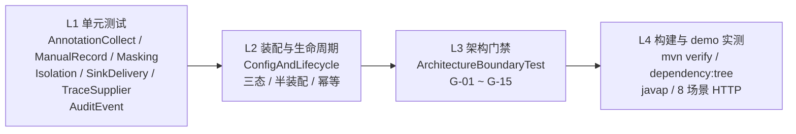

# 测试报告：aifei-audit

> 版本：**v2（返工后复测）**｜测试工程师：**策市袁**｜日期：**2026-11-18**
> 被测对象：`io.github.gollyhu:aifei-audit:1.0.0`（模块） + `aifei-audit-demo`（示例工程，端口 18160）
> 依据：`docs/需求/aifei-audit.md`（AC 34 条 / 门禁清单）、`docs/prd.md`（§7 场景 / §8 AC 索引）、`docs/design.md`（§10 门禁 / §11 测试支撑 / §13 UI 契约 / §15 AC 分组 / §16 跨文件约定 / §21 返工裁决）
> 判定纪律：本报告所有「通过」均来自**真实命令输出**与**真实 HTTP 响应**，无阅读推断。

> **v2 复测说明**：首轮测试后主源码发生一次返工（设计 §21 裁决 1，R-01「G-03 口径收敛」）：新增 `internal/AuditInvocation`（调用现场端口）与 `internal/AuditEnvironment`（容器查找 + 包扫描端口），`AuditCollector` / `AuditSpi` / `AuditScanner` 改为只认端口、`AuditInterceptor` 变薄适配器、`AuditPlugin` 持有框架能力端口实现；门禁 G-03 从「4 条白名单」收敛为「**精确 1 条**（仅 `internal/SafeInvoker.java -> cn.aifei.log.`）」。本报告全部数据均为**返工后代码重新执行**所得。

---

## 1. 结论摘要

**结论：通过，维持放行。** 返工后功能 / 门禁 / 构建 / demo 四层全部重新实测通过，无源码缺陷项。首轮唯一的门禁口径偏离 **R-01 已按 `design.md` §21 裁决 1（方案 A）返工闭环**：`G-03` 由「4 条白名单」收敛为「**精确 1 条**」，且本次修订**由测试侧独立重做反证**（临时注入即变红、还原后全绿）；R-03 已由设计 §13.2 文档口径闭环（非缺陷）；R-04 因 demo 已补 `log4j2.xml`，本次**实测复验通过**。剩余 R-02 / R-05 / R-06 / R-07 为低风险说明，见 §9。

| 项 | 结果 |
| --- | --- |
| 用例总数 | **70**（既有 61 + 首轮补测 9；返工未增减用例） |
| 通过 / 失败 / 跳过 | **70 / 0 / 0** |
| `mvn -o clean verify` | **BUILD SUCCESS**（0 failure / 0 error，耗时 6.5 s） |
| 架构门禁 G-01~G-15 | **15 / 15 通过** |
| `G-03` 反证（门禁是否空心） | **变红后又还原**：临时在 `internal/AuditEnvironment.java` 插 `import cn.aifei.aop.Aop;` → `Failures: 1`（`expected:<[internal/SafeInvoker.java -> cn.aifei.log.]> but was:<[internal/AuditEnvironment.java -> cn.aifei.aop.Aop, internal/SafeInvoker.java -> cn.aifei.log.]>`）；按 SHA256 还原后重跑全绿 |
| 依赖树（AC-25） | 仅 `aifei-all:provided` + `junit:test`，零第三方 compile/runtime，test 无日志绑定 |
| class major（AC-26） | 主 JAR **32 个 class 全部 52**（返工前 28） |
| demo 8 场景（AC-30） | **8 / 8 通过**，页面与静态资源零外网 host，18160 已释放 |
| demo 控制台 WARN（R-04） | **已复验通过**：`log4j2.xml` 生效，sink 抛异常时控制台出现**恰 1 条** `WARN [cn.hg.aifei.audit.internal.SafeInvoker] - [aifei-audit] 落点交付失败，已按失败隔离吞掉` |

**我的变更范围：首轮新增 1 个测试文件；v2 修订只改本文件（`docs/testing.md`）。** 全程未修改 `src/main/java`、`docs/prd.md`、`docs/design.md`、`docs/需求/aifei-audit.md`。返工中开发同步调整了测试侧 3 处（`ArchitectureBoundaryTest` 的 `G-03` 断言、`ConfigAndLifecycleTest` 的 `AuditSpi.sink(...)` 入参、`support/AuditTestSupport#emptyEnvironment()`），`AcceptanceSupplementTest` 未被改动且在返工后重跑全绿。

> `G-03` 反证曾**临时**改动 `internal/AuditEnvironment.java` 一行（验证门禁非空心），随即按备份 SHA256 精确还原（`HASH MATCH`），并重跑 `clean verify` 确认 70 例全绿——还原后文件与原文逐字节一致，工作区无残留改动。

---

## 2. 测试策略（四层）



| 层 | 目的 | 手段 | 命令 / 入口 |
| --- | --- | --- | --- |
| L1 单元 | 逐条固化 AC 的行为断言（采集 / 脱敏 / 隔离 / 交付） | JUnit4 + `AuditHolder` 直装快照，按 `routes.scan` 真实形态构造框架 `Invocation` 驱动 `AuditInterceptor`（采集编排内部经 `internal/AuditInvocation` 端口，测试侧仍用框架 `Invocation` 保证与真实形态同源） | `mvn -o -f aifei-audit\pom.xml test` |
| L2 装配生命周期 | 三态矩阵、半装配、配置校验、幂等 | `AuditPlugin.start()/stop()` + `RecordingLogFactory` | 同上 |
| L3 架构门禁 | 公共面 / 依赖边界 / 唯一定义点 / Java 8 | 源码文本扫描（先剥离注释）+ 反射 | 同上（`ArchitectureBoundaryTest` 须在模块根执行） |
| L4 构建与 demo | AC-24/25/26/27/30 的命令级与端到端判定 | `dependency:tree`、`javap -verbose`、真实启动 demo 走 8 场景 | 见 §7、§8 |

**测试纪律落实**：Java 8 语法；未引入任何日志绑定（test scope 亦无）；每个测试类 `@BeforeClass` 装 `RecordingLogFactory` 并 `@AfterClass` 还原；无秒级 `Thread.sleep` 堆叠（并发用例用 `CountDownLatch` + 5/10 秒上限，非固定等待）；测试源码零 `cn.hg.aifei.trace.*` 等生态模块引用（G-06 同约束 test）。

---

## 3. 用例统计

| 测试类 | 用例数 | 承载范围 |
| --- | --- | --- |
| `AnnotationCollectTest` | 4 | AC-01 / 02 / 03 / 21 |
| `AuditEventTest` | 4 | AC-04（构造）/ 05 / 06 / 13（toString） |
| `MaskingTest` | 5 | AC-13 / 14 / 15 + 全局开关、越界 mask |
| `IsolationTest` | 5 | AC-10 / 11 / 12 + actorName 失败、judge 降级 |
| `SinkDeliveryTest` | 5 | AC-08 / 09 / 16 / 17a / 17b |
| `ManualRecordTest` | 2 | AC-07 / 09b |
| `TraceSupplierTest` | 4 | AC-20 + client 注入、supplier 抛异常 |
| `ConfigAndLifecycleTest` | 6 | AC-09 / 18 / 18b / 19 / 29 + 扫描范围必填、enabled=false |
| `AcceptanceSupplementTest`（首轮补测，返工未改） | 9 | AC-04（注解路径全要素）/ 07（同 sink 同类型）/ 09b（启动失败态）/ 13（真覆写）/ 14（0-based）/ 15（上限 0）/ 18（重复 start）/ 29（四属性） |
| `ArchitectureBoundaryTest` | 15 | G-01 ~ G-15（`G-03` 断言于返工后改为集合精确比对，例数不变） |
| `pv/Pv01~Pv04` | 3 + 3 + 3 + 2 = 11 | 前置实证（args / 拦截器顺序 / 启动期扫描 / 容器探测） |
| **合计** | **70** | — |

> 返工（R-01 方案 A）**未增减任何用例**，仅把 `G-03` 的判定口径从「命中文件是否在登记表内」改为「① 白名单登记表 `size() == 1`；② 非 `aifei` 包文件的 `cn.aifei.*` 出现位置集合**精确等于** `{internal/SafeInvoker.java -> cn.aifei.log.}`」。主源码同时新增 2 个 `internal` 端口类型（`AuditInvocation` / `AuditEnvironment`）与 2 个匿名实现类（`AuditInterceptor$1` / `AuditPlugin$1`），主 JAR class 数由此 28 → **32**（AC-26 计数同步更新）。

---

## 4. AC ↔ 用例 ↔ 结果（34 条全覆盖）

| AC | 判定要点 | 承载用例（类#方法） | 结果 |
| --- | --- | --- | --- |
| AC-01 | 未标注 0 条；同批次标注恰 1 条 | `AnnotationCollectTest#unannotatedMethodProducesNoEventWhileAnnotatedProducesOne` | 通过 |
| AC-02 | 正常返回 1 条成功事件，操作人取 provider 值，耗时 ≥ 0，错误码/消息为空 | `AnnotationCollectTest#successEventCarriesActorAndNoError` | 通过 |
| AC-03 | 异常 → 1 条失败事件（错误码含类型名、消息含原文），`assertSame` 原异常 | `AnnotationCollectTest#failureEventIsRecordedAndBusinessExceptionIsRethrown` | 通过 |
| AC-04 | 全要素逐项可断言（按 15 个 getter） | `AuditEventTest#eventExposesAllFifteenFields`（构造层）<br/>`AcceptanceSupplementTest#ac04AnnotationPathFillsEveryElement`（采集层 15 项）<br/>`AcceptanceSupplementTest#ac04ArgumentSummaryFollowsRecordingSwitch`（开关取值） | 通过 |
| AC-05 | 无 setter、字段全 `final`、反射置值抛异常、无集合字段 | `AuditEventTest#eventIsImmutable` | 通过 |
| AC-06 | 4 线程 × 25 次，100 个事件号去重后 size == 100 | `AuditEventTest#eventIdsAreUniqueUnderConcurrentCollection` | 通过 |
| AC-07 | `record` 产 1 条，与注解路径同 sink、同事件类型、口径一致 | `ManualRecordTest#manualEventUsesSameSinkAndSameShape`<br/>`AcceptanceSupplementTest#ac07ManualAndAnnotationShareSinkAndEventType` | 通过 |
| AC-08 | sink A 计数 == N 且 B == 0；换 B 后业务零改动、事件全进 B | `SinkDeliveryTest#switchingSinkKeepsBusinessCodeUntouched` | 通过 |
| AC-09 | 已启动无 sink：不构造事件、返回原值、无异常；`start()` 恰一条告警，运行期不重复 | `ConfigAndLifecycleTest#a01StartWithoutSinkWarnsOnceAndCollectsNothing`<br/>`SinkDeliveryTest#startedWithoutSinkCollectsNothingAndLogsNothing` | 通过 |
| AC-09b | 未启动 / 启动失败时 `record` 抛模块异常；注解路径不产事件、返回值不变 | `ManualRecordTest#beforeStartManualRecordThrowsWhileAnnotationPathIsSilent`<br/>`AcceptanceSupplementTest#ac09bFailedStartBehavesAsNotStarted` | 通过 |
| AC-10 | 无 provider → 仍 1 条、操作人为空、返回值不变 | `IsolationTest#missingActorProviderKeepsEventWithoutActor` | 通过 |
| AC-11 | provider 抛异常 → 1 条事件、操作人为空、返回值不变、日志一条 | `IsolationTest#actorProviderFailureIsSwallowedWithOneWarning`（另有 `actorNameFailureKeepsIdAndLogsOnce`） | 通过 |
| AC-12 | judge 抛异常 → 事件仍出、默认口径兜底、返回值不变、日志一条 | `IsolationTest#judgeFailureFallsBackToDefaultResult`（另有 `judgeCanDowngradeSuccessfulReturnToFailure`） | 通过 |
| AC-13 | 默认配置摘要为空；`toString()` 真覆写、不含 `SECRET-XYZ`、含要素标识 | `MaskingTest#defaultConfigKeepsArgumentsOutOfEvent`<br/>`AuditEventTest#toStringCarriesIdentifiersAndNoArgumentText`<br/>`AcceptanceSupplementTest#ac13ToStringIsReallyOverriddenAndHidesSecret` | 通过 |
| AC-14 | `mask={1}` 不含第二参原文、仍含第一参原文（0-based） | `MaskingTest#maskRemovesOnlyTheConfiguredPosition`<br/>`AcceptanceSupplementTest#ac14MaskIsZeroBased`（`mask={0}` 反向证明） | 通过 |
| AC-15 | 单参 10000 字符 + 上限 512 → 摘要 ≤ 512、正常返回、1 条事件、无异常 | `MaskingTest#longArgumentIsTruncatedNotRejected`<br/>`AcceptanceSupplementTest#ac15MaxLengthZeroKeepsPlaceholderWithoutFailure`（上限 0 边界） | 通过 |
| AC-16 | sink 抛异常且 `fail-fast=false` → 返回值相同、无外泄、日志**恰一条** | `SinkDeliveryTest#failingSinkIsSwallowedWithExactlyOneWarning` | 通过 |
| AC-17a | `fail-fast=true` + 业务正常 + sink 抛 → 收到 sink 异常，且事件已先交付 | `SinkDeliveryTest#failFastRethrowsSinkExceptionAfterDelivery` | 通过 |
| AC-17b | `fail-fast=true` + 业务异常 + sink 抛 → `assertSame` 业务原异常，sink 异常吞并记一条 | `SinkDeliveryTest#failFastKeepsBusinessExceptionPriority` | 通过 |
| AC-18 | `start()` 后采集生效；`stop()` 后不产事件且业务不受影响；重复 start/stop 无异常 | `ConfigAndLifecycleTest#a01StartWithoutSinkWarnsOnceAndCollectsNothing`、`#a02StartWithSinkCollectsAndStopEndsCollection`<br/>`AcceptanceSupplementTest#ac18RepeatedStartKeepsSameSnapshot` | 通过 |
| AC-18b | `stop()` 后 `record` 抛模块异常；注解路径不产事件、返回值不变 | `ConfigAndLifecycleTest#a01StartWithoutSinkWarnsOnceAndCollectsNothing` | 通过 |
| AC-19 | 上限 -1 / `fail-fast` 非法 → 启动异常含键名与原值；无残留态，合法配置可再启动 | `ConfigAndLifecycleTest#b01InvalidConfigFailsFastWithoutResidue` | 通过 |
| AC-20 | 注入固定串 → `traceId` 逐字符相等；未注入为空且不抛；`TraceKit` 只在 demo | `TraceSupplierTest#injectedTraceIdLandsOnEventVerbatim`、`#missingSupplierLeavesTraceIdEmptyWithoutFailure` + demo 场景 6 | 通过 |
| AC-21 | 审计拦截器在链首，内层拦截器抛异常仍产 1 条失败事件 | `AnnotationCollectTest#innerInterceptorFailureStillProducesOneFailureEvent`（形态与 `Pv02` 一致） | 通过 |
| AC-22 | 根包顶层 public 类型 == `Audit`/`AuditEvent`/`AuditKit`/`AuditException`；`Result` 为嵌套枚举 | `ArchitectureBoundaryTest#g01RootPackageHasExactlyFourPublicTypes` | 通过 |
| AC-23 | `spi` 恰 3 类；`aifei` 包存在 Plugin/Interceptor；`cn.aifei.*` 仅限该包与唯一登记点（**白名单集合 size == 1**） | `ArchitectureBoundaryTest#g02SpiPackageHasExactlyThreeTypes`、`#g03FrameworkTypesStayInAccessPackageOrRegisteredInternalPoints`（返工后精确集合断言） | 通过（G-03 白名单精确等于 1 条：`internal/SafeInvoker.java -> cn.aifei.log.`） |
| AC-24 | `main` 无 `java.sql.`、无线程创建；依赖树无 `aifei-db` | `ArchitectureBoundaryTest#g04NoStorageAccess`、`#g07NoThreadCreation` + `dependency:tree` | 通过 |
| AC-25 | `main` + `test` 无 `cn.aifei.vip.` 与生态包；零第三方 compile/runtime；test 无日志绑定 | `#g05NoVipReferences`、`#g06NoEcosystemModuleReferences`、`#g11NoLoggingBinding` + `dependency:tree` | 通过 |
| AC-26 | 主 JAR 全部 class major == 52；源码无 Java 8 后语法 | `#g14Java8SourceConstraints` + `javap -verbose`（32/32 = 52） | 通过 |
| AC-27 | 模块内 `mvn clean verify` 0 failure / 0 error | 真实构建：70 例 0 failure / BUILD SUCCESS | 通过 |
| AC-28 | 脱敏截断与失败隔离各只在一处实现；无 `System.out/err`/`printStackTrace`/日志绑定 | `#g08MaskingAndTruncationHaveSingleDefinitionPoint`、`#g09CatchIsLimitedToRegisteredIsolationPoints`、`#g10NoStandardOutput` | 通过 |
| AC-29 | `@Audit` 四属性运行期可读；空 `action` → `start()` 失败且消息含 `全限定类名#方法名`；无半装配 | `ConfigAndLifecycleTest#c01EmptyActionFailsStartAndReportsSignature`<br/>`AcceptanceSupplementTest#ac29AnnotationExposesFourRuntimeReadableAttributes` | 通过 |
| AC-30 | 18160 可启动、8 场景可见、页面与源码零外网 host | `ArchitectureBoundaryTest#g13DemoIsOffline` + demo 8 场景实测（§8） | 通过 |
| AC-31 | 存在 `AuditKit`，全模块无 `AuditUtil` | `ArchitectureBoundaryTest#g12PublicSurfaceIsImplementationFreeAndNamingIsEnforced` | 通过 |

---

## 5. 重点复核项实测（防假绿）

| 复核项 | 判定方式 | 实测证据 |
| --- | --- | --- |
| AC-13 `toString()` 真覆写 | 断言 `AuditEvent.class.getMethod("toString").getDeclaringClass() == AuditEvent.class`，再断言输出含事件号 + 动作码、不含 `SECRET-XYZ` | `ac13ToStringIsReallyOverriddenAndHidesSecret` 通过；`AuditEvent#toString` 确为自身声明 |
| AC-14 0-based | `mask={1}` 剔除第二参（正例）+ `mask={0}` 剔除第一参（反向证明）；断言 `<masked>` 标识、被剔除原文不出现、另一参原文仍出现 | `mask={1}` 的摘要实测为 `#0=VISIBLE-OK;#1=<masked>`（demo）；`mask={0}` 断言 `#0=<masked>` 且不含 `SECRET-XYZ`、含 `VISIBLE-OK`，两条用例均通过 |
| AC-15 10000 → ≤512 | 10000 字符 + 上限 512：摘要 `length() <= 512`、返回 `ok`、1 条事件；上限 0：摘要为 `[args omitted]` 且 ≤512 | 两条用例均通过，无异常 |
| AC-16 日志恰一条 | `RecordingLogFactory.count("warn") == 1`（一次失败一条，不重复） | 通过 |
| AC-17a 先交付后上抛 | sink「先入收集列表再抛」；捕获后 `assertSame(sinkThrown, caught)` 且收集列表 size == 1、action == `order.cancel` | 通过 |
| AC-17b 业务异常优先 | `assertSame(Service.thrown, caught)` 且 `assertNotSame(sinkThrown, caught)`，warn == 1 | 通过 |
| AC-06 并发去重 | `CountDownLatch` 4 线程 × 25 次，`events.size() == 100` 且去重后 `ids.size() == 100` | 通过 |
| AC-21 拦截器顺序 | 拦截器数组 `[AuditInterceptor, VetoInterceptor]`（下标 0 最外层），内层直接抛 `veto`；仍产 1 条 FAILURE | 通过 |
| AC-29 空 action | `start()` 抛 `AuditException`，消息含 `cn.hg.aifei.audit.ConfigAndLifecycleTest$EmptyActionService#run`；`AuditHolder.snapshot() == null`；改用合法扫描类可再启动 | 通过 |
| AC-22/23 公共面 | 文件名集合精确比对 + 四个类型 `isPublic` + `AuditEvent$Result` 为 public 嵌套枚举；`spi` 精确 3 个 | 通过 |
| AC-23 `G-03` 非空心 | ① `assertEquals(1, INTERNAL_FRAMEWORK_ALLOWED.size())`；② 扫描 `main` 下非 `aifei/` 文件的 `cn.aifei.` 出现位置（剥离注释后），组装 `文件 -> 前缀` 集合，`assertEquals(EXPECTED_INTERNAL_FRAMEWORK_POINTS, observed)` | 通过；且反证成立：注入 `import cn.aifei.aop.Aop;` 到 `internal/AuditEnvironment.java` → `expected:<[internal/SafeInvoker.java -> cn.aifei.log.]> but was:<[internal/AuditEnvironment.java -> cn.aifei.aop.Aop, ...]>`，移除后全绿 |

### 5.1 三态矩阵逐格验证（AC-09 / 09b / 18 / 18b）

| 状态 | 注解路径 | 手动埋点 `record` | 模块日志 | 实测用例 |
| --- | --- | --- | --- | --- |
| ① 未启动 / `start()` 失败 | 不采集、不抛、返回值不变 | 抛 `AuditException`（含「插件未启动或已停止」） | 不记 | `ManualRecordTest#beforeStartManualRecordThrowsWhileAnnotationPathIsSilent`、`AcceptanceSupplementTest#ac09bFailedStartBehavesAsNotStarted` |
| ② 已启动、无 sink | 不构造事件、直接返回、返回值不变 | 静默返回、不抛 | `start()` 恰一条 warn，运行期不重复 | `ConfigAndLifecycleTest#a01...`、`SinkDeliveryTest#startedWithoutSinkCollectsNothingAndLogsNothing` |
| ③ 已停止 | 不产事件、返回值不变 | 抛 `AuditException` | 不记 | `ConfigAndLifecycleTest#a01...`（`stop()` 后两路径） |

> 口径说明：「不构造事件」在无 sink 时无可观测落点，故以「sink 计数为 0 + 无异常 + 返回值不变」间接判定；事件构造点本身由 `SafeInvoker.capture` 包裹，缺陷时只记日志不产事件（`IsolationTest` / 门禁 G-09 共同约束）。

---

## 6. 架构门禁 G-01 ~ G-15 实测结论

| 门禁 | 断言 | 实测 | 结论 |
| --- | --- | --- | --- |
| G-01 | 根包顶层 public 类型精确 4 个；`Result` 为嵌套枚举 | 文件名集合精确相等；4 类型 `isPublic`；`AuditEvent$Result` `isEnum` | 通过 |
| G-02 | `spi` 顶层 public 类型精确 3 个 | 集合精确相等 | 通过 |
| G-03 | `aifei` 包存在 Plugin/Interceptor；`cn.aifei.*` 出现位置集合**精确等于**「`aifei` 包 ∪ 唯一 `internal` 登记点」；白名单登记表 `size() == 1` | 两文件存在；`INTERNAL_FRAMEWORK_ALLOWED.size() == 1`；非 `aifei` 文件实测集合 == `{internal/SafeInvoker.java -> cn.aifei.log.}`（`TreeSet` 精确相等，非子集判定） | 通过（**反证可红**：临时给 `internal/AuditEnvironment.java` 加 `import cn.aifei.aop.Aop;` → `Tests run: 15, Failures: 1`，报 `expected:<[internal/SafeInvoker.java -> cn.aifei.log.]> but was:<[internal/AuditEnvironment.java -> cn.aifei.aop.Aop, internal/SafeInvoker.java -> cn.aifei.log.]>`；还原后 15 / 15 全绿） |
| G-04 | `main` 无 `java.sql.` | 0 命中 | 通过 |
| G-05 | `main` + `test` 无 `cn.aifei.vip.` | 0 命中 | 通过 |
| G-06 | `main` + `test` 无 13 个生态模块包引用 | 0 命中 | 通过 |
| G-07 | `main` 无线程 / 线程池 / 定时器 | 0 命中 | 通过 |
| G-08 | 脱敏截断唯一定义点（`length() >` / `substring(` / `"<masked>"` 只在 `Truncator`） | 仅 `internal/Truncator.java` 命中；`summary` / `truncate` 存在 | 通过 |
| G-09 | `catch (` 白名单（`SafeInvoker` / `AuditSpi` / `AuditCollector`）；`AuditCollector` 的 catch 200 字符内 `throw`；根包/spi/aifei 零 catch | 全部满足 | 通过 |
| G-10 | 无 `System.out` / `System.err` / `printStackTrace` | 0 命中 | 通过 |
| G-11 | 无 `org.slf4j.` / `log4j` / `logback` | 0 命中 | 通过 |
| G-12 | 公共面 import 仅 `java.` / `javax.` / `cn.hg.aifei.audit.`；存在 `AuditKit`；全模块无 `AuditUtil` | 全部满足 | 通过 |
| G-13 | demo 内 URL host 只能是 `127.0.0.1` / `localhost` | demo 目录存在并扫描；页面/JS/CSS 零外网 URL（仅版权注释与示例注释被剥离） | 通过 |
| G-14 | Java 8 兜底：`var` / `record` / `sealed` 用**语法模式**（`\bvar\s+标识符\s*=`、`\brecord\s+大写类名\s*\(`、`\bsealed\s+(class\|interface)\b`）+ 字面量 `"""` / `List.of(` / `Map.of(` / `Set.of(`；扫 `main` 与 `test` | 0 命中（语法模式避免误伤 `for (String record : RECORDS)`，非放宽） | 通过 |
| G-15 | 时钟 / 事件号 / 配置键 / 注解读取唯一定义点 | `System.nanoTime`、`currentTimeMillis` → `Clock`；`UUID` → `EventIds`；`"audit.` → `AuditConfig`；`getAnnotation(Audit.class)` → `AuditAnnotations` | 通过 |

> 门禁条数口径（承接 design §10）：需求 §6.1 正文写「14 条断言」，表内为 G-01~G-13 共 13 条；设计把 AC-26 的 Java 8 文本兜底编为 G-14（正好 14 条），G-15 为设计关追加加固（只更严）。本报告按 **15 个可执行门禁用例**记录，与 `ArchitectureBoundaryTest` 的 15 个 `@Test` 一一对应。
>
> **G-03 严格性说明（返工后）**：断言之二为「白名单登记表 `size == 1`」，断言之三为「非 `aifei` 包文件的 `cn.aifei.*` 出现位置集合**精确等于** `{internal/SafeInvoker.java -> cn.aifei.log.}`」——集合相等而非「是否在表中」，因此任何新增 `internal` 框架引用（即使文件已在表中但前缀不同）都会变红。返工把 `AuditCollector` / `AuditSpi` / `AuditScanner` 的框架能力改为经 `internal/AuditInvocation` / `internal/AuditEnvironment` 端口由 `aifei` 包注入，故 `internal` 的框架引用面收敛为 1 个文件、1 个类型（`cn.aifei.log.Log`）。
>
> **门禁实现两点口径（承接 design §10 / §21 裁决 5，结论：不算放宽）**：① `ArchitectureBoundaryTest` 对**自身文件**豁免文本扫描——它把 `System.out` / `catch (` / `cn.aifei.vip.` 当作断言字符串持有，自扫必失败，且该文件不进交付 JAR；`src/test` 其余文件仍全量扫描。② `G-14` 的 `var` / `record` / `sealed` 改用**语法模式**而非字面量，因字面量 `record ` 会误伤 `support/RecordingLogFactory` 的 `for (String record : RECORDS)`；更精确，非放宽。两点均只影响门禁自身的误报面，不改变 `AC-25` / `AC-26` 判据。

---

## 7. 构建与环境自检（AC-24 / 25 / 26 / 27）

### 7.1 构建（AC-27）

命令（PowerShell，使用 `-f` 避免 `cd /d` 无效）：

```bat
mvn -o -f d:\WorkspaceIdea\aifei-eco-modules\aifei-audit\pom.xml clean verify
```

关键输出：

```text
[INFO] Tests run: 70, Failures: 0, Errors: 0, Skipped: 0
[INFO] BUILD SUCCESS
```

分模块结果：`AcceptanceSupplementTest 9`、`AnnotationCollectTest 4`、`ArchitectureBoundaryTest 15`、`AuditEventTest 4`、`ConfigAndLifecycleTest 6`、`IsolationTest 5`、`ManualRecordTest 2`、`MaskingTest 5`、`Pv01 3`、`Pv02 3`、`Pv03 3`、`Pv04 2`、`SinkDeliveryTest 5`、`TraceSupplierTest 4`。

### 7.2 依赖树（AC-24 / AC-25）

```bat
mvn -o -f d:\WorkspaceIdea\aifei-eco-modules\aifei-audit\pom.xml dependency:tree
```

关键行：

```text
io.github.gollyhu:aifei-audit:jar:1.0.0
+- cn.aifei:aifei-all:jar:1.1.2:provided
|  \- com.alibaba.fastjson2:fastjson2:jar:2.0.66:provided
\- junit:junit:jar:4.13.2:test
   \- org.hamcrest:hamcrest-core:jar:1.3:test
```

结论：零第三方 compile/runtime；`aifei-all` 为 provided 且其传递依赖同为 provided；test scope 仅 JUnit + Hamcrest，**无任何日志绑定**；无 `aifei-db`。

### 7.3 class major（AC-26）

命令（PowerShell，对 `target/classes` 逐类 `javap -verbose`；`clean` 后无遗留脚本，故直接内联执行）：

```powershell
$root='d:\WorkspaceIdea\aifei-eco-modules\aifei-audit\target\classes'
$classes = Get-ChildItem -Recurse -Path $root -Filter *.class
$r = foreach ($c in $classes) {
  $n = ($c.FullName.Substring($root.Length + 1)) -replace '\\','.' -replace '\.class$',''
  $o = & javap -verbose -classpath $root $n 2>$null | Select-String 'major version'
  "$n = $($o.Line.Trim())"
}
$r; "total: " + $r.Count; "major52: " + ($r | Where-Object { $_ -match 'major version: 52' }).Count
```

结果（32 行逐类输出，摘尾部汇总）：

```text
...
cn.hg.aifei.audit.internal.AuditEnvironment = major version: 52
cn.hg.aifei.audit.internal.AuditInvocation = major version: 52
...
total: 32
major52: 32
```

结论：主 JAR 全部 32 个 class 的 `major version` 均为 **52**（Java 8）。返工新增的两个端口接口与其匿名实现类同样为 52。

---

## 8. demo 实测（AC-30）

### 8.1 启动方式

```bat
mvn -o -f d:\WorkspaceIdea\aifei-eco-modules\aifei-audit\pom.xml install
mvn -o -f d:\WorkspaceIdea\aifei-eco-modules\aifei-audit-demo\pom.xml compile dependency:build-classpath "-Dmdep.outputFile=target/cp.txt"
java -Ddemo.config=app-config.txt -Dundertow.port=18160 -cp ".\target\classes;<cp.txt>" cn.hg.aifei.audit.demo.DemoApp
```

就绪探针：`GET /audit/demo/state` → 200，1 秒内就绪（`sink=memory`，`sinks=[memory,console,mq]`，`config.argsEnabled=false / maxLength=512 / failFast=false / clientEnabled=false / module=aifei-audit-demo`，计数全 0）。

页面与静态资源（本机加载，均 200）：

```text
/audit/demo/page          -> 200 len=9668
/assets/css/audit-demo.css -> 200 len=11874
/assets/js/audit-demo.js   -> 200 len=18153
```

零外网：`src/main/webapp/**` 与 demo 源码中无任何外网 URL（G-13 实测通过）；页面资源引用为站内相对路径 `/assets/...`，无 CDN、无构建工具。

### 8.2 8 场景实测记录

| # | 场景 | 触发 | 关键响应摘要 | 结论 |
| --- | --- | --- | --- | --- |
| 0 | 空态（场景 7 前置） | `GET /reset` | `seq=0`、`events=[]`、`delivered=0`；页面含占位文案「还没有采集到事件」 | 通过 |
| 1 | 注解采集 + 未标注对照 | `GET /annotated` ×2、`GET /unannotated` ×1 | 事件 +2；`action=order.cancel`、`module=aifei-audit-demo`、`desc=取消订单`、`actorId=alice`、`result=SUCCESS`、`elapsedMillis=1`（≥0），空值字段为 null/省略；未标注动作返回 `no-audit-1` 且事件不增 | 通过 |
| 2 | 手动埋点 | `GET /manual?times=3` | `recorded=3`，事件 +3；`action=order.batch`、`target=item-1`、`elapsedMillis=0`，形状与场景 1 一致 | 通过 |
| 3 | 脱敏前后对照 | `GET /masked?keep=VISIBLE-OK&secret=SECRET-XYZ` / `GET /masked/off?...` | 前者 `argsSummary=#0=VISIBLE-OK;#1=<masked>`（不含 `SECRET-XYZ`）；后者 `argsSummary=null`、`recordArgs=false` | 通过 |
| 4 | 落点切换 | `GET /sink/switch?name=console|mq|memory` | console：console 计数 0→1、memory 不变；mq：mq 0→1 且 `mqConsumed` 0→1；非法名 → `code=400, msg=未知落点: nope` | 通过 |
| 5 | 业务异常失败事件 | `GET /failure` + `GET /failure/evidence` | `/failure` 为 HTTP 200 + `{"code":20000,"msg":"服务端错误"}`（语义由业务码承载）；evidence：`type=java.lang.IllegalStateException`、`message=order-cancel-rejected`、`sameInstance=true`；`lastFailure.result=FAILURE`、`errorCode=java.lang.IllegalStateException`、`errorMessage=order-cancel-rejected` | 通过 |
| 6 | `traceId` 关联 | `GET /annotated` + `GET /events` | 触发请求返回的 `traceId` 与该请求所产事件的 `traceId` 逐字符相等（如 `e67b3d76...`）；`state.traceId` 为当次轮询请求自身的链路标识，与历史事件不同属正常 | 通过 |
| 7 | 空态 | `GET /reset` | `seq=0`、`events=[]`、`delivered=0`；列表占位文案可见，不残留上次数据 | 通过 |
| 8 | 错误态（sink 抛异常） | `GET /sink/fail?on=true` + `GET /annotated` | `sinkFailMode=true`；业务返回 `cancelled-6`（未变）；`delivered` 0→1、`memory` 0→0、事件列表不新增；页面含「已按失败隔离吞掉并记一条模块日志」提示 | 通过 |

> 场景 8 的「记一条模块日志」有两层证据：
> ① **单元层**：`SinkDeliveryTest#failingSinkIsSwallowedWithExactlyOneWarning` 以 `RecordingLogFactory.count("warn") == 1` 精确判定；
> ② **demo 控制台（本轮复验，R-04 由开发补 `log4j2.xml` 后闭环）**：`GET /reset` → `GET /sink/fail?on=true` → `GET /annotated`，`state` 显示 `delivered=1 / memory=0`（事件已交付但落点失败）、业务返回值未变（本次为 `cancelled-1`；上表 `cancelled-6` 是上一轮的自增序号，二者语义一致），控制台出现**恰好 1 条** WARN：
>
> ```text
> 15:27:28.154 WARN  [cn.hg.aifei.audit.internal.SafeInvoker] - [aifei-audit] 落点交付失败，已按失败隔离吞掉: java.lang.IllegalStateException: demo-sink-failure
> ```
>
> 复验时 18160 已被上一轮遗留实例占用，故本次在 **18161** 启动独立实例取自有控制台输出（`log4j2.xml` 只把 `cn.hg.aifei.audit` 放开到 WARN、根 logger 保持 ERROR，与 §8.1 启动参数无关）。

### 8.3 进程清理

测试结束后按端口结束监听进程并复核：

```text
stop pid=17040
stop pid=4340
port 18160 free
```

> 返工前发现上一轮（非本次脚本启动）遗留的 demo 进程占用 18160 与 `target/demo-out.log`，已一并结束；本轮结束时端口已释放、无 `DemoApp` 进程残留。
>
> **v2 复验（R-04）的进程记录**：复验时 18160 仍被一个遗留实例占用（新实例报 `BindException: Address already in use`），故改用 18161 独立实例；结束后按端口定位 owner（`pid=17068`，`java`）终止，复核 `port 18161 free`。复核时的端口状态：`18160 free`、`18161 free`，无本次启动的 `DemoApp` 残留。

---

## 9. 遗留风险与未覆盖项

| 编号 | 事项 | 影响 | 建议 / 责任 |
| --- | --- | --- | --- |
| **R-01（已裁决并返工完成）** | 首轮发现**门禁 G-03 白名单被拓宽**：当时 `AuditSpi` / `AuditCollector` / `AuditScanner` 直接引用 `cn.aifei.aop.*` 与 `cn.aifei.scanner.*`，白名单登记为 4 条，断言弱于 `AC-23` 字面 | 已按 `design.md` §21 裁决 1 **方案 A 收敛，需求零改动**：`internal` 框架引用只剩 `SafeInvoker → cn.aifei.log.`，框架能力下沉为 `internal/AuditInvocation`（调用现场）与 `internal/AuditEnvironment`（`lookup` / `scan`）两个端口，由 `aifei` 包注入实现 | **门禁已变严**：白名单 `size() == 1` + 出现位置集合精确相等，**反证可红**（本轮由测试侧独立重现：注入 `cn.aifei.aop.Aop` → `Failures: 1`；按 SHA256 还原后 15 / 15 全绿）。无后续动作 |
| R-02 | G-13 只识别 `http(s)://host`，协议相对 URL（`//cdn.example.com/x.js`）可绕过 | 门禁可绕过面；实测 demo 静态资源无协议相对引用，当前无风险 | 后续可在 G-13 增加 `//host` 正则；本次不改 |
| **R-03（已闭环，非缺陷）** | demo JSON 省略 null 字段：`EventFeed` 视图含 15 字段，fastjson2 默认 writer 不输出 null，实际响应缺 `target/argsSummary/errorCode/errorMessage/client` 等键，与 design §13.2 示例的「字段齐全」字面不符 | 页面一律按「键缺失 == null」渲染（`undefined` 与 `null` 同处理为 `-`），8 场景与字段语义均不受影响；问题在**文档示例字面**而非实现 | **已通过文档口径闭环（非缺陷）**：`design.md` §13.2 已回写「null 字段口径」（fastjson2 `2.0.66` 实测：值为 `null` 的键不出现；示例里的 `"target": null` 不得理解为必须出现）。无需改 demo |
| **R-04（已复验通过）** | demo 控制台原先看不到模块 WARN：demo 未提供 `log4j2.xml`，log4j2 默认根级别只输出 ERROR | 演示者看不到「一条模块日志」，可能误判隔离未生效 | **已通过**：开发已补 `aifei-audit-demo/src/main/resources/log4j2.xml`（`cn.hg.aifei.audit` 放开到 WARN、根 logger 保持 ERROR、纯控制台 appender、无外网），本轮实测见 §8.2（恰 1 条 WARN）。若该文件后续被移除或改级别，按 §8.2 场景 8 复验；模块侧仍由单测精确断言 |
| R-05 | AC-09「不构造事件」无直接观测点（无 sink 时事件不落地） | 判定依赖「计数 0 + 无异常 + 返回值不变」的间接组合 | 已在 §5.1 注明口径；如需直接证明，可在测试中注入事件构造计数桩（需模块暴露构造点，属 P1） |
| R-06 | AC-26 的 `javap` 与 AC-30 的 demo 实测不在 `mvn test` 内 | 属发布前自检项，长期依赖人工/脚本执行 | 已在本报告固化命令与结果；建议后续纳入发布检查清单 |
| R-07 | AC-04「13 个要素」与 15 个 getter 的计数口径差异 | 不影响断言完整性（按 getter 逐项断言，覆盖更全） | 见 §10 U-01，不改需求与 PRD |

**未覆盖项**：无 P0/P1 功能缺口。P1 能力（异步投递、重试、采样、多实现分发等）按 PRD §5.2 不在本期范围，未设计用例。

---

## 10. 口径注记

### U-01 要素计数

需求正文写「13 个要素」，需求 §5.1 表为 14 行（操作人 id / 名 各占一行），设计为 15 个字段（错误码与消息拆两个 getter，操作人 id / 名分列）。本报告按 **getter 逐一断言**（15 项），「13 要素」理解为「操作人 id + 名合为 1 个要素、错误码与消息合为 1 个要素」。**不改需求文档、不改 PRD**。

### U-02 半装配清理清单

`AC-29` 中「已登记的注解索引清除」在本设计下为空集（D-14 不建运行期索引）。该条后半段以「启动失败后 `AuditHolder.snapshot() == null`，且改用合法配置可再次 `start()` 并采集生效」覆盖，用例名体现「无残留态（快照未装 / 无容器注册 / 无索引）」。

### U-03 多实现检测

`Q14`「同一类型多实现视为配置错误并启动失败」在框架层不可表达：框架在**第二次注册**时即抛 `Singleton object already exists`，早于 `AuditPlugin.start()`。因此模块侧无「多实现检测」代码，`README` 声明「同一时刻只能注册一个实现；需要按动作分发时在自己的 sink 内分发」。**本报告不针对该场景写用例**，原因如上（用例只能测到框架注册行为，不属模块 AC）。

---

## 11. 复现命令

```bat
rem 1) 模块全量（70 例）
mvn -o -f d:\WorkspaceIdea\aifei-eco-modules\aifei-audit\pom.xml clean verify

rem 2) 依赖树
mvn -o -f d:\WorkspaceIdea\aifei-eco-modules\aifei-audit\pom.xml dependency:tree

rem 3) class major：构建后对 target/classes 下每个 class 批量 javap（脚本见 §7.3）
rem    javap -verbose -classpath target\classes <全限定类名> | findstr "major version"
rem    本次实测 32 个 class 全为 52

rem 3b) 门禁 G-03 反证（可选，验证门禁非空心；完成后必须还原）
rem    a) 备份 internal\AuditEnvironment.java 并记录 SHA256
rem    b) 在 package 行后插入 import cn.aifei.aop.Aop;
rem    c) mvn -o -f d:\WorkspaceIdea\aifei-eco-modules\aifei-audit\pom.xml test -Dtest=ArchitectureBoundaryTest -DfailIfNoSpecifiedTests=false
rem       期望 Tests run: 15, Failures: 1（expected:<[internal/SafeInvoker.java -> cn.aifei.log.]> but was:<...>）
rem    d) 用备份覆盖还原，校验 SHA256 一致，重跑 clean verify 应 70 例全绿

rem 4) demo（端口 18160；若被占用可改 -Dundertow.port=18161 并在响应侧同步端口）
mvn -o -f d:\WorkspaceIdea\aifei-eco-modules\aifei-audit\pom.xml install
cd /d d:\WorkspaceIdea\aifei-eco-modules\aifei-audit-demo
start-demo.bat

rem 5) demo 结束后释放端口（PowerShell）
powershell -NoProfile -Command "Get-NetTCPConnection -LocalPort 18160 -State Listen | ForEach-Object { Stop-Process -Id $_.OwningProcess -Force }"
```

---

## 12. 变更清单

| 文件 | 变更 |
| --- | --- |
| `aifei-audit/src/test/java/cn/hg/aifei/audit/AcceptanceSupplementTest.java` | **新增**（9 例，补齐 AC-04 / 07 / 09b / 13 / 14 / 15 / 18 / 29 的逐项固化断言）；v2 返工中**未改动**，重跑全绿 |
| `aifei-audit/src/test/java/cn/hg/aifei/audit/ArchitectureBoundaryTest.java` | 返工中由开发改写 `G-03`：`INTERNAL_FRAMEWORK_ALLOWED` 由 4 条收敛为 1 条，新增 `EXPECTED_INTERNAL_FRAMEWORK_POINTS` 与 `size()==1` 断言（用例数仍 15）；**测试工程师未修改** |
| `aifei-audit/src/test/java/cn/hg/aifei/audit/ConfigAndLifecycleTest.java` | 返工中由开发调整 1 行：`AuditSpi.sink(AuditTestSupport.emptyEnvironment())`（适配端口签名） |
| `aifei-audit/src/test/java/cn/hg/aifei/audit/support/AuditTestSupport.java` | 返工中由开发新增 `emptyEnvironment()`（无实现的 `AuditEnvironment` 替身） |
| `aifei-audit-demo/src/main/resources/log4j2.xml` | 由开发新增（R-04 闭环：`cn.hg.aifei.audit` → WARN、根 logger → ERROR、纯控制台）；**测试工程师未修改**，仅按 §8.2 复验 |
| `aifei-audit/src/main/java/**` | 返工涉及 `internal/AuditInvocation`、`internal/AuditEnvironment`、`AuditCollector`、`AuditSpi`、`AuditScanner`、`aifei/AuditInterceptor`、`aifei/AuditPlugin`；**测试工程师未修改** |
| `aifei-audit/docs/prd.md`、`docs/design.md`、`docs/需求/aifei-audit.md` | **测试工程师未修改**（设计 §21 / §5.5 由架构侧同步登记 G-03 收敛） |
| `aifei-audit/docs/testing.md` | 本文档（v2 返工后复测数据） |

> 补测选择新增独立测试类而非改动既有类：`ConfigAndLifecycleTest` 依赖 `@FixMethodOrder` 与「容器内落点只注册一次」的全局前提，追加方法可能改变执行顺序与全局状态；独立类内所有用例均通过 `AuditHolder` 直装快照或独立 `AuditPlugin`，不向 `AopKit` 注册对象，互不干扰。
