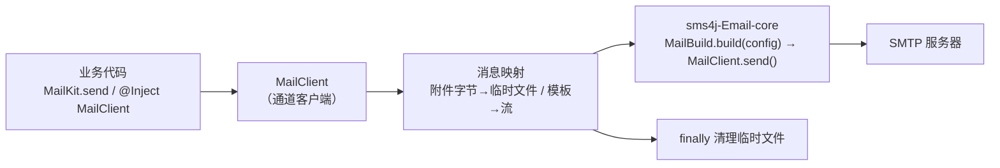

# aifei-email

出站邮件统一门面：一套接口发送纯文本 / HTML / 模板邮件（多收件人、抄送密送、附件字节），底层基于 **sms4j-Email-core 3.3.6** 二次封装，**换 SMTP 服务器只改 `email.*` 配置、业务代码零改动**。

坐标：`io.github.gollyhu:aifei-email:1.0.0-SNAPSHOT`（`packaging=jar`，Java 8，class major 52）。库模块（可被应用依赖），不是业务应用工程。

## 一、定位与场景

**解决什么问题**：业务各自裸用 JavaMail / Spring Mail / 厂商 SDK 发邮件，SMTP 配置、附件拼装、HTML 模板、多账号切换各写各的，换一次 SMTP 就要重写发送代码。本模块把这层收口为极简门面，并支持多 SMTP 配置池（多账号 / 多租户）。

**适合**：订单 / 告警 / 验证码等**同步出站发送**；一个应用内有多个发件账号（如通知邮箱 + 营销邮箱）需要按通道切换；希望在无文件系统的环境（容器 / 云函数）里以字节数组发附件。

**不适合**：IMAP / POP3 收信、退信与打开点击追踪（本模块只做出站）；异步发送与批量群发性能优化（公共面只同步，异步请自行包装）；模板 CRUD 与内容审核（属业务系统）；模板引擎渲染（只承诺 `#{变量名}` 替换，复杂模板请先在业务侧渲染成 HTML 再传入）。

## 二、5 分钟快速开始

### 1. 加依赖

```xml
<!-- 门面：本模块 -->
<dependency>
    <groupId>io.github.gollyhu</groupId>
    <artifactId>aifei-email</artifactId>
    <version>1.0.0-SNAPSHOT</version>
</dependency>

<!-- 生态底座：provided，消费方应用必须自带（插件接口 / 配置源 / 注入工具） -->
<dependency>
    <groupId>cn.aifei</groupId>
    <artifactId>aifei</artifactId>
    <version>1.1.2</version>
</dependency>

<!-- 实现内核：optional，消费方必须显式引入，否则没有发送能力 -->
<dependency>
    <groupId>org.dromara.sms4j</groupId>
    <artifactId>sms4j-Email-core</artifactId>
    <version>3.3.6</version>
</dependency>
```

> 本模块不引任何 starter（也不引 solon 插件），不声明任何日志绑定实现（sms4j 只传递 `slf4j-api` 门面）。

### 2. 最少配置（`app-config.txt`）

```properties
# 单通道时默认通道可缺省；多通道时必须显式声明
email.default-channel=qq

email.qq.smtp-server=smtp.qq.com
email.qq.port=465
email.qq.from-address=notice@example.com
email.qq.username=notice@example.com
email.qq.password=你的授权码
email.qq.nick-name=订单中心
```

其余键（`is-ssl` / `is-auth` / `nick-name` / `retry-interval` / `max-retries`）可缺省，默认值见[参考](#七参考)。凭据一律走配置，不要硬编码。

### 3. 装配

```java
import cn.aifei.config.AifeiConfig;
import cn.aifei.config.Plugins;
import cn.aifei.config.Routes;
import cn.aifei.config.Settings;
import cn.aifei.util.PropKit;
import cn.hg.aifei.email.aifei.EmailPlugin;

public class AppConfig implements AifeiConfig<In, Out> {

    @Override
    public void config(Settings<In, Out> settings) {
        PropKit.use("app-config.txt");
        // 其它装配...
    }

    @Override
    public void config(Routes routes) {
        // 本模块无入站路由
    }

    @Override
    public void config(Plugins plugins) {
        plugins.add(new EmailPlugin(PropKit.getProp()));   // 构造期只持配置引用，校验与装配在 start()
    }
}
```

### 4. 发一封邮件

```java
import cn.hg.aifei.email.MailKit;
import cn.hg.aifei.email.MailMessage;
import cn.hg.aifei.email.MailResult;

MailMessage message = MailMessage.builder()
        .to("buyer@example.com")
        .subject("您的订单已发货")
        .body("包裹已交付承运商，预计 2 日内送达。")
        .build();

MailResult result = MailKit.send(message);
System.out.println(result.getChannelName() + " -> " + result.isSuccess() + " / " + result.getMessage());
// 期望输出：qq -> true / sent
```

发送成功返回 `MailResult`；**任何失败都抛 `MailException`**（不返回失败结果对象），消息可读且不含第三方类名。



## 三、常用用法

### 取用客户端

| 方式 | 取到的实例 | 说明 |
| --- | --- | --- |
| `@Inject MailClient` | 默认通道 | 由 `email.default-channel` 指定（单通道可缺省）；字段注入后长期可用 |
| `MailKit.defaultClient()` | 默认通道 | 与上者等价 |
| `MailKit.use("corp")` | 命名通道 | 通道名即配置键 `email.<name>.*` 中的 `<name>` |
| `MailKit.channels()` | 已装配通道名集合 | 不可变 `Set`（顺序不保证） |

`MailKit` 是**有状态门面**：须先 `EmailPlugin.start()`；未装配或 `stop()` 后调用一律抛 `MailException`。

### 纯文本 / 多收件人 / 抄送密送

```java
MailMessage message = MailMessage.builder()
        .to("ops@example.com", "leader@example.com")   // 至少一个
        .cc("qa@example.com")
        .bcc("archive@example.com")
        .subject("每日巡检报告")
        .body("全部服务正常。")
        .build();

MailKit.send(message);
```

### HTML 内容（HTML 邮件）

```java
MailMessage message = MailMessage.builder()
        .to("buyer@example.com")
        .subject("账单")
        .htmlContent("<h3>本期账单</h3><p>应付 199.00 元</p>")   // 直接给完整 HTML
        .build();
```

`htmlContent` 与 `htmlTemplate` **互斥**，同时设置会在发送前被拒绝。

### 附件（字节数组）

```java
MailMessage message = MailMessage.builder()
        .to("buyer@example.com")
        .subject("发票")
        .body("发票见附件。")
        .attachment("invoice.pdf", pdfBytes)      // 显示名 + 字节；空数组 / null 会被忽略
        .build();
```

附件字节由适配层写入系统临时文件供 SMTP 内核读取，发送结束（成功或失败）后清理，业务侧无需关心文件。

### 装配状态与多实例

`start()` / `stop()` 均**幂等**且线程安全；配置非法或依赖缺失时 `start()` 立即失败，先回滚注册表再抛异常，不留半装配。

```java
EmailPlugin plugin = new EmailPlugin(prop);
plugin.start();      // 失败即抛 MailException，注册表已清空
plugin.stop();       // 之后所有门面调用抛「插件未启动或已停止」
plugin.start();      // 可再次装配（配置变更即时生效）
```

## 四、深入使用

### 场景一：订单状态变更后通知买家（HTML 内容）

**业务问题**：发货、退款等状态变更要第一时间通知买家，邮件带样式且内容随订单变化。订单内容由业务自己拼装（可用任意模板能力），本模块只负责「把这段 HTML 发出去」。

配置（沿用 `email.qq.*` 通知邮箱即可）：

```properties
email.default-channel=notice
email.notice.smtp-server=smtp.exmail.qq.com
email.notice.port=465
email.notice.from-address=notice@example.com
email.notice.username=notice@example.com
email.notice.password=${MAIL_NOTICE_PASSWORD}
email.notice.nick-name=订单中心
```

发送端（业务代码）：

```java
public class OrderNotifier {

    @Inject
    private MailClient mailClient;          // 默认通道：通知邮箱

    public void onShipped(Order order) {
        String html = renderShippedHtml(order);   // 业务侧渲染（本模块不引模板引擎）
        mailClient.send(MailMessage.builder()
                .to(order.getBuyerEmail())
                .subject("订单 " + order.getNo() + " 已发货")
                .htmlContent(html)
                .build());
    }

    private String renderShippedHtml(Order order) {
        return "<h3>您的订单已发货</h3><p>订单号：" + order.getNo()
                + "</p><p>承运商：" + order.getCarrier() + "</p>";
    }
}
```

**这段业务只受一条语义约束**：发送是同步的——`send` 返回即 SMTP 已受理入队，若卖家要求「下单接口不被邮件拖慢」，请在业务侧自行异步化（见[注意事项](#六注意事项与技术难点)）。

### 场景二：注册验证码邮件（HTML 模板 + `#{变量名}`）

**业务问题**：验证码邮件文案由运营维护成模板，代码只填变量。本模块支持把模板放在**消费方 classpath 的 `template/`** 下，用 `#{变量名}` 占位，由内核替换。

模板文件 `src/main/resources/template/verify-code.html`：

```html
<div>
  <p>您好，您的验证码是 <b>#{code}</b>，#{minutes} 分钟内有效。</p>
</div>
```

发送端：

```java
public class SignupMailer {

    @Inject
    private MailClient mailClient;

    public void sendVerifyCode(String email, String code) {
        mailClient.send(MailMessage.builder()
                .to(email)
                .subject("注册验证码")
                .htmlTemplate("verify-code.html")        // 相对 classpath 的 template/ 目录
                .templateVariable("code", code)
                .templateVariable("minutes", "10")
                .build());
    }
}
```

**语义差异（只列影响这段业务的）**：

- 模板由**上下文类加载器**从 `template/` 读取——打成 JAR 也能读到消费方的模板；
- `templateVariables` **只对 `htmlTemplate` 生效**，对 `htmlContent` 不做事后替换；
- 模板不存在时发送前即抛 `MailException`（`html template not found: <name> on classpath template/`），不会发出空邮件。

### 场景三：通知邮箱与营销邮箱双账号切换（多通道 + 默认通道）

**业务问题**：通知类邮件走企业邮箱（要进收件箱），营销类走另一个账号（独立信誉、独立限流）。两条业务线共用同一套发送代码，只按通道取客户端。

配置：

```properties
email.default-channel=notice

email.notice.smtp-server=smtp.exmail.qq.com
email.notice.port=465
email.notice.from-address=notice@example.com
email.notice.username=notice@example.com
email.notice.password=${MAIL_NOTICE_PASSWORD}

email.marketing.smtp-server=smtpdm.aliyun.com
email.marketing.port=465
email.marketing.from-address=market@mail.example.com
email.marketing.username=market@mail.example.com
email.marketing.password=${MAIL_MARKET_PASSWORD}
email.marketing.nick-name=品牌活动
email.marketing.max-retries=0
```

发送端（两条业务线，同一套 API）：

```java
public class MailDispatcher {

    public void notifyOps(String to, String text) {
        MailKit.use("notice").send(MailMessage.builder()      // 命名通道
                .to(to).subject("系统告警").body(text).build());
    }

    public void sendCampaign(String to, String html) {
        MailKit.use("marketing").send(MailMessage.builder()
                .to(to).subject("本周上新").htmlContent(html).build());
    }

    public void replyToBuyer(String to, String html) {
        MailKit.defaultClient().send(MailMessage.builder()    // 默认通道（notice）
                .to(to).subject("订单回复").htmlContent(html).build());
    }
}
```

**切换成本**：把 `email.default-channel` 改成 `marketing`，`defaultClient()` / `@Inject MailClient` 立刻指向新通道，**上面三处业务代码一行不改**（`start()` → `stop()` → `start()` 后注入的客户端会自动指向新实例，无需重启应用）。

### 场景四：容器 / 云函数里发送带附件的邮件（字节数组 + 临时目录）

**业务问题**：云函数没有可写业务目录，附件是内存里的字节（报表、发票、导出文件）；同时希望失败不留下垃圾文件。

```java
public class ReportMailer {

    @Inject
    private MailClient mailClient;

    public void sendDailyReport(String to, byte[] xlsx) {
        MailMessage message = MailMessage.builder()
                .to(to)
                .subject("昨日经营日报")
                .body("报表见附件。")
                .attachment("daily-report.xlsx", xlsx)   // 直接给字节，业务侧不落盘
                .build();
        mailClient.send(message);                        // 发送结束（无论成败）临时文件已清理
    }
}
```

**语义差异**：附件临时文件落在 JVM 的 `java.io.tmpdir`（云函数 / 容器默认可写）；文件名用显示名映射，临时文件名为随机名；`byte[]` 为空或 `null` 的附件被忽略，不会让整封邮件失败。

## 五、高级使用

### 扩展新通道类型（`MailProvider` SPI）

首期唯一的通道类型是 `smtp`。若要把厂商 HTTP API（SendGrid / SES / Mailgun / 阿里云邮件推送等）接进来，实现 SPI 即可，**公共面无需变更**：

```java
package com.acme.mail;

import cn.hg.aifei.email.MailClient;
import cn.hg.aifei.email.spi.MailProvider;
import java.util.Map;

public class SendGridMailProvider implements MailProvider {

    @Override
    public String type() {
        return "sendgrid";                 // 通道类型标识，须全局唯一
    }

    @Override
    public MailClient createClient(String channelName, Map<String, String> options) {
        return new SendGridMailClient(channelName, options.get("api-key"));
    }
}
```

在 `src/main/resources/META-INF/services/cn.hg.aifei.email.spi.MailProvider` 里声明实现类全限定名：

```
com.acme.mail.SendGridMailProvider
```

装配期按 `type()` 建索引（`smtp` 为内建实现，随包提供），业务代码无需感知 Provider：

```java
// 业务仍然只认门面：装配入口负责按配置构建每通道客户端
MailKit.use("marketing").send(message);
```

约定：

- `type()` 必须唯一——同一 type 出现多个实现属装配期错误（启动即失败）；
- 找不到所需 type 的实现（资源文件缺失 / 未打包）→ 启动失败并提示检查该服务资源文件；
- `createClient` 的 `options` 是该通道的原始配置项（`email.<name>.*` 去掉前缀，kebab-case 键名）；
- SPI 签名不得引用内核或内部类型（`cn.hg.aifei.email.internal.*` 非承诺实现层，可随时重构）。

### 与框架注入配合

`EmailPlugin.start()` 会把一个**动态委托代理**注册为 `MailClient` 单例：

- 代理不持有具体客户端，每次 `send` / `channelName()` 都现取当前默认通道的实例；
- 因此 `stop()` 之后调用会立刻失败（而不是「继续用旧连接发出去」）；
- `stop()` → `start()`（改了 SMTP 账号 / 默认通道）后，注入的字段自动指向新实例，**不需要重启应用**。

### 依赖探测时机

依赖探测在 `EmailPlugin.start()` 执行（启动即失败），不会把 `NoClassDefFoundError` 延迟到首次发送：

```text
email: org.dromara.sms4j:sms4j-Email-core:3.3.6 is required, add it to your dependencies
```

## 六、注意事项与技术难点

**1. 只有同步发送，没有异步 API、没有内置线程池。**
`send` 阻塞至 SMTP 返回。需要「不拖慢接口」请在业务侧用自有线程池 / 消息队列包装；本模块不自建线程模型（库模块纪律）。

**2. 失败一律抛异常，不隐藏、不重试。**
`max-retries` 默认 **0**（不重试）：重试会掩盖 SMTP 配置错误与网络故障，排障更难。要重试请在业务侧显式决策（配置层可调 `email.<name>.max-retries` / `retry-interval`，但公共 API 不提供重试参数）。

**3. 附件走系统临时目录，发送后清理。**
`byte[]` 先写入 `java.io.tmpdir` 下的随机临时文件供内核读取，`send` 的 `finally` 中按本次清单删除（成功与失败都删）；并发发送时各次调用只清理自己的临时文件。

**4. `htmlContent` 与 `htmlTemplate` 互斥；`templateVariables` 只对模板生效。**
同时设置会在发送前抛 `MailException`；给 `htmlContent` 配的变量**不会**被替换（避免二义性）。想用模板变量就传模板名，想用现成 HTML 就传 `htmlContent`。

**5. 模板必须放在消费方 classpath 的 `template/` 下。**
模板经**上下文类加载器**读取并在发送前一次性载入，打进 JAR 也可用；模板缺失在发送前即失败（不会发出空白邮件）。模板只做 `#{变量名}` 字面替换，**不引模板引擎**（FreeMarker / Thymeleaf / Enjoy 都不在依赖里）；复杂逻辑请在业务侧渲染好再走 `htmlContent`。

**6. 依赖缺失是「启动即失败」，不是运行期裸错。**
`sms4j-Email-core` 为 `optional`：不显式引入时门面类仍可加载（可用 `MailMessage` / `MailResult` 等值对象），但 `EmailPlugin.start()` 会抛上面的可读异常。这是「能力按需引入」。

**7. 许可证提醒（javax.mail）。**
sms4j-Email-core 传递依赖 `com.sun.mail:javax.mail:1.6.2`（JavaMail），许可证为 **CDDL 1.1 + GPL 2.0 with Classpath Exception**，另有 `javax.activation` / `com.sun.activation:javax.activation`（CDDL）。**法务已确认 CPE（Classpath Exception）豁免可接受**，不构成 Apache-2.0 分发阻塞。声明见本模块 [LICENSE](LICENSE) / [NOTICE](NOTICE)。

**8. 凭据与 TLS。**
账号密码走配置中心 / 环境变量，禁止硬编码；`is-ssl` 默认 `true`（465 常见），`is-auth` 默认 `true`。证书校验由 JDK 与 SMTP 内核负责，本模块不做例外放行。

**9. 通道命名限制。**
通道名不得含 `.`（键归属会歧义）、不得为空、不得占用保留字 `default-channel`；含点或保留字的键被忽略，可能表现为「未声明任何通道」而非「键非法」——配置错误时请对照[参考](#七参考)的键总表核对拼写（本模块零日志绑定，不做运行期告警）。

**10. 不支持的能力（首期明确不做）。**
IMAP / POP3 收信、退信与打开点击追踪、发送记录持久化、内容审核 / 敏感词、附件病毒扫描、多 SMTP 负载均衡 / 故障切换、批量群发优化、黑名单与附件压缩包（内核有，但未在公共面暴露）、异步 API。

## 七、参考

### 配置键总表（`email.*`）

| 键 | 必填 | 默认值 | 说明 |
| --- | --- | --- | --- |
| `email.default-channel` | 多通道时必填 | 单通道缺省取唯一通道 | 默认通道标识（`@Inject MailClient` / `MailKit.defaultClient()` 对应它） |
| `email.<name>.smtp-server` | 是 | — | SMTP 服务器地址 |
| `email.<name>.port` | 是 | — | SMTP 端口（值按字符串传递） |
| `email.<name>.from-address` | 是 | — | 发件人地址 |
| `email.<name>.username` | 是 | — | 认证用户名 |
| `email.<name>.password` | 是 | — | 认证密码 / 授权码 |
| `email.<name>.is-ssl` | 否 | `true` | 是否启用 SSL（`true` / `false`） |
| `email.<name>.is-auth` | 否 | `true` | 是否启用认证（`true` / `false`） |
| `email.<name>.nick-name` | 否 | 无 | 发件人显示名称 |
| `email.<name>.retry-interval` | 否 | `5` | 重试间隔（秒，配置层可调；公共 API 不暴露重试） |
| `email.<name>.max-retries` | 否 | `0` | 最大重试次数，**默认 0 = 不重试** |

### 异常对照表（16 条，消息逐字稳定）

| # | 类别 | 场景 | 消息 |
| --- | --- | --- | --- |
| 1 | 参数 | 消息为 `null` | `email: message must not be null` |
| 2 | 参数 | 收件人为空 | `email: recipient list must not be empty` |
| 3 | 参数 | 主题空白 | `email: subject must not be blank` |
| 4 | 装配 | 未声明通道 / 必填项缺失 | `email: config {fullKey} is required but was: {rawValue}`（空值显示 `<empty>`） |
| 5 | 状态 | 插件未启动 / 已停止 | `email: plugin not started or stopped, call EmailPlugin.start() first` |
| 6 | 状态 | 通道不存在 | `email: channel not found: {name}` |
| 7 | 装配 | 默认通道非法或缺失 | `email: default-channel {rawValue} is invalid or missing` |
| 8 | 依赖 | 内核依赖缺失 | `email: org.dromara.sms4j:sms4j-Email-core:3.3.6 is required, add it to your dependencies` |
| 9 | 装配 | 整数项格式非法 | `email: config {fullKey} must be an integer but was: {rawValue}` |
| 10 | SMTP | SMTP 返回错误（认证失败 / 收件人拒绝） | `email: smtp error on channel {name}, cause: {causeMsg}` |
| 11 | 网络 | 网络异常（连接 / 超时 / IO） | `email: network error on channel {name}, cause: {causeMsg}` |
| 12 | 参数 | `htmlContent` 与 `htmlTemplate` 同时非空 | `email: htmlContent and htmlTemplate are mutually exclusive` |
| 13 | 装配 | 找不到 `smtp` 类型 Provider | `email: no MailProvider found for type smtp, check META-INF/services/cn.hg.aifei.email.spi.MailProvider` |
| 14 | IO | 附件临时文件写入失败 | `email: failed to write attachment {name} to temp file, cause: {causeMsg}` |
| 15 | IO | 模板在 classpath 上不存在 | `email: html template not found: {name} on classpath template/` |
| 16 | 装配 | 装配期构建 SMTP 客户端失败 | `email: failed to build smtp client for channel {name}, cause: {causeMsg}` |

场景 10 / 11 按**原因链类型**分类：链上任一层为网络类（套接字 / 连接 / 超时 / `IOException`）判网络错误，否则判 SMTP 错误；两类都保留 `cause`，且消息正文不含第三方类名。另有装配入口配置源为空时的一条表外消息：`email: prop can not be null`。

### 公共面与依赖

- 根包 `cn.hg.aifei.email` 精确 5 个类型：`MailClient` / `MailKit` / `MailMessage` / `MailResult` / `MailException`；`spi` 包 1 个：`MailProvider`。公共签名零第三方 / 零框架类型。
- `cn.aifei:aifei:1.1.2` 为 `provided`（消费方自带）；`org.dromara.sms4j:sms4j-Email-core:3.3.6` 为 `optional`（**不向下游传递**，见第 6 条注意事项）；零 DB、零 Web 容器、零日志绑定、零 starter。

### 文档索引

- 契约事实来源（签名 / 决策 / 门禁 / AC）：[docs/design.md](docs/design.md)
- 测试策略与用例清单：[docs/testing.md](docs/testing.md)
- 开发约束（改代码前必读）：[AGENTS.md](AGENTS.md)
- 第三方许可证声明：[LICENSE](LICENSE) / [NOTICE](NOTICE)
- 零外网演示工程：[aifei-email-demo](../aifei-email-demo/README.md)（端口 18190，mock 发送）

### 验证命令

```bash
cd aifei-email
mvn clean verify                                  # 编译 + 83 个测试（含 14 例架构门禁），0/0
mvn test -Dtest=ArchitectureBoundaryTest          # 仅跑架构门禁
mvn dependency:tree                               # 仅 aifei(provided) / sms4j-Email-core(optional) / junit(test)
```
