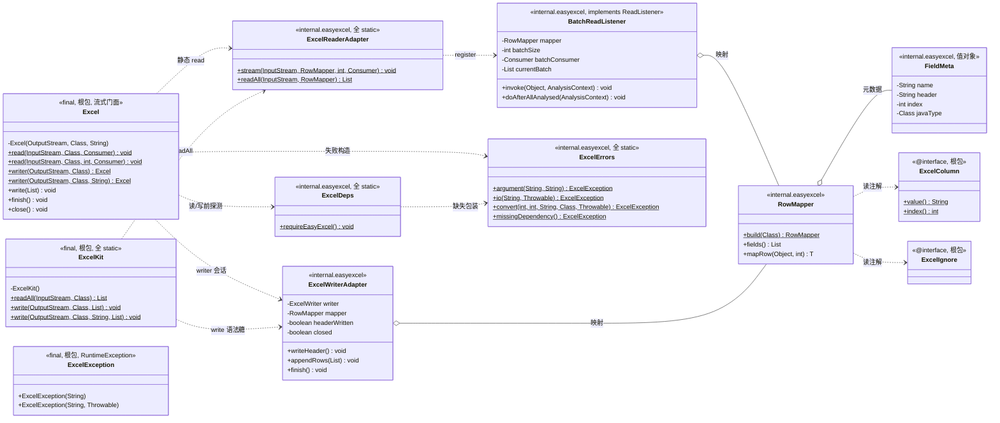
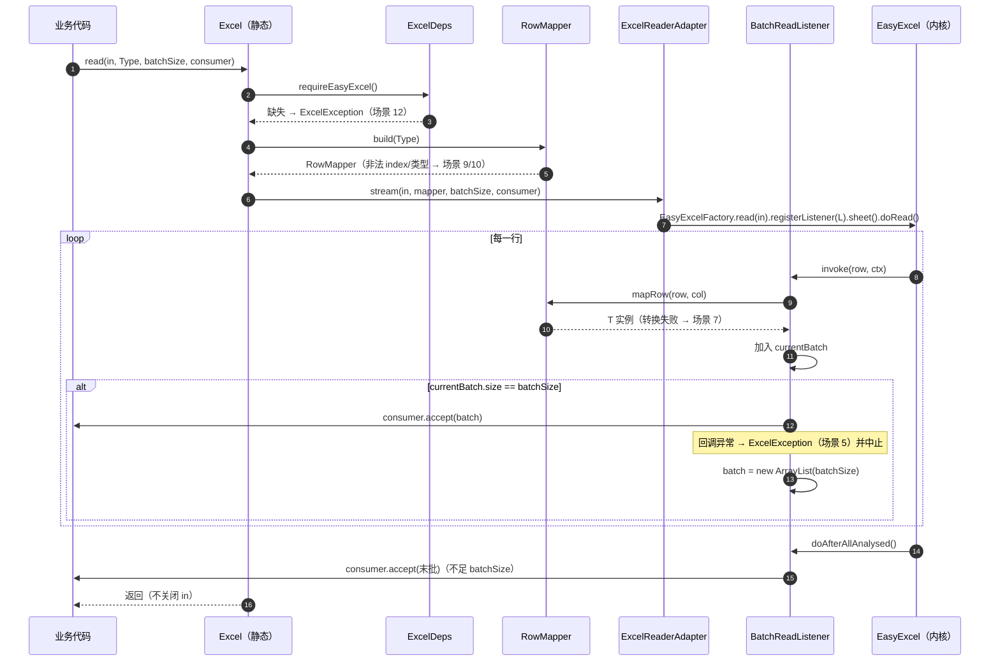
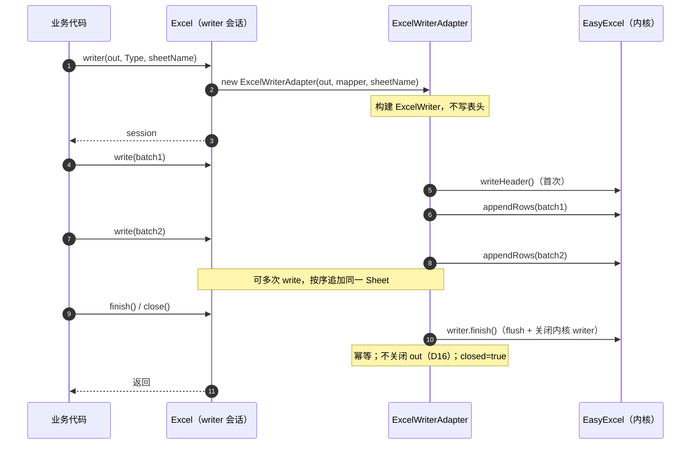

# aifei-excel 设计文档

本文是 `aifei-excel` 的**设计事实来源（契约）**：公共 API 逐字签名、注解语义、流式内存边界、异常模型、架构门禁、任务分解与验收标准（AC）以本文为准。面向使用者的用法见 `README.md`；面向开发代理的约束见模块 `AGENTS.md`；测试策略与用例清单见 `docs/testing.md`（本文只定契约与端点清单）。

> **交付性质**：`aifei-excel` 是 aifei 生态的**库模块（SDK，可被应用依赖）**，**不是业务应用工程**。工程内**没有** `AppConfig implements AifeiConfig` / `Launcher` / `@Path` Service 方法 / `service/` 业务包 / 业务库表 / `Db+Row` / `Generator` / 服务拓扑 / 部署架构 / 数据层实现 / UI 原型与 QA 基线门禁；只有「根包公共 API 精确 5 类型 + `internal/easyexcel` 非承诺适配层」。不适用章节声明见 §0。
>
> **坐标**：`io.github.gollyhu:aifei-excel:1.0.0`（`packaging=jar`）；包名 `cn.hg.aifei.excel`；**Java 8**（语法与 API 双约束，主 JAR class major = 52）；**唯一第三方依赖** `com.alibaba:easyexcel:3.3.2`（`optional`），`aifei-all:1.1.2` 为 `provided`。
>
> **文档状态**：1.0.0 已落地（库模块 + demo + 门禁测试齐备）。§5 的 5 个公共类型签名是编码角色的**唯一依据**，变更前必须先改本文。
>
> **文件位置**：本文位于 `aifei-excel/docs/design.md`。模板默认路径 `docs/02-design-*.md` 对库模块**不适用**；`README.md` / `AGENTS.md` / `docs/testing.md` 与根导航均已落盘（§11.1 文件清单、§11.3 任务分解记录了产出过程）。
>
> **底稿说明**：本模块为原创设计，无官方同名模块可对齐。范式参考 `aifei-trace`（无 Plugin / 无配置键门面 + 命名例外登记）、`aifei-http`（公共面收敛 + `internal` 实现层 + 门禁 + 时序写法）、`aifei-id`（决策表 + 唯一定义点 + 任务分解 + AC 映射）、`aifei-oss`（第三方内核 + `optional` 边界）。文中所有 EasyExcel / POI API 签名均按本地 3.3.2 sources jar 与源码核对，不臆造。

---

## 0. 不适用章节声明（模板裁剪）

本次是**库模块（SDK）**，不是业务应用工程。系统架构师模板中以下章节**不适用**，逐条给出理由：

| 模板章节 | 结论 | 理由 |
| --- | --- | --- |
| 模块划分（业务服务/子系统拓扑） | **不适用** | 本模块是单一 JAR 库，无业务服务切分；仅按「根包公共 API / `internal` 适配层」两个技术层划分（§7.1） |
| 业务库表结构 / `Db+Row` / `Generator` / `Model` | **不适用** | 本模块**零 DB**：无表、无连接；与数据仅经 `InputStream` / `OutputStream` 交互；门禁反向断言全模块无 `import java.sql.` |
| 服务拓扑 / `@Path` 方法清单 / HIO / 路由 / 拦截器（入站） | **不适用** | 库模块本体无入站 HTTP 面；Excel 读写是进程内能力。真实端点只存在于 `aifei-excel-demo`（§12.2），属示例工程，不在本模块 |
| 部署架构 / 实例规格 / 容量规划 | **不适用** | 库模块随使用方应用部署，无独立部署单元；内存边界以 API 契约（§5 / §7.3）表达，而非部署参数 |
| 数据层角色产出清单 / 前端页面设计交付 | **不适用** | 无数据层实现；无设计交付页面——demo 单页由前端直接实装，不经原型与 QA 基线门禁（同 `aifei-id-demo` 定档） |
| `AppConfig implements AifeiConfig` / `Launcher` / `Plugin` / 配置键 | **不适用** | 按 `aifei-trace` 先例（其 design §2 决策 6）：本模块无连接资源、无配置可解析，不设 Plugin、不设配置键、无 `aifei` 接入包（§3 决策 D5） |
| 配置中心 / 部署配置 | **不适用** | 无配置键；全部行为由方法入参显式传入（类型、批大小、流） |

`aifei-excel/` 内 `mvn clean verify` 必须 **0 failure / 0 error**（含架构门禁测试）。

---

## 1. 模块定位与边界

### 1.1 定位

aifei 生态有 `aifei-oss` 负责「文件往哪存」，但**缺 Excel 读写能力**：业务普遍各自裸用 POI / EasyExcel，注解映射、流式大文件、异常口径各写各的。本模块补齐**统一 Excel 读写门面**，一件一个落点：

| # | 目标 | 落点 |
| --- | --- | --- |
| 1 | **注解表头映射**：表头名 / 列序 / 排除字段，统一字段参与语义 | 注解 `ExcelColumn` / `ExcelIgnore` + `internal.easyexcel.RowMapper`（唯一映射定义点） |
| 2 | **一次性便捷读写**（小文件）：全量读成 `List`、列表一次写 | `ExcelKit`（§5.2） |
| 3 | **流式读写**（大文件）：分批读回调、同流多次追加写，内存 `O(batchSize)` | `Excel` 会话 + `internal.easyexcel.BatchReadListener` / `ExcelWriterAdapter`（§7.3 / §7.4） |
| 4 | **统一异常**：参数 / IO / 解析转换三段收敛，保留 cause | `ExcelException` + `internal.easyexcel.ExcelErrors`（唯一构造点） |

**与生态的关系**：

- **不依赖 `aifei-oss`**：本模块只认 `InputStream` / `OutputStream`，与存储解耦；「导入源 / 导出落盘」由使用方把 `aifei-oss` 的流传入本模块实现（规划文档 §6.3 的组合关系，非代码依赖）。
- **内核**：EasyExcel 3.3.2（`optional`），经 `internal/easyexcel` 适配层单点引用；POI 随 EasyExcel 传递，库模块源码不直接 import POI（封装在适配层）。
- **不记录日志**：失败即抛 `ExcelException`（携带定位信息与 cause），库模块全模块零 `cn.aifei.*` 引用（含 `cn.aifei.log.*`），无需在根 `AGENTS.md` 登记框架类型例外（§3 决策 D5）。

### 1.2 公共面收敛纪律（硬约束）

| # | 纪律 |
| --- | --- |
| 1 | **根包 `cn.hg.aifei.excel` 精确 5 个公共类型**：`Excel` / `ExcelKit` / `ExcelException` / `ExcelColumn` / `ExcelIgnore`。**不得增删、不得改名**；变更须先改本文 §5 并过设计决策 |
| 2 | **公共签名零第三方类型、零框架类型**：5 个公共类型的签名只出现 JDK 类型（`InputStream` / `OutputStream` / `Class` / `List` / `Consumer` / 基本类型 / `String`）+ 本模块类型；不出现 `com.alibaba.*` / `org.apache.poi.*` / `cn.aifei.*` |
| 3 | **唯一第三方依赖 `easyexcel:3.3.2` 为 `optional`**（阻断传递），`aifei-all:1.1.2` 为 `provided`；`junit:4.13.2` 为 `test` |
| 4 | **无 provider / 无 SPI / 无 `META-INF/services`**；不设自定义转换器 SPI，仅用 EasyExcel 内置常用类型转换器 |
| 5 | `internal.easyexcel` 为非承诺实现层：可引用 EasyExcel / POI / `com.alibaba.*`；**不得**被公共面签名暴露 |
| 6 | 每类规则只有一个定义点（§7.2），实现类不得复制 |
| 7 | Java 8 语法与 API 双约束；主 JAR class major = 52 |

> 第 1、2、3、4、7 条由架构门禁 `ArchitectureBoundaryTest`（§9）强制，**不得放宽或绕过**。

### 1.3 本期不做清单（边界，防范围蔓延）

以下能力**明确不做**，写进 README「注意事项」与本文，实现时不得自行扩张：

| 不做项 | 边界说明 |
| --- | --- |
| **CSV 读写** | 只支持 xls / xlsx；虽 EasyExcel 传递了 `commons-csv`，本模块不暴露 CSV API |
| **模板导出** | 不做 `withTemplate` 填充；只做「注解模型 → 表头 + 数据行」的平铺导出 |
| **公式 / 图片 / 富文本 / 批注 / 合并单元格 / 超链接** | 只读写单元格标量值；不解析或生成上述结构 |
| **自定义转换器 SPI** | 不声明 `converterClass` 属性、不注册 `Converter`；仅内置常用类型（§6.4）。理由见 §3 决策 D8 |
| **JSR-303 / Bean Validation** | 不做字段校验注解；值合法性由使用方在回调/写入前自行保证 |
| **provider / SPI / 多后端** | 只有 EasyExcel 一条实现路径，无后端切换、无 `ServiceLoader` |
| **独立配置 / Plugin / 命名实例** | 无 `excel.*` 配置键、无 Plugin、无多实例注册表（§3 决策 D5） |
| **加密 / 密码保护 / 数字签名文档** | 不处理受保护工作簿 |
| **多 Sheet 高级编排** | 读写默认单 Sheet（读第 0 个 Sheet、写单 Sheet）；多 Sheet 场景本期不提供 API |
| **流式读的随机访问 / 回退** | 单向逐批读，回调后不可回退；不缓存历史批次 |

> **归类口径**：本表是「实现期防范围蔓延红线」，不是需求池 / 演进清单的完备来源——某项未在本表列举，不等于它属于本期范围。凡 §13 标注「1.1 演进」的条目即需求池演进候选（P1），与是否在本表列举无关（例：父类字段映射，见 §6.5 / §13 事项 7）。

---

## 2. 选型实证记录（含依赖树结论）

> **门禁要求**：对框架 / 依赖做「不可用 / 有缺陷」断言前必须当场实测；本次对定档依赖做完整性、Java 8 兼容与传递依赖实测，结论如下（**离线优先，必要时联网核验**）。所有命令在仓库根 `c:/Workspace/github/aifei-eco-modules` 执行。

### 2.1 定档依赖（不可推翻，仅记录理由）

- `com.alibaba:easyexcel:3.3.2`，`optional=true`（主会话定档 1）：本机仓库已有该版本；POI 4.1.2 / 5.5.1 已在本地。
- `aifei-all:1.1.2` 为 `provided`（共同底座，消费方自带）。
- 若 3.3.2 实测不可用，**须回报主会话而非私自换方案**——本次实测结论为**可用**（§2.3 / §2.4）。

### 2.2 实测环境与命令

| 项 | 值 |
| --- | --- |
| Maven | `Apache Maven 3.9.16`，home `C:\IDEs\apache-maven3` |
| 实际本地仓库 | `C:\IDEs\apache-maven-repository`（`settings.xml` 的 `localRepository` 覆盖默认值；默认 `.m2\repository` 下无 easyexcel，已核实） |
| 构建 JDK | JDK 21（仅用于 `javap` 探测字节码；编译 `source/target=1.8`） |
| 镜像 | aliyunmaven（`https://maven.aliyun.com/repository/public`） |

执行过的实证命令（枚举，便于复核）：
1. `dir` 探测仓库内 `com/alibaba/easyexcel` / `org/apache/poi` 目录与版本。
2. `javap -verbose -classpath <jar> <class>` 检查 class `major version`。
3. `jar tf <jar>` 列出 facade / core jar 内真实类名。
4. 最小临时 pom（`easyexcel:3.3.2` `optional`）执行 `mvn -o dependency:tree -DoutputFile=tree.txt`。
5. `mvn -q dependency:get "-Dartifact=org.slf4j:slf4j-api:1.7.32"`（联网补齐，**`-D` 参数整体加引号**，否则 PowerShell 在冒号处切断——符合根 `AGENTS.md` 警示）。
6. 探针目录 `out/excel-probe/` 用毕即删（构建中间产物不留仓库）。

### 2.3 实测结论

| # | 结论 | 证据 |
| --- | --- | --- |
| 1 | easyexcel 3.3.2 全家桶齐全 | `com/alibaba/{easyexcel,easyexcel-core,easyexcel-support}/3.3.2/` 均含 `.jar` + `-sources.jar` + `.pom` + `.sha1` |
| 2 | **Java 8 字节码兼容** | `javap -verbose`：`com.alibaba.excel.EasyExcelFactory`（core）**major version: 52**；`org.apache.poi.xssf.usermodel.XSSFWorkbook`（poi-ooxml 4.1.2）**major version: 52** |
| 3 | facade jar 为空壳，真 API 在 core | `easyexcel-3.3.2.jar` 仅含 `com/alibaba/excel/Empty.class`；`EasyExcelFactory` / `ExcelReaderBuilder` / `ExcelWriterBuilder` 均在 `easyexcel-core-3.3.2.jar` |
| 4 | **离线依赖树解析成功** | `mvn -o dependency:tree` **EXIT=0**，全部传递项标记 `(optional)`；无 `org.springframework.*`、无 JDBC 驱动 / 连接池 |
| 5 | POI 版本锁定 4.1.2 | `easyexcel-core:3.3.2` pom 固定 `poi`/`poi-ooxml`/`poi-ooxml-schemas` = 4.1.2（非 5.5.1） |
| 6 | 唯一缺失项已补齐 | `slf4j-api:1.7.32` 原缺失，联网 `dependency:get` 后 `.jar` 落盘（EXIT=0）；不改 easyexcel 原始传递版本 |
| 7 | lombok 不传递 | `easyexcel` / `easyexcel-core` 的 `lombok:1.18.20` 为 `provided`，不进入本模块依赖树 |

### 2.4 依赖树结论（实测回填，实现期以本表核对）

```text
io.github.gollyhu:aifei-excel:1.0.0
├─ cn.aifei:aifei-all:1.1.2 ........................ provided（消费方自带）
├─ com.alibaba:easyexcel:3.3.2 ..................... optional（阻断传递）
│  ├─ com.alibaba:easyexcel-core:3.3.2 ............... optional
│  │  ├─ com.alibaba:easyexcel-support:3.3.2 ......... optional
│  │  ├─ org.apache.poi:poi:4.1.2 .................... optional
│  │  │  ├─ commons-codec:commons-codec:1.13 .......... optional
│  │  │  ├─ org.apache.commons:commons-collections4:4.4 optional
│  │  │  ├─ org.apache.commons:commons-math3:3.6.1 .... optional
│  │  │  └─ com.zaxxer:SparseBitSet:1.2 ............... optional
│  │  ├─ org.apache.poi:poi-ooxml:4.1.2 ............... optional
│  │  │  ├─ org.apache.commons:commons-compress:1.19 ... optional
│  │  │  └─ com.github.virtuald:curvesapi:1.06 ........ optional
│  │  ├─ org.apache.poi:poi-ooxml-schemas:4.1.2 ........ optional
│  │  │  └─ org.apache.xmlbeans:xmlbeans:3.1.0 ......... optional
│  │  ├─ org.apache.commons:commons-csv:1.8 ............ optional
│  │  ├─ org.ehcache:ehcache:3.9.9 ..................... optional
│  │  └─ commons-io:commons-io:2.11.0 .................. optional
│  └─ org.slf4j:slf4j-api:1.7.32 ....................... optional
└─ junit:junit:4.13.2 ................................. test
```

**断言口径**：① 全部 EasyExcel / POI 传递项均为 `optional`（`optional` 会阻断向下游传递，消费方须自行引入 easyexcel，从而连带获得其传递项）；② 无日志绑定实现（`slf4j-simple` / `logback` 等一律不声明）；③ 无 JDBC / 连接池；④ 除上表外出现任何条目即视为依赖失控（门禁外的 `dependency:tree` 人工核对项）。

**`optional` 语义必须写入 README**：不引 `com.alibaba:easyexcel:3.3.2` 则本模块读写均不可用（首次调用抛 `ExcelException`，消息由 `ExcelErrors` 给出可读提示，不得出现裸 `NoClassDefFoundError`）——这是「能力按需引入」而非「功能降级」。EasyExcel 缺失的可读失败由适配层首次加载点捕获 `NoClassDefFoundError` / `ClassNotFoundException` 后包装（§7.5 场景 12）。

### 2.5 选型风险提示（P1 非阻塞假设，不改变定档）

- **POI 4.1.2 的公开安全公告**：EasyExcel 3.3.2 固定依赖 POI 4.1.2；换成 5.5.1 需对 easyexcel 做 exclusion + 显式声明，可能破坏 EasyExcel 3.3.2 针对 POI 4.1.2 的二进制兼容。**本版按定档锁 3.3.2 / POI 4.1.2 不动**；该风险登记为 P1 非阻塞假设（§13），由主理人决定是否未来整体升级，实现期不私自变更。
- **`slf4j-api:1.7.32` 随 EasyExcel 传递**：库模块自身零 `org.slf4j.*` import（门禁断言）；消费方若已有其它 slf4j 版本由依赖仲裁决定，本模块不声明绑定。

---

## 3. 设计决策表

> 格式：**决策** —— 理由 —— 被否决的替代方案。逐条对应主会话定档 1–9，并补充契约落地所需的衍生决策。定档条目「理由」为记录性质，不作为推翻依据。

| # | 决策（对应定档） | 理由 | 被否决的替代方案 |
| --- | --- | --- | --- |
| **D1**（定档 1） | **依赖 `com.alibaba:easyexcel:3.3.2` 且 `optional=true`**；POI 随其传递、库模块源码不直接 import POI | §2 已实测：版本齐全、major 52、离线依赖树 EXIT=0、无 Spring/JDBC；`optional` 阻断传递，消费方按需自带，符合仓库「第三方一律 optional/provided」 | ① 裸用 POI 自实现：重复造注解映射与 SAX 流式，正是要消灭的分散实现；② `compile`（像 `aifei-oss` 内核）：会把整棵 POI 树强加给所有消费方，本模块门面可独立存在（缺依赖时可读失败即可），不构成「脱离即无任何功能」的 compile 例外；③ 私自换成 3.3.3 / POI 5.5.1：违反定档，且已实测 3.3.2 可用 |
| **D2**（定档 1） | **`aifei-all:1.1.2` 为 `provided`**，但库模块源码**零 `cn.aifei.*` 引用**（含 log） | 生态统一底座（规划 §6.1），demo 侧以 `compile` 自带验证 provided 口径；本模块是纯数据能力，无需装配入口与框架日志，异常即契约 | ① 不声明 `aifei-all`：破坏生态基线一致性且 demo 需另行传递；② 用 `cn.aifei.log` 记日志：引入装配期 `NoLogFactory` 陷阱（`aifei-id` §2 D10 已论证），且需在根 `AGENTS.md` 登记例外，无收益 |
| **D3**（定档 2） | **根包精确 5 个公共类型**：`Excel` / `ExcelKit` / `ExcelException` / `ExcelColumn` / `ExcelIgnore`；门禁按**文件名集合精确相等**断言 | 定档冻结；集合相等可防「同名替换 / 悄悄增删」（`aifei-http` 决策 3 先例） | ① 只断言数量：无法防同名替换；② 增设 `ExcelWriter` / `ExcelReader` 公共句柄类：突破精确 5，改由 `Excel` 会话类承载（D7） |
| **D4**（定档 2） | **公共签名零第三方 / 零框架类型**：只用 JDK 类型 + 本模块类型 | 公共 API 实现无关；消费方签名不被迫依赖 EasyExcel / POI | ① 公共方法暴露 `com.alibaba.excel.read.listener.ReadListener` / `ExcelWriter`：把内核类型拖进公共面，换内核即破坏二进制兼容 |
| **D5**（定档 2 / 9） | **不设 Plugin、不设配置键、无 `aifei` 接入包，全模块零 `cn.aifei.*` 引用**；门禁断言 `cn.aifei.*` 全模块禁止，**需登记的框架类型例外清单为空** | 按 `aifei-trace` 先例（design §2 决策 6）：无连接资源需 start/stop、无可从 `app-config.txt` 解析的配置，强造 Plugin 只剩空壳；全部行为由方法入参（类型、批大小、流）决定 | ① 仿 `aifei-http` 加 `ExcelPlugin`：无配置无资源无单例注册，纯空转；② 用 `cn.aifei.log.*` 记日志：与 D2 同因否决；③ 设 `excel.*` 配置键：调用点分散、语义靠全局状态，违背显式入参 |
| **D6**（定档 3） | **不设 provider / SPI；不依赖 `aifei-oss`；与存储仅经 `InputStream` / `OutputStream`** | 只有一条 EasyExcel 实现路径；流解耦使「导入源 / 导出落盘」可与 `aifei-oss` 自由组合而不产生代码依赖 | ① 设 `Converter` provider 扩展点：与 D8「不提供自定义转换器 SPI」冲突；② 直接依赖 `aifei-oss` 收 `OssObject`：把存储模块拖进依赖树，破坏流解耦 |
| **D7**（定档 4 / 6） | **`Excel` = 流式门面**（静态分批读回调 + 有状态 writer 会话，同实例多次追加）；**`ExcelKit` = 一次性便捷门面**（全静态：`readAll` 全量读 / `write` 列表一次写）；回调用 JDK `java.util.function.Consumer` | 定档冻结；`Consumer<List<T>>` 满足「每批回调」，不新增公共类型；writer 会话由 `Excel` 自身承载，避免在精确 5 之外新增句柄类 | ① 新增 `ExcelWriter` 公共类作会话句柄：突破精确 5；② 用 `Iterator<List<T>>` 喂批做「分批写」：无法支持「写一批→做别的事→再写一批」的交互式追加；③ 自定义 `BatchConsumer` 接口：JDK `Consumer` 已够用，新增类型无收益 |
| **D8**（定档 5） | **`@ExcelColumn` 只声明 `value`（表头名）与 `index`（列序）两个属性，不声明 `converterClass`**；仅用 EasyExcel 内置常用类型转换器（§6.4） | 定档原文「不提供自定义转换器 SPI，仅内置常用类型」；`converterClass` 属性本质是自定义转换器的注册入口，声明它即为暴露 SPI 且误导使用者，与 D4 / D6 一致；未来需要时作为 1.1 演进 | ① 声明 `converterClass` 但内部忽略：误导性公共 API，违背「不自造无效键/属性的」原则（类比 `aifei-http` 决策 9）；② 声明并实现 `Converter` SPI：违反定档 5 |
| **D9**（定档 5） | **默认全部字段参与**；`@ExcelIgnore` 字段排除；**注解缺省字段用字段名原样匹配表头**；`index>=0` 优先按列序定位；表头映射唯一定义点 `internal.easyexcel.RowMapper` | 定档冻结；单一定义点防止读写两侧映射规则漂移 | ① 仅注解字段参与：违背「默认全部字段」；② 驼峰自动转下划线表头：定档要求「原样匹配」，不擅自猜测命名策略 |
| **D10**（定档 5） | **xls / xlsx 均支持**（由 EasyExcel 按文件签名自动识别）；不做 CSV / 模板 / 公式 / 图片 / JSR-303 等（§1.3） | 定档冻结；边界显式化防实现期扩张 | ① 支持 CSV：虽有 `commons-csv` 传递，但无 API 契约；② 模板导出：引入模板资源模型，超出平铺定位 |
| **D11**（定档 6） | **`Excel` 读 `batchSize` 默认 1000、由调用方传入，每读满一批回调一次；写支持同实例多次 `write` 追加；`ExcelKit` 全量 API 仅定位小文件并在 javadoc / README 注明内存边界** | 定档冻结；`O(batchSize)` 内存边界可契约化（§7.3）；全量 API 的边界必须文档化以防误用于大文件 | ① `batchSize` 做成全局配置：与 D5「无配置键」冲突；② 全量 API 不注明边界：诱导大文件 OOM |
| **D12**（定档 7） | **统一 `ExcelException`（`RuntimeException`）收敛三段：参数错误 / IO 错误 / 解析转换错误，保留 cause**；所有公共方法 javadoc 写 `@throws ExcelException`（但不写 `throws` 子句）；唯一构造点 `internal.easyexcel.ExcelErrors` | 单一 catch 点；cause 保留底层异常便于排障；构造器 `public` 因唯一构造点异包（包私有不可跨包，同 `aifei-id` D8 / `aifei-job` D1）；`RuntimeException` 不污染使用方签名 | ① 细分 `ExcelReadException` / `ExcelWriteException` 多类：公共面扩张；② 用 `IllegalArgumentException` 表达解析失败：与「调用方当场写错」语义混同 |
| **D13**（定档 8） | **`aifei-excel-demo` 自写 HIO（包名 `cn.hg.aifei.excel.demo`），Undertow 端口 18150**，完整单页 + 真实后端端点（上传解析 / 一次性导出 / 流式导出），不发布 | 端口 18150 已实测空闲（18100 mq / 18110 job / 18120 http / 18130 trace / 18140 id 顺延）；自写 HIO 跟随 `aifei-id-demo` 可离线真跑 | ① 引入现成 Web 依赖：破坏「零业务框架」；② 假开关 / 静态假数据：违反「真实能跑一遍」 |
| **D14**（定档 9） | **门禁 `ArchitectureBoundaryTest`**：EasyExcel/POI import 仅 `internal/easyexcel`；`cn.aifei.*` 全模块禁止（无接入包，无 log 例外）；禁 `io.undertow.*` / `java.sql.*` 于库模块本体；根包精确 5；Java 8 major 52 | 定档冻结；边界由断言守护（§9） | ① 为「兼容错误用法」放宽断言：违反根 `AGENTS.md`；② 新增例外不登记：违反根 `AGENTS.md`「新增例外须提请主会话登记」 |
| **D15**（衍生） | **`Excel` / `ExcelKit` 命名例外登记**：二者均非典型 `Util`/`Kit`——`Excel` 是有生命周期的流式会话对象（写），`ExcelKit` 是一次性便捷门面（无 Plugin 装配期，随取随用）；按 `aifei-trace` 的 `TraceKit` 先例记录为命名例外，名字由定档冻结 | 名字被需求冻结，改名收益为零且破坏术语一致；`Excel` 是会话对象（名词），`ExcelKit` 操作有生命周期的 reader/writer（Kit 语义成立），只是无 Plugin 装配期 | ① `ExcelUtil` / `ExcelStreamUtil`：破坏定档冻结名；② 因无 Plugin 强行判为 `Util`：与 `TraceKit` 先例不一致 |
| **D16**（衍生） | **流所有权归调用方**：库模块读不关闭入参 `InputStream`、写 `finish()`/`close()` 只 flush + 关闭 EasyExcel writer，**不关闭调用方 `OutputStream`** | 与「仅经流交互」「存储解耦」一致；调用方可能复用流或自行管理生命周期 | ① 库模块关闭流：会误关调用方持有的连接流（如 `aifei-oss` 上传流），语义越界 |

---

## 4. 术语表

| 术语 | 含义 | 归属 |
| --- | --- | --- |
| **流式读 streaming read** | EasyExcel SAX 模式逐行解析，累积满 `batchSize` 行回调一次，回调后即释放该批引用 | `Excel#read` + `internal.easyexcel.BatchReadListener` |
| **流式写 streaming write** | 持有单个 writer 会话，多次 `write` 追加数据行，内存仅驻留当前批 | `Excel` writer 会话 + `ExcelWriterAdapter` |
| **一次性全量读 readAll** | 一次性把全部行读进 `List<T>` 返回；仅定位小文件 | `ExcelKit#readAll` |
| **批次 batch** | 流式读回调的单位 `List<T>`，长度 ≤ `batchSize`；最后一批可能不足 | `BatchReadListener` |
| **表头 header** | Excel 首行；按字段名原样匹配或 `@ExcelColumn.value` 匹配 | `internal.easyexcel.RowMapper` |
| **列序 index** | `@ExcelColumn.index`，0 起；≥0 时按列位置定位（优先于表头名） | `ExcelColumn` + `RowMapper` |
| **字段元数据 FieldMeta** | 适配层内部值对象：字段名 / 表头名 / 列序 / 是否忽略 / Java 类型 | `internal.easyexcel.FieldMeta` |
| **三段错误** | 参数错误（入参非法）/ IO 错误（流读写失败）/ 解析转换错误（类型或表头不匹配） | `ExcelException` + `ExcelErrors` |
| **适配层 adapter** | `internal.easyexcel` 包，唯一允许引用 EasyExcel / POI 的层；非承诺 API | `internal.easyexcel.*` |
| **流所有权 stream ownership** | 入参流的开关职责；本模块一律不关闭调用方的流（D16） | 公共 API javadoc 契约 |

---

## 5. 公共 API 契约（根包精确 5 类型）

根包 `cn.hg.aifei.excel` **精确 5 个公共类型**，为本节与门禁 `EXPECTED_ROOT_TYPES`（§9）的**唯一事实来源**。逐字签名如下（**编码角色照抄**；`static` 与否、返回类型、泛型、异常声明均不得改动）。所有公共方法均**不声明 `throws` 子句**（`ExcelException` 为 `RuntimeException`），但 javadoc **必须**写全 `@param` / `@return` / `@throws ExcelException`。

### 5.1 `Excel`（流式门面，`final`；静态读 + 有状态 writer 会话）

```java
public final class Excel {

    private Excel(OutputStream out, Class<?> type, String sheetName);

    // ---- 静态：流式读（分批回调）----
    public static <T> void read(InputStream in, Class<T> type, Consumer<List<T>> batchConsumer);
    public static <T> void read(InputStream in, Class<T> type, int batchSize, Consumer<List<T>> batchConsumer);

    // ---- 静态：创建 writer 会话 ----
    public static <T> Excel writer(OutputStream out, Class<T> type);
    public static <T> Excel writer(OutputStream out, Class<T> type, String sheetName);

    // ---- 实例：同流多次追加写 ----
    public <T> void write(List<T> rows);
    public void finish();          // 幂等：flush + 关闭底层 writer，不关闭 out
    public void close();           // 等价 finish，便于 try-with-resources（implements AutoCloseable）
}
```

契约要点：

| 方法 | 契约 | 失败 |
| --- | --- | --- |
| `read(in,type,consumer)` | 默认 `batchSize=1000`；等价于 `read(in,type,1000,consumer)` | 参数非法 / IO / 解析转换失败 → `ExcelException` |
| `read(in,type,batchSize,consumer)` | SAX 逐行读；累积满 `batchSize` 行回调 `batchConsumer` 一次，末批不足亦回调一次；**0 数据行（仅表头 / 空 Sheet）不回调空批**（§7.3）；**读完或异常后 `batchConsumer` 持有的批引用不再被复用**；读过程**不关闭 `in`** | `batchSize<=0`、`in/type/consumer` 为 null → 参数错；回调内抛异常 → 包装为 `ExcelException`（cause=原异常）并中止读 |
| `writer(out,type[,sheetName])` | 创建 writer 会话；`sheetName` 为空时用默认 Sheet 名（唯一定义点 `ExcelWriterAdapter.DEFAULT_SHEET_NAME`）；**不写 `out`** 直到首次 `write` | 参数非法 → `ExcelException` |
| `write(rows)`（实例） | 向同一会话追加一批数据行；可多次调用，行按调用顺序追加；`rows` 为 null/空时**只保证表头、不写数据行**（首次 `write` 写一次表头；表头已写则本次调用无实际写入；均不抛异常）；**不关闭 `out`** | 会话已 `finish()` 后再写 → `ExcelException`（会话已关闭）；转换失败 → `ExcelException` |
| `finish()` / `close()` | 写表头（若尚未写）+ flush + 关闭底层 writer；**幂等**（重复调用无副作用）；**不关闭 `out`**（D16） | flush/close 底层失败 → `ExcelException` |

- **命名依据**：`Excel` 是**流式会话对象**（名词，`final` + 私有构造 + 静态工厂），承载读门面与 writer 生命周期；非典型 `Util`/`Kit`，按定档冻结名登记为命名例外（§3 D15）。
- **线程安全**：静态 `read` 无共享状态，可并发调用；writer **会话非线程安全**（单线程写入，javadoc 声明）；不同会话互不干扰。
- **类型安全**：`writer` 的 `<T>` 仅用于编译期约束会话用途，实际行类型校验在 `write` 时按 `Class<?>` 反射完成，不产生公共泛型泄漏。

### 5.2 `ExcelKit`（一次性便捷门面，`final` + 私有构造 + 全 `static`）

```java
public final class ExcelKit {

    private ExcelKit() {
    }

    public static <T> List<T> readAll(InputStream in, Class<T> type);
    public static <T> void write(OutputStream out, Class<T> type, List<T> rows);
    public static <T> void write(OutputStream out, Class<T> type, String sheetName, List<T> rows);
}
```

契约要点：

| 方法 | 契约 | 失败 |
| --- | --- | --- |
| `readAll(in,type)` | **一次性全量读**，返回全部行（含表头映射后的对象）；**仅定位小文件**，javadoc 与 README 必须注明「内存 `O(行数)`，大文件请用 `Excel.read` 分批」；不关闭 `in` | 参数非法 / IO / 解析转换失败 → `ExcelException` |
| `write(out,type,rows)` | **列表一次写**：内部创建 writer 会话、写一批、`finish()`；`sheetName` 重载同 `Excel.writer`；不关闭 `out` | 参数非法 / IO / 转换失败 → `ExcelException` |

- **命名依据**：全静态便捷门面，操作有生命周期的 reader/writer（Kit 语义），但无 Plugin 装配期、随取随用——与 `aifei-trace` 的 `TraceKit` 同类，登记为命名例外（§3 D15）。**与 `aifei-http` 的 `HttpKit`「未装配即失败」是两种门面形态，README 须说明「ExcelKit 无需装配、任何时刻可调用」。**
- **空结果语义**：`readAll` 无数据行时返回**空 `List`**（非 null）；`write` 的 `rows` 为 null/空时写表头后结束（不抛异常）。

### 5.3 `ExcelException`（唯一模块异常）

```java
public final class ExcelException extends RuntimeException {

    public ExcelException(String message);

    public ExcelException(String message, Throwable cause);
}
```

javadoc **必须显著声明**（原文照写）：

> 本异常**由模块内部抛出**，业务方只 `catch`、**不要** `new`。构造器为 `public` 是因为唯一构造点 `internal.easyexcel.ExcelErrors` 与公共类型不同包（Java 包私有语义所限），并非对外构造入口。消息必然携带定位信息（参数名 / 行号 / 列名 / 文件路径语义），并保留底层 cause。

- 覆盖三段全部失败（§7.5）：参数错误 / IO 错误 / 解析转换错误。
- **消息逐字对齐** §7.5 表，全部由 `ExcelErrors` 构造；测试按表逐字断言。
- 不复用 `IllegalArgumentException` / `IllegalStateException` 表达上述语义（§3 D12）；`RuntimeException` 语义下公共方法不写 `throws`。

### 5.4 `ExcelColumn`（字段注解，`@Retention(RUNTIME)` `@Target(FIELD)`）

```java
@Retention(RetentionPolicy.RUNTIME)
@Target(ElementType.FIELD)
public @interface ExcelColumn {

    String value() default "";   // 表头名；为空时用字段名原样匹配

    int index() default -1;      // 列序（0 起）；>=0 时按列位置定位，优先于 value
}
```

- 属性定义与匹配规则见 §6.2 / §6.3；**不声明 `converterClass`**（§3 D8）。
- 两个属性都取缺省时，字段仍参与（默认全部字段参与），按字段名原样匹配表头。

### 5.5 `ExcelIgnore`（字段注解，`@Retention(RUNTIME)` `@Target(FIELD)`）

```java
@Retention(RetentionPolicy.RUNTIME)
@Target(ElementType.FIELD)
public @interface ExcelIgnore {
}
```

- 标注字段在**读与写两侧都完全排除**（不参与表头映射、不参与列序、不出现在导出列）。

### 5.6 公共面计数口径（供门禁复用）

「根包公共类型」= `src/main/java/cn/hg/aifei/excel/` 目录**直接子级 `.java` 文件**（不含子包）：

`Excel.java` / `ExcelKit.java` / `ExcelException.java` / `ExcelColumn.java` / `ExcelIgnore.java` —— **精确 5 个**。

`internal/easyexcel/` 子包不计数（非承诺 API），但其类型**不得**出现在根包公共签名中。`Exception` 的 `public` 构造器不增加顶层类型计数（同一文件）。

### 5.7 命名依据汇总

| 类型 | 形态 | 命名依据（根 `AGENTS.md` 命名约定 + 本设计决策） |
| --- | --- | --- |
| `Excel` | `public final` + 私有构造 + 静态工厂 + 实例会话方法 | 流式会话对象（名词）；命名例外登记（§3 D15） |
| `ExcelKit` | `public final` + 私有构造 + 全 `static` | 一次性便捷门面（Kit 语义，无 Plugin 装配期——命名例外，§3 D15） |
| `ExcelException` | `public final extends RuntimeException` | 模块唯一异常；`public` 构造器（唯一构造点在异包 `internal`，§3 D12） |
| `ExcelColumn` / `ExcelIgnore` | `@interface` | 注解类型，不适用 Util/Kit 判定 |

---

## 6. 注解定义与表头映射规则

### 6.1 字段参与规则（唯一定义点：`internal.easyexcel.RowMapper`）

对一个 POJO 类 `T` 的全部字段（含父类字段？**不含**——本期只扫当前类声明字段，见 §6.5）：

1. **标注 `@ExcelIgnore`** → 排除（读写两侧均跳过），即使同时标注了 `@ExcelColumn`（`@ExcelIgnore` 优先）。
2. **未标注任何注解** → 参与，表头名 = **字段名原样**。
3. **标注 `@ExcelColumn`**：
   - `value` 非空 → 表头名 = `value`；
   - `index >= 0` → 列位置 = `index`，定位**优先于**表头名；
   - 两者都缺省 → 退化为规则 2（字段名原样匹配）。

### 6.2 表头名匹配（读）

- 读首行为表头；对每个字段按「`index>=0` 优先按列位置取；否则按表头名原样匹配（`value` 非空取 `value`，否则取字段名）」定位单元格列。
- 表头名严格相等匹配（`String.equals`），**不做大小写折叠、不做驼峰/下划线互转**。
- 未匹配到任何字段的表头列 → 忽略（不报错）；匹配不到表头列的字段 → 该字段保持 Java 默认值（读时该列为 null/0）。
- 重复表头名（两列同名）→ 解析转换错误（§7.5 场景 8）。

### 6.3 列序与写表头

- 有 `index>=0` 的字段：写到第 `index` 列（0 起），按 `index` 升序排列。
- 无 `index` 的字段：按字段声明顺序，填入未被 `index` 占用的列（从 0 起找空位）。
- 表头行由各参与字段的表头名（§6.1 / §6.2）写入首行。
- 两个字段 `index` 相同 → 参数错误（构建 `RowMapper` 时抛 `ExcelException`，§7.5 场景 9）。

### 6.4 内置类型转换器（仅内置，无 SPI）

读写的单元格 ↔ Java 类型转换由 **EasyExcel 内置 `Converter`** 承担，本模块不注册自定义转换器。内置支持类型（javadoc / README 列出，作为公共契约）：

| Java 类型 | 说明 |
| --- | --- |
| `String` | 原样字符串 |
| `int` / `Integer` / `long` / `Long` / `double` / `Double` / `float` / `Float` / `short` / `Short` / `byte` / `Byte` | 数值类型，EasyExcel `NumberConverter` |
| `boolean` / `Boolean` | 布尔，`BooleanConverter` |
| `BigDecimal` / `BigInteger` | 高精度数值 |
| `java.util.Date` | 日期，`DateNumberConverter` |
| `java.time.LocalDate` / `LocalDateTime` / `LocalTime` | Java 8 日期时间，EasyExcel JSR-310 转换器 |
| `char` / `Character` | 单字符 |

- 字段类型不在上表（如自定义 POJO / 枚举 / `Map` / `List` 字段）→ 读时该列解析转换错误（§7.5 场景 7）；写时视为参数错误（§7.5 场景 10）。
- 值无法转换为目标类型（如字符串填 `int` 字段且非数字）→ 解析转换错误（§7.5 场景 7），消息含行号与列名/字段名。

### 6.5 本期类型扫描边界

- 只扫描 `T` **当前类声明的字段**（不含父类继承字段）；`static` / `transient` 字段一律跳过。
- 字段可为 `private`：适配层通过 `setAccessible(true)` 读写（Java 8 可行，无模块系统限制）。
- 无字段参与（全部 `@ExcelIgnore` 或无字段）→ 读返回空对象列表结构、写仅表头，具体见 §7.5 场景 11。

---

## 7. 内部结构、内核适配层与流式实现方案

### 7.1 包结构与依赖方向

```text
cn.hg.aifei.excel                    根包：5 公共类型（读门面 / 便捷门面 / 异常 / 2 注解），零第三方、零框架类型
cn.hg.aifei.excel.internal.easyexcel 适配层（非承诺 API）：唯一允许 import com.alibaba.* / org.apache.poi.* / org.slf4j.*

依赖方向（门禁 ①②③ 强制）：
  根包                    ──→ 纯 JDK（java.io / java.util / java.util.function）+ 本模块 internal.easyexcel
  internal.easyexcel      ──→ EasyExcel / POI / JDK；不得引用 cn.aifei.*
  禁止：根包 import com.alibaba.* / org.apache.poi.* / cn.aifei.*；
        任何库模块 .java import io.undertow.* / java.sql.*（demo 例外由 demo 自身约束）；
        任何 .java import org.slf4j.*（库模块零日志绑定）
```

- 无 `aifei` 接入包、无 Plugin、无 `internal` 其它子包——只有 `internal.easyexcel` 一个实现包（D5 / §1.2）。
- 根包门面通过**静态调用 / 会话实例**转入适配层；适配层类型不出现在任何公共签名（D4）。

### 7.2 各类型职责（★ 后为该规则的唯一定义点）

| 类型 | 包 | 职责 |
| --- | --- | --- |
| `Excel` | 根 | 流式门面：静态 `read` + writer 会话；★ 流所有权契约（D16）与 `batchSize` 默认值常量的对外暴露点 |
| `ExcelKit` | 根 | 一次性便捷门面：`readAll` / `write`；★ 「小文件」内存边界 javadoc 声明点 |
| `ExcelException` | 根 | 模块唯一异常类型（构造器 `public`，唯一构造点在 `ExcelErrors`） |
| `ExcelColumn` / `ExcelIgnore` | 根 | 注解定义；属性默认值（`""` / `-1`）唯一定义点 |
| `ExcelWriterAdapter` | internal | ★ writer 会话实现：`DEFAULT_SHEET_NAME`、表头写入时机、多次 `write` 累积、`finish()` 收尾；唯一持有 EasyExcel `ExcelWriter` 的类型 |
| `ExcelReaderAdapter` | internal | ★ 流式/全量读的 EasyExcel 装配点（`EasyExcelFactory.read(...)` builder 配置唯一落点） |
| `BatchReadListener<T>` | internal | ★ 分批回调实现：累积满 `batchSize` 触发 `Consumer.accept`、末批兜底回调、回调异常包装；唯一 `invoke` 实现 |
| `RowMapper<T>` | internal | ★ 字段参与 / 表头名 / 列序 / 类型校验的**唯一定义点**（§6 全部规则）；构建 `FieldMeta` 列表、按列定位字段、单元格值 → 字段赋值 |
| `FieldMeta` | internal | 字段元数据值对象：`name` / `header` / `index` / `javaType` / `Field` 引用（内部，非公共） |
| `ExcelErrors` | internal | ★ `ExcelException` 唯一构造点 + ★ 全部异常消息措辞唯一定义点（§7.5 逐字）；★ EasyExcel 缺失探测包装点 |
| `ExcelDeps` | internal | ★ EasyExcel 可选依赖探测唯一定义点（唯一 `Class.forName` 点）：`requireEasyExcel()`，缺失即抛可读 `ExcelException` |

### 7.3 流式读实现与内存边界

```text
Excel.read(in, type, batchSize, consumer)
  → ExcelDeps.requireEasyExcel()                  // 依赖探测（场景 12）
  → RowMapper.build(type)                          // 一次性构建字段映射（场景 9/10 校验）
  → ExcelReaderAdapter.stream(in, rowMapper, batchSize, consumer)
      → EasyExcelFactory.read(in, headClass=动态生成或 Map 行)
          .registerReadListener(new BatchReadListener<>(rowMapper, batchSize, consumer))
          .sheet().doRead()
```

- **内存边界**：`BatchReadListener` 内部只持有**当前一批**（`ArrayList<T>`，上限 `batchSize`）。每读到一行：经 `RowMapper` 映射为 `T` 加入当前批；`size == batchSize` 时调用 `consumer.accept(batch)`，**随后 `batch = new ArrayList<>(batchSize)` 丢弃旧引用**。故峰值内存 `O(batchSize × 单对象大小)`，与文件总行数无关。末批不足 `batchSize` 在 `doAfterAllAnalysed` 中兜底回调一次。
- **0 数据行不回调空批**：`BatchReadListener.doAfterAllAnalysed` 只在 `headerResolved && !currentBatch.isEmpty()` 时 `deliver()`，故「仅表头」与「连表头都没有」的文件 `batchConsumer` 一次也不被调用，**绝不回调空批**（消费方无需判 `batch.isEmpty()`）。所依赖的 EasyExcel 行为：解析结束必调用一次 `doAfterAllAnalysed`（0 行亦然）——实测仅表头文件 `invoke=1` / `doAfterAllAnalysed=1`，空 Sheet `invoke=0` / `doAfterAllAnalysed=1`。
- **`batchSize` 默认 1000**（`Excel.read` 两参重载内写死常量 1000；四参重载用调用方值），`<=0` 抛参数错误。
- **回调异常**：`consumer.accept` 抛任何异常 → 立即包装 `ExcelException`（cause=原异常，场景 5）并中止读；不吞异常、不继续下一批。
- **不缓存历史批**：回调后本模块不再持有该批引用；若 `consumer` 需要留存，由使用方自行复制。
- **`readAll` 不做分批**：`ExcelKit.readAll` 走同一 `RowMapper`，但 listener 把所有行累积进一个 `List` 返回——内存 `O(行数)`，故 javadoc / README 强标注「仅小文件」（D11）。

### 7.4 流式写实现与同流多次追加

```text
Excel.writer(out, type[, sheetName])               // 创建会话（不写 out）
  → ExcelDeps.requireEasyExcel()
  → RowMapper.build(type)
  → new ExcelWriterAdapter(out, rowMapper, sheetName)   // 内部：EasyExcelFactory.write(out).build()
      （此时不写表头，标记 headerWritten=false）

session.write(rows)                                // 可多次调用
  → if (!headerWritten) adapter.writeHeader()      // 首次 write 时写表头行
  → adapter.appendRows(rows)                       // 逐行按 RowMapper 列序写单元格
  → （内存仅驻留 rows 当前一批；EasyExcel 内部流式写出）

session.finish() / close()                         // 幂等
  → adapter.finish()                               // writer.finish()（flush + 关闭底层 writer）
  → 不关闭 out（D16）；writerClosed=true；后续 write 抛场景 3
```

- **同流多次追加**：同一 `Excel` 会话实例可多次 `write`，行按调用顺序追加到同一 Sheet；会话内部只持有一个 `ExcelWriter`，不重复构建、不重复写表头。
- **写表头时机**：首次 `write`（含空 `rows`：`rows` 为 null/空也触发写表头后结束）时写一次表头，`finish()` 前若从未 `write` 则 `finish()` 补写表头（保证导出文件有表头）。
- **`ExcelKit.write`**：分步调用 `Excel.writer(out,type[,sheetName])` → `write(rows)` → `finish()`（各步返回 `void`，不链式），一次写入；不关闭 `out`。
- **内存边界**：仅驻留调用方传入的当前 `rows`（一次性列表）与 `RowMapper` 元数据；写出由 EasyExcel 流式完成，与总行数无关。

### 7.5 异常语义表（全部失败路径，无遗漏）

消息**逐字**由 `ExcelErrors` 构造；`{...}` 为占位拼接值。三段分类：**参**=参数错误 / **IO**=IO 错误 / **析**=解析转换错误。

| # | 段 | 场景 | 行为 | 消息（逐字，唯一措辞来源） |
| --- | --- | --- | --- | --- |
| 1 | 参 | `Excel.read` / `writer` / `ExcelKit.readAll` / `write` 的 `in/out/type/consumer` 为 null | 拒绝 | `excel: {method} argument {name} must not be null` |
| 2 | 参 | `batchSize <= 0` | 拒绝 | `excel: batchSize must be positive, but was: {n}` |
| 3 | 参 | 会话已 `finish()` 后再 `write` | 拒绝 | `excel: writer session already finished, create a new writer` |
| 4 | 参 | `@ExcelColumn.index < 0` 缺省之外出现负数显式值 | 该字段按 `value`/字段名处理（index<0 视为未指定） | 无（非错误） |
| 5 | 析 | `batchConsumer.accept` 抛异常 | 包装中止读 | `excel: batch consumer failed at batch {index}, cause: {causeMsg}`（cause=原异常） |
| 6 | IO | 读/写底层流抛 `IOException` 或 EasyExcel 抛 IO 相关异常 | 包装 | `excel: io error during {read/write}, cause: {causeMsg}`（cause=原异常） |
| 7 | 析 | 单元格值无法转换为字段类型 | 拒绝该行（包装中止整次操作） | `excel: convert failed at row {row}, column {col}, field {field}, type {type}, cause: {causeMsg}` |
| 8 | 析 | 表头重复名 | 拒绝 | `excel: duplicated header "{header}" at column {col1} and {col2}` |
| 9 | 参 | 两个字段 `index` 相同 | 构建 RowMapper 时拒绝 | `excel: duplicated column index {index} on fields {f1} and {f2}` |
| 10 | 参 | 字段类型不支持（写侧，§6.4 之外） | 拒绝 | `excel: unsupported field type {type} on field {field}` |
| 11 | 参 | 类无可用字段（全 `ExcelIgnore` / 无字段） | 读返回空对象行、写仅表头（**不抛异常**） | 无（非错误，javadoc / README 说明） |
| 12 | 参 | EasyExcel 可选依赖缺失（首次加载适配层） | 包装为可读异常，禁止裸 `NoClassDefFoundError` | `excel: com.alibaba:easyexcel:3.3.2 is required, add it to your dependencies` |
| 13 | IO | `finish()` / `close()` 底层 flush 失败 | 包装 | `excel: io error during finish, cause: {causeMsg}`（cause=原异常） |

- **不降级**：任何失败都抛 `ExcelException`，不返回半截数据、不静默跳过错误行、不吞 cause。
- **cause 保留**：场景 5/6/7/13 必须 `new ExcelException(msg, cause)`，其余为 `new ExcelException(msg)`。
- **依赖探测**：`ExcelDeps.requireEasyExcel()` 是**唯一** `Class.forName` 点（门禁 ⑪），用 `Class.forName("com.alibaba.excel.EasyExcel", false, loader)` 不初始化；缺失即场景 12。

### 7.6 线程模型

| 状态 / 线程 | 归属 | 说明 |
| --- | --- | --- |
| 静态 `read` / `readAll` / `write` | 无共享可变状态 | 每次调用构建独立 listener/writer；可并发 |
| writer 会话 | `Excel` 实例 | **非线程安全**；单线程写入；javadoc 声明 |
| `BatchReadListener` 当前批 | 单次读调用栈内 | 不跨调用共享；无后台线程 |
| 其余 | 无线程 | 无异步、无回调线程池；`Consumer` 在调用方读线程内同步执行 |

---

## 8. 类图与关键时序图

### 8.1 类图



> 类图要点：5 个公共类型（3 类型 + 2 注解）+ 6 个 `internal.easyexcel` 类型。无 provider、无 SPI、无 Plugin、无值对象公共面。EasyExcel / POI 只在适配层出现（门禁 ①）。

### 8.2 时序图 ①：流式读（分批回调）



### 8.3 时序图 ②：流式写（同流多次追加 + finish）



---

## 9. 架构门禁设计（`ArchitectureBoundaryTest`）

- **位置 / 机制**：`src/test/java/cn/hg/aifei/excel/ArchitectureBoundaryTest.java`；`Files.walk(Paths.get("src/main/java"))` 收集全部 `.java`，按**源码文本**断言（路径分隔符归一化为 `/`，注释剥离后再匹配字面量）。
- **执行位置**：**必须在 `aifei-excel/` 根目录**（依赖相对路径 `src/main/java`），不得放宽断言。
- **关键常量**：

```java
private static final Path   SOURCE_ROOT = Paths.get("src/main/java");
private static final Path   TEST_ROOT   = Paths.get("src/test/java");
private static final String ROOT_PACKAGE    = "cn/hg/aifei/excel/";
private static final String ADAPTER_PACKAGE = "cn/hg/aifei/excel/internal/easyexcel/";
private static final int    EXPECTED_ROOT_TYPES = 5;
private static final Set<String> EXPECTED_ROOT_TYPES_SET = new LinkedHashSet<>(Arrays.asList(
        "Excel.java", "ExcelKit.java", "ExcelException.java",
        "ExcelColumn.java", "ExcelIgnore.java"));
```

### 9.1 断言清单（14 例，方法名可直接照写为测试方法）

| # | 测试方法 | 判定口径 | 风险针对 |
| --- | --- | --- | --- |
| ① | `easyExcelOnlyInAdapter` | 每条 `import com.alibaba.` / `import org.apache.poi.` 只允许出现在 `ADAPTER_PACKAGE` 下的文件；出现在根包即失败 | 第三方实现类型泄漏进公共面（D4） |
| ② | `noFrameworkReference` | 全模块任何 `.java` 不得 `import cn.aifei.`（**无接入包、无 log 例外**） | D5「零 `cn.aifei` 引用」被暗装绕过 |
| ③ | `noWebOrSqlInLibrary` | 全模块任何 `.java` 不得 `import io.undertow.` / `import java.sql.`（库模块本体零 Web / 零 DB；demo 例外由 demo 自身约束，不在本测试扫描范围） | 库模块被拖入 Web/DB 职责（§0 不适用声明） |
| ④ | `noSlf4jBinding` | 全模块任何 `.java` 不得 `import org.slf4j.`；pom 不声明 `slf4j-simple` / `logback` / `log4j`（后者人工核对） | 日志绑定被悄悄引入（D2） |
| ⑤ | `publicSurfaceExact` | 根包直接子 `.java` 数量**精确 = 5** 且文件名集合精确等于 `EXPECTED_ROOT_TYPES_SET` | 同名替换 / 悄悄增删公共类型（D3） |
| ⑥ | `publicSignaturesNoThirdParty` | 5 个公共类型源码中不得出现 `com.alibaba.` / `org.apache.poi.` / `cn.aifei.` 字面量（import 与全限定名均查） | 公共签名零第三方/框架类型（D4） |
| ⑦ | `noSqlOrJdbcInPom` | pom.xml 不得出现 `java.sql` / JDBC 驱动 / 连接池坐标（人工 + 文本断言结合） | 零 DB 底线（§0） |
| ⑧ | `java8Compatibility` | 不得出现 `List.of(` / `Map.of(` / `Set.of(` / `record ` 声明 / `var ` 局部声明 / `"""` / `sealed ` / `instanceof` 模式匹配 | Java 8 兼容底线（class major 52） |
| ⑨ | `noServiceProvider` | 不得出现 `ServiceLoader` / `META-INF/services` / `@ExcelColumn` 中的 `converterClass` 字面量；`src/main/resources` 下不得存在 `META-INF/services/` | 无 provider / 无转换器 SPI（D6 / D8） |
| ⑩ | `classForNameOnlyInDeps` | `Class.forName` 只允许出现在 `internal/easyexcel/ExcelDeps.java` | 依赖探测散落 / 暗装 provider（§7.5 场景 12） |
| ⑪ | `annotationShapeExact` | `ExcelColumn` 源码只声明 `value` 与 `index` 两个属性方法；`ExcelIgnore` 无属性方法 | 注解公共面精确（D8） |
| ⑫ | `batchSizeDefaultOnlyInExcel` | 字面量 `1000`（作为 batchSize 默认值）只允许出现在根包 `Excel.java` 与测试 | 默认批大小唯一定义点（D11） |
| ⑬ | `errorMessagesOnlyInErrors` | §7.5 消息前缀 `excel: ` 只允许出现在 `internal/easyexcel/ExcelErrors.java`（公共类型与测试断言除外） | 异常消息措辞唯一定义点（D12） |
| ⑭ | `testSourcesOfflineOnly` | 扫描 `src/test/java`：`http://` / `https://` 字面量的 host 只能是 `127.0.0.1` 或 `localhost`（注释先剥离） | 测试联网 |

> **门禁 ⑫ ↔ ⑧ 交叉说明**：`1000` 亦为「号段步长」等无关值，本模块无此概念，故 ⑫ 仅锁定「作为 `read` 默认 batchSize 的 `1000`」字面量出现在 `Excel.java`。若实现期需以常量类集中，须先改本文 §5.1 / §7.3 再调整断言，不得绕过。
>
> - **实现要点**：私有工具 `javaFiles(Path)` / `imports(String)` / `stripComments(String)` / `normalize(Path)` / `isDirectChild(String, String)`；异常消息须列出**违规文件 + 违规内容**。
> - 门禁**不得为兼容错误用法而放宽或绕过**；新增例外必须先改本文 §3 再改断言，并提请主会话登记（根 `AGENTS.md`）。
> - 门禁外的构建期断言：主 JAR 全部 class major = 52（`javap -verbose` 抽查，含 `Excel.class` / `ExcelKit.class` / `BatchReadListener.class`）；`mvn dependency:tree` 只出现 §10.2 允许清单。

---

## 10. 依赖与构建

### 10.1 依赖表

| 依赖 | 范围 | 用途 |
| --- | --- | --- |
| `cn.aifei:aifei-all:1.1.2` | **`provided`** | 生态统一底座（D2）；本模块源码零引用，消费方自带、不向下游传递 |
| `com.alibaba:easyexcel:3.3.2` | **`optional`** | 唯一实现内核，经 `internal/easyexcel` 引用；不传递，缺失时启动期（首次调用）可读失败（场景 12） |
| `junit:junit:4.13.2` | `test` | 单元测试 + 架构门禁 |
| （测试辅助）临时 xlsx / xls 样本 | `test` 资源 | 由测试在 `target/` 生成（EasyExcel 写出），或用固定小样本；**禁止提交二进制样本到仓库**（根 `AGENTS.md` 安全条款） |

- **零日志绑定**：不声明 `slf4j-simple` / `logback` / `log4j`（EasyExcel 传递的 `slf4j-api` 仅 API，无绑定；消费方自行选择）。
- **零 DB**：无 JDBC / 连接池。
- pom 对齐 `aifei-http/pom.xml` 模板：`maven-compiler-plugin`（`source`/`target` 1.8、UTF-8）+ `maven-surefire-plugin`（`workingDirectory = ${project.basedir}`，门禁依赖相对路径）+ `forceCreation` 的 source plugin + javadoc plugin（`excludePackageNames` 排除 `internal`）。**不引入** Central 发布元数据与 profile——本模块发布配置由主理人另行决定（§13 待明确事项）。

### 10.2 `dependency:tree` 允许清单

以 §2.4 实测树为准。断言口径重申：① 除 `aifei-all:provided` / `easyexcel:optional` 及其传递项 / `junit:test` 外，出现任何条目即依赖失控；② 全部 EasyExcel / POI 传递项均 `optional`；③ 无日志绑定实现；④ 无 JDBC / 连接池。

### 10.3 验证命令（模块根目录）

```bash
cd aifei-excel
mvn clean verify                                  # 必须 0 failure / 0 error
mvn test -Dtest=ArchitectureBoundaryTest          # 仅跑架构门禁（14 例）
mvn dependency:tree                               # 断言：仅 §10.2 允许清单
javap -verbose target/classes/cn/hg/aifei/excel/Excel.class | findstr "major version"   # 期望 52
```

---

## 11. 文件清单与有序任务分解

### 11.1 模块源码文件清单

```text
aifei-excel/                                  io.github.gollyhu:aifei-excel:1.0.0（packaging=jar）
├── pom.xml                                   # Java 8；aifei-all provided；easyexcel optional；junit test；零日志绑定
├── README.md                                 # 用法 / 配置 / 内存边界 / 可选依赖警告（实现批次写，素材见 §5–§7、§10）
├── AGENTS.md                                 # 模块硬约束（实现批次写，素材见 §9 + §3 决策表）
├── docs/
│   ├── design.md                             # ★ 本文（契约事实来源，本轮唯一落盘）
│   └── testing.md                            # 测试策略与用例清单（实现批次写，素材见 §7.5 + §12）
└── src/main/java/cn/hg/aifei/excel/
    ├── Excel.java                            # 流式门面（静态 read + writer 会话）
    ├── ExcelKit.java                         # 一次性便捷门面（readAll / write）
    ├── ExcelException.java                   # 模块唯一异常
    ├── ExcelColumn.java                      # 注解：value / index
    ├── ExcelIgnore.java                      # 注解：排除字段
    └── internal/easyexcel/
        ├── ExcelDeps.java                    # ★ EasyExcel 依赖探测（门禁 ⑩）
        ├── RowMapper.java                    # ★ 字段/表头/列序/类型校验唯一定义点（§6）
        ├── FieldMeta.java                    # 字段元数据值对象
        ├── ExcelReaderAdapter.java           # ★ 读装配点（EasyExcelFactory.read）
        ├── BatchReadListener.java            # ★ 分批回调（invoke / 末批兜底）
        ├── ExcelWriterAdapter.java           # ★ writer 会话（表头时机 / 多次追加 / finish）
        └── ExcelErrors.java                  # ★ 异常唯一构造点 + 消息措辞（门禁 ⑬）
```

**测试**（`src/test/java/cn/hg/aifei/excel/`）：`ArchitectureBoundaryTest`（门禁 14 例）、`ExcelReadTest`（分批回调 / 末批 / 回调异常 / 表头映射 / 类型转换 / 不关流）、`ExcelWriteTest`（同流多次追加 / 表头时机 / finish 幂等 / 不关流）、`ExcelKitTest`（readAll 空结果 / write 语法糖 / 小文件）、`AnnotationMappingTest`（index 优先 / 默认字段名 / ExcelIgnore 优先 / index 冲突 / 重复表头 / 无字段）、`ExcelExceptionTest`（三段分类 / 消息逐字 / cause 保留 / 依赖缺失）、`PublicApiContractTest`（公共面精确 5 / 公共签名零第三方 / 注解形状 / 门面形态 / 流所有权）；`support/` 放测试用 POJO（如 `UserRow` / `OrderRow`，业务视角命名，禁 `foo`/`bar`）。

**不计入本清单**：`aifei-excel-demo/` 位于仓库根、与本模块平级（§12）。

### 11.2 有序任务分解（T01…T10，逐步依赖）

> owner 均为 `aifei-core-engineer`；每任务完成后**不得**改动公共面签名，若发现签名不可行须**先回写本文 §5** 再改代码（根 `AGENTS.md`：需求与设计冲突时先更新设计决策）。

| 任务 | 内容（文件） | 依赖 | 优先级 | 验收 |
| --- | --- | --- | --- | --- |
| **T01 基础设施** | `pom.xml` + 目录骨架 + 5 个公共类型**签名骨架**（`Excel` / `ExcelKit` / `ExcelException` / `ExcelColumn` / `ExcelIgnore`，方法体抛 `UnsupportedOperationException`）；`ArchitectureBoundaryTest` 常量与 ⑤ 公共面计数断言先落地 | — | P0 | `mvn -q -DskipTests compile` 通过；5 签名与 §5 逐字一致；class major 52；`dependency:tree` 仅 §10.2 清单 |
| **T02 异常与依赖探测** | `internal/easyexcel/ExcelErrors.java` + `ExcelDeps.java` | T01 | P0 | §7.5 消息逐字；场景 12 可读失败（模拟缺依赖不出现裸 `NoClassDefFoundError`）；门禁 ⑩⑬ |
| **T03 注解映射内核** | `FieldMeta.java` + `RowMapper.java` | T02 | P0 | §6 全部规则（默认字段参与 / index 优先 / ExcelIgnore 优先 / 重复 index 场景 9 / 重复表头场景 8 / 类型校验场景 10）；`AnnotationMappingTest` 绿 |
| **T04 读适配层** | `ExcelReaderAdapter.java` + `BatchReadListener.java` | T03 | P0 | §7.3 分批回调、末批兜底、回调异常包装（场景 5）、转换失败（场景 7）、不关闭 `in` |
| **T05 写适配层** | `ExcelWriterAdapter.java` | T03 | P0 | §7.4 同流多次追加、表头时机、finish 幂等（场景 3/13）、不关闭 `out` |
| **T06 公共门面实现** | `Excel.java`（方法体）+ `ExcelKit.java`（方法体）；补齐门禁 ①–⑭ | T04、T05 | P0 | §5 契约全部落地；门禁 14 例全绿；`mvn clean verify` 0/0 |
| **T07 核心单测** | `ExcelReadTest` / `ExcelWriteTest` / `ExcelKitTest` / `ExcelExceptionTest` | T06 | P0 | §7.5 场景 1–13 全覆盖；大文件分批读内存边界用例（生成的行不随文件线性增长常驻） |
| **T08 文档四件套（本模块）** | `README.md` / `AGENTS.md` / `docs/testing.md` + 根导航同步（根 `README.md` 模块表加入 `aifei-excel`） | T07 | P1 | README 含 §1.3 本期不做、§10.1 optional 警告、§5.2 小文件边界、D15 门面形态说明；AGENTS 对齐 §9 门禁 14 例 |
| **T09 demo 后端** | `aifei-excel-demo/pom.xml` + `DemoApp` + `DemoAppConfig` + `demo/arch/**`（自写 HIO 复制改包名）+ `demo/service/ExcelDemoService` | T06 | P1 | 端口 18150 启动；§12.2 端点按契约返回；上传/导出/流式演示真实可用 |
| **T10 demo 前端与脚本** | `webapp/view/excel/index.html` + `assets/js` + `assets/css` + `start-demo.bat` / `stop-demo.bat` | T09 | P1 | §12.3 展示内容可见；页面零外网请求；真跑一遍通过 |

### 11.3 跨文件约定（工程师与 QA 共同遵守）

| 约定 | 内容 |
| --- | --- |
| **命名** | 根包公共类型逐字按 §5；`internal.easyexcel` 类型按 §7.2 表名；测试 POJO 用业务视角命名（`UserRow` / `OrderRow`），禁 `foo`/`bar`/`test` 无义名；文件头版权块按根 `AGENTS.md` 统一声明 |
| **公共方法 javadoc** | 简体中文；5 个公共类型的每个公共方法写全 `@param` / `@return` / `@throws ExcelException`；注解属性写用途与缺省语义 |
| **异常消息** | 唯一定义点 `ExcelErrors`，逐字对齐 §7.5；`excel: ` 前缀；禁止在其它实现类自拼（`ArchitectureBoundaryTest` ⑬ 断言） |
| **依赖探测** | 唯一 `Class.forName` 点 `ExcelDeps`（门禁 ⑩）；不反射实例化、不 `ServiceLoader` |
| **批大小常量** | 默认 `1000` 唯一在 `Excel.read` 两参重载；四参重载用入参（门禁 ⑫） |
| **表头匹配** | 唯一定义点 `RowMapper`；严格相等、不折叠大小写、不转下划线（§6.2）；读写共用同一定义点 |
| **流所有权** | 公共 API 一律不关闭调用方 `InputStream` / `OutputStream`（D16）；javadoc 必须声明 |
| **行尾与编码** | `.md` / `.java` 一律 CRLF、UTF-8（根 `AGENTS.md`，`core.autocrlf=true`）；批量改写按字节读写、整文件读入断言后单次写回 |
| **测试离线** | 单元测试零外网；样本 xlsx/xls 由测试在 `target/` 生成或固定小样本，不提交二进制（§10.1 / 门禁 ⑭） |
| **git 纪律** | Conventional Commit；不改冻结契约；`git status` 无 `AD` 残留；当日工作日志追加仓库根协作记忆目录 |

---

## 12. 测试策略与 demo 端点清单

### 12.1 测试策略

| 层 | 覆盖 | 判据 |
| --- | --- | --- |
| **架构门禁** | `ArchitectureBoundaryTest` 14 例（§9） | 全绿；不得放宽 |
| **字节码** | 主 JAR 全部 class major = 52（`javap` 抽查 `Excel` / `ExcelKit` / `BatchReadListener`） | 恒 52 |
| **注解映射** | `AnnotationMappingTest`：默认字段名 / `value` 表头 / `index` 优先 / `ExcelIgnore` 优先 / index 冲突（场景 9）/ 重复表头（场景 8）/ 无字段（场景 11）/ 不支持类型（场景 10） | §6 规则逐条断言 |
| **读** | `ExcelReadTest`：分批回调次数与批大小 / 末批不足兜底 / 回调异常（场景 5）/ 转换失败（场景 7）/ IO 失败（场景 6）/ 依赖缺失（场景 12）/ **读后 `in` 未关闭** / 表头未匹配字段取默认值 / xls 与 xlsx 各一遍 | §5.1 / §7.3 / §7.5 |
| **写** | `ExcelWriteTest`：同流多次追加（两批以上，读回校验行数与顺序）/ 表头时机（首次 write / finish 补写）/ finish 幂等（场景 3）/ flush 失败（场景 13）/ **写后 `out` 未关闭** / xls 与 xlsx 各一遍 | §5.1 / §7.4 / §7.5 |
| **便捷门面** | `ExcelKitTest`：`readAll` 空结果返回空 `List` / `readAll` 小文件全量 / `write` 语法糖读回一致 / 参数 null（场景 1） | §5.2 |
| **异常** | `ExcelExceptionTest`：三段分类 / §7.5 消息逐字 / cause 保留 / 构造器 javadoc 语义 | §5.3 / §7.5 |
| **公共面契约** | `PublicApiContractTest` 9 例：公共面精确 5 / 公共签名零第三方 / 注解形状 / 门面形态（会话 vs 便捷）/ 流所有权契约 | §5 逐条断言 |
| **内存边界** | 生成较大行数（如 10 万行）走 `Excel.read(batchSize=1000)`，断言「回调内累计持有的对象数与文件总行数无关」——用计数器而非全量 `List` 校验，避免测试自身 OOM | §7.3 / D11 |

- **离线**：全部单测零外网；xlsx/xls 样本用 EasyExcel 在 `target/` 现场写出再读回（自洽闭环），或固定极小样本（不提交二进制到仓库，§10.1 / 门禁 ⑭）。
- **判据**：`aifei-excel/` 内 `mvn clean verify` **0 failure / 0 error**。

### 12.2 demo 端点清单（`aifei-excel-demo`，不发布）

- **位置**：仓库根 `aifei-excel-demo/`（与 `aifei-excel/` 平级）；依赖 `io.github.gollyhu:aifei-excel:1.0.0` + `com.alibaba:easyexcel:3.3.2`（消费方自带，验证 `optional` 口径）+ `cn.aifei:aifei-all`（demo 以 `compile` 自带，验证 provided 口径）。
- **端口**：**18150**（已实测空闲；18100 mq / 18110 job / 18120 http / 18130 trace / 18140 id 顺延）。
- **形态**：自写 HIO（包名 **`cn.hg.aifei.excel.demo`**，跟随 `aifei-id-demo` 的 `arch` 同步类结构：`ContentType` / `In` / `InParser` / `IoDispatcher` / `IoHandler` / `Out` / `OutCode` / `TargetFactory`）+ 单页静态层（`webapp/view/excel/index.html` + `assets/{js,css,lib}`，Vue 走本地 `assets/lib`）+ `ExcelDemoService` + `DemoAppConfig` + `start-demo.bat` / `stop-demo.bat`；离线可跑、零日志绑定（自带 `ConsoleLogFactory` 如需装配日志，同 `aifei-id-demo`）。
- **端点契约**（信封 `code` / `data` / `msg`，HTTP 状态恒 200，语义由 `code` 承载；上传为 `multipart/form-data`，其余 `GET`；`/excel/demo/...` 命名空间）：

| 端点 | 方法 | 请求 | `data` 内容 | 数据来源 |
| --- | --- | --- | --- | --- |
| `/excel/demo/page` | GET | — | 页面（静态层 HTML） | `view/excel/index.html` |
| `/excel/demo/parse` | POST | multipart 上传 xlsx/xls + `batchSize`（默认 1000） | `{ fileName, rows, batches, headers: [..], sample: [..] }` —— `Excel.read` 分批回调累计统计，`sample` 取前若干行 | `Excel.read` |
| `/excel/demo/export-once` | GET | — | 二进制 xlsx 流（`Content-Disposition: attachment`）—— `ExcelKit.write` 一次写若干示例行 | `ExcelKit.write` |
| `/excel/demo/export-stream` | GET | `rows`（如 50000） | 二进制 xlsx 流 —— `Excel.writer` 会话**分批多次 `write`**追加后 `finish()`，演示同流多次追加与内存边界 | `Excel.writer` + `write`×N + `finish` |
| `/excel/demo/state` | GET | — | `{ easyExcelAvailable: true, version: "3.3.2" }` —— 由 `ExcelDeps` 探测结果驱动（此处依赖已在 demo 声明，恒 true；用于页面展示依赖状态） | demo 自身探测 |

- **端点真实性**：`/parse` 必须真实解析上传文件、`/export-*` 必须真实生成可打开的 Excel（`Excel.writer` 与 `ExcelKit.write` 各自走通），**不得用静态假数据或假开关**。
- **上传实现**：demo 的 HIO `InParser` 需支持 `multipart/form-data` 文件体提取（若同步的 HIO 基础件不含 multipart 解析，在 demo 层补一个最小 multipart 解析器并放 `demo/arch` 内；此为 demo 范畴，不进库模块、不触发库模块门禁）。
- **硬约束**：demo 展示统计值由真实读写结果得出；demo **不得**为展示而要求库模块新增公共 API（尤其状态查询类）。

### 12.3 demo 页面展示内容

1. **上传解析**：选文件 + 填 `batchSize` → 提交，展示文件名、总行数、回调批次数、表头列表、前若干行样例；直观体现「分批回调」。
2. **一次性导出**：点击下载 xlsx，打开可见示例数据表头与行（演示 `ExcelKit.write`）。
3. **流式导出**：填行数（如 5 万）→ 下载 xlsx，页面配文说明「服务端分批追加写出、内存不随行数线性增长」（演示 `Excel.writer` 同流多次追加）。
4. **依赖状态**：展示 `easyExcelAvailable` 与版本，配文说明 `optional` 依赖需消费方自带。

- **离线可跑**：页面零外网请求；`start-demo.bat` 启动后浏览器访问 `http://localhost:18150/excel/demo/page` 可完成一轮「上传 → 解析 → 两种导出」真实闭环。
- **不经过原型与 QA 基线门禁**（同 `aifei-id-demo` 定档）。

---

## 13. 待明确事项与假设

| # | 事项 | 处理 / 假设 | 归属 |
| --- | --- | --- | --- |
| 1 | **根 `AGENTS.md` 需登记清单** | 经核对先例：`aifei-trace` 的公共面框架类型例外已登记；本模块**根包零框架类型、零第三方类型、无 compile 例外、无 Plugin、零 `cn.aifei.*` 引用** → **需登记清单为空**，本设计**不修改根 `AGENTS.md`**。若评审要求改变任一前提，须先提请主会话登记 | 已定档（默认空） |
| 2 | **`@ExcelColumn` 无 `converterClass`**（D8） | 定档原文「不提供自定义转换器 SPI，仅内置常用类型」→ 注解不声明该属性；若未来要支持自定义转换器，作为 1.1 演进并先过设计决策 + 门禁 ⑨ 调整 | 已定档 |
| 3 | **POI 4.1.2 安全公告**（§2.5） | 按定档锁 3.3.2 / POI 4.1.2 不动；登记为 P1 非阻塞假设，由主理人决定是否未来整体升级；实现期不私自变更版本 | P1（非阻塞） |
| 4 | **demo 自写 HIO 的 multipart 解析** | 若同步的 HIO 基础件不含 multipart 解析，demo 层补最小解析器（§12.2）；属 demo 范畴，不进库模块 | 实现期确认 |
| 5 | **发布元数据（Central）** | 本轮 pom 不含 Central 发布 profile（§10.1）；是否加入 licenses/developers/scm + central-publishing 由主理人决定（`aifei-oss` 有、`aifei-id`/`aifei-http` 无，仓库不统一） | 待主会话拍板（非阻塞实现） |
| 6 | **writer 会话是否 `implements AutoCloseable`** | 本设计定档实现（便于 try-with-resources，`close()` 等价 `finish()`，§5.1）；若评审认为多余，可去掉 `close()` 仅留 `finish()`——但需在 §5.1 与 §7.4 同步修订 | 已定档（可评审微调） |
| 7 | **字段扫描是否含父类字段** | 本期**不含**（§6.5）；若业务强依赖继承字段映射，作为 1.1 演进 | 已定档 |
| 8 | **本批只交本文** | 本批不写任何 Java 源码，也不写 `README.md` / `AGENTS.md` / `docs/testing.md` / demo / 根导航（由实现批次 T08–T10 产出）；本文 §5–§12 是其素材 | 已定档 |

> P0 可验收项（公共面 / 注解 / 读写 / 内存边界 / 异常 / Java8+门禁+optional / demo smoke / mvn clean verify 0/0 / 文档四件套+根导航）逐条映射见 §14；P1 为非阻塞假设（事项 3/5），不阻塞本期实现。

---

## 14. 验收标准（AC）

| # | 判定条件 | 验证通道 | 对应 P0 |
| --- | --- | --- | --- |
| AC-01 | 根包顶层公共类型集合恰等于 `Excel`/`ExcelKit`/`ExcelException`/`ExcelColumn`/`ExcelIgnore`（精确 5） | 门禁 ⑤ `publicSurfaceExact` + ⑥ | ① |
| AC-02 | 公共签名只含 JDK + 本模块类型；零第三方 / 零框架类型 | 门禁 ⑥ `publicSignaturesNoThirdParty` | ① |
| AC-03 | `@ExcelColumn` 仅 `value`/`index`；`@ExcelIgnore` 无属性；无 `converterClass` / 无 SPI | 门禁 ⑨⑪ `noServiceProvider` / `annotationShapeExact` | ②⑥ |
| AC-04 | 注解映射：默认字段名 / `value` 表头 / `index` 优先 / ExcelIgnore 排除 / 重复 index 与重复表头报错 | `AnnotationMappingTest` | ② |
| AC-05 | 流式读分批回调（默认 1000）、末批兜底、回调异常包装、`O(batchSize)` 内存边界、读后不关流、xls+xlsx | `ExcelReadTest` + 内存边界用例 | ③④⑤ |
| AC-06 | 流式写同实例多次追加、表头时机、finish 幂等、不关流、xls+xlsx | `ExcelWriteTest` | ③⑤ |
| AC-07 | `readAll` 空结果空 `List`、小文件全量、javadoc/README 注明内存边界；`write` 语法糖一致 | `ExcelKitTest` + 文档检查 | ③⑨ |
| AC-08 | 异常三段（参数/IO/解析转换）逐字消息、cause 保留、唯一构造点 `ExcelErrors`、依赖缺失可读失败 | `ExcelExceptionTest` + 门禁 ⑬ | ⑤ |
| AC-09 | 仅 `easyexcel:optional` + `aifei-all:provided` + `junit:test`；无 Spring / JDBC / 日志绑定；全传递项 optional | 门禁 ②④⑦ + `dependency:tree`（§10.2） | ⑥ |
| AC-10 | Java 8：全 class major 52；无 Java 8 后语法 / API | pom 1.8 + 门禁 ⑧ + `javap` 抽查 | ⑥⑧ |
| AC-11 | 架构门禁 14 例全绿；根 `AGENTS.md` 无需新增登记 | `mvn test -Dtest=ArchitectureBoundaryTest` + §13 事项 1 | ⑥ |
| AC-12 | demo：端口 18150、5 端点、上传解析/一次性导出/流式导出真实可用、页面零外网请求、真跑一遍通过 | `aifei-excel-demo` 实测（§12.2 / §12.3） | ⑦ |
| AC-13 | `aifei-excel/` 内 `mvn clean verify` = 0 failure / 0 error | 构建日志 | ⑧ |
| AC-14 | 文档四件套齐备（README / design / testing / AGENTS）+ 根导航含 `aifei-excel`；本期不做边界与 optional 警告写入 README | 文件检查 + README 内容检查 | ⑨ |

---

> **一句话总览**：`io.github.gollyhu:aifei-excel:1.0.0` 单模块 —— 根包 **精确 5 个公共类型**（`Excel` 流式门面 / `ExcelKit` 一次性便捷门面 / `ExcelException` / `@ExcelColumn` / `@ExcelIgnore`）+ `internal.easyexcel` 非承诺适配层。读 = SAX 逐批回调（`batchSize` 默认 1000、内存 `O(batchSize)`），写 = 同会话多次追加（`finish` 收尾）；注解做表头名/列序/排除映射，仅内置类型转换、无 SPI；三段异常统一收敛且保留 cause。唯一第三方 `easyexcel:3.3.2` 为 `optional`（已实测 Java 8 兼容、离线依赖树 EXIT=0），`aifei-all` 为 `provided`，零 Plugin / 零配置键 / 零 `cn.aifei.*` / 零 DB / 零 Web 面 / 零日志绑定。示例工程 `aifei-excel-demo` 端口 18150 真实可跑（上传解析 + 两种导出），不发布。

