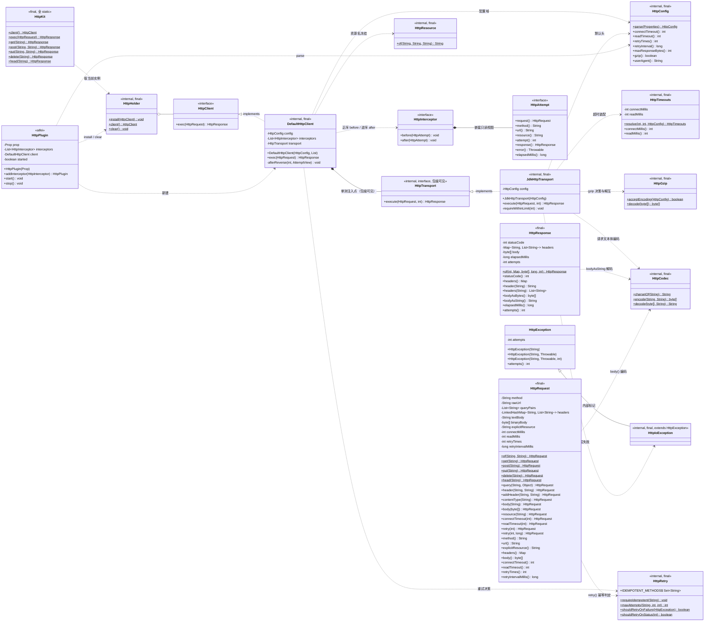
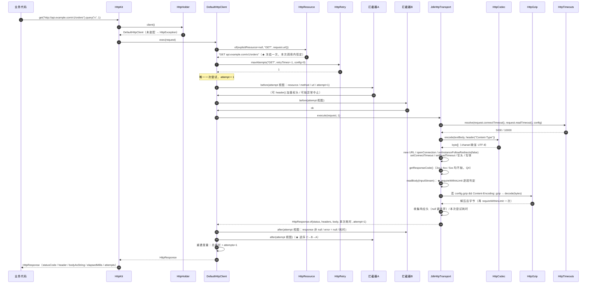
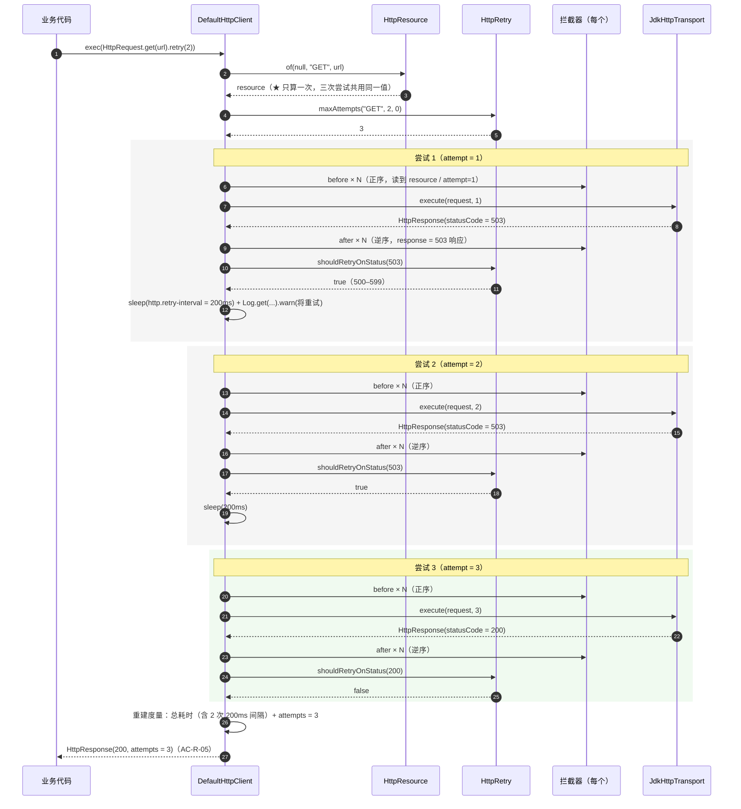
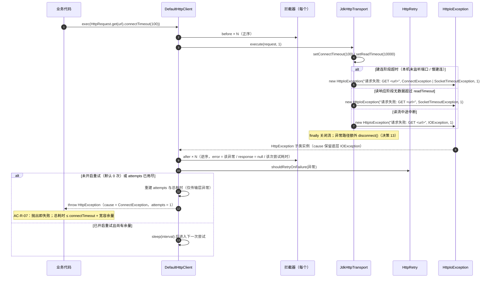

# aifei-http 设计文档

本文是 `aifei-http` 的**设计事实来源（契约）**：公共 API 逐字签名、内部结构、配置键、重试与拦截语义、架构门禁、任务分解与 AC 映射以本文为准。面向使用者的用法见 `README.md`；面向开发代理的约束见模块 `AGENTS.md`；测试策略与用例清单见 `docs/testing.md`（由编码角色在实现后编写，本文只定契约）。

> **交付性质**：`aifei-http` 是 aifei 生态的**库模块（可被应用依赖的 SDK）**，**不是应用工程**。工程内**没有** `AppConfig` / `Launcher` / `service/` 包 / `webapp/` / HTTP 路由 / HIO / 表结构 / Db+Row / Generator / UI 页面；只有「根包公共 API 精确 6 类型 + `internal` 非承诺实现 + 一个装配用 `aifei.HttpPlugin`」。
>
> **坐标**：`io.github.gollyhu:aifei-http:1.0.0-SNAPSHOT`（`packaging=jar`）；包名 `cn.hg.aifei.http`；**Java 8**（语法与 API 双约束，主 JAR class major = 52）；**零第三方**（compile / runtime / optional 全为零）。
>
> **文档状态**：本文是 1.0.0 的**设计定稿，已按本文实现交付**（模块 + `aifei-http-demo` 已落地并过 `mvn clean verify`，`docs/testing.md` 已产出）。§5 的 6 个公共类型签名与 §7 的配置键名仍是公共契约的**唯一依据**，变更前必须先改本文。

---

## 1. 模块定位与边界

### 1.1 定位

`aifei` 只有**入站** HTTP（`aifei-undertow` + HIO），**出站** HTTP 无任何构件。本模块补齐**出站 HTTP 统一客户端**：业务只构造请求 + 读响应，超时、重试、拦截、编解码、资源名由模块统一负责。

四件事，一件一个落点：

| # | 目标 | 落点 |
| --- | --- | --- |
| 1 | 统一超时 | connect / read 两段全局默认 + 逐请求覆盖（`internal.HttpTimeouts`） |
| 2 | 统一重试 | 默认 0 次、必须显式开启、仅 GET / HEAD 有入口（`internal.HttpRetry`） |
| 3 | 统一拦截 | 应用侧有序拦截器链，进入正序 / 收尾逆序（`internal.DefaultHttpClient`） |
| 4 | 统一编解码 | charset 与 Content-Type 解析、`String` ↔ `byte[]`（`internal.HttpCodec`） |

与 `aifei-sentinel` 的协同：模块**零 `aifei-sentinel` 依赖**，只以统一口径产出**资源名**供其 `HttpInterceptor` 自行埋点（§5.2 / §7）。

### 1.2 为什么是「库/SDK」而非应用工程（不适用章节声明）

| 常规章节 | 结论 | 理由 |
| --- | --- | --- |
| 表结构草案 | **不适用** | 零 DB、零表、零 `Db+Row`、零 `Generator`，运行期不连任何数据源；门禁反向断言全模块无 `import java.sql.` |
| Service 方法清单 / `@Path` | **不适用** | 模块本体无 Service（Just Service 是应用工程的形态）；公共面由本文 §5 定稿为 **6 类型** |
| HIO / 路由 / 拦截器（入站） | **不适用** | 模块无入站 HTTP 面；`aifei-http-demo` 的回环 echo 端点属 demo 工程（§14），不在本模块 |
| 低保真 UI 原型 / QA 基线门禁 | **不适用** | 无页面；demo 单页由前端直接实装（已定档跳过原型与基线门禁） |
| `AppConfig implements AifeiConfig` / `Launcher` | **不适用** | 装配入口属**使用方应用**；本模块只提供 `HttpPlugin` 供 `plugins.add(...)` |

`aifei-http/` 内 `mvn clean verify` 必须 **0 failure / 0 error**（含架构门禁测试）。

### 1.3 公共面收敛纪律（硬约束）

| # | 纪律 |
| --- | --- |
| 1 | **根包公共 API 精确 6 个类型**：`HttpClient` / `HttpRequest` / `HttpResponse` / `HttpKit` / `HttpException` / `HttpInterceptor`。**不得增删、不得改名**；嵌套类型（`HttpInterceptor.HttpAttempt`）不单独计数 |
| 2 | **零第三方类型**、**零框架类型**出现在公共面：`cn.aifei.*` 只允许出现在 `aifei` 接入包（`cn.aifei.log.*` 另允许出现在 `internal` 的记录点） |
| 3 | **零第三方依赖**：pom 只有 `cn.aifei:aifei`（`provided`）+ `junit`（`test`）；**无 `optional`、无 `compile` 第三方** |
| 4 | 公共面签名只用 `String` / `byte[]` / `Map` / `List` / 基本类型 / 本模块类型；**不出现** `java.net.URL` / `HttpURLConnection` / `java.util.function.*` |
| 5 | 每类规则只有一个定义点（§6.4），实现类不得复制 |
| 6 | Java 8 语法与 API 双约束；主 JAR class major = 52 |

> 第 1、2、4 条由架构门禁 `ArchitectureBoundaryTest`（§11）强制，**不得放宽或绕过**。

### 1.4 v1 不做清单（边界，防范围蔓延）

**不支持 HTTP/2**；**连接池受 JVM 全局属性 `http.maxConnections` / `http.keepAlive` 约束且只读不写**；**超时仅 connect / read 两段，无整体 deadline、不可取消在途请求**；**gzip / Cookie / 重定向需自实现**（本版决策见 §2 第 9 条）；**无 provider 扩展点、无 SPI、无后端切换**；**无异步 / 回调 / Future**；**无 multipart 与文件上传下载高层封装**；**无 Cookie 持久化容器**；**无重定向完整语义矩阵（303 / 307 / 308）**；**无代理认证 / mTLS 高层配置**；**无熔断限流**（属 `aifei-sentinel`）；**无拦截器短路合成响应**（Q1）。

---

## 2. 设计决策表

> 格式：**决策** —— 理由 —— 被否决的替代方案。

| # | 决策 | 理由 | 被否决的替代方案 |
| --- | --- | --- | --- |
| 1 | **零第三方纯 JDK**：传输实现只用 `HttpURLConnection`（`internal.JdkHttpTransport` 是全模块唯一 `java.net.HttpURLConnection` 出现点） | 仓库「公共 API 零第三方」口径；Java 8 无 `java.net.http.HttpClient`，`HttpURLConnection` 是唯一纯 JDK 路径；`aifei-weixin` 底稿已同路线验证（超时 / 固定长度流式写 / 不跟随重定向） | ① 引 okhttp：违反零第三方口径、下游强制传递 1 个网络栈；② 引 Apache HttpClient：同上且包体更大；③ 各业务自写 `HttpURLConnection`：正是当前要消灭的重复 |
| 2 | **无 provider / 无 SPI / 无 `META-INF/services`**：`internal.HttpTransport` 为 `internal` 包内**包级可见**接口，**仅供单测注入** | 只有一条实现路径，「换后端」无需求驱动；包级可见性使应用侧**在类型层面无法引用或注册**，天然不构成扩展点 | ① `ServiceLoader` + `META-INF/services`：为不存在的第二实现付成本，且会把 `internal` 变成对外契约；② 公开 `register` 方法：等于开放 provider 扩展点 |
| 3 | **6 公共类型收口**，门禁按**文件名集合精确相等**断言（§11 ⑤） | 需求 §三-2 已定档；集合相等可防「同名替换 / 悄悄增删」 | ① 只断言数量：无法防同名替换；② 按反射扫 class：依赖编译产物，门禁需先 `compile`，源码文本扫描更稳 |
| 4 | **资源名规则**：`HttpRequest` 可显式设 `resource`，未设时默认 `METHOD + " " + host + path`（去 query、method 大写、host 含非默认端口、空 path 归一为 `/`）；**唯一拼装点** `internal.HttpResource.of(explicitResource, method, rawUrl)`；一次 `exec()` 内**冻结一次**，重试各次恒定 | 需求 §5.1；sentinel 埋点需要稳定维度；冻结一次让「进入时已可读」不留歧义（拦截器追加 query 不改资源名——本就去 query） | ① 每次尝试重算：拦截器改 header / query 会让资源名漂移，AC-R-14 恒定性破坏；② 由拦截器自行推导：多方口径必然漂移；③ 带 query：同逻辑请求被打散成多维度，限流粒度失真 |
| 5 | **重试默认 0 次、必须显式开启，且仅 GET / HEAD 有入口**（`HttpRequest#retry` 内即拒非幂等方法，`internal.HttpRetry.requireIdempotent` 单点判定） | 出站隐式重放可能重复下单 / 重复扣款，属高危默认值，不得「开箱重试」 | ① 默认 2 次（HTTP 客户端常见默认）：静默重放，风险不可接受；② 全方法可重试 + 文档警告：把安全责任推给业务；③ 只给 `HttpClient` 级开关：粒度太粗，同进程无法区分幂等与否 |
| 6 | **拦截器为 before / after 观测式**：`before`（正序、可抛异常中止）＋ `after`（逆序、默认空实现）；**拦截器无返回值**，拿不到也造不出 `HttpResponse` 作为结果 | AC-R-10（正进逆出各一次）与 AC-R-11（可中断 + 未发送 + 异常原样）用两条 for 循环 + `try/finally` 直接满足；**「不支持短路」由协议形态从类型层面排除**（Q1），不靠约定 | ① okhttp 式 `Chain#proceed()` 包裹形态：天然允许拦截器「不调 proceed 直接返回响应」= 短路合成，与 Q1 冲突，且要求 `HttpResponse` 具备公共构造入口、把「谁负责状态码」的语义负担引入公共面；② 单一 `handle(Request)->Response` 函数式接口：无「收尾」时机，sentinel `entry.exit()` 无法配对 |
| 7 | **拦截器注册通道 = 显式有序列表**：`HttpPlugin#addInterceptor` 按调用顺序累积，`start()` 时快照为不可变 `List` 交给 `DefaultHttpClient`；**不从容器按类型取** | **顺序可复现是 AC-R-10 的前提**：aifei 容器按类型注册单例、同类型重复注册抛 `Singleton object already exists`（`aifei-job` 决策 13 已实测），**无「按类型取全部实现」通道，也无 `@Order` / 按名通道**；显式列表让顺序成为源码事实（`AppConfig` 里的调用顺序） | ① 容器按类型取全部实现：框架无此 API，且返回顺序不可复现 → AC-R-10 无法机械断言；② 依赖 Bean 注解排序：注解不保证有序，且需引入框架类型；③ 计数器 / 优先级字段：多一套可比数值的约定，收益为零 |
| 8 | **响应体上限作用于「解压后字节数」**，默认 `8 MiB`，超限抛 `HttpException`（消息含实际生效上限值），**不截断返回半截** | 防大响应与压缩炸弹双风险；截断会让调用方拿到不可解析的残体，比失败更危险（AC-R-25） | ① 只限压缩前字节数：`gzip` 炸弹可绕过；② 超限截断返回：静默产出坏数据；③ 不设上限：OOM 风险 |
| 9 | **默认行为三定档**：gzip **默认关闭**（不发 `Accept-Encoding`，`http.gzip=true` 才发并在模块内解压）；Cookie **无容器、无配置键**（业务经请求头自行管理）；重定向 **固定不跟随**（`setInstanceFollowRedirects(false)`，3xx 原样返回），**不提供 `http.follow-redirects` 键** | 需求 §5.5 的两条「显式开启后」栏本身写着「业务经请求头自行管理 Cookie」与「v1 不做完整跟随矩阵（303 / 307 / 308 未定）」——**没有真实可开启的行为**；给一个「开了也无效」的键会制造错误预期，比不给键更糟 | ① 三键齐全、`true` 时静默无效：违反「不得静默忽略」；② 三键齐全、`true` 时启动失败：键变成陷阱；③ 默认跟随重定向：出站语义黑箱，sentinel 埋点与状态码判断全部失真 |
| 10 | **`HttpKit` = 有状态静态门面**：`final` + 私有构造，全部方法经 `internal.HttpHolder` 取当前 `HttpClient`；未装配 / 已停止 → `HttpException` | 仓库根 `AGENTS.md` 命名约定：需要先从注册表取到实例才能干活 → `Kit`；`HttpClient` 依赖 `HttpPlugin.start()` 完成装配，生命周期有界 | ① `HttpUtil`：无状态工具类的后缀，语义不符；② 无门面、只留 `@Inject`：静态上下文（工具方法 / 脚本）无法取用；③ `HttpKit` 自带实例字段：与装配期写入的实例天然不一致 |
| 11 | **`java.util.function.*` 不作为公共面**：拦截器用自定义 `HttpInterceptor`，不用 `Consumer` / `Function` / `Supplier` | ① 需要「进入 / 收尾」两个时机，`java.util.function` 无对应形状；② 具名接口可写 javadoc 契约（顺序、异常、可见信息），JDK 函数式类型无法承载；③ 未来加默认方法或第二时机不会破坏实现方 | ① `BiConsumer<HttpRequest, Integer>` 之类：语义全靠文档，且改形状即破坏二进制兼容；② 只用一个 `java.util.function` 组合：表达力不足，仍需包装类 |
| 12 | **`HttpResponse` 私有构造 + 唯一公共工厂 `of(...)`**（`internal` 用它装配，`HttpKit` / 业务不构造） | 公共面需要一个可读值对象，但构造入口必须唯一（避免多处装配口径漂移）；`of` 参数只用 `int` / `Map` / `byte[]` / `long`，符合「公共 API 实现无关」 | ① 公共构造器：与 `of` 等价但更难写 javadoc「不要手工构造」；② 构造函数包私有 + `internal` 反射：脆弱且不可读；③ 让 `HttpResponse` 变接口 + `internal` 实现：值对象语义（`toString` / 稳定字段）弱化，且接口可被应用侧实现，反而打开装配口径 |
| 13 | **keep-alive 策略**：读完响应体后**关闭流、不 `disconnect()`**（连接归还 JDK 缓存）；**仅异常路径与超限路径**在 `finally` 中 `disconnect()` | 恒 `disconnect()` 会让 `http.keepAlive` / `http.maxConnections` 全部失效，「连接池受全局属性约束」的声明就成空话；异常路径必须断开，否则泄漏连接。**这是对 `aifei-weixin` 底稿（恒 `disconnect()`）的有意偏离** | ① 恒 `disconnect()`（对齐底稿）：keep-alive 名存实亡；② 从不 `disconnect()`：超限 / 异常路径连接泄漏 |
| 14 | **`HttpClient` 不声明 `close()`**：单方法接口，无跨请求资源需释放 | 传输实现每次请求新建 `HttpURLConnection` 并在 `finally` 收敛流；连接由 JVM 全局属性管理（模块**无权也无力**关闭）；无 `close()` 就没有「关闭后行为」这一整类语义负担（对比 `aifei-mq` 的 `close()` 语义矩阵） | ① 声明 `close()` 并定义关闭后语义：为不存在的资源付出全部契约成本；② `AutoCloseable`：同上，且迫使调用方 try-with-resources |
| 15 | **异常分类**：传输层失败 / 配置非法 / 未装配 / 响应体超限 / 解码失败 / 重试拒绝（非幂等）统一 `HttpException`（`extends RuntimeException`）；**调用方参数编码错误**（null 参数、负数、空白名）用 `IllegalArgumentException` | 需求 AC-R-15 / R-17 / R-18 明确要求 `HttpException`；`IllegalArgumentException` 只保留给「调用方当场写错」的即时可判错误，与仓库既有口径（`aifei-mq`）一致 | ① 全部 `IllegalArgumentException`：违反 AC-R-15 / R-17 / R-18；② 细分连接 / 超时 / 解码子类到公共面：公共面扩张，业务只需一个 catch 点 |
| 16 | **模块自身日志经 `cn.aifei.log.Log`，惰性取用（方法内 `Log.get(Class)`，不用 `static` 字段）**；**唯一记录点 = 重试发生时 warn 一次**（`internal.DefaultHttpClient`） | `LogFactory` 装配晚于类初始化，`static` 字段会在装配前固化空实现；日志绑定一律不引入（需求 §六）；只在「将重试」这类业务看不见的分支记录，避免刷屏 | ① `static final Log LOG`：早于 `LogFactory` 装配；② `System.err` / 自建通道：违反根 `AGENTS.md`；③ 每次请求都打日志：出站高频，成本与噪声不可接受 |

---

## 3. 术语表

| 术语 | 含义 | 归属 |
| --- | --- | --- |
| **请求 HttpRequest** | 一次逻辑请求的**可变构建器**：方法 / URL / query / 头 / 体 / 显式资源名 / 逐请求超时 / 重试 | 根包（公共） |
| **响应 HttpResponse** | 一次 `exec()` 的**不可变结果快照**：状态码 / 头 / 体 / 总耗时 / 总尝试次数 | 根包（公共） |
| **客户端 HttpClient** | 发送视图：`exec(HttpRequest)`；实现由装配期注册为 `@Inject` 单例 | 根包（公共接口） |
| **拦截器 HttpInterceptor** | 双时机横切钩子：`before`（正序）/ `after`（逆序） | 根包（公共接口，单抽象方法） |
| **一次尝试 attempt** | 一次真实发送（含其 `before` / 发送 / `after` 全过程）；编号从 **1** 起；`attempts = 1 + 实际重试次数` | 根包（`HttpAttempt` 只读视图） |
| **资源名 resource** | 出站埋点维度：`METHOD host path`（去 query）；可显式覆盖 | 根包（设置）/ `internal.HttpResource`（拼装） |
| **幂等方法** | `GET` / `HEAD`（白名单唯一来源 `internal.HttpRetry.IDEMPOTENT_METHODS`） | `internal` |
| **传输层 transport** | 真正发出字节的实现（`JdkHttpTransport`），背后是 `internal.HttpTransport` 契约 | `internal`（**非扩展点**） |
| **装配插件 HttpPlugin** | `cn.hg.aifei.http.aifei.HttpPlugin`：解析 `http.*`、建客户端、注册 `@Inject`、写入门面 | `aifei` |

---

## 4. 需求 §九 Q1–Q7 逐条定档

> 七条**全部按需求默认假设接受**，无否决项。下表结论即最终口径，编码角色照此实现，不得各自解释。

| # | 问题 | **定档结论** | 落实点 |
| --- | --- | --- | --- |
| **Q1** | 拦截器是否允许「短路并合成响应」？ | **不支持，且由协议形态从类型层面排除**：拦截器方法**无返回值**（`before` / `after` 均 `void`），拿不到 `HttpResponse` 作为本次结果；`HttpResponse` 的唯一工厂 `of(...)` 仅供模块装配，**没有任何通道让拦截器产出的对象成为 `exec()` 的返回值**。中止只有一条路：抛异常 | `HttpInterceptor`（§5.4）+ `DefaultHttpClient`（§6.1） |
| **Q2** | 重试的每次尝试是否重新穿过整条拦截器链？ | **是**：每次尝试完整穿链（`before` 正序全部进入 + `after` 逆序全部收尾），资源名恒定；**尝试计数由模块维护**（`HttpAttempt#attempt()` 与 `HttpException#attempts()` / `HttpResponse#attempts()`），拦截器**不自行计数** | `DefaultHttpClient#exec`（§6.1、§8.2） |
| **Q3** | 资源名的 `host` 是否包含非默认端口？ | **包含**（authority 语义）：`getPort()` 为 `-1`（默认端口 80 / 443）时省略，否则 `host + ":" + port`。AC-R-12 用默认端口例子避开歧义 | `internal.HttpResource#of` |
| **Q4** | 非 2xx 是否抛异常？ | **不抛**：3xx / 4xx / 5xx 一律正常返回 `HttpResponse`，由业务读 `statusCode()` 判断（5xx 只影响「是否重试」）；异常只覆盖传输层失败与配置 / 解码 / 超限 | `JdkHttpTransport`（不按状态码抛）+ `HttpRetry` |
| **Q5** | 重试触发条件与退避形态？ | 触发条件 = **① 网络层失败**（连接拒绝 / connect 超时 / read 超时 / 读流中断，实现上等价于 `internal.HttpIoException`）**或 ② 状态码 5xx（500–599）**；**4xx / 3xx / 2xx 不重试**；解码失败、解压失败、超限、非法 URL **不重试**（确定性失败）。退避 = **可配固定间隔** `http.retry-interval`（默认 200 ms），**无指数退避、无抖动**；`Thread.sleep` 在调用线程内，被中断则恢复中断标志并抛 `HttpException` | `internal.HttpRetry` + `DefaultHttpClient` |
| **Q6** | 拦截器注册通道与顺序依据？ | **显式有序注册列表**：`HttpPlugin#addInterceptor(HttpInterceptor)`，按 `add` 调用顺序累积；`start()` 时快照为不可变 `List` 交给 `DefaultHttpClient`；`start()` 之后调用 `addInterceptor` → `HttpException`。**不从容器按类型取**（框架无「按类型取全部实现」通道、同类型重复注册抛异常、返回顺序不可复现 → AC-R-10 无法机械断言）。业务若想复用容器内的拦截器实例，自行 `Aop.get(MyInterceptor.class)` 取出再 `addInterceptor` | `HttpPlugin`（§6.3）+ 决策 7 |
| **Q7** | 响应体上限默认值与超限语义？ | 默认 **8 MiB（8388608 字节）**，作用于**解压后**字节数；超限抛 `HttpException`，消息含**实际生效上限值**（形如 `响应体超过上限 8388608 字节（已读 8388609）`），**不截断**。`aifei-http-demo` 端口定档 **18120**（`aifei-job-demo` 占 18110） | `internal.HttpConfig` + `JdkHttpTransport` + `aifei-http-demo`（§14） |

---

## 5. 公共 API 契约（根包精确 6 类型）

根包 `cn.hg.aifei.http` **精确 6 个公共类型**，为本节与门禁 `EXPECTED_ROOT_TYPES` 的**唯一事实来源**。逐字签名如下（**编码角色照抄**；`static` 与否、返回类型、异常声明均不得改动）。

### 5.1 `HttpClient`（公共接口）

```java
public interface HttpClient {

    HttpResponse exec(HttpRequest request);
}
```

- **唯一方法**，`exec` 不声明受检异常（`HttpException` 是未受检异常，故不写 `throws`）。
- 语义：`exec` 内完成「资源名冻结 → 重试决策 → 逐次尝试（穿链 + 发送 + 收尾）→ 度量写回」；**非 2xx 不抛**（Q4）。
- 实现类 `internal.DefaultHttpClient`（公共面不出现）；装配期由 `HttpPlugin` 注册为 `@Inject HttpClient` 单例。
- **不声明** `close()` / `AutoCloseable`（决策 14）。

### 5.2 `HttpRequest`（公共可变构建器，`final`）

```java
public final class HttpRequest {

    // ---- 工厂（静态）----
    public static HttpRequest of(String method, String url);
    public static HttpRequest get(String url);
    public static HttpRequest post(String url);
    public static HttpRequest put(String url);
    public static HttpRequest delete(String url);
    public static HttpRequest head(String url);

    // ---- 构建（实例，链式返回 this）----
    public HttpRequest query(String name, Object value);
    public HttpRequest header(String name, String value);
    public HttpRequest addHeader(String name, String value);
    public HttpRequest contentType(String contentType);
    public HttpRequest body(String text);
    public HttpRequest body(byte[] bytes);
    public HttpRequest resource(String resource);
    public HttpRequest connectTimeout(int millis);
    public HttpRequest readTimeout(int millis);
    public HttpRequest retry(int times);
    public HttpRequest retry(int times, long intervalMillis);

    // ---- 读取（实例）----
    public String method();
    public String url();
    public String explicitResource();
    public Map<String, List<String>> headers();
    public byte[] body();
    public int connectTimeout();
    public int readTimeout();
    public int retryTimes();
    public long retryIntervalMillis();
}
```

逐条口径：

| 方法 | 契约 | 非法入参 |
| --- | --- | --- |
| `of(method, url)` | `method` 归一为**大写**（`String.toUpperCase(Locale.ROOT)`）；`url` 原样保存（不做合法性校验——URL 解析在 `internal`，见下文）。允许任意方法名（不白名单），幂等性只对 `GET` / `HEAD` 有意义 | `method` 空白 / `url` 空白 → `IllegalArgumentException` |
| `get/post/put/delete/head(url)` | 等价 `of("GET", url)` 等五个便捷工厂 | 同上 |
| `query(name, value)` | **追加**一个 query 参数；`name` 与 `value`（`String.valueOf(value)`，`null` → 空串）均按 **UTF-8** `URLEncoder` 编码；与 `url` 中已有 query 用 `&` 拼接（`url` 无 `?` 时用 `?`） | `name` 空白 → `IllegalArgumentException` |
| `header(name, value)` | **覆盖**同名头（大小写不敏感匹配，先移除全部同名再置一个值）；`value == null` 等价「移除该头」 | `name` 空白 → `IllegalArgumentException` |
| `addHeader(name, value)` | **追加**一个多值头（不覆盖）；`Set-Cookie` 之类的多值场景用此方法 | 同上 |
| `contentType(ct)` | 等价 `header("Content-Type", ct)`；决定文本体编码 / 解码的 charset | `ct` 空白 → `IllegalArgumentException` |
| `body(String)` | 保存**文本体原文**，编码推迟到「读取 `body()` / 发送」时按**当时**的 `Content-Type` charset（缺省 UTF-8）执行（`internal.HttpCodec`） | `null` → 清除请求体 |
| `body(byte[])` | 保存**二进制体**原样（入参防御性拷贝） | `null` → 清除请求体 |
| `resource(resource)` | 显式资源名，**完全替代**默认推导 | 空白 → `IllegalArgumentException` |
| `connectTimeout(millis)` / `readTimeout(millis)` | 逐请求覆盖全局默认（毫秒） | `<= 0` → `IllegalArgumentException` |
| `retry(times)` / `retry(times, intervalMillis)` | **仅 `GET` / `HEAD` 可调用**；判定经 `internal.HttpRetry.requireIdempotent(method)`，非幂等方法**当场抛**（不静默忽略，AC-R-06） | `times < 0` 或 `intervalMillis < 0` → `IllegalArgumentException`；非幂等方法 → `IllegalArgumentException` |
| `method()` / `url()` | `url()` 返回**拼接后完整 URL**（含 query，已编码）；根包**不解析 URL**（门禁 ⑦ 禁 `java.net.URL`） | — |
| `explicitResource()` | 显式资源名，未设返回 `null` | — |
| `headers()` | 不可变视图（`Map<String, List<String>>`，值不可变列表）；键为**调用方书写的大小写** | — |
| `body()` | 无请求体返回 `null`；文本体按当前 `Content-Type` charset 编码后返回（每次调用重新编码） | — |
| `connectTimeout()` / `readTimeout()` | **未设置返回 `0`**（表示继承全局默认） | — |
| `retryTimes()` | **未设置返回 `-1`**（表示继承 `http.retry-times`） | — |
| `retryIntervalMillis()` | **未设置返回 `-1`**（表示继承 `http.retry-interval`） | — |

- **可变性声明**：`HttpRequest` 是**可变构建器**（拦截器需要在 `before` 里加鉴权头），**非线程安全**，不应跨线程共享；一次 `exec()` 返回后可安全复用。
- **拦截器内可改什么**：可 `header()` / `addHeader()` / `query()`；**不可改方法与 URL 主体**（无 setter，类型层面不可）。鉴权类拦截器**必须用 `header()`（覆盖）而非 `addHeader()`**，否则头会随重试次数累积（写入 `README` 注意事项）。

### 5.3 `HttpResponse`（公共不可变值对象，`final`）

```java
public final class HttpResponse {

    public static HttpResponse of(int statusCode, Map<String, List<String>> headers,
                                  byte[] body, long elapsedMillis, int attempts);

    public int statusCode();
    public Map<String, List<String>> headers();
    public String header(String name);
    public List<String> headers(String name);
    public byte[] bodyAsBytes();
    public String bodyAsString();
    public long elapsedMillis();
    public int attempts();
}
```

| 方法 | 契约 |
| --- | --- |
| `of(...)` | **唯一构造入口**（内部装配口径单点）。参数做防御性拷贝（`headers` 深拷贝为不可变结构，`body` clone）；`attempts < 1` → `IllegalArgumentException`；`elapsedMillis < 0` → `IllegalArgumentException` |
| `statusCode()` | HTTP 状态码；3xx / 4xx / 5xx 均正常返回（Q4） |
| `headers()` | 不可变视图，键为**响应原样的原始大小写**（`HttpURLConnection#getHeaderFields` 中 `null` 键——状态行——丢弃） |
| `header(name)` | **大小写不敏感**取**首个**值；无则 `null` |
| `headers(name)` | **大小写不敏感**取**全部**值（`Set-Cookie` 等）；无则空列表（非 `null`） |
| `bodyAsBytes()` | 响应体原样（防御性拷贝），二进制字节级相等（AC-R-21） |
| `bodyAsString()` | 按响应头 `Content-Type` 的 charset 解码，无 `Content-Type` 或无声明的 charset 时 UTF-8；charset 名不可识别 → `HttpException`（不静默返回半截字符串） |
| `elapsedMillis()` | **整个 `exec()` 的总墙钟耗时**（含全部尝试与重试间隔）；单次尝试耗时由 `HttpAttempt#elapsedMillis()` 给出 |
| `attempts()` | 本次调用共尝试几次（`1 + 实际重试次数`，≥ 1） |

### 5.4 `HttpInterceptor`（公共接口，含嵌套只读视图）

```java
public interface HttpInterceptor {

    void before(HttpAttempt attempt);

    default void after(HttpAttempt attempt) {
    }

    interface HttpAttempt {

        HttpRequest request();

        String method();

        String url();

        String resource();

        int attempt();

        HttpResponse response();

        Throwable error();

        long elapsedMillis();
    }
}
```

- **单抽象方法**（`after` 有默认空实现）→ 只写 `before` 的场景可用 **lambda**；需要成对收尾（sentinel `entry.exit()`）时才覆写 `after`。
- 链语义（AC-R-10 / AC-R-11）：

| 项 | 定档 |
| --- | --- |
| 顺序 | 按 `addInterceptor` 顺序进入（**正序**）；收尾**逆序**（保证资源释放对称） |
| 触发次数 | 正常路径每个拦截器的 `before` / `after` **各恰好一次**（AC-R-10） |
| 可中断 | 任一 `before` 抛异常（`HttpException` 或任意 `RuntimeException`）→ **后续拦截器不再进入**、**真实发送不发生**；异常**原样向调用方传播**（不被吞、不被包装、不被替换类型、**不重试**） |
| 收尾范围 | 只有 `before` **已成功返回**的拦截器才收到 `after`（逆序）；`before` 抛异常的那个拦截器**自己**也收到 `after`（自身 `before` 抛出的异常已在 `error()` 中可见） |
| 失败也收尾 | 传输层抛 `HttpException` 时，本轮全部 `after` 照常逆序调用，`error()` 为该异常、`response()` 为 `null` |
| 线程 | 同步执行在 `exec()` 调用线程上；**不引入任何额外线程** |
| 短路 | **不支持**（Q1）：无返回值，无法合成响应；中止只能抛异常 |
| 异常口径 | 拦截器内部异常**不转换**：模块不捕获后静默继续、不包装成别的类型 |

`HttpAttempt` 各方法口径：

| 方法 | `before` 阶段 | `after` 阶段 |
| --- | --- | --- |
| `request()` | 当前请求（可改头 / query） | 同左 |
| `method()` / `url()` | 方法与**完整 URL**（含 query） | 同左 |
| `resource()` | **最终资源名**（已冻结，本次调用内恒定） | 同左（恒等） |
| `attempt()` | 本次尝试序号，从 **1** 起 | 同左 |
| `response()` | `null` | 成功时该次响应；失败时 `null` |
| `error()` | `null` | 失败时的异常（传输层 `HttpException` 或拦截器抛出的任意异常）；成功时 `null` |
| `elapsedMillis()` | `0` | 该次尝试耗时（不含重试间隔） |

### 5.5 `HttpException`（唯一未受检异常）

```java
public class HttpException extends RuntimeException {

    public HttpException(String message);

    public HttpException(String message, Throwable cause);

    public HttpException(String message, Throwable cause, int attempts);

    public int attempts();
}
```

- 前两个构造器的 `attempts()` 恒为 **1**；第三个显式指定（`attempts < 1` → `IllegalArgumentException`）。
- **唯一未受检异常**，不细分子类到公共面；`internal.HttpIoException extends HttpException` 是**内部标记**（网络层失败，仅用于重试判定，不得外泄到公共面签名）。
- 抛出场景（AC-R-15 / R-17 / R-18 / R-25）：

| 场景 | 消息要点 | `getCause()` |
| --- | --- | --- |
| 连接拒绝 / connect 超时 | `请求失败: GET http://127.0.0.1:1/x` | `java.net.ConnectException` 或等价 `IOException`（AC-R-07） |
| read 超时 | 同上 | `java.net.SocketTimeoutException` |
| 非法 URL | `URL 非法: <原值>` | `java.net.MalformedURLException` |
| 响应体超限 | `响应体超过上限 8388608 字节（已读 8388609）` | 无 |
| 响应 charset 不可识别 | `响应 charset 非法: x-unknown` | `java.io.UnsupportedEncodingException` 或 `IllegalCharsetNameException` |
| gzip 解压失败 | `gzip 解压失败` | `java.io.IOException` |
| 配置非法 | `配置项 http.connect-timeout 非法: 0（要求 >= 1）`（**必须含键名与原值**，AC-R-18） | 无 |
| 未装配 / 已停止 | `HTTP 客户端未装配或已停止` | 无 |
| 重试等待被中断 | `重试等待被中断` | `InterruptedException`（并恢复中断标志） |

### 5.6 `HttpKit`（公共静态门面，`final`）

```java
public final class HttpKit {

    public static HttpClient client();

    public static HttpResponse exec(HttpRequest request);

    public static HttpResponse get(String url);

    public static HttpResponse post(String url, String body);

    public static HttpResponse put(String url, String body);

    public static HttpResponse delete(String url);

    public static HttpResponse head(String url);
}
```

- **有状态门面**：`final` + 私有构造，**零实例字段**；全部方法经 `internal.HttpHolder` 取当前已装配的 `HttpClient`——**未装配 / 已停止 → `HttpException`**（不静默返回 `null`，AC-R-17）。
- `exec` 与 5 个便捷方法**只做转发**：不重复校验、不转换异常、不加默认头（默认头由 `http.user-agent` 与拦截器负责）；`post(url, body)` 等价 `exec(HttpRequest.post(url).body(body))`。
- 取到的实例与 `@Inject HttpClient` 注入的**同一个对象**。

### 5.7 命名依据（`Kit` / `Util` / 接口 / 异常）

| 类型 | 形态 | 命名依据（仓库根 `AGENTS.md`「命名约定」） |
| --- | --- | --- |
| `HttpClient` | `public interface` | **接口用名词性后缀** `XxxClient`（同条款明示示例 `HttpClient`）；不适用 `Kit` / `Util` 后缀规则 |
| `HttpRequest` / `HttpResponse` | `public final class` 值对象 | 值对象不适用后缀规则，按 Java 习惯用名词 |
| `HttpInterceptor` | `public interface` | 行为角色用名词 `XxxInterceptor`（对齐框架 `cn.aifei.aop.Interceptor` 叫法） |
| `HttpException` | `public class extends RuntimeException` | 异常用 `XxxException` |
| `HttpKit` | `public final` + 私有构造 + 全 `static` | **有状态门面**：必须先经 `HttpPlugin.start()` 装配、再从 `HttpHolder` 取到实例才能干活；未装配即失败 → 判据落在 `Kit` 一侧 |
| （反例）`HttpUtil` | **不使用** | 去掉入参就产不出结果（需要装配后的实例），不满足 `Util` 的「无状态、任何时刻调用都成立」判据 |

### 5.8 公共面计数口径（供门禁复用）

「根包公共类型」= `src/main/java/cn/hg/aifei/http/` 目录**直接子级的 `.java` 文件**（不含子包；`internal/`、`aifei/` 均不计入）：

`HttpClient.java`（interface）/ `HttpRequest.java`（final class）/ `HttpResponse.java`（final class）/ `HttpKit.java`（final 静态门面）/ `HttpException.java`（class extends RuntimeException）/ `HttpInterceptor.java`（interface，含嵌套 `HttpAttempt`）—— **精确 6 个**，是门禁 `EXPECTED_ROOT_TYPES` 的唯一事实来源。

---

## 6. 内部结构

### 6.1 `internal`（非承诺 API）

> 约束：`cn.aifei.*` 只允许出现在 `aifei` 接入包；**唯一例外** `cn.aifei.log.*`（模块自身记录）允许出现在 `aifei` 与 `internal`。故 `internal` **不得** import `Prop` / `AopKit` / `Plugin` 等框架类型；配置**装载**（`prop.getProperties()`）留在 `aifei.HttpPlugin` 一行完成。

| 类型 | 形态 | 职责（**★ 后为唯一职责点**） |
| --- | --- | --- |
| `HttpConfig` | `public final` 值对象 + 静态工厂 | **★ 配置域与键常量、默认值、解析与校验唯一定义点**：7 个键常量（§7）、7 个默认值常量、`parse(Properties)`（非法值 → `HttpException`，消息含键名与原值）、7 个只读访问器 |
| `HttpResource` | `public final` + 静态方法 | **★ 资源名拼装唯一定义点**：`of(String explicitResource, String method, String rawUrl)`——`explicitResource` 非 `null` 则**原样返回**（trim 后），否则解析 URL 得 `host`（含非默认端口）+ `path`（空则 `/`），返回 `METHOD + " " + authority + path` |
| `HttpRetry` | `public final` + 静态方法 | **★ 重试决策唯一定义点**：`IDEMPOTENT_METHODS`（不可变 `{"GET","HEAD"}`）、`requireIdempotent(String method)`（非幂等 → `IllegalArgumentException`）、`maxAttempts(String method, int requestRetryTimes, int configRetryTimes)`（非幂等恒 `1`；否则 `1 + 生效重试次数`，逐请求优先）、`shouldRetryOnFailure(HttpException e)`（**仅** `e instanceof HttpIoException`）、`shouldRetryOnStatus(int statusCode)`（`500 <= s <= 599`） |
| `HttpTimeouts` | `public final` 值对象 | **★ 超时装配唯一定义点**：`resolve(int requestConnectMillis, int requestReadMillis, HttpConfig config)`——逐请求值 `> 0` 优先，否则取全局默认；产出 `connectMillis()` / `readMillis()` |
| `HttpCodec` | `public final` + 静态方法 | **★ 编解码唯一定义点**：`charsetOf(String contentType)`（解析 `charset=`，大小写不敏感、去引号，缺省 `UTF-8`；不可识别 → `HttpException`）、`encode(String text, String contentType)`、`decode(byte[] bytes, String contentType)` |
| `HttpGzip` | `public final` + 静态方法 | **★ gzip 唯一定义点**：`acceptEncoding(HttpConfig config)`（`http.gzip=true` 才返回 `true`）、`decode(byte[] raw)`（`GZIPInputStream` 解压，失败 → `HttpException`） |
| `HttpHolder` | `public final` + 静态方法 | **★ 运行期实例持有唯一定义点**：`install(HttpClient)` / `client()`（未装配或已停止 → `HttpException`）/ `clear()` |
| `HttpIoException` | `public final` extends `HttpException` | **★ 网络层失败标记唯一定义点**（`JdkHttpTransport` 唯一构造点）：仅用于 `HttpRetry.shouldRetryOnFailure` 判别「可重试的网络失败」，**不进入公共面签名** |
| `HttpTransport` | interface（**包级可见**，`internal` 内） | **传输契约，仅供单测注入**：`HttpResponse execute(HttpRequest request, int attempt)`。见 §6.2 |
| `JdkHttpTransport` | `public final implements HttpTransport` | **★ 传输细节唯一定义点**（全模块唯一 `java.net.HttpURLConnection` / `java.net.URL` 出现点）：建连、应用超时、写头 / 体、读状态码、**★ 响应体上限判定（`requireWithinLimit`，读流与解压后共用一个判定方法）**、收集响应头、`setInstanceFollowRedirects(false)`、keep-alive 策略（决策 13）、`HttpIoException` 构造 |
| `DefaultHttpClient` | `public final implements HttpClient` | **★ 执行编排唯一定义点**：资源名冻结一次 → 重试决策 → 逐次尝试（`before` 正序 / 发送 / `after` 逆序）→ 度量写回（总耗时 + 总尝试次数）→ 重试或收尾；**★ 拦截器链顺序唯一定义点**；**唯一日志记录点**（将重试时 `Log.get(...).warn(...)`）。私有静态嵌套类 `AttemptView implements HttpInterceptor.HttpAttempt` 提供只读视图（不单独计文件） |

依赖方向：`aifei.HttpPlugin` → `internal.*` → 根包（`HttpRequest` / `HttpResponse` / `HttpException` / `HttpInterceptor` / `HttpClient`）；`internal` **不**依赖 `aifei`；根包**不**依赖 `aifei`，只依赖 `internal` 中**非传输**的规则类（`HttpCodec` / `HttpRetry`）。

### 6.2 传输接口「不作扩展点」的机械化保证

| 保证 | 实现方式 |
| --- | --- |
| 应用侧**无法引用** | `HttpTransport` 声明为**包级可见**（无 `public` 修饰符），只在 `cn.hg.aifei.http.internal` 内可见 |
| 应用侧**无法注册** | 无 `META-INF/services` 文件；`DefaultHttpClient` 的**注入构造器也是包级可见**（3 参），公开构造器（2 参）内部固定 `new JdkHttpTransport(config)` |
| 单测可注入 | 测试类放在 `src/test/java/cn/hg/aifei/http/internal/`（同包），实现 `HttpTransport` 的伪实现（可录制调用、返回固定响应 / 抛指定异常），覆盖 AC-R-04 / R-10 / R-11 / R-12 / R-13 / R-14 与 AC-R-05 的确定性部分 |
| 不存在第二实现 | 全模块**唯一** `implements HttpTransport` 的是 `JdkHttpTransport`；门禁不额外断言（由包级可见性天然约束） |

### 6.3 `aifei`（装配接入）

| 类型 | 形态 | 职责 |
| --- | --- | --- |
| `HttpPlugin` | `public class implements cn.aifei.plugin.Plugin` | **全模块唯一引用 `cn.aifei.*`（除 `cn.aifei.log.`）的类**。见下方签名与生命周期 |

```java
public class HttpPlugin implements Plugin {

    public HttpPlugin(Prop prop);                          // prop == null → IllegalArgumentException

    public HttpPlugin addInterceptor(HttpInterceptor interceptor);   // 链式；null → IllegalArgumentException；已 start → HttpException

    @Override
    public void start();                                   // 无 throws（HttpException 未受检）

    @Override
    public void stop();
}
```

- **构造期只持 `Prop` 引用**：不解析、不校验、不建客户端（对齐 `MqPlugin` / `JobPlugin`）；`addInterceptor` 只累积列表（保序）。
- `start()`：① `HttpConfig.parse(prop.getProperties())`（非法 → `HttpException`，**不留半装配**）；② `new DefaultHttpClient(config, snapshot(interceptors))`；③ `internal.HttpHolder.install(client)`；④ `AopKit.get().addSingletonObject(HttpClient.class, client)`；⑤ `started = true`。重复 `start()` **no-op**。
- `stop()`：`HttpHolder.clear()` → `started = false`（**不清空 `interceptors` 列表**，也不注销容器单例——框架无注销 API，见 §13）。重复 `stop()` **no-op**。
- `stop()` 后再次 `start()`：实现取**保守口径**——复用首次装配的 `DefaultHttpClient` 实例，**不重复向容器注册**（避免 `Singleton object already exists`）；`HttpClient` 无跨请求资源需关闭，故无副作用（§13）。

### 6.4 唯一定义点清单（实现类不得复制）

| 规则 | 唯一定义点 |
| --- | --- |
| 配置键名 / 默认值 / 解析 / 校验 / 非法值消息 | `internal.HttpConfig` |
| 资源名拼装（默认推导 + 显式覆盖优先级） | `internal.HttpResource` |
| 幂等白名单、重试次数换算、重试触发条件（网络失败 / 5xx） | `internal.HttpRetry` |
| 「网络层失败」标记 | `internal.HttpIoException`（构造点 `JdkHttpTransport`） |
| connect / read 超时的逐请求与全局合并 | `internal.HttpTimeouts` |
| charset 解析、`String` ↔ `byte[]` | `internal.HttpCodec` |
| `Accept-Encoding` 决策、gzip 解压 | `internal.HttpGzip` |
| 响应体上限判定 | `JdkHttpTransport#requireWithinLimit` |
| 单一 `HttpURLConnection` / `URL` 出现点、`setInstanceFollowRedirects(false)`、keep-alive / `disconnect` 策略 | `JdkHttpTransport` |
| 拦截器链执行顺序（正序 `before` / 逆序 `after`）、收尾范围、异常原样传播、重试循环 | `internal.DefaultHttpClient` |
| 运行期实例持有与「未装配即失败」消息 | `internal.HttpHolder` |
| `HttpResponse` 装配（字段拷贝 + 度量写回） | `HttpResponse#of`（调用点：`JdkHttpTransport` 单次尝试、`DefaultHttpClient` 最终结果） |
| `HttpException` 构造与消息格式 | §5.5 表格（各抛出点按表逐字实现，不各写一套措辞） |
| 拦截器注册与顺序 | `HttpPlugin#addInterceptor` |
| 模块日志获取（`Log.get(本类.class)`，禁 `static` 字段 / `org.slf4j.*` / `System.err`） | `internal.DefaultHttpClient`（唯一记录点） |

---

## 7. 配置键全名清单（`http.*`，共 7 键）

> 全部键名**写全前缀**；`internal.HttpConfig` 是这些字面量的唯一定义点，其余类**不得手写** `"http.connect-timeout"` 之类字面量（一律引用常量）。所有键**全部可选**，缺失即取默认值。

| # | 完整键名 | 类型 | 默认值 | 缺省行为 | 非法值 → 启动失败（`HttpException`，消息**必须**含键名与原值） |
| --- | --- | --- | --- | --- | --- |
| 1 | `http.connect-timeout` | `int`（毫秒） | `5000` | 所有请求的建连超时 | 非整数 / `< 1` → `配置项 http.connect-timeout 非法: 0（要求 >= 1）` |
| 2 | `http.read-timeout` | `int`（毫秒） | `10000` | 所有请求的读超时 | 非整数 / `< 1` → 同上格式 |
| 3 | `http.retry-times` | `int` | `0` | **幂等（GET / HEAD）请求**的默认重试次数；**非幂等方法不适用**（恒 1 次尝试，属设计内语义而非忽略） | 非整数 / `< 0` → 同上格式 |
| 4 | `http.retry-interval` | `long`（毫秒） | `200` | 每次重试前的固定等待；`0` 合法（无等待，测试用） | 非整数 / `< 0` → 同上格式 |
| 5 | `http.max-response-bytes` | `int`（字节，**解压后**） | `8388608`（8 MiB） | 单次响应体读取上限 | 非整数 / `< 1` → 同上格式 |
| 6 | `http.gzip` | `boolean` | `false` | **不发送** `Accept-Encoding: gzip`，**不解压**（即使服务端硬编码返回 gzip 也原样返回字节）；`true` 时发送 `Accept-Encoding: gzip` 且对 `Content-Encoding: gzip` 的响应在模块内解压 | 非 `true` / `false`（大小写不敏感） → 同上格式 |
| 7 | `http.user-agent` | `String` | `aifei-http/1.0.0` | 每个请求默认携带的 `User-Agent`；逐请求可经 `header("User-Agent", ...)` 覆盖 | **空白串合法**：表示模块不主动设置该头（JDK 可能补默认值，属不可控，写入 README） |

**不提供的键**（决策 9）：`http.follow-redirects`（行为固定为不跟随）、`http.cookie*`（无 Cookie 容器）、`http.headers.*`（除 `User-Agent` 外的默认头一律由拦截器注入）。**出现这些键不报错、不生效**——属未使用配置，与「不给键」等价；此偏离已在 §13 显式声明。

**配置装载位置**：`aifei.HttpPlugin#start()` 内 `prop.getProperties()` 一行读取 → `internal.HttpConfig.parse(Properties)` 承接解析与校验（`internal` 不得 import `Prop`）。

---

## 8. 类图与关键时序图

### 8.1 类图



> 类图事实要点：根包 6 类型 + `internal` 11 类型（含 `HttpIoException` / 包级 `HttpTransport`）+ `aifei.HttpPlugin`。**没有** Controller / Render / Repository / Mapper / DTO / Service 层；`DefaultHttpClient` 是唯一的执行编排类，其余 `internal` 类都是**纯规则类**（无状态、可独立单测）。

### 8.2 时序图 ①：一次成功请求（含拦截器链正序进 / 逆序收）



### 8.3 时序图 ②：一次重试（GET，`retry(2)`，端点前 2 次 503）



### 8.4 时序图 ③：超时失败（connect 超时 / read 超时 / 网络层失败）



> **异常路径不重包装拦截器异常**：若异常来自某个拦截器的 `before`（AC-R-11），模块**不再进入后续拦截器、不发送、不重试、不重建异常**，逆序对已进入者调用 `after` 后**原样抛出同一个异常实例**。

---

## 9. 文件清单与有序任务分解

### 9.1 工程根与主源码（18 个主源文件）

```text
aifei-http/                                    io.github.gollyhu:aifei-http:1.0.0-SNAPSHOT（packaging=jar）
├── pom.xml                                    # Java 8；aifei provided；junit test；零第三方
├── README.md                                  # 用法 / 能力边界 / 消费方自带 aifei（编码角色写）
├── AGENTS.md                                  # 模块硬约束（本文同级）
├── docs/
│   ├── design.md                              # ★ 本文（契约事实来源）
│   └── testing.md                             # 测试策略与用例清单（编码角色实现后写）
└── src/
    ├── main/java/cn/hg/aifei/http/
    │   ├── HttpClient.java                    ┐
    │   ├── HttpRequest.java                   │ 公共面 6 类型
    │   ├── HttpResponse.java                  │ （门禁⑤ EXPECTED_ROOT_TYPES）
    │   ├── HttpKit.java                       │
    │   ├── HttpException.java                 │
    │   ├── HttpInterceptor.java               ┘（含嵌套 HttpAttempt）
    │   ├── internal/                          # 11 类（非承诺 API）
    │   │   ├── HttpConfig.java
    │   │   ├── HttpResource.java
    │   │   ├── HttpRetry.java
    │   │   ├── HttpTimeouts.java
    │   │   ├── HttpCodec.java
    │   │   ├── HttpGzip.java
    │   │   ├── HttpHolder.java
    │   │   ├── HttpIoException.java
    │   │   ├── HttpTransport.java             # 包级可见（不作扩展点）
    │   │   ├── JdkHttpTransport.java          # 唯一 HttpURLConnection / URL 出现点
    │   │   └── DefaultHttpClient.java         # 执行编排 + 私有嵌套 AttemptView
    │   └── aifei/HttpPlugin.java              # 唯一 cn.aifei.*（除 log）出现点
    └── test/java/cn/hg/aifei/http/
        ├── ArchitectureBoundaryTest.java       # 门禁 10 例（§11）
        ├── HttpKitTest.java · HttpPluginTest.java
        ├── support/LoopbackServer.java         # com.sun.net.httpserver 回环端点（127.0.0.1 随机端口）
        └── internal/
            ├── HttpResourceTest.java · HttpConfigTest.java · HttpRetryTest.java
            ├── HttpCodecTest.java · HttpTimeoutsTest.java · HttpGzipTest.java
            ├── DefaultHttpClientTest.java      # 伪 HttpTransport：链 / 重试 / 资源名
            ├── JdkHttpTransportTest.java       # 回环集成：超时 / 编解码 / 上限 / gzip / 302
            └── TransportStub.java              # 伪传输实现（可录制调用、可抛指定异常）
```

- **不计入本清单**：`aifei-http-demo/` 位于**仓库根、与本模块平级**（示例工程，不随模块发布，§14）。
- 依赖方向：`aifei` → `internal` → 根包；`internal` 不依赖 `aifei`；根包不依赖 `aifei`。

### 9.2 每个文件的职责与预估行数

| 文件 | 职责 | 预估行数 |
| --- | --- | --- |
| `pom.xml` | 单模块构建：`aifei` provided、`junit` test、compiler 1.8 / UTF-8、surefire | 70–90 |
| `HttpClient.java` | 单方法发送接口 + javadoc 契约 | 30–40 |
| `HttpRequest.java` | 可变构建器：工厂 / 链式 setter / 读取器 / `retry` 幂等守卫 / `url()` 拼接 | 300–380 |
| `HttpResponse.java` | 不可变值对象：`of` 单一工厂 + 大小写不敏感查找 + `bodyAsString` 委派 `HttpCodec` | 150–200 |
| `HttpInterceptor.java` | `before` / `after`（default）+ 嵌套 `HttpAttempt` 接口 + 链语义 javadoc | 80–110 |
| `HttpException.java` | 三构造器 + `attempts()` | 50–70 |
| `HttpKit.java` | 静态门面 7 方法，全部经 `HttpHolder` | 80–110 |
| `internal/HttpConfig.java` | 7 键常量 + 7 默认值 + `parse` 校验 + 访问器 | 180–230 |
| `internal/HttpResource.java` | `of(explicit, method, rawUrl)`：URL 解析、端口归一、空 path 归一 | 50–70 |
| `internal/HttpRetry.java` | 幂等白名单、`requireIdempotent`、`maxAttempts`、两个 `shouldRetry*` | 80–110 |
| `internal/HttpTimeouts.java` | `resolve` + 两个访问器 | 40–60 |
| `internal/HttpCodec.java` | `charsetOf` / `encode` / `decode` | 80–110 |
| `internal/HttpGzip.java` | `acceptEncoding` / `decode` | 50–70 |
| `internal/HttpHolder.java` | `install` / `client` / `clear` + 未装配消息 | 50–70 |
| `internal/HttpIoException.java` | 三构造器（`extends HttpException`）+ 标记 javadoc | 25–40 |
| `internal/HttpTransport.java` | 单方法包级可见接口 + 「非扩展点」javadoc | 25–35 |
| `internal/JdkHttpTransport.java` | 建连 / 头 / 体 / 状态码 / 读流 + 上限 / 响应头 / gzip / keep-alive / `HttpIoException` | 240–300 |
| `internal/DefaultHttpClient.java` | 编排：冻结 / 重试循环 / 链顺序 / 收尾范围 / 度量写回 / 重试日志 + 嵌套 `AttemptView` | 200–260 |
| `aifei/HttpPlugin.java` | `Prop` 持有 / `addInterceptor` / `start` / `stop` / 幂等 | 120–160 |
| `ArchitectureBoundaryTest.java` | 门禁 10 例（§11） | 220–280 |
| `support/LoopbackServer.java` | `com.sun.net.httpserver.HttpServer` 绑定 `127.0.0.1` 随机端口；可控状态码 / 延迟 / 前 N 次 5xx / gzip / 302 / 回显 | 180–240 |

### 9.3 有序任务分解（批次 = 落盘批次，每批 3–4 文件）

> 依赖链**尽量只指向 B1/B2**，避免长线性依赖；每批结束时 `mvn -q -DskipTests compile` 应可过（B6 起含测试）。

| 批次 | 文件（按写入顺序） | 依赖 | 优先级 | 建议执行者 | 批次验收 |
| --- | --- | --- | --- | --- | --- |
| **B1** 工程骨架 + 异常 + 配置 + 编解码（4） | `pom.xml` · `HttpException.java` · `internal/HttpConfig.java` · `internal/HttpCodec.java` | — | P0 | `aifei-service-engineer` | `mvn -q -DskipTests compile` 通过；`http.*` 7 键全部可解析，非法值消息含键名与原值 |
| **B2** 纯规则三件（3） | `internal/HttpResource.java` · `internal/HttpRetry.java` · `internal/HttpTimeouts.java` | B1 | P0 | `aifei-service-engineer` | 资源名对 AC-R-12 / R-13 字面量正确；`requireIdempotent("POST")` 抛 `IllegalArgumentException` |
| **B3** 公共值对象与拦截器（4） | `HttpRequest.java` · `HttpResponse.java` · `HttpInterceptor.java` · `HttpClient.java` | B1、B2 | P0 | `aifei-service-engineer` | 根包 6 文件中的 4 个到位；`retry()` 守卫与 `url()` 拼接自测通过 |
| **B4** 传输与编排（4） | `internal/HttpTransport.java` · `internal/HttpIoException.java` · `internal/HttpGzip.java` · `internal/JdkHttpTransport.java` | B1、B2、B3 | P0 | `aifei-service-engineer` | 回环端点可完成一次 GET / POST；超时 → `HttpIoException`（cause 为 `IOException`）；超限 → `HttpException` |
| **B5** 门面与装配（4） | `internal/DefaultHttpClient.java` · `internal/HttpHolder.java` · `HttpKit.java` · `aifei/HttpPlugin.java`（4 文件） | B3、B4 | P0 | `aifei-service-engineer` | 链顺序正进逆出；重试计数正确；`HttpPlugin.start/stop` 幂等；`@Inject HttpClient` 非 null |
| **B6** 门禁 + 纯规则单测（4） | `ArchitectureBoundaryTest.java` · `internal/HttpResourceTest.java` · `internal/HttpConfigTest.java` · `internal/HttpRetryTest.java` | B1–B5 | P0 | `aifei-service-engineer` | 门禁 10 例全绿（AC-R-01/02/03/14/19/20/26） |
| **B7** 编排与集成单测（4） | `internal/TransportStub.java` · `internal/DefaultHttpClientTest.java` · `HttpPluginTest.java` · `HttpKitTest.java` | B5、B6 | P0 | `aifei-service-engineer` | AC-R-04/05/06/10/11/12/13/14/17/18/19 通过 |
| **B8** 回环集成（3） | `support/LoopbackServer.java` · `internal/JdkHttpTransportTest.java` · `internal/HttpCodecTest.java`（+ 需要时 `HttpGzipTest` / `HttpTimeoutsTest`） | B4、B7 | P0 | `aifei-service-engineer` | AC-R-07/08/09/15/16/21/22/23/24/25 通过；断网可跑全绿 |
| **B9** demo（平级工程，不计入模块） | `aifei-http-demo/`（`pom.xml` · `DemoAppConfig` · HIO · `DemoService`（`/demo/echo`）· `webapp/view/demo/index.html` · `assets/{js,css}` · `start-demo.bat` · `stop-demo.bat`） | B5 | P1 | `aifei-frontend-engineer` | 8 个演示场景可见（§14）；页面零外网请求；端口 18120 |

**硬纪律**：B1–B8 每批完成后**不得**改动公共面签名；若实现期发现签名不可行，**先回写本文 §5** 再改代码（根 `AGENTS.md`：需求与设计冲突时先更新设计决策）。

---

## 10. AC ↔ 实现点映射表（26 条全覆盖）

| AC | 判定条件摘要 | 实现点（类 / 方法） | 验证通道 |
| --- | --- | --- | --- |
| `AC-R-01` | 根包顶层 public 类型集合恰等于 6 个 | 根包 6 个 `.java` 文件（§5.8） | 门禁 **⑤ `publicSurfaceExact`**（数量 + 文件名集合精确相等）+ 编译产物反射扫描 |
| `AC-R-02` | 除 `aifei`（provided）外零第三方依赖 / 源码 import 受限 | `pom.xml`；`internal` 与根包全无第三方 import | 门禁 **① `noThirdPartyReference`** + **② `frameworkOnlyInBridgePackage`** + `mvn dependency:tree` |
| `AC-R-03` | 全部 class major = 52；无 Java 8 后语法 | `pom.xml`（source/target 1.8） | 门禁 **⑧ `java8Compatibility`** + 构建后 `javap -verbose` 批量断言 |
| `AC-R-04` | 未开启重试时端点计数 == 1 | `HttpRetry#maxAttempts`（`requestRetry=-1` + `config=0` → 1）+ `DefaultHttpClient#exec` | `JdkHttpTransportTest`（回环计数器） |
| `AC-R-05` | GET + `retry(2)`：前 2 次 503、第 3 次 200 → 计数 3、`attempts == 3` | `HttpRetry.IDEMPOTENT_METHODS` / `maxAttempts` / `shouldRetryOnStatus` + `DefaultHttpClient` 重试循环 | `DefaultHttpClientTest`（伪 transport）+ `JdkHttpTransportTest` |
| `AC-R-06` | POST 无法开启重试（拒绝并抛出），端点计数 == 1 | `HttpRequest#retry` → `HttpRetry#requireIdempotent`（`IllegalArgumentException`）；`maxAttempts` 对非幂等恒 1 | `HttpRetryTest` + `HttpRequestTest`（拒绝路径）+ 集成计数 |
| `AC-R-07` | 连接未监听端口 → `HttpException`，cause 为 `ConnectException`，总耗时受限 | `JdkHttpTransport`（`HttpIoException` 包装 `IOException`）+ `HttpTimeouts#resolve` | `JdkHttpTransportTest`（耗时 + 异常链） |
| `AC-R-08` | read 超时 → `HttpException`，耗时 ≥ readTimeout | `JdkHttpTransport#setReadTimeout` + 读流 `catch IOException` | `JdkHttpTransportTest` |
| `AC-R-09` | 全局 read 5000 + 逐请求 100 → 按 100 触发 | `HttpTimeouts#resolve`（逐请求 `> 0` 优先） | `HttpTimeoutsTest` + `JdkHttpTransportTest` |
| `AC-R-10` | 进入 `A→B→C`，收尾 `C→B→A`，各恰好一次 | `DefaultHttpClient#exec`（正序 `before` 循环 + 逆序 `afterReverse`） | `DefaultHttpClientTest`（记录列表断言） |
| `AC-R-11` | B 抛异常 → C 未进入、端点计数 0、异常原样 | `DefaultHttpClient`（`entered` 计数 + `catch RuntimeException → 逆序 after → rethrow`） | `DefaultHttpClientTest` + `JdkHttpTransportTest`（计数 0） |
| `AC-R-12` | 默认资源名 == `GET api.example.com/v1/orders` | `HttpResource#of`（去 query、method 大写、默认端口省略） | `HttpResourceTest`（固定字面量期望，不用实现推导） |
| `AC-R-13` | 显式 `resource = "order.query"` → 拦截器读到该值 | `HttpResource#of`（explicit 优先，原样返回）+ `HttpRequest#resource` | `HttpResourceTest` + `DefaultHttpClientTest` |
| `AC-R-14` | 重试 3 次资源名完全相同；异常路径同值；推导只在 `HttpResource` | `DefaultHttpClient#exec`（冻结一次）+ `HttpResource` | `DefaultHttpClientTest` + 门禁 **⑥ `resourceDerivationOnlyInHttpResource`** |
| `AC-R-15` | 连接拒绝 / 超时 / 非法 URL / 解码失败 → 均 `HttpException`（cause 保留），无受检异常外泄 | `HttpIoException` / `HttpResource`（MalformedURL → `HttpException`）/ `HttpCodec`；公共面所有方法**无 `throws`** | `HttpCodecTest` + `JdkHttpTransportTest` + 编译期（签名无受检异常） |
| `AC-R-16` | 500 正常返回可读体；404 即便开启重试也计数 1 | `JdkHttpTransport`（不按状态码抛）+ `HttpRetry#shouldRetryOnStatus`（仅 5xx） | `JdkHttpTransportTest` |
| `AC-R-17` | `start` 后 `@Inject HttpClient` 非 null；`stop` 后 `HttpKit` 抛 `HttpException`；重复 start/stop 幂等 | `HttpPlugin#start/stop` + `HttpHolder#install/client/clear` | `HttpPluginTest` + `HttpKitTest` |
| `AC-R-18` | 超时 0 / 负数、重试负数、上限 0 → 启动失败，消息含键名与原值 | `HttpConfig#parse` | `HttpConfigTest` |
| `AC-R-19` | 用例前后 JVM `http.maxConnections` / `http.keepAlive` 不变；源码无写入 | 全模块**无任何** `System.setProperty` / `getProperties().put` | 单元快照比对 + 门禁 **④ `noJvmGlobalPropertyWrite`** |
| `AC-R-20` | 断网可跑；测试源码 URL host 只允许 `127.0.0.1` / `localhost` | `support/LoopbackServer` + `TransportStub` | 门禁 **⑩ `testSourcesOfflineOnly`** + CI 断网跑 `mvn clean verify` |
| `AC-R-21` | 中文 + emoji 往返；GBK 响应按 GBK 解码；二进制字节级相等 | `HttpCodec#encode/decode/charsetOf` + `HttpResponse#bodyAsString/bodyAsBytes` | `HttpCodecTest` + `JdkHttpTransportTest` |
| `AC-R-22` | 状态码 / 头（大小写不敏感 + 多值）/ 体 / 耗时 / 尝试次数可读 | `HttpResponse` 全部访问器 + `DefaultHttpClient` 度量写回 | `JdkHttpTransportTest` |
| `AC-R-23` | query 中文 / 空格 / `&` 编码正确；自定义头可达；`byte[]` 体字节级到达 | `HttpRequest#query`（`URLEncoder` UTF-8）/ `header` / `body(byte[])` | `JdkHttpTransportTest`（端点回显） |
| `AC-R-24` | 默认不发 `Accept-Encoding: gzip`；302 不跟随；开启 gzip 后正确解压 | `HttpGzip#acceptEncoding/decode` + `JdkHttpTransport#setInstanceFollowRedirects(false)` | `JdkHttpTransportTest` |
| `AC-R-25` | 超限 → `HttpException`（消息含上限值）；未超限正常 | `JdkHttpTransport#requireWithinLimit`（读流与解压后共用） | `JdkHttpTransportTest` |
| `AC-R-26` | 无 `java.sql.`、无 `aifei-db`；接入包存在 `HttpPlugin` | 全模块 | 门禁 **③ `noSqlReference`** + **⑨ `bridgePackageExists`** + `dependency:tree` |

> `docs/testing.md` 由编码角色按上表逐行展开为「AC 编号 ↔ 用例类#方法 ↔ 结果」三列映射，G4 门禁据此核对。

---

## 11. 架构门禁设计（`ArchitectureBoundaryTest`）

- **位置 / 机制**：`src/test/java/cn/hg/aifei/http/ArchitectureBoundaryTest.java`；`Files.walk(Paths.get("src/main/java"))` 收集全部 `.java`，按**源码文本**断言（路径分隔符归一化为 `/`）。
- **执行位置**：**必须在 `aifei-http/` 根目录**（依赖相对路径 `src/main/java`），不得放宽断言。
- **关键常量**：

```java
private static final Path   SOURCE_ROOT       = Paths.get("src/main/java");
private static final Path   TEST_ROOT         = Paths.get("src/test/java");
private static final String ROOT_PACKAGE      = "cn/hg/aifei/http/";
private static final String BRIDGE_PACKAGE    = "cn/hg/aifei/http/aifei/";
private static final String INTERNAL_PACKAGE  = "cn/hg/aifei/http/internal/";
private static final String LOG_PACKAGE       = "cn.aifei.log.";
private static final int    EXPECTED_PUBLIC_TYPES = 6;
private static final Set<String> EXPECTED_ROOT_TYPES = new LinkedHashSet<>(Arrays.asList(
        "HttpClient.java", "HttpRequest.java", "HttpResponse.java",
        "HttpKit.java", "HttpException.java", "HttpInterceptor.java"));
```

### 11.1 断言清单（**10 例**）

| # | 测试方法 | 判定口径 | 覆盖 AC |
| --- | --- | --- | --- |
| ① | `noThirdPartyReference` | 每个 `.java` 的每条 `import`：FQN 必须以 `java.` / `javax.` / `cn.aifei.` / `cn.hg.aifei.http.` 之一开头，否则失败（本模块**零第三方**，比 `aifei-mq` 的「只允许实现包」更严——无实现包可放行） | AC-R-02 |
| ② | `frameworkOnlyInBridgePackage` | `import cn.aifei.…`（不含 `cn.hg.aifei.http.`）：若**不以** `cn.aifei.log.` 开头 → 文件路径必须含 `BRIDGE_PACKAGE`；若**以** `cn.aifei.log.` 开头 → 文件路径必须含 `BRIDGE_PACKAGE` **或** `INTERNAL_PACKAGE`（模块自身记录的唯一例外） | AC-R-02 |
| ③ | `noSqlReference` | 全模块任何 `.java` 不得出现 `import java.sql.` | AC-R-26 |
| ④ | `noJvmGlobalPropertyWrite` | 全模块任何 `.java` 不得出现 `System.setProperty`、`System.getProperties().put`，也不得出现字符串字面量 `http.maxConnections` / `http.keepAlive`（**只读不写**，AC-R-19） | AC-R-19 |
| ⑤ | `publicSurfaceExact` | 根包**直接子文件**（含 `ROOT_PACKAGE` 且其后不再含 `/`）的 `.java` 数量**精确等于 6**，且文件名集合**精确等于** `EXPECTED_ROOT_TYPES`；`HttpInterceptor.HttpAttempt` 为**嵌套类型**，不单独计数 | AC-R-01 |
| ⑥ | `resourceDerivationOnlyInHttpResource` | 除 `internal/HttpResource.java` 外，任何 `.java` 不得**同时**出现 `getHost()` 与 `getPath()` 两个调用（资源名推导单点）；`HttpRequest#url()` 只做字符串拼接，不得解析 URL | AC-R-14 |
| ⑦ | `jdkTransportOnlyInInternal` | 根包 6 个文件不得 `import java.net.URL` / `java.net.HttpURLConnection`；`HttpURLConnection` 只能出现在 `INTERNAL_PACKAGE` 下（传输细节不外溢） | AC-R-02 |
| ⑧ | `java8Compatibility` | 全模块 `.java` 不得出现 `List.of(` / `Map.of(` / `Set.of(` / `record ` 声明 / `var ` 局部声明 / text block `"""` / `sealed ` / `instanceof … ` 后紧跟模式变量（按正则逐条断言） | AC-R-03 |
| ⑨ | `bridgePackageExists` | `SOURCE_ROOT/BRIDGE_PACKAGE` 必须为目录，且存在以 `BRIDGE_PACKAGE + "HttpPlugin.java"` 结尾的源文件 | AC-R-26 |
| ⑩ | `testSourcesOfflineOnly` | 扫描 `src/test/java` 全部 `.java`：出现的 `http://` / `https://` 字面量，其 host **只能是** `127.0.0.1` 或 `localhost`（AC-R-20，零外网） | AC-R-20 |

- **实现要点**：私有工具 `javaFiles(Path)` / `imports(String)` / `normalize(Path)` / `isDirectRootFile(String)`；异常消息须列出**违规文件 + 违规内容**，便于定位。
- 断言⑤**只按文件数 + 文件名集合**，不解析类型修饰符：新增公共类型的唯一合法途径是**过设计决策并同步本文 §5**，而不是改断言。
- 门禁**不得为兼容错误用法而放宽或绕过**。

---

## 12. 依赖与构建

| 依赖 | 范围 | 用途 |
| --- | --- | --- |
| `cn.aifei:aifei:1.1.2` | **`provided`** | 框架内核：`cn.aifei.plugin.Plugin` / `cn.aifei.aop.AopKit` / `cn.aifei.util.Prop`（**仅 `aifei` 接入包**）+ `cn.aifei.log.Log`（`internal` / `aifei` 的记录点）。**不向下游传递**，消费方必须自带（README 声明） |
| `junit:junit:4.13.2` | `test` | 单元测试与架构门禁 |

- **零第三方 compile / optional**：本模块无任何第三方实现依赖（传输实现是 JDK 自带 `HttpURLConnection`），**不引入日志绑定**（无 `slf4j` / `logback` / `log4j`）。
- **零 DB**：全模块禁 `import java.sql.`，不依赖 `aifei-db`。
- **构建插件**：`maven-compiler-plugin`（`source`/`target` = `1.8`，`encoding` = `UTF-8`，`showWarnings` 按仓库既有口径）、`maven-surefire-plugin`（与 `aifei-mq` / `aifei-websocket` 版本一致）。
- **验证命令**（模块根目录，见 `AGENTS.md`）：

```bash
cd aifei-http
mvn clean verify
```

---

## 13. 待明确事项与假设

| # | 事项 | 处理 / 假设 |
| --- | --- | --- |
| 1 | **`http.follow-redirects` / Cookie 键的缺失** | 需求 §四「配置能力诉求」将 gzip / 重定向 / Cookie 列为「必须可配」，但 §5.5 的「显式开启后」栏对 Cookie（业务自行管理）与重定向（v1 不做完整矩阵）都没给出可开启的行为。**本设计定档：不提供这两个键**（决策 9），行为固定。**属对需求的显式偏离，已回弹调度人**；若裁定必须给键，则改为「键存在、`true` 时启动失败」，实现只改 `HttpConfig` 一处 |
| 2 | **`stop()` 后 `@Inject HttpClient` 仍可发请求** | 框架无「注销已注册单例」API（`AopKit.addSingletonObject` 只增不删），故 `stop()` 只清 `HttpHolder`：`HttpKit` 调用按 AC-R-17 抛 `HttpException`，但已注入的字段仍持旧实例。**已知边界**，写入 README 注意事项；不为此引入 `HttpClient.close()`（决策 14） |
| 3 | **`stop()` 后再 `start()`** | 取保守口径：复用首次装配的 `DefaultHttpClient`，**不重复向容器注册**（避免 `Singleton object already exists`）。`HttpClient` 无跨请求资源，无副作用。若实现期发现副作用须回填本节 |
| 4 | **`HttpRequest` 可变性** | 拦截器要在 `before` 里加鉴权头，故设计为**可变构建器**（非不可变）。代价：不能跨线程共享，必须在 javadoc 与 README 声明；`header()`（覆盖）与 `addHeader()`（追加）的差别是「重试是否累积头」的关键，写入 README 注意事项 |
| 5 | **响应体上限作用于解压后** | 与需求 R-09 的「单次响应体读取上限」一致口径下的强化（防压缩炸弹）；`requireWithinLimit` 是唯一判定方法，读流与解压后各调用一次 |
| 6 | **`http.user-agent` 空白串** | 视为「模块不主动设置该头」；JDK 仍可能补默认 `User-Agent: Java/<version>`，属**不可控**，README 显式声明 |
| 7 | **未提供的默认头** | 除 `User-Agent` 外不提供 `http.headers.*`：通用默认头由拦截器注入（否则两套通道产生「谁先谁后 / 谁覆盖谁」的语义负担）。需求 §四「默认请求头（如 User-Agent）可配」按此收窄解释 |
| 8 | **IPv6 host** | `HttpResource` 直接使用 `URL#getHost()` 返回值（形如 `[::1]`），不做额外归一；AC-R-12 用 IPv4 域名例子避开歧义。如需统一口径，后续版本另议 |
| 9 | **重试间隔与测试时长** | `http.retry-interval` 在测试中置 `0`，避免秒级等待；超时用例的宽容余量（建议 connect 侧 `+500ms`、read 侧 `+800ms`）写入 `docs/testing.md` |
| 10 | **`aifei-http-demo` 端口 18120** | Q7 定档采纳（`aifei-job-demo` 占 18110）。demo 不在本模块发布件内，端口冲突时由 demo 自行改 `app-config.txt` |
| 11 | **模块日志唯一记录点** | 仅「将重试」时 `warn` 一次；不记录每次请求（出站高频）。`Log.get(...)` **必须方法内取用**，不得声明 `static` 字段（`LogFactory` 装配晚于类初始化） |
| 12 | **重试与 `5xx` 的交互** | 5xx 与网络失败同等对待（都重试）；需求 §5.3 未区分。若业务不愿对 5xx 重试，用 `retry(0)` 或不调用 `retry` |

---

## 14. `aifei-http-demo`（示例工程，平级目录，不随模块发布）

- **位置**：`aifei-http-demo/`（仓库根、与 `aifei-http/` 平级）；端口 **18120**；依赖 `io.github.gollyhu:aifei-http:1.0.0-SNAPSHOT` + `cn.aifei:aifei`（demo 自带，验证模块 `provided` 口径）。
- **离线可跑**：demo 自带**本地回环 echo 端点**，页面**不请求任何外网地址**；端点支持 6 种可控行为（回显 query / 请求头 / 请求体、指定状态码、延迟 N 毫秒、前 N 次 5xx、gzip 压缩响应、重定向到自身）。
- **页面**：单页（`src/main/webapp/view/demo/index.html` + `assets/{js,css}`），零构建工具，覆盖需求 §八 的 8 个场景（请求构造 / 发送与响应 / 重试 / 超时 / 拦截器与资源名 / 空态 / 错误态 / 连接池边界只读展示）。
- **不出原型、不走 QA 基线门禁**（已定档）；**不得**因页面需求回头要求模块新增公共 API。
- **启动 / 停止**：`start-demo.bat` / `stop-demo.bat`（对齐 `aifei-mq-demo` / `aifei-job-demo`）。
- **实现归属**：B9 批次，`aifei-frontend-engineer`。

---

> **一句话总览**：`io.github.gollyhu:aifei-http:1.0.0-SNAPSHOT` 单模块 —— 根包 **6 个公共类型**（`HttpClient` / `HttpRequest` / `HttpResponse` / `HttpKit` / `HttpException` / `HttpInterceptor`）+ `internal` 11 个非承诺类型（配置 / 资源名 / 重试 / 超时 / 编解码 / gzip / 实例持有 / 网络失败标记 / 包级传输契约 / 纯 JDK 传输 / 执行编排）+ `aifei.HttpPlugin` 单一装配入口。零第三方、无 provider、无短路、默认不重试；超时、重试、拦截、编解码、资源名各有唯一定义点。

