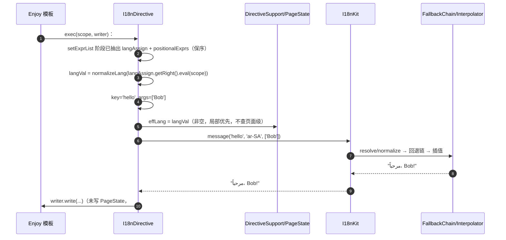
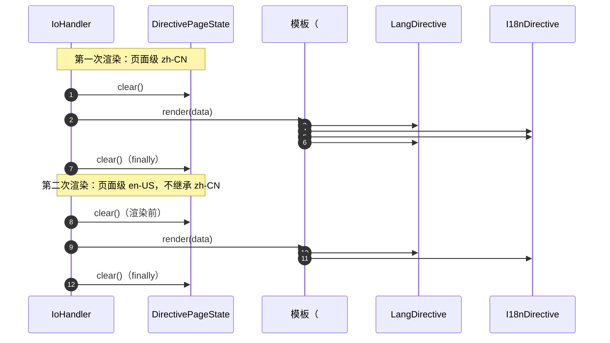

# aifei-i18n 指令增量设计文档（阶段二 Demo 实现）

> **文件定位**：本文是 `docs/design.md`（1.0.0 设计事实来源）的**独立增量设计文档**，只覆盖「Enjoy 三条指令 + aifei-i18n-demo 示例工程」的增量实现，不改动原 `design.md`。原 `design.md` 的全部契约（公共面 9 类型、唯一定义点、I18nKit 重载签名、LocaleContext、I18nConfig、§8.3 异常消息逐字表）继续有效；本文与之冲突处一律以原 `design.md` 为准并显式说明。
>
> **事实来源**：增量 PRD `docs/需求/aifei-i18n-directive.md`（§3 指令契约、§5 AC-INC-01~13、§6 唯一定义点、§7 spike 结论、§9 P-01~P-06、§10 交付物）；已确认阶段一原型 `docs/原型/aifei-i18n/index.html` + `README.md`；模块 `AGENTS.md`；原 `design.md`；`requirements-review.md`。
>
> **版本纪律**：`aifei-i18n` 仍为 `1.0.0`，**不递增**；新建示例工程 `aifei-i18n-demo` 同为 `1.0.0`（示例工程，不发布）。
>
> **范围**：只做增量设计，不含实现代码；产出供下一棒开发工程师与 QA 使用。

---

## 0. 实现方案总览（选型门禁留痕）

### 0.1 模块划分与数据流

```
aifei-i18n（库模块 SDK，既有）
└─ internal/directive/（新增，非承诺实现，public 供注册，不计入公共面 9 类型）
   ├─ I18nDirective   → #i18n(...)  取文案（薄封装分发）
   ├─ LangDirective   → #lang() / #lang('xxx')  页面语言读写
   ├─ DirDirective    → #dir() / #dir('xxx')   页面方向读写
   ├─ DirectivePageState → 页面级 lang / dirOverride 的 ThreadLocal 唯一持有点 + clear()
   ├─ DirectiveSupport   → effectivePageLang() / 参数切分 / 校验（共享工具，非规则定义点）
   └─ DirectiveRegistrar → register(Engine)：一处 addDirective 三条指令

aifei-i18n-demo（新建示例工程，不发布，端口 18170）
└─ 真实 Enjoy 渲染：Service @Path → view 模板（内嵌三条指令）→ engine.getTemplate().render()
   → I18nKit.bundle(locale) 下发语言包 JSON（前端控件文案）→ FormatKit 货币展示
```

**数据流（一句话）**：模板指令只做「抽 `lang` + 切位置 + 选语言层 + 调 `I18nKit` 既有重载」；选中 locale 后，规范化（`LocaleNormalizer`）、四级优先级（`LocaleResolver`）、回退链/插值（`I18nKit`→`FallbackChain`/`MessageInterpolator`）、dir 判定与降级（`LocaleMeta`）**全部复用原唯一定义点**，指令层零复制。

### 0.2 技术选型与实证记录（选型门禁）

| 项 | 决策 | 实证 / 依据 |
| --- | --- | --- |
| 模板引擎 | 复用 `aifei-all:1.1.2` 已内含的 `cn.aifei:aifei-enjoy`，**零新增依赖坐标、零库模块 pom 改动** | PRD §七 spike（2026-11-19）已验证指令契约在真实 Enjoy 1.1.2 全部成立；`aifei-enjoy` 随 `aifei-all(provided)` 提供 |
| 指令基类 / 注册 | 基类 `cn.aifei.enjoy.Directive extends Stat`；注册 `Engine.addDirective(name, Class<? extends Directive>, keepLineBlank)` | PRD §七结论④（spike 实证） |
| 具名参数取值 | `Assign.getRight().eval(scope)`，**禁用** `Assign.eval(scope)`（后者写 scope，污染页面作用域） | PRD §七「具名参数语义提醒」 |
| 语言层落点 | 新增 `DirectivePageState` 持有页面级 lang/dir；`effectivePageLang()` 为优先级链唯一落点 | 原 `design.md` §5.5/§6.3 四级优先级不含「页面级」，故在指令层组合，不修改 `LocaleResolver` |
| dir 数据源 | 仅 `LocaleMeta.dir(Locale)`（JDK `ComponentOrientation`），`#dir('xxx')` 显式覆盖只写页面级 state | AGENTS §四 / 原 design D-4 / PRD §6 |
| Demo 端口 | **18170** | 仓库现有 demo 实际占用：18080/18090/18092/18100/18110/18120/18130/18140/18150/18160（已读全部 `start-demo.bat` 实证），18170 空闲 |
| 弃用默认栈 | **无弃用项** | Java 8 + Maven + Aifei + 静态页/AJAX 全部沿用；无「不可用/有缺陷」断言，无需弃用实证 |

**唯一新增门禁例外（关键决策，留痕）**：实测 `ArchitectureBoundaryTest#frameworkScopeRules`（源码已读）为白名单制——任何 `cn.aifei.*` import 非 `Prop`/`Plugin`/`aop`/`core`/`log` 即判违规；指令类必须 `import cn.aifei.enjoy.*`，故**必须**为该包开例外。按 `AGENTS.md` §六「新增例外必须先改设计再改门禁」的纪律，**本文即该例外的设计载体**：仅允许 `cn.aifei.enjoy.*` 出现在 `internal/directive/`，其余包不变、门禁不放宽。详见 §7.1 与任务 T-I01。

---

## 1. 增量目标与不变约束清单

### 1.1 增量目标（对齐 PRD §一成功标准）

1. 三条指令在真实 Enjoy 引擎跑通，`lang` 位置无关提取规则单一、可测试；
2. 指令层只做「抽 lang + 切位置 + 分发到 I18nKit 既有重载」，零新增回退/规范化/插值逻辑；
3. 公共面精确 9 类型与「公共签名零第三方/框架类型」约束不变。

### 1.2 继续有效的既有条款（明确不变更）

| 来源 | 继续有效的条款 |
| --- | --- |
| 原 PRD（aifei-i18n.md） | Q1~Q9 裁决、16 条 P0 / 75 条 AC，除增量 PRD §二明示变更（Q7 突破）外全部有效 |
| 原 design.md | §5 公共 API 逐字签名（9 类型）、§6.3 全部唯一定义点、§7 四个配置键、§8.3 异常逐字表、§11 双门禁、§12 依赖、§14 任务、§15 AC 映射 |
| AGENTS.md | 公共面 9 类型不变；零新增依赖坐标；零 pom 改动；Java 8 语法/API；简体中文注释；dir 只走 JDK；非零第三方生态依赖 |
| 增量 PRD | §二 Q7 突破（新增 demo、复用 aifei-enjoy 零新增坐标）；§3.4 优先级链；§6 唯一定义点；§7 spike 结论；§9 P-01~P-06；§10 交付物 |

### 1.3 本增量唯一新增文件边界

- **库模块**：只新增 `internal/directive/` 下 6 个非承诺类 + 1 个指令单测；修改 `ArchitectureBoundaryTest`（门禁例外）、`README.md`、`docs/testing.md`。**不改任何既有公共类型签名、不改配置键、不改 pom**。
- **示例工程**：新建 `aifei-i18n-demo/`，独立 pom，不发布。

---

## 2. 指令类清单

### 2.1 三类指令总表

| 指令 | 类名 | 基类 | 所在包 | 可见性 | 注册入口 |
| --- | --- | --- | --- | --- | --- |
| `#i18n(...)` | `I18nDirective` | `cn.aifei.enjoy.Directive`（`extends Stat`） | `cn.hg.aifei.i18n.internal.directive` | `public`（供注册，非承诺 API） | `Engine.addDirective("i18n", I18nDirective.class, true)` |
| `#lang()` / `#lang('xxx')` | `LangDirective` | 同上 | 同上 | 同上 | `Engine.addDirective("lang", LangDirective.class, true)` |
| `#dir()` / `#dir('xxx')` | `DirDirective` | 同上 | 同上 | 同上 | `Engine.addDirective("dir", DirDirective.class, true)` |

- **公共面安全**：三者位于 `internal/directive/` 子包，原门禁③按「根/web/aifei 直接子级文件集合」断言、门禁④按 `tail.startsWith("web.")/("aifei.")` 过滤——`internal.directive.*` 均不计入，公共面仍精确 9 类型。
- **注册集中化**：`DirectiveRegistrar.register(Engine)` 一处完成三条 `addDirective`，demo 的 `IoHandler` 构造引擎后调用一次；`keepLineBlank=true` 保持页面排版（指令独占行时保留换行，避免文案粘连）。
- ** Enjoy 类型不外泄**：Enjoy 类型（`Directive`/`Stat`/`Expr`/`Assign`/`Scope`/`Writer`/`Engine`）只出现在 `internal/directive/*` 与 demo 工程，根/web/aifei 三包公共签名零 Enjoy 类型。

### 2.2 具名参数判定与取值伪码（spike §七口径）

```text
// setExprList(List<Expr> list)：解析期，只做结构化，不求值
langAssign = null
positionalExprs = []
for e in list:
    if e instanceof cn.aifei.enjoy.expr.Assign && ((Assign)e).getId().equals("lang"):
        if langAssign != null: throw IAE("i18n 指令具名参数 lang 重复")   // 重复 → IAE
        langAssign = (Assign) e                                            // 只记录节点，不 eval
    else:
        positionalExprs.add(e)                                             // 字符串常量 "lang='x'" 非 Assign → 天然不误判（AC-INC-10）

// exec(Scope scope, Writer writer)：渲染期，按序 eval
String langVal = null
if langAssign != null:
    Object v = langAssign.getRight().eval(scope)                           // ★ getRight().eval，禁用 Assign.eval(scope)
    langVal = DirectiveSupport.normalizeLang(v)                            // 复用 LocaleNormalizer.normalize；非法 → IAE（§8.3）
// langVal == null 表示无局部 lang → 走 effectivePageLang()
```

**要点**：`Assign.eval(scope)` 会把值写入 scope（wisdom/local/global）污染页面作用域；取 lang 值必须 `getRight().eval(scope)`（PRD §七派生结论）。`getId()` 判定具名参数名严格等于 `"lang"`。

---

## 3. 参数解析与分发伪码

### 3.1 `#i18n` 完整解析与四式分发

```text
exec(Scope scope, Writer writer):
    // ① 局部 lang（具名参数，位置无关）
    String langVal = null
    if langAssign != null:
        langVal = DirectiveSupport.normalizeLang(langAssign.getRight().eval(scope))

    // ② 剩余参数按原顺序求值：第一个 = key，第二个起 = args
    if positionalExprs.isEmpty(): throw IAE("key 不能为空")               // 缺 key → IAE（§8.3 逐字）
    Object[] pos = new Object[positionalExprs.size()]
    for i in 0..n-1: pos[i] = positionalExprs[i].eval(scope)
    String key = String.valueOf(pos[0])
    Object[] args = (n > 1) ? Arrays.copyOfRange(pos, 1, n) : new Object[0]

    // ③ 选语言层：局部 lang > 页面级 #lang > 当前生效 locale（唯一落点）
    String effLang = (langVal != null) ? langVal : DirectiveSupport.effectivePageLang()

    // ④ 分发到 I18nKit 既有重载（薄封装，零新逻辑）
    String out
    if effLang != null && args.length > 0:  out = I18nKit.message(key, effLang, args)
    elif effLang != null:                   out = I18nKit.message(key, effLang)
    elif args.length > 0:                   out = I18nKit.message(key, null, args)   // 理论兜底：落 defaultLocale
    else:                                   out = I18nKit.message(key)
    writer.write(out)
```

**§3.1 四式分发映射（显式化）**：

| 指令层解析结果 | `effLang` 来源 | 调用 `I18nKit` 重载 | 对应 PRD §3.1 表 |
| --- | --- | --- | --- |
| 有 lang、有 args | `normalizeLang(lang)` | `message(key, lang, args)` | 有 lang、有 args |
| 有 lang、无 args | `normalizeLang(lang)` | `message(key, lang)` | 有 lang、无 args |
| 无 lang、有 args | `effectivePageLang()`（页面级 > 四级优先级） | `message(key, effLang, args)` | 无 lang、有 args（当前 locale，此处具体化为页面生效 locale） |
| 无 lang、无 args | `effectivePageLang()` | `message(key, effLang)` | 无 lang、无 args |

> **为何"无 lang"显式传 `effLang` 而非直接 `message(key)`**：`message(key)` 走 `LocaleResolver.resolve(null)`，只读请求级 `LocaleContext` + defaultLocale，**读不到页面级 `#lang('xxx')`**。为落实 PRD §3.4 优先级链与 AC-INC-13，指令层用 `effectivePageLang()` 选出语言层后**显式**传入既有重载；`effLang` 已规范化，`message(key, effLang)` 与 `message(key)` 在无页面级覆盖时内部 resolve 结果一致（幂等），行为等价、语义更稳。回退链/插值仍由 `I18nKit` 内部完成，指令层零复制。

### 3.2 `#lang` 伪码

```text
exec(Scope scope, Writer writer):
    if positionalExprs.isEmpty():                                          // #lang() 读
        writer.write(DirectiveSupport.effectivePageLang())                 // 页面级 lang 优先，否则当前生效 locale
        return
    if positionalExprs.size() != 1: throw IAE("#lang 参数过多")            // 边界
    String tag = DirectiveSupport.normalizeLang(positionalExprs[0].eval(scope))  // 非法 BCP47 → IAE（§8.3）
    DirectivePageState.setPageLang(tag)                                    // 设页面级默认语言，不污染请求级 LocaleContext
    // 无输出（writer 不 write）
```

### 3.3 `#dir` 伪码

```text
exec(Scope scope, Writer writer):
    if positionalExprs.isEmpty():                                          // #dir() 读
        String override = DirectivePageState.pageDirOverride()
        if override != null: writer.write(override); return
        Locale loc = Locale.forLanguageTag(DirectiveSupport.effectivePageLang())
        writer.write(LocaleMeta.dir(loc))                                  // 复用唯一定义点：JDK 判定 + 不可用 ltr+WARN（AC-INC-08）
        return
    if positionalExprs.size() != 1: throw IAE("#dir 参数过多")
    String v = String.valueOf(positionalExprs[0].eval(scope))
    if !("ltr".equals(v) || "rtl".equals(v)):
        throw IAE("dir 非法: " + v + "（仅允许 ltr / rtl）")               // 仅接受两个方向字面量，非"语言→方向映射表"
    DirectivePageState.setPageDirOverride(v)                               // 只影响本次页面渲染元数据，不改 bundle 导出
    writer.write(v)
```

> `LocaleMeta.dir` 的降级分支（能力不可用 → `ltr` + WARN）由原 `design.md` D-4 保证，指令层直接复用；`Locale.forLanguageTag` 是 JDK 解析，仅用于把已规范化 tag 转 `Locale` 入参，不构成第二套规范化/方向规则。门禁⑩检查的「语言码→方向数组」模式不触发（指令类无 `{"ar",...}` 形式数组）。

### 3.4 字符串字面量不误判（AC-INC-10）

`#i18n('hello', "lang='x'", 'Bob')` 中 `"lang='x'"` 在 Enjoy AST 中是字符串常量表达式（`Str` 类），不是 `cn.aifei.enjoy.expr.Assign` 节点 → §2.2 的 `instanceof Assign` 判定天然不命中 → 作为普通位置参数参与 `args`（spike §七结论③）。

---

## 4. 页面级 / 局部语言分层实现方案

### 4.1 状态存哪里：新增 `DirectivePageState`，不动 `LocaleContext`

| 状态 | 持有点 | 语义 | 生命周期 |
| --- | --- | --- | --- |
| 请求级上下文 locale | 既有 `internal.LocaleContext`（`ThreadLocal<String>`） | 由 `web.I18nHandler` 在 handler 链绑定/finally 清理；影响所有 `message(key)` 无显式 locale 调用 | 一个 HTTP 请求 |
| **页面级 lang** | 新增 `DirectivePageState.pageLangTL` | `#lang('xxx')` 设置；影响本次页面渲染内无局部 lang 的 `#i18n` 与 `#lang()` 读值 | 一次模板渲染 |
| **页面级 dir 覆盖** | 新增 `DirectivePageState.pageDirTL` | `#dir('xxx')` 设置；仅页面渲染元数据 | 一次模板渲染 |

**为何不复用 `LocaleContext`**：`LocaleContext` 是「请求级生效 locale」的唯一定义点，由 `I18nHandler` 在 handler 链首绑定、`finally` 清理；`#lang('xxx')` 是**模板渲染期**的页面级默认值，二者作用域不同（demo 的 Service 渲染未必经过 `I18nHandler`）。写入 `LocaleContext` 会污染请求级语义并与 handler 清理耦合。故新增独立 ThreadLocal，**不动 `LocaleContext`、零回归**，同时保证"公共面/唯一定义点"约束不变（新增类在 `internal/directive/`，非承诺实现）。

### 4.2 优先级链唯一落点：`DirectiveSupport.effectivePageLang()`

```text
// 语言取值唯一优先级链（PRD §3.4）的唯一实现落点
String effectivePageLang():
    String page = DirectivePageState.pageLang()
    if page != null: return page                      // ② 页面级 #lang('xxx')（高优先级存在即命中，不向下回退）
    return LocaleResolver.resolve(null)                // ③ #lang() = 当前生效 locale（请求头 > defaultLocale 四级优先级，唯一定义点）
```

- ① 局部 `#i18n(..., lang='xxx')` 在 §3.1 的 `langVal` 分支命中，**不进入** `effectivePageLang()`；三者构成完整链 `① > ② > ③`。
- `LocaleResolver.resolve(null)` 是原 `design.md` 四级优先级的唯一定义点，本方法只决定「选哪一层」，选中后**不改**回退链/规范化/插值。
- `#lang()` 读、`#i18n` 无 lang 取文案、`#dir()` 无覆盖时判定 locale，三者**共用**本方法，保证 AC-INC-06/13 的"页面值不被局部覆盖污染、#lang() 读回一致"。

### 4.3 `#lang('xxx')` 设置 / `#lang()` 读取 / 局部覆盖不污染

- 设置：`#lang('zh-CN')` → normalize → `DirectivePageState.setPageLang("zh-CN")`。
- 读取：`#lang()` → `effectivePageLang()` → 有页面级返回它，否则四级优先级（无页面级且无请求头时 = `i18n.defaultLocale`，满足 P-01）。
- 局部覆盖不污染：`#i18n('hello', lang='ar-SA')` 仅用 `langVal` 调一次 `message`，**不写** `DirectivePageState`；其后 `#lang()` 仍返回页面级 zh-CN（AC-INC-06/13）。
- 高优先级不回退：局部有 lang 时即使页面级/请求头存在也不参入（§3.4；AC-INC-13 局部条 = ar-SA、无 lang 条与 #lang() = zh-CN）。

### 4.4 `finally` 清理策略（对齐 AC-INC-12 同线程不串）

- `DirectivePageState.clear()` 同时清空 `pageLangTL` 与 `pageDirTL`，幂等。
- **清理责任在渲染入口**（指令是散点调用，无统一结束点）：demo 的 `IoHandler` 在 `engine.getTemplate(view).render(data, out)` 前后：
  ```text
  DirectivePageState.clear()            // 渲染前先清，防上次残留
  try:
      DirectivePageState.setPageLang(reqLang)   // 或由模板顶部 #lang(lang) 设置
      engine.getTemplate(view).render(data, out)
  finally:
      DirectivePageState.clear()        // 无条件清理，异常路径同样生效（对齐 AC-08-6/I18nHandler finally 口径）
  ```
- 同线程连续两次不同语言渲染：第二次渲染前 `clear()` 保证不继承第一次的页面级 lang/dir（AC-INC-12）。
- `README.md` 显式声明：消费方若在模板用 `#lang`/`#dir`，须在渲染入口 try/finally 调 `DirectivePageState.clear()`（internal API，随模块提供）。

---

## 5. AC-INC-01~13 ↔ 实现映射表

| AC | 判定要点 | 实现点（类 / 方法） | 验证通道 |
| --- | --- | --- | --- |
| AC-INC-01 | 三式写法输出逐字相等 | `I18nDirective#setExprList`（位置无关抽 lang）+ `#exec`（`langVal` 分支 ⇒ 同一 `message(key, lang, args)`） | `DirectiveTest#testLangPositionIndependence` |
| AC-INC-02 | lang 置首/中/尾均提取、剩余参数顺序不变 | `I18nDirective#setExprList`（`positionalExprs` 保序） | `DirectiveTest#testLangAnyPositionKeepsArgsOrder` |
| AC-INC-03 | `{0}` 插值 + 缺参原样保留 | `I18nKit.message` → `MessageInterpolator#format`（E-6，既有唯一定义点） | `DirectiveTest#testInterpolationAndMissingArg` |
| AC-INC-04 | 无 lang 走当前页面/请求 locale | `DirectiveSupport#effectivePageLang` → `LocaleResolver.resolve(null)` | `DirectiveTest#testNoLangUsesEffectiveLocale` |
| AC-INC-05 | `#lang('zh-CN')` 后无 lang 文案跟随 | `LangDirective#exec`（setPageLang）+ `DirectiveSupport#effectivePageLang` | `DirectiveTest#testPageLangGoverns` |
| AC-INC-06 | 局部 ar-SA + 页面 zh-CN：局部阿文、`#lang()` 仍 zh-CN | `I18nDirective`（langVal 不写 state）+ `LangDirective#exec`（读 effectivePageLang）+ `DirectivePageState` | `DirectiveTest#testLocalOverrideNotPollutePage` |
| AC-INC-07 | `#dir('rtl')` → `#dir()`=rtl；非法值 IAE | `DirDirective#exec`（setPageDirOverride / ltr·rtl 校验） | `DirectiveTest#testDirReadWriteAndIllegal` |
| AC-INC-08 | dir 能力不可用 → ltr + WARN，不抛 | `LocaleMeta#dir`（原 D-4 降级分支，指令层复用） | `DirectiveTest#testDirFallback`（隔离能力替身） |
| AC-INC-09 | lang 重复 / 非法 / 缺 key → IAE，消息可定位 | `I18nDirective#setExprList`（重复/缺 key）+ `DirectiveSupport#normalizeLang`（非法，§8.3） | `DirectiveTest#testIllegalIae` |
| AC-INC-10 | 字符串字面量 `"lang='x'"` 不误判 | `I18nDirective#setExprList`（`instanceof Assign` 天然不命中） | `DirectiveTest#testStringLiteralNotNamedArg` |
| AC-INC-11 | demo 真实 Enjoy 渲染 §4 场景，逐字相等，零联网 | demo `I18nDemoService` + `view/i18n/index.html` + `DirectiveRegistrar` | `DirectiveTest#testRealEngineEndToEnd`（真实 Engine + 内存模板，无 HTTP） + demo 手工核对 P-01~P-06 |
| AC-INC-12 | 同线程两次不同语言渲染不串 | `DirectivePageState.clear()` + demo `IoHandler` try/finally | `DirectiveTest#testSameThreadNoLeak`（连渲两次断言隔离） |
| AC-INC-13 | 局部 ar-SA / 无 lang 与 #lang() 均 zh-CN（请求头 en-US），高优先级不回退 | `DirectiveSupport#effectivePageLang` + `I18nDirective`（langVal 优先）+ `LangDirective` | `DirectiveTest#testPriorityChainNoFallback` |

> 覆盖：AC-INC-01~13 全部有一一实现点与验证通道，无遗漏；每条测试在 `aifei-i18n/src/test/java/cn/hg/aifei/i18n/internal/directive/DirectiveTest.java` 中实现，真实 Engine 渲染内存模板（零联网、零 HTTP 依赖），满足测试零联网纪律。

---

## 6. aifei-i18n-demo 工程方案

### 6.1 目录结构（对齐仓库现有 demo 风格，参照 aifei-excel-demo）

```text
aifei-i18n-demo/                              io.github.gollyhu:aifei-i18n-demo:1.0.0（jar，示例工程不发布）
├── pom.xml                                   aifei-all compile + aifei-i18n compile + undertow-core
├── README.md                                 启动方式、端点、P-01~P-06 核对、版本不发布声明
├── start-demo.bat                            -Dundertow.port=18170
├── stop-demo.bat                             netstat 查 18170 → taskkill
└── src/main/
    ├── resources/
    │   ├── app-config.txt                    i18n.defaultLocale=zh-CN / i18n.sources=properties / enjoyDevMode=true
    │   └── i18n.properties                   语言包：zh-CN|key=原文，含 zh-CN/en-US/ja-JP/ar-SA
    ├── java/cn/hg/aifei/i18n/demo/
    │   ├── DemoApp.java                      Aifei.start(new DemoAppConfig(), args)
    │   ├── DemoAppConfig.java                PropKit.use → I18nPlugin → setServer → addHandler(IoHandler)
    │   ├── arch/                             In/InParser/IoHandler/IoDispatcher/Out/OutCode/ContentType/TargetFactory（模板复用 excel-demo）
    │   │   └── IoHandler.java                ★ 构造引擎后 DirectiveRegistrar.register(engine)；render 前后 try/finally clear()
    │   ├── console/                          ConsoleLog / ConsoleLogFactory（零日志绑定，System.out）
    │   └── service/
    │       └── I18nDemoService.java          @Path("/i18n/demo")：page / bundle / rtl / money 端点
    └── webapp/
        ├── view/i18n/
        │   ├── index.html                    真实 Enjoy 模板，还原原型 P-01~P-06（含三条指令）
        │   └── rtl.html                      iframe 用：#lang('ar-SA') + #i18n(key) + #dir()
        └── assets/
            ├── css/i18n-demo.css             原型样式迁移（深色开发者工具风、RTL、响应式）
            └── js/i18n-demo.js                语言包 JSON 填充 data-i18n、下拉切换、toast、货币符号
```

### 6.2 坐标、依赖与版本

| 依赖 | 范围 | 说明 |
| --- | --- | --- |
| `cn.aifei:aifei-all:1.1.2` | compile | 示例工程自带内核（含 Enjoy + Undertow 内核 API） |
| `io.github.gollyhu:aifei-i18n:1.0.0` | compile | 被演示的库本体；启动前先 `cd ..\aifei-i18n && mvn -q -DskipTests clean install` |
| `io.undertow:undertow-core:2.2.39.Final` | compile | 对齐 excel-demo 版本；零日志绑定（自带 ConsoleLogFactory） |

- **零新增第三方**：不引 jackson/slf4j 等；JSON 由 `cn.aifei.json.Json` 拼装。
- **版本不变**：SDK 与 demo 均 `1.0.0`；demo 描述标明「示例工程，不发布」。
- **properties 保留方法参数名**：`maven-compiler-plugin` 配 `<parameters>true</parameters>`（对齐 excel-demo，反射注入取参名需要）。

### 6.3 端口与脚本

- **端口 18170**（host `0.0.0.0`），避开全部现有 demo 端口。
- `start-demo.bat`：对齐 excel-demo 三步（compile + build-classpath → 读 cp.txt → `java -Dundertow.port=18170 -Dundertow.host=0.0.0.0 -Ddemo.config=app-config.txt -cp ".\target\classes;%CP%" cn.hg.aifei.i18n.demo.DemoApp`），头部注释先 install i18n 库。
- `stop-demo.bat`：`set "PORT=18170"` + netstat 查 LISTENING → `taskkill /f /pid`（对齐 excel-demo）。
- 验证地址：`http://localhost:18170/i18n/demo/page`。

### 6.4 app-config 配置

```text
# demo 是应用工程：端口由 start-demo.bat -Dundertow.port=18170 传入
i18n.defaultLocale = zh-CN      # P-01：首屏默认中文
i18n.sources = properties       # 仅用本地语言包，零外部依赖
enjoyDevMode = true             # 模板热加载，改页面刷新即生效
```
- 不配 `i18n.locales`（不设白名单）、不配 `i18n.cache.ttlMillis`（默认 60000）——保持 4 配置键口径不变。
- `DemoAppConfig.config(Plugins)`：`plugins.add(new I18nPlugin(prop))`（原 design §5.9 装配用法）。

### 6.5 真实 Enjoy 渲染还原原型 P-01~P-06

| 编号 | 原型观察点 | 真实 Enjoy 还原方案 |
| --- | --- | --- |
| P-01 | 首屏取 `i18n.defaultLocale=zh-CN`；未选择时中文 | `I18nDemoService#page` 读可选 `?lang` 参数，默认 null → 模板顶部 `#lang(lang)`：lang 为 null 时不设页面级，`#i18n` 走 `effectivePageLang()`→`LocaleResolver.resolve(null)`→defaultLocale=zh-CN；配置徽标展示 `i18n.defaultLocale = zh-CN` |
| P-02 | 醒目区同屏展示 `locale`/`localeName`/`dir`，随切换更新 | 模板三 metric：`locale`=`#lang()`；`localeName` 由 Service 用 `I18nKit.bundle(lang).localeName()` 放 model（公共 API，禁译名表由 LocaleMeta 保证）；`dir`=`#dir()`。`<html dir>` 由 Service 按 locale 的 bundle.dir 设置 |
| P-03 | 中/英/日下拉切换，整体文案（含 P-05）同步 | 下拉 `onchange → location.href='?lang=xxx'` 整页真实重渲染；Service 把 lang 传 model，模板顶部 `#lang(lang)` 设页面级，全部 `#i18n` 与 JSON 文案跟随 |
| P-04 | iframe 内中东文 RTL，口径「先 `#lang('ar-SA')` 再 `#i18n(key)`」 | iframe `src=/i18n/demo/rtl`；`rtl.html` 顶部 `#lang('ar-SA')`，正文 `#i18n('iframe.title')`/`#i18n('hello','بوب')` 等阿文 key，`<html dir="rtl" lang="ar-SA">`，`#dir()` 输出 rtl；保留「RTL 实现口径」徽标（原型已确认，非阻塞） |
| P-05 | 表单 8 项 + 表格 3 项文案随切换；货币英文显美元符；表格仅外观不查询 | **控件文案走语言包 JSON**：前端 `i18n-demo.js` 按 `#lang()` 的 locale 拉取 `/i18n/demo/bundle?locale=xx`（`I18nKit.bundle` 四字段 JSON，原 design §9.4 契约），填 `data-i18n`/`data-i18n-placeholder`；货币值输入框符号由 Service 用 `FormatKit.formatCurrency(amount, currencyCode, locale)` 产出（en-US→USD、zh-CN→CNY、ja-JP→JPY 由 demo 演示逻辑选币种，符号由 JDK/FormatKit 决定，demo 不自建符号表）；查询/重置仅弹 toast、表格空提示 + 分页仅外观（与 PRD「表格不查询」一致） |
| P-06 | 三卡并列：局部 lang > 页面级 #lang > 无参 #lang()；局部不污染 | ①局部卡 `#i18n('hello', lang='ar-SA', 'Bob')`（固定阿文）；②页面级卡 `#i18n('hello','Bob')`（随下拉）；③无参卡 `#lang()` 读值 + 对应 `#i18n('hello','Bob')`（无页面级覆盖时=defaultLocale，随切换）；代码示例块逐字展示三种写法 |

- **语言包 JSON 落点**：`src/main/resources/i18n.properties`，格式 `<locale>|<key>=<原文>`（UTF-8，对齐 `PropertiesSource#DEFAULT_RESOURCE`），覆盖原 `I18N.m` 全部 key；zh-CN/en-US/ja-JP 全量，ar-SA 仅 `hello`/`page.title`/`iframe.title`/`table.empty`/`form.search`（其余靠回退链补 en-US，正好演示 REQ-P0-03 回退）。
- **零联网**：语言包为 classpath 本地资源；demo 内所有 URL 为 `localhost`。
- **布局/视觉**：CSS 与原 `docs/原型/aifei-i18n/index.html` 一致（深色开发者工具风、SVG 图标、响应式、RTL 区域），仅把前端 `t()` 文案渲染替换为真实指令 + bundle JSON。

### 6.6 服务端 FormatKit 货币展示（P-05 口径）

```text
// I18nDemoService#money：demo 演示逻辑选币种（非 SDK 规则数据，demo 不受库门禁约束）
currencyCode = locale.equals("en-US") ? "USD" : locale.equals("ja-JP") ? "JPY" : "CNY"
String shown = FormatKit.formatCurrency(12800.0, currencyCode, locale)   // 符号/小数位由 JDK 决定
// 放入 model 或 JSON，前端货币值输入框 affix 显示（英文环境美元符由 JDK 产出，不写死 "$" 常量）
```
- 遵守原 design §9.8「不写死符号字符」：断言/展示以 FormatKit 输出为准。

### 6.7 页面级清理在 demo 的落地

- `IoHandler` 构造 `Engine` 后调用 `DirectiveRegistrar.register(engine)`（一次）。
- `render(view, data, out)` 前后按 §4.4 的 try/finally 调 `DirectivePageState.clear()`，保证 P-03 反复切换、AC-INC-12 同线程不串。

---

## 7. 跨文件约定与门禁例外

### 7.1 门禁例外登记（唯一新增，必须落地）

修改 `ArchitectureBoundaryTest#frameworkScopeRules`：新增常量与白名单分支，**只**放开 `cn.aifei.enjoy.*` 于 `internal/directive/`：

```text
private static final String DIRECTIVE_PACKAGE = "cn/hg/aifei/i18n/internal/directive/";
// 在 allowed 计算中追加一项：
boolean enjoyOnly = fqn.startsWith("cn.aifei.enjoy.");
allowed = allowed || (enjoyOnly && path.contains(DIRECTIVE_PACKAGE));
```
- 断言消息同步补充「enjoy 仅允许 internal/directive」；其余门禁①/③/④/⑧/⑨/⑩/⑪/⑫/⑬ 规则与常量**不变、不放宽**。
- 依据：`AGENTS.md` §六「新增例外先改设计再改门禁」——本文即设计载体；`PRD §二` 已明示 Q7 突破（引入 Enjoy 但零新增坐标、Enjoy 类型不进公共签名）。

### 7.2 命名与分包约定

| 项 | 约定 |
| --- | --- |
| 指令类 | `XxxDirective`，`public`，`cn.hg.aifei.i18n.internal.directive`，继承 `cn.aifei.enjoy.Directive` |
| 共享工具 | `DirectiveSupport`（静态工具，非规则定义点）、`DirectivePageState`（页面级 state 唯一持有点）、`DirectiveRegistrar`（注册入口） |
| 注册名 | `"i18n"` / `"lang"` / `"dir"`（模板用 `#名(...)`），`keepLineBlank=true` |
| 注释语言 | 全部简体中文；类名/包名严格 `cn.hg.aifei.i18n`（demo 为 `cn.hg.aifei.i18n.demo`） |

### 7.3 异常消息增量（登记到 §8.3 逐字表的新增行）

| 场景 | 消息（逐字） | 复用口径 |
| --- | --- | --- |
| `#i18n` lang 具名参数重复 | `i18n 指令具名参数 lang 重复` | 新增（指令特有），IAE |
| `#i18n` 缺 key | `key 不能为空` | 复用原 §8.3 |
| `#i18n`/`#lang` lang 非法 | `locale 非法: <原值>（不是合法 BCP 47）` | 复用原 §8.3（经 `LocaleNormalizer`） |
| `#dir` 非法值 | `dir 非法: <原值>（仅允许 ltr / rtl）` | 新增（指令特有），IAE |
| `#lang`/`#dir` 参数过多 | `#lang 参数过多` / `#dir 参数过多` | 新增（指令特有），IAE |

> 除以上新增/复用项外，运行期故障仍走「WARN + 回退，不抛」、未命中仍 DEBUG、dir 降级仍 `ltr`+WARN——全部沿用既有口径，不为模板另设一套。

### 7.4 公共工具与复用边界

- `DirectiveSupport.normalizeLang(Object)`：把 eval 结果转 String 后调 `LocaleNormalizer.normalize`（唯一定义点），非法转 IAE（§8.3 消息）；**不自建** BCP47 校验。
- `DirectiveSupport.effectivePageLang()`：§4.2 优先级链唯一落点。
- `DirectivePageState`：页面级 lang/dir 的 ThreadLocal 唯一持有点 + `clear()`；不写 `LocaleContext`。
- 三条指令与 demo 只能通过上述工具访问规则，**不得**直接 `setLanguageTag`、`ComponentOrientation`、自建方向/货币表（门禁⑨/⑩/⑪ 保证）。

---

## 8. 文件清单与有序任务分解

### 8.1 文件清单（每个文件恰好归属一个任务）

```text
aifei-i18n/（库模块增量）
├── src/main/java/cn/hg/aifei/i18n/internal/directive/
│   ├── DirectiveRegistrar.java        [T-I01] 注册入口 register(Engine)
│   ├── DirectivePageState.java        [T-I02] 页面级 lang/dir ThreadLocal + clear()
│   ├── DirectiveSupport.java          [T-I02] effectivePageLang/normalizeLang/参数工具
│   ├── I18nDirective.java             [T-I02] #i18n
│   ├── LangDirective.java             [T-I02] #lang
│   └── DirDirective.java              [T-I02] #dir
├── src/test/java/cn/hg/aifei/i18n/
│   ├── ArchitectureBoundaryTest.java  [T-I01] 修改：enjoy 门禁例外登记
│   └── internal/directive/
│       └── DirectiveTest.java         [T-I05] 指令单测（AC-INC-01~13）
├── README.md                          [T-I06] 修改：指令用法 + 页面级 clear 责任声明
└── docs/testing.md                    [T-I06] 修改：指令用例清单
（docs/design-directive.md 为本文，已产出，不在任务清单内）

aifei-i18n-demo/（新建示例工程）
├── pom.xml                            [T-I01]
├── src/main/resources/
│   ├── app-config.txt                 [T-I01]
│   └── i18n.properties                [T-I01]
├── src/main/java/cn/hg/aifei/i18n/demo/
│   ├── DemoApp.java                   [T-I01]
│   ├── DemoAppConfig.java             [T-I01]
│   ├── arch/In.java                   [T-I03]
│   ├── arch/InParser.java             [T-I03]
│   ├── arch/IoHandler.java            [T-I03] ★注册指令 + render try/finally clear()
│   ├── arch/IoDispatcher.java         [T-I03]
│   ├── arch/Out.java                  [T-I03]
│   ├── arch/OutCode.java              [T-I03]
│   ├── arch/ContentType.java          [T-I03]
│   ├── arch/TargetFactory.java        [T-I03]
│   ├── console/ConsoleLog.java        [T-I03]
│   ├── console/ConsoleLogFactory.java [T-I03]
│   └── service/I18nDemoService.java   [T-I03]
├── src/main/webapp/view/i18n/
│   ├── index.html                     [T-I04]
│   └── rtl.html                       [T-I04]
├── src/main/webapp/assets/css/i18n-demo.css [T-I04]
├── src/main/webapp/assets/js/i18n-demo.js   [T-I04]
├── README.md                          [T-I06]
├── start-demo.bat                     [T-I06]
└── stop-demo.bat                      [T-I06]
```

> 根 `README.md` 模块总览新增一行（aifei-i18n-demo，链接 + "示例工程不发布"）归属 T-I06，不计入上述主清单。

### 8.2 有序任务分解（T-I01 基础设施优先；依赖只指向前序任务）

| 任务 | 文件（按写入顺序） | 依赖 | 优先级 | 批次验收 |
| --- | --- | --- | --- | --- |
| **T-I01** 基础设施（demo 构建/配置/入口 + 指令注册骨架 + 门禁例外） | demo:`pom.xml`·`app-config.txt`·`i18n.properties`·`DemoApp.java`·`DemoAppConfig.java`；库:`DirectiveRegistrar.java`·`ArchitectureBoundaryTest.java`（改） | — | P0 | demo `mvn -q -DskipTests compile` 过；门禁②仍全绿（enjoy 例外生效、其它未放宽） |
| **T-I02** 三条指令实现 + 页面级 state | `DirectivePageState.java`·`DirectiveSupport.java`·`I18nDirective.java`·`LangDirective.java`·`DirDirective.java` | T-I01 | P0 | 库 `mvn -q -DskipTests compile` 过；公共面仍 9 类型；无新增依赖坐标 |
| **T-I03** demo 架构件 + Service 端点 | demo:`arch/*`(8)·`console/*`(2)·`service/I18nDemoService.java` | T-I01、T-I02 | P0 | `/i18n/demo/page`、`/bundle`、`/rtl`、`/money` 可访问；render 前后 clear 就位 |
| **T-I04** demo 真实 Enjoy 页面（P-01~P-06） | `view/i18n/index.html`·`view/i18n/rtl.html`·`assets/css/i18n-demo.css`·`assets/js/i18n-demo.js` | T-I03 | P0 | 浏览器逐条核对 P-01~P-06 与原型一致；零联网 |
| **T-I05** 指令单测 | `internal/directive/DirectiveTest.java` | T-I02 | P0 | AC-INC-01~13 全覆盖；真实 Engine 渲染内存模板；同线程不串 |
| **T-I06** 文档与交付物 | 库:`README.md`（改）·`docs/testing.md`（改）；demo:`README.md`·`start-demo.bat`·`stop-demo.bat`；根 `README.md`（加一行） | T-I01~T-I05 | P1 | `cd aifei-i18n && mvn clean verify` 0 failure/0 error；demo 手工核对通过；版本仍 1.0.0 |

**硬纪律**：T-I01~T-I05 每批不得改公共面签名/配置键/异常既有措辞；T-I06 回归未过不得交付。新增异常消息仅 §7.3 列明项。

---

## 9. 关键链路时序图（Mermaid）

### 9.1 `#i18n('hello', lang='ar-SA', 'Bob')` —— 局部 lang 命中（AC-INC-01/02/06）



### 9.2 同线程两次渲染 —— 页面级 lang 不串（AC-INC-05/12/13）



---

## 10. 待明确事项与假设

| # | 事项 | 处理 / 假设 |
| --- | --- | --- |
| 1 | **P-04 iframe RTL 口径** | PRD §九 P-04 原文的表述差异已由阶段一原型确认：iframe 内「先 `#lang('ar-SA')` 设页面级语言、再 `#i18n(key)` 取文案」。本文按此落地，不修改 §3 契约；原型已标「待确认」徽标，保留即可，不阻塞。 |
| 2 | **门禁例外范围** | 仅放开 `cn.aifei.enjoy.*` 于 `internal/directive/`（§7.1）；若 QA 认为过宽，可进一步收紧到具体类，但不得放回「一律失败」导致指令无法编译。 |
| 3 | **Enjoy 指令 exec 方法签名细节** | 以 `aifei-enjoy 1.1.2` 实际 API 为准（spike 已验证基类与注册入口）；本文伪码中 `setExprList`/`exec(Scope,Writer)` 为形态说明，编码期照实际签名对齐，不改契约语义。 |
| 4 | **页面级 clear 的消费方责任** | 由 `internal.DirectivePageState.clear()` 暴露，demo 已落地；消费方使用 `#lang`/`#dir` 须在渲染入口 try/finally 清理，`README.md` 显式声明（对齐原 `I18nHandler` finally 口径）。 |
| 5 | **localeName 展示来源** | 通过公共 `I18nKit.bundle(lang).localeName()` 放 model，不在指令层新增取 localeName 的指令（本期只三条指令），保持公共面 9 类型不变。 |
| 6 | **版本与发布** | SDK 与 demo 均 `1.0.0` 不递增；demo 描述与 README 标注「示例工程，不发布」；库 pom 零改动。 |

---

设计关 IS_PASS: YES

架构师 贾苟思
