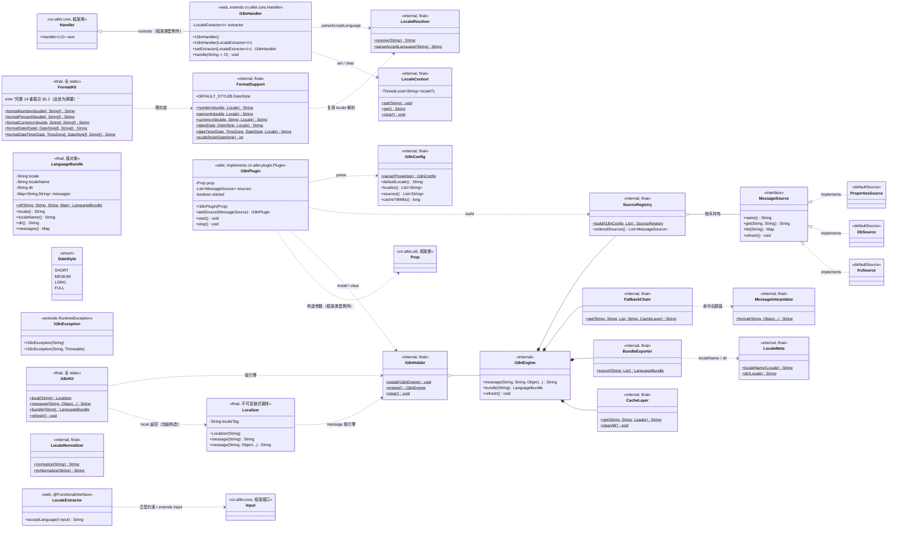
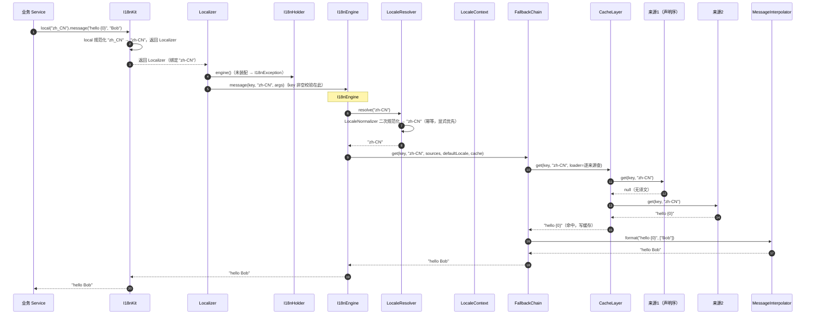
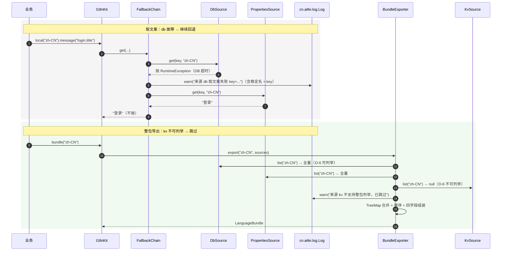
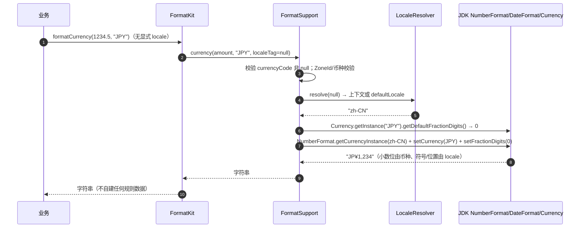
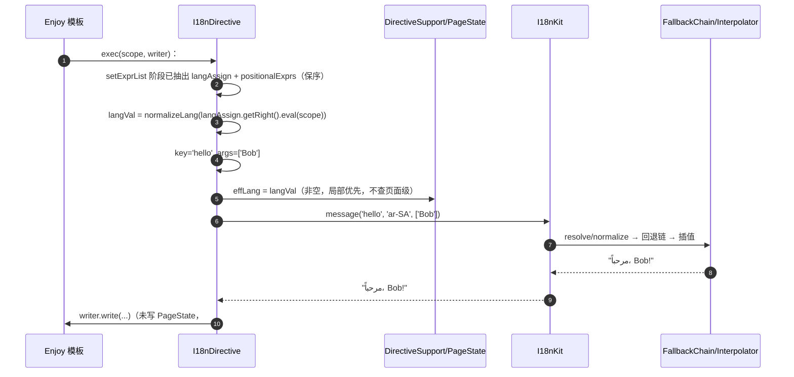
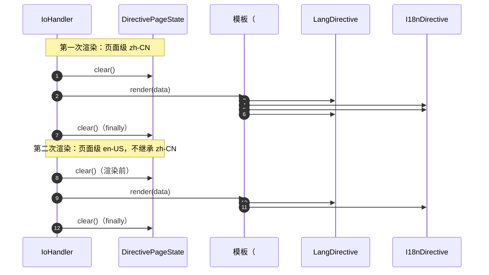

# aifei-i18n 设计文档

本文是 `aifei-i18n` 的**设计事实来源（契约）**：公共 API 逐字签名、内部结构与唯一定义点、配置键、行为契约与异常语义、架构门禁、任务分解与 AC↔实现映射以本文为准。面向使用者的用法见 `README.md`；面向开发代理的约束见模块 `AGENTS.md`；测试策略与用例清单见 `docs/testing.md`（由测试角色在实现后编写，本文只定契约）。

> **需求事实来源**：`docs/需求/aifei-i18n.md`（第四轮定档，16 条 P0 / 75 条 AC / Q1~Q9 已裁决；§十一 为 Enjoy 模板指令增量需求）。本文**不推翻任何需求结论**；需求关核对结论并入 `docs/需求/aifei-i18n.md` §十一。
>
> **交付性质**：`aifei-i18n` 是 aifei 生态的**库模块（可被应用依赖的 SDK）**，**不是应用工程**。工程内**没有** `AppConfig` / `Launcher` / `service/` 包 / `webapp/` / HTTP 路由 / HIO / 表结构实体 / Generator / UI 页面。只有「根包公共 API 精确 7 类型 + `web` 接入包 2 类型 + `aifei` 装配包 1 类型 + `internal` 非承诺实现」。**本模块不提供 HTTP 端点**——语言包下发由消费方 Just Service 一行完成（契约见 §9.4）。
>
> **坐标**：`io.github.gollyhu:aifei-i18n:1.0.0-SNAPSHOT`（`packaging=jar`）；包名 `cn.hg.aifei.i18n`；**Java 8**（语法与 API 双约束，主 JAR class major = 52）；**零第三方**（`aifei-all` 为 `provided`、`aifei-cache` 为 `optional`，junit 为 `test`）。
>
> **文档状态**：本文是 1.0.0 的**设计定稿（契约）**。§5 的公共类型签名、§7 的 4 个配置键名、§2 的 4 项定档结论是编码与维护的**唯一依据**，变更前必须先改本文并过设计决策。增量需求来源见 `docs/需求/aifei-i18n.md` §十一。

---

## 1. 模块定位与边界

### 1.1 定位

框架与现有生态模块均无国际化构件，业务侧替代只有 JDK `ResourceBundle`（编译期打包、来源唯一、前端导出另建通道、Locale 无贯通口径）。

**底座边界（基线）**：底座只做四件事并做到极致、冻结边界——**locale 贯通的取文案 + 整包下发 + JDK 格式化 + 开放来源**；其余全部以扩展点形式交给业务方（职责归属与挂点见 §1.4、§1.5）。四件事的实现落点如下；Locale 贯通横切取文案与格式化，单列一行便于定位：

| # | 目标 | 落点 |
| --- | --- | --- |
| 1 | 后端按 `key + locale` 取单条文案，自带回退、缺译不 500 | `I18nKit#message` + `internal.FallbackChain` |
| 2 | 前端按 `locale` 取整包语言包，四字段固定、key 稳定排序 | `I18nKit#bundle` + `internal.BundleExporter` |
| 3 | 文案来源开放扩展 + 3 个默认件（`properties` / `db` / `kv`）按序叠加 | `MessageSource`（扩展点） + `internal.SourceRegistry` + `defaultSource.*` |
| 4 | Locale 贯通：解析优先级唯一 + Web 入口绑定/finally 清理 | `internal.LocaleResolver` + `web.I18nHandler` |
| 5 | Locale 贯通到 JDK 格式化（数值/百分比/货币/日期/日期时间），零自建规则数据 | `FormatKit` + `internal.FormatSupport` |

与生态的关系：`aifei-cache` 是 `kv` 来源的**可选**依赖（`optional`，不向下游传递，缺失即已声明来源启动失败）；`aifei-trace` 的 Web 入口绑定 + `finally` 清理是本模块 `web.I18nHandler` 的**同构先例**（需求 §5.5 点名）。模块**零**对 `aifei-trace` 的代码依赖。

### 1.2 为什么是「库/SDK」而非应用工程（不适用章节声明）

| 常规章节 | 结论 | 理由 |
| --- | --- | --- |
| 表结构草案 / DDL | **不适用** | 模块不建表、不执行 DDL；`db` 来源只读，建表 SQL 随 `README.md` 交付（§9.5） |
| Service 方法清单 / `@Path` | **不适用** | 模块本体无 Service；语言包下发端点由消费方 Just Service 一行实现（§9.4） |
| HIO / 路由 / 拦截器（入站） | **不适用** | 模块无入站 HTTP 面；`web.I18nHandler` 是挂在使用方 Handler 链上的接入构件 |
| 低保真 UI 原型 / QA 基线门禁 | **不适用** | 无页面；需求 Q7 已裁决**不新建 demo 工程** |
| `AppConfig implements AifeiConfig` / `Launcher` | **不适用** | 装配入口属使用方应用；本模块只提供 `aifei.I18nPlugin` 供 `plugins.add(...)` |

`aifei-i18n/` 内 `mvn clean verify` 必须 **0 failure / 0 error**（含两套架构门禁测试）。

### 1.3 公共面收敛纪律（硬约束）

| # | 纪律 |
| --- | --- |
| 1 | **根包公共 API 精确 7 个类型**：`I18nKit` / `Localizer` / `FormatKit` / `MessageSource` / `LanguageBundle` / `DateStyle` / `I18nException`；**`web` 包精确 2 个**：`I18nHandler` / `LocaleExtractor`；**`aifei` 包精确 1 个**：`I18nPlugin`。合计 10 个公共类型。不得增删、不得改名；变更须先改本文 §5 并过设计决策 |
| 2 | 公共面**零第三方类型、零框架类型**：`cn.aifei.*` 只允许出现在 `aifei` 接入包（`I18nPlugin`），`cn.hg.aifei.cache.*` 只允许出现在 `internal.source.KvSource`（且仅限方法体，不进签名）。根包与 `web` 包的公共签名**只出现** JDK 类型（`String` / `Locale` / `Date` / `TimeZone` / `Map` / `Object...` / `double`）与本模块类型 |
| 3 | **零第三方 compile 依赖**：pom 只有 `aifei-all`（`provided`）+ `aifei-cache`（`optional`）+ `junit`（`test`）；无日志绑定、无 `java.sql` 依赖 |
| 4 | 每类规则只有一个定义点（§6.3），实现类不得复制 |
| 5 | Java 8 语法与 API 双约束；主 JAR class major = 52（§12 门禁 ⑬） |
| 6 | 无 SPI、无 `ServiceLoader`、无 `META-INF/services`；来源扩展走**显式注册**（§9.6） |

> 第 1、2、4、5、6 条由架构门禁 `ArchitectureBoundaryTest`（§12）与 `ClassFileVersionTest`（§12）强制，**不得放宽或绕过**。

### 1.4 v1 不做清单（边界，防范围蔓延）

对齐需求 §3.2 的 13 条 + 格式化薄门面定位。**标注口径**：【保持不做·留挂点】= 底座冻结边界、由业务方经扩展点自行承担（挂点见 §1.5）；【P1 待实施】= 延后项、当前不实施。

1. **前端 i18n SDK 与语言包运行时**（只交付 JSON 契约文档）【保持不做·留挂点】；
2. **翻译管理后台 / 审校流程 / 机器翻译接入**【保持不做·留挂点】；
3. **ICU 复数 / 性别 / 序数规则**（v1 只做 `MessageFormat` 风格 `{0}` 位置占位）【保持不做·留挂点】；
4. **多租户维度**（用 key 前缀规避）【保持不做·留挂点】；
5. **运行期建表与数据库迁移**（`db` 只读，模块不执行 DDL）【保持不做·留挂点】；
6. **文案版本号与增量下发**（v1 整包全量导出）【保持不做·留挂点】；
7. **格式化规则数据**（日期/数字/货币模式串、货币符号表，源 CLDR）——不进来源、不落库、不自建；本期只加 Locale 贯通薄封装【保持不做·留挂点】；
8. **语言语法与形态规则数据**（复数/性别/序数）——委托 JDK/ICU，不进来源【保持不做·留挂点】；
9. **文化与布局**（排序规则 / 文化内容 / 布局约定）——例外：`dir` 作为 locale 元数据下发，且判定不自建数据【保持不做·留挂点】；
10. **度量单位换算**（公制/英制，CLDR units）——JDK 无稳定公开 API，需自建换算表（触边界）【保持不做·留挂点】；
11. **反向解析**（`NumberFormat.parse()` 等宽松解析）——静默吞错风险高于收益，格式化单向【保持不做·留挂点】；
12. **紧凑数字格式**（`12K`/`1.2万`）——`getCompactNumberInstance` 是 Java 12+ API，Java 8 无原生能力，自建表违反 §1.3 第 4 条【保持不做·留挂点】；
13. **自定义格式串（pattern）透传**——会让调用方写死 `yyyy-MM-dd`，模块退化为 JDK 转发壳【保持不做·留挂点】；
14. **P1 延后**：`Accept-Language` 多值 q 权重择优（REQ-P1-01）、locale 语言级宽松匹配（REQ-P1-03）【P1 待实施】；
15. **P2 延后**：文案版本化、properties 热重载、反向解析、单位换算、pattern 透传、紧凑数字（REQ-P2-01~07）【保持不做】。

**边界澄清（非「不做」）**：后端按 locale 格式化输出**已定为本期 P0**（REQ-P0-16），承诺最小子集——数值（含百分比）/ 货币 / 日期 / 日期时间四项；日期类仅 SHORT/MEDIUM/LONG/FULL 四档（默认 MEDIUM）；一致性口径为「同一 JDK 内稳定、跨 JDK 差异由 JDK locale 数据决定」（§9.8）。

### 1.5 职责边界基线（守 / 放 / 留挂点）

底座职责冻结为 §1.1 四件事；下表固化「底座守什么、把什么交给业务方、留什么挂点」，作为边界基线。扩张须先过设计决策。

**守（底座冻结、维持现状，不扩张）**：

| # | 守项 | 冻结口径 |
| --- | --- | --- |
| S-1 | 单条取文案 + 唯一回退链 | 逐来源 → 默认 locale 逐来源 → key 原文，缺译不 500；`FallbackChain` 唯一定义点 |
| S-2 | 整包下发 + 四字段 JSON 契约 | `locale` / `localeName` / `dir` / 有序 `messages`；`TreeMap` 自然序；**不补缺译** |
| S-3 | Locale 四级优先级 + 单条缺键回退 | `显式 > 上下文 > Accept-Language > defaultLocale`；**回退仅单条取路径生效**；`LocaleResolver` 唯一定义点 |
| S-4 | JDK 格式化薄封装 | 数值 / 百分比 / 货币 / 日期，四档枚举编译期检查；零自建规则数据 |
| S-5 | 来源开放扩展 + 显式有序注册 | `I18nPlugin#addSource`，无 SPI；`kv` 不可列举跳过 + WARN |
| S-6 | 缓存 + TTL + `refresh()` 全清 | `CacheLayer` 唯一定义点；`i18n.cache.ttlMillis` 默认 60000、`≤0` 不缓存 |
| S-7 | 框架无关公共面 + 架构门禁 | 精确 10 类型、零第三方 compile、Java 8 class major 52；门禁不得放宽 |

**放（交给业务方，底座不碰，只留挂点）**：

| # | 交给业务方的能力 | 底座为何不碰 | 留存挂点 |
| --- | --- | --- | --- |
| R-1 | 复数 / 性别 / 序数 / 语境形态 | §1.4 第 3、8 条；零自建规则数据 | 自定义 `MessageSource` 按数量 / 性别拆 key，或业务侧引入 ICU MessageFormat 自渲染 |
| R-2 | 度量衡（公制 / 英制）换算 | §1.4 第 10 条；JDK 无稳定公开 API | 业务侧自建换算层；底座只把 locale 贯通到数值格式化 |
| R-3 | 语言切换 UI / 全局运行时状态 | SDK 无状态、无路由 / 端点（§1.2） | 显式 `I18nKit.local(tag)` 或页面级 `#lang(tag)`；URL / 会话状态由消费方应用驱动 |
| R-4 | URL 路径段 / 子域名 / 浏览器语言识别 | `LocaleExtractor` 只暴露 `Accept-Language` | 消费方在路由 / 拦截器解析后，以显式 locale 或 `#lang(tag)` 注入 |
| R-5 | 前端 i18n 运行时 / TS 编译期 key 类型安全 | §1.4 第 1 条；本模块是 Java 后端库 | 底座只交付四字段 JSON 契约；前端自建 `tr()` / key 常量 / 代码生成 |
| R-6 | 热重载触发时机编排 | 底座无定时任务 / 文件监听 / 长轮询 | db / kv 改后业务侧显式调 `I18nKit.refresh()`；周期刷新用 `aifei-job` 调 `I18nKit.refresh()`（仅文档化，不新增配置键 / 公共面 / 依赖）；properties 保持启动期快照 |

**留挂点**：上述「放」项均由底座既有扩展点承接，不新增公共面——`MessageSource`（自定义来源 / 拆 key）、`LocaleExtractor` + `web.I18nHandler`（请求 locale 注入）、`#i18n` / `#lang` 指令（页面级语言）、`I18nKit.refresh()`（热更新触发）、四字段 JSON 契约（前端自建运行时）。`Accept-Language` q 权重择优（REQ-P1-01）与 locale 语言级宽松匹配（REQ-P1-03）保持延后【P1 待实施】（§1.4 第 14 条、§4.2 A-4），实施须先走设计决策。

---

## 2. 设计决策表

> 格式：**决策** —— 理由（含实证） —— 被否决的替代方案。
>
> 前 4 项是需求关显式移交设计关的**定档项**，结论在本表锁定，下游照此实现。

### 2.1 四项移交定档（CRITICAL）

| # | 决策 | 理由（含当场实证） | 被否决的替代方案 |
| --- | --- | --- | --- |
| **D-1** | **公共面精确 10 类型**：根包 7（`I18nKit` / `Localizer` / `FormatKit` / `MessageSource` / `LanguageBundle` / `DateStyle` / `I18nException`）+ `web` 2（`I18nHandler` / `LocaleExtractor`）+ `aifei` 1（`I18nPlugin`）；门禁按**文件名集合精确相等 + 反射 `Modifier.isPublic` 双重断言**（§12 ③） | ① 需求 A-3 预估 `I18nKit`/`MessageSource`/`I18nException` 仅覆盖取文案；按 trace（根6+web2）与 http（根6+门禁集合精确）同构，格式化入口扩充为独立 `FormatKit`（薄门面，职责与取文案正交），整包导出需值对象 `LanguageBundle`，档位需枚举 `DateStyle`（定档 D-3），`Localizer` 为 `I18nKit.local` 返回的不可变链式载体、与 Kit 正交，仍零第三方/框架类型，共 7 根包类型；② 按文件名集合精确相等可防「同名替换 / 悄悄增删」（http 门禁 ⑤ 已验证形态）；③ 反射断言补「源码扫描漏掉的 public 类型」；④ `web` 接入构件与 `aifei` 装配包分列，不让框架类型污染根包 | ① 只断言数量：无法防同名替换；② 只按反射扫 class：依赖先 `compile`，源码文本扫描更稳，故两者并用；③ 把 `I18nHandler` 塞进根包：`cn.aifei.core.*` 污染公共面且包边界不可断言；④ 把 `I18nPlugin` 塞进根包：违反 `cn.aifei.*` 仅 `aifei` 包的纪律 |
| **D-2** | **`messages` key 排序 = Java `String` 自然序（`compareTo`，UTF-16 code unit 升序）**，对 i18n 常见的 ASCII/BMP key 即 A-2 建议的「字典序（Unicode 码点）升序」；**唯一定义点 = `internal.BundleExporter` 用 `TreeMap<String,String>` 收集**，契约文档（§5.4 / §9.7）写明并稳定 | ① A-2 已建议字典序且「设计关选其它序须写明」，采纳建议避免分歧；② `TreeMap` 自然序是 JDK 唯一稳定实现，无需自建比较器（自建即第二定义点）；③ 编码角色与测试可用同一 `String.compareTo` 断言，不引入歧义；④ i18n key 惯用 ASCII（`login.title`），与码点序一致，无代理对边界问题 | ① 按插入序（`LinkedHashMap`）：来源声明顺序变化时 key 序漂移，破坏 AC-09-3；② 按 locale 排序（Collator）：依赖 JDK locale 数据，跨 provider 不稳；③ 自建码点比较器：多一个定义点且对代理对处理易错 |
| **D-3** | **非法档位采用「枚举编译期类型检查」**（`DateStyle` 枚举，仅 `SHORT`/`MEDIUM`/`LONG`/`FULL` 四个合法构造），**不做运行期「任意档位值→IAE」分支**；**`null` 档位按 null 口径抛 `IllegalArgumentException`**。二者取其一已明确选枚举 | ① 需求 §5.8⑥/⑧与 AC-16-9 允许「二者取其一」；枚举把非法值挡在**编译期**，比运行期断言更早、更省；② 档位与 JDK `DateFormat` 四常量一一对应，枚举是自然映射；③ `null` 是唯一可在运行期构造的「非四档」输入，按 §5.8⑥ null 口径抛 IAE，不留静默默认；④ 本设计**没有**选 IAE 路径，故不定义任何字符串档位解析入口 | ① 用 `int`/`String` 档位 + 运行期 IAE：把编译期可查的错误推迟到运行期，且需自建字符串→档位映射表（触「零自建规则数据」）；② 两者都做：冗余且给调用方「签名为何是宽松类型」的错误暗示 |
| **D-4** | **`dir` 判定 API = `java.awt.ComponentOrientation.getOrientation(Locale).isLeftToRight()`；Java 8 可用（已实测）；Java 9+ jlink 须保留 `java.desktop`；不可用降级 `ltr` + WARN。`唯一定义点 = internal.LocaleMeta#dir`** | ① 需求 Q9 硬边界：禁自建语言码→方向表，只能走 JDK 公开 API；② **实证**：`javac --release 8` 编译通过，运行 `ar`/`he`/`fa-IR`→`isLeftToRight()==false`（RTL），`zh-CN`/`en-US`→`true`（LTR）；③ `ComponentOrientation` 在 Java 8 无模块系统随 JDK 提供，Java 9+ 位于 `java.desktop`，jlink 裁剪环境须保留（README 显式声明）；④ 降级用 `catch (LinkageError\|RuntimeException)` 包裹，返回 `ltr` + `Log.warn`（含 locale），不改 JSON 形状、不阻断导出 | ① 自建 RTL 语言码集合：违反 Q9 与 §3.3⑤，且语言/地区方向会变化长期失修；② 让判定失败直接抛异常：AC-14-5 要求导出仍成功；③ 无 WARN 静默降级：不可观测，违反 Q9 裁决 |
| **D-5** | **来源扩展注册 = `I18nPlugin#addSource(MessageSource)` 显式有序注册**，稳定名由 `MessageSource#name()` 提供；`i18n.sources` 按稳定名引用；**无 SPI、无 ServiceLoader、无容器按类型扫描** | ① AC-04-1 要求「不改模块源码/pom/配置键」——消费方在自身 `AppConfig` 内 `new I18nPlugin(prop).addSource(new MySource())` 即完成，模块零改动；② http 已实证框架 `AopKit` 按类型注册单例、**无「按类型取全部实现」通道**，容器扫描不可行；③ 显式列表让顺序成为源码事实（声明顺序 = 叠加顺序）；④ SPI/ServiceLoader 违反 §1.3 第 6 条 | ① `ServiceLoader` + `META-INF/services`：违反无 SPI 决策且把 `internal` 变成对外契约；② 容器按类型扫描：框架无 API，顺序不可复现；③ 反射扫描 classpath：不可控、破坏模块化 |
| **D-6** | **`db` 来源可列举、`kv` 来源不可列举**（`list()` 默认返回 `null`）；整包导出遇 `kv` 时「跳过 + WARN」（AC-09-6 / AC-10-4 的真实载体） | ① `properties` 启动全量载入内存，`db` 可 `SELECT` 全量，二者天然可列举；② `kv` 底层 `Cache.keys()` 是弱一致快照、分页扫描开销大，且缓存键含 namespace，列举结果不适合作为「稳定语言包」——定档为选修要素④缺失，符合需求「存储型/代理型通常只按 key 查」的分层；③ 使 AC-09-6 / AC-10-4 有稳定的默认来源载体，测试无需造自定义来源 | ① 三者全可列举：kv 弱一致导致 key 集不稳定，破坏 AC-09-3；② 三者全不可列举：整包导出无默认来源可用，违背开箱可用；③ 不定义、由实现决定：二义性，测试不可断言 |
| **D-7** | **locale 规范化 + 严格 BCP 47 校验的唯一定义点 = `internal.LocaleNormalizer`，实现基于 `Locale.Builder().setLanguageTag()`（Java 8 API）**，前置 `_`→`-` 归一 | ① **实证**：`Locale.Builder` 严格拒绝 `zh-CN-`/`''`（抛 `IllformedLocaleException`），并把 `zh_CN`→`zh-CN`、`zh-hant-tw`→script `Hant`、地区大写——一条 API 同时满足需求 §5.5 的全部规范化规则与 Q8 的非法处置；② `Locale.forLanguageTag` 是宽松解析（`zh_CN` 直接得空 locale），**不可**用于校验，必须先归一再走 Builder；③ 一处实现供「取文案 / 导出 / 缓存 key / 格式化 / 请求头」全部复用，杜绝第二定义点 | ① 手写正则 + `String.toUpperCase`：脚本码/地区码规则易错，且非严格 BCP47；② 用 `Locale.forLanguageTag` 校验：宽松，无法识别 `zh_CN_` 非法；③ 各入口各自规范化：违反唯一定义点 |
| **D-8** | **非法时区校验用 `java.time.ZoneId.of()`（抛 `ZoneRulesException`）并转 `IllegalArgumentException`；不得用 `TimeZone.getTimeZone` 的返回值判非法** | ① **实证（关键）**：`TimeZone.getTimeZone("Mars/Base")` **不抛异常**，静默返回 `GMT`——直接用它会使 AC-16-5「非法时区→IAE」失效；② `ZoneId.of("Mars/Base")` 抛 `ZoneRulesException`（Java 8 `java.time`，`--release 8` 编译可用），捕获后转 IAE，消息含原值；③ `Asia/Shanghai` 等合法 ID 正常通过 | ① `TimeZone.getAvailableIDs()` 线性比对：可用但另造一份「合法 ID 集合」语义，且 `ZoneId.of` 更准；② 不校验：违反 AC-16-5 且静默错误；③ 用 `TimeZone.getTimeZone(...).getID().equals(input)` 判定：对 `GMT+8` 等别名误判 |
| **D-9** | **异常分类**：启动期失败（配置非法 / 来源重名 / 来源未注册 / 已声明来源依赖缺失 / `defaultLocale` 缺失）统一 `I18nException extends RuntimeException`（消息含稳定名或键名，逐字表 §8.3）；**调用方当场写错**（显式非法 locale、null 值/币种/时区、非法档位 null）用 `IllegalArgumentException`；**运行期来源故障**不抛异常、WARN 后继续回退（Q4）；**整包导出**不可用来源跳过 + WARN（Q2） | ① A-3 预估 `I18nException`，启动失败横跨配置/来源/依赖三类，单一异常让消费方一次捕获；② IAE 对齐仓库口径（trace/http/lock 一致）；③ Q2/Q4 已裁决「不中断取文案」，与 IAE 的「调用方写错」性质分明；④ 格式化非法币种 `Currency.getInstance("XYZ")` 实测即抛 `IllegalArgumentException`，直接透传不包装 | ① 全部 `I18nException`：违反 AC-08-7/14-3/16-5/16-9 的 IAE 要求；② 运行期故障也抛：违反 Q4「不得让业务接口 500」；③ 细分多异常子类：公共面扩张，业务只需一个 catch 点 |
| **D-10** | **装配形态采用 `aifei.I18nPlugin implements cn.aifei.plugin.Plugin` + 构造收 `cn.aifei.util.Prop` + `internal.I18nConfig.parse(Properties)`**；`start()` 解析配置、建注册表、装门面、失败回滚 `catch (RuntimeException\|Error){ holder.clear(); throw e; }`（防半装配，对齐 `HttpPlugin` / `CachePlugin`） | ① 需求有 4 个配置键（trace 无配置键且禁 Plugin，不适用）；http/cache 同构形态已在本仓库验证；② `Prop` 仅出现在 `aifei` 包，`internal` 只收 `Properties`（与 http 决策同纪律）；③ `catch(RuntimeException\|Error)` 双抓回滚已在 `CachePlugin.start()` 实测形态（§参考源码） | ① 无 Plugin、消费方手工装配：4 配置键无统一解析点，且无法做到「缺失即启动失败」；② `internal` import `Prop`：违反分层门禁；③ 失败只清门面不清注册表：留下半装配状态 |
| **D-11** | **模块自身日志经 `cn.aifei.log.Log`，方法内惰性取用（`Log.get(Xxx.class)`），禁 `static` 字段、禁 `System.err`、禁第三方绑定**；唯一 WARN 点集合固定：来源故障（§8.2）、不可列举/导出故障、dir 降级、来源刷新故障（I18nEngine）、properties 资源读故障（PropertiesSource） | ① `LogFactory` 装配晚于类初始化，`static` 字段会固化空实现（http 决策 16 已实证）；② 日志绑定一律不引入（零第三方）；③ DEBUG 仅「未命中」，WARN 仅「故障/降级」，级别语义分明（Q4） | ① `static final Log`：装配前固化；② `System.err`：违反根 AGENTS.md；③ 每次取文案都打日志：高频路径噪声与成本不可接受 |
| **D-12** | **Web 上下文用普通 `ThreadLocal`（非 `InheritableThreadLocal`）**，唯一持有点 `internal.LocaleContext`；`I18nHandler#handle` 执行序 = `try{解析 locale→绑定→next}finally{clear()}`；下游异常原样传播；**必须第一个 addHandler** | ① 对齐 aifei-trace 同构（需求 §5.5 点名）；线程池复用线程下 `InheritableThreadLocal` 会串语言（trace 已否决）；② finally 保证异常路径清理（AC-08-6）；③ 首个 addHandler 才能覆盖全部下游 | ① `InheritableThreadLocal`：池线程串号；② 业务手动清理：遗漏即串语言；③ Handler 捕获下游异常：违反「原样传播」语义 |
| **D-13** | **`Accept-Language` 解析放在 `web` 入口**：`LocaleExtractor<I>` 返回原始 header 字符串（因框架 `Input` 无 header API，见下），`I18nHandler` 调 `internal.LocaleResolver#parseAcceptLanguage` 解析「首个受支持语种」并绑定；P0 忽略 q 权重（P1） | ① `cn.aifei.core.Input` 公开接口只有参数读取、**无 header 访问**（trace design §6 已核实），Handler 无法自取 header，需消费方从自定义 Input 暴露（函数式接口承担）；② 把「读 header」留消费方、「解析规则」留模块内部，职责边界干净且解析仍是唯一定义点；③ 四级优先级的「请求头级」在 Web 入口落地，非 Web 场景该级不存在（落默认），符合 AC-08-3/08-4 | ① 内部另设 ThreadLocal 存原始 header：第二状态源；② 让业务传 header 字符串到每个入口：污染公共签名；③ 用 `Input` 直接读 header：框架无此 API |
| **D-14** | **`MessageSource` 的「未命中」用 `null` 表示、空串是合法命中；`list()` 用 `null` 表示「不支持整包列举」**；均写进接口 javadoc（唯一契约定义点） | ① 需求必修要素③要求「无译文 ≠ 空串」可区分；`null` 是唯一自然的哨兵；② `list()==null` 天然表达选修要素④缺失，配合 Q2 跳过 + WARN；③ 不引入 `Optional`（公共面只用 JDK 常用类型，且 Java 8 Optional 作为返回值在框架生态不普遍） | ① 用空串表示未命中：AC-02-3 空串命中无法表达；② 用 `Optional`：公共面风格不统一，且 `null` 哨兵更贴合缓存/来源生态；③ 自定义 Result 类型：公共面扩张 |

### 2.2 实证记录汇总（选型门禁留痕）

| # | 断言对象 | 实测方法 | 结论 |
| --- | --- | --- | --- |
| E-1 | `dir` 判定 API 在 Java 8 可用 | `javac --release 8 Probe.java` + 运行 `ComponentOrientation.getOrientation(Locale).isLeftToRight()` | 编译通过；`ar`/`he`/`fa-IR`→`false`（RTL），`zh-CN`/`en-US`→`true`（LTR）。支持 D-4 |
| E-2 | BCP 47 严格校验 + 规范化 | `new Locale.Builder().setLanguageTag(s).build()` 对 `zh-CN`/`zh_CN`/`''`/`zh-CN-`/`zh-hant-tw` | `zh_CN`→`zh-CN`；`zh-hant-tw`→script=`Hant`、region=`TW`；`''`/`zh-CN-` 抛 `IllformedLocaleException`。支持 D-7 |
| E-3 | 非法时区处置 | `TimeZone.getTimeZone("Mars/Base").getID()` vs `ZoneId.of("Mars/Base")` | 前者返回 `GMT`（静默吞）；后者抛 `ZoneRulesException`。支持 D-8 |
| E-4 | 非法币种处置 | `Currency.getInstance("XYZ")` | 抛 `IllegalArgumentException`。支持 D-9（直接透传） |
| E-5 | 货币小数位由币种决定 | `Currency.getInstance(c).getDefaultFractionDigits()`：`USD/CNY=2`、`JPY/KRW=0`、`BHD/KWD=3`；`NumberFormat.getCurrencyInstance(zh-CN)` + `setCurrency` + `setMin/MaxFractionDigits(fd)` 格式化 `1234.5` | 小数位正确随币种；无需自建货币表。支持 §5.8 / AC-16-2 |
| E-6 | MessageFormat 缺参 | `MessageFormat.format("hello {0} {1}", "Bob")` | 得 `hello Bob {1}`，缺参原样保留、不抛。支持 AC-01-2 |
| E-7 | 跨 provider 差异 | 默认 provider 与 `-Djava.locale.providers=CLDR` 下 `zh-CN` USD `1234.5` | 符号位/写法随 provider（`US$` / `$` 差异）；支撑 §9.8「只断言跨 provider 稳定性质」 |
| E-8 | 日期字段序差异 | `DateFormat.getDateTimeInstance(MEDIUM, MEDIUM, locale)` 对 `en-US`/`en-GB` | 月份名 `Jan` 在 `en-US` 位于日前、`en-GB` 位于日后；支撑 AC-16-3 的月份锚点断言口径 |

> 所有偏离默认技术栈的决策：**本模块无弃用默认栈项**——Java 8 + Maven、纯 JDK 实现、Aifei 作为 provided/装配入口，均与工程规范一致；`aifei-cache optional` 与 `I18nException` 属需求/同构先例驱动，非「默认栈不可用」。故无需「弃用实证」；上表实证支撑的是**选型正确性**而非弃用理由。

---

## 3. 术语表

| 术语 | 含义 | 归属 |
| --- | --- | --- |
| **文案 message** | 一条可翻译文本，以 `key` 定位、以 `locale` 区分语种 | `I18nKit` / `MessageSource` |
| **来源 source** | 提供文案的实体；存储型/快照型/代理型/计算型/组合型/测试替身皆可 | `MessageSource`（公共扩展点） |
| **稳定名** | 来源唯一定位名（`MessageSource#name()`），`i18n.sources` 引用，日志与清单均以此名出现 | `MessageSource` / `internal.SourceRegistry` |
| **单点命中** | 给定 `key + locale` 返回译文或明确「无译文」（`null`）；空串是合法命中 | `MessageSource#get` |
| **整包列举** | 给定 `locale` 返回全部 `key→文案`（选修；`null`=不支持） | `MessageSource#list` |
| **语言包 bundle** | 一次导出的值对象：`locale` + `localeName` + `dir` + 有序 `messages` | `LanguageBundle`（公共值对象） |
| **回退链** | `按 locale 逐来源 → 默认 locale 逐来源 → 返回 key 原文`，唯一且不可配 | `internal.FallbackChain` |
| **上下文 Locale** | 当前线程绑定的已规范化 locale tag（Web 入口绑定、结束清理） | `internal.LocaleContext` |
| **生效 Locale** | 一次调用的最终 locale：`显式 > 上下文 > Accept-Language > i18n.defaultLocale` | `internal.LocaleResolver` |
| **档位 DateStyle** | 日期类输出的四档枚举（SHORT/MEDIUM/LONG/FULL，默认 MEDIUM），与 JDK `DateFormat` 四常量一一对应 | `DateStyle`（公共枚举） |
| **薄门面** | 格式化入口只把生效 Locale 交给 JDK，不持有任何格式规则数据 | `FormatKit` / `internal.FormatSupport` |
| **装配插件 I18nPlugin** | `cn.hg.aifei.i18n.aifei.I18nPlugin`：解析 `i18n.*`、建来源注册表、写门面实例 | `aifei` 包 |

---

## 4. 需求协同口径定档

### 4.1 Q1~Q9 已裁决结论（直接采纳，不重议）

| # | 裁决结论 | 落实点 |
| --- | --- | --- |
| Q1 | 下发 `dir`（LTR/RTL 随语言包），禁自建方向表 | §5.4 / §6.3 / `internal.LocaleMeta` |
| Q2 | 不可列举来源「跳过 + WARN 记日志」，整包导出不失败 | §8.2 / `internal.BundleExporter` |
| Q3 | 下发 `localeName`，禁语言名译名表 | §5.4 / `internal.LocaleMeta` |
| Q4 | 运行期来源故障「继续回退 + WARN」，REQ-P1-02 升 P0（REQ-P0-15） | §8.2 / `internal.FallbackChain` |
| Q5 | `defaultLocale` 必填、`sources` 默认仅 `properties`、`locales` 未配不设白名单、`ttlMillis≤0` 不缓存 | §7 / `internal.I18nConfig` |
| Q6 | 整包下发原文（`{0}` 占位符不替换） | §5.4 / `internal.BundleExporter` |
| Q7 | 不新建 demo，两条端到端用例落模块测试内 | §11 / §15 |
| Q8 | 显式非法 locale → IAE；请求头非法片段 → 静默忽略继续回退 | §8.1 / §8.3 / `internal.LocaleNormalizer` |
| Q9 | `dir` 禁自建集合、只走 JDK 公开 API，不可用降级 `ltr` + WARN | D-4 / `internal.LocaleMeta` |

### 4.2 生效假设 A-1~A-6 的落实

| # | 假设 | 本设计落实 |
| --- | --- | --- |
| A-1 | 空串译文视为命中 | D-14：`MessageSource#get` 用 `null` 表未命中，空串为命中；`FallbackChain` 只对 `null` 回退 |
| A-2 | `messages` key 字典序升序 | D-2：`TreeMap` 自然序，唯一定义点 `BundleExporter` |
| A-3 | 公共面类型与数量由设计关定档 | D-1：精确 10 类型（根 7 + web 2 + aifei 1），门禁文件名集合 + 反射双重断言 |
| A-4 | P0 精确匹配，无语言级宽松匹配 | `internal.LocaleResolver` 只做规范化后精确匹配；`zh`↔`zh-CN` 落默认（P1，【P1 待实施】） |
| A-5 | `dir` API 可用，不可用降级 `ltr` + WARN | D-4 + E-1；`LocaleMeta#dir` 降级分支 + WARN |
| A-6 | 货币符号/小数位取自 JDK `Currency`，不自建 | E-5；`FormatSupport` 读 `Currency.getDefaultFractionDigits()` |

---

## 5. 公共 API 契约（根包 7 + web 2 + aifei 1）

根包 `cn.hg.aifei.i18n`、子包 `cn.hg.aifei.i18n.web`、`cn.hg.aifei.i18n.aifei` 共 **10 个公共类型**，为本节与门禁 `EXPECTED_ROOT_TYPES` / `EXPECTED_WEB_TYPES` / `EXPECTED_AIFEI_TYPES` 的**唯一事实来源**。逐字签名如下（**编码角色照抄**；`static` 与否、返回类型、异常声明均不得改动）。

### 5.1 `I18nKit`（公共静态门面，`final`）——显式 locale / 默认取文案 / 导出 / 刷新

```java
public final class I18nKit {

    public static Localizer local(String localeTag);

    public static String message(String key, Object... args);

    public static LanguageBundle bundle(String localeTag);

    public static void refresh();
}
```

| 方法 | 契约 | 非法入参 |
| --- | --- | --- |
| `local(localeTag)` | 显式 locale 的唯一入口：当场把 `localeTag` 交 `LocaleNormalizer.normalize` 规范化，返回不可变 `Localizer`（§5.1.1）；链式 `I18nKit.local(localeTag).message(key[, args])` | `localeTag` 为 `null`/空白/非法 BCP 47 → `IllegalArgumentException`（§8.3 逐字）；`zh_CN` → `zh-CN` |
| `message(key, args)` | 默认 local 入口：locale 走 §5.5 四级优先级解析（`args` 缺省即无参数）；命中后用 `MessageFormat` 风格 `{0}` 位置插值，**缺参占位符原样保留、不抛**（E-6）；`args` 为 `null` 或空数组等价无参数 | `key == null`/空白 → `IllegalArgumentException`（§8.3 逐字，`I18nEngine#message` 统一抛）；无显式 locale 参数 |
| `bundle(localeTag)` | 整包导出：**显式 locale，不受上下文影响**（AC-09-4）；四字段 + 有序 messages；不可列举来源跳过 + WARN；`dir` 不可用时 `ltr` + WARN | `localeTag` 非法 → `IllegalArgumentException`（AC-14-3） |
| `refresh()` | 显式全清所有来源本地缓存（含 db/kv 懒缓存与 `properties` 快照重建标记）；`properties` 资源仍须重启才变（AC-07-4） | — |

- **有状态门面**：`final` + 私有构造，零实例字段；全部方法经 `internal.I18nHolder` 取当前 `I18nEngine`——**未装配 / 已停止 → `I18nException`**（不静默返回 `null`）。
- 门面转发，`key` 校验与规则均在 engine/规则类唯一定义点（§6.3），本类不重复实现。
- 线程安全：底层注册表与规则类只读；缓存层内部并发安全（§6.2）。

### 5.1.1 `Localizer`（公共不可变链式载体，`final`）

```java
public final class Localizer {

    Localizer(String normalizedLocaleTag);   // 包级构造，仅同包 I18nKit 可 new

    public String message(String key);

    public String message(String key, Object... args);
}
```

| 项 | 契约 |
| --- | --- |
| 构造 | 包级构造，入参是**已规范化**的 locale tag（由 `I18nKit.local` 当场经 `LocaleNormalizer.normalize` 产出）；外部不可直接 new、无 getter |
| 不可变 / 可复用 | 仅持一个 `final String localeTag`，无状态变更；同一 `Localizer` 可反复调用 `message`、可跨线程复用 |
| `message(key)` | 等价 `message(key, new Object[0])`：转发 `I18nHolder.engine().message(key, localeTag, args)` |
| `message(key, args)` | 命中后用 `{0}` 位置插值（缺参原样保留）；`key` 校验由 `I18nEngine#message` 统一抛（§8.3 逐字） |
| 二次规范化幂等 | `local` 已规范化一次；`I18nEngine#message` 内 `LocaleResolver.resolve` 再对已规范化 tag 规范化，结果不变（幂等），链路无第二套规则 |
| 公共面纯净 | 仅 import `internal.I18nHolder` 与 JDK 类型；公共签名零第三方/框架类型；不复制规范化/回退/插值规则（各有唯一定义点） |

### 5.2 `FormatKit`（公共静态门面，`final`）——Locale 贯通的格式化薄门面

```java
public final class FormatKit {

    // ---- 数值（无档位维度）----
    public static String formatNumber(double value);
    public static String formatNumber(double value, String localeTag);

    // ---- 百分比（无档位维度）----
    public static String formatPercent(double ratio);
    public static String formatPercent(double ratio, String localeTag);

    // ---- 货币（无档位维度；币种为独立参数）----
    public static String formatCurrency(double amount, String currencyCode);
    public static String formatCurrency(double amount, String currencyCode, String localeTag);

    // ---- 日期（档位可省略，默认 MEDIUM）----
    public static String formatDate(Date value);
    public static String formatDate(Date value, String localeTag);
    public static String formatDate(Date value, DateStyle style);
    public static String formatDate(Date value, DateStyle style, String localeTag);

    // ---- 日期时间（档位可省略，默认 MEDIUM；时区为独立参数）----
    public static String formatDateTime(Date value, TimeZone zone);
    public static String formatDateTime(Date value, TimeZone zone, String localeTag);
    public static String formatDateTime(Date value, TimeZone zone, DateStyle style);
    public static String formatDateTime(Date value, TimeZone zone, DateStyle style, String localeTag);
}
```

- 每个能力都提供**不传 locale**（走 §5.5 优先级）与**显式 locale** 两个重载；日期/日期时间在此基础上再提供**省略档位**（前两个重载）与**显式档位**（后两个重载）两组——日期共 4 重载、日期时间共 4 重载，**全部签名见上块，无其它重载**。
- **档位默认 MEDIUM 的落地方式**（D-3 + AC-16-8 逐字一致）：省略档位的 4 个重载内部**唯一**转发到 `style = DateStyle.MEDIUM`（`internal.FormatSupport#DEFAULT_STYLE` 一行定义），不传档位与显式传 MEDIUM 输出逐字一致；MEDIUM 硬编码、不出现在任何配置项（AC-12-1 仍 4 键）。
- **两类非法档位的触发路径**（AC-16-9）：「四档之外的取值」由 `DateStyle` 枚举在**编译期**排除（D-3，调用方无法构造）；「`null` 档位」以 `formatDate(value, (DateStyle) null)` 等显式强传触发 `FormatSupport` 的 IAE。这样测试对两条路径均可机械断言。

| 维度 | 契约 |
| --- | --- |
| 值 | 数值 `double` / 百分比比例 `double`（`0.85`→`85%`）/ 金额 `double` / 时间点 `java.util.Date` |
| 维度参数 | 数值/百分比：无；货币：`currencyCode`（独立参数，**不从 locale 反推**）；日期时间：`zone`（独立参数，**与 locale 正交**） |
| 档位 | 仅日期/日期时间：`DateStyle` 四档；默认 MEDIUM（省略重载） |
| locale | 复用 `internal.LocaleResolver` 同一解析优先级与同一实现（AC-16-4） |
| 规则数据 | 全部由 JDK `NumberFormat` / `DateFormat` / `Currency` 提供；模块零自建（AC-16-6） |

| 非法入参（统一 IAE，AC-16-5/16-9） | 处理 |
| --- | --- |
| `value == null`（日期值）、`currencyCode == null`、`zone == null`、`style == null` | `IllegalArgumentException`（不返回空串、不输出 `"null"`） |
| 非法币种（如 `XYZ`） | `Currency.getInstance` 抛 `IllegalArgumentException`，**透传不包装**（E-4） |
| 非法时区（如 `Mars/Base`） | `ZoneId.of` 校验（D-8）抛 `ZoneRulesException` → 转 `IllegalArgumentException` |
| `localeTag` 显式非法 | `LocaleNormalizer` 抛 `IllegalArgumentException`（Q8） |
| 无显式 locale 且上下文为空 | 落 `i18n.defaultLocale`，**不抛**（与取文案同优先级） |

### 5.3 `MessageSource`（公共来源扩展点接口）

```java
public interface MessageSource {

    String name();

    String get(String key, String localeTag);

    default Map<String, String> list(String localeTag) {
        return null;
    }

    default void refresh() {
    }
}
```

| 方法 | 契约（唯一定义点 = 本接口 javadoc） |
| --- | --- |
| `name()` | 来源稳定名：非空、应用内唯一；`i18n.sources` 以该名引用；重名启动失败（AC-04-4）。模块内含三个保留名 `properties` / `db` / `kv`，消费方自定义名不得与之重复 |
| `get(key, localeTag)` | 单点命中：`localeTag` **已由模块规范化**（实现方直接用）；返回译文（可空串，空串=命中）；**`null` 表示无译文**；抛运行时异常 = 本次无译文 + WARN（Q4） |
| `list(localeTag)` | 选修·整包列举：返回 `key→原文` 映射（`{0}` 不替换）；**`null` 表示不支持**（选修要素④缺失 → 跳过 + WARN）；返回值的 key 顺序不影响导出（导出层用 `TreeMap` 重排） |
| `refresh()` | 选修·运行期刷新：默认无操作（`properties` 的降级表现）；调用方 `I18nKit.refresh()` 逐个触发 |

- **契约与形态无关**（AC-04-3）：存储型/快照型/计算型实现走同一接口。
- 实现方应无状态或自行保证线程安全；模块在启动期构造并持有唯一实例。

### 5.4 `LanguageBundle`（公共不可变值对象，`final`）

```java
public final class LanguageBundle {

    public static LanguageBundle of(String locale, String localeName, String dir,
                                    Map<String, String> messages);

    public String locale();
    public String localeName();
    public String dir();
    public Map<String, String> messages();
}
```

| 项 | 契约 |
| --- | --- |
| `of(...)` | 唯一构造入口（模块装配用）；`messages` 深拷贝为**不可变有序** `Map`（内部 `Collections.unmodifiableMap(new LinkedHashMap<>(...))`，插入序由 `BundleExporter` 的 `TreeMap` 决定）；四参数 null → IAE |
| `locale()` | **规范化后**的 locale tag（如 `zh-CN`） |
| `localeName()` | JDK `Locale#getDisplayName(该Locale)`（该语言在该语言中的名称），禁译名表（AC-14-1） |
| `dir()` | `ltr` / `ltr` 降级 / `rtl`，唯一来源 `internal.LocaleMeta#dir`（D-4） |
| `messages()` | 不可变有序映射；value 恒为 String（AC-09-5）；下发原文含 `{0}`（Q6） |

> 消费方 Just Service 把四个访问器拼成 JSON（形状见 §9.4）；模块**不序列化 JSON**（零第三方、无 jackson）。

### 5.5 `DateStyle`（公共枚举）——档位

```java
public enum DateStyle {
    SHORT, MEDIUM, LONG, FULL
}
```

- 与 JDK `DateFormat.SHORT/MEDIUM/LONG/FULL` 一一对应（映射唯一定义点 `internal.FormatSupport#toJdkStyle`）。
- 模块不自定义档位语义、不提供中间档、不接受 pattern（§3.2 第 13 条）。
- `null` 档位 → IAE（D-3）；四档之外的构造在编译期不存在。

### 5.6 `I18nException`（唯一未受检异常）

```java
public class I18nException extends RuntimeException {

    public I18nException(String message);

    public I18nException(String message, Throwable cause);
}
```

- 用于**启动期失败**（配置非法 / 来源重名 / 来源未注册 / 已声明来源依赖缺失 / `defaultLocale` 缺失）与**未装配调用**（§5.1）。
- 运行期取文案故障**不用它**（Q4：WARN 后回退不抛）。
- 消息逐字表见 §8.3；不回显数据库连接串等敏感配置（需求 §8 安全）。

### 5.7 `web.I18nHandler`（公共接入处理器，`extends cn.aifei.core.Handler`）——框架类型例外

```java
public class I18nHandler<I extends Input, O extends Output> extends Handler<I, O> {

    public I18nHandler();

    public I18nHandler(LocaleExtractor<I> extractor);

    public I18nHandler<I, O> setExtractor(LocaleExtractor<I> extractor);

    @Override
    public void handle(String path, I input, O output) throws Exception;
}
```

| 项 | 契约 |
| --- | --- |
| 泛型 | `<I extends Input, O extends Output>` 与框架 `Handler<I,O>` 对齐以 override `handle`；`LocaleExtractor` 只保留 `I`（只读 Input） |
| 构造 | 无参 = 不提取（落 default）；带 extractor = 从请求头提取；`setExtractor(null)` 等价不提取 |
| `handle` 执行序 | ① extractor 非 null 时 `extractor.acceptLanguage(input)` 取原始 header；② `LocaleResolver.parseAcceptLanguage(raw)` 解析首个受支持语种并规范化（非法片段静默忽略）；③ 解析成功 → `LocaleContext.set(tag)`；④ `next != null` 透传下游；⑤ **finally `LocaleContext.clear()`** |
| extractor 异常 | **吞掉**（header 读取失败 → 不绑定 → 落 default，不影响业务） |
| 下游异常 | **原样向上传播**，finally 照常清理（AC-08-6） |
| 链上位置 | **必须第一个 addHandler**（javadoc 与 README 写明） |
| 静态资源 | undertow IO 线程拦截，不进 Handler 链，天然无绑定（trace 同口径） |

> **框架类型例外登记**：`web.I18nHandler` / `web.LocaleExtractor` 暴露 `cn.aifei.core.Handler` / `Input` / `Output`，与 `aifei-trace` 同构。**已完成登记**：根 `AGENTS.md`「已登记的公共面框架类型例外」清单已登记本模块两处（理由见本文 §2 决策 D-1 / §5.7 / §13 待明确事项 1）。

### 5.8 `web.LocaleExtractor`（公共函数式接口）

```java
@FunctionalInterface
public interface LocaleExtractor<I extends Input> {

    String acceptLanguage(I input);
}
```

- 语义：从请求提取原始 `Accept-Language` 头字符串（如 `zh-CN,en;q=0.8`）；**无法提取返回 `null`**。
- 框架 `Input` 无 header API（D-13）：消费方自定义 Input 暴露 header 后以 lambda 提供，如 `input -> input.getHeader("Accept-Language")`。
- 抛出的异常由 `I18nHandler` 吞掉（§5.7）。
- 接口只负责「取原始串」；「解析/规范化/白名单匹配」由 `internal.LocaleResolver#parseAcceptLanguage` 唯一实现。

### 5.9 `aifei.I18nPlugin`（装配插件，`implements cn.aifei.plugin.Plugin`）——框架类型例外

```java
public class I18nPlugin implements Plugin {

    public I18nPlugin(Prop prop);                       // prop == null → IllegalArgumentException

    public I18nPlugin addSource(MessageSource source);  // 显式注册自定义来源；null → IAE；已 start → I18nException

    @Override
    public void start();                                // 无 throws（I18nException 未受检）

    @Override
    public void stop();
}
```

| 项 | 契约 |
| --- | --- |
| 构造期 | 只持 `Prop` 引用与来源列表；不解析、不校验、不建实例（对齐 `HttpPlugin` / `CachePlugin`） |
| `addSource` | 按调用顺序累积；**来源稳定名重复**（含与保留名重复）在 `start()` 统一报错（AC-04-4），不在 add 时报错（保持与 `i18n.sources` 声明的统一校验点） |
| `start()` | ① `I18nConfig.parse(prop.getProperties())`（4 键校验，`defaultLocale` 缺失 → I18nException）；② `SourceRegistry.build(config, explicitSources)`（按 `i18n.sources` 声明顺序解析稳定名→实例，未注册/依赖缺失 → I18nException 含稳定名）；③ `I18nHolder.install(engine)`；④ `started = true`；失败 `catch(RuntimeException\|Error){ I18nHolder.clear(); throw e; }` 防半装配 |
| `stop()` | `I18nHolder.clear()` → `started = false`；不清来源列表；重复 stop no-op；重复 start no-op |
| 装配用法 | `plugins.add(new I18nPlugin(prop).addSource(new MyRemoteSource()))` |

> `Prop` / `Plugin` 只出现在 `aifei` 包；`internal` 只收 `Properties`（§6.1）。

### 5.10 公共面计数口径（供门禁复用）

- 「根包公共类型」= `src/main/java/cn/hg/aifei/i18n/` **直接子级** `.java` 文件（不含子包）：`I18nKit.java` / `Localizer.java` / `FormatKit.java` / `MessageSource.java` / `LanguageBundle.java` / `DateStyle.java` / `I18nException.java` —— **精确 7 个**。
- 「web 包公共类型」= `.../i18n/web/` 直接子级：`I18nHandler.java` / `LocaleExtractor.java` —— **精确 2 个**。
- 「aifei 包公共类型」= `.../i18n/aifei/` 直接子级：`I18nPlugin.java` —— **精确 1 个**。
- 反射断言：`target/classes` 下顶层 public 类型（过滤含 `$` 的嵌套/匿名类）集合**精确等于**上述 10 个全限定名。

### 5.11 命名依据（`Kit` / 接口 / 值对象 / 枚举 / 异常）

| 类型 | 形态 | 命名依据（根 `AGENTS.md` 命名约定） |
| --- | --- | --- |
| `I18nKit` / `FormatKit` | `public final` + 私有构造 + 全 static | **有状态门面**：需先经 `I18nPlugin.start()` 装配、再取实例才能干活；未装配失败 → `Kit`（去掉入参就产不出结果，非 `Util`） |
| `Localizer` | `public final` + 包级构造 + 两实例方法 | **不可变链式载体**：由 `I18nKit.local` 返回的、绑定已规范化 locale 的取值器；名词（载体），与门面正交 |
| `MessageSource` | `public interface` | 行为角色用名词 `XxxSource`（来源扩展点） |
| `LanguageBundle` | `public final` 值对象 | 值对象按 Java 习惯用名词 |
| `DateStyle` | `public enum` | 枚举表意，对应 JDK `FormatStyle` 四档 |
| `I18nException` | `public class extends RuntimeException` | 异常用 `XxxException` |
| `I18nHandler` / `LocaleExtractor` | `web` 包公共类型 | 对齐框架 `cn.aifei.core.Handler` 与 trace 同构 |
| `I18nPlugin` | `aifei` 包 | 对齐 `HttpPlugin` / `CachePlugin` 装配入口 |

---

## 6. 内部结构

### 6.1 包结构与依赖方向

```text
cn.hg.aifei.i18n                 根包：7 公共类型（门面 + 链式载体 + 扩展点 + 值对象 + 枚举 + 异常）
cn.hg.aifei.i18n.web             接入包：2 公共类型（Handler 链接入）
cn.hg.aifei.i18n.aifei           装配包：1 公共类型（I18nPlugin，唯一 Prop/Plugin）
cn.hg.aifei.i18n.internal        非承诺实现（规则类 + 引擎）
cn.hg.aifei.i18n.defaultSource   3 默认来源实现（PropertiesSource / DbSource / KvSource）

依赖方向（门禁强制）：
  aifei.I18nPlugin ──→ internal ──→ 根包（I18nKit / MessageSource / LanguageBundle / I18nException）
  web.I18nHandler ──→ 根包 + internal.LocaleResolver / LocaleContext
  web.LocaleExtractor ──→ cn.aifei.core.Input
  internal.* ──→ 根包类型；仅 I18nHolder/引擎 可写门面安装
  defaultSource.KvSource ──→ (方法体内) cn.hg.aifei.cache.CacheKit；字段/签名只用 JDK 类型
  defaultSource.DbSource ──→ (方法体内) cn.aifei.db.Db / Row（随 aifei-all provided）

  禁止：根包/web 包 import cn.aifei.*（web 的 core 例外见 §5.7）；
        根包/web/internal import cn.hg.aifei.cache.*（仅 KvSource 方法体例外）；
        任何文件 import java.sql.*；任何文件用 ServiceLoader / META-INF/services；
        cn.hg.aifei.cache.* 出现在任何公共方法签名。
```

**`aifei-cache` 缺失的类加载期防护**（AC-11-1，对齐 `aifei-lock` 的教训）：`KvSource` 的**字段、方法签名、父类**只出现 JDK/`MessageSource` 类型，对 `cn.hg.aifei.cache.CacheKit` 的引用**只在方法体内**（JVM 延迟解析）；`SourceRegistry` 在实例化 `kv` 前用 `Class.forName("cn.hg.aifei.cache.CacheKit")`（带 `Thread.currentThread().getContextClassLoader()`）探测，缺失 → 抛 `I18nException`（含稳定名 `kv` 与「缺少依赖 aifei-cache」提示），**不静默退回 properties**。未声明的来源一律不实例化、不探测（AC-11-3）。

### 6.2 各类型职责（★ 后为唯一职责点）

| 类型 | 职责 |
| --- | --- |
| `Localizer` | 不可变链式载体：持有 `I18nKit.local` 传入的已规范化 tag；`message(key[, args])` 纯转发 `I18nHolder.engine().message(key, localeTag, args)`，零规则复制 |
| `internal.I18nConfig` | **★ 4 配置键名/默认值/解析/校验/非法消息唯一定义点**：`parse(Properties)`；`defaultLocale()`（必填）/ `locales()`（可空=不设白名单）/ `sources()`（默认 `["properties"]`）/ `cacheTtlMillis()`（默认 60000，≤0 不缓存） |
| `internal.LocaleNormalizer` | **★ locale 规范化 + 严格 BCP47 校验唯一定义点**：`normalize(String)`（`_`→`-` + `Locale.Builder`）；`tryNormalize(String)`（请求头用，非法返回 `null` 不抛） |
| `internal.LocaleResolver` | **★ 生效 locale 四级优先级唯一定义点**：`resolve(String explicit)`（显式>上下文>默认）；**★ Accept-Language 解析唯一定义点**：`parseAcceptLanguage(String raw)`（首个受支持语种，非法片段静默忽略） |
| `internal.LocaleContext` | **★ ThreadLocal 持有唯一定义点**：`set(String)` / `get()` / `clear()`；普通 `ThreadLocal<String>`（非 Inheritable） |
| `internal.I18nHolder` | **★ 运行期引擎持有唯一定义点**：`install(I18nEngine)` / `engine()`（未装配 → I18nException）/ `clear()` |
| `internal.SourceRegistry` | **★ 稳定名注册与重名判定唯一定义点**：`build(config, List<MessageSource>)`（按 `i18n.sources` 顺序解析、重名/未注册/依赖缺失 → I18nException）、`orderedSources()` |
| `internal.FallbackChain` | **★ 回退链唯一定义点**：`get(key, localeTag, sources, defaultLocale, cache)`——两轮（生效 locale 逐来源 → 默认 locale 逐来源）+ 未命中 DEBUG + 故障 WARN + 返回 key 原文 |
| `internal.CacheLayer` | **★ 缓存键拼装 + TTL 判定 + 全清唯一定义点**：`get(key, localeTag, loader)` / `clearAll()`；TTL≤0 直接回源；空串命中与未命中哨兵区分 |
| `internal.MessageInterpolator` | **★ `{0}` 占位插值唯一定义点**：`format(pattern, args)` 委派 `java.text.MessageFormat`（缺参原样保留，E-6） |
| `internal.BundleExporter` | **★ 整包导出唯一定义点**：`export(localeTag, sources)`——按序合并可列举来源（先命中先返回）+ `TreeMap` 稳定排序（D-2）+ 原文 value + 不可列举/故障跳过 WARN + 装配四字段 |
| `internal.LocaleMeta` | **★ `localeName` / `dir` 判定唯一定义点**：`localeName(Locale)`（`getDisplayName`）；`dir(Locale)`（`ComponentOrientation` + `catch(LinkageError\|RuntimeException)` 降级 `ltr` + WARN，D-4） |
| `internal.FormatSupport` | **★ 格式化薄封装唯一定义点**：`number` / `percent` / `currency` / `date` / `dateTime` + `toJdkStyle`（枚举映射）+ 参数校验（null/币种/时区/档位） + 小数位取自 `Currency`（E-5） + locale 经 `LocaleResolver` 解析 |
| `internal.I18nEngine` | **★ 编排门面后端 + key 非空校验唯一定义点**：持有 config / sources / cache；`message` 首行校验 `key`（空/空白 → IAE，§8.3 逐字）后再委派 `LocaleResolver`；`message` / `bundle` / `refresh` 转发到上述规则类；本身不实现回退/解析/插值规则 |
| `defaultSource.PropertiesSource` | classpath 资源启动期全量载入内存（`name=properties`）；`refresh()` 无操作（须重启）；零第三方 |
| `defaultSource.DbSource` | 只读查询（`name=db`），参数化 SQL，不执行 DDL；按 key 懒缓存；可列举（D-6）；SQL 由消费方建表（§9.5） |
| `defaultSource.KvSource` | 经 `CacheKit`（`aifei-cache`，optional）命中（`name=kv`）；按 key 懒缓存；不可列举（`list()` 返回 `null`，D-6）；类加载期依赖防护见 §6.1 |
| `aifei.I18nPlugin` | 装配入口：解析配置、建注册表、装门面、失败回滚、幂等 |

### 6.3 唯一定义点清单（实现类不得复制）

| 规则 | 唯一定义点 |
| --- | --- |
| `key` 非空校验（空/空白 → IAE，消息 §8.3 逐字） | `internal.I18nEngine#message` |
| 配置键名 / 默认值 / 解析 / 校验 / 非法消息 | `internal.I18nConfig` |
| locale 规范化（`_`→`-`、语言小写、地区大写、脚本首字母大写）与严格 BCP47 校验 | `internal.LocaleNormalizer` |
| 生效 locale 四级优先级 + Accept-Language 首个受支持语种解析 | `internal.LocaleResolver` |
| ThreadLocal 持有与 set/get/clear | `internal.LocaleContext` |
| 回退链（两轮逐来源 + key 原文 + DEBUG/WARN 分级） | `internal.FallbackChain` |
| 缓存键拼装、TTL 判定、全清、空串/未命中区分 | `internal.CacheLayer` |
| `{0}` 位置插值（缺参原样保留） | `internal.MessageInterpolator` |
| 整包 key 排序（`TreeMap` 自然序）、叠加合并、原文下发、跳过 WARN | `internal.BundleExporter` |
| `localeName` 与 `dir`（JDK API + 降级） | `internal.LocaleMeta` |
| 档位枚举→JDK 常量映射、币种小数位、币种/时区校验、格式化 locale 解析 | `internal.FormatSupport`（locale 解析再委派 `LocaleResolver`，不另写） |
| 来源稳定名注册与重名判定 | `internal.SourceRegistry` |
| 运行期实例持有与「未装配」消息 | `internal.I18nHolder` |
| 默认档位 MEDIUM（省略重载的唯一转发） | `internal.FormatSupport#DEFAULT_STYLE` |
| `I18nException` / `IllegalArgumentException` 消息措辞 | §8.3 逐字表（各抛出点按表实现，不各写措辞） |
| 模块日志获取（`Log.get(本类.class)`，禁 static/System.err） | `internal.FallbackChain` / `internal.BundleExporter` / `internal.LocaleMeta` / `internal.I18nEngine` / `defaultSource.PropertiesSource` 五个 WARN 点 |

---

## 7. 配置键全名清单（`i18n.*`，恰好 4 键）

> 全部键名写全前缀；`internal.I18nConfig` 是这些字面量的**唯一定义点**，其余类不得手写（一律引用常量）。**无启用开关、无第五键**（AC-12-1/12-2）；档位 MEDIUM 硬编码不占键（AC-16-8）。

| # | 完整键名 | 类型 | 必填/默认 | 语义 | 非法值 → 启动失败（`I18nException`，消息含键名与原值） |
| --- | --- | --- | --- | --- | --- |
| 1 | `i18n.defaultLocale` | BCP47 字符串 | **必填，无默认** | 回退链终点；无显式/上下文/请求头时的生效语种 | 缺失 → `缺少必填配置项 i18n.defaultLocale`；非法 → `配置项 i18n.defaultLocale 非法: <原值>（不是合法 BCP 47）` |
| 2 | `i18n.locales` | 逗号分隔 locale 列表 | 可选；空=不设白名单 | 请求头匹配与导出合法性判断（导出以显式 locale 为准，白名单用于判定「是否受支持」，AC-12-6） | 任一片段非法 → `配置项 i18n.locales 非法: <原值>（含非法 BCP 47 片段）` |
| 3 | `i18n.sources` | 逗号分隔稳定名有序清单 | 可选；默认 `properties` | 顺序 = 叠加与回退顺序 | 声明了未注册名 → 见 §8.3 来源错误（含稳定名） |
| 4 | `i18n.cache.ttlMillis` | long（毫秒） | 可选；默认 `60000` | db/kv 懒缓存 TTL；`≤0` 不缓存 | 非整数 → `配置项 i18n.cache.ttlMillis 非法: <原值>（要求整数）` |

**配置装载位置**：`aifei.I18nPlugin#start()` 内 `prop.getProperties()` 一行读取 → `internal.I18nConfig.parse(Properties)` 承接解析与校验（`internal` 不得 import `Prop`）。

---

## 8. 行为契约要点与异常语义表

### 8.1 行为契约速查

- **回退链固定**：`按 locale 逐来源 → 默认 locale 逐来源 → key 原文`；未命中返回 key + DEBUG（含 key 与 locale），无 strict 模式（AC-03-3：未知键不识别）。
- **空串是命中**：来源返回 `""` 视为命中，不回退（A-1 / AC-02-3）。
- **来源故障不中断**：来源抛运行时异常 = 该来源本次无译文，继续回退 + WARN（含稳定名与 key，AC-15-1~15-4）；全部故障仍返回 key 原文（AC-15-2）。
- **叠加顺序**：`i18n.sources` 声明顺序，先命中先返回；默认来源无特权（AC-05-1 / AC-06-4）。
- **Locale 优先级**：显式 > 上下文 > Accept-Language > `i18n.defaultLocale`；唯一定义点 `LocaleResolver`，格式化复用同一实现（AC-16-4）。
- **规范化先于一切**：任何 locale 入参先 `LocaleNormalizer.normalize`，再参与匹配/缓存 key/导出字段（AC-08-9 / AC-14-4）。
- **Web 绑定 + finally 清理**：`I18nHandler` 第一个 addHandler；异常路径仍清理；同线程两次请求不串语言（AC-08-5/08-6）。
- **导出独立**：`bundle(localeTag)` 显式 locale，不受上下文影响（AC-09-4）；value 恒为原文字符串（Q6 / AC-09-5）；不可列举/故障来源跳过 + WARN（Q2 / AC-09-6 / AC-15-5）。
- **一致性**：单条取文案与整包导出对「可列举来源覆盖的 key」取同一来源同一值，缓存/refresh 后仍一致（AC-10-1~10-3）；仅存于不可列举来源的 key 不在整包中（AC-10-4，合法例外）。
- **缓存**：db/kv 按 key 懒加载、TTL 内命中、到期回源；`refresh()` 全清；TTL≤0 每次回源；`properties` 改值须重启（AC-07-1~07-4）。
- **格式化**：数值分隔符随 locale、币种/时区正交、小数位随币种、百分比随 locale、日期字段序随 locale、默认 MEDIUM、跨 JDK 由 JDK 数据决定（§9.8）。
- **三处易混边界**（对齐核对报告 §五，必须显式区分）：
  - **(a) `zh_CN_` ≠ `zh_CN`**：前者规范化后 `zh-CN-`，严格 BCP47 非法 → 显式传参 IAE / 请求头忽略；后者 `zh-CN` 合法命中（AC-08-7/08-8 vs AC-08-9/14-4）。
  - **(b) 缺参占位符 ≠ null 值**：文案插值 `{0}` 参数少于占位符 → 缺参原样保留、不抛（AC-01-2 / E-6）；格式化入口传 null 值/币种/时区 → IAE（AC-16-9）。属不同能力路径。
  - **(c) locale 缺省 ≠ null 维度参数**：无显式 locale 且上下文空 → 落 defaultLocale、不抛（AC-16-5）；值/币种/时区为 null → IAE（AC-16-9）。

### 8.2 异常语义表（全部失败路径）

| # | 场景 | 行为 | 异常 / 日志 |
| --- | --- | --- | --- |
| 1 | 显式 locale 非法（如 `zh_CN_`、空串） | 拒绝 | `IllegalArgumentException`（§8.3） |
| 2 | 请求头含非法片段 | 静默忽略该片段，其余继续匹配；全不可用落 default | 无异常 |
| 3 | 取文案全部来源未命中 | 返回 key 原文 | DEBUG（含 key + locale），无 WARN/ERROR |
| 4 | 某来源译文为空串 | 返回空串，视为命中 | 无 |
| 5 | 某来源运行期抛异常（取文案） | 该来源本次无译文，继续回退 | WARN（含稳定名 + key），不向上抛 |
| 6 | 全部来源抛异常 | 返回 key 原文 | WARN（每个故障来源一条），不向上抛 |
| 7 | 整包导出遇不可列举来源 | 跳过该来源，导出成功 | WARN（含稳定名） |
| 8 | 整包导出某来源抛异常 | 跳过该来源，导出成功 | WARN（含稳定名） |
| 9 | `dir` 判定能力不可用 | `dir=ltr`，导出成功 | WARN（含 locale），不改 JSON 形状 |
| 10 | 未配置 `i18n.defaultLocale` | 启动失败 | `I18nException`（§8.3） |
| 11 | 配置项取值非法 | 启动失败 | `I18nException`（含键名 + 原值） |
| 12 | 两个来源同稳定名 | 启动失败 | `I18nException`（含稳定名 + 「重复」） |
| 13 | `i18n.sources` 声明未注册稳定名 | 启动失败 | `I18nException`（含该名） |
| 14 | 声明 `kv` 但 classpath 无 `aifei-cache` | 启动失败，不静默降级 | `I18nException`（含 `kv` + 缺失依赖提示） |
| 15 | 某来源依赖缺失但未被声明 | 启动成功（不参与） | 无 |
| 16 | 未装配调用 `I18nKit` / `FormatKit` 门面 | 拒绝 | `I18nException`（未装配） |
| 17 | 格式化值/币种/时区/`null` 档位 | 拒绝 | `IllegalArgumentException`（不返回空串、不输出 `"null"`） |
| 18 | 显式非法币种 / 非法时区 | 拒绝 | `IllegalArgumentException`（币种透传 `Currency.getInstance`；时区由 `ZoneId.of` 转换） |
| 19 | 无显式 locale 且上下文为空（格式化） | 落 `i18n.defaultLocale` | 无异常 |
| 20 | `I18nHandler` 下游抛异常 | 原样向上传播，finally 清理 | 原异常 |
| 21 | extractor 抛异常 | 吞掉，不绑定，落 default | 无（被吞） |
| 22 | 重复 `I18nKit.refresh()` / 空来源刷新 | 幂等 | 无 |
| 23 | `refresh()` 某来源抛异常 | 跳过该来源，继续刷新其余；不向上抛 | WARN（含稳定名） |
| 24 | `properties` 资源读取抛 `IOException` | 按已读结果继续（资源缺失即空来源），不启动失败 | WARN（含资源名） |

### 8.3 `IllegalArgumentException` / 启动失败消息（唯一措辞来源）

| 场景 | 消息（逐字模板） |
| --- | --- |
| 显式非法 locale / 导出非法 locale | `locale 非法: <原值>（不是合法 BCP 47）` |
| `I18nEngine#message` key 空白（经 `I18nKit.message` / `Localizer.message` 转发） | `key 不能为空` |
| 格式化 null 值 / 币种 / 时区 / 档位 | `值不能为 null` / `币种代码不能为 null` / `时区不能为 null` / `档位不能为 null` |
| 非法币种 | `币种代码非法: <原值>`（由 `Currency.getInstance` 的 IAE 透传，消息以 JDK 为准；模块包装时沿用本模板） |
| 非法时区 | `时区非法: <原值>`（由 `ZoneId.of` 转换） |
| `new I18nPlugin(null)` | `prop can not be null` |
| `addSource(null)` | `source can not be null` |
| `LanguageBundle.of` 参数 null | `locale / localeName / dir / messages 均不能为 null`（按实际参数名给出具体项） |
| 缺失 `defaultLocale` | `缺少必填配置项 i18n.defaultLocale` |
| 配置项非法 | `配置项 <键名> 非法: <原值>（要求 <说明>）` |
| 来源重名 | `来源稳定名重复: <稳定名>` |
| 来源未注册 | `来源未注册: <稳定名>` |
| 来源依赖缺失 | `来源 <稳定名> 依赖缺失: 缺少 aifei-cache（请显式引入 io.github.gollyhu:aifei-cache）` |
| 未装配调用门面 | `i18n 未装配或已停止，请先注册 I18nPlugin` |

> 消息中 `<原值>` / `<稳定名>` / `<键名>` 为运行时占位，不回显连接串等敏感配置（需求 §8 安全）。

---

## 9. 使用链路与契约（README / testing 素材，唯一来源）

### 9.1 服务层取文案（D-02 端到端用例 1）

```text
装配期：plugins.add(new I18nPlugin(prop));
请求期：String text = I18nKit.local("zh-CN").message("login.title", "Bob");
        → local 当场规范化 locale = 显式 zh-CN
        → 生效 locale = 显式 zh-CN
        → FallbackChain: zh-CN 逐来源 → 默认 locale 逐来源 → key 原文
        → 命中 "hello {0}" → MessageInterpolator → "hello Bob"
```

### 9.2 模板渲染取文案（D-02 端到端用例 2，等价输出断言）

需求 Q7 裁决**不新建 demo**：模板渲染用例落模块测试内。思路：在测试中构造「模板函数 → `I18nKit.local("zh-CN").message(k)`」的最小包装（等价消费方 Enjoy 模板函数的一行调用），断言其输出与服务层同一 key/locale 逐字相等：

```text
// 测试内：模拟模板函数（与消费方模板函数形态一致）
Function<String,String> tpl = k -> I18nKit.local("zh-CN").message(k);
assertEquals(I18nKit.local("zh-CN").message("login.title"), tpl.apply("login.title"));
```

> 该断言证明「同一入口、同一回退语义」在模板路径成立；不引入 Enjoy 依赖（零第三方）。

### 9.3 Web 入口装配（D-02 Web 清理用例）

```text
AppConfig 装配（使用方，非本模块）：
  settings.addHandler(new I18nHandler<InputImpl, OutputImpl>(
      input -> input.getHeader("Accept-Language")));   // 必须第一个 addHandler
  plugins.add(new I18nPlugin(prop));

请求：GET /，Accept-Language: zh-CN,en;q=0.8
  → I18nHandler: extractor 取头 → parseAcceptLanguage → "zh-CN" → LocaleContext.set
  → next.handle(...)（业务 I18nKit.message(key) 无显式 locale → 读上下文 zh-CN）
  → finally LocaleContext.clear()
第二个请求（en）不继承第一个（AC-08-5）；下游抛异常仍清理（AC-08-6）。
```

### 9.4 语言包下发（模块不提供端点）

消费方 Just Service 一行（伪代码，说明形态，非本模块代码）：

```java
// 消费方 @Path 方法：
LanguageBundle b = I18nKit.bundle("zh-CN");   // 显式 locale
// 将 b.locale()/b.localeName()/b.dir()/b.messages() 写为 JSON 响应
```

JSON 契约（四字段固定，写进 README）：

```json
{ "locale": "zh-CN", "localeName": "中文（中国）", "dir": "ltr", "messages": { "login.title": "登录", "login.submit": "提交" } }
```

**边界（基线）**：整包导出按来源可列举范围原样输出，**不补齐缺译**；§1.1 的唯一回退链（含默认 locale 与 key 原文兜底）**仅作用于单条取文案路径**（`I18nKit.message` / `#i18n`），不作用于 `I18nKit.bundle`。不可列举来源（如 `kv`）跳过 + WARN（D-6）。

### 9.5 `db` 来源建表 SQL（随文档交付，模块不执行 DDL）

```sql
CREATE TABLE IF NOT EXISTS i18n_message (
  locale VARCHAR(32)   NOT NULL COMMENT '规范化后的 BCP 47 locale',
  msg_key VARCHAR(255) NOT NULL COMMENT '文案 key',
  content VARCHAR(4096) NOT NULL COMMENT '文案原文（含 {0} 占位符）',
  PRIMARY KEY (locale, msg_key)
) COMMENT='i18n 文案表（模块只读，DDL 由消费方执行）';
```

- `DbSource` 只读：`SELECT content FROM i18n_message WHERE locale=? AND msg_key=?`（参数化）；列举：`SELECT msg_key, content FROM i18n_message WHERE locale=?`（D-6）。
- 表名/列名固定为契约（变更属破坏性，须先改本文 §9.5）。

### 9.6 来源扩展接入步骤（AC-04-1）

1. 实现 `MessageSource`：`name()` 返回唯一稳定名（不与 `properties`/`db`/`kv` 及已注册名重复）；`get(key, localeTag)` 返回译文或 `null`；按需覆写 `list()`（可列举）/ `refresh()`。
2. 使用方装配：`plugins.add(new I18nPlugin(prop).addSource(new MySource()))`。
3. 在 `i18n.sources` 中按需要的顺序声明稳定名（如 `i18n.sources=mySource,properties`）。
4. **模块源码与 pom 零改动**（AC-04-1）；仅 `list()` 缺失时整包导出跳过 + WARN（AC-04-2）。

### 9.7 整包 key 稳定排序口径（D-2）

`internal.BundleExporter` 用 `TreeMap<String,String>` 收集所有可列举来源的 `key→value`（先命中先返回），迭代顺序即 `String.compareTo` 升序；导出为不可变 `LinkedHashMap` 保持该顺序。**顺序规则一旦定档不得随实现变化**。

### 9.8 跨 provider 稳定断言口径（D-03 / AC-16）

涉及 JDK 输出字面量的用例**只断言跨 provider 稳定的性质**：
- 数值：分隔符随 locale（`de-DE` 千位 `.`/小数 `,`，`en-US` 相反），不写死完整串以外的实现细节；
- 货币：**不写死符号字符**，断言「USD/CNY 输出互不相等 + 各含本币种可辨识符号」「JPY 0 位小数」「同币种 zh-CN 与 en-US 输出不同」（E-5/E-7）；
- 日期：**不比对完整串**，以月份名（如 `Nov`/`Jan`）为锚点断言相对「日」的位置（E-8），时区正交断言「同刻不同区输出时刻不同」；
- 百分比：断言「两 locale 输出不等价写法 + `0.85` 输出等价 `85%` 语义」；
- README 推荐 `-Djava.locale.providers=CLDR` 统一行为（Java 8 默认 JRE，Java 9+ 默认 CLDR）。

---

## 10. 类图与关键时序图

### 10.1 类图



> 类图事实要点：公共 10 类型（根 7 + web 2 + aifei 1）+ `internal` 11 规则类 + `defaultSource` 3 默认来源 + 3 框架类型（`Handler`/`Input`/`Prop`，均属已定档例外）。**没有** Controller / Service / DTO / Mapper / SPI / 配置类进入公共面。

### 10.2 时序图 ①：服务层取文案（含回退 + 缓存 + 插值）



### 10.3 时序图 ②：Web 入口绑定 → 下游 → finally 清理（异常路径）

```mermaid
sequenceDiagram
    autonumber
    participant F as Handler 链
    participant H as I18nHandler
    participant EX as LocaleExtractor
    participant LR as LocaleResolver
    participant LC as LocaleContext
    participant B as 下游 Handler
    participant Kit as I18nKit

    F->>H: handle(path, input, output)
    H->>EX: acceptLanguage(input)
    EX-->>H: "zh-CN,en;q=0.8"
    H->>LR: parseAcceptLanguage(raw)
    LR->>LR: 首段 zh-CN 规范化 + 白名单匹配 → "zh-CN"
    LR-->>H: "zh-CN"
    H->>LC: set("zh-CN")
    H->>B: next.handle(path, input, output)
    B->>Kit: message("login.title")（无显式 locale）
    Kit->>LR: resolve(null) → 读上下文
    LR->>LC: get() → "zh-CN"
    Kit-->>B: "登录"
    B--xH: 抛业务异常
    Note over H: 异常原样传播（不捕获不包装）
    H->>LC: clear()（finally，无条件）
    H-->>F: throw 原业务异常
    Note over LC: 同线程下个请求重新绑定，不继承
```

### 10.4 时序图 ③：来源故障回退 + 整包导出跳过（Q4 / Q2）



### 10.5 时序图 ④：格式化三参正交（locale 贯通，零自建规则）



---

## 11. 架构门禁设计

双门禁：`ArchitectureBoundaryTest`（源码文本 + 反射）与 `ClassFileVersionTest`（字节码版本）。

### 11.1 `ArchitectureBoundaryTest`

- **位置 / 机制**：`src/test/java/cn/hg/aifei/i18n/ArchitectureBoundaryTest.java`；`Files.walk(Paths.get("src/main/java"))` 收集 `.java`，按**源码文本**断言（路径分隔符归一化为 `/`）；反射部分读 `target/classes` 的 `.class`（不存在则跳过，见 §11.2）。
- **执行位置**：**必须在 `aifei-i18n/` 根目录**（依赖相对路径 `src/main/java`），surefire 的 `workingDirectory=${project.basedir}` 保证。
- **关键常量**：

```java
private static final Path   SOURCE_ROOT      = Paths.get("src/main/java");
private static final Path   CLASSES_ROOT     = Paths.get("target/classes");
private static final String ROOT_PACKAGE     = "cn/hg/aifei/i18n/";
private static final String WEB_PACKAGE      = "cn/hg/aifei/i18n/web/";
private static final String AIFEI_PACKAGE    = "cn/hg/aifei/i18n/aifei/";
private static final String INTERNAL_PACKAGE = "cn/hg/aifei/i18n/internal/";
private static final String DEFAULT_SRC      = "cn/hg/aifei/i18n/defaultSource/";
private static final int    EXPECTED_PUBLIC_TYPES = 7;
private static final Set<String> EXPECTED_ROOT_TYPES = new LinkedHashSet<>(Arrays.asList(
        "I18nKit.java", "Localizer.java", "FormatKit.java", "MessageSource.java",
        "LanguageBundle.java", "DateStyle.java", "I18nException.java"));
private static final Set<String> EXPECTED_WEB_TYPES = new LinkedHashSet<>(Arrays.asList(
        "I18nHandler.java", "LocaleExtractor.java"));
private static final Set<String> EXPECTED_AIFEI_TYPES = new LinkedHashSet<>(Arrays.asList(
        "I18nPlugin.java"));
```

- **stripComments 工具**：5 态状态机（CODE / LINE_COMMENT / BLOCK_COMMENT / STRING / CHAR）剥离注释后再做字面量扫描，避免注释中的关键字误报；断言**首参**为中文说明（对齐 trace/http 门禁风格）。

#### 断言清单（**13 例**）

| # | 测试方法 | 判定口径 | 覆盖 AC |
| --- | --- | --- | --- |
| ① | `noThirdPartyReference` | 每个 `.java` 的每条 `import`：FQN 必须以 `java.` / `javax.` / `cn.aifei.` / `cn.hg.aifei.i18n.` / `cn.hg.aifei.cache.`（仅 `KvSource`）之一开头，否则失败 | AC-13-1 |
| ② | `frameworkScopeRules` | `cn.aifei.util.Prop` / `cn.aifei.plugin.Plugin` / `cn.aifei.aop.*` 只允许在 `AIFEI_PACKAGE`；`cn.aifei.core.*` 只允许在 `WEB_PACKAGE`；`cn.aifei.log.*` 只允许在 `INTERNAL_PACKAGE` 的 WARN 记录类、`DEFAULT_SRC` 的 WARN 记录类与 `AIFEI_PACKAGE`；其余 `cn.aifei.*` 一律失败 | AC-13-1 |
| ③ | `publicSurfaceExact` | 根包直接子文件数精确 = 7 且集合 = `EXPECTED_ROOT_TYPES`；web 包 = 2 且集合 = `EXPECTED_WEB_TYPES`；aifei 包 = 1 且集合 = `EXPECTED_AIFEI_TYPES`（文件名精确相等，防同名替换/增删） | AC-13-2 |
| ④ | `publicSurfaceByReflection` | 编译产物存在时，扫描 `target/classes` 顶层 `.class`（过滤 `$`），`Modifier.isPublic` 的类型 FQN 集合**精确等于**根 7 + web 2 + aifei 1 的 10 个 FQN（防源码扫描漏报） | AC-13-2 |
| ⑤ | `noSqlReference` | 全模块任何 `.java` 不得 `import java.sql.`（零 DB 依赖，db 来源走框架 `cn.aifei.db` 且仅在方法体） | REQ-P0-06 |
| ⑥ | `noJvmGlobalPropertyWrite` | 不得出现 `System.setProperty` / `System.getProperties().put` / `System.setOut` / `System.setErr`（禁 JVM 全局写） | §1.3 |
| ⑦ | `noServiceProvider` | 全模块不得出现 `ServiceLoader` / `META-INF/services` 字面量；`src/main/resources` 下不得存在 `META-INF/services/` 目录（无 SPI/Plugin 偷装） | D-5 |
| ⑧ | `java8Compatibility` | 不得出现 `List.of(` / `Map.of(` / `Set.of(` / `record ` 声明 / `var ` 局部声明 / text block `"""` / `sealed ` / `instanceof` 模式匹配 / `ZoneId.of` 之外的 Java 9+ API 若出现） | AC-13-3 |
| ⑨ | `localeRulesSingleDefinition` | `setLanguageTag(` 字面量只允许出现在 `internal/LocaleNormalizer.java`；`parseAcceptLanguage` 方法名只允许出现在 `internal/LocaleResolver.java` 与其调用点（取原始串处），禁止第二套规范化/请求头解析 | §6.3 |
| ⑩ | `dirOnlyInLocaleMeta` | `ComponentOrientation` 字面量只允许出现在 `internal/LocaleMeta.java`；不得出现任何「语言码→方向」的映射表（源码审查：无同时含 `rtl` 与语言码数组的常量集合） | AC-14-2 / Q9 |
| ⑪ | `noSelfBuiltRuleData` | 全模块不得出现日期/数字 pattern 字面量（如 `yyyy-MM-dd`、`#,##0`）、货币符号表（如 `"$"`、`"US$"` 常量数组）、百分比规则串、`new String[]{"USD"...}` 之类货币/方向硬编码集合；小数位只能来自 `getDefaultFractionDigits(` | AC-16-6 |
| ⑫ | `cacheDependencyOnlyInKvSource` | `cn.hg.aifei.cache.` 只允许出现在 `defaultSource/KvSource.java`；且 `KvSource` 的字段声明行与 `public` 方法签名行不得出现 `cn.hg.aifei.cache`（用 stripComments 后逐行正则断言），仅方法体可引用 | AC-11-1 / §6.1 |
| ⑬ | `testSourcesOfflineOnly` | 扫描 `src/test/java` 全部 `.java`：`http://` / `https://` 字面量 host 只能是 `127.0.0.1` / `localhost`（测试零联网） | §11 质量约束 |

- **实现要点**：私有工具 `javaFiles(Path)` / `imports(String)`（stripComments 后）/ `normalize(Path)` / `isDirectPackageFile(String, String)` / `stripComments(String)`；异常消息须列出**违规文件 + 违规内容**。
- 门禁**不得为兼容错误用法而放宽或绕过**；例外面（② 的框架类型、⑫ 的 cache 方法体）已按文件级白名单编码，新增例外必须先改本文 §2 再改门禁。

### 11.2 `ClassFileVersionTest`（照搬 `aifei-cache` 形态）

- **位置**：`src/test/java/cn/hg/aifei/i18n/ClassFileVersionTest.java`。
- **机制**：`Files.walk(Paths.get("target/classes"))` 收集 `.class`；`DataInputStream` 读 magic `0xCAFEBABE`，跳过 minor，读 major，`assertEquals(52)`（`target/classes` 不存在则跳过，避免纯 IDE 环境误报）。
- 源码 `pom.xml` 的 `maven.compiler.source/target=1.8` 保证语法与字节码双约束。

### 11.3 验证命令

```bash
cd aifei-i18n
mvn clean verify                                # 必须 0 failure / 0 error
mvn test -Dtest=ArchitectureBoundaryTest,ClassFileVersionTest   # 仅跑双门禁
mvn dependency:tree                             # 断言：aifei-all(provided) + aifei-cache(optional) + junit(test)
```

---

## 12. 依赖与构建

| 依赖 | 范围 | 用途 |
| --- | --- | --- |
| `cn.aifei:aifei-all:1.1.2` | **`provided`** | 框架内核：`cn.aifei.plugin.Plugin` / `cn.aifei.util.Prop` / `cn.aifei.aop.AopKit`（仅 `aifei` 包）+ `cn.aifei.core.Handler`/`Input`/`Output`（`web` 包）+ `cn.aifei.log.Log`（`internal` WARN 点）+ `cn.aifei.db.Db`/`Row`（`db` 来源）。不向下游传递，消费方自带（README 声明） |
| `io.github.gollyhu:aifei-cache:1.1.0` | **`optional`** | `kv` 来源的缓存访问（仅 `KvSource` 方法体引用 `CacheKit`）。**不向下游传递**，消费方须显式引入；缺失时已声明 `kv` → 启动失败（AC-11-1） |
| `junit:junit:4.13.2` | `test` | 单元测试 + 双门禁（`assertThrows` 断言异常） |

- **零第三方 compile 强制**：无 slf4j/logback/log4j/okhttp/jackson 等；日志只面向 `cn.aifei.log.Log`。
- **pom 骨架**（对齐 `aifei-http/pom.xml`）：`io.github.gollyhu:aifei-i18n:1.0.0-SNAPSHOT:jar`；properties 含 `maven.compiler.source/target=1.8`、`project.build.sourceEncoding=UTF-8`、`aifei.version=1.1.2`、`aifei-cache.version=1.1.0`、`junit.version=4.13.2`；`maven-compiler-plugin 3.15.0`（source/target 1.8、UTF-8）+ `maven-surefire-plugin 3.2.5`（带 `<workingDirectory>${project.basedir}</workingDirectory>`，门禁靠相对路径 `src/main/java` 扫描）。
- **验证命令**：`cd aifei-i18n && mvn clean verify`（0 failure / 0 error）。

---

## 13. 待明确事项与假设

| # | 事项 | 处理 / 假设 |
| --- | --- | --- |
| 1 | **`web` 框架类型例外登记** | **已完成**：`I18nHandler` / `LocaleExtractor` 暴露 `cn.aifei.core.Handler`/`Input`/`Output`（与 trace 同构），已在根 `AGENTS.md`「已登记的公共面框架类型例外」清单登记本模块两处（理由引用本文 §2 D-1 / §5.7） |
| 2 | **A-5 `dir` API 可用性** | 已实证 Java 8 可用（E-1）；Java 9+ jlink 须保留 `java.desktop`，README 显式声明；降级 `ltr` + WARN 已实现于 `LocaleMeta#dir`（D-4） |
| 3 | **D-3 档位策略** | 选枚举编译期检查 + `null`→IAE；**不定义字符串档位解析**，不给运行期「任意档位值」IAE 分支（编译期不可达） |
| 4 | **D-2 key 排序** | `TreeMap` 自然序；对 ASCII/BMP key 等价码点序；代理对边界（supplementary 字符）按 Java `String.compareTo` 语义，i18n key 惯用 ASCII 无影响 |
| 5 | **`kv` 依赖缺失的异常时机** | optional 依赖若被其它路径提前加载仍可能 `NoClassDefFoundError`（`aifei-lock` 已知教训）；本模块通过 `KvSource` 方法体隔离 + `Class.forName` 探测，把「已声明 kv 但缺失」转为可读 `I18nException`（AC-11-1）；未声明不探测（AC-11-3） |
| 6 | **`db` 来源框架 API 形态** | `cn.aifei.db.Db` / `Row` 随 `aifei-all` provided；`DbSource` 用只读参数化查询 + 全量列举（§9.5），**不执行 DDL**。具体调用对齐框架 `Db+Row` 用法；建表 SQL 由消费方执行 |
| 7 | **`LocaleExtractor` 与框架 Input** | 框架 `Input` 无 header API（trace 已核实）：消费方须自定义 Input 暴露 header 并以 lambda 提供 `LocaleExtractor`；README 写明此边界，模块不做「万能提取器」（D-13） |
| 8 | **`i18n.locales` 白名单对导出的作用** | 需求 §5.7 定义白名单用于「请求头匹配与导出合法性判断」；导出入口 `bundle(localeTag)` 以显式 locale 为准，白名单用于判定该 locale 是否「受支持」——本设计定档：**白名单不阻断导出**（导出仍按显式 locale 产出），仅在请求头匹配时作为过滤条件（AC-12-6 与 AC-09-4 不冲突）。若裁定导出须拒绝非白名单 locale，属行为变更，先改本文 |
| 9 | **Demo 与 QA 基线** | 需求 Q7 不新建 demo；D-02 用例落模块测试内（§9.2/§9.3），不引入 Enjoy 依赖 |
| 10 | **「多实现共同底线/允许差异」** | 3 默认来源是同一 `MessageSource` 接口的多实现，但**共同底线**由接口 javadoc 锁定（`null`=未命中、空串=命中、原文、稳定名唯一），**允许差异**已逐项列明：整包列举（properties/db 支持，kv 不支持，D-6）、刷新（properties 须重启，db/kv 支持，§7）、存储形态；均在本文 §5.3/§6.2/D-6 显性记录 |
| 11 | **`FormatKit` 重载歧义规避** | `formatDate(date, null)` 因 `(Date, String)` 与 `(Date, DateStyle)` 两个重载对 `null` 均可匹配而**编译期歧义**。约定：测「null 档位」一律显式强转 `formatDate(date, (DateStyle) null)`；测「显式 null locale」用 `(String) null`。正常调用走无参重载或具名参数，不传裸 `null`。AC-16-9 用例按强转编写（§5.2 已注明） |
| 12 | **`I18nPlugin` 与来源注册边界** | `addSource` 只在 `start()` 前有效；已 start 后再注册 → `I18nException`。来源重名在 `start()` 统一判定（含与保留名 `properties`/`db`/`kv` 冲突），不在 `addSource` 即时判定，保证与 `i18n.sources` 校验同点（§5.9） |

---

## 14. 文件清单与有序任务分解

### 14.1 文件清单（待创建 40 个：主源 26 + 测试 10 + 模块文档/构建 4）

> 计数口径：主源 26 = 根包 7 + web 2 + aifei 1 + internal 13 + defaultSource 3；测试 10；模块文档/构建 4 = `pom.xml` + `README.md` + `AGENTS.md` + `docs/testing.md`。另有 `docs/design.md`（本文，已产出）与仓库根 `README.md`（模块总览加一行，归属 T12）不计入 40。每个待创建文件**恰好归属** T01–T12 中的一个任务（见 §14.2）。

```text
aifei-i18n/                                       io.github.gollyhu:aifei-i18n:1.0.0-SNAPSHOT（packaging=jar）
├── pom.xml                                       # 构建：aifei-all provided + aifei-cache optional + junit test
├── README.md                                     # 面向使用者：用法 / JSON 契约 / 建表 SQL / CLDR & jlink 说明
├── AGENTS.md                                     # 面向开发代理：硬约束与门禁说明
├── docs/
│   ├── design.md                                 # ★ 本文（设计事实来源，含 §16 指令增量设计）
│   └── testing.md                                # 测试策略与用例清单（测试角色产出）
└── src/
    ├── main/java/cn/hg/aifei/i18n/
    │   ├── I18nKit.java                          ┐ 根包 7 公共类型
    │   ├── Localizer.java                        │
    │   ├── FormatKit.java                        │
    │   ├── MessageSource.java                    │
    │   ├── LanguageBundle.java                   │
    │   ├── DateStyle.java                        │
    │   ├── I18nException.java                    ┘
    │   ├── web/
    │   │   ├── I18nHandler.java                  # 接入处理器（extends Handler）
    │   │   └── LocaleExtractor.java              # 头提取函数式接口
    │   ├── aifei/
    │   │   └── I18nPlugin.java                   # 装配插件（唯一 Prop/Plugin）
    │   ├── internal/
    │   │   ├── I18nConfig.java                   # 4 键配置域
    │   │   ├── LocaleNormalizer.java             # 规范化 + BCP47 校验（唯一定义点）
    │   │   ├── LocaleResolver.java               # 四级优先级 + 请求头解析（唯一定义点）
    │   │   ├── LocaleContext.java                # ThreadLocal 唯一持有点
    │   │   ├── I18nHolder.java                   # 引擎持有唯一定义点
    │   │   ├── SourceRegistry.java               # 稳定名注册/重名/依赖探测
    │   │   ├── FallbackChain.java                # 回退链唯一定义点
    │   │   ├── CacheLayer.java                   # 缓存键/TTL/全清唯一定义点
    │   │   ├── MessageInterpolator.java          # {0} 插值唯一定义点
    │   │   ├── BundleExporter.java               # 整包导出/排序唯一定义点
    │   │   ├── LocaleMeta.java                   # localeName/dir 唯一定义点
    │   │   ├── FormatSupport.java                # 格式化薄封装唯一定义点
    │   │   └── I18nEngine.java                   # 编排门面后端
    │   └── defaultSource/
    │       ├── PropertiesSource.java             # properties 默认来源
    │       ├── DbSource.java                     # db 默认来源（只读）
    │       └── KvSource.java                     # kv 默认来源（optional 依赖隔离）
    └── test/java/cn/hg/aifei/i18n/
        ├── ArchitectureBoundaryTest.java         # 双门禁之源码门禁（13 例）
        ├── ClassFileVersionTest.java             # 双门禁之字节码门禁
        ├── support/
        │   ├── FakeMessageSource.java            # 测试替身（可抛异常/可列举开关/录制调用）
        │   └── FakeDbAccessor.java               # db 访问替身（若需要隔离框架 Db）
        ├── I18nKitTest.java                      # 取文案/回退/缓存/未命中/故障
        ├── FormatKitTest.java                    # 三参正交/百分比/四档/默认 MEDIUM/IAE
        ├── BundleExportTest.java                 # 四字段/排序/一致性/dir 降级
        ├── LocaleResolverTest.java               # 四级优先级/规范化/请求头容错
        ├── web/I18nHandlerTest.java              # 绑定/异常路径清理/不串语言
        └── aifei/I18nPluginTest.java             # 装配幂等/重名/依赖缺失启动失败
```

> 根 `README.md` 模块总览表新增一行（模块名带链接）归属 T12（文档与交付物），不计入本模块 30 文件清单。

### 14.2 有序任务分解（T01 基础设施；每批 ≤ 4 文件）

> 依赖链尽量只指向 T01/T02；每批完成后 `mvn -q -DskipTests compile` 应可过（T09 起含测试）。**每批完成后不得改公共面签名**；若实现期发现签名不可行，先回写本文 §5 再改代码。

| 任务 | 文件（按写入顺序） | 依赖 | 优先级 | 批次验收 |
| --- | --- | --- | --- | --- |
| **T01** 基础设施（构建 + 配置 + 公共异常） | `pom.xml` · `I18nException.java` · `internal/I18nConfig.java` · `DateStyle.java` | — | P0 | `mvn -q -DskipTests compile` 通过；4 配置键可解析、`defaultLocale` 缺失报 §8.3 消息；枚举四档定义 |
| **T02** 公共契约类型（扩展点 + 值对象） | `MessageSource.java` · `LanguageBundle.java` · `I18nHolder.java` · `internal/LocaleNormalizer.java` | T01 | P0 | `MessageSource` javadoc 契约齐（null/空串/list-null）；`LanguageBundle.of` 不可变有序；`LocaleNormalizer` 规范化与严格校验符合 E-2 |
| **T03** locale 上下文与解析 | `internal/LocaleContext.java` · `internal/LocaleResolver.java` · `internal/CacheLayer.java` · `internal/SourceRegistry.java` | T01、T02 | P0 | 四级优先级与请求头解析符合 §8.1；`ThreadLocal` 仅在 `LocaleContext`；重名/依赖探测消息符合 §8.3 |
| **T04** 核心规则（回退 + 插值 + 导出 + 元数据） | `internal/FallbackChain.java` · `internal/MessageInterpolator.java` · `internal/BundleExporter.java` · `internal/LocaleMeta.java` | T02、T03 | P0 | 回退链两轮 + DEBUG/WARN 分级；插值缺参原样（E-6）；`TreeMap` 排序；`dir` 降级 WARN（E-1） |
| **T05** 格式化薄封装 | `internal/FormatSupport.java` · `FormatKit.java` · `internal/I18nEngine.java` · `I18nKit.java` | T02、T03、T04 | P0 | 三参正交 + 四档 + 默认 MEDIUM + 非法入参 IAE；locale 复用 `LocaleResolver`；门面只转发不重写规则 |
| **T06** 三个默认来源 | `defaultSource/PropertiesSource.java` · `defaultSource/DbSource.java` · `defaultSource/KvSource.java` | T02、T03 | P0 | properties 全量载入、db 只读参数化、kv 方法体隔离 + 不可列举；类加载期依赖防护符合 §6.1 |
| **T07** web + aifei 接入 | `web/I18nHandler.java` · `web/LocaleExtractor.java` · `aifei/I18nPlugin.java` | T03、T05、T06 | P0 | handle 执行序与 finally 清理；start 失败回滚、幂等；框架类型仅在 web/aifei 包 |
| **T08** 门禁测试 | `ArchitectureBoundaryTest.java` · `ClassFileVersionTest.java` | T01–T07 | P0 | 13 + 1 门禁全绿（源码 13 例 + 字节码 major 52） |
| **T09** 核心单测 | `I18nKitTest.java` · `FormatKitTest.java` · `LocaleResolverTest.java` · `support/FakeMessageSource.java` | T05、T08 | P0 | AC-01~03 / 08 / 16 核心路径覆盖；测试替身可抛异常/可列举开关 |
| **T10** 导出与接入单测 | `BundleExportTest.java` · `web/I18nHandlerTest.java` · `aifei/I18nPluginTest.java` · `support/FakeDbAccessor.java` | T06–T09 | P0 | AC-04/09/10/11/14/15 覆盖；D-02 Web 清理用例；D-03 断言口径合规（不写死符号/完整日期串） |
| **T11** 测试总回归 | （无新增文件，运行全量 `mvn clean verify`） | T08–T10 | P0 | 0 failure / 0 error；每条 P0 ≥ 1 用例；断网可跑 |
| **T12** 文档与交付物 | `README.md` · `AGENTS.md` · `docs/testing.md` · 根 `README.md`（模块总览加一行） | T01–T11 | P1 | 文档四件套齐备；建表 SQL / CLDR / jlink / 须重启声明齐全；根总览表新增 i18n 行 |

**硬纪律**：T01–T10 每批完成后不得改动公共面签名；若签名不可行先回写 §5。T11 回归未过不得进入 T12。

---

## 15. AC ↔ 实现点映射表（16 条 P0 / 75 条 AC 全覆盖）

> 以 `docs/需求/aifei-i18n.md` §6.1 为准；每条 AC 映射到实现点与验证通道。测试角色据此展开为「AC ↔ 用例类#方法 ↔ 结果」三列（G4 门禁）。

| AC | 判定条件摘要 | 实现点（类 / 方法） | 验证通道 |
| --- | --- | --- | --- |
| AC-01-1 | `key+locale` 命中返回译文 | `I18nKit#message` → `FallbackChain#get` → `CacheLayer` → `MessageSource#get` | `I18nKitTest` |
| AC-01-2 | `{0}` 占位 + 缺参原样保留 | `MessageInterpolator#format`（E-6） | `I18nKitTest` |
| AC-01-3 | 并发多 locale 不串语言 | `LocaleContext`（ThreadLocal） + `LocaleResolver`（显式入参优先） | `I18nKitTest`（并发）/ `LocaleResolverTest` |
| AC-02-1 | 未命中返回 key、不抛 | `FallbackChain#get`（末段返回 key） | `I18nKitTest` |
| AC-02-2 | 未命中 DEBUG（含 key+locale） | `FallbackChain#get`（DEBUG 记录） | `I18nKitTest`（日志录制） |
| AC-02-3 | 空串视为命中 | `MessageSource#get` 契约（null=未命中）+ `FallbackChain`（只对 null 回退） | `I18nKitTest` + `FakeMessageSource` |
| AC-03-1 | 默认 locale 逐来源命中 | `FallbackChain#get`（第二轮 defaultLocale） | `I18nKitTest` |
| AC-03-2 | 先命中先返回（db 序1 优先） | `FallbackChain`（按 `SourceRegistry.orderedSources()`）+ `SourceRegistry#build` | `I18nKitTest` |
| AC-03-3 | 无 strict 开关 | `I18nConfig`（仅 4 键）+ `SourceRegistry`（无语义开关） | `门禁①/配置统计` + `I18nPluginTest` |
| AC-04-1 | 自定义来源零改模块接入 | `MessageSource` + `I18nPlugin#addSource` + `SourceRegistry#build` | `I18nPluginTest` + `FakeMessageSource` |
| AC-04-2 | 不可列举来源单条正常、导出降级 | `MessageSource#list` 默认 null + `BundleExporter`（跳过 WARN） | `BundleExportTest` |
| AC-04-3 | 契约与来源形态无关 | `MessageSource` 契约 + `FakeMessageSource`（计算型）与 `PropertiesSource`（存储型）同测 | `I18nKitTest` |
| AC-04-4 | 重名启动失败含稳定名 | `SourceRegistry#build`（重名判定） | `I18nPluginTest` |
| AC-05-1 | 声明顺序决定叠加优先级 | `SourceRegistry#build`（按顺序）+ `FallbackChain` | `I18nKitTest` |
| AC-05-2 | 前来源未命中继续后来源 | `FallbackChain#get`（两轮逐来源） | `I18nKitTest` |
| AC-06-1 | properties 零依赖全量载入 | `PropertiesSource`（启动全量载入） | `I18nKitTest` |
| AC-06-2 | db 只读、不执行 DDL | `DbSource`（参数化只读 + DDL 不在模块） | `I18nKitTest` + `门禁⑤` + 源码审查 |
| AC-06-3 | kv 命中（classpath 含 cache） | `KvSource`（`CacheKit` 方法体访问） | `I18nKitTest`（kv 集成默认关闭）/ `FakeMessageSource` |
| AC-06-4 | 默认来源无特权、按声明顺序 | `SourceRegistry#build` + `FallbackChain` | `I18nKitTest` |
| AC-07-1 | TTL 内缓存命中（来源只调一次） | `CacheLayer#get` | `I18nKitTest`（计数器） |
| AC-07-2 | TTL 到期回源 | `CacheLayer#get`（TTL 判定） | `I18nKitTest` |
| AC-07-3 | `refresh()` 全清 | `I18nKit#refresh` → `CacheLayer#clearAll` + `MessageSource#refresh` | `I18nKitTest` |
| AC-07-4 | properties 改值须重启（README 声明） | `PropertiesSource`（启动快照）+ README | `I18nKitTest` + README 审查 |
| AC-08-1 | 显式优先于上下文 | `LocaleResolver#resolve`（显式优先） | `LocaleResolverTest` |
| AC-08-2 | 上下文生效 | `LocaleResolver#resolve` + `LocaleContext#get` | `LocaleResolverTest` |
| AC-08-3 | 请求头首个受支持语种 | `Web.I18nHandler` + `LocaleResolver#parseAcceptLanguage` | `I18nHandlerTest` |
| AC-08-4 | 全缺失落 defaultLocale | `LocaleResolver#resolve` + `I18nConfig#defaultLocale` | `LocaleResolverTest` |
| AC-08-5 | 同线程两请求不串语言 | `I18nHandler#handle`（finally clear）+ `LocaleContext` | `I18nHandlerTest` |
| AC-08-6 | 异常路径仍清理 | `I18nHandler#handle`（finally） | `I18nHandlerTest` |
| AC-08-7 | 显式非法 locale → IAE | `LocaleNormalizer#normalize`（严格校验） | `LocaleResolverTest`（assertThrows） |
| AC-08-8 | 请求头非法片段静默忽略 | `LocaleResolver#parseAcceptLanguage`（`tryNormalize`） | `LocaleResolverTest` |
| AC-08-9 | `zh_CN` 规范化后命中 | `LocaleNormalizer#normalize` + `FallbackChain` | `LocaleResolverTest` + `I18nKitTest` |
| AC-09-1 | 两个可列举来源 key 合并 | `BundleExporter#export` + `DbSource.list`/`PropertiesSource.list` | `BundleExportTest` |
| AC-09-2 | 整包取叠加顺序最靠前值 | `BundleExporter#export`（按 `orderedSources`，先命中先返回） | `BundleExportTest` |
| AC-09-3 | key 顺序稳定（连续两次一致） | `BundleExporter`（`TreeMap` 自然序，D-2） | `BundleExportTest` |
| AC-09-4 | 导出显式 locale 不受上下文影响 | `I18nKit#bundle`（不走 `resolve`） | `BundleExportTest` |
| AC-09-5 | value 恒为字符串 | `LanguageBundle#messages`（`Map<String,String>`）+ `BundleExporter` | `BundleExportTest` |
| AC-09-6 | 不可列举来源跳过 + WARN | `BundleExporter#export`（`list()==null` → WARN） | `BundleExportTest` |
| AC-10-1 | 单点与整包取值一致（可列举 K） | `FallbackChain` 与 `BundleExporter` 共用 `orderedSources` + 同一 `get` 语义 | `BundleExportTest`（逐 key 比对） |
| AC-10-2 | 缓存存在时仍一致 | `CacheLayer`（两路径共用） | `BundleExportTest` |
| AC-10-3 | `refresh()` 后仍一致 | `I18nKit#refresh` + 两规则类 | `BundleExportTest` |
| AC-10-4 | 仅不可列举来源的 key 不在整包（合法例外） | `BundleExporter`（跳过） + D-6 | `BundleExportTest` |
| AC-11-1 | 声明 kv 无 cache → 启动失败含 kv | `SourceRegistry#build`（`Class.forName` 探测）+ `I18nException` | `I18nPluginTest` |
| AC-11-2 | 未注册来源名 → 启动失败含名 | `SourceRegistry#build` | `I18nPluginTest` |
| AC-11-3 | 未声明来源缺失不连带失败 | `SourceRegistry#build`（只处理已声明名） | `I18nPluginTest` |
| AC-11-4 | 错误消息可定位稳定名 | §8.3 消息表 + `SourceRegistry` | `I18nPluginTest` |
| AC-12-1 | 配置键恰 4 个 | `I18nConfig`（4 常量，无第五键）+ README | `门禁①`/配置统计 + `I18nPluginTest` |
| AC-12-2 | 无启用开关、不装配无副作用 | `I18nPlugin`（无 enable 键）+ `I18nHolder`（未装配即失败） | `I18nPluginTest` |
| AC-12-3 | ttlMillis 默认 60000、配置优先 | `I18nConfig#cacheTtlMillis` | `I18nPluginTest`（配置解析） |
| AC-12-4 | 缺 defaultLocale → 启动失败 | `I18nConfig#parse` | `I18nPluginTest` |
| AC-12-5 | 未配 sources → 仅 properties | `I18nConfig#sources` + `SourceRegistry#build` | `I18nPluginTest` |
| AC-12-6 | locales 可选白名单语义 | `I18nConfig#locales` + `LocaleResolver#parseAcceptLanguage` | `LocaleResolverTest` |
| AC-12-7 | TTL≤0 每次回源 | `CacheLayer#get`（TTL≤0 直通） | `I18nKitTest` |
| AC-13-1 | 公共面零第三方/框架类型 | 门禁 ①② + `pom.xml` | `ArchitectureBoundaryTest` ①② + `dependency:tree` |
| AC-13-2 | 根包公共类型精确匹配 | 门禁 ③④（文件名集合 + 反射） | `ArchitectureBoundaryTest` ③④ |
| AC-13-3 | class major=52、Java 8 语法 | `pom.xml` + 门禁 ⑧ + `ClassFileVersionTest` | 门禁 ⑧ + `ClassFileVersionTest` |
| AC-14-1 | localeName = JDK、禁译名表 | `LocaleMeta#localeName` + 门禁 ⑪ | `BundleExportTest` + 门禁 ⑪ |
| AC-14-2 | dir = rtl/ltr、禁方向表 | `LocaleMeta#dir` + 门禁 ⑩ | `BundleExportTest` + 门禁 ⑩ |
| AC-14-3 | 显式非法 locale 导出 → IAE；请求头非法忽略 | `LocaleNormalizer#normalize` / `tryNormalize` | `BundleExportTest` + `LocaleResolverTest` |
| AC-14-4 | `zh_CN` 导出 locale 规范化、结果一致 | `LocaleNormalizer#normalize` + `BundleExporter` | `BundleExportTest` |
| AC-14-5 | dir 能力不可用 → ltr + WARN、导出成功 | `LocaleMeta#dir`（降级）+ `BundleExporter` | `BundleExportTest`（隔离能力替身） |
| AC-15-1 | db 故障回退 properties + WARN 含稳定名 | `FallbackChain`（故障处置） | `I18nKitTest` + `FakeMessageSource` |
| AC-15-2 | 全故障返回 key、不抛 | `FallbackChain` | `I18nKitTest` |
| AC-15-3 | 故障触发默认 locale 回退段 | `FallbackChain`（第二轮） | `I18nKitTest` |
| AC-15-4 | 故障 WARN（含稳定名 + key） | `FallbackChain`（WARN 记录） | `I18nKitTest`（日志录制） |
| AC-15-5 | 导出期间可列举来源故障 → 跳过 + WARN | `BundleExporter#export` | `BundleExportTest` |
| AC-16-1 | 数值分隔符随 locale | `FormatSupport#number` | `FormatKitTest` |
| AC-16-2 | 币种正交、小数位随币种、跨 provider 稳定断言 | `FormatSupport#currency`（E-5） | `FormatKitTest`（§9.8 口径） |
| AC-16-3 | 日期字段序随 locale、时区正交 | `FormatSupport#date/#dateTime`（E-8） | `FormatKitTest`（§9.8 口径） |
| AC-16-4 | 格式化复用同一 locale 解析 | `FormatSupport` → `LocaleResolver#resolve` | `FormatKitTest` + 门禁 ⑨ |
| AC-16-5 | 非法币种/时区 IAE、locale 缺省落默认 | `FormatSupport`（币种透传 `Currency.getInstance` / 时区 `ZoneId.of`，D-8） | `FormatKitTest` |
| AC-16-6 | 零自建规则数据表 | 门禁 ⑪ + `FormatSupport` 只用 JDK | `ArchitectureBoundaryTest` ⑪ |
| AC-16-7 | 百分比随 locale、零规则 | `FormatSupport#percent`（JDK `getPercentInstance`） | `FormatKitTest` |
| AC-16-8 | 默认档位 MEDIUM（逐字一致、不占配置键） | `FormatSupport#DEFAULT_STYLE` + `FormatKit` 省略重载 | `FormatKitTest` + 配置键统计 |
| AC-16-9 | 非法档位 null / null 值/币种/时区 → IAE | `FormatSupport`（参数校验 + D-3） | `FormatKitTest` |

> 映射覆盖：16 条 P0 / 75 条 AC 全部有一一实现点与验证通道；无遗漏。

---

## 16. Enjoy 模板指令增量设计

> **事实来源**：`docs/需求/aifei-i18n.md` §十一（§11.3 指令契约、§11.5 AC-INC-01~13、§11.6 唯一定义点、§11.7 spike 结论、§11.9 P-01~P-06、§11.10 交付物）；已确认阶段一原型 `docs/原型/aifei-i18n/index.html` + `README.md`；模块 `AGENTS.md`；本文 §1~§15。
>
> **版本纪律**：`aifei-i18n` 仍为 `1.0.0`，**不递增**；新建示例工程 `aifei-i18n-demo` 同为 `1.0.0`（示例工程，不发布）。
>
> **范围**：只做增量设计，不含实现代码；产出供下一棒开发工程师与 QA 使用。与本文 §1~§15 冲突处一律以 §1~§15 为准。

### 16.1 实现方案总览（选型门禁留痕）

#### 16.1.1 模块划分与数据流

```
aifei-i18n（库模块 SDK，既有）
└─ enjoy/directive/（新增，非承诺实现，public 供注册，不计入公共面 10 类型）
   ├─ I18nDirective   → #i18n(...)  取文案（薄封装分发）
   ├─ LangDirective   → #lang() / #lang('xxx')  页面语言读写
   ├─ DirDirective    → #dir() / #dir('xxx')   页面方向读写
   ├─ DirectivePageState → 页面级 lang / dirOverride 的 ThreadLocal 唯一持有点 + clear()
   ├─ DirectiveSupport   → effectivePageLang() / 参数切分 / 校验（共享工具，非规则定义点）
   └─ DirectiveRegistrar → register(Engine)：一处 addDirective 三条指令

aifei-i18n-demo（新建示例工程，不发布，端口 18170）
└─ 真实 Enjoy 渲染：Service @Path → view 模板（内嵌三条指令）→ engine.getTemplate().render()
   → I18nKit.bundle(locale) 下发语言包 JSON（前端控件文案）→ FormatKit 货币展示
```

**数据流（一句话）**：模板指令只做「抽 `lang` + 切位置 + 选语言层 + 调 `I18nKit` 新 API（`local` 链式 / `message` 默认 local）」；选中 locale 后，规范化（`LocaleNormalizer`）、四级优先级（`LocaleResolver`）、回退链/插值（`I18nKit`→`FallbackChain`/`MessageInterpolator`）、dir 判定与降级（`LocaleMeta`）**全部复用本文 §1~§15 的唯一定义点**，指令层零复制。

#### 16.1.2 技术选型与实证记录（选型门禁）

| 项 | 决策 | 实证 / 依据 |
| --- | --- | --- |
| 模板引擎 | 复用 `aifei-all:1.1.2` 已内含的 `cn.aifei:aifei-enjoy`，**零新增依赖坐标、零库模块 pom 改动** | `docs/需求/aifei-i18n.md` §11.7 spike（2026-11-19）已验证指令契约在真实 Enjoy 1.1.2 全部成立；`aifei-enjoy` 随 `aifei-all(provided)` 提供 |
| 指令基类 / 注册 | 基类 `cn.aifei.enjoy.Directive extends Stat`；注册 `Engine.addDirective(name, Class<? extends Directive>, keepLineBlank)` | `docs/需求/aifei-i18n.md` §11.7 结论④（spike 实证） |
| 具名参数取值 | `Assign.getRight().eval(scope)`，**禁用** `Assign.eval(scope)`（后者写 scope，污染页面作用域） | `docs/需求/aifei-i18n.md` §11.7「具名参数语义提醒」 |
| 语言层落点 | 新增 `DirectivePageState` 持有页面级 lang/dir；`effectivePageLang()` 为优先级链唯一落点 | 本文 §5.5/§6.3 四级优先级不含「页面级」，故在指令层组合，不修改 `LocaleResolver` |
| dir 数据源 | 仅 `LocaleMeta.dir(Locale)`（JDK `ComponentOrientation`），`#dir('xxx')` 显式覆盖只写页面级 state | AGENTS §四 / 本文 D-4 / `docs/需求/aifei-i18n.md` §11.6 |
| Demo 端口 | **18170** | 仓库现有 demo 实际占用：18080/18090/18092/18100/18110/18120/18130/18140/18150/18160（已读全部 `start-demo.bat` 实证），18170 空闲 |
| 弃用默认栈 | **无弃用项** | Java 8 + Maven + Aifei + 静态页/AJAX 全部沿用；无「不可用/有缺陷」断言，无需弃用实证 |

**唯一新增门禁例外（关键决策，留痕）**：实测 `ArchitectureBoundaryTest#frameworkScopeRules`（源码已读）为白名单制——任何 `cn.aifei.*` import 非 `Prop`/`Plugin`/`aop`/`core`/`log` 即判违规；指令类必须 `import cn.aifei.enjoy.*`，故**必须**为该包开例外。按 `AGENTS.md` §六「新增例外必须先改设计再改门禁」的纪律，**本章即该例外的设计载体**：仅允许 `cn.aifei.enjoy.*` 出现在 `enjoy/directive/`，其余包不变、门禁不放宽。详见 §16.8.1 与任务 T-I01。

### 16.2 增量目标与不变约束清单

#### 16.2.1 增量目标（对齐 `docs/需求/aifei-i18n.md` §11.1 成功标准）

1. 三条指令在真实 Enjoy 引擎跑通，`lang` 位置无关提取规则单一、可测试；
2. 指令层只做「抽 lang + 切位置 + 分发到 I18nKit 新 API（local 链式/message 默认 local）」，零新增回退/规范化/插值逻辑；
3. 公共面精确 10 类型与「公共签名零第三方/框架类型」约束不变。

#### 16.2.2 继续有效的既有条款（明确不变更）

| 来源 | 继续有效的条款 |
| --- | --- |
| `docs/需求/aifei-i18n.md` §一~§十 | Q1~Q9 裁决、16 条 P0 / 75 条 AC，除 §11.2 明示变更（Q7 突破）外全部有效 |
| 本文 §1~§15 | §5 公共 API 逐字签名（10 类型）、§6.3 全部唯一定义点、§7 四个配置键、§8.3 异常逐字表、§11 双门禁、§12 依赖、§14 任务、§15 AC 映射 |
| AGENTS.md | 公共面 10 类型不变；零新增依赖坐标；零 pom 改动；Java 8 语法/API；简体中文注释；dir 只走 JDK；非零第三方生态依赖 |
| `docs/需求/aifei-i18n.md` §十一 | §11.2 Q7 突破（新增 demo、复用 aifei-enjoy 零新增坐标）；§11.3.4 优先级链；§11.6 唯一定义点；§11.7 spike 结论；§11.9 P-01~P-06；§11.10 交付物 |

#### 16.2.3 本增量唯一新增文件边界

- **库模块**：只新增 `enjoy/directive/` 下 6 个非承诺类 + 1 个指令单测；修改 `ArchitectureBoundaryTest`（门禁例外）、`README.md`、`docs/testing.md`。**不改任何既有公共类型签名、不改配置键、不改 pom**。
- **示例工程**：新建 `aifei-i18n-demo/`，独立 pom，不发布。

### 16.3 指令类清单

#### 16.3.1 三类指令总表

| 指令 | 类名 | 基类 | 所在包 | 可见性 | 注册入口 |
| --- | --- | --- | --- | --- | --- |
| `#i18n(...)` | `I18nDirective` | `cn.aifei.enjoy.Directive`（`extends Stat`） | `cn.hg.aifei.i18n.enjoy.directive` | `public`（供注册，非承诺 API） | `Engine.addDirective("i18n", I18nDirective.class, true)` |
| `#lang()` / `#lang('xxx')` | `LangDirective` | 同上 | 同上 | 同上 | `Engine.addDirective("lang", LangDirective.class, true)` |
| `#dir()` / `#dir('xxx')` | `DirDirective` | 同上 | 同上 | 同上 | `Engine.addDirective("dir", DirDirective.class, true)` |

- **公共面安全**：三者位于 `enjoy/directive/` 子包，本文 §11 门禁③按「根/web/aifei 直接子级文件集合」断言、门禁④按 `tail.startsWith("web.")/("aifei.")` 过滤——`enjoy.directive.*` 均不计入，公共面仍精确 10 类型。
- **注册集中化**：`DirectiveRegistrar.register(Engine)` 一处完成三条 `addDirective`，demo 的 `IoHandler` 构造引擎后调用一次；`keepLineBlank=true` 保持页面排版（指令独占行时保留换行，避免文案粘连）。
- **Enjoy 类型不外泄**：Enjoy 类型（`Directive`/`Stat`/`Expr`/`Assign`/`Scope`/`Writer`/`Engine`）只出现在 `enjoy/directive/*` 与 demo 工程，根/web/aifei 三包公共签名零 Enjoy 类型。

#### 16.3.2 具名参数判定与取值伪码（spike §11.7 口径）

```text
// setExprList(List<Expr> list)：解析期，只做结构化，不求值
langAssign = null
positionalExprs = []
for e in list:
    if e instanceof cn.aifei.enjoy.expr.Assign && ((Assign)e).getId().equals("lang"):
        if langAssign != null: throw IAE("i18n 指令具名参数 lang 重复")   // 重复 → IAE
        langAssign = (Assign) e                                            // 只记录节点，不 eval
    else:
        positionalExprs.add(e)                                             // 字符串常量 "lang='x'" 非 Assign → 天然不误判（AC-INC-10）

// exec(Scope scope, Writer writer)：渲染期，按序 eval
String langVal = null
if langAssign != null:
    Object v = langAssign.getRight().eval(scope)                           // ★ getRight().eval，禁用 Assign.eval(scope)
    langVal = DirectiveSupport.normalizeLang(v)                            // 复用 LocaleNormalizer.normalize；非法 → IAE（本文 §8.3）
// langVal == null 表示无局部 lang → 走 effectivePageLang()
```

**要点**：`Assign.eval(scope)` 会把值写入 scope（wisdom/local/global）污染页面作用域；取 lang 值必须 `getRight().eval(scope)`（`docs/需求/aifei-i18n.md` §11.7 派生结论）。`getId()` 判定具名参数名严格等于 `"lang"`。

### 16.4 参数解析与分发伪码

#### 16.4.1 `#i18n` 完整解析与两式分发

```text
exec(Scope scope, Writer writer):
    // ① 局部 lang（具名参数，位置无关）
    String langVal = null
    if langAssign != null:
        langVal = DirectiveSupport.normalizeLang(langAssign.getRight().eval(scope))

    // ② 剩余参数按原顺序求值：第一个 = key，第二个起 = args
    if positionalExprs.isEmpty(): throw IAE("key 不能为空")               // 缺 key → IAE（本文 §8.3 逐字）
    Object[] pos = new Object[positionalExprs.size()]
    for i in 0..n-1: pos[i] = positionalExprs[i].eval(scope)
    String key = String.valueOf(pos[0])
    Object[] args = (n > 1) ? Arrays.copyOfRange(pos, 1, n) : new Object[0]

    // ③ 选语言层：局部 lang > 页面级 #lang > 当前生效 locale（唯一落点）
    String effLang = (langVal != null) ? langVal : DirectiveSupport.effectivePageLang()

    // ④ 两式分发到 I18nKit 新 API（薄封装，零新逻辑）
    String out = (args.length > 0)
            ? I18nKit.local(effLang).message(key, args)
            : I18nKit.local(effLang).message(key)
    writer.write(out)
```

**§16.4.1 两式分发映射（显式化）**：

| 指令层解析结果 | `effLang` 来源 | 调用 `I18nKit` 新 API | 对应 `docs/需求/aifei-i18n.md` §11.3.1 表 |
| --- | --- | --- | --- |
| 有 lang、有 args | `normalizeLang(lang)` | `local(lang).message(key, args)` | 有 lang、有 args |
| 有 lang、无 args | `normalizeLang(lang)` | `local(lang).message(key)` | 有 lang、无 args |
| 无 lang、有 args | `effectivePageLang()`（页面级 > 四级优先级） | `local(effLang).message(key, args)` | 无 lang、有 args（当前 locale，此处具体化为页面生效 locale） |
| 无 lang、无 args | `effectivePageLang()` | `local(effLang).message(key)` | 无 lang、无 args |

> **为何统一走 `local(effLang)`**：`I18nKit.message(key)` 为默认 local 入口，走 `LocaleResolver.resolve(null)`，只读请求级 `LocaleContext` + defaultLocale，**读不到页面级 `#lang('xxx')`**。为落实 `docs/需求/aifei-i18n.md` §11.3.4 优先级链与 AC-INC-13，指令层用 `effectivePageLang()` 选出语言层后统一经 `local(effLang)` 显式绑定：有 args 走 `message(key, args)` 插值，无 args 走 `message(key)` 无参数形态。`effLang` 已规范化，`local(effLang)` 二次规范化幂等，无页面级覆盖时四级解析结果与默认 local 一致（幂等），行为等价、语义更稳。回退链/插值仍由 `I18nKit` 内部完成，指令层零复制。

#### 16.4.2 `#lang` 伪码

```text
exec(Scope scope, Writer writer):
    if positionalExprs.isEmpty():                                          // #lang() 读
        writer.write(DirectiveSupport.effectivePageLang())                 // 页面级 lang 优先，否则当前生效 locale
        return
    if positionalExprs.size() != 1: throw IAE("#lang 参数过多")            // 边界
    String tag = DirectiveSupport.normalizeLang(positionalExprs[0].eval(scope))  // 非法 BCP47 → IAE（本文 §8.3）
    DirectivePageState.setPageLang(tag)                                    // 设页面级默认语言，不污染请求级 LocaleContext
    // 无输出（writer 不 write）
```

#### 16.4.3 `#dir` 伪码

```text
exec(Scope scope, Writer writer):
    if positionalExprs.isEmpty():                                          // #dir() 读
        String override = DirectivePageState.pageDirOverride()
        if override != null: writer.write(override); return
        Locale loc = Locale.forLanguageTag(DirectiveSupport.effectivePageLang())
        writer.write(LocaleMeta.dir(loc))                                  // 复用唯一定义点：JDK 判定 + 不可用 ltr+WARN（AC-INC-08）
        return
    if positionalExprs.size() != 1: throw IAE("#dir 参数过多")
    String v = String.valueOf(positionalExprs[0].eval(scope))
    if !("ltr".equals(v) || "rtl".equals(v)):
        throw IAE("dir 非法: " + v + "（仅允许 ltr / rtl）")               // 仅接受两个方向字面量，非"语言→方向映射表"
    DirectivePageState.setPageDirOverride(v)                               // 只影响本次页面渲染元数据，不改 bundle 导出
    writer.write(v)
```

> `LocaleMeta.dir` 的降级分支（能力不可用 → `ltr` + WARN）由本文 D-4 保证，指令层直接复用；`Locale.forLanguageTag` 是 JDK 解析，仅用于把已规范化 tag 转 `Locale` 入参，不构成第二套规范化/方向规则。本文 §11 门禁⑩检查的「语言码→方向数组」模式不触发（指令类无 `{"ar",...}` 形式数组）。

#### 16.4.4 字符串字面量不误判（AC-INC-10）

`#i18n('hello', "lang='x'", 'Bob')` 中 `"lang='x'"` 在 Enjoy AST 中是字符串常量表达式（`Str` 类），不是 `cn.aifei.enjoy.expr.Assign` 节点 → §16.3.2 的 `instanceof Assign` 判定天然不命中 → 作为普通位置参数参与 `args`（`docs/需求/aifei-i18n.md` §11.7 结论③）。

### 16.5 页面级 / 局部语言分层实现方案

#### 16.5.1 状态存哪里：新增 `DirectivePageState`，不动 `LocaleContext`

| 状态 | 持有点 | 语义 | 生命周期 |
| --- | --- | --- | --- |
| 请求级上下文 locale | 既有 `internal.LocaleContext`（`ThreadLocal<String>`） | 由 `web.I18nHandler` 在 handler 链绑定/finally 清理；影响所有 `message(key)` 无显式 locale 调用 | 一个 HTTP 请求 |
| **页面级 lang** | 新增 `DirectivePageState.pageLangTL` | `#lang('xxx')` 设置；影响本次页面渲染内无局部 lang 的 `#i18n` 与 `#lang()` 读值 | 一次模板渲染 |
| **页面级 dir 覆盖** | 新增 `DirectivePageState.pageDirTL` | `#dir('xxx')` 设置；仅页面渲染元数据 | 一次模板渲染 |

**为何不复用 `LocaleContext`**：`LocaleContext` 是「请求级生效 locale」的唯一定义点，由 `I18nHandler` 在 handler 链首绑定、`finally` 清理；`#lang('xxx')` 是**模板渲染期**的页面级默认值，二者作用域不同（demo 的 Service 渲染未必经过 `I18nHandler`）。写入 `LocaleContext` 会污染请求级语义并与 handler 清理耦合。故新增独立 ThreadLocal，**不动 `LocaleContext`、零回归**，同时保证"公共面/唯一定义点"约束不变（新增类在 `enjoy/directive/`，非承诺实现）。

#### 16.5.2 优先级链唯一落点：`DirectiveSupport.effectivePageLang()`

```text
// 语言取值唯一优先级链（docs/需求/aifei-i18n.md §11.3.4）的唯一实现落点
String effectivePageLang():
    String page = DirectivePageState.pageLang()
    if page != null: return page                      // ② 页面级 #lang('xxx')（高优先级存在即命中，不向下回退）
    return LocaleResolver.resolve(null)                // ③ #lang() = 当前生效 locale（请求头 > defaultLocale 四级优先级，唯一定义点）
```

- ① 局部 `#i18n(..., lang='xxx')` 在 §16.4.1 的 `langVal` 分支命中，**不进入** `effectivePageLang()`；三者构成完整链 `① > ② > ③`。
- `LocaleResolver.resolve(null)` 是本文四级优先级（§5.5/§6.3）的唯一定义点，本方法只决定「选哪一层」，选中后**不改**回退链/规范化/插值。
- `#lang()` 读、`#i18n` 无 lang 取文案、`#dir()` 无覆盖时判定 locale，三者**共用**本方法，保证 AC-INC-06/13 的"页面值不被局部覆盖污染、#lang() 读回一致"。

#### 16.5.3 `#lang('xxx')` 设置 / `#lang()` 读取 / 局部覆盖不污染

- 设置：`#lang('zh-CN')` → normalize → `DirectivePageState.setPageLang("zh-CN")`。
- 读取：`#lang()` → `effectivePageLang()` → 有页面级返回它，否则四级优先级（无页面级且无请求头时 = `i18n.defaultLocale`，满足 P-01）。
- 局部覆盖不污染：`#i18n('hello', lang='ar-SA')` 仅用 `langVal` 调一次 `message`，**不写** `DirectivePageState`；其后 `#lang()` 仍返回页面级 zh-CN（AC-INC-06/13）。
- 高优先级不回退：局部有 lang 时即使页面级/请求头存在也不参入（`docs/需求/aifei-i18n.md` §11.3.4；AC-INC-13 局部条 = ar-SA、无 lang 条与 #lang() = zh-CN）。

#### 16.5.4 `finally` 清理策略（对齐 AC-INC-12 同线程不串）

- `DirectivePageState.clear()` 同时清空 `pageLangTL` 与 `pageDirTL`，幂等。
- **清理责任在渲染入口**（指令是散点调用，无统一结束点）：demo 的 `IoHandler` 在 `engine.getTemplate(view).render(data, out)` 前后：
  ```text
  DirectivePageState.clear()            // 渲染前先清，防上次残留
  try:
      DirectivePageState.setPageLang(reqLang)   // 或由模板顶部 #lang(lang) 设置
      engine.getTemplate(view).render(data, out)
  finally:
      DirectivePageState.clear()        // 无条件清理，异常路径同样生效（对齐 AC-08-6/I18nHandler finally 口径）
  ```
- 同线程连续两次不同语言渲染：第二次渲染前 `clear()` 保证不继承第一次的页面级 lang/dir（AC-INC-12）。
- `README.md` 显式声明：消费方若在模板用 `#lang`/`#dir`，须在渲染入口 try/finally 调 `DirectivePageState.clear()`（internal API，随模块提供）。

### 16.6 AC-INC-01~13 ↔ 实现映射表

| AC | 判定要点 | 实现点（类 / 方法） | 验证通道 |
| --- | --- | --- | --- |
| AC-INC-01 | 三式写法输出逐字相等 | `I18nDirective#setExprList`（位置无关抽 lang）+ `#exec`（`langVal` 分支 ⇒ 同一 `local(lang).message(key, args)`） | `DirectiveTest#testLangPositionIndependence` |
| AC-INC-02 | lang 置首/中/尾均提取、剩余参数顺序不变 | `I18nDirective#setExprList`（`positionalExprs` 保序） | `DirectiveTest#testLangAnyPositionKeepsArgsOrder` |
| AC-INC-03 | `{0}` 插值 + 缺参原样保留 | `I18nKit.message` → `MessageInterpolator#format`（E-6，既有唯一定义点） | `DirectiveTest#testInterpolationAndMissingArg` |
| AC-INC-04 | 无 lang 走当前页面/请求 locale | `DirectiveSupport#effectivePageLang` → `LocaleResolver.resolve(null)` | `DirectiveTest#testNoLangUsesEffectiveLocale` |
| AC-INC-05 | `#lang('zh-CN')` 后无 lang 文案跟随 | `LangDirective#exec`（setPageLang）+ `DirectiveSupport#effectivePageLang` | `DirectiveTest#testPageLangGoverns` |
| AC-INC-06 | 局部 ar-SA + 页面 zh-CN：局部阿文、`#lang()` 仍 zh-CN | `I18nDirective`（langVal 不写 state）+ `LangDirective#exec`（读 effectivePageLang）+ `DirectivePageState` | `DirectiveTest#testLocalOverrideNotPollutePage` |
| AC-INC-07 | `#dir('rtl')` → `#dir()`=rtl；非法值 IAE | `DirDirective#exec`（setPageDirOverride / ltr·rtl 校验） | `DirectiveTest#testDirReadWriteAndIllegal` |
| AC-INC-08 | dir 能力不可用 → ltr + WARN，不抛 | `LocaleMeta#dir`（本文 D-4 降级分支，指令层复用） | `DirectiveTest#testDirFallback`（隔离能力替身） |
| AC-INC-09 | lang 重复 / 非法 / 缺 key → IAE，消息可定位 | `I18nDirective#setExprList`（重复/缺 key）+ `DirectiveSupport#normalizeLang`（非法，本文 §8.3） | `DirectiveTest#testIllegalIae` |
| AC-INC-10 | 字符串字面量 `"lang='x'"` 不误判 | `I18nDirective#setExprList`（`instanceof Assign` 天然不命中） | `DirectiveTest#testStringLiteralNotNamedArg` |
| AC-INC-11 | demo 真实 Enjoy 渲染 §16.5 场景，逐字相等，零联网 | demo `I18nDemoService` + `view/i18n/index.html` + `DirectiveRegistrar` | `DirectiveTest#testRealEngineEndToEnd`（真实 Engine + 内存模板，无 HTTP） + demo 手工核对 P-01~P-06 |
| AC-INC-12 | 同线程两次不同语言渲染不串 | `DirectivePageState.clear()` + demo `IoHandler` try/finally | `DirectiveTest#testSameThreadNoLeak`（连渲两次断言隔离） |
| AC-INC-13 | 局部 ar-SA / 无 lang 与 #lang() 均 zh-CN（请求头 en-US），高优先级不回退 | `DirectiveSupport#effectivePageLang` + `I18nDirective`（langVal 优先）+ `LangDirective` | `DirectiveTest#testPriorityChainNoFallback` |

> 覆盖：AC-INC-01~13 全部有一一实现点与验证通道，无遗漏；每条测试在 `aifei-i18n/src/test/java/cn/hg/aifei/i18n/enjoy/directive/DirectiveTest.java` 中实现，真实 Engine 渲染内存模板（零联网、零 HTTP 依赖），满足测试零联网纪律。

### 16.7 aifei-i18n-demo 工程方案

#### 16.7.1 目录结构（对齐仓库现有 demo 风格，参照 aifei-excel-demo）

```text
aifei-i18n-demo/                              io.github.gollyhu:aifei-i18n-demo:1.0.0-SNAPSHOT（jar，示例工程不发布）
├── pom.xml                                   aifei-all compile + aifei-i18n compile + undertow-core
├── README.md                                 启动方式、端点、P-01~P-06 核对、版本不发布声明
├── start-demo.bat                            -Dundertow.port=18170
├── stop-demo.bat                             netstat 查 18170 → taskkill
└── src/main/
    ├── resources/
    │   ├── app-config.txt                    i18n.defaultLocale=zh-CN / i18n.sources=properties / enjoyDevMode=true
    │   └── i18n.properties                   语言包：zh-CN|key=原文，含 zh-CN/en-US/ja-JP/ar-SA
    ├── java/cn/hg/aifei/i18n/demo/
    │   ├── DemoApp.java                      Aifei.start(new DemoAppConfig(), args)
    │   ├── DemoAppConfig.java                PropKit.use → I18nPlugin → setServer → addHandler(IoHandler)
    │   ├── arch/                             In/InParser/IoHandler/IoDispatcher/Out/OutCode/ContentType/TargetFactory（模板复用 excel-demo）
    │   │   └── IoHandler.java                ★ 构造引擎后 DirectiveRegistrar.register(engine)；render 前后 try/finally clear()
    │   ├── console/                          ConsoleLog / ConsoleLogFactory（零日志绑定，System.out）
    │   └── service/
    │       └── I18nDemoService.java          @Path("/i18n/demo")：page / bundle / rtl / money 端点
    └── webapp/
        ├── view/i18n/
        │   ├── index.html                    真实 Enjoy 模板，还原原型 P-01~P-06（含三条指令）
        │   └── rtl.html                      iframe 用：#lang('ar-SA') + #i18n(key) + #dir()
        └── assets/
            ├── css/i18n-demo.css             原型样式迁移（深色开发者工具风、RTL、响应式）
            └── js/i18n-demo.js                语言包 JSON 填充 data-i18n、下拉切换、toast、货币符号
```

#### 16.7.2 坐标、依赖与版本

| 依赖 | 范围 | 说明 |
| --- | --- | --- |
| `cn.aifei:aifei-all:1.1.2` | compile | 示例工程自带内核（含 Enjoy + Undertow 内核 API） |
| `io.github.gollyhu:aifei-i18n:1.0.0-SNAPSHOT` | compile | 被演示的库本体；启动前先 `cd ..\aifei-i18n && mvn -q -DskipTests clean install` |
| `io.undertow:undertow-core:2.2.39.Final` | compile | 对齐 excel-demo 版本；零日志绑定（自带 ConsoleLogFactory） |

- **零新增第三方**：不引 jackson/slf4j 等；JSON 由 `cn.aifei.json.Json` 拼装。
- **版本不变**：SDK 与 demo 均 `1.0.0`；demo 描述标明「示例工程，不发布」。
- **properties 保留方法参数名**：`maven-compiler-plugin` 配 `<parameters>true</parameters>`（对齐 excel-demo，反射注入取参名需要）。

#### 16.7.3 端口与脚本

- **端口 18170**（host `0.0.0.0`），避开全部现有 demo 端口。
- `start-demo.bat`：对齐 excel-demo 三步（compile + build-classpath → 读 cp.txt → `java -Dundertow.port=18170 -Dundertow.host=0.0.0.0 -Ddemo.config=app-config.txt -cp ".\target\classes;%CP%" cn.hg.aifei.i18n.demo.DemoApp`），头部注释先 install i18n 库。
- `stop-demo.bat`：`set "PORT=18170"` + netstat 查 LISTENING → `taskkill /f /pid`（对齐 excel-demo）。
- 验证地址：`http://localhost:18170/i18n/demo/page`。

#### 16.7.4 app-config 配置

```text
# demo 是应用工程：端口由 start-demo.bat -Dundertow.port=18170 传入
i18n.defaultLocale = zh-CN      # P-01：首屏默认中文
i18n.sources = properties       # 仅用本地语言包，零外部依赖
enjoyDevMode = true             # 模板热加载，改页面刷新即生效
```
- 不配 `i18n.locales`（不设白名单）、不配 `i18n.cache.ttlMillis`（默认 60000）——保持 4 配置键口径不变。
- `DemoAppConfig.config(Plugins)`：`plugins.add(new I18nPlugin(prop))`（本文 §5.9 装配用法）。

#### 16.7.5 真实 Enjoy 渲染还原原型 P-01~P-06

| 编号 | 原型观察点 | 真实 Enjoy 还原方案 |
| --- | --- | --- |
| P-01 | 首屏取 `i18n.defaultLocale=zh-CN`；未选择时中文 | `I18nDemoService#page` 读可选 `?lang` 参数，默认 null → 模板顶部 `#lang(lang)`：lang 为 null 时不设页面级，`#i18n` 走 `effectivePageLang()`→`LocaleResolver.resolve(null)`→defaultLocale=zh-CN；配置徽标展示 `i18n.defaultLocale = zh-CN` |
| P-02 | 醒目区同屏展示 `locale`/`localeName`/`dir`，随切换更新 | 模板三 metric：`locale`=`#lang()`；`localeName` 由 Service 用 `I18nKit.bundle(lang).localeName()` 放 model（公共 API，禁译名表由 LocaleMeta 保证）；`dir`=`#dir()`。`<html dir>` 由 Service 按 locale 的 bundle.dir 设置 |
| P-03 | 中/英/日下拉切换，整体文案（含 P-05）同步 | 下拉 `onchange → location.href='?lang=xxx'` 整页真实重渲染；Service 把 lang 传 model，模板顶部 `#lang(lang)` 设页面级，全部 `#i18n` 与 JSON 文案跟随 |
| P-04 | iframe 内中东文 RTL，口径「先 `#lang('ar-SA')` 再 `#i18n(key)`」 | iframe `src=/i18n/demo/rtl`；`rtl.html` 顶部 `#lang('ar-SA')`，正文 `#i18n('iframe.title')`/`#i18n('hello','بوب')` 等阿文 key，`<html dir="rtl" lang="ar-SA">`，`#dir()` 输出 rtl；保留「RTL 实现口径」徽标（原型已确认，非阻塞） |
| P-05 | 表单 8 项 + 表格 3 项文案随切换；货币英文显美元符；表格仅外观不查询 | **控件文案走语言包 JSON**：前端 `i18n-demo.js` 按 `#lang()` 的 locale 拉取 `/i18n/demo/bundle?locale=xx`（`I18nKit.bundle` 四字段 JSON，本文 §9.4 契约），填 `data-i18n`/`data-i18n-placeholder`；货币值输入框符号由 Service 用 `FormatKit.formatCurrency(amount, currencyCode, locale)` 产出（en-US→USD、zh-CN→CNY、ja-JP→JPY 由 demo 演示逻辑选币种，符号由 JDK/FormatKit 决定，demo 不自建符号表）；查询/重置仅弹 toast、表格空提示 + 分页仅外观（与需求「表格不查询」一致） |
| P-06 | 三卡并列：局部 lang > 页面级 #lang > 无参 #lang()；局部不污染 | ①局部卡 `#i18n('hello', lang='ar-SA', 'Bob')`（固定阿文）；②页面级卡 `#i18n('hello','Bob')`（随下拉）；③无参卡 `#lang()` 读值 + 对应 `#i18n('hello','Bob')`（无页面级覆盖时=defaultLocale，随切换）；代码示例块逐字展示三种写法 |

- **语言包 JSON 落点**：`src/main/resources/i18n.properties`，格式 `<locale>|<key>=<原文>`（UTF-8，对齐 `PropertiesSource#DEFAULT_RESOURCE`），覆盖原 `I18N.m` 全部 key；zh-CN/en-US/ja-JP 全量，ar-SA 仅 `hello`/`page.title`/`iframe.title`/`table.empty`/`form.search`（其余靠回退链补 en-US，正好演示 REQ-P0-03 回退）。
- **零联网**：语言包为 classpath 本地资源；demo 内所有 URL 为 `localhost`。
- **布局/视觉**：CSS 与原 `docs/原型/aifei-i18n/index.html` 一致（深色开发者工具风、SVG 图标、响应式、RTL 区域），仅把前端 `t()` 文案渲染替换为真实指令 + bundle JSON。

#### 16.7.6 服务端 FormatKit 货币展示（P-05 口径）

```text
// I18nDemoService#money：demo 演示逻辑选币种（非 SDK 规则数据，demo 不受库门禁约束）
currencyCode = locale.equals("en-US") ? "USD" : locale.equals("ja-JP") ? "JPY" : "CNY"
String shown = FormatKit.formatCurrency(12800.0, currencyCode, locale)   // 符号/小数位由 JDK 决定
// 放入 model 或 JSON，前端货币值输入框 affix 显示（英文环境美元符由 JDK 产出，不写死 "$" 常量）
```
- 遵守本文 §9.8「不写死符号字符」：断言/展示以 FormatKit 输出为准。

#### 16.7.7 页面级清理在 demo 的落地

- `IoHandler` 构造 `Engine` 后调用 `DirectiveRegistrar.register(engine)`（一次）。
- `render(view, data, out)` 前后按 §16.5.4 的 try/finally 调 `DirectivePageState.clear()`，保证 P-03 反复切换、AC-INC-12 同线程不串。

### 16.8 跨文件约定与门禁例外

#### 16.8.1 门禁例外登记（唯一新增，必须落地）

修改 `ArchitectureBoundaryTest#frameworkScopeRules`：新增常量与白名单分支，**只**放开 `cn.aifei.enjoy.*` 于 `enjoy/directive/`：

```text
private static final String DIRECTIVE_PACKAGE = "cn/hg/aifei/i18n/enjoy/directive/";
// 在 allowed 计算中追加一项：
boolean enjoyOnly = fqn.startsWith("cn.aifei.enjoy.");
allowed = allowed || (enjoyOnly && path.contains(DIRECTIVE_PACKAGE));
```
- 断言消息同步补充「enjoy 仅允许 enjoy/directive」；其余门禁①/③/④/⑧/⑨/⑩/⑪/⑫/⑬ 规则与常量**不变、不放宽**。
- 依据：`AGENTS.md` §六「新增例外先改设计再改门禁」——本章即设计载体；`docs/需求/aifei-i18n.md` §11.2 已明示 Q7 突破（引入 Enjoy 但零新增坐标、Enjoy 类型不进公共签名）。

#### 16.8.2 命名与分包约定

| 项 | 约定 |
| --- | --- |
| 指令类 | `XxxDirective`，`public`，`cn.hg.aifei.i18n.enjoy.directive`，继承 `cn.aifei.enjoy.Directive` |
| 共享工具 | `DirectiveSupport`（静态工具，非规则定义点）、`DirectivePageState`（页面级 state 唯一持有点）、`DirectiveRegistrar`（注册入口） |
| 注册名 | `"i18n"` / `"lang"` / `"dir"`（模板用 `#名(...)`），`keepLineBlank=true` |
| 注释语言 | 全部简体中文；类名/包名严格 `cn.hg.aifei.i18n`（demo 为 `cn.hg.aifei.i18n.demo`） |

#### 16.8.3 异常消息增量（登记到本文 §8.3 逐字表的新增行）

| 场景 | 消息（逐字） | 复用口径 |
| --- | --- | --- |
| `#i18n` lang 具名参数重复 | `i18n 指令具名参数 lang 重复` | 新增（指令特有），IAE |
| `#i18n` 缺 key | `key 不能为空` | 复用本文 §8.3 |
| `#i18n`/`#lang` lang 非法 | `locale 非法: <原值>（不是合法 BCP 47）` | 复用本文 §8.3（经 `LocaleNormalizer`） |
| `#dir` 非法值 | `dir 非法: <原值>（仅允许 ltr / rtl）` | 新增（指令特有），IAE |
| `#lang`/`#dir` 参数过多 | `#lang 参数过多` / `#dir 参数过多` | 新增（指令特有），IAE |

> 除以上新增/复用项外，运行期故障仍走「WARN + 回退，不抛」、未命中仍 DEBUG、dir 降级仍 `ltr`+WARN——全部沿用既有口径，不为模板另设一套。

#### 16.8.4 公共工具与复用边界

- `DirectiveSupport.normalizeLang(Object)`：把 eval 结果转 String 后调 `LocaleNormalizer.normalize`（唯一定义点），非法转 IAE（本文 §8.3 消息）；**不自建** BCP47 校验。
- `DirectiveSupport.effectivePageLang()`：§16.5.2 优先级链唯一落点。
- `DirectivePageState`：页面级 lang/dir 的 ThreadLocal 唯一持有点 + `clear()`；不写 `LocaleContext`。
- **Localizer 二次规范化幂等**：`I18nKit.local(effLang)` 已当场规范化，`Localizer` 持已规范化 tag；`I18nEngine#message` 内 `LocaleResolver.resolve` 再规范化一次，对已规范化 tag 结果不变（幂等）。指令层因此无第二套 locale 规则，重复规范化不产生副作用（§5.1.1）。
- 三条指令与 demo 只能通过上述工具访问规则，**不得**直接 `setLanguageTag`、`ComponentOrientation`、自建方向/货币表（门禁⑨/⑩/⑪ 保证）。

### 16.9 文件清单与有序任务分解

#### 16.9.1 文件清单（每个文件恰好归属一个任务）

```text
aifei-i18n/（库模块增量）
├── src/main/java/cn/hg/aifei/i18n/enjoy/directive/
│   ├── DirectiveRegistrar.java        [T-I01] 注册入口 register(Engine)
│   ├── DirectivePageState.java        [T-I02] 页面级 lang/dir ThreadLocal + clear()
│   ├── DirectiveSupport.java          [T-I02] effectivePageLang/normalizeLang/参数工具
│   ├── I18nDirective.java             [T-I02] #i18n
│   ├── LangDirective.java             [T-I02] #lang
│   └── DirDirective.java              [T-I02] #dir
├── src/test/java/cn/hg/aifei/i18n/
│   ├── ArchitectureBoundaryTest.java  [T-I01] 修改：enjoy 门禁例外登记
│   └── enjoy/directive/
│       └── DirectiveTest.java         [T-I05] 指令单测（AC-INC-01~13）
├── README.md                          [T-I06] 修改：指令用法 + 页面级 clear 责任声明
└── docs/testing.md                    [T-I06] 修改：指令用例清单
（本章已并入 `docs/design.md` §16，不另立文件，不在任务清单内）

aifei-i18n-demo/（新建示例工程）
├── pom.xml                            [T-I01]
├── src/main/resources/
│   ├── app-config.txt                 [T-I01]
│   └── i18n.properties                [T-I01]
├── src/main/java/cn/hg/aifei/i18n/demo/
│   ├── DemoApp.java                   [T-I01]
│   ├── DemoAppConfig.java             [T-I01]
│   ├── arch/In.java                   [T-I03]
│   ├── arch/InParser.java             [T-I03]
│   ├── arch/IoHandler.java            [T-I03] ★注册指令 + render try/finally clear()
│   ├── arch/IoDispatcher.java         [T-I03]
│   ├── arch/Out.java                  [T-I03]
│   ├── arch/OutCode.java              [T-I03]
│   ├── arch/ContentType.java          [T-I03]
│   ├── arch/TargetFactory.java        [T-I03]
│   ├── console/ConsoleLog.java        [T-I03]
│   ├── console/ConsoleLogFactory.java [T-I03]
│   └── service/I18nDemoService.java   [T-I03]
├── src/main/webapp/view/i18n/
│   ├── index.html                     [T-I04]
│   └── rtl.html                       [T-I04]
├── src/main/webapp/assets/css/i18n-demo.css [T-I04]
├── src/main/webapp/assets/js/i18n-demo.js   [T-I04]
├── README.md                          [T-I06]
├── start-demo.bat                     [T-I06]
└── stop-demo.bat                      [T-I06]
```

> 根 `README.md` 模块总览新增一行（aifei-i18n-demo，链接 + "示例工程不发布"）归属 T-I06，不计入上述主清单。

#### 16.9.2 有序任务分解（T-I01 基础设施优先；依赖只指向前序任务）

| 任务 | 文件（按写入顺序） | 依赖 | 优先级 | 批次验收 |
| --- | --- | --- | --- | --- |
| **T-I01** 基础设施（demo 构建/配置/入口 + 指令注册骨架 + 门禁例外） | demo:`pom.xml`·`app-config.txt`·`i18n.properties`·`DemoApp.java`·`DemoAppConfig.java`；库:`DirectiveRegistrar.java`·`ArchitectureBoundaryTest.java`（改） | — | P0 | demo `mvn -q -DskipTests compile` 过；门禁②仍全绿（enjoy 例外生效、其它未放宽） |
| **T-I02** 三条指令实现 + 页面级 state | `DirectivePageState.java`·`DirectiveSupport.java`·`I18nDirective.java`·`LangDirective.java`·`DirDirective.java` | T-I01 | P0 | 库 `mvn -q -DskipTests compile` 过；公共面仍 10 类型；无新增依赖坐标 |
| **T-I03** demo 架构件 + Service 端点 | demo:`arch/*`(8)·`console/*`(2)·`service/I18nDemoService.java` | T-I01、T-I02 | P0 | `/i18n/demo/page`、`/bundle`、`/rtl`、`/money` 可访问；render 前后 clear 就位 |
| **T-I04** demo 真实 Enjoy 页面（P-01~P-06） | `view/i18n/index.html`·`view/i18n/rtl.html`·`assets/css/i18n-demo.css`·`assets/js/i18n-demo.js` | T-I03 | P0 | 浏览器逐条核对 P-01~P-06 与原型一致；零联网 |
| **T-I05** 指令单测 | `enjoy/directive/DirectiveTest.java` | T-I02 | P0 | AC-INC-01~13 全覆盖；真实 Engine 渲染内存模板；同线程不串 |
| **T-I06** 文档与交付物 | 库:`README.md`（改）·`docs/testing.md`（改）；demo:`README.md`·`start-demo.bat`·`stop-demo.bat`；根 `README.md`（加一行） | T-I01~T-I05 | P1 | `cd aifei-i18n && mvn clean verify` 0 failure/0 error；demo 手工核对通过；版本仍 1.0.0 |

**硬纪律**：T-I01~T-I05 每批不得改公共面签名/配置键/异常既有措辞；T-I06 回归未过不得交付。新增异常消息仅 §16.8.3 列明项。

### 16.10 关键链路时序图（Mermaid）

#### 16.10.1 `#i18n('hello', lang='ar-SA', 'Bob')` —— 局部 lang 命中（AC-INC-01/02/06）



#### 16.10.2 同线程两次渲染 —— 页面级 lang 不串（AC-INC-05/12/13）



### 16.11 待明确事项与假设

| # | 事项 | 处理 / 假设 |
| --- | --- | --- |
| 1 | **P-04 iframe RTL 口径** | `docs/需求/aifei-i18n.md` §11.9 P-04 原文的表述差异已由阶段一原型确认：iframe 内「先 `#lang('ar-SA')` 设页面级语言、再 `#i18n(key)` 取文案」。本章按此落地，不修改 `docs/需求/aifei-i18n.md` §11.3 契约；原型已标「待确认」徽标，保留即可，不阻塞。 |
| 2 | **门禁例外范围** | 仅放开 `cn.aifei.enjoy.*` 于 `enjoy/directive/`（§16.8.1）；若 QA 认为过宽，可进一步收紧到具体类，但不得放回「一律失败」导致指令无法编译。 |
| 3 | **Enjoy 指令 exec 方法签名细节** | 以 `aifei-enjoy 1.1.2` 实际 API 为准（spike 已验证基类与注册入口）；本章伪码中 `setExprList`/`exec(Scope,Writer)` 为形态说明，编码期照实际签名对齐，不改契约语义。 |
| 4 | **页面级 clear 的消费方责任** | 由 `enjoy.directive.DirectivePageState.clear()` 暴露，demo 已落地；消费方使用 `#lang`/`#dir` 须在渲染入口 try/finally 清理，`README.md` 显式声明（对齐 `I18nHandler` finally 口径）。 |
| 5 | **localeName 展示来源** | 通过公共 `I18nKit.bundle(lang).localeName()` 放 model，不在指令层新增取 localeName 的指令（本期只三条指令），保持公共面 10 类型不变。 |
| 6 | **版本与发布** | SDK 与 demo 均 `1.0.0` 不递增；demo 描述与 README 标注「示例工程，不发布」；库 pom 零改动。 |

---

设计关 IS_PASS: YES

架构师 贾苟思

---

> **一句话总览**：`io.github.gollyhu:aifei-i18n:1.0.0-SNAPSHOT` 单模块 —— 根包 **7 公共类型**（`I18nKit` / `Localizer` / `FormatKit` / `MessageSource` / `LanguageBundle` / `DateStyle` / `I18nException`）+ `web` 2（`I18nHandler` / `LocaleExtractor`）+ `aifei` 1（`I18nPlugin`）+ `internal` 11 规则类 + `defaultSource` 3 默认来源；零第三方、4 配置键、开放来源 + 唯一回退链 + Locale 四级贯通 + 整包四字段稳定导出 + JDK 格式化薄门面；回退/排序/规范化/解析/dir/插值/格式化/key 校验各有唯一定义点，双门禁（源码 13 例 + class major 52）强制收敛。
