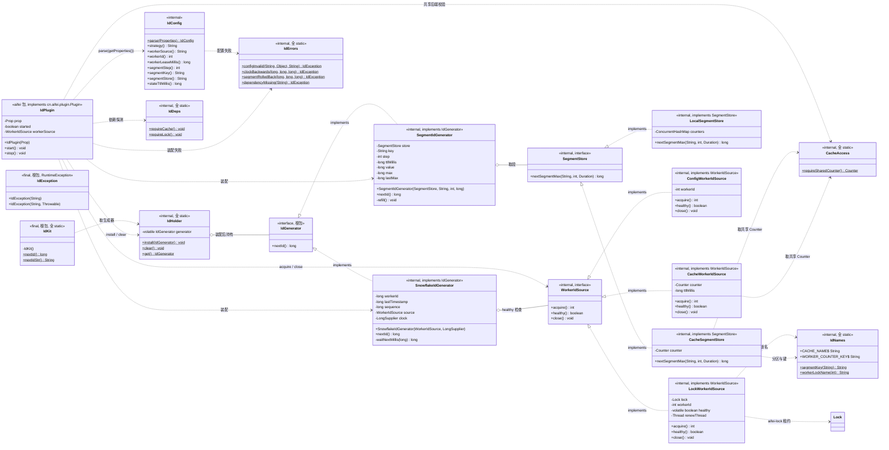
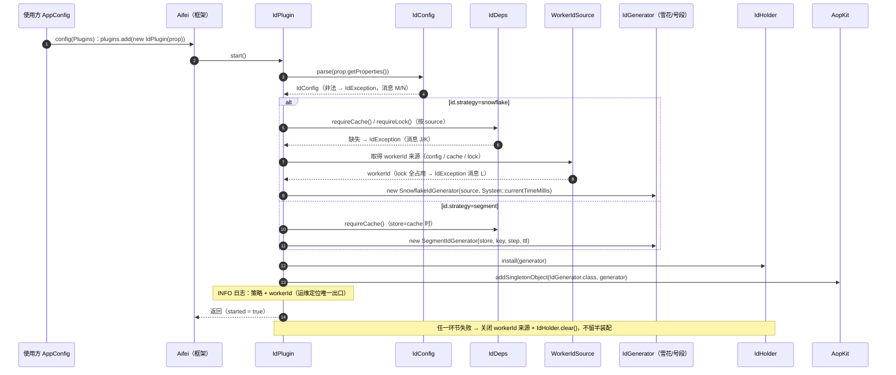
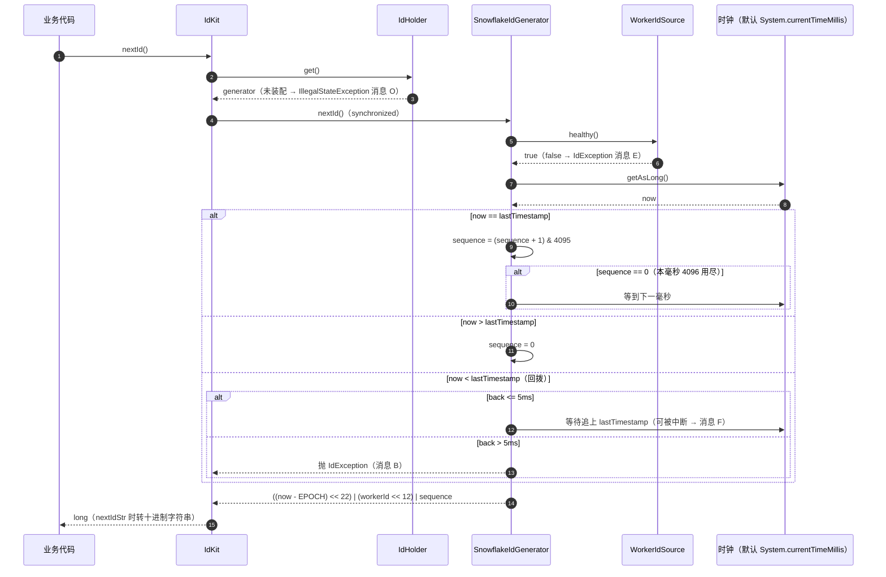
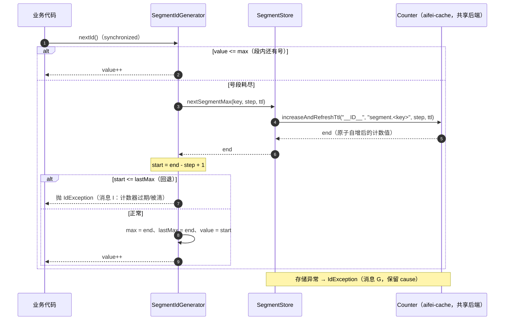
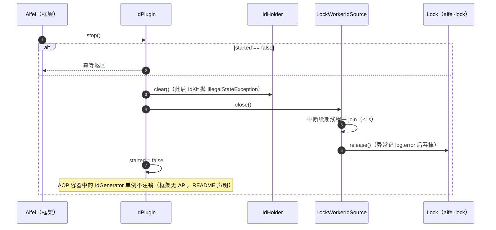

# aifei-id 设计文档

本文是 `aifei-id` 的**设计事实来源（契约）**：公共 API 逐字签名、包结构与门禁、行为契约、异常语义、配置键与验收标准以本文为准。面向使用者的用法见 `README.md`；面向开发代理的约束见模块 `AGENTS.md`；测试策略与用例清单见 `docs/testing.md`。

> **坐标**：`io.github.gollyhu:aifei-id:1.0.0-SNAPSHOT`（`packaging=jar`）；包名 `cn.hg.aifei.id`；**Java 8**（语法与 API 双约束，主 JAR class major = 52）；**零第三方依赖**（`aifei-cache` / `aifei-lock` 均 `optional`，`aifei` 为 `provided`）。
>
>

---

## 1. 模块定位与边界

### 1.1 定位

aifei 生态缺少**分布式 ID 生成能力**，雪花算法散落在各业务代码里，号段方案更是每次重写。本模块补齐两代生成策略，一件一个落点：

| # | 目标 | 落点 |
| --- | --- | --- |
| 1 | **雪花**：单机毫秒级趋势递增、位数可解释、跨节点不重号 | `internal.SnowflakeIdGenerator`（位数常量与算法唯一落点） |
| 2 | **号段**：以存储为中心取号段，降低对时钟的依赖 | `internal.SegmentIdGenerator` + `internal.SegmentStore`（cache / local 两实现） |
| 3 | **装配**：配置驱动、启动期一次性校验、失败不留半装配 | `aifei.IdPlugin`（唯一框架装配入口） |
| 4 | **取用**：业务一行代码拿到 ID | `IdKit`（全静态门面，唯一取用通道） |

与生态的关系：

- `aifei-cache`：号段取段的原子原语 = `Counter#increaseAndRefreshTtl`（`Counter` 由 `aifei-cache` 提供，底层 Redis `INCRBY` 原子）；键落在主缓存的 `__ID__` 保留分区。
- `aifei-lock`：`id.worker.source=lock` 时经 `LockKit#tryLock` 抢占式持有 workerId；锁内的 `CacheLockStore#tryAcquire` 正是 `Cache#putIfAbsent`，即需求中「号段/workerId 复用 cache 的 `putIfAbsent`」由 `aifei-lock` 间接覆盖。
- `aifei-log`：模块自身记录只用 `cn.aifei.log.Log`（随 `cn.aifei:aifei` 提供），**不引入任何日志绑定**。

### 1.3 公共面收敛纪律（硬约束）

| # | 纪律 |
| --- | --- |
| 1 | **根包 `cn.hg.aifei.id` 精确 3 个公共类型**：`IdGenerator` / `IdKit` / `IdException`；**装配包 `cn.hg.aifei.id.aifei` 精确 1 个**：`IdPlugin`。**不得增删、不得改名**；变更须先改本文 §5 并过设计决策 |
| 2 | **根包零框架类型、零第三方类型**：`IdGenerator` / `IdKit` / `IdException` 的签名不出现任何 `cn.aifei.*`；`IdPlugin` 位于装配包（非承诺 API），暴露 `cn.aifei.plugin.Plugin` / `cn.aifei.util.Prop` |
| 3 | **零第三方依赖**：pom 只有 `cn.aifei:aifei`（`provided`）+ `io.github.gollyhu:aifei-cache` / `aifei-lock`（`optional`）+ `junit`（`test`） |
| 4 | `internal` 包为非承诺实现层：可引用 `aifei-cache` / `aifei-lock` / `cn.aifei.log.*`，**不得**被公共面签名暴露 |
| 5 | 每类规则只有一个定义点（§6.3），实现类不得复制 |
| 6 | Java 8 语法与 API 双约束；主 JAR class major = 52 |

> 第 1、2、3、6 条由架构门禁 `ArchitectureBoundaryTest`（§10，14 例）强制，**不得放宽或绕过**。

### 1.4 v1 不做清单（能力边界）

**不做**：Redis / 数据库 / 第三方服务商 SDK 的 ID 接入（v1 只走 cache 与本地）；**不做** UUID / 短链 / 业务前缀编码（不属于本模块定位）；**不做** 号段异步预取；**不做** workerId 运行期迁移（回拨时不换 workerId）；**不做** provider 扩展点 / `ServiceLoader` / 自定义生成器注册；**不做** ID 状态查询 API（`workerId()` / `strategy()` 等）；**不做** 命名实例（多 ID 域共用一套生成器）；**不做** 指标上报、审计、埋点（可观测由使用方组合 `aifei-metrics` 等模块自行实现）。

---

## 3. 术语表

| 术语 | 含义 | 归属 |
| --- | --- | --- |
| **雪花 snowflake** | 基于 `毫秒时间戳 + workerId + 序列号` 拼装的 64 位 ID 算法 | `internal.SnowflakeIdGenerator` |
| **纪元 epoch** | 雪花时间戳的零点，`2024-01-01T00:00:00Z = 1704067200000L`；**冻结常量** | 同上（唯一落点） |
| **workerId** | 节点编号，10 位，取值 `0..1023`；同一时刻全局不得重复 | 雪花算法（消费方）；来源见 §7.3 |
| **序列号 sequence** | 同一毫秒内的自增槽位，12 位，`0..4095` | `SnowflakeIdGenerator` |
| **号段 segment** | 从共享存储一次性领走的连续整数区间 `[start, end]`，长度 = `step` | `internal.SegmentIdGenerator` |
| **取段 refill** | 号段用尽（或在 `id.segment.store=local` 下进程内推进）时领取下一段 | `SegmentIdGenerator#nextId` 内的临界区 |
| **号段回退 segment rollback** | 新领号段的起点**不大于**上次号段末端（计数器过期 / 被清空 / 被手工重置） | 同上：命中即抛 `IdException` |
| **本地退化 local store** | `id.segment.store=local` 时用进程内计数代替共享存储，**重启重号** | `internal.LocalSegmentStore` |
| **共享后端 shared backend** | 支持条件操作（`Cache#supportsCas() == true`）的缓存后端（如 Redis）；本地 Caffeine 后端为 `false` | `internal.CacheAccess`（复用 `aifei-cache` 的能力声明） |
| **workerId 租约 lease** | `id.worker.source=lock` 时经 `aifei-lock` 持有的、带有效期的 workerId 占用凭据 | `internal.LockWorkerIdSource` |
| **冻结数据格式** | 雪花位布局 + EPOCH + `long` 语义；发布后不得更改 | 本文 §7.1 |

---

## 5. 公共 API 契约（根包精确 3 + 装配包精确 1）

根包 `cn.hg.aifei.id` 与装配包 `cn.hg.aifei.id.aifei` 共 **4 个公共类型**，为本节与门禁 `EXPECTED_ROOT_TYPES` / `EXPECTED_BRIDGE_TYPES` 的**唯一事实来源**。逐字签名如下（`static` 与否、返回类型、异常声明均不得改动）。

### 5.1 `IdGenerator`（公共策略契约接口）

```java
public interface IdGenerator {

    long nextId();
}
```

| 项 | 契约（javadoc 强约束） |
| --- | --- |
| 返回值 | **恒正**（`> 0`）；雪花恒为正（符号位固定 0），号段从 1 起 |
| 唯一性 | 在**配置的域内**唯一：雪花 = 「同 EPOCH + 同 workerId」空间内的全局唯一；号段 = **同 `id.segment.key`** 域内唯一（不同 key 的号段序列互不相干） |
| 趋势 | 雪花：同一实例**严格递增**；号段：同一实例**严格递增**；**不保证连续**（雪花在毫秒边界跳跃、号段跨实例有空洞、进程崩溃会丢弃未用完的号段） |
| 线程安全 | 实现必须线程安全，可被任意多线程并发调用（`synchronized` / 无共享可变状态） |
| 失败 | 运行期不可用时抛 `IdException`（时钟回拨超阈、号段存储失败、workerId 租约丢失等，§7.5）；**永不返回 0、永不降级** |
| 冻结 | 返回值的**位语义属已发布数据格式**，不得在后续版本变更 |

- **不声明 `throws`**：`IdException` 是 `RuntimeException`，不写 `throws` 以免污染使用方签名（与 `LockKit` / `CacheKit` 口径一致）。
- 唯一实现：`internal.SnowflakeIdGenerator` / `internal.SegmentIdGenerator`（**实现类不进公共面**）。
- 取用方式：`IdKit`（主通道）或 `@Inject IdGenerator`（`IdPlugin#start` 注册的单例）。业务可在自身单测中自行 `new` 一个实现（接口无装配依赖）。
- **命名依据**：策略接口用名词性后缀 `-Generator`（对齐 `TraceIdGenerator`、`trace` 模块先例），不属 `Util` / `Kit` 判定范围。

### 5.2 `IdKit`（公共静态门面，`final`）

```java
public final class IdKit {

    private IdKit() {
    }

    public static long nextId();

    public static String nextIdStr();
}
```

| 方法 | 契约 | 失败 |
| --- | --- | --- |
| `nextId()` | 返回当前装配的生成器产出的下一个 ID（等价 `IdHolder.get().nextId()`） | `IllegalStateException`：`IdPlugin` 未 `start()` 或已 `stop()`；`IdException`：生成器运行期不可用 |
| `nextIdStr()` | `nextId()` 的十进制字符串形态（`Long.toString`），供前端 / JSON 使用 | 同上 |

- **命名依据**：`Kit`（有状态门面）——它操作 Plugin 装配的运行期对象（生成器 + workerId 租约 + 号段游标），未装配时调用即失败。与 `aifei-trace` 的 `TraceKit`（无装配期、永不抛未装配异常）是**两种门面形态**，README 必须分写。
- **零格式化规则旁落**：`long → 十进制字符串`的转换是**唯一定义点**（本类 `nextIdStr`），其它任何地方不得自拼（门禁 ⑬ 只约束配置键，本条靠 §6.3 唯一定义点表 + 评审）。
- 内部只持有 `IdHolder`（`internal`）的静态调用，无实例状态，线程安全。

### 5.3 `IdException`（唯一模块异常）

```java
public final class IdException extends RuntimeException {

    public IdException(String message);

    public IdException(String message, Throwable cause);
}
```

javadoc **必须显著声明**（原文照写）：

> 本异常**由模块内部抛出**，业务方只 `catch`、**不要** `new`。构造器为 `public` 是因为唯一构造点 `internal.IdErrors` 与公共类型不同包（Java 包私有语义所限），并非对外构造入口；消息必然携带定位信息（配置键与原值 / workerId / 键名 / 时间戳）。

- 覆盖**启动期**全部失败：`id.*` 配置非法、数值非整数、必填缺失、可选依赖缺失、缓存后端非共享、workerId 全被占用。
- 覆盖**运行期**全部失败：时钟回拨超阈、时钟早于 EPOCH、时间戳溢出、等待时钟被中断、号段取段失败、号段回退、workerId 租约丢失。
- **消息逐字对齐** §7.6 表；`cause` 保留底层异常（如缓存/锁抛出的运行时异常）。
- 不复用 `IllegalArgumentException` / `IllegalStateException` 表达上述语义。

### 5.4 `aifei.IdPlugin`（装配入口，`implements cn.aifei.plugin.Plugin`）

```java
package cn.hg.aifei.id.aifei;

public class IdPlugin implements Plugin {

    public IdPlugin(Prop prop);

    @Override
    public void start();

    @Override
    public void stop();
}
```

| 项 | 契约 |
| --- | --- |
| 包位置 | `cn.hg.aifei.id.aifei`（**装配包，非承诺 API**）：公共面因此保持零框架类型（门禁 ③） |
| 构造 | 只保存 `Prop` 引用，**不解析、不校验、不取 workerId、不建线程**；`prop == null` → `IllegalArgumentException("prop can not be null")` |
| `start()` | `synchronized` + `volatile boolean started` 保证幂等：`IdConfig.parse(prop.getProperties())` → 按策略装配生成器（含 `IdDeps` 依赖探测、workerId 获取、`CacheAccess` 共享后端校验）→ `IdHolder.install(generator)` → `AopKit.get().addSingletonObject(IdGenerator.class, generator)` → INFO 日志（策略 + workerId） |
| 失败回滚 | 任一环节抛异常：`IdHolder.clear()` + 关闭已创建的 workerId 来源（释放租约、停止续期线程）+ `started` 保持 `false`，**不留半装配** |
| `stop()` | 幂等：`IdHolder.clear()` → 关闭 workerId 来源（中断续期线程、`Lock#release()`）→ `started = false`。**不**从 AOP 容器注销（框架无注销 API，与 `CachePlugin` 一致，README 声明「停机后注入引用仍在容器中」） |
| 装配顺序 | `id.worker.source=cache` 必须晚于 `CachePlugin`；`=lock` 必须晚于 `CachePlugin` 与 `LockPlugin`（否则 `CacheKit#use` / `LockKit#tryLock` 抛 `IllegalStateException`，本插件包装为 `IdException`） |
| 命名实例 | **不支持**（无 `id.names`） |

### 5.5 公共面计数口径（供门禁复用）

「根包公共类型」= `src/main/java/cn/hg/aifei/id/` 目录**直接子级 `.java` 文件**（不含子包）：

`IdGenerator.java` / `IdKit.java` / `IdException.java` —— **精确 3 个**。

「装配包公共类型」= `src/main/java/cn/hg/aifei/id/aifei/` 目录**直接子级 `.java` 文件**：`IdPlugin.java` —— **精确 1 个**。

「`internal` 包」不计数（非承诺 API），但**不得**出现被根包引用的公共契约类型；`internal` 内全部类型为 `public` 或包级可见由实现决定，不影响门禁 ④。

### 5.6 命名依据汇总

| 类型 | 形态 | 命名依据（根 `AGENTS.md`「命名约定」+ 本设计决策） |
| --- | --- | --- |
| `IdKit` | `public final` + 私有构造 + 全 `static` | **有状态门面**：需 Plugin 装配后取实例，未装配即失败 |
| `IdGenerator` | `public interface` | 策略接口，名词性后缀 `-Generator` |
| `IdException` | `public final extends RuntimeException` | 模块唯一异常类型，`public` 构造器（唯一构造点在 `internal`） |
| `aifei.IdPlugin` | `public class implements cn.aifei.plugin.Plugin` | 装配入口：Plugin 后缀 + 模块名，置于装配包（非承诺 API） |
| `internal.*` | 全部非承诺 | 无 `XxxUtil` / `XxxHelper` / `XxxSupport` 后缀（`IdNames` 是常量与拼装的持有者，非工具入口） |

---

## 6. 内部结构

### 6.1 包结构与依赖方向

```text
cn.hg.aifei.id              根包：3 公共类型（契约 + 门面 + 异常），零框架类型
cn.hg.aifei.id.aifei        装配包：IdPlugin（唯一框架触点，非承诺 API）
cn.hg.aifei.id.internal     实现层（非承诺 API）：配置 / 错误 / 命名 / 持有器 / 依赖探测 / 两个生成器 / 两个存储契约与其实现 / 三种 workerId 来源

依赖方向（门禁 ②③ 强制）：
  aifei 包      ──→ internal + cn.aifei.plugin / cn.aifei.util.Prop / cn.aifei.aop.AopKit
  internal 包   ──→ cn.aifei.log.*（唯一允许的任意包框架类型）+ cn.hg.aifei.cache.* / cn.hg.aifei.lock.*（可选依赖）
  根包          ──→ 纯 JDK（无 any cn.aifei.*，含 log）
  禁止：根包 import cn.aifei.* / cn.hg.aifei.cache.* / cn.hg.aifei.lock.*；
        aifei 包 import cn.hg.aifei.cache.* / cn.hg.aifei.lock.*；
        任何文件 import java.sql.* / 第三方包
```

### 6.2 各类型职责（★ 后为该规则的唯一定义点）

| 类型 | 包 | 职责 |
| --- | --- | --- |
| `IdGenerator` | 根 | 生成契约声明（javadoc 唯一定义点：唯一性域、趋势、线程安全、失败语义） |
| `IdKit` | 根 | 取用门面；**★ `long → 十进制字符串` 唯一转换点**；只转发 `IdHolder` |
| `IdException` | 根 | 模块唯一异常类型（构造器 `public`，构造点唯一在 `IdErrors`） |
| `IdPlugin` | aifei | **★ 装配与停机收敛唯一定义点**：解析 → 装配 → install → Aop 注册 → 回滚；**★ INFO 日志（策略 + workerId）唯一输出点** |
| `IdConfig` | internal | **★ 配置键名与默认值常量唯一定义点** + **★ `id.*` 解析与校验唯一定义点**（`parse(Properties)` → 值对象；策略相关键才校验） |
| `IdErrors` | internal | **★ `IdException` 唯一构造点**（全模块唯一 `new IdException(...)` 出现处）+ **★ 全部异常消息措辞唯一定义点**（§7.6 逐字） |
| `IdNames` | internal | **★ 缓存/计数分区名、键拼装、锁名拼装、workerId 取值范围唯一定义点**：`CACHE_NAME = "__ID__"`、`segmentKey(name)`、`WORKER_COUNTER_KEY = "worker"`、`workerLockName(workerId)` |
| `IdHolder` | internal | **★ `IdKit` 唯一写入/读取通道**：`install(generator)` / `clear()` / `get()`；`get()` 为 null 时抛 `IllegalStateException`（消息唯一定义点） |
| `IdDeps` | internal | **★ 可选依赖探测唯一定义点**（唯一 `Class.forName` 点）：`requireCache()` / `requireLock()`，缺失即 `IdException` |
| `CacheAccess` | internal | **★ 共享后端校验唯一定义点**：`CounterKit.use()` 取主计数器 + `CacheKit.use().supportsCas()` 校验，返回 `Counter`；非共享后端即 `IdException` |
| `SnowflakeIdGenerator` | internal | **★ 雪花算法唯一定义点**：位数/移位/EPOCH/序列耗尽等待/回拨策略/上界校验/时刻采样（唯一 `System.currentTimeMillis` 默认源） |
| `SegmentIdGenerator` | internal | **★ 号段分配与回退校验唯一定义点**：`synchronized` 分配、耗尽取段、回退检测 |
| `SegmentStore` | internal | 号段存储契约（隔离 `aifei-cache`）：`long nextSegmentMax(String key, int step, Duration ttl)` |
| `CacheSegmentStore` | internal | 共享存储实现：`Counter#increaseAndRefreshTtl(IdNames.CACHE_NAME, IdNames.segmentKey(key), step, ttl)` |
| `LocalSegmentStore` | internal | 本地退化实现：按 key 维护进程内计数（`ConcurrentHashMap<String, Long>`），**重启重号** |
| `WorkerIdSource` | internal | workerId 来源契约：`int acquire()` / `boolean healthy()` / `void close()` |
| `ConfigWorkerIdSource` | internal | 静态配置来源（`healthy()` 恒 `true`，`close()` 空操作） |
| `CacheWorkerIdSource` | internal | 计数器取模来源：`(v - 1) % 1024`（**★ 取模规则唯一定义点**） |
| `LockWorkerIdSource` | internal | 租约来源：0..1023 升序 `tryLock` 抢占 + **唯一后台续期线程**（`aifei-id-worker-lease`，daemon），丢失即置 `healthy()=false` |

### 6.3 唯一定义点清单（实现类不得复制）

| 规则 | 唯一定义点 |
| --- | --- |
| 雪花位宽 / 移位 / EPOCH / 序列上限 / workerId 上限 / 回拨容差常量 | `internal.SnowflakeIdGenerator` |
| 雪花时刻采样（`System.currentTimeMillis` 调用与 `System::currentTimeMillis` 方法引用） | 同上（门禁 ⑨） |
| 回拨等待与「序列耗尽等下一毫秒」的等待实现 | 同上（同一私有方法 `waitNextMillis`） |
| 号段分配、耗尽取段、**回退检测** | `internal.SegmentIdGenerator#nextId` |
| 号段长度与 TTL 的取值约束 | `internal.IdConfig`（校验）+ `IdErrors`（消息） |
| 缓存/计数分区名、键拼装、锁名拼装、workerId 范围 | `internal.IdNames`（门禁 ⑩） |
| 缓存模式 workerId 取模规则 | `internal.CacheWorkerIdSource` |
| 共享后端能力校验（`supportsCas`） | `internal.CacheAccess` |
| 可选依赖探测（`Class.forName`） | `internal.IdDeps`（门禁 ⑪） |
| 后台线程创建（`new Thread` / `Executor`） | `internal.LockWorkerIdSource`（门禁 ⑫） |
| 配置键名与默认值字面量 | `internal.IdConfig`（门禁 ⑬） |
| `IdException` 构造与消息措辞 | `internal.IdErrors` |
| 未装配异常（`IllegalStateException`）与消息 | `internal.IdHolder#get` |
| `long → 十进制字符串` | `IdKit#nextIdStr` |
| 装配、回滚、停机收敛 | `aifei.IdPlugin#start` / `#stop` |

### 6.4 线程模型

| 状态 / 线程 | 归属 | 说明 |
| --- | --- | --- |
| 雪花生成器锁 | `SnowflakeIdGenerator` 实例（`synchronized`） | 单实例，串行发号；无其它共享可变状态 |
| 号段生成器锁 | `SegmentIdGenerator` 实例（`synchronized`） | 覆盖「分配 + 取段」整段临界区 |
| workerId 续期线程 | `LockWorkerIdSource` | **仅 `id.worker.source=lock` 时存在**；单线程 daemon，名字 `aifei-id-worker-lease`，周期 `max(1000ms, lease/3)`；`close()` 中断并 join（≤1s） |
| 其余 | 无线程 | `config` / `cache` 来源与两种号段存储均无线程、无异步回调 |

---

## 7. 行为契约与异常语义

### 7.1 雪花算法（`internal.SnowflakeIdGenerator`）

| 项 | 值 / 规则 |
| --- | --- |
| 位布局 | `[1 符号=0][41 毫秒时间戳][10 workerId][12 序列号]`（自高向低） |
| 常量 | `TIMESTAMP_SHIFT = 22`、`WORKER_ID_SHIFT = 12`、`MAX_WORKER_ID = 1023`、`MAX_SEQUENCE = 4095`、`EPOCH = 1704067200000L`、`MAX_BACKWARD_WAIT_MS = 5` |
| 单节点上限 | **4096 个/毫秒**（≈409.6 万/秒）；超出即等下一毫秒 |
| 可用年限 | `EPOCH + 2^41 ms` ≈ **2093 年 9 月**；越界抛 `IdException` |
| 组合公式 | `((now - EPOCH) << 22)` 按位或 `((long) workerId << 12)` 按位或 `sequence`（三段无重叠，等价于标准位拼接） |
| `nextId()` 步骤 | ①（`synchronized`）`now = clock.getAsLong()`；② `now < EPOCH` → 抛（场景 3）；③ `now < lastTimestamp` → 回拨处理（§7.2）；④ `now == lastTimestamp` → `sequence = (sequence + 1) & MAX_SEQUENCE`，为 0 则等下一毫秒；否则 `sequence = 0`；⑤ `now - EPOCH` 超 41 位 → 抛（场景 4）；⑥ `lastTimestamp = now`，返回组合值 |
| 时刻源 | 构造参数 `LongSupplier clock`（默认 `System::currentTimeMillis`，**包级构造**供测试注入假时钟）——这是本模块唯一的时刻采样点，也是回拨用例可测的前提 |
| 构造期校验 | 构造期即 `source.acquire()` 并校验 `workerId ∈ [0, 1023]`，越界**复用消息 N**（`id.workerId must be in [0, 1023], but was: v`）——三种来源（`config` / `cache` / `lock`）统一在雪花构造期拦截，取号与取模本身不再各自校验 |
| 等待粒度 | `WAIT_INTERVAL_MS = 1L`：`waitNextMillis(target)` 以 `Thread.sleep(1)` 自旋采样，直到时钟读数 `>= target`（回拨 ≤5ms 与「序列耗尽等下一毫秒」共用同一私有方法）；等待中被中断即恢复中断位并抛（场景 6 / 消息 F） |
| 冻结声明 | 位布局、EPOCH、`long` 语义为**已发布数据格式**（根 `AGENTS.md`「已发布的数据格式不得更改」），不得变更；`IdKit#nextIdStr` 只是同一 `long` 的十进制表示，不改变位布局 |

### 7.2 时钟回拨

```text
now < lastTimestamp ?
├─ back = lastTimestamp - now
├─ back > 5ms  → 抛 IdException（场景 2，含 lastTimestamp / now / back）
└─ back <= 5ms → waitNextMillis(lastTimestamp)
                 ├─ 追上（now >= lastTimestamp）→ 按「now == lastTimestamp」分支继续（序列 +1，不重置）
                 └─ 等待被中断 → 恢复中断位并抛 IdException（场景 6）
```

- **数据格式冻结的含义**：因为位布局与 EPOCH 冻结、且「回拨追上后沿用同一毫秒分支」，任意两个相邻 ID 的大小关系与时间关系保持可解释——运维可按 ID 反推毫秒时间戳与 workerId（`id >> 22`、`(id >> 12) & 0x3FF`），排障口径在版本间稳定。
- **不换 workerId**，因此 `id.worker.source=config` 与 `cache` / `lock` 在同一回拨场景下行为一致。

### 7.3 workerId 来源

| 来源 | 取得方式 | `healthy()` | 停机 | 代价 / 风险 |
| --- | --- | --- | --- | --- |
| `config`（**默认**） | 读 `id.workerId`（0..1023，必填） | 恒 `true` | 空操作 | **跨实例重号风险由使用方承担**：两个实例配同一 workerId 必然重号，模块无法检测（启动期无共享状态）。README 必须显著警告 |
| `cache` | `CacheAccess.requireSharedCounter()` 后 `Counter#increaseAndRefreshTtl("__ID__", "worker", 1, ttl)` → `workerId = (int) ((v - 1) % 1024)` | 恒 `true` | 空操作 | 无续期、无后台线程；**回绕风险**：累计冷启动超过 1024 次会与存活实例撞号（TTL 365 天内），需运维关注 |
| `lock` | 按 `n = 0..1023` 升序 `LockKit#tryLock(IdNames.workerLockName(n), lease)`（立即尝试、不等待），首个成功即持有；同时启动续期线程 | 续期成功 → `true`；`renew()` 返回 `false` 或抛 `LockException` → 置 `false` 并 `log.error` | 中断线程 + `Lock#release()` | 依赖 `aifei-lock`+`aifei-cache`；**全部占用即启动失败**（不等待：租约按进程生命周期持有，等待通常无意义，快速失败更利于运维）；续期丢失后**不可自愈**（重号不可逆，宁可停机） |

- 三来源都实现 `WorkerIdSource`，雪花生成器只依赖 `acquire()` / `healthy()`；`nextId()` 每次先读 `healthy()`（`volatile` 读，未持有锁时也安全），`false` 即抛 `IdException`（场景 5）。
- **零依赖（不引 cache / lock）**：`id.strategy=snowflake` + `id.worker.source=config`（默认组合）即可工作，只依赖 `aifei`。
- **可选依赖缺失**：`IdDeps` 在 `start()` 探测 → `IdException`（场景 13/14），不降级。

### 7.4 号段策略（`internal.SegmentIdGenerator`）

| 项 | 规则 |
| --- | --- |
| 状态 | `long value`（下一个待发值）、`long max`（当前段末端，含）、`long lastMax`（历史最大段末端，用于回退检测） |
| 初始 | `value = 1`、`max = 0`（首次调用即触发取段） |
| `nextId()` | （`synchronized`）`if (value > max) refill();` → `return value++` |
| `refill()` | ① `end = store.nextSegmentMax(key, step, ttl)`；② `start = end - step + 1`；③ **回退检测**：`start <= lastMax` → 抛 `IdException`（场景 11）；④ `max = end`、`lastMax = end`、`value = start` |
| 取段失败 | `store` 抛任何运行时异常 → 包装为 `IdException`（场景 9，保留 `cause`） |
| 并发模型 | **单 buffer + `synchronized`**，无预取、无异步、无常驻线程 |
| 段长 | `id.segment.step`（默认 1000，`[1, 1000000]`）；进程崩溃最多丢弃当前段剩余号（空洞可接受） |
| 存储 TTL | `id.state.ttlMillis`（默认 365 天）：`increaseAndRefreshTtl` 每次取段续期 → 活跃进程永不过期；闲置超期后计数器归零 → 由回退检测拦下 |
| 键规则 | 计数器分区 `__ID__`，键 `segment.<id.segment.key>`（`IdNames` 单点）；物理 key 前缀由 `aifei-cache` 实例的 `namespace` 负责，模块只给逻辑键 |
| 共享后端要求 | `id.segment.store=cache` 时要求 `supportsCas() == true`（本地 Caffeine 后端 → `IdException`，场景 10）；否则多实例各自从 1 开始，必重号 |
| 本地退化 | `id.segment.store=local`：进程内 `ConcurrentHashMap<String, Long>` 按 key 递增，**重启后从 `step` 重新开始 → 重号**；仅限单实例 / 开发测试，README 必须显著警告 |
| 多 ID 域 | 不同 `id.segment.key` 各自一条序列；**跨域不保证唯一**（雪花跨 workerId 全局唯一，号段按 key 隔离） |

### 7.5 异常语义表（全部失败路径，无遗漏）

| # | 场景 | 行为 | 异常 |
| --- | --- | --- | --- |
| 1 | `new IdPlugin(null)` | 拒绝 | `IllegalArgumentException`（§7.6 消息 A） |
| 2 | 雪花：时钟回拨 > 5ms | 拒绝发号 | `IdException`（消息 B） |
| 3 | 雪花：系统时钟早于 EPOCH | 拒绝发号 | `IdException`（消息 C） |
| 4 | 雪花：`now - EPOCH` 超出 41 位 | 拒绝发号 | `IdException`（消息 D） |
| 5 | 雪花：workerId 租约丢失（`healthy()==false`；单测桩 `support/FakeWorkerIdSource#breakLease()`） | 拒绝发号 | `IdException`（消息 E） |
| 6 | 雪花：回拨等待中被中断 | 恢复中断位 + 拒绝发号 | `IdException`（消息 F） |
| 7 | 雪花：同一毫秒序列耗尽（4096） | 等下一毫秒后继续 | 无 |
| 8 | 雪花：回拨 ≤ 5ms | 等待追上后继续（序列 +1） | 无 |
| 9 | 号段：取段时存储抛异常 | 包装并拒绝发号 | `IdException`（消息 G，`cause` = 原异常） |
| 10 | 号段：缓存后端非共享（`supportsCas()==false`） | 启动期拒绝装配 | `IdException`（消息 H） |
| 11 | 号段：新段回退（起点 ≤ 上次末端） | 拒绝发号（防重号） | `IdException`（消息 I） |
| 12 | `id.strategy=snowflake` + `source=cache/lock` 但依赖缺失 | 启动期拒绝 | `IdException`（消息 J） |
| 13 | `id.strategy=segment` + `store=cache` 但 `aifei-cache` 缺失 | 启动期拒绝 | `IdException`（消息 J） |
| 14 | `source=lock` 但 `aifei-lock` 缺失 | 启动期拒绝 | `IdException`（消息 K） |
| 15 | `source=lock` 且 0..1023 全被占用 | 启动期拒绝 | `IdException`（消息 L） |
| 16 | `id.*` 配置缺失 / 越界 / 非整数 | 启动期拒绝且不留半装配 | `IdException`（消息 M / N，含键名与原值） |
| 17 | `IdKit.nextId()` / `nextIdStr()` 在未装配或已停机时调用 | 拒绝 | `IllegalStateException`（消息 O） |
| 18 | `IdPlugin.start()` 被重复调用 | 幂等返回（`started == true`） | 无 |
| 19 | `IdPlugin.stop()` 被重复调用 / 未启动即调用 | 幂等返回 | 无 |
| 20 | `LockWorkerIdSource.close()` 时 `release()` 抛异常 | 记 `log.error` 后吞掉（停机路径不掩盖主流程异常） | 无 |
| 21 | `id.worker.*` 键在 `id.strategy=segment` 下出现 | **忽略、不校验、不读**（避免切换策略时残留键导致启动失败） | 无 |
| 22 | `id.segment.*` 键在 `id.strategy=snowflake` 下出现 | 同上 | 无 |
| 23 | 协同模块（`aifei-cache` / `aifei-lock`）classpath 存在但**未装配**（`CachePlugin` / `LockPlugin` 未启动或装配顺序不对） | 启动期拒绝装配，不留半装配 | `IdException`（消息 P，`detail` = 底层异常消息） |

### 7.6 异常消息格式（**唯一措辞来源**，逐字）

| 标号 | 场景 | 消息（逐字，`+` 后为拼接值） |
| --- | --- | --- |
| A | `new IdPlugin(null)` | `prop can not be null` |
| B | 回拨超阈 | `clock moved backwards beyond tolerance, lastTimestamp: ` + last + `, now: ` + now + `, backwards: ` + back + `ms, tolerance: 5ms` |
| C | 时钟早于 EPOCH | `clock is before aifei-id epoch 2024-01-01T00:00:00Z, now: ` + now |
| D | 时间戳溢出 | `timestamp overflow, the 41-bit timestamp field of snowflake is exhausted, now: ` + now |
| E | 租约丢失 | `worker id lease lost, workerId: ` + workerId + `, stop generating ids to avoid duplicates` |
| F | 等待被中断 | `interrupted while waiting for clock to catch up` |
| G | 取段失败 | `segment store failed, cache: __ID__, key: ` + key + `, cause: ` + cause.getMessage() |
| H | 非共享后端 | `aifei-cache backend is not a shared store (supportsCas=false), aifei-id requires a shared backend such as redis` |
| I | 号段回退 | `segment rolled back, lastMax: ` + lastMax + `, newSegment: [` + start + `, ` + end + `], the counter may have expired or been reset` |
| J | cache 缺失 | `aifei-id requires module aifei-cache for this configuration, add io.github.gollyhu:aifei-cache to your dependencies` |
| K | lock 缺失 | `aifei-id requires module aifei-lock when id.worker.source=lock, add io.github.gollyhu:aifei-lock to your dependencies` |
| L | workerId 全占用 | `no worker id available in [0, 1023], all leases are held by other instances` |
| M | 枚举值非法 | `id.strategy must be one of [snowflake, segment], but was: ` + v（`id.worker.source` → `must be one of [config, cache, lock]`；`id.segment.store` → `must be one of [cache, local]`） |
| N | 数值/必填非法 | `id.workerId is required when id.worker.source=config`；`id.workerId must be in [0, 1023], but was: ` + v；`id.segment.step must be in [1, 1000000], but was: ` + v；`id.state.ttlMillis must be in [60000, 2147483647000], but was: ` + v；`id.segment.key must be non-blank, without whitespace and no longer than 64 chars, but was: ` + v；`id.worker.leaseMillis must be at least 1000, but was: ` + v；`id.` + key + ` must be an integer, but was: ` + v |
| O | 未装配 | `IdGenerator not installed, add IdPlugin to AppConfig.config(Plugins) before using IdKit` |
| P | 协同模块在 classpath 上存在但未装配 | `aifei-id assembly failed, ` + dep + ` is not ready, start it before IdPlugin: ` + detail（`dep` ∈ {`aifei-cache`, `aifei-lock`}；`detail` = 底层异常消息；承接三处失败点：`CacheWorkerIdSource` 取计数、`CacheAccess` 取 cache 实例、`LockWorkerIdSource#tryLock` 取锁实例） |

> 消息全部由 `internal.IdErrors` 构造，其它类不得自拼；测试按本表逐字断言。

---

## 8. 配置键（**8 个**，构造期只持 `Prop`，解析校验全部在 `start()`）

| 键 | 必填 | 默认值 | 规则 | 生效范围 |
| --- | --- | --- | --- | --- |
| `id.strategy` | 否 | `snowflake` | `snowflake` / `segment` | 全局 |
| `id.worker.source` | 否 | `config` | `config` / `cache` / `lock` | 仅 `snowflake` |
| `id.workerId` | `source=config` 时**必填** | — | 整数 `0..1023` | 仅 `snowflake` + `config` |
| `id.worker.leaseMillis` | 否 | `30000` | `≥ 1000` | 仅 `snowflake` + `lock` |
| `id.segment.step` | 否 | `1000` | `1..1000000` | 仅 `segment` |
| `id.segment.key` | 否 | `default` | 非空白、无空白字符、长度 `≤ 64` | 仅 `segment` |
| `id.segment.store` | 否 | `cache` | `cache` / `local` | 仅 `segment` |
| `id.state.ttlMillis` | 否 | `31536000000`（365 天） | `60000 .. 2147483647000`（上限 = `aifei-cache` 的 `Integer.MAX_VALUE` 秒） | `segment`（取段）+ `snowflake`+`cache`（workerId 计数） |

- 键名与默认值常量集中在 `internal.IdConfig`（门禁 ⑬ 断言 `"id.` 字面量只在该文件出现）。
- 数值键解析失败（非整数）同样 `IdException`，消息含键名与原值。
- 与生效策略无关的键**不读、不校验**（§7.5 场景 21/22）。
- **无** `id.names`（命名实例）；**无** EPOCH / 位宽 / 回拨容差配置。

---

## 9. 类图与关键时序图

### 9.1 类图



> 类图事实要点：4 个公共类型（`IdGenerator` / `IdKit` / `IdException` / `IdPlugin`）+ 15 个 `internal` 类型。**没有** provider、没有 SPI、没有值对象公共面、没有 HTTP 组件。可选依赖只在 `internal` 出现（`Counter` / `Cache` / `Lock` 三个外部类型各由 1–2 个内部类持有）。

### 9.2 时序图 ①：装配（`IdPlugin#start`）



### 9.3 时序图 ②：雪花发号（正常 / 回拨 ≤5ms / 回拨 >5ms）



### 9.4 时序图 ③：号段发号（耗尽取段 / 回退拦截）



### 9.5 时序图 ④：停机（`IdPlugin#stop`）



---

## 10. 架构门禁设计（`ArchitectureBoundaryTest`）

- **位置 / 机制**：`src/test/java/cn/hg/aifei/id/ArchitectureBoundaryTest.java`；`Files.walk(Paths.get("src/main/java"))` 收集全部 `.java`，按**源码文本**断言（路径分隔符归一化为 `/`，注释剥离后再匹配字面量）。
- **执行位置**：**必须在 `aifei-id/` 根目录**（依赖相对路径 `src/main/java`），不得放宽断言。
- **关键常量**：

```java
private static final Path   SOURCE_ROOT = Paths.get("src/main/java");
private static final Path   TEST_ROOT   = Paths.get("src/test/java");
private static final String ROOT_PACKAGE    = "cn/hg/aifei/id/";
private static final String BRIDGE_PACKAGE  = "cn/hg/aifei/id/aifei/";
private static final String INTERNAL_PACKAGE= "cn/hg/aifei/id/internal/";
private static final String LOG_PACKAGE     = "cn.aifei.log.";
private static final String CACHE_PACKAGE   = "cn.hg.aifei.cache.";
private static final String LOCK_PACKAGE    = "cn.hg.aifei.lock.";
private static final int    EXPECTED_PUBLIC_TYPES  = 3;
private static final int    EXPECTED_BRIDGE_TYPES  = 1;
private static final Set<String> EXPECTED_ROOT_TYPES = new LinkedHashSet<>(Arrays.asList(
        "IdGenerator.java", "IdKit.java", "IdException.java"));
private static final Set<String> EXPECTED_BRIDGE_TYPES_SET = new LinkedHashSet<>(Arrays.asList(
        "IdPlugin.java"));
```

### 10.1 断言清单（**14 例，方法名可直接照写为测试方法**）

| # | 测试方法 | 判定口径 | 风险针对 |
| --- | --- | --- | --- |
| ① | `noThirdPartyReference` | 每条 `import` 必须以 `java.` / `javax.` / `cn.aifei.` / `cn.hg.aifei.id.` / `cn.hg.aifei.cache.` / `cn.hg.aifei.lock.` 之一开头；**无其它放行包** | 第三方依赖蔓延（零第三方口径） |
| ② | `optionalModuleScopeRules` | `import cn.hg.aifei.cache.*` 与 `import cn.hg.aifei.lock.*` 只允许出现在 `INTERNAL_PACKAGE` 下的文件；出现在根包 / 装配包即失败 | 可选依赖泄漏进公共面 |
| ③ | `frameworkOnlyInBridgeExceptLog` | 每条 `import cn.aifei.…`：以 `cn.aifei.log.` 开头 → 只允许在 `INTERNAL_PACKAGE` 与 `BRIDGE_PACKAGE`（**根包禁止**）；其余 `cn.aifei.*`（`plugin` / `util` / `aop` / `core` / `scanner` 等）→ 只允许在 `BRIDGE_PACKAGE` | 根包被框架类型污染 / 装配职责外溢 |
| ④ | `publicSurfaceExact` | 根包直接子 `.java` 数量**精确 = 3** 且文件名集合精确等于 `EXPECTED_ROOT_TYPES`；装配包直接子 `.java` 数量**精确 = 1** 且集合精确等于 `EXPECTED_BRIDGE_TYPES_SET` | 同名替换 / 悄悄增删公共类型 |
| ⑤ | `noSqlReference` | 全模块任何 `.java` 不得出现 `import java.sql.` | 零 DB 底线 |
| ⑥ | `noJvmGlobalPropertyWrite` | 不得出现 `System.setProperty` / `System.getProperties().put` / `System.setErr` / `System.setOut` | JVM 全局状态被改写（会波及同进程其它模块） |
| ⑦ | `java8Compatibility` | 不得出现 `List.of(` / `Map.of(` / `Set.of(` / `record ` 声明 / `var ` 局部声明 / `"""` / `sealed ` / `instanceof` 模式匹配 | Java 8 兼容底线（class major 52） |
| ⑧ | `noServiceProvider` | 不得出现 `ServiceLoader` / `META-INF/services` 字面量；`src/main/resources` 下不得存在 `META-INF/services/` 目录 | 无 provider / 无 SPI 决策被暗装绕过 |
| ⑨ | `clockOnlyInSnowflake` | `System.currentTimeMillis`（调用形式）与 `System::currentTimeMillis`（方法引用形式）及纪元字面量 `1704067200000` 只允许出现在 `internal/SnowflakeIdGenerator.java` | 第二处时刻采样 / 纪元常量被复制（位布局随之分裂） |
| ⑩ | `cacheNamesOnlyInIdNames` | 字面量 `"__ID__"` / `"segment."` / `"worker"` / `"id.worker."` 只允许出现在 `internal/IdNames.java` | 键拼装散落（冻结的物理 key 格式） |
| ⑪ | `classForNameOnlyInIdDeps` | `Class.forName` 只允许出现在 `internal/IdDeps.java` | 反射 / 依赖探测散落（防暗装 provider） |
| ⑫ | `threadCreationOnlyInWorkerLease` | `new Thread(` / `Executors.` / `ThreadPoolExecutor` 只允许出现在 `internal/LockWorkerIdSource.java` | 后台线程被悄悄引入（本模块仅租约续期需要线程） |
| ⑬ | `configKeysOnlyInIdConfig` | 字面量 `"id.` 只允许出现在 `internal/IdConfig.java` | 配置键硬编码散落 |
| ⑭ | `testSourcesOfflineOnly` | 扫描 `src/test/java`：`http://` / `https://` 字面量的 host 只能是 `127.0.0.1` 或 `localhost`（注释先剥离） | 测试联网 |

- 门禁**不得为兼容错误用法而放宽或绕过**；新增例外必须先改本文公共面契约再改断言。
- 门禁外的构建期断言：主 JAR 全部 class major = 52（`javap -verbose` 抽查）、`mvn dependency:tree` 只出现 §11.2 允许清单。

---

## 11. 依赖与构建

### 11.1 依赖表

| 依赖 | 范围 | 用途 |
| --- | --- | --- |
| `cn.aifei:aifei:1.1.2` | **`provided`** | 框架：`cn.aifei.plugin.Plugin` / `cn.aifei.util.Prop` / `cn.aifei.aop.AopKit`（仅装配包）+ `cn.aifei.log.Log`（`internal` 与装配包）。**不向下游传递**，消费方必须自带 |
| `io.github.gollyhu:aifei-cache:1.2.0-SNAPSHOT` | **`optional`** | `Counter` / `CounterKit` / `Cache` / `CacheKit`（号段取段、cache 模式 workerId、共享后端校验）。不传递，缺失时按 §7.5 场景 12/13 启动期失败 |
| `io.github.gollyhu:aifei-lock:1.0.0-SNAPSHOT` | **`optional`** | `LockKit#tryLock` / `Lock#renew` / `Lock#release`（`id.worker.source=lock`）。不传递，缺失时按 §7.5 场景 14 启动期失败 |
| `junit:junit:4.13.2` | `test` | 单元测试与架构门禁 |

- **零第三方**：不引入任何日志绑定（`slf4j` / `logback` / `log4j` 一律禁止）、不引入 jedis / fury（`aifei-cache` 侧已 `optional`，本模块不直接使用）。
- **传递项**：`io.github.gollyhu:aifei-cache` 会把框架内核 `cn.aifei:aifei` 传递进本模块的依赖树（标记 `optional`）；它属框架而非第三方，不构成对「零第三方」的破坏，清单见 §11.2。
- **零 DB**：全模块禁 `import java.sql.`。
- `aifei-cache` / `aifei-lock` 的 `optional` 语义必须写入 README：**不引则对应配置不可用**（不是「功能降级」而是「启动失败」）。
- pom 对齐 `aifei-lock/pom.xml` 模板：`maven-compiler-plugin`（`source`/`target` 1.8、UTF-8）+ `maven-surefire-plugin`（`workingDirectory = ${project.basedir}`，门禁依赖相对路径；可选 `redis.integration` 开关默认 `false`）。

### 11.2 `dependency:tree` 允许清单

| 构件 | 范围 | 说明 |
| --- | --- | --- |
| `io.github.gollyhu:aifei-id:1.0.0-SNAPSHOT` | 根 | 本模块 |
| `cn.aifei:aifei:1.1.2` | `provided` | 框架内核，消费方自带 |
| `com.alibaba.fastjson2:fastjson2:2.0.65` | `provided` | `aifei` 的传递项，本模块零引用 |
| `io.github.gollyhu:aifei-cache:1.2.0-SNAPSHOT` | `optional` | 不向下游传递；其传递项 `cn.aifei:aifei` 在本模块树中随 `optional` 一并标记（见下一行） |
| `cn.aifei:aifei:1.1.2` | `optional` | **`aifei-cache` 的传递项**（非本模块直接声明）；属框架内核而非「第三方」，本模块零直接引用，不改变 §1.3 第 3 条的「零第三方」口径 |
| `io.github.gollyhu:aifei-lock:1.0.0-SNAPSHOT` | `optional` | 不传递、无传递项 |
| `junit:junit:4.13.2` / `org.hamcrest:hamcrest-core:1.3` | `test` | 测试与门禁，不随发布 |

**断言口径**：① 零日志绑定；② 无 JDBC 驱动 / 连接池；③ 除上表外出现任何条目即视为依赖失控。

`optional` 在 `dependency:tree` 中渲染为 `compile (optional)`。`cn.aifei:aifei:1.1.2` 一条为 `aifei-cache` 的传递项（`aifei-cache` 自身在本模块为 `optional`，其传递项随之标记为 `optional`）；`aifei-lock` 无传递项。

### 11.3 验证命令（模块根目录）

```bash
cd aifei-id
mvn clean verify                                  # 必须 0 failure / 0 error
mvn test -Dtest=ArchitectureBoundaryTest          # 仅跑架构门禁（14 例）
mvn dependency:tree                               # 断言：仅 11.2 允许清单内的构件
```

---

## 13. `aifei-id-demo`（示例工程，平级目录，不随模块发布）

- **位置**：`aifei-id-demo/`（仓库根、与 `aifei-id/` 平级）；依赖 `io.github.gollyhu:aifei-id:1.0.0-SNAPSHOT` + `cn.aifei:aifei`（demo 自带，验证模块 `provided` 口径）。
- **端口**：**18140**（18100 mq / 18110 job / 18120 http / 18130 trace 顺延；已核对仓库内 18140 未被任何文件占用）。
- **形态**：`aifei-trace-demo` 同款——零构建 Aifei 静态层单页（`src/main/webapp/view/id/index.html` + `assets/{js,css,lib}`，Vue 走本地 `assets/lib`）+ 自写 HIO（包名 **`cn.hg.aifei.id.demo.arch`**，从 `aifei-trace-demo` 复制并改包名）+ 自带 `LogFactory`（`cn.hg.aifei.id.demo.console.{ConsoleLog, ConsoleLogFactory}`）+ `IdDemoService` + `DemoAppConfig` + `start-demo.bat` / `stop-demo.bat` / `start-demo-segment.bat`。
- **HIO 口径（实现期落地记录）**：本模块采 **`aifei-trace-demo` 口径**（落 `cn.hg.aifei.id.demo.arch`）；`cn.aifei.demo.common.arch` 是 `aifei-job-demo` / `aifei-sentinel-demo` 的形态，二者不是同一套，本 demo 不混用。
- **日志实现（相对 §13 初稿的增量）**：`DemoAppConfig.config(Settings)` 内 `settings.setLogFactory(new ConsoleLogFactory())`——内核默认 `NoLogFactory` **每次取日志即抛**，而 `IdPlugin#start()` 的 INFO（策略 + workerId）需要真实 `LogFactory`；`ConsoleLog` 以 `System.out` 落地，demo 仍**零日志绑定**。
- **装配**：`DemoAppConfig.config(Plugins)` → `plugins.add(new IdPlugin(prop))`；`app-config.txt` 含 `id.strategy=snowflake`、`id.worker.source=config`、`id.workerId=1`；`app-config-segment.txt` 含 `id.strategy=segment`、`id.segment.step=200`、`id.segment.store=local`（离线可跑）。
- **端点契约**（全部 `GET`，`/id/demo/...` 命名空间；**HTTP 状态恒 200，语义由业务 `code` 承载**，信封 `code` / `data` + 消息双字段 `msg` 与 `message`）：

| 端点 | `data` 内容 | 数据来源 |
| --- | --- | --- |
| `GET /id/demo/page` | 页面（静态层） | `view/id/index.html` |
| `GET /id/demo/next` | `{ id: "字符串形态", firstSeen: true }`（`id` **必须是字符串**，19 位 `long` 在 JS 中会丢精度） | `IdKit.nextIdStr()` |
| `GET /id/demo/batch?size=2000` | `{ size, unique, duplicated, first, last, costMillis }` —— 多线程并发生成 + `ConcurrentHashMap` 去重计数 | `IdKit.nextIdStr()` |
| `GET /id/demo/segment?size=450` | `{ step, generated, segments: [{ index, start, end, count }], currentSegment }` —— demo **按 ID 值与自身已知 step 自算**段边界（`index = (id - 1) / step`）；`index` / `start` / `end` / `currentSegment` 由 `long` 派生，**一律以字符串下发**（避免 JS 大整数精度丢失），`count` / `step` / `generated` 仍为整数 | `IdKit.nextIdStr()` + demo 配置 |
| `GET /id/demo/state` | `{ installed, strategy, workerSource, workerId, segmentStore, step }` —— `installed` 由「调用 `IdKit.nextId()` 是否抛 `IllegalStateException`」判定；策略与 workerId 取**demo 自身配置**；**号段策略下 `workerSource` / `workerId` 为 `null`**（模块不读这两个键，JSON 中省略），`workerId` 是小整数（`0..1023`）不下发为字符串 | demo 自身配置 + `IdKit` 可用性探测 |

- **页面要展示的 4 个内容**：
  1. **雪花单号生成**：点一次生成一个 ID，显示字符串值、长度、以及「末 12 位（序列号）/ 中间 10 位（workerId）」的位拆解（demo 自算，用于直观解释 §7.1 位布局）。
  2. **并发批量生成去重校验**：一次生成 2000 个，展示 `size / unique / duplicated`（必须 `duplicated == 0`）、耗时、首尾值。
  3. **号段耗尽与新号段获取过程**：号段模式下连续生成跨段（`step=200` 起），页面以「段」为行展示当前已用段与新取段的边界（`start / end / count`），可见「耗尽 → 取段 → 继续」的过程。
  4. **workerId 来源与当前状态**：显示 `strategy`、`workerSource`、`workerId`、`installed`，以及说明文案（`config` 模式提示「多实例须配不同 workerId」）。
- **离线可跑**：页面零外网请求；`snowflake` 与 `segment(local)` 均无外部服务依赖。
- **硬约束**：workerId / 段边界等展示值由 **demo 自算或取自 demo 自身配置**，**不是模块能力**；demo **不得**为此要求模块新增状态 API。
- **信封别名（实现期落地记录）**：`demo/arch/Out` 增 `getMessage()` 别名——同一消息值在 JSON 中**同时输出 `msg` 与 `message`**，前端按 `envelope.msg || envelope.message` 兼容读取（本文端点契约写 `message`，HIO 原字段名为 `msg`，故二者恒同值同出）。
- **端口**：**18140**；`start-demo.bat`（`id.strategy=snowflake` + `id.worker.source=config` + `id.workerId=1`，`id.segment.step` 取默认 1000）与 `start-demo-segment.bat`（`id.strategy=segment` + `id.segment.step=200` + `id.segment.store=local`）二者同端口不可并存（顺序演示）。
- **不经过原型与 QA 基线门禁**。

---

## 15. 验收标准（AC）

| # | 判定条件 | 验证通道 |
| --- | --- | --- |
| AC-01 | 根包顶层 public 类型集合恰等于 3 个、装配包恰等于 1 个 | 门禁 ④ `publicSurfaceExact` |
| AC-02 | 除 `aifei`（provided）/ `aifei-cache`+`aifei-lock`（optional）外零第三方；无日志绑定 | 门禁 ① + `dependency:tree`（§11.2） |
| AC-03 | 全部 class major = 52；无 Java 8 后语法 / API | pom（1.8）+ 门禁 ⑦ + `javap -verbose` 抽查 |
| AC-04 | 雪花位布局 = 1+41+10+12、EPOCH = `1704067200000L`、单节点 4096/ms；`workerId ∈ [0,1023]` | `SnowflakeIdGeneratorTest`（位拆解断言 + 序列耗尽用例） |
| AC-05 | 回拨 ≤5ms 等待后继续（无重号）；>5ms 抛消息 B；时钟早于 EPOCH 抛消息 C；时间戳溢出抛消息 D | `SnowflakeIdGeneratorTest`（假时钟） |
| AC-06 | 雪花多线程并发生成无重复、单实例严格递增 | `SnowflakeIdGeneratorTest`（线程池 + `Set` 去重 + 递增断言） |
| AC-07 | 号段：step 内连续、耗尽取新段；取段失败消息 G（含 cause）；回退消息 I；`local` store 按 key 独立 | `SegmentIdGeneratorTest` / `LocalSegmentStore` 用例 |
| AC-08 | 三 workerId 来源：`config` 校验 0..1023；`cache` 取模 1024；`lock` 升序抢占 + 全占用消息 L + 续期失败置不可用（消息 E） | `IdPluginTest` + `support/FakeWorkerIdSource#breakLease()`（`FakeLock` 不可行，`Lock` 为 `final` 且构造器包私有，改由桩在 `LockStore` 层覆盖）；`lock` 升序抢占 / 全占用（消息 L）/ 停机释放由 `IdPluginTest` + `support/FakeLockStore` **离线**覆盖，真 Redis 的 `-Dredis.integration=true` 集成用例默认关闭 |
| AC-09 | `IdKit` 未装配 → `IllegalStateException` 消息 O；装配后 `nextId > 0`；`nextIdStr` 等于 `Long.toString(nextId)` | `IdKitTest` |
| AC-10 | `IdPlugin`：`prop == null` → `IllegalArgumentException` 消息 A；`start()` 幂等；失败回滚（`IdHolder` 无残留 + 租约释放）；`stop()` 幂等 | `IdPluginTest` |
| AC-11 | 配置：§8 全部键的缺失/越界/非整数 → 消息 M/N；无关键被忽略（场景 21/22） | `IdConfigTest` |
| AC-12 | 可选依赖缺失 → 消息 J/K（`IdDeps` 探测，不得出现 `NoClassDefFoundError`） | `IdPluginTest`（借助类加载断言的隔离用例） |
| AC-13 | `System.currentTimeMillis` 与 `System::currentTimeMillis` 仅在雪花文件；`"__ID__"` / 配置键 / `Class.forName` / 线程创建各只有一处 | 门禁 ⑨⑩⑪⑫⑬ |
| AC-14 | 无 SQL、无 SPI、无 JVM 全局写、测试零联网 | 门禁 ⑤⑥⑧⑭ + 断网 `mvn clean verify` |
| AC-15 | demo：端口 18140、5 端点、4 个展示内容可见、ID 以字符串展示、`segment` 脚本离线可跑 | `aifei-id-demo` 实测 |

---

> **一句话总览**：`io.github.gollyhu:aifei-id:1.0.0-SNAPSHOT` 单模块 —— 根包 **3 个公共类型**（`IdGenerator` / `IdKit` / `IdException`）+ 装配包 **1 个**（`IdPlugin`）+ **15 个 `internal`** 非承诺实现。雪花 = `1+41+10+12`、EPOCH `2024-01-01Z`、4096/ms、回拨 ≤5ms 等待 / >5ms 失败、workerId 三来源（`config` 默认 / `cache` 取模 / `lock` 租约续期）；号段 = step 默认 1000、单 buffer、`synchronized` 同步取段、回退即 fail-fast、`local` 显式退化（重启重号）。零 DB、无 HTTP 面、无第三方、无 provider；`aifei-cache` / `aifei-lock` 均 `optional` 且缺失即启动期可读失败。
