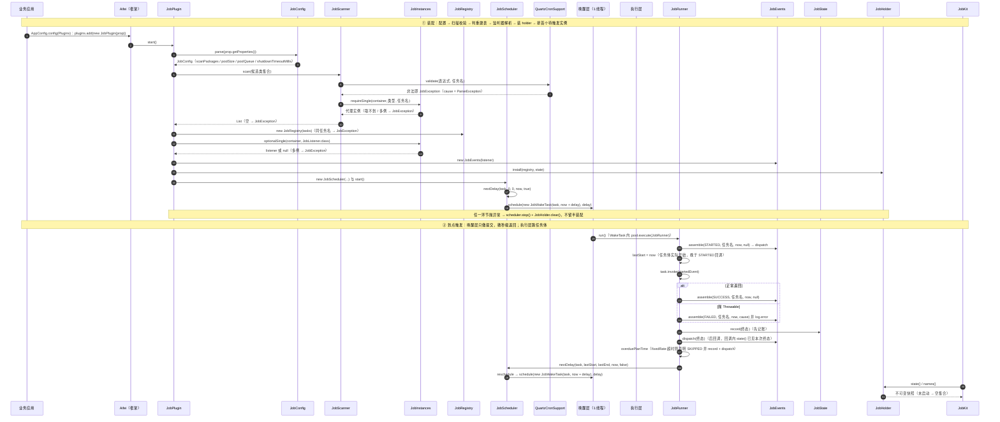
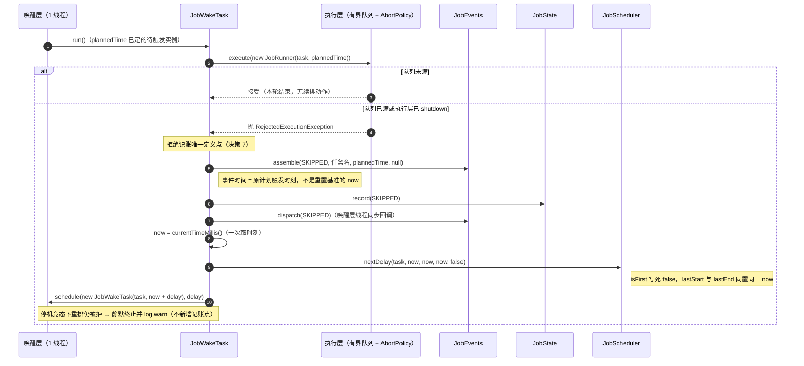
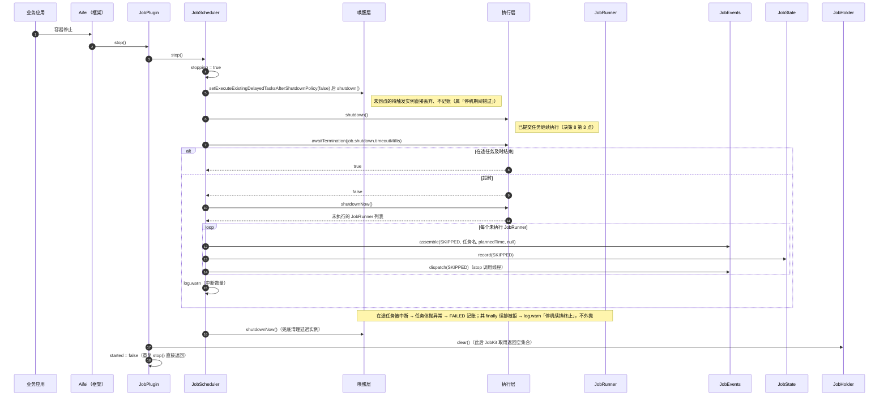

# aifei-job 设计文档

本文是 `aifei-job` 的**设计事实来源**：模块定位、公共 API 契约、调度内核的触发与执行语义、装配链路、门禁设计以本文为准。面向使用者的说明见 `README.md`；面向开发代理的约束见模块 `AGENTS.md`；测试策略与用例清单见 `docs/testing.md`。

> **交付性质**：`aifei-job` 是 aifei 生态的**库模块（可被应用依赖的 SDK）**，**不是应用工程**。因此**没有** `AppConfig` / `Launcher` / `service/` 包 / `webapp/` / HTTP 路由 / HIO / 表结构 / Db+Row / Generator；只有「公共 API 7 类型 + `internal` 实现 + `local` 表达式薄封装 + 一个装配用 `aifei.JobPlugin`」。
>
> **文档状态**：`1.0.0` 设计定稿，`src/main` 已按本文实现（`mvn clean compile` 通过），依赖树已实测回填（§10.2 / §10.3，2026-11-10）。文中的类名、方法签名、配置键、门禁常量均为**实现依据**，**不得**另立口径；实现与本文的 4 处口径差异集中在 §12（D3–D5），以实测为准。

---

## 1. 模块定位与边界

### 1.1 定位

`aifei-job` 为 aifei 应用补齐**应用内定时任务**：业务只写方法 + 一个注解，调度、并发控制、异常隔离、停机收敛由模块统一负责。

- 坐标：`io.github.gollyhu:aifei-job:1.0.0-SNAPSHOT`（`packaging=jar`）
- 包名：`cn.hg.aifei.job`
- 技术基线：**Java 8**（语法与 API 双约束，主 JAR class major version = 52）
- 调度内核：JDK `ScheduledThreadPoolExecutor` 上的**单飞自续排模型**——每个任务始终至多一个待触发实例，执行结束后于 `finally` 计算下次延迟并重排；**不重叠、不堆叠、不补跑是结构属性**，不是附加守卫
- cron 解析：委托 Quartz `CronExpression`（**全模块唯一用途**，见 §10）

### 1.2 为什么是「库模块」而非应用工程

本模块提供的是**可被别的应用依赖的能力**，自身不承载任何应用装配。以下 aifei 应用工程要素**一律不提供**：

| 要素 | 归属 |
| --- | --- |
| `AppConfig implements AifeiConfig` | **使用方应用**（本模块只提供 `JobPlugin` 供 `plugins.add(...)`） |
| `Launcher` / `Aifei.start` | 应用入口 |
| `service/` 包（Just Service） | 业务侧（本模块是基础设施 SDK） |
| HIO / 路由 / `webapp/` | 无 HTTP 面；演示页面属示例工程 `aifei-job-demo` |
| 表结构 / Db+Row / Generator | 无持久化（不建表、不连 DB） |

`aifei-job/` 内 `mvn clean verify` 必须 **0 failure / 0 error**（含架构门禁测试）。

### 1.3 工程结构（单模块）

单模块 `io.github.gollyhu:aifei-job:1.0.0-SNAPSHOT`：公共 7 类型 + `internal` + `local` + `aifei` 同处一个 JAR。文件清单见 §15。

### 1.4 v1 不做清单（边界，防范围蔓延）

1. 工作流 / DAG 编排：任务之间不建立依赖与编排关系。
2. 分布式调度：不做选主、分片、任务分发；v1 也不做执行互斥（v1.1 经 `aifei-lock` 增补）。
3. 数据流 / 批处理框架：不接管大批量读写、分片游标与检查点。
4. 任务管理后台：demo 演示页属示例工程，不是模块能力。
5. 动态脚本任务：任务必须是编译期存在的方法。
6. Quartz 调度运行时：`StdSchedulerFactory` / `Scheduler` / `RAMJobStore` / `JobDetail` / `Trigger`（含 `CronTrigger` / `SimpleTrigger`）/ `JobDataMap` / misfire 策略**全不用**，不建任何 Quartz 表；只用 `CronExpression#getNextValidTimeAfter`。
7. v1 不做任务传参：注解无「任务入参」属性（`period` / `delay` / `initialDelay` 属**节拍属性**，不在此列），`JobEvent` 无参数字段。

> **v1 不留任何 v1.1 桩代码与占位配置**：不建 `cluster` 包、不留 `job.cluster.*` 键、不写 `TODO` / 被注释掉的代码、不预留未使用的方法参数。v1.1 会**修改** `JobPlugin.start()`（非纯新增），因此桩代码没有复用价值，只会误导读者。

### 1.5 公共面收敛纪律（硬约束）

| # | 纪律 |
| --- | --- |
| 1 | **公共 API 零第三方类型**：根包 7 类型不含任何第三方类型（含零 `org.quartz.*`） |
| 2 | **公共 API 零框架类型**：根包 7 类型不出现任何 `cn.aifei.*` |
| 3 | 根包公共类型**逐个列出并说明职责**（§4），**精确 7 个**；新增公共类型必须先过设计决策 |
| 4 | 依赖分层：契约层（根包 / `internal` / `aifei`）零第三方类型；`org.quartz.*` **只允许**出现在 `local` 包（§11）；`cn.aifei.log.*` 是唯一允许出现在任意包的框架类型（模块自身记录通道） |
| 5 | Java 8 语法与 API；主 JAR class major = 52 |
| 6 | 每类规则只有一个定义点（§5.3） |

> 第 1–4 条由**架构门禁测试** `ArchitectureBoundaryTest` 强制（§11，共 6 例），不得放宽或绕过。

---

## 2. 术语表

| 术语 | 含义 | 归属 |
| --- | --- | --- |
| **任务 task** | 一个「业务方法 + 一个触发注解」的组合；以**任务名**标识 | 任务定义 |
| **任务名** | `类全名#方法名`（如 `com.acme.OrderJob#clean`）；`JobKit.names()` / `state()` 的 key、`JobEvent#taskName()` 的取值与全部错误消息的定位口径 | `internal.JobNames`（唯一定义点） |
| **触发方式 trigger** | `@Cron` / `@FixedRate` / `@FixedDelay` 三者之一，语义单义 | `internal.JobTrigger` |
| **节拍** | 两次触发之间的时间关系；由「下次延迟」纯函数唯一决定 | `internal.JobSchedule` |
| **唤醒层** | `ScheduledThreadPoolExecutor`，**固定 1 线程**，只做「提交到执行层」，微秒级返回 | `internal.JobScheduler` |
| **执行层** | `ThreadPoolExecutor`（`job.pool.size` 线程 + `job.pool.queue` 有界队列），跑任务体 | `internal.JobScheduler` |
| **待触发实例** | 唤醒层队列中的一个 `JobWakeTask`；同一任务**恒至多一个** | `internal.JobWakeTask` |
| **续排** | 计算下次延迟并重新投递一个待触发实例；全模块**只有两处**（执行结束点、提交被拒点） | §3 决策 7 |
| **终态** | `SUCCESS` / `FAILED` / `SKIPPED` 三者之一；只有终态进入观测面 | `internal.JobState` |
| **观测面** | `JobKit.state()`（最近一次终态快照）与 `JobKit.names()`（已注册任务名） | 公共 API / `internal.JobHolder` |

---

## 3. 设计决策（14 条落定）

本节**不改档**，只把每条决策落成可实现口径。带「实现口径」的补充项为细化，不改变决策结论。

### 3.1 决策 1 —— 调度引擎 = JDK 自续排，Quartz 降级为 cron 计算器

| 项 | 落定 |
| --- | --- |
| 唤醒层 | `ScheduledThreadPoolExecutor` **固定 1 线程**（不暴露配置）；线程名 `aifei-job-wake` |
| 执行层 | `ThreadPoolExecutor`，`job.pool.size` 线程 + `job.pool.queue` 有界队列（`ArrayBlockingQueue`），线程名 `aifei-job-worker-N` |
| 线程性质 | 两层线程均为 **daemon**（实现口径：插件未被 `stop()` 时不拖住 JVM 退出；停机收敛仍由 `stop()` 负责） |
| Quartz 用途 | 只用 `CronExpression` 的构造（校验）与 `getNextValidTimeAfter(Date)` |
| `org.quartz.*` 唯一落点 | `local.QuartzCronSupport`（`CronExpression` 实例按**表达式字符串**缓存，构造有解析开销，计算只读且线程安全；口径见 §12 D3） |
| 传递依赖 | 排除 `c3p0` 变体、`HikariCP-java7`、全部日志绑定；**保留 `slf4j-api`** 并在 `pom.xml` 显式声明为 `compile` 直接依赖（版本 `1.7.30`）；该门面**只供 Quartz 内部使用**，模块代码零 `org.slf4j.*` 引用（§11 门禁③） |
| 模块自身记录 | 统一经 `cn.aifei.log.Log`（`Log.get(本类.class)`），随 `cn.aifei:aifei`（provided）提供；**不新增依赖**、**不引入任何日志绑定**、禁止 `System.err` 与自建记录通道 |
| 日志获取时机 | **一律惰性**：静态工具类在**方法内**取用，实例类在**构造内 / 字段初始化期**取用；**禁止** `static` 字段持有 `Log`（理由见 §5.4） |
| provided 不传递 | 消费方必须自带 `aifei`；只引核心 `cn.aifei:aifei` 时 `cn.aifei.log` 不在 classpath，运行期 `NoClassDefFoundError: cn/aifei/log/Log`（早于任何可读错误）。README 与本文 §10 双处声明 |
| 依赖实测 | 排除清单与 `dependency:tree` 允许清单见 §10.2 / §10.3，**已实测回填**（2026-11-10）：3 条 exclusion 均有效、零日志绑定、`c3p0:c3p0` 旧变体不存在 |

### 3.2 决策 2 —— 注解声明式，公共类型定 7 个

- 根包公共类型**精确 7**：`JobKit` / `JobEvent` / `JobListener` / `JobException` + `@Cron` / `@FixedRate` / `@FixedDelay`（契约见 §4）。
- **任务名 = `类全名#方法名`**，由 `internal.JobNames` 唯一生成；注解**不提供**「任务名」属性；同一方法被扫到两次即按任务名判重并启动失败（判重点 `internal.JobRegistry`）。
- **不设 `JobScheduler` 公共接口**：唯一引擎、无 provider 扩展点、生命周期归 `JobPlugin`，接口无承载方法。
- **`JobException` 构造器为 `public`** —— 这是对需求原文「构造器包私有」的**唯一偏离**，缘由与拍板结论见 §12（D1）。

### 3.3 决策 3 —— cron 语义 = Quartz 表达式

6 段含秒，可选第 7 段年；字段与特殊字符 `* , - / ? L W #` 全按 Quartz 语义。校验与下次触发计算**一律委托 `CronExpression`**，不自实现解析器，**不做 5 段兼容写法**（Quartz 不接受，写错即启动失败）。

实现口径：`local.QuartzCronSupport` 构造 `CronExpression` 即校验（`ParseException` → `JobException`，原异常作 `cause`）。

### 3.4 决策 4 —— 同一任务恒串行

自续排结构保证同任务不重叠、不排队、不堆叠；不提供「允许重叠」开关。结构依据：同一任务只有一个待触发实例，下一个实例只在「上一个执行结束」或「上一个提交被拒」时投递。

### 3.5 决策 5 —— 错过触发不补跑

- 停机期间未触发的计划点一律跳过，不做补偿执行。
- 唤醒线程因 GC / 系统调度延迟取到已到期任务属**延迟执行**（任务不丢、不记 `SKIPPED`、`lastStart` 取实际开始时刻使节拍随之后移），**不是补跑**。
- fixedRate 执行结束时已过去的计划点按跳过规则记 `SKIPPED`（决策 7）。

### 3.6 决策 6 —— 任务异常就地隔离

单个任务抛异常不影响其他任务与后续触发；异常捕获并记堆栈；本轮不重试；续排在 `finally`，异常不断链。

实现口径：`internal.JobRunner` 捕获 `Throwable`（含 `Error`，避免 Error 杀死池线程导致该任务链断裂），解包 `InvocationTargetException#getTargetException()` 作为 `JobEvent#error()`，并 `log.error(任务名, 原因)` 留堆栈。

### 3.7 决策 7 —— 触发与执行分离，调度内核不阻塞唤醒线程（**本模块最重的一条**）

| 项 | 落定 |
| --- | --- |
| 执行层拒绝策略 | **固定 `AbortPolicy`**（「不执行 + 抛 `RejectedExecutionException`」）；禁 `CallerRunsPolicy`、禁任何**不抛异常**的静默丢弃 handler、禁 `BlockingQueue.put` 等阻塞提交方的调用 |
| 拒绝记账 | **唯一入口** = `internal.JobWakeTask.run()` 的 `catch (RejectedExecutionException)`；**不另设**自定义 handler 记一次账再抛 |
| 续排位置 | **只有两处**：① 执行结束点（`internal.JobRunner` 的 `finally`，正常路径）；② 提交被拒点（`JobWakeTask` 的 `catch` 内就地重排）。被拒任务进不了执行层，那个 `finally` 永远不执行，缺 ② 该任务永久停摆 |
| 被拒重排入参 | `isFirst` **写死 `false`**；`lastStart` 与 `lastEnd` 同置当次采样的**同一个 `now`**（一次取时刻，不得两次读时钟）；随后走同一个 `JobSchedule#nextDelay` |
| 三类 `SKIPPED` 的事件时间 | ① 提交被拒 → **原计划触发时刻**（`JobWakeTask#plannedTime`）；② fixedRate 超时跳过 → `lastStart + period`（`JobSchedule#overduePlanTime` 返回值）；③ 停机 `shutdownNow()` 剩余任务 → 其**原计划触发时刻**（`JobRunner#plannedTime`） |
| 倒挂防护 | 三类事件时间**一律不晚于**新基准 `now`（该保证只覆盖调度内核自身，不含监听器回调耗时） |
| 三种触发方式的差异 | 全部收敛到 `JobSchedule#nextDelay` 一个纯函数（入参含 `isFirst`：为真返回 `initialDelay`，为假**完全不读**该值） |

**时刻采样纪律**：`JobSchedule` 的两个方法**都是纯函数，不读时钟**；`System.currentTimeMillis()` 只在 `JobRunner` / `JobWakeTask` / `JobScheduler#start` 的明确采样点调用，且同一语义需要的时刻**只取一次**。

### 3.8 决策 8 —— 三处细节

1. `lastStart` = 任务体**实际开始执行**的时刻（队列等待不计入；`STARTED` 回调在其之前，见决策 14）。**唯一例外**是决策 7 的被拒重置——此时它只是节拍起点，该任务本轮并未执行。
2. 停机时在途任务 `finally` 续排必须捕获 `RejectedExecutionException` 并静默终止（`log.warn` 记「停机续排终止」，**不得外抛**覆盖任务自身异常）。被拒点（`JobWakeTask` 的 `catch`）内的就地重排在停机竞态下同样可能被拒，同一处静默终止、**不新增记账点**。
3. 执行层 `shutdown()` 后已提交任务继续执行属预期。

### 3.9 决策 9 —— 优雅停机

`internal.JobScheduler#stop()` 的**固定顺序**：

```
stopping = true
wake.setExecuteExistingDelayedTasksAfterShutdownPolicy(false)   // 见下方实现口径
wake.shutdown()                  // 停止新触发
pool.shutdown()                  // 拒绝新提交，已提交任务继续执行
awaitTermination(job.shutdown.timeoutMillis)
  ├─ 正常结束 → 完成
  └─ 超时      → pool.shutdownNow()，返回的未执行 Runnable 逐个记 SKIPPED（事件时间 = 其 plannedTime）并留日志
wake.shutdownNow()               // 兜底清理唤醒层剩余延迟实例（不记账，理由见下）
```

**实现口径（必读）**：`ScheduledThreadPoolExecutor#shutdown()` 默认仍会执行**已排队的延迟任务**（`executeExistingDelayedTasksAfterShutdownPolicy` 默认 `true`），因此必须先置 `false` 才能达成「停止新触发」。

**丢弃口径区分**：

- 执行层队列中**已到点、未执行**的 `JobRunner` → 记 `SKIPPED`（计划点已到，属「停机中断」）。
- 唤醒层队列中**未到点**的 `JobWakeTask` → 直接丢弃、**不记账**（计划点尚未发生，属「停机期间错过」，见决策 5）。

**超时等待范围**：只 `awaitTermination` 执行层（在途任务的主体），唤醒层线程只做微秒级提交、不阻塞，`shutdownNow()` 兜底即可。

任务须自行响应中断，模块**不保证强制终止**（README 声明）。

### 3.10 决策 10 —— 任务实例与方法校验

- 任务所在类**一律从 aifei 容器按类型取**（`Aop.get(类型.class)`，取出的是代理对象，事务 / 日志生效），**不做**反射 `new` + 手工注入兜底；`Aop.get` 抛异常即「取不到」→ 启动失败。
- **多例（prototype）Bean 视为配置错误**并启动失败。判定通道 = 容器提供的单例 / 多例标记：`类型上的 @Singleton#value()`，缺省取全局默认 `AopKit.get().isSingleton()`（与 `AopFactory#doGet` 的判定规则一致）。
- 判定点**唯一**：`internal.JobInstances`（任务实例与监听器共用同一判定实现，两个入口语义不同），不在任务扫描与监听器解析两处各写一套。
- 注解方法必须为 `public` 实例方法、非 `static`、返回 `void`、参数为 `()` 或 `(JobEvent)`，否则启动失败并指出方法全名。
- `job.scan.packages` 内多个包存在包含关系时同一方法可能被扫到多次 → **按任务名判重，重复即启动失败**（不静默去重，避免掩盖配置冗余）。

实现口径：

1. 方法发现用 `Class#getDeclaredMethods()`（只扫**被扫到类自身声明**的方法）：继承而来的注解方法不注册，且避免子类与父类各自注册导致的任务名判重误报。
2. 跳过 `Method#isSynthetic()` / `isBridge()` 的编译器生成方法。
3. `Method#getParameterCount()` 只允许 `0` 或 `1`；为 `1` 时参数类型必须是 `JobEvent`。
4. 候选类发现（类路径扫描）必须使用框架 `cn.aifei.scanner.Scanner`（`scan(String packageName)`），**只能**出现在 `aifei` 包内（门禁②）→ 落在 `JobPlugin` 的私有方法；规则识别仍在 `internal.JobScanner`。
5. 扫描结果为空 → `JobException`（消息列出全部扫描包）。

### 3.11 决策 11 —— v1 不支持任务传参

注解无「任务入参」属性；`JobEvent` 无参数字段；README 声明参数由业务经自身注入的 Service / 配置获取。

### 3.12 决策 12 —— 集群互斥（v1.1，本次不做）

多实例部署时同一任务由各实例竞争一把执行锁（依赖 `aifei-lock`，scope `optional`）。**v1 不留桩代码与占位配置**（见 §1.4）：不声明 `job.cluster.*` 键、不做 `Class.forName` 探测、不改 `JobPlugin.start()`。

v1.1 待定档两项（本次**不设计、不落地**）：超时任务的租约与续期责任（含 `job.cluster.*` 的 `lease` 配置键）、失败语义（抢锁失败记 `SKIPPED`；`LockException` 结果未知记 `FAILED` 留堆栈）。

### 3.13 决策 13 —— `JobListener` 为可选的单监听器，按类型从容器取

| 项 | 落定 |
| --- | --- |
| 解析时机与次数 | `JobPlugin.start()` 按 `JobListener.class` 从容器取**一次**并持有引用（与任务实例同一通道）；`stop()` 释放引用 |
| 取不到 | **视为「无监听器」**：不启动失败、不升级为配置错误（观测属可选设施）。事件仍正常装配与记账，只是 `dispatch` 直接返回 |
| 多例 Bean | **配置错误**、启动失败（`start()` 只取一次并长期持有，多例会让事件散落到不同实例、监听器自身状态也不可依赖）。判定通道与任务实例同一实现（`internal.JobInstances`） |
| 与任务实例的语义差 | 任务实例缺失 → **配置错误**（启动失败）；监听器缺失 → **正常**（无观测）。两条语义不同，但**判定实现同一处** |
| 多监听器 | **v1 不支持**：框架按类型注册，同类型重复注册抛 `Singleton object already exists`；无 `@Order` / 按名通道。需要多路分发的业务自行实现一个 `JobListener` 做组合转发 |
| `JobKit` 影响 | **不新增注册方法**，仍只有 `state()` / `names()` |

### 3.14 决策 14 —— `JobEvent` 不可变 + 监听器同步回调

**不可变**：`final` 类、字段全 `final`、无 setter、无懒加载 / 缓存字段，构造期一次赋值；触发时间用 `long`。不承诺深度不可变（唯一可变引用是 `Throwable`）。`JobKit.state()` 每次构建新的不可变 `Map` 与**新 `JobEvent` 值**，不返回内部记录实例、不返回活视图（§4.4）。

**同步回调与线程归属**：`JobListener#onEvent` 同步调用、运行在产生该事件的线程上；无异步派发、无监听队列与监听线程池（线程归属表见 §5.4）。监听器必须快速返回、无阻塞 IO / 长计算、线程安全（不同任务的事件可并发到达同一实例）、不依赖线程局部变量；同一任务的阶段事件按 `STARTED → 终态` 顺序串行到达。

**`STARTED` 在 `lastStart` 采样之前**（顺序不可交换）：

```
进入执行
  → now1 = currentTimeMillis()
  → assemble(STARTED, 任务名, now1, null) → dispatch   // 该时刻即事件触发时间；同步回调
  → lastStart = currentTimeMillis()                      // 回调返回后才采样，任务体随即开始
  → 调用任务体
```

- 监听器耗时因此**不计入** `lastEnd - lastStart`，不参与 fixedRate 的「耗时超过间隔」判定，也不改变 fixedDelay 的结束基准。
- **两个时刻不要求复用同一个 `now`**：事件时间只服务观测，`lastStart` 只服务节拍计算，二者差值即监听器耗时（属预期，不是实现偏差）。
- 顺序取此而非「采样后发事件」，因为 `lastStart` 的语义是「任务体开始」，反过来会让慢监听器间接改变跳过行为，违背「监听器不得影响调度」。

**回调异常完全隔离于状态机**：异常被捕获并记录（`log.error`），不影响任务执行、终态记账与续排，不改变 `state()` 观测结果。

**终态一律「先记账再回调」**：`record(终态)` 之后才 `dispatch(终态)`，故回调内调用 `JobKit.state()` 已能看到本次终态；`STARTED` 本就不记账（回调内看到的是**上一次终态**，首次执行时该任务不在 `state()` 中）。

**耗时由使用方承担**：模块不做回调超时中断；README 显式警告「慢监听器会拖慢全部任务的到点触发」。

---

## 4. 公共 API 契约（根包精确 7 类型）

根包 `cn.hg.aifei.job` **精确 7 个公共类型**：`JobKit` / `JobEvent` / `JobListener` / `JobException` / `Cron` / `FixedRate` / `FixedDelay`。此清单是门禁常量 `EXPECTED_ROOT_TYPES` 的**唯一事实来源**。

### 4.1 `JobEvent`（不可变状态快照）

```java
public final class JobEvent {

    public enum Phase { STARTED, SUCCESS, FAILED, SKIPPED }

    private final String taskName;
    private final long triggerTime;
    private final Phase phase;
    private final Throwable error;

    private JobEvent(String taskName, long triggerTime, Phase phase, Throwable error) { ... }

    public static JobEvent of(String taskName, long triggerTime, Phase phase, Throwable error);  // 唯一工厂

    public String taskName();
    public long triggerTime();     // epoch 毫秒
    public Phase phase();
    public Throwable error();      // 非 FAILED 阶段为 null

    @Override public String toString();
}
```

- **私有构造 + 唯一静态工厂 `of`**（对齐 `aifei-mq` 的 `Message.of` 范式）：`internal` 与根包不同包，包私有构造器无法跨包调用，故装配点经工厂进入。
- `triggerTime` 为 `long`（epoch 毫秒），**不用** `Date` / `Calendar`（可变类型，`final` 字段挡不住）。
- 除 `Throwable` 引用外不可变；`Throwable` 仅作故障记录、不作调度判据，**不做**防御性拷贝。
- **不实现** `equals` / `hashCode`（无值比较语义需求；`JobKit.state()` 每次返回**新实例**，暗示值相等会误导）。
- `Phase` 是**嵌套类型**，门禁不单独计数（§11）。
- 唯一装配点：`internal.JobEvents`（§5.3）。

### 4.2 `JobListener`（公共函数式接口）

```java
@FunctionalInterface
public interface JobListener {
    void onEvent(JobEvent event);
}
```

- **同步调用、运行在产生该事件的线程上**（线程归属见决策 14 落定表）；不提供异步派发，无监听队列与监听线程池。
- 监听器为**可选单例**：`JobPlugin.start()` 从容器按类型取一次并持有（§3.13）——**取不到即无监听器**，不启动失败；`stop()` 释放引用。
- 多例 Bean → 启动失败；**v1 不支持多个监听器**（框架按类型注册、同类型重复注册抛 `Singleton object already exists`，且无 `@Order` / 按名通道）。
- 须快速返回、无阻塞 IO / 长计算、线程安全；回调异常被捕获，不影响调度（§3.14）。

### 4.3 `JobException`（唯一启动期异常）

```java
public final class JobException extends RuntimeException {
    public JobException(String message);
    public JobException(String message, Throwable cause);
}
```

javadoc **必须显著声明**（原文照写）：

> 本异常**由模块内部抛出**，业务方只 `catch`、**不要** `new`。构造器为 `public` 是因为唯一构造点 `internal.JobErrors` 与公共类型不同包（Java 包私有语义所限），并非对外构造入口；消息必然携带定位信息（方法全名 / 键名与原值 / 表达式原文 / 任务名）。

- 覆盖**启动期**全部失败：`job.*` 配置非法、扫描包为空或扫不到任务、注解与注解方法签名非法、同一方法多触发注解、cron 非法、`initialDelay` / `period` / `delay` 越界、任务实例取不到或为多例、同一方法被扫到多次、监听器为多例。
- **消息必含定位信息**；底层异常（如 Quartz `ParseException`）保留为 `cause`。
- **启动期只用它**：不复用 `IllegalArgumentException` / `IllegalStateException`（与 `aifei-cache` 用前者、`aifei-lock` 用后者的差异在此显式声明）。
- **运行期不抛它**：任务体异常、续排被拒、监听器回调异常一律就地捕获记录。

### 4.4 `JobKit`（只读观测门面）

```java
public final class JobKit {
    private JobKit() { }

    public static Set<String> names();            // 已注册任务名；不可变、按任务名排序
    public static Map<String, JobEvent> state();  // 最近一次终态快照；不可变、按任务名排序
}
```

- **只有这两个只读方法**，不对外暴露 setter、不新增注册方法。
- 静态引用由 `JobPlugin.start()` 写入、`stop()` 清除，通道为 `internal.JobHolder`（对齐 `aifei-mq` 的 `MqHolder` 范式）。
- **未启动（或已停机）时两个方法返回空集合，不抛异常**——与仓库根 `AGENTS.md`「`XxxKit` 未装配即失败」的表面冲突见 §12（D2）。
- `state()`：`Value` 为该任务**最近一次终态**（`SUCCESS` / `FAILED` / `SKIPPED`）快照；`STARTED` **既不作结果也不清除记录**；**每次调用构建新的不可变 `Map` 与新 `JobEvent` 值**，不返回内部记录实例、不返回活视图；从未执行过的任务不出现。

### 4.5 三个触发注解

```java
@Retention(RetentionPolicy.RUNTIME)
@Target(ElementType.METHOD)
public @interface Cron { String value(); }

@Retention(RetentionPolicy.RUNTIME)
@Target(ElementType.METHOD)
public @interface FixedRate { long period() default 0; long initialDelay() default 0; }

@Retention(RetentionPolicy.RUNTIME)
@Target(ElementType.METHOD)
public @interface FixedDelay { long delay() default 0; long initialDelay() default 0; }
```

- 三注解各自**语义单义**，不提供任何其它属性（无任务名、无分组、无优先级、无「允许重叠」、无入参）。
- `initialDelay` 是**首次触发延迟**而非节拍参数：`@FixedRate` / `@FixedDelay` 对称持有、语义一致（只影响首次）；`@Cron` **不设**（首次触发点由表达式自身定义，两套来源会冲突）。
- 时间单位一律**毫秒**。
- 属性校验**唯一实现点** = `internal.JobTrigger` 的静态工厂（§5.3），越界经 `JobErrors` 抛 `JobException`。

### 4.6 公共面计数口径（供门禁复用）

「根包公共类型」= `src/main/java/cn/hg/aifei/job/` 的**直接子 `.java` 文件**（子包 `internal` / `local` / `aifei` 均不计入）——**精确 7 个**，文件名集合精确为：

```
JobKit.java  JobEvent.java  JobListener.java  JobException.java  Cron.java  FixedRate.java  FixedDelay.java
```

---

## 5. 内部结构

### 5.1 `internal`（非承诺 API）

> 关键约束：门禁规定 `cn.aifei.*` 只允许出现在 `aifei` 包，**`cn.aifei.log.*` 为唯一例外**。故 `internal` 可以 `import cn.aifei.log.Log`，但**不得** import `Prop` / `Aop` / `AopKit` / `Scanner` / `Singleton` 等其它框架类型。配置**装载**（`prop.getProperties()`）留在 `aifei.JobPlugin` 一行完成，解析与校验全在 `internal.JobConfig`。

| 类型 | 形态 | 职责 |
| --- | --- | --- |
| `JobConfig` | final 值对象 + 静态工厂 | **配置域常量与解析校验唯一定义点**：4 个键名常量 + 默认值常量；`parse(Properties)`（缺必填 / 取值越界 → `JobException`）；`scanPackages()` / `poolSize()` / `poolQueue()` / `shutdownTimeoutMillis()` |
| `JobErrors` | final + 静态方法 | **`JobException` 唯一构造点**（唯一 `new JobException` 出现处）：`configInvalid` / `scanPackagesEmpty` / `noTaskFound` / `illegalSignature` / `multipleTriggers` / `illegalCron` / `illegalParameter` / `instanceMissing` / `prototypeBean` / `duplicateTask` / `listenerPrototype`，全部**返回**异常对象由调用方 `throw`（便于带 `cause`） |
| `JobNames` | final + 静态方法 | **任务名生成唯一定义点**：`of(Method)` → `getDeclaringClass().getName() + "#" + getName()` |
| `JobTrigger` | final 值对象 | **触发方式与注解属性校验唯一定义点**：`Kind{CRON, FIXED_RATE, FIXED_DELAY}`；工厂 `cron(expr, taskName)` / `fixedRate(period, initialDelay, taskName)` / `fixedDelay(delay, initialDelay, taskName)`；`kind()` / `cron()` / `period()` / `delay()` / `initialDelay()` |
| `JobTask` | final 值对象 | 任务定义（不可变）：`name()` / `instance()` / `method()` / `trigger()`；`invoke(JobEvent startedEvent)` 按参数个数选 `()` 或 `(JobEvent)` 调用（`InvocationTargetException` 不在此吞掉） |
| `JobContainer` | interface | **容器访问契约**（不含框架类型）：`<T> T get(Class<T> type)` / `boolean isSingleton(Class<?> type)`；实现见 `aifei.AifeiJobContainer` |
| `JobInstances` | final + 静态方法 | **实例获取与多例判定唯一实现**：`requireSingle(container, type, taskName)`（取不到 → `instanceMissing`；多例 → `prototypeBean`）、`optionalSingle(container, type)`（取不到 → `null`；多例 → `listenerPrototype`） |
| `JobScanner` | final | **注解扫描与签名校验唯一定义点**：`scan(Collection<Class<?>> candidates)` → `List<JobTask>`；识别三注解、校验方法签名、拒绝多注解、经 `JobTrigger` 校验属性、经 `JobNames` 生成任务名、经 `JobInstances` 取实例、经 `CronCalculator#validate` 校验表达式；结果为空 → `noTaskFound` |
| `JobRegistry` | final | **任务注册表与任务名判重唯一定义点**：构造期插入并判重（重名 → `duplicateTask`）；`tasks()`（按任务名排序的不可变列表）/ `names()` / `get(String)` |
| `JobState` | final | **状态记账唯一定义点**：`record(JobEvent)`（只接受终态，`STARTED` 直接忽略）、`snapshot()`（新 `TreeMap` + 每个 value 经 `JobEvent#of` 复制成新实例 + `Collections.unmodifiableMap`） |
| `JobEvents` | final | **`JobEvent` 装配唯一定义点 + 监听器分发与异常捕获唯一定义点**：`assemble(Phase, taskName, triggerTime, error)`、`dispatch(JobEvent)`（同步回调、`catch Throwable` 记日志、无监听器直接返回） |
| `JobHolder` | final + 静态方法 | **`JobKit` 的唯一写入通道**：`install(JobRegistry, JobState)` / `clear()` / `names()` / `state()`（未安装 → 空集合，**不抛**） |
| `JobSchedule` | final（构造注入 `CronCalculator`） | **下次触发延迟纯函数唯一定义点**：`nextDelay(task, lastStart, lastEnd, scheduleNow, isFirst)`（三触发方式的唯一分叉点，`initialDelay` 只在此读取一次；返回 `-1` 表示「无下次触发」）、`overduePlanTime(task, lastStart, scheduleNow)`（fixedRate 超时跳过判定，返回跳过事件时间或 `-1`）；两个方法**都不读时钟** |
| `CronCalculator` | interface | cron 计算契约（隔离 `org.quartz.*`）：`validate(expression, taskName)` / `nextAfter(expression, epochMillis, taskName)`（返回 `-1` = 无下次） |
| `JobScheduler` | final | 调度内核装配与生命周期：构造唤醒层 / 执行层、`start()`（为每个任务排首个待触发实例）、`stop()`（决策 9 全流程）、`reschedule(task, delay)`（唯一续排投递实现，返回是否成功）；`volatile boolean stopping` |
| `JobWakeTask` | final（包级，`implements Runnable`） | 待触发实例：持 `JobTask` 与 **`plannedTime`**（计划触发时刻）；`run()` 提交执行层，`catch (RejectedExecutionException)` 内完成**拒绝记账 + 就地重排**（决策 7） |
| `JobRunner` | final（包级，`implements Runnable`） | 执行单元：持 `JobTask` 与 **`plannedTime`**；`run()` 完成 `STARTED` → 采样 `lastStart` → 调任务体 → 终态记账与回调 → fixedRate 跳过记账 → `finally` 续排（被拒静默） |

### 5.2 `local` 与 `aifei` 包

| 类型 | 形态 | 职责 |
| --- | --- | --- |
| `local.QuartzCronSupport` | final `implements CronCalculator` | **全模块唯一出现 `org.quartz.*` 的类**：校验（构造 `CronExpression`）+ 下次触发计算（`getNextValidTimeAfter`）；`CronExpression` 按**表达式字符串**缓存在 `ConcurrentHashMap`，命中失败时构造并缓存（同一构造点，见 §12 D3） |
| `aifei.JobPlugin` | `implements cn.aifei.plugin.Plugin` | **唯一 import aifei 插件 / 容器 / 扫描器类型的类**（`Prop` / `Aop` / `AopKit` / `Singleton` / `Scanner`）；构造只持 `Prop`，`start()` 全量解析校验装配，`stop()` 收敛；另含候选类发现的私有方法 |
| `aifei.AifeiJobContainer` | final `implements internal.JobContainer` | **容器语义映射唯一定义点**：`get(type)` → `Aop.get(type)`；`isSingleton(type)` → 先 `AopKit.get().getAopFactory().getMappingClass(type)` 解析出实际类型，再取其上的 `@Singleton#value()`，未声明则回落 `AopKit.get().isSingleton()`（比原字面多一步映射解析，见 §12 D5） |

> **命名口径说明**：`QuartzCronSupport` 是 **`CronCalculator` 的实现类**（实现类按 Java 习惯名词化并冠以实现前缀「Quartz」），不属仓库根 `AGENTS.md`「无状态工具类用 `Util`」的适用范围；该名称由需求定档，保持不变。

### 5.3 每类规则的唯一定义点（实现类不得复制）

| # | 规则 | 唯一定义点 | 禁用的复制位置（示例） |
| --- | --- | --- | --- |
| 1 | 任务名生成（`类全名#方法名`） | `internal.JobNames#of` | 扫描 / 记账 / 错误消息各自拼字符串 |
| 2 | cron 表达式校验与下次触发计算 | `local.QuartzCronSupport`（`CronCalculator` 契约） | `JobScanner` 自行 try/catch `ParseException` |
| 3 | 下次触发延迟纯函数（三触发方式的唯一分叉点，`initialDelay` 只读一次） | `internal.JobSchedule#nextDelay` | `JobRunner` / `JobWakeTask` 各自算 `period - elapsed` |
| 4 | 跳过判定与三类 `SKIPPED` 事件时间口径 | 判定：`JobSchedule#overduePlanTime`（fixedRate）；事件时间：被拒 / 停机取 `plannedTime`、超时取 `overduePlanTime` 返回值；记账入口：`JobState#record` | 任一 `catch` 里自行 `now` 当事件时间 |
| 5 | 拒绝记账（`RejectedExecutionException` → `SKIPPED`） | `internal.JobWakeTask#run` 的 `catch` 块 | 自定义 `RejectedExecutionHandler` 再记一次 |
| 6 | 节拍基准重置（`isFirst=false` + 同一 `now` 采样） | `internal.JobWakeTask` 的 `catch` 块（决策 7 唯一入口） | `JobRunner` 里也重置一次 |
| 7 | 状态记录顺序（终态**先记账再回调**，`STARTED` 不记账） | `internal.JobRunner`（调用顺序）+ `internal.JobState#record`（只收终态） | 监听器分发后再 `record` |
| 8 | `JobEvent` 构造（不可变装配点） | `internal.JobEvents#assemble`（内部只经 `JobEvent#of`） | 各调用点直接 `JobEvent.of(...)` |
| 9 | 监听器解析（单例、按类型取一次、缺失即无监听器、多例即失败） | `internal.JobInstances#optionalSingle`（由 `JobPlugin#start` 调用一次） | `JobScheduler` / `JobEvents` 各自回容器取 |
| 10 | 监听器分发与回调异常捕获 | `internal.JobEvents#dispatch` | `JobRunner` 直接调 `listener.onEvent` |
| 11 | 配置域常量与解析校验 | `internal.JobConfig` | 各处硬编码 `"job.pool.size"` |
| 12 | 日志获取方式（`Log.get(本类.class)`，禁 `org.slf4j.*` / `System.err` / 自建通道） | 各持有日志的类（`JobRunner` / `JobWakeTask` / `JobScheduler` / `JobEvents`），一律方法内或构造内取用 | `static Log LOG = Log.get(...)` |
| 13 | 任务名判重 | `internal.JobRegistry` 构造期 | `JobScanner` 内另建 `Set` 判重 |
| 14 | 容器实例获取与多例判定（规则实现层） | `internal.JobInstances`（判定语句一处）；容器语义映射在 `aifei.AifeiJobContainer#isSingleton` | `JobScanner` 与 `JobPlugin` 各写一套 `@Singleton` 判断 |
| 15 | 续排投递（含「无下次触发」放弃） | `internal.JobScheduler#reschedule` | `JobRunner` / `JobWakeTask` 各自 `wake.schedule(...)` |

### 5.4 线程模型与日志纪律

**线程归属（与决策 14 一致）**：

| 事件 | 产生线程 |
| --- | --- |
| `STARTED` / `SUCCESS` / `FAILED`、fixedRate 超时 `SKIPPED` | 执行层线程（`aifei-job-worker-N`） |
| 提交被拒 `SKIPPED` | 唤醒层线程（`aifei-job-wake`，**全局仅 1 个**） |
| 停机 `shutdownNow()` 剩余任务 `SKIPPED` | `stop()` 调用线程 |

**日志惰性获取的理由（精确）**：`Log.get(...)` 依赖 `LogKit` 的 `logFactory`；框架默认值是 `cn.aifei.log.NoLogFactory.INSTANCE`，它**每次调用都抛** `IllegalStateException("LogFactory not configured.")`。若在**类静态初始化期**强取 `Log`：

1. 静态初始化早于框架装配时会失败；
2. 异常会被包装成 `ExceptionInInitializerError`，类随后永久不可用（`NoClassDefFoundError`），故障点远离真实原因。

因此在**方法内 / 实例构造内**取用。另注：本模块 `compile` 依赖 `slf4j-api`，`LogKit` 的静态初始化会探测到 `Slf4jLogFactory`（无绑定 → SLF4J 打印一次 NOP 警告、日志静默），故**未装配 `LogFactory` 时通常不会抛**；只有消费方同时排空 `slf4j-api` 才命中 `NoLogFactory`。README 按「未装配 `LogFactory` 时按框架既有语义」声明，测试一律先装配 Noop 实现（§13 / `docs/testing.md`）。

---

## 6. 触发与执行语义（契约表）

> 与需求第五节第 1 小节**逐条一致**（原样落为契约）；右列为本设计的实现落点，便于实现与评审对照。

| 场景 | 约定 | 实现落点 |
| --- | --- | --- |
| fixedRate 结束时发现 period 已过 | 记一条 `SKIPPED`（事件时间取原计划触发时刻 `lastStart + period`，非当前时刻）、以当前时刻为新基准立即重排，已过触发点不补跑 | `JobRunner`：`JobSchedule#overduePlanTime` → 声明 `SKIPPED` → `nextDelay` 返回 0 |
| 触发点因停机错过 | 停机期间的计划点全部跳过，重启后不补跑 | `JobScheduler#stop` 丢弃唤醒层未到点实例，不记账 |
| 唤醒线程因 GC / 系统调度延迟取到已到期任务 | 照常提交执行（延迟执行，非补跑、不记 `SKIPPED`），`lastStart` 取实际开始时刻使节拍随之后移 | `JobWakeTask` 不比较时间，照常 `pool.execute`；`JobRunner` 采样实际开始 |
| `initialDelay` 未到即停机 / 错过该点 | 不触发、不补跑、不记账（从未执行过的任务不进入 `state()`） | `JobState` 只收终态 |
| 首次提交即被拒 | 同后续周期口径：记 `SKIPPED` + 节拍基准重置为当前时刻 + `isFirst` 置 `false`（不重复消费 `initialDelay`），不另开分支 | `JobWakeTask` 的 `catch` 唯一分支 |
| 任务耗时超过间隔 | 结束后按「上次开始 + 间隔」重算；已过时间点不补跑，按跳过规则记账 | 同第 1 行 |
| 任务抛异常 | 捕获 + 记录（含堆栈）；不影响其他任务与后续触发；本轮不重试；续排不受影响 | `JobRunner` `catch Throwable` + `finally` 续排 |
| 执行池队列满（提交被拒） | 唤醒层捕获 `RejectedExecutionException` → 记 `SKIPPED` → 重置节拍基准 → **唤醒层就地重排**；唤醒线程不阻塞，异常仅在内部流转、不向调用方外抛 | `JobWakeTask#run` |
| 任务在队列等待 | 等待**不计入** `lastStart` | `lastStart` 在 `JobRunner` 内采样 |
| 应用停机 | 停止新触发，等待在途任务；超时后中断并记录未完成 | `JobScheduler#stop` 固定顺序（§3.9） |
| 同一方法多个触发注解 | 配置错误，启动即失败（避免语义歧义） | `JobScanner` + `JobErrors#multipleTriggers` |
| 非法 cron 表达式 | 启动即失败，指出方法全名与表达式原文 | `QuartzCronSupport#validate` + `JobErrors#illegalCron` |

**只读观测面补充**（需求第五节第 3 小节）：

- `state()`：`STARTED` 已发、终态未发时**保留上一次终态**，观测口径是「最后已知结果」，执行中的任务不会暂时消失；首次执行且尚无终态的任务在执行中**仍不出现**；因此 `state()` **无法区分**「正在执行」与「空闲等待」——执行中视图只能由监听器事件流提供（demo 据此实现，§13）。
- `names()`：区分「已注册未执行」与「未注册」。

---

## 7. 数据结构与接口（类图）

### 7.1 类图

```mermaid
classDiagram
    direction TB

    class JobKit {
        -JobKit()
        +names() Set~String~
        +state() Map~String,JobEvent~
    }

    class JobEvent {
        <<final>>
        -String taskName
        -long triggerTime
        -Phase phase
        -Throwable error
        -JobEvent(String, long, Phase, Throwable)
        +of(String, long, Phase, Throwable) JobEvent
        +taskName() String
        +triggerTime() long
        +phase() Phase
        +error() Throwable
    }

    class Phase {
        <<enumeration>>
        STARTED
        SUCCESS
        FAILED
        SKIPPED
    }

    class JobListener {
        <<interface>>
        +onEvent(JobEvent) void
    }

    class JobException {
        <<final>>
        +JobException(String)
        +JobException(String, Throwable)
    }

    class Cron {
        <<annotation>>
        +value() String
    }

    class FixedRate {
        <<annotation>>
        +period() long
        +initialDelay() long
    }

    class FixedDelay {
        <<annotation>>
        +delay() long
        +initialDelay() long
    }

    class JobPlugin {
        -Prop prop
        -boolean started
        +start() void
        +stop() void
    }

    class AifeiJobContainer {
        +get(Class) Object
        +isSingleton(Class) boolean
    }

    class JobContainer {
        <<interface>>
        +get(Class) Object
        +isSingleton(Class) boolean
    }

    class JobConfig {
        <<final>>
        +parse(Properties) JobConfig
        +scanPackages() List~String~
        +poolSize() int
        +poolQueue() int
        +shutdownTimeoutMillis() long
    }

    class JobErrors {
        <<final>>
        +configInvalid(String, Object, String) JobException
        +illegalCron(String, String, Throwable) JobException
        +prototypeBean(String, String) JobException
        +duplicateTask(String) JobException
    }

    class JobNames {
        <<final>>
        +of(Method) String
    }

    class JobTrigger {
        <<final>>
        +cron(String, String) JobTrigger
        +fixedRate(long, long, String) JobTrigger
        +fixedDelay(long, long, String) JobTrigger
        +kind() Kind
    }

    class JobTask {
        <<final>>
        +name() String
        +instance() Object
        +method() Method
        +trigger() JobTrigger
        +invoke(JobEvent) void
    }

    class JobScanner {
        <<final>>
        +scan(Collection) List~JobTask~
    }

    class JobInstances {
        <<final>>
        +requireSingle(JobContainer, Class, String) Object
        +optionalSingle(JobContainer, Class) Object
    }

    class JobRegistry {
        <<final>>
        +tasks() List~JobTask~
        +names() Set~String~
        +get(String) JobTask
    }

    class JobState {
        <<final>>
        +record(JobEvent) void
        +snapshot() Map~String,JobEvent~
    }

    class JobEvents {
        <<final>>
        -JobListener listener
        +assemble(Phase, String, long, Throwable) JobEvent
        +dispatch(JobEvent) void
    }

    class JobHolder {
        <<final>>
        +install(JobRegistry, JobState) void
        +clear() void
        +names() Set~String~
        +state() Map~String,JobEvent~
    }

    class JobSchedule {
        <<final>>
        -CronCalculator cron
        +nextDelay(JobTask, long, long, long, boolean) long
        +overduePlanTime(JobTask, long, long) long
    }

    class CronCalculator {
        <<interface>>
        +validate(String, String) void
        +nextAfter(String, long, String) long
    }

    class QuartzCronSupport {
        <<final>>
        -Map cache
        +validate(String, String) void
        +nextAfter(String, long, String) long
    }

    class JobScheduler {
        <<final>>
        -boolean stopping
        +start() void
        +stop() void
        +reschedule(JobTask, long) boolean
    }

    class JobWakeTask {
        <<final>>
        -JobTask task
        -long plannedTime
        +run() void
    }

    class JobRunner {
        <<final>>
        -JobTask task
        -long plannedTime
        +run() void
    }

    JobEvent *-- Phase
    JobKit ..> JobHolder : 只读取用
    CronCalculator <|.. QuartzCronSupport : 实现
    JobContainer <|.. AifeiJobContainer : 实现
    JobPlugin ..> JobConfig : parse
    JobPlugin ..> JobScanner : scan
    JobPlugin ..> JobRegistry : 判重建表
    JobPlugin ..> JobState : 新建
    JobPlugin ..> JobEvents : 装配监听器
    JobPlugin ..> JobScheduler : start/stop
    JobPlugin ..> JobHolder : install/clear
    JobPlugin ..> AifeiJobContainer : 容器访问
    JobPlugin ..> QuartzCronSupport : 新建
    JobScanner ..> JobContainer : 取实例
    JobScanner ..> JobInstances : 实例与多例判定
    JobScanner ..> JobNames : 任务名
    JobScanner ..> JobTrigger : 属性校验
    JobScanner ..> CronCalculator : 表达式校验
    JobScanner ..> JobTask : 产出
    JobScanner ..> JobErrors : 启动期失败
    JobRegistry o-- JobTask
    JobScheduler o-- JobRegistry
    JobScheduler *-- JobWakeTask : 投递
    JobScheduler *-- JobRunner : 提交
    JobScheduler ..> JobSchedule : 纯函数
    JobScheduler ..> JobEvents : 装配与分发
    JobScheduler ..> JobState : 记账
    JobSchedule ..> CronCalculator : 仅 cron 分支
    JobEvents ..> JobListener : 同步回调
    JobEvents ..> JobEvent : 装配
```



### 7.2 类图事实要点

- **依赖方向单向**：`local` → `internal`（`CronCalculator` 契约 + `JobErrors`）；`aifei` → `internal` + 框架；`internal` **不依赖** `local` / `aifei`（`CronCalculator` 与 `JobContainer` 两个内部接口把框架与第三方都挡在 `internal` 之外）。
- **`org.quartz.*` 只在 `local.QuartzCronSupport`**；`cn.aifei.*` 只在 `aifei` 包 + `cn.aifei.log.Log`（任意包）。
- **无 provider 扩展点、无 ServiceLoader、无 `META-INF/services`**（唯一引擎）。
- 调度状态极简：`JobScheduler` 不保存每任务的 `lastStart` / `lastEnd`（它们是 `JobRunner` 的局部变量，随每次运行传递），因此**无跨运行的可变节拍状态**、无并发共享写。

---

## 8. 程序调用流程（时序图）

### 8.1 启动与正常续排



### 8.2 提交被拒：唤醒层就地重排



### 8.3 停机收敛



---

## 9. 配置键与注解属性

### 9.1 配置键（**4 个**，构造期只持 `Prop` 引用，解析与校验全部在 `start()`）

| 键 | 必填 | 默认值 | 规则 | 违规结果 |
| --- | --- | --- | --- | --- |
| `job.scan.packages` | **是** | — | 逗号分隔、每项 `trim()`；空值或含空项即失败（对齐 `cache.names` 规则） | `JobException`（含键名与原值） |
| `job.pool.size` | 否 | `Runtime.getRuntime().availableProcessors()` | 执行层线程数，`≥ 1` | `JobException` |
| `job.pool.queue` | 否 | `256` | 执行层有界队列容量，`≥ 1`；默认值只适合开发 / 低负载环境，**正式环境须按「任务数 × 单批堆积量」评估后取更大值** | `JobException` |
| `job.shutdown.timeoutMillis` | 否 | `10000` | 停机等待上限，`≥ 0`（`0` = 不等待，直接 `shutdownNow()`） | `JobException` |

- 键名常量与默认值常量集中在 `internal.JobConfig`（唯一定义点），其它类**不得**硬编码键名字面量。
- 数值键解析失败（非整数）同样 `JobException`，消息含键名与原值。
- 配置**不含**任何 `job.cluster.*` 键（v1.1 才有，见 §1.4）。

### 9.2 注解属性规则

| 注解 | 属性 | 必填 | 声明默认值 | 规则 | 违规结果 |
| --- | --- | --- | --- | --- | --- |
| `@Cron` | `value` | **是** | 无（必填） | 非空非空白；Quartz 6 段（含秒）/ 可选第 7 段年；校验委托 `CronExpression` | `JobException`（含方法全名与表达式原文） |
| `@FixedRate` | `period` | **是** | `0`（视为未设置） | `≥ 1` 毫秒 | `JobException`（含方法全名与参数值） |
| `@FixedRate` | `initialDelay` | 否 | `0` | `≥ 0` | 同上 |
| `@FixedDelay` | `delay` | **是** | `0`（视为未设置） | `≥ 1` 毫秒 | 同上 |
| `@FixedDelay` | `initialDelay` | 否 | `0` | `≥ 0` | 同上 |

**方法签名规则**（同一处校验，`internal.JobScanner`）：

| 规则 | 违规结果 |
| --- | --- |
| 必须 `public` | `JobException`（含方法全名） |
| 非 `static` | 同上 |
| 返回 `void` | 同上 |
| 参数为 `()` 或 `(JobEvent)`（`getParameterCount()` 为 0 或 1，且类型匹配） | 同上 |
| 同一方法**只能有一个**触发注解 | `JobException#multipleTriggers` |
| 同一任务名**只能出现一次**（跨包包含关系导致重复扫描） | `JobException#duplicateTask` |

### 9.3 解析时机

配置与注解校验**全部在 `JobPlugin.start()` 完成**；构造函数只保留 `Prop` 引用，不解析、不校验、不建线程池。任一环节失败即抛 `JobException`、回滚（`scheduler.stop()` + `JobHolder.clear()`），**不留半装配状态**。

---

## 10. 依赖

### 10.1 依赖表

| 依赖 | 范围 | 用途 |
| --- | --- | --- |
| `cn.aifei:aifei:1.1.2` | **provided** | 框架内核：`cn.aifei.plugin.Plugin` / `cn.aifei.aop.Aop` / `AopKit` / `Singleton` / `cn.aifei.util.Prop` / `cn.aifei.scanner.Scanner`（仅 `aifei` 包使用）+ `cn.aifei.log.Log`（任意包，模块自身记录） |
| `org.quartz-scheduler:quartz:2.3.2` | **compile** | **仅 `CronExpression`**（表达式校验 + `getNextValidTimeAfter`）；只被 `local.QuartzCronSupport` 使用 |
| `org.slf4j:slf4j-api:1.7.30` | **compile** | **仅 Quartz 内部日志门面**；显式直接依赖（不靠 Quartz 传递，避免 Quartz 变动后门面消失）；**模块代码零 `org.slf4j.*` 引用**（门禁③） |
| `junit:junit:4.13.2` | **test** | 单元测试与架构门禁 |

**声明理由与代价（必须写入 README）**：

- `aifei` 为 `provided` → **不向消费方传递**。消费方必须自带 `aifei`；只引核心 `cn.aifei:aifei` 时 `cn.aifei.log` 不在 classpath，运行期 `NoClassDefFoundError: cn/aifei/log/Log`（早于任何可读错误）。与 `aifei-weixin` 的依赖声明口径一致。
- Quartz 为 `compile` **会向消费方传递**：版本冲突由消费方 `exclusion` 或显式对齐（README 与本文双处声明）。
- **不引入任何日志绑定**（`slf4j-simple` / `logback` / `log4j` 等一律禁止）。
- 除上述两项外**无其它第三方运行时依赖**；不再新增直接依赖（需先过设计决策）。

### 10.2 传递依赖排除清单（**实测结论**）

**实测环境**：Apache Maven `3.9.16` / JDK `21.0.11`（`source`/`target` = `1.8`，主 JAR class major 仍为 52）/ Windows 11；执行目录 `aifei-job/`；执行日期 **2026-11-10**。命令原文：

```bash
mvn dependency:tree -Dverbose
```

Quartz 2.3.2 官方 POM 声明的依赖**全部为 `compile` 且均未标 `optional`**，共 4 项；实测（在仓库外的临时工程中先**去掉全部 `<exclusions>`**跑同一命令）确认这 4 项全部真实出现在依赖树中：

| 传递项 | 来源 | 处置 | 实测结论 |
| --- | --- | --- | --- |
| `com.mchange:c3p0:0.9.5.4` | quartz 直接声明 | **排除**（本模块无连接池需求） | 未加 exclusion 时出现，排除后消失 → **有效排除** |
| `com.mchange:mchange-commons-java:0.2.15` | quartz 直接声明 | **排除**（与 c3p0 一并排空） | 同上 → **有效排除** |
| `com.zaxxer:HikariCP-java7:2.4.13` | quartz 直接声明 | **排除** | 同上 → **有效排除** |
| `org.slf4j:slf4j-api`（quartz 声明 `1.7.7`） | quartz 直接声明 | **保留**；本模块显式声明 `1.7.30`（最近优先） | 树中 `1.7.7` 行标注 `omitted for conflict with 1.7.30`，最终解析为 `1.7.30` |
| `c3p0:c3p0`（旧 groupId 变体） | **2.3.2 未声明** | **不写 `<exclusions>`** | 实测不存在；写进去是空操作、会造成「已排空」的错觉（需求文档列举的「两个变体」以此为准） |
| 日志绑定（`slf4j-simple` / `logback` / `log4j` / `commons-logging` 系） | **Quartz 2.3.2 未声明任何绑定** | 无需 exclusion | 实测零绑定；由「不得引入日志绑定」纪律 + 门禁③保证 |

> **纪律**：`pom.xml` 的 `<exclusions>` 只允许写**实测真实存在**的传递项——新增 exclusion 前必须先以 `mvn dependency:tree` 证明该项存在。当前 `pom.xml` 的 3 条 exclusion 经实测**全部有效**，无空操作项，故无需删除。

### 10.3 `dependency:tree` 允许出现的依赖清单（**实测**）

实测输出（`mvn dependency:tree -Dverbose`，2026-11-10，不含 `maven-*` 插件）：

```text
io.github.gollyhu:aifei-job:jar:1.0.0
+- cn.aifei:aifei:jar:1.1.2:provided
|  \- com.alibaba.fastjson2:fastjson2:jar:2.0.65:provided
+- org.quartz-scheduler:quartz:jar:2.3.2:compile
|  \- (org.slf4j:slf4j-api:jar:1.7.7:compile - omitted for conflict with 1.7.30)
+- org.slf4j:slf4j-api:jar:1.7.30:compile
\- junit:junit:jar:4.13.2:test
   \- org.hamcrest:hamcrest-core:jar:1.3:test
```

**计数口径**：树中节点 **8** 个（含根）；去掉根与「`omitted for conflict`」行后，实际参与构建的构件 **6** 个。`-Dverbose` 在原样输出中还会给直接声明的 `slf4j-api:1.7.30` 行追加 `(scope not updated to compile)` 提示（Maven 3.9 的最近优先说明，非告警、不影响解析结果）。

**允许清单**：

| 构件 | 范围 | 说明 |
| --- | --- | --- |
| `cn.aifei:aifei:1.1.2` | `provided` | 框架内核，消费方自带，**不传递** |
| `com.alibaba.fastjson2:fastjson2:2.0.65` | `provided` | `aifei` 的传递项；随 `provided` 不向消费方传递，本模块代码零引用 |
| `org.quartz-scheduler:quartz:2.3.2` | `compile` | **唯一第三方运行时依赖**（仅 `CronExpression`），**会传递** |
| `org.slf4j:slf4j-api:1.7.30` | `compile` | 仅 Quartz 内部日志门面；模块代码零 `org.slf4j.*`（门禁③） |
| `junit:junit:4.13.2` / `org.hamcrest:hamcrest-core:1.3` | `test` | 测试与架构门禁，不随发布 |

**断言口径**：

1. **零日志绑定**：树中不得出现 `slf4j-simple` / `slf4j-log4j12` / `slf4j-jdk14` / `logback-*` / `log4j*` / `commons-logging` / `spring-jcl` 任一；实测 **0 项**。
2. **无 `java.sql` 相关传递项被本模块实际使用**：树中不含任何 JDBC 驱动与连接池（`com.mchange:*` / `com.zaxxer:*` / `*jdbc*` 均 0 项），且门禁④断言全模块零 `import java.sql.`——「不传递」与「不使用」双向成立。
3. 除上表 6 个构件外出现任何条目即视为依赖失控，须修正 `pom.xml` 后重跑。

### 10.4 Quartz 与消费方的声明（README 必写）

- 本模块 `compile` 依赖 Quartz 2.3.2 与 slf4j-api 1.7.30，**会传递**给消费方；
- Quartz 只用于 cron 表达式计算，**不启动任何调度器、不建表、不连库**；
- 若消费方已有其它 Quartz 版本，请自行 `exclusion` 或对齐版本；
- 消费方**不得**依赖本模块带来的 slf4j-api 作为自身日志门面（本模块不承诺其日志语义）。

### 10.5 根 `AGENTS.md` 的 `compile` 例外登记（**已完成**）

仓库根 `AGENTS.md` 规定「第三方依赖一律 `optional` 或 `provided`；新增 `compile` 例外一律须先在该文件登记」。本模块的 Quartz 与 slf4j-api 为 `compile`，两条例外**已在根 `AGENTS.md`「已登记的 `compile` 例外」清单完成登记**（口径照 `aifei-oss` / `aifei-sa-token`；理由指向本文 §10.1 / §3.1）：`org.quartz-scheduler:quartz`（cron 表达式校验与下次触发计算的实现内核）与 `org.slf4j:slf4j-api`（Quartz 内部日志门面）。

### 10.6 构建插件

`maven-compiler-plugin`（`source`/`target` = `1.8`、UTF-8）、`maven-surefire-plugin`，版本与 `aifei-mq/pom.xml` 对齐。

---

## 11. 架构门禁设计（`ArchitectureBoundaryTest`）

- **位置 / 机制**：`src/test/java/cn/hg/aifei/job/ArchitectureBoundaryTest.java`；`Files.walk(Paths.get("src/main/java"))` 收集全部 `.java`，按**源码文本**断言（路径分隔符归一化为 `/`）。
- **执行位置**：**必须在模块根目录 `aifei-job/`**（依赖相对路径 `src/main/java`），不得放宽断言。
- **关键常量**：

```java
private static final Path SOURCE_ROOT   = Paths.get("src/main/java");
private static final String ROOT_PACKAGE   = "cn/hg/aifei/job/";
private static final String BRIDGE_PACKAGE = "cn/hg/aifei/job/aifei/";
private static final String LOCAL_PACKAGE  = "cn/hg/aifei/job/local/";
private static final String LOG_PACKAGE    = "cn.aifei.log.";
private static final String QUARTZ_PACKAGE = "org.quartz.";
private static final int    EXPECTED_PUBLIC_TYPES = 7;
private static final Set<String> EXPECTED_ROOT_TYPES = new LinkedHashSet<>(Arrays.asList(
        "JobKit.java", "JobEvent.java", "JobListener.java", "JobException.java",
        "Cron.java", "FixedRate.java", "FixedDelay.java"));
```

### 11.1 断言清单（**6 例，逐条写明判定口径**）

| # | 测试方法 | 判定口径 |
| --- | --- | --- |
| ① | `quartzOnlyInLocalPackage` | 对每个 `.java` 的每条 `import`：解析出 FQN；若 FQN **不以** `java.` / `javax.` / `cn.aifei.` / `cn.hg.aifei.job.` 开头（即第三方或其它模块），则**该文件路径必须位于 `LOCAL_PACKAGE`**，且该 FQN **必须以 `org.quartz.` 开头**；任一不满足即失败。→ 同时锁死「`org.quartz.*` 只在 `local`」与「除 Quartz 外无其它第三方类型」 |
| ② | `frameworkOnlyInBridgePackageExceptLog` | 对每个 `.java` 的每条 `import`：若为 `import cn.aifei.…`（**不含**前缀 `cn.hg.aifei.job.`）且**不以** `LOG_PACKAGE`（`cn.aifei.log.`）开头，则**该文件路径必须包含 `BRIDGE_PACKAGE`**；否则失败。→ `cn.aifei.log.*` 是**任意包唯一例外**（模块自身记录通道） |
| ③ | `noSlf4jReference` | 全模块任何 `.java` 不得出现 `import org.slf4j.`（含 `import static org.slf4j.`）；否则失败。（只由 Quartz 内部使用） |
| ④ | `noSqlReference` | 全模块任何 `.java` 不得出现 `import java.sql.`；否则失败。（本模块不承担数据库职责） |
| ⑤ | `publicSurfaceExact` | 根包**直接子文件**（路径含 `ROOT_PACKAGE` 且其后不再含 `/`）的 `.java` 数量**精确等于** `EXPECTED_PUBLIC_TYPES`（= 7），且其文件名集合**精确等于** `EXPECTED_ROOT_TYPES`（防同名替换）。`JobEvent.Phase` 为**嵌套类型**，不单独计数 |
| ⑥ | `aifeiBridgePackageExists` | `SOURCE_ROOT/BRIDGE_PACKAGE` 必须为目录，且存在以 `BRIDGE_PACKAGE + "JobPlugin.java"` 结尾的源文件；否则失败 |

### 11.2 实现要点

- 复用的私有工具方法：`javaFiles()` / `imports(String)` / `normalize(Path)` / `isDirectRootFile(String)` / `containsSuffix(List<String>, String)`；异常消息须列出违规文件与 FQN（便于定位）。
- 断言⑤的计数口径**只按文件数 + 文件名集合**，不解析类型修饰符：新增公共类型的唯一合法途径是**过设计决策并同步本表**，而不是改断言。
- 门禁断言**不得为兼容错误用法而放宽或绕过**；新增包（例如未来 v1.1 的 `cluster`）时，若引入新的第三方类型，必须**先**更新本表并说明理由。

---

## 12. 偏离记录

### D1 —— `JobException` 构造器为 `public`（对需求决策 2 的唯一偏离）

| 项 | 内容 |
| --- | --- |
| 需求原文 | `JobException` 是「`final class extends RuntimeException`、**构造器包私有**（仅模块内抛出，业务只 `catch` 不 `new`）」 |
| 实际定档 | 构造器 **`public`**（两个重载：`(String)` / `(String, Throwable)`） |
| 技术缘由 | 需求同时要求「`internal.JobErrors` 是**唯一构造点**」，而 `internal` 与根包是**不同 Java 包**：包私有构造器在 `cn.hg.aifei.job.internal` 内**不可调用**。二者在 Java 包语义下互斥，必须有一个让步——保留「唯一构造点」（可门禁 / 可评审），放开构造器可见性 |
| 一致性论证 | 与 `aifei-lock` 的 `LockException`、`aifei-mq` 的 `MqException` 同为 **`public` 构造器**口径，生态内无第二套写法 |
| 补偿约束 | ① `JobException` 的 javadoc **显著声明**「由模块内部抛出，业务方只 `catch` 不 `new`」；② `internal.JobErrors` 是**唯一构造点**（全模块唯一 `new JobException` 出现处）；③ 门禁口径**不改**：根包顶层公共 `.java` 文件数**精确 = 7**，不放宽；`JobEvent.Phase` 为嵌套类型不单独计数 |
| 实现落地 | 1.0.0 已按本条落地：两个重载均为 `public`；其**唯一用途**是与 `internal.JobErrors` 的唯一构造点配套——`JobErrors` 仍是全模块唯一 `new JobException(...)` 出现处，`public` 不构成对外构造入口 |
| 拍板 | 用户拍板（对本条不再列冲突、不再追问） |

### D2 —— `JobKit` 未启动返回空集合、不抛异常

| 项 | 内容 |
| --- | --- |
| 表面冲突 | 仓库根 `AGENTS.md` 命名约定：「`XxxKit` 有状态门面……未装配 / 已停止时调用即失败」 |
| 本模块定档 | `JobKit#state()` / `#names()` 在未启动 / 已停机时**返回空集合，不抛异常**（需求第五节第 3 小节已定档） |
| 理由 | ① **停机后观测口径不破裂**：管理端点 / 演示页在停机窗口轮询观测面时不应开始抛异常；② `JobKit` 是**纯只读观测门面**，无副作用、无「取到实例才能干活」的语义（判定口径「需要先从注册表 / 容器取到实例才能干活 → `Kit`」在此仅用于**命名**，不构成异常约定）；③ `Job` 的观测面本身就是「空 = 无任务」的自然表达 |
| 边界 | 该让步**只覆盖 `JobKit` 两个只读方法**；不推广到其它 `XxxKit`，也不改变「未装配即失败」对**写入 / 触发类**门面的适用性 |
| 拍板 | 用户拍板（不再列冲突） |

### D3 —— `CronExpression` 缓存键为**表达式字符串**（非「按任务名」）

| 项 | 内容 |
| --- | --- |
| 原文口径 | §3.1 / §5.2 曾写「`CronExpression` 实例按**任务名**缓存」 |
| 实现实际 | `local.QuartzCronSupport` 的缓存 `Map<String, CronExpression>` 以**表达式原文**为 key，命中失败时构造并缓存（解析失败不写缓存） |
| 理由 | `CronExpression` 的解析结果只由表达式决定，与任务名无关：按表达式缓存让**同表达式跨任务共享一次解析**，语义等价且缓存量更小；按任务名缓存会让同一表达式在 N 个任务下重复解析 N 次 |
| 影响 | 无行为差异：错误消息仍带任务名（`compile(expression, taskName)` 每次传入），校验与下次触发计算的结果完全一致 |
| 定档 | 以**实测为准**，实现不改；本文 §3.1 / §5.2 已同步为「按表达式字符串」 |

### D4 —— `JobPlugin` 构造期 `prop == null` 抛 `IllegalArgumentException`

| 项 | 内容 |
| --- | --- |
| 原文口径 | §9.3 与 §10 只说明「`job.*` 校验全走 `JobException`」，未提及构造期参数检查 |
| 实现实际 | `JobPlugin(Prop prop)` 在 `prop == null` 时抛 `IllegalArgumentException("prop can not be null")` |
| 理由 | 与 `MqPlugin` / `WebSocketServerPlugin` 的构造期口径一致：**调用方编程错误**（漏传参数）在装配前就暴露，不属于「应用启动期配置非法」；`IllegalArgumentException` 在 `plugins.add(...)` 处即抛出，早于 `start()` |
| 边界 | `job.*` 配置缺失 / 越界、扫描与注解校验、cron 非法等**仍全部走 `JobException`**，语义不变（§4.3） |
| 定档 | 以实测为准，实现不改 |

### D5 —— `AifeiJobContainer#isSingleton` 比原字面多一步映射解析

| 项 | 内容 |
| --- | --- |
| 原文口径 | §5.2 曾写 `isSingleton(type)` → 「`type` 上的 `@Singleton#value()`，缺省 `AopKit.get().isSingleton()`」 |
| 实现实际 | 先经 `AopKit.get().getAopFactory().getMappingClass(type)` 把**声明类型**解析成**实际类型**（接口→实现类 / 父类→子类），再取该类型上的 `@Singleton`；未声明时回落 `AopKit.get().isSingleton()` |
| 理由 | 与框架 `AopFactory#doGet` 的判定规则**逐条一致**：任务类可能以接口类型被扫描到，若直接读声明类型上的注解会漏判映射后的实现类声明，导致多例判定与容器实际语义不一致 |
| 影响 | 判定结果更准确，是「容器语义映射唯一定义点」的应有之义；不影响公共面与门禁 |
| 定档 | 以实测为准，实现不改；本文 §5.2 已同步 |

---

## 13. demo 工程（`aifei-job-demo`，示例工程，不属本模块发布件）

### 13.1 路线与原型确认时点

- **静态原型路线**：前端**直接出功能体验完整的单页 HTML（假数据）**，不走「产品文档 + QA 基线门禁」流程。
- **原型确认时点**：**在 demo 后端开工前**，由**用户**确认原型（未确认不得开始 demo 后端实现）。
- 前端栈：**Aifei 静态层**（`src/main/webapp/`，无构建工具、无 npm / TS）；页面 `view/job/index.html`，请求用原生 `fetch`。
- 完整 demo：`aifei-job-demo` 位于**仓库根、与本模块平级**；自写 HIO（对齐 `aifei-mq-demo` 的 `common/arch`），`start-demo.bat` / `stop-demo.bat`。

### 13.2 端口与端点契约

- **HTTP 端口 `18110`**（`start-demo.bat` 以 `-Dundertow.port=18110` 传入）。
- **全部端点 GET**，`/job/demo/...` 命名空间；**HTTP 状态恒 200，语义由业务 `code` 承载**（信封 `code` / `message` / `data`，对齐 `aifei-mq-demo` 的 `Out`）。

| 端点 | 入参 | `data` 内容 | 数据来源 |
| --- | --- | --- | --- |
| `GET /job/demo/page` | — | 页面（Enjoy 渲染 `view/job/index.html`） | 静态层 |
| `GET /job/demo/names` | — | 已注册任务名数组 | `JobKit.names()` |
| `GET /job/demo/state` | — | 任务名 → { phase, triggerTime, error 摘要 } | `JobKit.state()` |
| `GET /job/demo/events` | — | demo 监听器收集的事件流（环形缓冲，最新在前）：{ seq, taskName, phase, triggerTime, error 摘要 } | **demo 自己的 `JobListener`**（执行中视图唯一来源） |
| `GET /job/demo/events/clear` | — | 清空事件流 | demo |
| `GET /job/demo/tasks` | — | 任务清单：{ name, trigger 描述, period / delay / cron, **nextFireTime** } | **demo 端按自身配置自算**（§13.4） |

### 13.3 原型与完整 demo 必须覆盖的 5 个观测点

| # | 观测点 | 视图要求 | 语义依据 |
| --- | --- | --- | --- |
| 1 | **任务列表** | 名称（`类全名#方法名`）/ 触发方式 / 最近触发时间 / 阶段；`STARTED` 显示「执行中」 | `state()` 只给终态，执行中视图取**监听器事件流** |
| 2 | **到点触发** | 触发瞬间高亮（新事件插入动画 / 行闪烁），并显示距下次触发的倒计时 | 事件流 `STARTED`；倒计时由 demo 自算 |
| 3 | **跳过 `SKIPPED`** | `SKIPPED` 与 `SUCCESS` 视觉可区分；展示其事件时间（原计划触发时刻）与当前时间的差 | fixedRate 超时跳过 / 队列拒绝 |
| 4 | **异常隔离** | 一个任务 `FAILED`（红色 + 异常摘要）时，其他任务的触发时间点**照常推进** | 决策 6 |
| 5 | **停机收敛** | 「等待中（在途任务数）」与「已中断（超时 `shutdownNow` 后的 `SKIPPED` 计数）」两个状态可见 | 决策 9；`stop()` 期间由 demo 主动调用 `Plugin.stop()` / 重新 `start()` 演示 |

### 13.4 硬约束：「触发方式」与「下次触发时间」由 demo 自算

**触发方式与下次触发时间由 demo 端按自身配置自算**——这是**示例工程的行为，不是模块能力**。公共面只提供 `state()`（最近终态）与 `names()`，**不提供、也不承诺**这两项；demo **不得**为此要求模块新增公共字段或 API（含不得要求 `JobEvent` 增加 `period` / `cron` / `nextFireTime`）。

### 13.5 demo 任务清单（示例，供原型与联调对齐）

| 任务（示例名） | 触发方式 | 演示目的 |
| --- | --- | --- |
| `DemoCronJob#tick` | `@Cron("0/5 * * * * ?")` | 到点触发（每 5 秒），观测点 1 / 2 |
| `DemoFixedRateJob#poll` | `@FixedRate(period = 3000, initialDelay = 2000)` | `initialDelay` 只影响首次 |
| `DemoFixedDelayJob#flush` | `@FixedDelay(delay = 5000)` | fixedDelay 以上次结束为基准 |
| `DemoFailingJob#boom` | `@FixedRate(period = 4000)` 且必抛异常 | 异常隔离（观测点 4） |
| `DemoSlowJob#slow` | `@FixedRate(period = 2000)`，任务体 `Thread.sleep(4000)` | fixedRate 超时跳过（观测点 3） |
| `DemoShutdownJob#waiting` | `@FixedDelay(delay = 3000)`，任务体阻塞 | 停机收敛（观测点 5） |

> demo 的日志工厂按框架既有语义处理（`aifei` 由 demo 自带）。

---

## 14. 待明确事项与假设

| # | 事项 | 处理 / 假设 |
| --- | --- | --- |
| 1 | **`JobException` 构造器可见性** | 已拍板 `public`（§12 D1）；门禁口径不变 |
| 2 | **`JobKit` 未启动语义** | 已拍板返回空集合（§12 D2） |
| 3 | **Quartz 传递依赖实测** | **已实测回填**（§10.2 / §10.3，2026-11-10）：3 条 exclusion（`c3p0` / `mchange-commons-java` / `HikariCP-java7`）均为有效排除，零日志绑定；`c3p0:c3p0` 旧变体实测不存在，故未写 exclusion |
| 4 | **根 `AGENTS.md` 的 `compile` 例外登记** | **已完成**：本模块的 Quartz / slf4j-api 两条例外已在根 `AGENTS.md`「已登记的 `compile` 例外」清单登记（§10.5），理由指向本文 §10.1 / §3.1 |
| 5 | **表达式「无下次触发时刻」** | 极端表达式（如年份已过）`getNextValidTimeAfter` 返回 `null`。实现口径：`CronCalculator#nextAfter` 返回 `-1`，`JobSchedule#nextDelay` 返回 `-1`，`JobScheduler#reschedule` **放弃续排并 `log.warn` 一次**（不抛、不记账）。需求未覆盖此场景，故列为实现期口径 |
| 6 | **daemon 线程** | 两层线程设为 daemon（§3.1 实现口径）。若不设，插件未 `stop()` 会拖住 JVM 退出；设为 daemon 后「进程退出即停」符合「不保证强制终止」声明。**属实现口径，可评审但不改契约** |
| 7 | **方法发现范围** | 只扫被扫到类**自身声明**的方法（`getDeclaredMethods()`）；继承而来的注解方法不注册（避免父子类各自注册触发任务名判重误报）。需求未明确，按此实现并写入 README 注意事项 |
| 8 | **`Scanner.scan` 的过滤条件** | 候选类发现用 `scan(package)` 全量取类，注解识别在 `internal.JobScanner` 内完成（保持规则在 `internal`、框架调用在 `aifei`）。包很大时会有一次性扫描开销，属启动期成本 |
| 9 | **一次 `stop()` 后能否再 `start()`** | v1 未定档。实现取**保守口径**：`stop()` 后 `start()` **允许**（每次都新建线程池与容器引用，无 `AopKit` 单例残留问题——本模块不向容器注册任何对象）。若实现期发现副作用，须回填本节 |
| 10 | **测试替身 `NoopLogFactory` 的来源** | 复制 `aifei-weixin` 的 `support/NoopLog` / `NoopLogFactory` 到 `src/test/java/cn/hg/aifei/job/support/`（保留原版权头、只改 `package`），`@BeforeClass` 装配。框架另自带 `cn.aifei.log.NoLogFactory`（默认即抛异常，不可用于测试），故测试须自带空实现 |
| 11 | **demo 端点与原型细节** | 端点契约（§13.2）与观测点（§13.3）为定稿；页面视觉与交互由前端成员出原型后经用户确认，**不得**回头要求模块新增公共 API |
| 12 | **v1.1 集群互斥** | 不在本次范围；`JobPlugin.start()` 将被修改（非纯新增），故 v1 不留任何桩代码与占位配置（§1.4） |

---

## 15. 文件清单（1.0.0 目标态）

```text
aifei-job/                                  io.github.gollyhu:aifei-job:1.0.0-SNAPSHOT（packaging=jar）
├── pom.xml                                 # Java 8；aifei provided；quartz + slf4j-api compile；传递依赖排空
├── README.md                               # 用法 / 语义声明 / 依赖声明（面向使用者）
├── AGENTS.md                               # 开发约束（面向开发代理）
├── docs/
│   ├── design.md                           # ★ 本文（契约事实来源）
│   └── testing.md                          # 测试策略与用例清单
└── src/
    ├── main/java/cn/hg/aifei/job/
    │   ├── JobKit.java                     ┐
    │   ├── JobEvent.java                   │ 公共面 7 类型（门禁⑤ EXPECTED_ROOT_TYPES）
    │   ├── JobListener.java                │
    │   ├── JobException.java               │
    │   ├── Cron.java / FixedRate.java / FixedDelay.java
    │   ├── internal/                       # 17 类（§5.1）
    │   │   ├── JobConfig.java · JobErrors.java · JobNames.java
    │   │   ├── JobTrigger.java · JobTask.java · JobScanner.java · JobRegistry.java
    │   │   ├── JobContainer.java · JobInstances.java
    │   │   ├── JobState.java · JobEvents.java · JobHolder.java
    │   │   ├── JobSchedule.java · CronCalculator.java
    │   │   └── JobScheduler.java · JobWakeTask.java · JobRunner.java
    │   ├── local/QuartzCronSupport.java    # 唯一 org.quartz.* 出现点（门禁①）
    │   └── aifei/
    │       ├── JobPlugin.java              # 唯一框架装配入口（门禁⑥）
    │       └── AifeiJobContainer.java      # 容器语义映射（Aop.get / @Singleton / AopKit）
    └── test/java/cn/hg/aifei/job/
        ├── ArchitectureBoundaryTest.java    # 门禁 6 例（§11）
        ├── support/                         # NoopLog / NoopLogFactory / TestJobContainer / 测试任务类
        └── ...                              # 用例类清单见 docs/testing.md
```

- **不计入本清单**：`aifei-job-demo/` 位于**仓库根、与本模块平级**（示例工程，不随模块发布）。
- 依赖方向：`local` / `aifei` → `internal` 契约；`internal` 不依赖 `local` / `aifei`；契约层零第三方类型。

---

> **一句话总览**：`io.github.gollyhu:aifei-job:1.0.0-SNAPSHOT` 单模块 —— 根包 **7 个公共类型**（`JobKit` / `JobEvent` / `JobListener` / `JobException` + 3 注解）+ `internal` 非承诺实现（配置 / 错误 / 任务名 / 触发方式 / 扫描 / 注册表 / 容器实例 / 记账 / 事件 / holder / 纯函数节拍 / 调度内核与两层 Runnable）+ `local.QuartzCronSupport`（唯一 Quartz 触点）+ `aifei.JobPlugin` 单一装配入口。调度模型 = 唤醒层固定 1 线程的自续排单飞；不重叠、不堆叠、不补跑是结构属性；拒绝、跳过、异常、停机四类语义各有唯一记账点。
