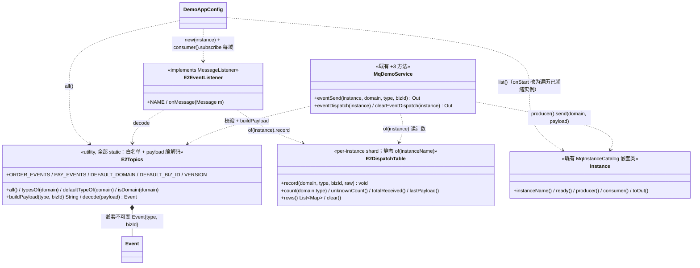
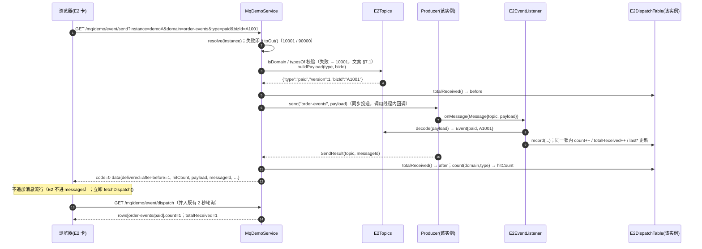

# aifei-mq-demo · E2 事件分发演示 · 增量设计

> v1｜架构师 高见远｜输入：`aifei-mq/docs/design.md` §5.8 + demo `README.md` + `docs/aifei-mq-demo/{prd,design,ui-prototype}.md` + 代码现状
> 范围：**只改 `aifei-mq-demo`**；`aifei-mq` 一行不改、HIO 不改、不加依赖、不做运行期动态 topic。前端沿用 **档案 A · Aifei 静态层**。
> 本文是**增量设计**；未提及的既有契约（`/mq/demo/*` 9 端点、错误码、chip 语义、消息流卡）全部不变。

## 1. 增量设计说明

### 1.1 目标
演示页新增 **E2 区块**，现场演示 §5.8 定档用法：**topic 表达业务域（少量、启动前决定、终身不变）**、**事件类型降级为 payload 内字段**、**订阅侧一个入口 + 本地按 `type` 分发**。可观测证据 = 「发送事件 → 分发 → 命中计数」：一次点击后命中表对应行 +1、`delivered=1`，且该事件**不出现在消息流卡**。

### 1.2 与既有「自由 topic 演示」的关系（两套并行，互不污染）

| 维度 | 自由 topic 演示（既有，不改） | E2 事件演示（新增） |
| --- | --- | --- |
| topic | `aifei.mq.demo.topic` + 任意输入 | 固定 2 域：`order-events` / `pay-events` |
| 订阅与监听器 | 装配期（仅主实例）+ 运行期页面订阅/取消；`DemoMessageListener` / `PageDemoListener` | **装配期、每个已就绪实例**，页面不可取消；`E2EventListener`（独立，**不进** `messages` 流） |
| 计数与可见位置 | `DemoMessageLog.sentCount/receivedCount` → 信息条 + 右列消息流卡 | `E2DispatchTable.totalReceived` + 命中表 → 左列 E2 卡 |

**交叉点（页面须说明）**：E2 域 topic 就是普通 topic，用户仍可在订阅卡把它们再订阅一次 —— 此时 `PageDemoListener` 会额外把该事件写进 `messages` 流，命中表仍只由 `E2EventListener` 计数。故 `/mq/demo/send?topic=order-events` 的 `delivered` 统计消息流侧监听器数，`/mq/demo/event/send` 的 `delivered` 统计 E2 侧监听器数 —— **两套计数各自准确、互不叠加**（原 R3 的 `delivered=2` 现象只出现在 `/mq/demo/send` 路径）。

**不做范围**：运行期动态增删 topic（§5.8.2 已否决）／死信、重试、告警／payload `version` 演进演示（固定 `1`）／跨实例广播／右列消息流卡与入口页改造（`subscribedTopicCount` 0→2 是自然的接口结果）／任何新依赖或 Maven 插件。

## 2. 文件清单（相对 `aifei-mq-demo/`）

| 全路径 | 动作 | 职责 |
| --- | --- | --- |
| `src/main/java/cn/hg/aifei/mq/demo/mq/E2Topics.java` | **新建** | E2 协议唯一定义点：域/类型白名单 + payload 编解码 + 嵌套不可变 `Event` |
| `src/main/java/cn/hg/aifei/mq/demo/mq/E2DispatchTable.java` | **新建** | 每实例分片的 E2 分发统计（命中计数 + `unknown` 桶 + `totalReceived` + `lastPayload`），与 `DemoMessageLog` 同构 |
| `src/main/java/cn/hg/aifei/mq/demo/mq/E2EventListener.java` | **新建** | E2 专用监听器：解码 → 计数；**不写** `DemoMessageLog`、不抛异常 |
| `src/main/java/cn/hg/aifei/mq/demo/common/DemoAppConfig.java` | 改 | `onStart()` 改为遍历**已就绪实例**订阅全部 E2 域 topic 并登记 `startup` 槽 + 重写该段 javadoc（§8.1） |
| `src/main/java/cn/hg/aifei/mq/demo/service/MqDemoService.java` | 改 | 新增 3 端点（`event/send`、`event/dispatch`、`event/dispatch/clear`）+ 私有 `putDispatch(...)`；既有 9 方法零改动 |
| `src/main/webapp/view/mq/demo.html`、`assets/js/mq-demo.js` | 改 | 左列发布卡下方新增 E2 卡；脚本新增 `fetchDispatch()` 并入既有 2 秒轮询 + E2 发送/清空与三态，**不新开定时器** |
| `src/main/webapp/assets/css/mq-test.css` | 改 | 新增 `.e2-table` / `.e2-preview`（复用既有 token 与 `.card`/`.op-msg`/`.hint`） |
| `README.md`、`docs/aifei-mq-demo/design.md`、`docs/aifei-mq-demo/ui-prototype.md` | 改（T04） | 端点表补 3 行 + 演示脚本补一步 + 说明「E2 装配期订阅按实例生效且不可取消」；`design.md` §7.3 第 3 条 `demoA subscribedTopics:[]` 断言改为 `[order-events, pay-events]`、§8 R10 增补本轮偏差；原型登记 E2 区块（与 §6 一致） |

## 3. 类图

> `E2Topics.decode` 返回 `Event{type, bizId}`（`type` 无法解析时为 `null`）；`Instance.producer()/consumer()` 返回 `aifei-mq` 只读类型 `Producer`（`send(topic, text)`）/ `Consumer`（`subscribe(topic, listener)`），demo 不包装它们。

## 4. 时序图（发送事件 → 分发 → 计数）

## 5. 任务列表（按依赖排序）

| ID | 名称 | 源文件 | 依赖 | 优先级 | 建议执行者 |
| --- | --- | --- | --- | --- | --- |
| T01 | E2 协议与分发统计（3 新类，无配置/依赖/DB） | `mq/E2Topics.java`、`mq/E2DispatchTable.java`、`mq/E2EventListener.java` | 无 | P0 | `aifei-service-engineer` |
| T02 | 装配期每实例订阅 + 3 端点 | `common/DemoAppConfig.java`、`service/MqDemoService.java` | T01 | P0 | `aifei-service-engineer` |
| T03 | E2 区块（页面 + 脚本 + 样式，复用既有轮询） | `view/mq/demo.html`、`assets/js/mq-demo.js`、`assets/css/mq-test.css` | T02 | P0 | `aifei-frontend-engineer` |
| T04 | 文档与原型收口（端点表 / 演示脚本 / 已失效断言） | `README.md`、`docs/aifei-mq-demo/design.md`、`docs/aifei-mq-demo/ui-prototype.md` | T02、T03 | P1 | `aifei-service-engineer` |

依赖图：`T01 → T02 → {T03, T04}`。施工纪律沿用 `design.md` §7.1：每任务末在模块根跑 `mvn -q -B compile`，失败即回退本任务；`webapp/` 下**新增文件**无需重启，改 js/css 刷新即可。

## 6. 区块字段契约表（QA 依此验收；替代 UI 基线）

### 6.1 位置与边界
左列 `.col-left` **发布卡下方新增第 3 张卡** `card card-e2`（`id="e2-card"`，标题「事件分发（E2：固定 topic + payload 内 type）」）；**右列消息流卡不动**（E2 事件不进入消息流列表）；响应式沿用既有 1200px / 900px 断点；禁用词与既有页面同口径。

### 6.2 控件清单

| # | 控件 | 绑定 | 行为 |
| --- | --- | --- | --- |
| 1 | 业务域下拉 `select#e2-domain` / 事件类型下拉 `select#e2-type` | `e2.domain` / `e2.type` | 域选项来自 `dispatch.domainTopics`（原文显示 `order-events` / `pay-events`）；类型选项来自 `dispatch.typeOptions[e2.domain]`，首屏默认 `dispatch.defaultType`；切换域后若 `type` 不在新域清单则重置为首个 |
| 2 | 业务字段输入 `input#e2-bizid` + payload 只读预览 `.e2-preview` | `e2.bizId` / 计算属性 | 输入缺省 `A1001`（`E2Topics.DEFAULT_BIZ_ID`），回车触发发送；预览实时显示 `{"type":<type>,"version":1,"bizId":<bizId>}`，纯展示、不参与请求 |
| 3 | 按钮「发送事件」/「清空命中统计」 | `e2SendBusy` / `e2ClearBusy` | 发送成功后回执行 + 立即 `fetchDispatch()`；清空需二次确认（`confirm` 文案含实例名）→ `/mq/demo/event/dispatch/clear` |
| 4 | 命中表 `table.e2-table` + 说明句 `.hint` | `dispatch.rows` / 静态 | 列见 §6.3；**恒显示全部行**（0 也显示，避免行抖动）；说明句「topic 表达业务域，事件类型在 payload 内，订阅侧本地分发；装配期已为**每个实例**订阅 2 个域 topic（不可取消）」 |

### 6.3 命中表列（字段名 = 后端 `rows[]` 字段名，前端不改名）

| 列 | 字段 | 渲染 |
| --- | --- | --- |
| 业务域 | `domain` | 原样（`order-events` / `pay-events`） |
| 事件类型 | `type` | 原样；`unknown` 显示为「未知 type（兜底桶）」 |
| 命中次数 | `count`（long） | 数字右对齐 |
| 最近一次 | `lastBizId` + `lastAt` | `A1001 · 14:03:22.418`；未命中过显示 `—` |

### 6.4 三态文案

| 态 | 触发 | 表现 |
| --- | --- | --- |
| 加载（首屏）/ 空态 | `e2Loading` / `totalReceived === 0` | 骨架 3 行（复用 `.log-skel/.skel-line`）+ 控件 `disabled`；空态时表下 `.hint`「尚未收到事件。选业务域与事件类型后点『发送事件』。」（表格仍显示全 0 行） |
| 读取失败 | `fetchDispatch` 非 0 / 网络失败 | 卡内 `p.err-bar.is-inline`「读取分发统计失败：{msg}」，**保留上次数据**，写信息条「最近错误」 |
| 发送中 / 清空中 / 发送失败 | busy 标志 / `code != 0` | 按钮文案 `发送中…` / `清空中…`；失败时回执 `.receipt.is-fail`：`code={code} {msg}`，写信息条「最近错误」 |
| 整页降级 | 信息条 `code=10001`（既有 `locked`） | E2 卡的控件同样 `disabled`，不额外提示 |

### 6.5 与既有 2 秒轮询的合并方式（**不新开定时器**）
`pollOnce()` 的 `Promise.all([fetchState(), fetchMessages()])` **追加** `fetchDispatch()`，失败判定改为 `results.some(r => r === false)`；复用既有 `POLL_NORMAL=2000` / `POLL_SLOW=5000` / `SLOW_AFTER_FAILS=3` / `paused`（一并冻结）/ `document.hidden`。**禁止**新增 `setInterval`、禁止为 E2 单起循环。E2 发送/清空成功后**只**调 `fetchDispatch()`（不调 `fetchState()`：E2 不动 `sentCount/receivedCount`）。

## 7. 端点契约表（与既有 `MqDemoService` / `OutCode` 同构）

**统一约定**：`GET`，HTTP 恒 200，语义由 `code` 承载；`instance` 缺省 `__MAIN__`；**唯一校验点** `MqInstanceCatalog.resolve`（只写 `if (!it.ok()) return it.toOut();`）；成功 `Out.ok(...).data(Map)`，参数非法 `Out.fail(OutCode.INVALID_PARAM).msg(...)`（`10001`），异常 `Out.fail("…失败: " + describe(e))`（`90000`）。**不新增错误码、不自写校验、不返回裸 Map**。类级 `@Path("/mq/demo")` + 方法级 `@Path("event/…")` → `/mq/demo/event/…`（同 `messages/clear` 先例）。

| 端点 | 参数（缺省 → 语义） | 成功 `data` 字段 | 失败 / msg |
| --- | --- | --- | --- |
| `GET /mq/demo/event/send` | `instance`=`__MAIN__`；`domain`=`order-events`（空串取缺省，仅空白→10001）；`type`=**该域首个类型**（空串取缺省，仅空白→10001，不在清单→10001）；`bizId`=`A1001`（仅空白→10001） | `instance`、`domain`、`type`、`bizId`、`version`(=1)、`payload`、`payloadSize`、`messageId`、`delivered`、`totalReceived`、`hitCount` | 成功 msg `已发送事件 {type} 到 {domain}`；`10001` 见 §7.1；`90000` 未装配 / `发送事件失败: …` |
| `GET /mq/demo/event/dispatch` | `instance`=`__MAIN__` | `instance`、`domainTopics`、`typeOptions`(domain→string[])、`defaultDomain`、`defaultType`、`totalReceived`、`unknownCount`、`lastPayload`、`rowCount`、`rows`(`{domain,type,count,lastBizId,lastAt}`，按域声明顺序 + 每域末尾一行 `unknown`) | `10001` / `90000`（`读取分发统计失败: …`） |
| `GET /mq/demo/event/dispatch/clear` | `instance`=`__MAIN__` | `instance`、`totalReceived=0`、`unknownCount=0`、`rowCount`、全 0 `rows`；**不动** `DemoSubscriptions` 与 `DemoMessageLog` | `10001` / `90000`（`清空分发统计失败: …`）；msg `{instance} 的事件分发命中统计已清空（订阅保留）` |

### 7.1 `10001` 文案（唯一定义点：`E2Topics` + 端点既有 `Out.fail`）

| 触发 | msg |
| --- | --- |
| `domain` 只含空白 / 不在白名单 | `domain 不能为空`；`未知业务域: {domain}，可用业务域: [order-events, pay-events]` |
| `type` 只含空白 / 不在该域清单 | `type 不能为空`；`未知事件类型: {type}，可用类型({domain}): [created, paid, cancelled]` |
| `bizId` 只含空白 | `bizId 不能为空` |

> 口径：**空串**（`?type=`）经 `InParser` 折叠为 `null` → `@Para` 缺省生效（`code=0`）；**只含空白**（`?type=%20`）不被折叠 → `10001`。与既有 `topic`/`text` 同一口径，不发明新规则。

## 8. 显式裁定

### 8.1 R1：装配期按**每实例**订阅 E2 域 topic（有意偏差）
- **偏差声明 + 反证（R2 采纳）**：`onStart()` 现有 javadoc 写「装配期订阅刻意只覆盖主实例，命名实例的订阅留给页面端点」。本轮**有意偏差，但仅限 E2 域 topic**：`aifei.mq.demo.topic` 的装配期订阅**仍只覆盖 `__MAIN__`**（否则 `demoA` 消息流被自由 topic 演示污染，两套对照失效）。若 E2 域 topic 也只订阅主实例，`demoA` 上 `/event/send` 必然 `delivered=0`、命中表恒 0 —— 命名实例上演示不成立；故「每实例装配期订阅」是**需求**，不是过度设计。
- **实现口径**：遍历 `MqInstanceCatalog.list()`（不是 `names()`，`list()` 内建 `ready` 判定）；`if (!it.ready()) { 打印一行原因; continue; }`；对每个就绪实例用 `it.consumer()`（**不可**用 `ConsumerUtil.use()` 无参，那恒指主实例）逐 `E2Topics.all()` 域 topic 调 `subscribe(topic, new E2EventListener(name))`，随后 `DemoSubscriptions.registerStartup(name, topic, E2EventListener.NAME)`。订阅异常**不吞**（沿用「启动期明确失败优于静默无订阅」）。
- **对既有 chip 的影响（QA 必验）**：`demoA`/`demoB` 的「已订阅主题」**0 → 2**，两个 chip 为 `startup` 来源（无 `×`、`title` 沿用既有不可取消文案）；对其调 `unsubscribe` 返回 `10001 未登记该主题的页面订阅`。入口页 `subscribedTopicCount` 同步 0 → 2（页面逻辑不变）。
- **javadoc 改法**：原「装配期订阅刻意只覆盖主实例——…」整段替换为：「装配期订阅分两类：**自由 demo 主题仅主实例**（保住 `demoA`/`demoB` 消息流从 0 起算）；**E2 域 topic 覆盖每个已就绪实例**（否则命名实例无法演示 E2 分发，见 `docs/aifei-mq-demo/design-e2.md` §8.1）。二者均登记为 `startup` 槽，页面一律不可取消。」

### 8.2 类职责切分（三个新类，坚持「每规则一个定义点」）
`E2Topics` = **E2 协议唯一定义点**：域白名单、域→类型清单、`DEFAULT_DOMAIN`/`DEFAULT_BIZ_ID`/`VERSION`、**payload 编解码**（`buildPayload`/`decode` + 嵌套不可变 `Event`）。编解码不另开第 4 个类：payload 形状本身属协议定义，拆开会让字段名出现两处定义点；`@Para(defaultValue = E2Topics.DEFAULT_DOMAIN)` 要求编译期常量（字面量赋值链，成立）。`E2DispatchTable` = **唯一计数事实来源**（每实例分片，静态 `of()`），只被 `E2EventListener` 写、`MqDemoService` 读。`E2EventListener` = **唯一分发入口**（一个入口 + 本地按 `type` 分发，即 §5.8.5 规范形状）；**明确裁定：不写 `DemoMessageLog`** —— 保证两套演示干净对照，且 `/event/send` 的 `delivered` 只反映 E2 侧回调。`MqDemoService` 只做「校验 → 取数 → 组装 `Out`」，命中表行由 `rows()` 产出、Service 不自算。

### 8.3 R4：payload 编解码 —— **实证通过**（用框架内置，不碰 fastjson2）
1. 生成：`cn.aifei.json.Json.of(Object).toJson()` → `String`（`JsonObject` 有无参 `public String toJson()`）。**约束**：`Json.of(Object)` 对 `String` 入参主动抛 `IllegalArgumentException`（源码「Use Json.of(String) instead」）→ 生成侧必须传 `Map<String,Object>`（`type`/`version`/`bizId`），**不得**传 JSON 字符串。
2. 解析：`cn.aifei.json.Json.of(String).toMap()` → `Map<String,Object>`（`JsonString.toMap()`，内部 `JSON.parseObject`，畸形 JSON 抛 `RuntimeException`）→ 取 `type`/`bizId`。`JsonKit` **只是配置入口**（`setRead*/setWrite*` 返回 `this`），无编解码方法，不用于本需求。
结论：**实证通过，无需退化为手写方案**。证据：`C:\IDEs\apache-maven-repository\cn\aifei\aifei-all\1.1.1\aifei-all-1.1.1-sources.jar` 内 `cn/aifei/json/{Json,JsonObject,JsonString,JsonKit}.java` + 二进制 jar 含对应 `.class`；demo 既有先例 `common/arch/IoHandler.java:144` 已用 `Json.of(out).modelAsRow(...).toJson(outputStream)`。`fastjson2` 仍不直连（仅 `aifei-all` 传递依赖）。

### 8.4 并发与锁口径：沿用 `DemoMessageLog` 的理由
`E2DispatchTable` 与 `DemoMessageLog` **同构**：静态 `of(name)` + `ConcurrentHashMap` 惰性建分片（`putIfAbsent` 双检）+ 分片内单把 `private final Object lock` + 读方法锁内做副本。理由：① **回调线程不确定**（同步投递在 Undertow 请求线程池，换真实后端后回调来自消费线程）——与 `DemoMessageLog` javadoc 既有论证逐字相同；② **计数与「最近一次」必须原子**（`count`/`totalReceived`/`lastBizId`/`lastAt`/`lastPayload` 同一 `synchronized` 块内更新），否则前端会看到「`count=1` 但 `lastBizId=null`」的撕裂态；③ demo 规模小，不值得 `AtomicLong` 与锁混用；④ 一套心智模型，QA 只需验一次。

### 8.5 其它小裁定
`delivered` = 本次发送期间 `E2DispatchTable.totalReceived()` 增量（与既有 `delivered` 同法，依赖内存后端同步投递）。`unknown` 桶：`record()` 按「`domain` 是已知域 **且** `type` 在 `typesOf(domain)` 内」判命中，否则计入该域 `unknown` 行；已知域恒有 `unknown` 行（0 也显示）；`domain` 不属于任何已知域时（**防御分支，正常演示不可达**，E2 listener 只订阅已知域 topic）计入全局 `unknownCount` 并在 `rows()` 末尾追加 `(domain=原 topic, type=unknown)` 动态行（仅 `count>0` 出现）。`E2Topics.typesOf(未知域)` 返回**空列表**（不抛异常），供端点直接判 `10001`。

## 9. 待明确项
| # | 事项 | 本设计的裁定/假设 | 若假设不成立 | 归谁 |
| --- | --- | --- | --- | --- |
| Q1 | 入口页是否区分「E2 域订阅」与「自由主题订阅」 | **不区分**，`subscribedTopicCount` 自然 0→2，入口页零改动 | 需在 `instances` 增字段（破坏「不改接口字段」，属重开设计） | 调度人 / 产品 |
| Q2 | `type` 只含空白字符；域/类型清单（`order-events`: created/paid/cancelled；`pay-events`: paid/refunded/failed）与字段名 `bizId` | 只含空白 → `10001`，空串 → 缺省该域首类型；按 §5.8.5 固化 2 域 6 类型 + 统一 `bizId`（缺省 `A1001`） | 若要求空白也回落缺省、或分域不同业务字段（`orderId`/`payId`），只改 `MqDemoService` 判定点与 `E2Topics` 编解码 | 调度人 / 产品 |
| Q3 | E2 事件是否也进右列消息流 | **不进**（两套对照，§8.2 已裁定） | 若要单一时间线，需重开 E2 区块设计（`delivered` 口径会混） | QA / 调度人 |
