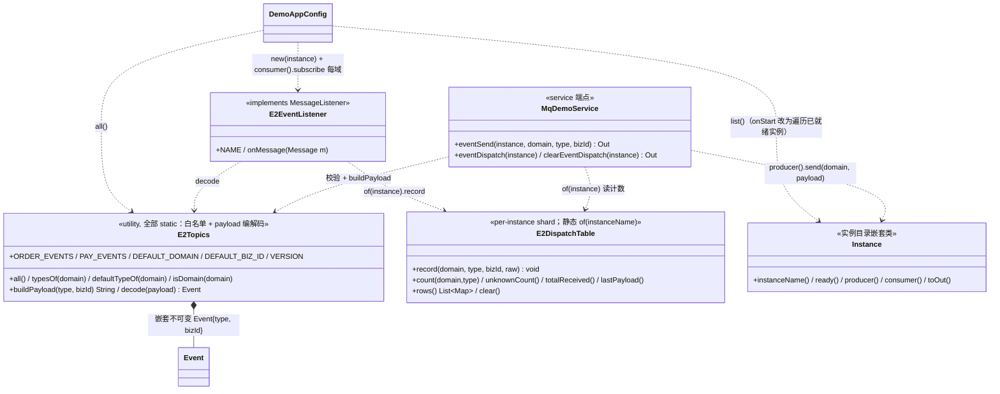
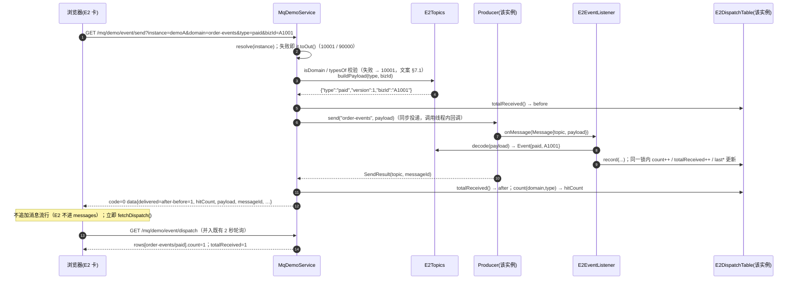

# aifei-mq-demo · E2 事件分发演示

## 1. E2 契约

### 1.1 目标
演示页 **E2 区块** 展示如下用法：**topic 表达业务域（少量、启动前决定、终身不变）**、**事件类型降级为 payload 内字段**、**订阅侧一个入口 + 本地按 `type` 分发**。可观测证据 = 「发送事件 → 分发 → 命中计数」：一次点击后命中表对应行 +1、`delivered=1`，且该事件**不出现在消息流卡**。

### 1.2 与既有「自由 topic 演示」的关系（两套并行，互不污染）

| 维度 | 自由 topic 演示 | E2 事件演示 |
| --- | --- | --- |
| topic | `aifei.mq.demo.topic` + 任意输入 | 固定 2 域：`order-events` / `pay-events` |
| 订阅与监听器 | 装配期（仅主实例）+ 运行期页面订阅/取消；`DemoMessageListener` / `PageDemoListener` | **装配期、每个已就绪实例**，页面不可取消；`E2EventListener`（独立，**不进** `messages` 流） |
| 计数与可见位置 | `DemoMessageLog.sentCount/receivedCount` → 信息条 + 右列消息流卡 | `E2DispatchTable.totalReceived` + 命中表 → 左列 E2 卡 |

**交叉点（页面须说明）**：E2 域 topic 就是普通 topic，用户仍可在订阅卡把它们再订阅一次 —— 此时 `PageDemoListener` 会额外把该事件写进 `messages` 流，命中表仍只由 `E2EventListener` 计数。故 `/mq/demo/send?topic=order-events` 的 `delivered` 统计消息流侧监听器数，`/mq/demo/event/send` 的 `delivered` 统计 E2 侧监听器数 —— **两套计数各自准确、互不叠加**。

## 3. 类图

> `E2Topics.decode` 返回 `Event{type, bizId}`（`type` 无法解析时为 `null`）；`Instance.producer()/consumer()` 返回 `aifei-mq` 只读类型 `Producer`（`send(topic, text)`）/ `Consumer`（`subscribe(topic, listener)`），demo 不包装它们。

## 4. 时序图（发送事件 → 分发 → 计数）

## 6. 区块字段契约表

### 6.1 位置与边界
左列 `.col-left` **发布卡下方第 3 张卡** `card card-e2`（`id="e2-card"`，标题「事件分发（E2：固定 topic + payload 内 type）」）；**右列消息流卡不展示 E2 事件**（E2 事件不进入消息流列表）；响应式采用 1200px / 900px 断点；禁用词与页面其它区块同口径。

### 6.2 控件清单

| # | 控件 | 绑定 | 行为 |
| --- | --- | --- | --- |
| 1 | 业务域下拉 `select#e2-domain` / 事件类型下拉 `select#e2-type` | `e2.domain` / `e2.type` | 域选项来自 `dispatch.domainTopics`（原文显示 `order-events` / `pay-events`）；类型选项来自 `dispatch.typeOptions[e2.domain]`，首屏默认 `dispatch.defaultType`；切换域后若 `type` 不在新域清单则重置为首个 |
| 2 | 业务字段输入 `input#e2-bizid` + payload 只读预览 `.e2-preview` | `e2.bizId` / 计算属性 | 输入缺省 `A1001`（`E2Topics.DEFAULT_BIZ_ID`），回车触发发送；预览实时显示 `{"type":<type>,"version":1,"bizId":<bizId>}`，纯展示、不参与请求 |
| 3 | 按钮「发送事件」/「清空命中统计」 | `e2SendBusy` / `e2ClearBusy` | 发送成功后回执行 + 立即 `fetchDispatch()`；清空需二次确认（`confirm` 文案含实例名）→ `/mq/demo/event/dispatch/clear` |
| 4 | 命中表 `table.e2-table` + 说明句 `.hint` | `dispatch.rows` / 静态 | 列见 §6.3；**恒显示全部行**（0 也显示，避免行抖动）；说明句「topic 表达业务域，事件类型在 payload 内，订阅侧本地分发；装配期已为**每个实例**订阅 2 个域 topic（不可取消）」 |

### 6.3 命中表列（字段名 = 后端 `rows[]` 字段名，前端不改名）

| 列 | 字段 | 渲染 |
| --- | --- | --- |
| 业务域 | `domain` | 原样（`order-events` / `pay-events`） |
| 事件类型 | `type` | 原样；`unknown` 显示为「未知 type（兜底桶）」 |
| 命中次数 | `count`（long） | 数字右对齐 |
| 最近一次 | `lastBizId` + `lastAt` | `A1001 · 14:03:22.418`；未命中过显示 `—` |

### 6.4 三态文案

| 态 | 触发 | 表现 |
| --- | --- | --- |
| 加载（首屏）/ 空态 | `e2Loading` / `totalReceived === 0` | 骨架 3 行（复用 `.log-skel/.skel-line`）+ 控件 `disabled`；空态时表下 `.hint`「尚未收到事件。选业务域与事件类型后点『发送事件』。」（表格仍显示全 0 行） |
| 读取失败 | `fetchDispatch` 非 0 / 网络失败 | 卡内 `p.err-bar.is-inline`「读取分发统计失败：{msg}」，**保留上次数据**，写信息条「最近错误」 |
| 发送中 / 清空中 / 发送失败 | busy 标志 / `code != 0` | 按钮文案 `发送中…` / `清空中…`；失败时回执 `.receipt.is-fail`：`code={code} {msg}`，写信息条「最近错误」 |
| 整页降级 | 信息条 `code=10001`（既有 `locked`） | E2 卡的控件同样 `disabled`，不额外提示 |

### 6.5 与 2 秒轮询的合并方式
`pollOnce()` 的 `Promise.all([fetchState(), fetchMessages(), fetchDispatch()])`，失败判定为 `results.some(r => r === false)`；`POLL_NORMAL=2000` / `POLL_SLOW=5000` / `SLOW_AFTER_FAILS=3` / `paused`（一并冻结）/ `document.hidden`。不另起 `setInterval` 定时器。E2 发送/清空成功后只调 `fetchDispatch()`（不调 `fetchState()`：E2 不动 `sentCount/receivedCount`）。

## 7. 端点契约表

**统一约定**：`GET`，HTTP 恒 200，语义由 `code` 承载；`instance` 缺省 `__MAIN__`；**唯一校验点** `MqInstanceCatalog.resolve`（只写 `if (!it.ok()) return it.toOut();`）；成功 `Out.ok(...).data(Map)`，参数非法 `Out.fail(OutCode.INVALID_PARAM).msg(...)`（`10001`），异常 `Out.fail("…失败: " + describe(e))`（`90000`）。**不引入新错误码、不自写校验、不返回裸 Map**。类级 `@Path("/mq/demo")` + 方法级 `@Path("event/…")` → `/mq/demo/event/…`。

| 端点 | 参数（缺省 → 语义） | 成功 `data` 字段 | 失败 / msg |
| --- | --- | --- | --- |
| `GET /mq/demo/event/send` | `instance`=`__MAIN__`；`domain`=`order-events`（空串取缺省，仅空白→10001）；`type`=**该域首个类型**（空串取缺省，仅空白→10001，不在清单→10001）；`bizId`=`A1001`（仅空白→10001） | `instance`、`domain`、`type`、`bizId`、`version`(=1)、`payload`、`payloadSize`、`messageId`、`delivered`、`totalReceived`、`hitCount` | 成功 msg `已发送事件 {type} 到 {domain}`；`10001` 见 §7.1；`90000` 未装配 / `发送事件失败: …` |
| `GET /mq/demo/event/dispatch` | `instance`=`__MAIN__` | `instance`、`domainTopics`、`typeOptions`(domain→string[])、`defaultDomain`、`defaultType`、`totalReceived`、`unknownCount`、`lastPayload`、`rowCount`、`rows`(`{domain,type,count,lastBizId,lastAt}`，按域声明顺序 + 每域末尾一行 `unknown`) | `10001` / `90000`（`读取分发统计失败: …`） |
| `GET /mq/demo/event/dispatch/clear` | `instance`=`__MAIN__` | `instance`、`totalReceived=0`、`unknownCount=0`、`rowCount`、全 0 `rows`；**不动** `DemoSubscriptions` 与 `DemoMessageLog` | `10001` / `90000`（`清空分发统计失败: …`）；msg `{instance} 的事件分发命中统计已清空（订阅保留）` |

### 7.1 `10001` 文案

| 触发 | msg |
| --- | --- |
| `domain` 只含空白 / 不在白名单 | `domain 不能为空`；`未知业务域: {domain}，可用业务域: [order-events, pay-events]` |
| `type` 只含空白 / 不在该域清单 | `type 不能为空`；`未知事件类型: {type}，可用类型({domain}): [created, paid, cancelled]` |
| `bizId` 只含空白 | `bizId 不能为空` |

> 口径：**空串**（`?type=`）经 `InParser` 折叠为 `null` → `@Para` 缺省生效（`code=0`）；**只含空白**（`?type=%20`）不被折叠 → `10001`。与 `topic`/`text` 口径一致。

## 8. 实现约定

### 8.1 装配期订阅范围
装配期订阅分两类：**自由 demo 主题（`aifei.mq.demo.topic`）仅覆盖 `__MAIN__`**（使 `demoA` / `demoB` 消息流从 0 起算，两套演示不互相污染）；**E2 域 topic 覆盖每个已就绪实例**（否则命名实例上 `/event/send` 恒 `delivered=0`、命中表恒 0）。二者均登记为 `startup` 槽，页面一律不可取消。
- 遍历 `MqInstanceCatalog.list()`（内含 `ready` 判定）；`if (!it.ready()) { 打印一行原因; continue; }`；对每个就绪实例用 `it.consumer()`（不可用 `ConsumerKit.use()` 无参，那恒指主实例）逐 `E2Topics.all()` 域 topic 调 `subscribe(topic, new E2EventListener(name))`，随后 `DemoSubscriptions.registerStartup(name, topic, E2EventListener.NAME)`。订阅异常不吞（启动期明确失败优于静默无订阅）。
- 可观测结果：`demoA` / `demoB` 的「已订阅主题」为 2 个 `startup` chip（无 `×`），对其调 `unsubscribe` 返回 `10001 未登记该主题的页面订阅`；入口页 `subscribedTopicCount` 同步为 2。

### 8.2 类职责切分
`E2Topics` = **E2 协议唯一定义点**：域白名单、域→类型清单、`DEFAULT_DOMAIN`/`DEFAULT_BIZ_ID`/`VERSION`、**payload 编解码**（`buildPayload`/`decode` + 嵌套不可变 `Event`）。payload 形状本身属协议定义，编解码不与协议分拆；`@Para(defaultValue = E2Topics.DEFAULT_DOMAIN)` 依赖编译期常量（字面量赋值链）。`E2DispatchTable` = **唯一计数事实来源**（每实例分片，静态 `of()`），只被 `E2EventListener` 写、`MqDemoService` 读。`E2EventListener` = **唯一分发入口**（一个入口 + 本地按 `type` 分发）；**不写 `DemoMessageLog`**，使 `/event/send` 的 `delivered` 只反映 E2 侧回调。`MqDemoService` 只做「校验 → 取数 → 组装 `Out`」，命中表行由 `rows()` 产出。

### 8.3 payload 编解码
1. 生成：`cn.aifei.json.Json.of(Object).toJson()` → `String`（`JsonObject` 有无参 `public String toJson()`）。`Json.of(Object)` 对 `String` 入参抛 `IllegalArgumentException`（"Use Json.of(String) instead"）→ 生成侧传 `Map<String,Object>`（`type`/`version`/`bizId`），不得传 JSON 字符串。
2. 解析：`cn.aifei.json.Json.of(String).toMap()` → `Map<String,Object>`（`JsonString.toMap()`，畸形 JSON 抛 `RuntimeException`）→ 取 `type`/`bizId`。`JsonKit` 只是配置入口（`setRead*/setWrite*` 返回 `this`），无编解码方法。`fastjson2` 不直连（仅 `aifei-all` 传递依赖）。

### 8.4 并发与锁口径
`E2DispatchTable` 与 `DemoMessageLog` 同构：静态 `of(name)` + `ConcurrentHashMap` 惰性建分片（`putIfAbsent` 双检）+ 分片内单把 `private final Object lock` + 读方法锁内做副本。回调线程不确定（同步投递在 Undertow 请求线程池，换真实后端后来自消费线程）；`count`/`totalReceived`/`lastBizId`/`lastAt`/`lastPayload` 在同一 `synchronized` 块内更新，避免「`count=1` 但 `lastBizId=null`」的撕裂态。

### 8.5 其它约定
`delivered` = 本次发送期间 `E2DispatchTable.totalReceived()` 增量（依赖内存后端同步投递）。`unknown` 桶：`record()` 按「`domain` 是已知域 **且** `type` 在 `typesOf(domain)` 内」判命中，否则计入该域 `unknown` 行；已知域恒有 `unknown` 行（0 也显示）；`domain` 不属于任何已知域时（**防御分支，正常演示不可达**，E2 listener 只订阅已知域 topic）计入全局 `unknownCount` 并在 `rows()` 末尾追加 `(domain=原 topic, type=unknown)` 动态行（仅 `count>0` 出现）。`E2Topics.typesOf(未知域)` 返回**空列表**（不抛异常），供端点直接判 `10001`。
