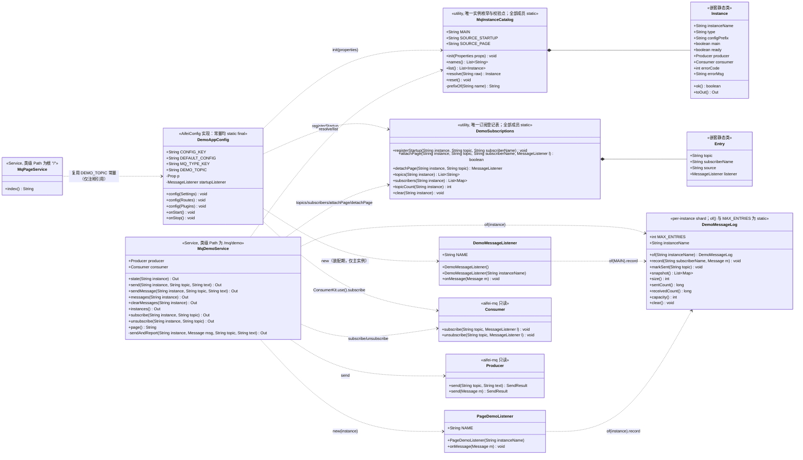
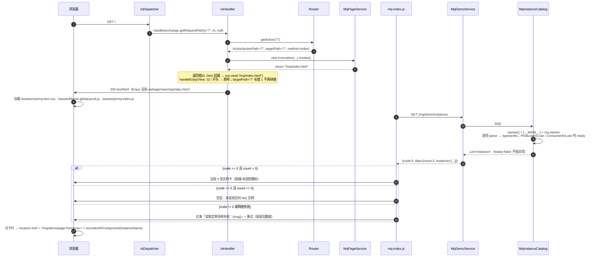
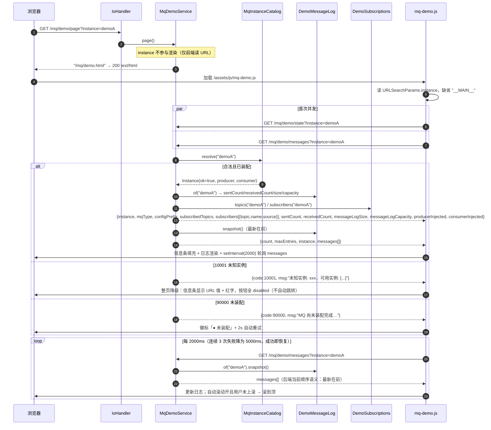
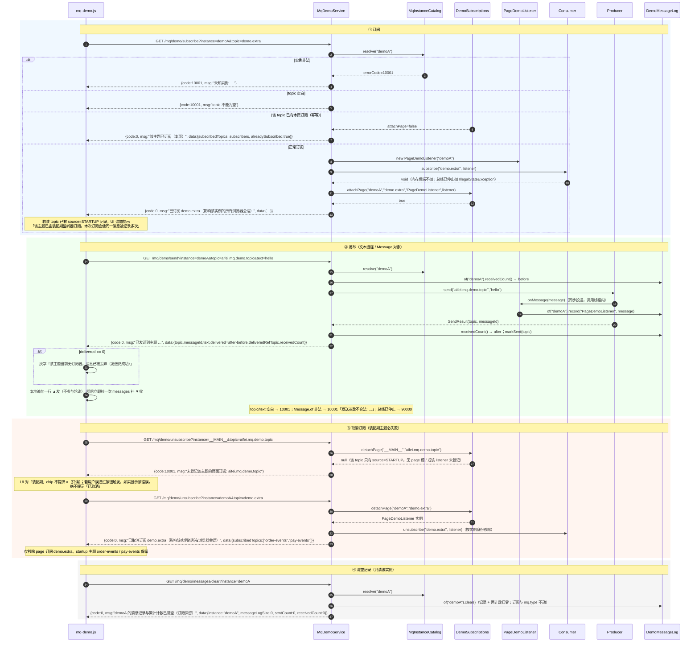
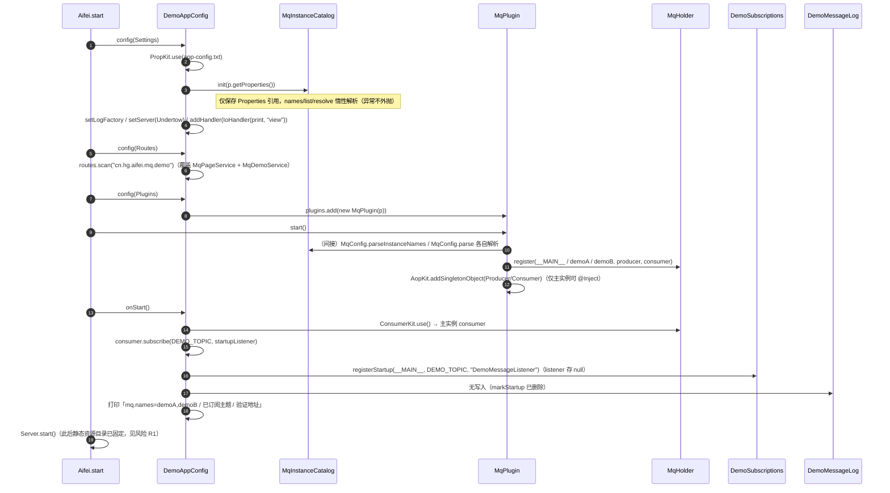

# aifei-mq-demo 演示页面 · 系统设计

范围：`aifei-mq-demo`（示例工程）依赖 `aifei-mq`，不改 `aifei-mq` 库，不改表结构（本 demo 无库无表）。前端形态：原生 HTML/CSS/JS + 本地全局 Vue，无构建工具，与 `aifei-websocket-demo` 同构。

---

## 2. 类图



**关系要点**

1. `MqDemoService` 是**唯一**对外 JSON 的 Service；`MqPageService` 只返回 view 字符串，二者都只写「取数据 → 组装 `Out`」，不维护任何状态。
2. 三类状态各一处定义点：**配置/就绪** → `MqInstanceCatalog`；**订阅事实** → `DemoSubscriptions`；**消息记录与计数** → `DemoMessageLog`。Service 里出现的 `subscribedTopicCount` / `messageLogSize` 都是**转调**，不得自算。
3. `PageDemoListener` 与 `DemoMessageListener` 是**两个不同实例**，二者都只做「写入自己实例的分片」，无其它副作用。

---

## 3. 时序图

### 3.1 打开入口页 → `instances` → 渲染



### 3.2 打开演示页 → `state` + `messages` 轮询



### 3.3 订阅 / 发布 / 清空（含失败分支）



### 3.4 启动链路（装配期订阅与登记）



---

## 4. 端点契约表

**统一约定**：全部 `GET`，HTTP **恒 200**，业务语义由 `code` 承载（`0` 成功）。`instance` 参数默认值 `__MAIN__`（省略即旧行为）；`instance` 校验、错误码与文案的唯一定义点 = `MqInstanceCatalog`。

### 4.1 视图端点

| 路径 | 方法 | 参数 | 成功返回 | 失败 |
| --- | --- | --- | --- | --- |
| `GET /` | `MqPageService.index()` | — | 返回 view 字符串 `/mq/index.html` → 200 `text/html` | 无（静态模板缺失会由 Enjoy 抛错 → 20000） |
| `GET /mq/demo/page` | `MqDemoService.page()` | `instance`（**仅前端读**，服务端不参与渲染） | 返回 view 字符串 `/mq/demo.html` → 200 `text/html` | 无 |

### 4.2 `GET /mq/demo/instances`（新增）

| 项 | 内容 |
| --- | --- |
| 参数 | 无 |
| 成功返回 | `code=0`，`msg="OK"`，`data`：`count`(int)、`instances`(array)、可选 `configError`(string，`names` 解析失败时出现) |
| `instances[]` 字段 | `instanceName`(string)、`type`(string，`memory`)、`main`(bool)、`configPrefix`(string，`mq` / `mq.demoA`)、`ready`(bool)、`subscribedTopicCount`(int)、`messageLogSize`(int)、`messageLogCapacity`(int，=200) |
| 顺序 | `__MAIN__` 在首，其后严格按 `mq.names` 声明顺序 |
| 失败 | **无失败码**：未装配时 `ready=false`；`mq.names` 非法（正常启动不可达）时只返回主实例并附 `configError` |

### 4.3 `GET /mq/demo/state`（扩展 `instance`）

| 项 | 内容 |
| --- | --- |
| 参数 | `instance`（默认 `__MAIN__`） |
| 成功 `data` | `instance`、`mqType`、`configPrefix`、`subscribedTopics`(string[])、`subscribedTopicCount`(int)、`subscribers`(array：`{topic, name, source}`，`source ∈ "startup"|"page"`)、`sentCount`(long)、`receivedCount`(long)、`messageLogSize`(int)、`messageLogCapacity`(int)、`producerInjected`(bool)、`consumerInjected`(bool) |
| 向后兼容 | 原 8 个字段名全部保留；新增 `instance` / `configPrefix` / `subscribedTopicCount` / `subscribers[].source` 为**附加字段** |
| 失败 | `10001` 未知实例；`90000` 未装配；其它异常 `90000`「读取状态失败: {ExceptionSimpleName}: {message}」 |

### 4.4 `GET /mq/demo/messages`（扩展 `instance`）

| 项 | 内容 |
| --- | --- |
| 参数 | `instance`（默认 `__MAIN__`） |
| 成功 `data` | `instance`、`count`(int)、`maxEntries`(int)、`messages`(array) |
| `messages[]` 字段 | `sequence`(long，**每实例**自增)、`topic`、`subscriber`、`text`、`payloadSize`(int)、`receivedAt`(`HH:mm:ss.SSS`)；**无 `messageId`**（接收侧 `Message` 不带） |
| 排序 | 后端返回顺序即 `snapshot()` 顺序：按接收顺序的**逆序**（最新在前），前端不再二次排序 |
| 失败 | `10001` / `90000`（`90000` msg：`读取消息记录失败: …`） |

### 4.5 `GET /mq/demo/messages/clear`（扩展 `instance`，语义改为「只清该实例」）

| 项 | 内容 |
| --- | --- |
| 参数 | `instance`（默认 `__MAIN__`） |
| 成功 | `code=0`，`msg="消息记录与累计计数已清空（订阅与 mq.type 快照保留）"`，`data`：`instance`、`messageLogSize=0`、`sentCount=0`、`receivedCount=0` |
| 作用域 | 只清该实例分片的 `entries` + `sentCount` + `receivedCount`；**不动** `DemoSubscriptions` |
| 失败 | `10001` / `90000`（`90000` msg：`清空消息记录失败: …`） |

### 4.6 `GET /mq/demo/send`（扩展 `instance`）

| 项 | 内容 |
| --- | --- |
| 参数 | `instance`（默认 `__MAIN__`）、`topic`（默认 `aifei.mq.demo.topic`）、`text`（默认 `hello`） |
| 成功 `data` | `instance`、`topic`、`messageId`(string)、`text`、`delivered`(long，= 本实例本次发送期间 `receivedCount` 增量)、`deliveredRefTopic`(string)、`receivedCount`(long) |
| 成功 msg | `已发送到主题 {topic}` |
| 失败 | `10001`「topic 不能为空」/「text 不能为空」/ 未知实例；`90000`「发送失败: …」/ 未装配 |

### 4.7 `GET /mq/demo/send/message`（扩展 `instance`）

| 项 | 内容 |
| --- | --- |
| 参数 | 同 4.6 |
| 成功 `data` | 同 4.6 + `payloadSize`(int，`message.payload().length`) |
| 失败 | 同上；另 `10001`「发送参数不合法: {reason}」（`Message.of` 校验失败） |

### 4.8 `GET /mq/demo/subscribe`（新增）

| 项 | 内容 |
| --- | --- |
| 参数 | `instance`（默认 `__MAIN__`）、`topic`（**必填**） |
| 行为 | 校验 → 幂等检查（该实例该 topic 已有 page 槽则**不再调库**，直接成功并置 `alreadySubscribed=true`）→ `new PageDemoListener(instance)` → `Consumer.subscribe(topic, listener)` → `DemoSubscriptions.attachPage(...)` |
| 成功 `data` | `instance`、`topic`、`alreadySubscribed`(bool)、`subscribedTopics`(string[])、`subscribedTopicCount`(int)、`subscribers`(array) |
| 成功 msg | `已订阅 {topic}（影响该实例的所有浏览器会话）`；幂等命中时 `该主题已订阅（本页）` |
| 失败 | `10001` 未知实例 /「topic 不能为空」；`90000` 未装配或总线已停止（msg：`订阅失败: MqException…`） |

### 4.9 `GET /mq/demo/unsubscribe`（新增）

| 项 | 内容 |
| --- | --- |
| 参数 | `instance`（默认 `__MAIN__`）、`topic`（**必填**） |
| listener 来源 | **只从登记表取回**（`DemoSubscriptions.detachPage`），不接受前端传 listener 名 |
| 成功 `data` | `instance`、`topic`、`subscribedTopics`、`subscribedTopicCount`、`subscribers` |
| 成功 msg | `已取消订阅 {topic}（影响该实例的所有浏览器会话）`；若该 topic 仍有装配期订阅，追加 `代码：装配期订阅仍生效` |
| 失败 | `10001` 未知实例 /「topic 不能为空」/ **「未登记该主题的页面订阅: {topic}」**（装配期主题、未订阅主题、已被别处移除）；`90000` 未装配或总线已停止 |

### 4.10 失败码汇总（唯一定义点：`MqInstanceCatalog` + 各端点既有 `Out.fail`）

| code | 触发 | msg 模板 |
| --- | --- | --- |
| `0` | 成功 | — |
| `10001` | `instance` 空白 / 含 `.` `=` `:` / 含空白字符 / 为保留名 / 未在清单中 | `未知实例: {raw}，可用实例: [__MAIN__, demoA, demoB]` |
| `10001` | `topic` 空白（subscribe / unsubscribe / send） | `topic 不能为空` |
| `10001` | `text` 空白（send） | `text 不能为空` |
| `10001` | `Message.of` 校验失败 | `发送参数不合法: {reason}` |
| `10001` | 无 page 槽可取回 listener | `未登记该主题的页面订阅: {topic}` |
| `90000` | `MqHolder` 未初始化 | `MQ 尚未装配完成，请确认 config(Plugins) 已注册 MqPlugin` |
| `90000` | 其它运行期异常 | `{动作}失败: {ExceptionSimpleName}: {message}` |

---

## 5. `app-config.txt` 变更

```properties
# ===== aifei-mq-demo 配置 =====
# HTTP 端口不在本文件：start-demo.bat 用 -Dundertow.port=18100 传入，本文件只放 mq.* 配置。

# 消息后端类型：缺省即 memory（内存/本地实现，进程内、零第三方）；显式写出便于演示与排查
mq.type = memory
# 内存后端无任何额外配置键（没有 mq.memory.*；后端专有键一律经 MqConfig 拼接读取）

# ===== 命名实例（本次新增） =====
# 逗号分隔，逐项去空白；主实例 __MAIN__ 是保留名、走根级 mq.*，不得在此声明。
# 顺序即入口页卡片顺序（主实例恒在最前，其后按本行声明顺序）。
# 校验：空项 / 含 '.'、'='、':'、空白 / 保留名 type、names / 重名 → 应用启动失败（无「部分实例」状态）。
mq.names = demoA,demoB

# 各命名实例的后端类型：前缀 mq.<实例名>，未配置时默认 memory；显式写出便于演示对照。
mq.demoA.type = memory
mq.demoB.type = memory

# 打开后每个 action 调用会打印到控制台（默认 false）；排查 GET / 是否命中 action 时可临时打开
# printAction = true
```

**注意**

1. `mq.names` 只能写 `demoA,demoB`（**不得**写 `__MAIN__`，否则 `MqConfig.parseInstanceNames` 抛异常导致启动失败）。
2. 本文件为 `Prop`（`PropKit.use`）读取，值两侧空格会被 `trim`；**不要**加引号。
3. 文件编码 UTF-8（与现有文件保持一致），行尾 CRLF。

---

## 8. 风险与处置

| # | 风险 | 说明与处置 |
| --- | --- | --- |
| R1 | **静态资源目录必须在启动前落盘** | `ResourceManagerBuilder.buildFileResourceManager` 只收录启动时已存在的目录（`Files.isDirectory`），启动后新建 `webapp/` 永不收录。**处置**：先落盘目录骨架再启动；新增目录（不止新增文件）必须重启。 |
| R2 | **运行期订阅的全局副作用** | `MemoryMessageBus` 的 `subscriptions` 是**每实例一份**、进程级共享：任一会话的 `subscribe`/`unsubscribe` 立刻影响访问**同一实例**的所有会话（且 `messages/clear` 同样全局）。**处置**：UI 固定徽标「影响所有浏览器会话（全局副作用）」+ 清空二次确认文案含实例名；文案绝不承诺「仅影响本页」。这是有意保留的能力，不是缺陷。 |
| R3 | **`delivered` 在多 listener 下叠加** | `delivered` 口径 = 该实例 `receivedCount` 增量；`MemoryMessageBus.publish` 对同 topic 的**每个** listener 各回调一次，故「装配期 listener + 页面 listener 同 topic」时 `delivered=2`、日志出现两条记录。**处置**：口径不变；`subscribe` 命中「该 topic 已有 startup 槽」时 UI 追加提示「该主题已由装配期监听器订阅，本次订阅会使同一消息被记录多次」；`subscribe` 端点对**同实例同 topic 的重复页面订阅做幂等**（`alreadySubscribed`），避免双击把 `delivered` 变 3、4…… |
| R4 | **页面订阅用独立 listener 导致重复记录** | 页面用 `PageDemoListener`、装配期用 `DemoMessageListener`，二者是不同实例 → 同一 topic 两条记录、`delivered` 叠加。**取舍**：不与装配期复用同一 listener（复用后再 `unsubscribe` 会把装配期订阅一起摘掉，后果更严重）。**处置**：日志行 `subscriber` 字段如实区分两个 listener 名；chip 标「装配期 / 本页」；文档与 UI 都说明「看起来重复 ≠ bug」。 |
| R5 | **`unsubscribe` 静默 no-op 被误读为成功** | 库对「未登记/重复取消」是幂等静默 no-op。**处置**：demo 侧登记表做唯一事实来源，**先查表再调库**：无 page 槽一律 `10001`，绝不返回 `code=0`；装配期主题永久 `10001`，UI 不提供 `×`。 |
| R6 | **`@Path("/")` 根路径在个别实现下不可达** | 判定手段为 `printAction` / 404 日志。**处置**：验收包含 `curl /` 200；若个别实现下根路径不可达，可把类注解改为 `@Path("/mq")`、方法写 `@Path("page")`，入口页改为 `GET /mq/page` 并同步前端常量。 |
| R7 | **Enjoy 渲染与前端模板语法冲突** | 页面经 Enjoy 渲染（不是静态直出），`#(` / 行首 `#if` 会被当指令。**处置**：页面不得出现 `#(` / 行首 `#if` 等 Enjoy 指令序列，自检时 `findstr "#(" 无命中；`{{ }}`/`@click`/`:class` 已验证安全（`ws-demo` 先例）。 |
| R8 | **`internal` 依赖的稳定性** | `MqInstanceCatalog` 依赖 `cn.hg.aifei.mq.internal.{MqConfig, MqProviderRegistry}`：`MqConfig#prefixOf` 是 private，故 demo 侧镜像了「`mq` / `mq.<name>`」这条三字符规则。**处置**：镜像只允许出现在 `prefixOf` 一个私有方法内并加注释「契约以 `MqConfig` 为准」；库侧升级若改前缀规则，只需改这一处。 |
| R9 | **每实例 200 条带来的口径变化** | 改造前「全体共享 200」，改造后「每实例各 200」；页面**必须**读接口返回的 `messageLogCapacity`，不得硬编码 200。**处置**：一律用 `state.messageLogCapacity` / `instances[].messageLogCapacity` 渲染。 |
| R10 | **自由 demo 主题的装配期订阅只覆盖主实例** | `demoA`/`demoB` 的自由 demo 主题订阅数为 0；E2 域 topic（`order-events`/`pay-events`）改为覆盖每个已就绪实例，`demoA`/`demoB` 装配期订阅数为 2，两套演示互不污染。若需自由 demo 主题也每实例订阅，把 `onStart()` 的该订阅与 `registerStartup` 包进 `for (name : MqInstanceCatalog.names())` 并为每个实例 `new DemoMessageListener(name)`，其它文件零改动。 |

---
