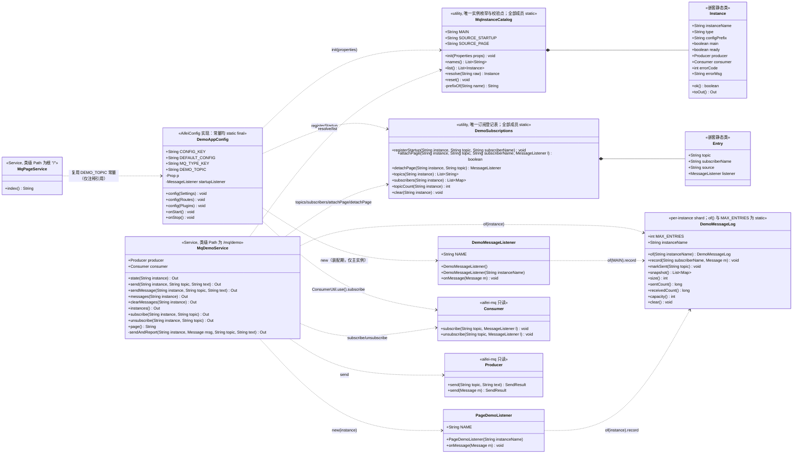
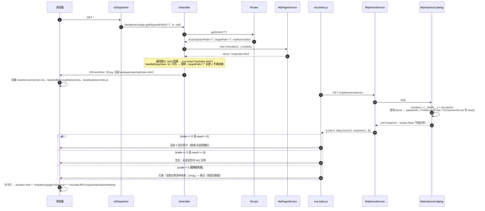
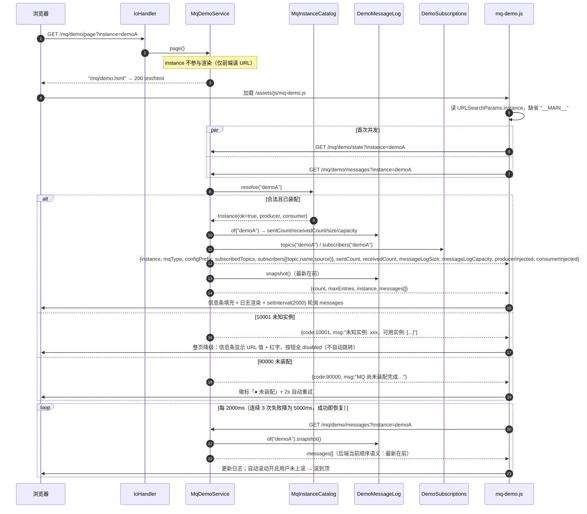
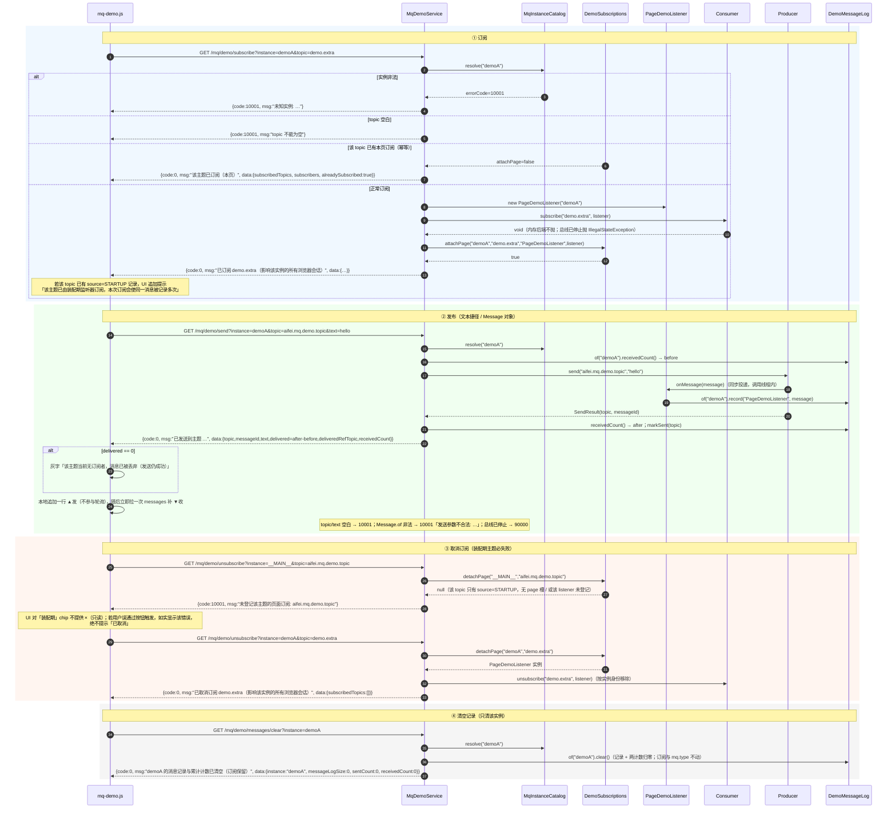
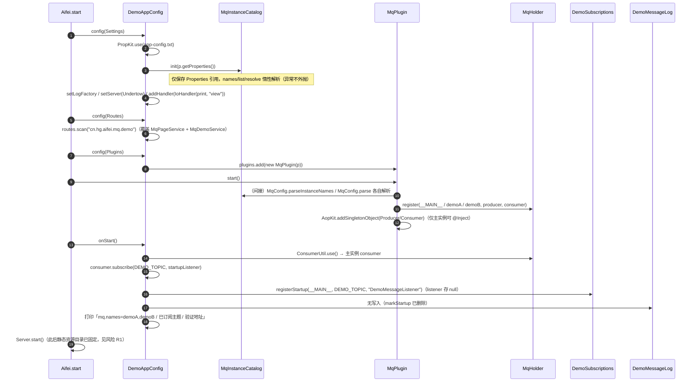
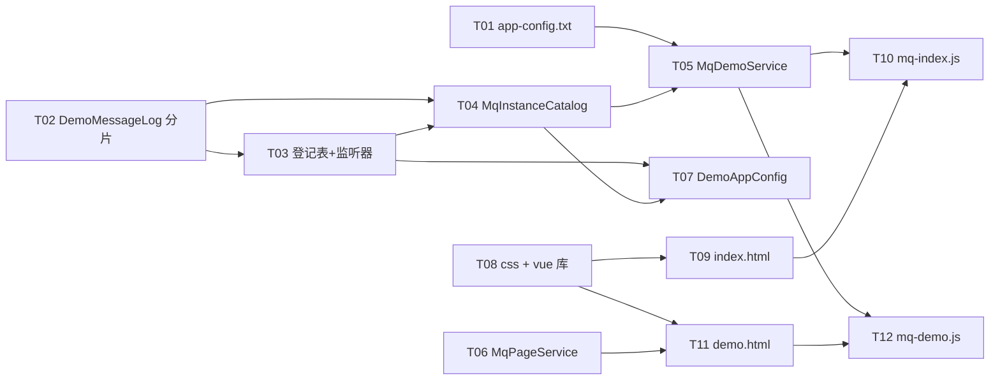

# aifei-mq-demo 演示页面 · 系统设计（含任务分解）

> 版本：v1｜作者：架构师 高见远｜输入：`docs/baseline/aifei-mq-demo-baseline.md`（BASELINE: PASS）+ `docs/aifei-mq-demo/prd.md` + `docs/aifei-mq-demo/ui-prototype.md`
> 范围：**只改 `aifei-mq-demo`（示例工程）**，`aifei-mq` 库**一行不改**。不改表结构（本 demo 无库无表）。
> 前端形态：**档案 A · Aifei 静态层**（原生 HTML/CSS/JS + 本地全局 Vue，无构建工具），与 `aifei-websocket-demo` 同构。
> 本文只做设计与任务分解，不含业务代码。

---

## 0. 六个技术问题的结论（先看这一节）

| # | 问题 | 结论（一句话 + 依据） |
| --- | --- | --- |
| 1 | `GET /` 怎么映射 | **类上 `@Path("/")`，方法名为 `index` 且方法上不加 `@Path`**：`Router.buildRoute` 对 `index`（`entryMethod` 默认 `"index"`）取 `methodPath=""`，`buildActionPath("/", "")` 走 `classPath.equals(SLASH)` 分支返回 `"/"`，故 actionPath 恰为 `"/"`；等价写法是方法上写 `@Path("")`。**不能用 `@Path("")` 标在类上**（类级值必须 `/` 开头，否则 `buildRoute` 抛 `IllegalArgumentException`）。`ws-demo` 的 `DemoPageService` 即同构先例。 |
| 2 | view 返回值 | 两种写法都成立且互不依赖：`IoHandler.handleEnjoyView` 只在 **view 不以 `/` 开头** 时补前缀；补法是「`targetPath.length()==1` 就补 `/`，否则补 `targetPath + "/"`」。故 `@Path("/")` 下返回 `/mq/index.html` 原样通过（即使写成 `mq/index.html` 也会被补成 `/mq/index.html`）；`@Path("/mq/demo")` 下必须写 `/mq/demo.html`（写 `mq/demo.html` 会变成 `/mq/demo/mq/demo.html`）。模板根 = `webRoot/view`（`IoHandler` 构造入参 `"view"` + `engine.setBaseTemplatePath`），所以都**不带 `view/`**。 |
| 3 | `DemoMessageLog` 分片 | 改为**「静态工厂 + 每实例分片对象」**：`MAX_ENTRIES=200` 保留为 `public static final`，新增 `DemoMessageLog.of(instanceName)` 按名取分片（`ConcurrentHashMap` 惰性建），原 `record/markSent/snapshot/size/sentCount/receivedCount/clear` 全部由静态方法变为**分片实例方法**（签名只去掉「静态」、`instanceName` 由 `of()` 承载）；`markStartup` **删除**——`mq.type` 归 `MqInstanceCatalog`、订阅快照归 `DemoSubscriptions`，三类状态各只有一处定义点。 |
| 4 | 实例枚举 | demo 侧 `MqInstanceCatalog` 内用 `MqConfig.parseInstanceNames(p.getProperties(), MqConfig.NAMES_KEY)` 重解析 `mq.names`，前面手工拼 `MqConfig.MAIN_INSTANCE_NAME`；`type/prefix` 用 `MqConfig.parse(props, new MqProviderRegistry().types(), name)` 的公开 `type()` 取得；`ready` = `ProducerUtil.use(name)` 与 `ConsumerUtil.use(name)` 都不抛。`cn.hg.aifei.mq.internal.*` 属**同厂 internal 依赖**，只在 `MqInstanceCatalog` 内出现，不扩散成公共契约、不做二次封装。 |
| 5 | 订阅登记表 | 新增 `DemoSubscriptions`（demo 侧唯一订阅事实来源）：`Map<instance, LinkedHashMap<topic, Entry>>`，`Entry{topic, subscriberName, source, listener}`，`source ∈ {STARTUP, PAGE}`；装配期由 `DemoAppConfig.onStart()` 调 `registerStartup(...)` 登记且 **`listener` 存 null**（保住基线「页面无法取回装配期 listener」的语义）；`unsubscribe` 只能对 `source=PAGE` 的槽取回 listener 调 `Consumer.unsubscribe`，无 page 槽一律 `code=10001`；线程安全用**单一类级锁**（demo 规模不值得分段锁），读路径返回副本。 |
| 6 | `instance` 校验唯一定义点 | 只在 `MqInstanceCatalog.resolve(String raw)` 一处：`null` 视为省略 → `__MAIN__`；空白 / 含 `.` `=` `:` / 含空白字符 / 保留名（`MqConfig.requireInstanceName` 判定）/ 未在清单中 → `code=10001`，`msg = "未知实例: {raw}，可用实例: [__MAIN__, demoA, demoB]"`；已装配性判定（`IllegalStateException`）→ `code=90000`。返回的 `Instance` 自带 `toOut()`，7 个端点每处只写 `if (!it.ok()) return it.toOut();`。 |

**参数默认值实现（可编译 + 可实测）**：`@Para(name = "instance", defaultValue = MqInstanceCatalog.MAIN)`。依据 `BasicArguments.StrArgument.getValue`：`ret = input.getStr(name); return ret != null ? ret : defaultValue;` —— **参数缺省**（`getStr` 返回 null）才取默认值；`?instance=`（空串）返回 `""` 而不是 null，故落到 catalog 的空白判定 → `10001`，与基线 §3.3「省略即旧行为 / 空串非法」**两条同时成立**。

**根路径的实测与替代方案**：若 `curl -s http://localhost:18100/` 返回 404（`IoHandler` 打印 `404 Action Not Found: /`），说明该 Undertow 版本把根请求的 `getRequestPath()` 归一成了空串。此时**唯一改动**是把 `MqPageService` 的类注解改成 `@Path("/mq")`、方法上写 `@Path("page")`，入口页改为 `GET /mq/page`，并在 `mq-index.js`/`mq-demo.js` 里把 `/` 换成 `/mq/page`（前端两处常量）。**取舍**：这样能跑通但偏离基线 §5「入口页 `GET /`」，属于最后手段，必须先回报调度人再改。定位手段：`-DprintAction=true` 看 action 打印，或看是否出现上述 404 日志。

---

## 1. 模块与包结构变化

### 1.1 后端（4 新增 + 4 修改）

| 全路径 | 动作 | 职责（一句话） |
| --- | --- | --- |
| `aifei-mq-demo/src/main/java/cn/hg/aifei/mq/demo/mq/DemoMessageLog.java` | **改** | 由全静态单份改为「静态工厂 + 每实例分片」，每实例 200 条记录与收发计数 |
| `aifei-mq-demo/src/main/java/cn/hg/aifei/mq/demo/mq/DemoSubscriptions.java` | **新建** | 唯一订阅登记表：`instance → topic → Entry{topic, subscriberName, source, listener}`，区分装配期/本页 |
| `aifei-mq-demo/src/main/java/cn/hg/aifei/mq/demo/mq/MqInstanceCatalog.java` | **新建** | 唯一实例枚举 + 唯一 `instance` 参数校验点 + `ready` 判定 + `10001/90000` 码与文案定义点 |
| `aifei-mq-demo/src/main/java/cn/hg/aifei/mq/demo/mq/PageDemoListener.java` | **新建** | 页面订阅专用监听器（与装配期 listener **不同实例**），按实例写分片 |
| `aifei-mq-demo/src/main/java/cn/hg/aifei/mq/demo/mq/DemoMessageListener.java` | **改** | 增 `(String instanceName)` 构造（无参构造委托到 `__MAIN__`），记录写入对应分片 |
| `aifei-mq-demo/src/main/java/cn/hg/aifei/mq/demo/service/MqDemoService.java` | **改** | 现有 5 端点加 `instance`；新增 `instances` / `subscribe` / `unsubscribe` / `page`（共 9 方法） |
| `aifei-mq-demo/src/main/java/cn/hg/aifei/mq/demo/service/MqPageService.java` | **新建** | `@Path("/")` 入口页 Service，`index()` 返回 `/mq/index.html` |
| `aifei-mq-demo/src/main/java/cn/hg/aifei/mq/demo/common/DemoAppConfig.java` | **改** | `config(Settings)` 里 `MqInstanceCatalog.init(p.getProperties())`；`onStart()` 改接 `DemoSubscriptions.registerStartup(...)`、去掉 `markStartup`、启动日志打印全部实例 |

### 1.2 配置（1）

| 全路径 | 动作 | 职责 |
| --- | --- | --- |
| `aifei-mq-demo/src/main/resources/app-config.txt` | **改** | 补 `mq.names = demoA,demoB` 与 `mq.demoA.type` / `mq.demoB.type`（见 §5） |

### 1.3 静态层（6 文件，5 新建 + 1 拷贝）

| 全路径 | 动作 | 职责 |
| --- | --- | --- |
| `aifei-mq-demo/src/main/webapp/view/mq/index.html` | **新建** | 实例入口页（3 张实例卡 + 固定警示条） |
| `aifei-mq-demo/src/main/webapp/view/mq/demo.html` | **新建** | 实例演示页（信息条 / 订阅卡 / 发布卡 / 消息流卡） |
| `aifei-mq-demo/src/main/webapp/assets/css/mq-test.css` | **新建** | 两页共用样式，沿用 `ws-test.css` 的 token 与组件类名 |
| `aifei-mq-demo/src/main/webapp/assets/js/mq-index.js` | **新建** | 入口页脚本（只调 `/mq/demo/instances`） |
| `aifei-mq-demo/src/main/webapp/assets/js/mq-demo.js` | **新建** | 演示页脚本（`page` 无需调用；`state`/`messages` 轮询 + 订阅/发布/清空） |
| `aifei-mq-demo/src/main/webapp/assets/lib/vue.global.prod.js` | **拷贝** | 从 `aifei-websocket-demo/src/main/webapp/assets/lib/vue.global.prod.js` 原样复制（同源同版本，**不要改内容、不要改版本**） |

> **不新增** Controller / Render / Repository / Mapper / DTO；**不新增**任何 `pom.xml` 依赖（无新库、无 JDBC）；**不新增** Maven 插件。

---

## 2. 类图



**关系要点**

1. `MqDemoService` 是**唯一**对外 JSON 的 Service；`MqPageService` 只返回 view 字符串，二者都只写「取数据 → 组装 `Out`」，不维护任何状态。
2. 三类状态各一处定义点：**配置/就绪** → `MqInstanceCatalog`；**订阅事实** → `DemoSubscriptions`；**消息记录与计数** → `DemoMessageLog`。Service 里出现的 `subscribedTopicCount` / `messageLogSize` 都是**转调**，不得自算。
3. `PageDemoListener` 与 `DemoMessageListener` 是**两个不同实例**（基线 Q1 / 硬约束 9），二者都只做「写入自己实例的分片」，无其它副作用。

---

## 3. 时序图

### 3.1 打开入口页 → `instances` → 渲染



### 3.2 打开演示页 → `state` + `messages` 轮询



### 3.3 订阅 / 发布 / 清空（含失败分支）



### 3.4 启动链路（装配期订阅与登记）



---

## 4. 端点契约表（与基线 §5 逐项一致）

**统一约定**：全部 `GET`，HTTP **恒 200**，业务语义由 `code` 承载（`0` 成功）。`instance` 参数默认值 `__MAIN__`（省略即旧行为）；`instance` 校验、错误码与文案的唯一定义点 = `MqInstanceCatalog`。

### 4.1 视图端点

| 路径 | 方法 | 参数 | 成功返回 | 失败 |
| --- | --- | --- | --- | --- |
| `GET /` | `MqPageService.index()` | — | 返回 view 字符串 `/mq/index.html` → 200 `text/html` | 无（静态模板缺失会由 Enjoy 抛错 → 20000） |
| `GET /mq/demo/page` | `MqDemoService.page()` | `instance`（**仅前端读**，服务端不参与渲染） | 返回 view 字符串 `/mq/demo.html` → 200 `text/html` | 无 |

### 4.2 `GET /mq/demo/instances`（新增）

| 项 | 内容 |
| --- | --- |
| 参数 | 无 |
| 成功返回 | `code=0`，`msg="OK"`，`data`：`count`(int)、`instances`(array)、可选 `configError`(string，`names` 解析失败时出现) |
| `instances[]` 字段 | `instanceName`(string)、`type`(string，`memory`)、`main`(bool)、`configPrefix`(string，`mq` / `mq.demoA`)、`ready`(bool)、`subscribedTopicCount`(int)、`messageLogSize`(int)、`messageLogCapacity`(int，=200) |
| 顺序 | `__MAIN__` 在首，其后严格按 `mq.names` 声明顺序 |
| 失败 | **无失败码**：未装配时 `ready=false`；`mq.names` 非法（正常启动不可达）时只返回主实例并附 `configError` |

### 4.3 `GET /mq/demo/state`（扩展 `instance`）

| 项 | 内容 |
| --- | --- |
| 参数 | `instance`（默认 `__MAIN__`） |
| 成功 `data` | `instance`、`mqType`、`configPrefix`、`subscribedTopics`(string[])、`subscribedTopicCount`(int)、`subscribers`(array：`{topic, name, source}`，`source ∈ "startup"|"page"`)、`sentCount`(long)、`receivedCount`(long)、`messageLogSize`(int)、`messageLogCapacity`(int)、`producerInjected`(bool)、`consumerInjected`(bool) |
| 向后兼容 | 原 8 个字段名全部保留；新增 `instance` / `configPrefix` / `subscribedTopicCount` / `subscribers[].source` 为**附加字段** |
| 失败 | `10001` 未知实例；`90000` 未装配；其它异常 `90000`「读取状态失败: {ExceptionSimpleName}: {message}」 |

### 4.4 `GET /mq/demo/messages`（扩展 `instance`）

| 项 | 内容 |
| --- | --- |
| 参数 | `instance`（默认 `__MAIN__`） |
| 成功 `data` | `instance`、`count`(int)、`maxEntries`(int)、`messages`(array) |
| `messages[]` 字段 | `sequence`(long，**每实例**自增)、`topic`、`subscriber`、`text`、`payloadSize`(int)、`receivedAt`(`HH:mm:ss.SSS`)；**无 `messageId`**（接收侧 `Message` 不带） |
| 排序 | 后端返回顺序即 `snapshot()` 顺序：按接收顺序的**逆序**（最新在前），前端不再二次排序 |
| 失败 | `10001` / `90000`（`90000` msg：`读取消息记录失败: …`） |

### 4.5 `GET /mq/demo/messages/clear`（扩展 `instance`，语义改为「只清该实例」）

| 项 | 内容 |
| --- | --- |
| 参数 | `instance`（默认 `__MAIN__`） |
| 成功 | `code=0`，`msg="消息记录与累计计数已清空（订阅与 mq.type 快照保留）"`，`data`：`instance`、`messageLogSize=0`、`sentCount=0`、`receivedCount=0` |
| 作用域 | 只清该实例分片的 `entries` + `sentCount` + `receivedCount`；**不动** `DemoSubscriptions` |
| 失败 | `10001` / `90000`（`90000` msg：`清空消息记录失败: …`） |

### 4.6 `GET /mq/demo/send`（扩展 `instance`）

| 项 | 内容 |
| --- | --- |
| 参数 | `instance`（默认 `__MAIN__`）、`topic`（默认 `aifei.mq.demo.topic`）、`text`（默认 `hello`） |
| 成功 `data` | `instance`、`topic`、`messageId`(string)、`text`、`delivered`(long，= 本实例本次发送期间 `receivedCount` 增量)、`deliveredRefTopic`(string)、`receivedCount`(long) |
| 成功 msg | `已发送到主题 {topic}` |
| 失败 | `10001`「topic 不能为空」/「text 不能为空」/ 未知实例；`90000`「发送失败: …」/ 未装配 |

### 4.7 `GET /mq/demo/send/message`（扩展 `instance`）

| 项 | 内容 |
| --- | --- |
| 参数 | 同 4.6 |
| 成功 `data` | 同 4.6 + `payloadSize`(int，`message.payload().length`) |
| 失败 | 同上；另 `10001`「发送参数不合法: {reason}」（`Message.of` 校验失败） |

### 4.8 `GET /mq/demo/subscribe`（新增）

| 项 | 内容 |
| --- | --- |
| 参数 | `instance`（默认 `__MAIN__`）、`topic`（**必填**） |
| 行为 | 校验 → 幂等检查（该实例该 topic 已有 page 槽则**不再调库**，直接成功并置 `alreadySubscribed=true`）→ `new PageDemoListener(instance)` → `Consumer.subscribe(topic, listener)` → `DemoSubscriptions.attachPage(...)` |
| 成功 `data` | `instance`、`topic`、`alreadySubscribed`(bool)、`subscribedTopics`(string[])、`subscribedTopicCount`(int)、`subscribers`(array) |
| 成功 msg | `已订阅 {topic}（影响该实例的所有浏览器会话）`；幂等命中时 `该主题已订阅（本页）` |
| 失败 | `10001` 未知实例 /「topic 不能为空」；`90000` 未装配或总线已停止（msg：`订阅失败: MqException…`） |

### 4.9 `GET /mq/demo/unsubscribe`（新增）

| 项 | 内容 |
| --- | --- |
| 参数 | `instance`（默认 `__MAIN__`）、`topic`（**必填**） |
| listener 来源 | **只从登记表取回**（`DemoSubscriptions.detachPage`），不接受前端传 listener 名 |
| 成功 `data` | `instance`、`topic`、`subscribedTopics`、`subscribedTopicCount`、`subscribers` |
| 成功 msg | `已取消订阅 {topic}（影响该实例的所有浏览器会话）`；若该 topic 仍有装配期订阅，追加 `代码：装配期订阅仍生效` |
| 失败 | `10001` 未知实例 /「topic 不能为空」/ **「未登记该主题的页面订阅: {topic}」**（装配期主题、未订阅主题、已被别处移除）；`90000` 未装配或总线已停止 |

### 4.10 失败码汇总（唯一定义点：`MqInstanceCatalog` + 各端点既有 `Out.fail`）

| code | 触发 | msg 模板 |
| --- | --- | --- |
| `0` | 成功 | — |
| `10001` | `instance` 空白 / 含 `.` `=` `:` / 含空白字符 / 为保留名 / 未在清单中 | `未知实例: {raw}，可用实例: [__MAIN__, demoA, demoB]` |
| `10001` | `topic` 空白（subscribe / unsubscribe / send） | `topic 不能为空` |
| `10001` | `text` 空白（send） | `text 不能为空` |
| `10001` | `Message.of` 校验失败 | `发送参数不合法: {reason}` |
| `10001` | 无 page 槽可取回 listener | `未登记该主题的页面订阅: {topic}` |
| `90000` | `MqHolder` 未初始化 | `MQ 尚未装配完成，请确认 config(Plugins) 已注册 MqPlugin` |
| `90000` | 其它运行期异常 | `{动作}失败: {ExceptionSimpleName}: {message}` |

---

## 5. `app-config.txt` 变更

```properties
# ===== aifei-mq-demo 配置 =====
# HTTP 端口不在本文件：start-demo.bat 用 -Dundertow.port=18100 传入，本文件只放 mq.* 配置。

# 消息后端类型：缺省即 memory（内存/本地实现，进程内、零第三方）；显式写出便于演示与排查
mq.type = memory
# 内存后端无任何额外配置键（没有 mq.memory.*；后端专有键一律经 MqConfig 拼接读取）

# ===== 命名实例（本次新增） =====
# 逗号分隔，逐项去空白；主实例 __MAIN__ 是保留名、走根级 mq.*，不得在此声明。
# 顺序即入口页卡片顺序（主实例恒在最前，其后按本行声明顺序）。
# 校验：空项 / 含 '.'、'='、':'、空白 / 保留名 type、names / 重名 → 应用启动失败（无「部分实例」状态）。
mq.names = demoA,demoB

# 各命名实例的后端类型：前缀 mq.<实例名>，未配置时默认 memory；显式写出便于演示对照。
mq.demoA.type = memory
mq.demoB.type = memory

# 打开后每个 action 调用会打印到控制台（默认 false）；排查 GET / 是否命中 action 时可临时打开
# printAction = true
```

**注意（施工要点）**

1. `mq.names` 只能写 `demoA,demoB`（**不得**写 `__MAIN__`，否则 `MqConfig.parseInstanceNames` 抛异常导致启动失败）。
2. 本文件为 `Prop`（`PropKit.use`）读取，值两侧空格会被 `trim`；**不要**加引号。
3. 文件编码 UTF-8（与现有文件保持一致），行尾 CRLF。

---

## 6. 有序任务列表

> 执行顺序 = 编号顺序。**每个后端任务完成后立即**在模块根目录（`c:\Workspace\github\aifei-eco-modules\aifei-mq-demo`）跑 `mvn -q -B compile`，失败即回退本任务，不带着编译错误进入下一任务。
> 任务粒度：一个文件或一组强相关改动（本 delta 涉及 13 个文件，若强行压到 5 个任务会让「先落盘静态层 → 再启动」的施工纪律无法执行）。

### T01 · 配置补命名实例

- **文件**：`src/main/resources/app-config.txt`（改）
- **要点**：按 §5 全文替换；`mq.names = demoA,demoB`、`mq.demoA.type = memory`、`mq.demoB.type = memory`；保留原 `mq.type` 与 `printAction` 注释。
- **依赖**：无
- **自检**：`mvn -q -B compile` 通过；启动后控制台无 `mq.names` 相关异常；`/mq/demo/state`（不带参数）仍返回 `code=0`（此时 MqPlugin 已装配 3 实例）。

### T02 · `DemoMessageLog` 按实例分片

- **文件**：`src/main/java/cn/hg/aifei/mq/demo/mq/DemoMessageLog.java`（改）
- **要点**：`public static final int MAX_ENTRIES = 200` 保留（**每实例**上限）；新增 `private static final Map<String, DemoMessageLog> SHARDS = new ConcurrentHashMap<>()` 与 `public static DemoMessageLog of(String instanceName)`（`computeIfAbsent` 惰性建，`instanceName` 为 null/空白时**不得**静默建 shard，抛 `IllegalArgumentException`）；类变为「有状态分片对象」：实例字段 `instanceName`、`lock`、`entries(ArrayDeque)`、`sentCount`、`receivedCount`；实例方法 `record(String subscriberName, Message)`、`markSent(String topic)`、`snapshot()`、`size()`、`sentCount()`、`receivedCount()`、`capacity()`、`clear()`、`instanceName()`；**删除** `markStartup`、`startupSnapshot`、`mqType` 字段与 `SUBSCRIBED_TOPICS`/`SUBSCRIBER_NAMES`（订阅快照迁至 `DemoSubscriptions`，mq.type 迁至 `MqInstanceCatalog`）。
- **依赖**：无（与 T01 无编译依赖）
- **自检**：`mvn -q -B compile`（**预期失败**：`MqDemoService` / `DemoAppConfig` 旧调用未改）→ 只允许「找不到符号」类错误定位到待改文件，不允许其它错误；本任务的完成判据是「新 API 编译通过 + 旧调用点清单已列出」。

> **施工顺序提示**：T02 会造成短暂编译失败。若要求「任何时刻可编译」，把 T02、T03、T04 与 T05（改调用点）合成一个编译批次连续执行，批次末再 `mvn -q -B compile`。

### T03 · 订阅登记表 + 两个监听器

- **文件**：`src/main/java/cn/hg/aifei/mq/demo/mq/DemoSubscriptions.java`（新建）、`.../mq/PageDemoListener.java`（新建）、`.../mq/DemoMessageListener.java`（改）
- **要点**：
  - `DemoSubscriptions`：常量 `SOURCE_STARTUP = "startup"`、`SOURCE_PAGE = "page"`；`private static final Object LOCK`；`private static final Map<String, LinkedHashMap<String, Entry>> TABLE`；`Entry{topic, subscriberName, source, listener}`（**嵌套 `static` 类，字段 final，listener 允许 null**）。
  - `registerStartup(instance, topic, subscriberName)`：`listener = null`；同 topic 重复调用幂等（**不覆盖已有 page 槽**）。
  - `attachPage(instance, topic, subscriberName, listener)`：已有 page 槽 → 返回 `false` 且不改动；否则填 page 槽返回 `true`；若该 topic 只有 startup 槽，则在同一 `Entry` 上补 page 槽与 `subscriberName`（保持「一个 topic 一个 chip」）。
  - `detachPage(instance, topic)`：只有 page 槽时取出 listener 并清空 page 槽；若 startup 槽存在则**保留 Entry**（chip 退化为「装配期」）；无 page 槽 → 返回 `null`。
  - `topics(instance)`（按登记顺序去重的 topic 列表）、`subscribers(instance)`（`[{topic,name,source}]`，同 topic 两个来源出两条，先 startup 后 page）、`topicCount(instance)`、`clear(instance)`；全部读方法在锁内做副本。
  - `PageDemoListener`：`public static final String NAME = "PageDemoListener"`；`private final DemoMessageLog log`（构造时 `DemoMessageLog.of(instanceName)`）；`onMessage` 只调 `log.record(NAME, message)`，不抛异常。
  - `DemoMessageListener`：保留 `NAME = "DemoMessageListener"`；新增 `(String instanceName)` 构造，无参构造委托到 `MqInstanceCatalog.MAIN`；`onMessage` 写自身分片。
- **依赖**：T02
- **自检**：`mvn -q -B compile`（本任务内三个文件自洽；旧调用点仍待 T05/T07）。

### T04 · `MqInstanceCatalog`（枚举 + 校验唯一点）

- **文件**：`src/main/java/cn/hg/aifei/mq/demo/mq/MqInstanceCatalog.java`（新建）
- **要点**：
  - `public static final String MAIN = MqConfig.MAIN_INSTANCE_NAME;`（编译期常量，供 `@Para(defaultValue=…)` 使用）。
  - `private static volatile Properties properties;` + `init(Properties)`（`DemoAppConfig.config(Settings)` 调用；幂等，重复调用覆盖）。
  - `names()`：`[MAIN] + MqConfig.parseInstanceNames(properties, MqConfig.NAMES_KEY)`；捕获 `RuntimeException` → 返回仅含 `MAIN` 的清单并记 `configError`（供 `instances` 附加字段）。
  - `list()`：逐名 `describe(name)`，**绝不抛异常**；`ready = producer != null && consumer != null`。
  - `resolve(String raw)`：`raw == null` → 视为省略（用 MAIN）；`MqConfig.requireInstanceName(raw)` 捕获 `IllegalArgumentException` → `errorCode=10001`；不在 `names()` 内 → `errorCode=10001`；`ProducerUtil.use(raw)` / `ConsumerUtil.use(raw)` 抛 `IllegalStateException` → `errorCode=90000`、抛 `IllegalArgumentException` → `errorCode=10001`。
  - 嵌套 `public static final class Instance`：字段见类图；`ok()`；`toOut()`（`10001` → `Out.fail(OutCode.INVALID_PARAM).msg(errorMsg)`；`90000` → `Out.fail(errorMsg)`）。
  - 唯一文案：`未知实例: {raw}，可用实例: [__MAIN__, demoA, demoB]`、`MQ 尚未装配完成，请确认 config(Plugins) 已注册 MqPlugin`。
  - `type` 由 `MqConfig.parse(properties, new MqProviderRegistry().types(), name).type()` 取得（**同厂 internal 依赖，只在本类出现**；`MqProviderRegistry` 只 new 一次并缓存）；`configPrefix` 用本类私有 `prefixOf(name)`（`mq` / `mq.<name>`）——这是 `MqConfig#prefixOf`（private）的镜像，**只允许在本类存在**。
  - `reset()`：仅供测试/重启用（清缓存）。
- **依赖**：T02、T03（`messageLogSize` / `subscribedTopicCount` 由调用方取，`Instance` 不重复持有）
- **自检**：`mvn -q -B compile`；临时以 `main` 或单测式 java 命令打印 `names()` / `list()` 三行（不做持久测试代码）。

### T05 · `MqDemoService` 扩展（9 个方法）

- **文件**：`src/main/java/cn/hg/aifei/mq/demo/service/MqDemoService.java`（改）
- **要点**：
  - 保留 `@Inject Producer` / `@Inject Consumer`（仅作主实例装配证据），**业务取用一律走 catalog**（`Instance.producer/consumer`），不再直接用注入对象做多实例操作。
  - 每个端点统一前置：`MqInstanceCatalog.Instance it = MqInstanceCatalog.resolve(instance); if (!it.ok()) return it.toOut();`（**只有这一种写法**，不得各端点自写校验）。
  - `@Para(name = "instance", defaultValue = MqInstanceCatalog.MAIN)`；`topic`/`text` 的默认值保持 `DemoAppConfig.DEMO_TOPIC` / `hello`。
  - `state`：替换 `DemoMessageLog.startupSnapshot()` 为 `it.type()` + `MqInstanceCatalog.prefixOf` 结果 + `DemoSubscriptions.topics/subscribers` + 分片计数；字段严格按 §4.3。
  - `messages` / `clearMessages`：`DemoMessageLog.of(it.instanceName())`。
  - `sendAndReport`：`before = log.receivedCount()` → `it.producer().send(...)` → `after` → `log.markSent(topic)`；`delivered = after - before`。
  - `instances`：`MqInstanceCatalog.list()` 组装 §4.2；`subscribedTopicCount = DemoSubscriptions.topicCount(name)`、`messageLogSize = DemoMessageLog.of(name).size()`、`messageLogCapacity = capacity()`。
  - `subscribe` / `unsubscribe`：按 §4.8 / §4.9，listener 一律 `new PageDemoListener(it.instanceName())`；`unsubscribe` 的 listener 只从 `detachPage` 取。
  - `page()`：`return "/mq/demo.html";`（**必须**以 `/` 开头）。
  - 删除 `requireInjected()`（职责已并入 catalog），异常文案统一走 `describe()`。
- **依赖**：T02、T03、T04
- **自检**：`mvn -q -B compile` 通过；启动后逐条 curl（见 §7.3）。

### T06 · `MqPageService`（入口页视图）

- **文件**：`src/main/java/cn/hg/aifei/mq/demo/service/MqPageService.java`（新建）
- **要点**：`package cn.hg.aifei.mq.demo.service;`；`@Path("/")`（`cn.aifei.core.Path`）标在类上；类内**只允许一个 public 方法** `public String index()`，方法上**不加** `@Path`（依赖 `entryMethod="index"` 约定），返回 `"/mq/index.html"`；不加其它 public 方法（否则会各自暴露成 `/xxx` 路由）。
- **依赖**：无（编译无依赖；**运行需 T09 落盘**）
- **自检**：`mvn -q -B compile`；启动后 `curl -i http://localhost:18100/` 返回 200 + `text/html`（失败见 §0 替代方案）。

### T07 · `DemoAppConfig` 接线

- **文件**：`src/main/java/cn/hg/aifei/mq/demo/common/DemoAppConfig.java`（改）
- **要点**：
  - `config(Settings)`：`PropKit.use(...)` 之后加 `MqInstanceCatalog.init(p.getProperties());`（注解装配阶段即就绪，Service 首次调用即可用）。
  - `onStart()`：保留 `ConsumerUtil.use().subscribe(DEMO_TOPIC, startupListener)`（**装配期仍只订阅主实例**——基线原型 `demoA`/`demoB` 订阅数为 0，且 §7.14 的「装配期订阅」专指主实例）；随后 `DemoSubscriptions.registerStartup(MqInstanceCatalog.MAIN, DEMO_TOPIC, DemoMessageListener.NAME);`；**删除** `DemoMessageLog.markStartup(...)`；启动日志打印 `mq.names` 与全部实例名（`MqInstanceCatalog.names()`）。
  - 字段 `final MessageListener listener = new DemoMessageListener();` 保留（无参构造即主实例分片）。
  - `onStop()` 不变（总线关闭仍由 `MqPlugin.stop()` 负责）；可选：`DemoSubscriptions.clear(MqInstanceCatalog.MAIN)`（示例工程可留，注释说明重启即清空）。
- **依赖**：T03、T04（`registerStartup`、`MqInstanceCatalog.init/MAIN/names`）
- **自检**：`mvn -q -B compile` 通过；启动日志出现 3 个实例名；`curl "/mq/demo/state"` 的 `subscribedTopics` 含 `aifei.mq.demo.topic` 且 `subscribers[0].source = "startup"`。

### T08 · 静态层骨架：样式 + Vue 本地库

- **文件**：`src/main/webapp/assets/css/mq-test.css`（新建）、`src/main/webapp/assets/lib/vue.global.prod.js`（**拷贝**）
- **要点**：
  - 先建目录：`src/main/webapp/view/mq/`、`src/main/webapp/assets/{css,js,lib}/`（**必须在首次启动前存在**，见 R1）。
  - `mq-test.css`：从 `aifei-websocket-demo/src/main/webapp/assets/css/ws-test.css` 提取 token（`--c-bg/--c-surface/--c-border/--c-text*/--c-primary/--c-recv(--c-send)/--c-err/--c-danger/--c-open/--c-pending/--c-idle/--r-md/--r-lg/--r-pill/--fs-*/--font-mono`）与组件类名（`topbar`/`seg-page`/`seg-demo`/`metric`/`card`/`card-title`/`text-input`/`btn`/`btn-primary`/`btn-ghost`/`chip`/`hint`/`layout`/`col-left`/`sr-only`/`[v-cloak]`），再补：`.warn-bar`（固定警示条）、`.card-grid`（`repeat(auto-fit, minmax(280px,1fr))`）、`.inst-card`、`.chip-source`、`.log-list/.log-row`（方向色 `--c-recv`/`--c-send`）、断点 `@media (max-width:1200px)`（2 列）/`(max-width:900px)`（单列、解除 `height:100vh` 锁定）。
  - Vue 库从 `aifei-websocket-demo/src/main/webapp/assets/lib/vue.global.prod.js` **二进制原样复制**（同源同版本；不改名、不升级、不引 CDN）。
- **依赖**：无
- **自检**：`mvn -q -B compile` 通过；启动后 `curl -I http://localhost:18100/assets/css/mq-test.css` 与 `.../assets/lib/vue.global.prod.js` 均 200 且 `Content-Type` 正确（`text/css` / `application/javascript`）。

### T09 · 入口页 `view/mq/index.html`

- **文件**：`src/main/webapp/view/mq/index.html`（新建）
- **要点**：`<script src="/assets/lib/vue.global.prod.js">`、`<link href="/assets/css/mq-test.css">`、`<script src="/assets/js/mq-index.js" defer>`；`#mq-index-app` + `v-cloak`；topbar（标题 `aifei-mq-demo · MQ 演示入口`、副标题 `配置来源：app-config.txt ｜ mq.type = memory ｜ mq.names = demoA,demoB`、`↻ 刷新实例清单`）；**固定警示条**（文案见基线 §3.2，两页一致）；卡片栅格（实例名 + `主实例` pill、`type`、`configPrefix` 补 `.*`、状态徽标 `● 就绪`/`● 未装配`、`subscribedTopicCount`、`messageLogSize / messageLogCapacity`、`进入演示页 →`）；三态（骨架卡 / 空态 `/ 错误条`）；页脚「每个实例是独立总线…」；禁用词零出现（连接/重连/QoS/retain/证书/主机/端口/Client ID）。
- **依赖**：T08
- **自检**：`curl -s http://localhost:18100/ | findstr "mq.names"` 有输出；浏览器打开 3 张卡；`grep -i "qos\|retain\|已连接"` 无命中。

### T10 · `assets/js/mq-index.js`

- **文件**：`src/main/webapp/assets/js/mq-index.js`（新建）
- **要点**：IIFE + `"use strict"` + `window.Vue.createApp`（写法对齐 `ws-test.js`）；常量 `INSTANCES_URL = "/mq/demo/instances"`、`PAGE_URL = "/mq/demo/page"`；`fetch` → `code === 0` 才渲染，否则错误条「读取实例清单失败：{msg}」并**保留旧数据**；跳转 `location.href = PAGE_URL + "?instance=" + encodeURIComponent(instanceName)`（**绝对路由**，`__MAIN__` 也显式带参）；「刷新实例清单」置 loading 文案「刷新中…」；键盘可达（卡片只暴露一个可聚焦按钮）。
- **依赖**：T05、T08、T09
- **自检**：点卡片 URL 变为 `/mq/demo/page?instance=demoA`；断网重试显示错误条且旧数据仍可见。

### T11 · 演示页 `view/mq/demo.html`

- **文件**：`src/main/webapp/view/mq/demo.html`（新建）
- **要点**：结构 = topbar（`← 返回实例列表` 指 `/`、实例名/`mqType`/前缀/状态徽标、`订阅 n 主题`、`发送/接收`、`记录 n/200`、`最近错误`）+ 警示条 + `.layout` 双列（左：订阅卡、发布卡；右：消息流卡整列）；订阅卡必须含**全局副作用徽标**「⚠ 影响所有浏览器会话（全局副作用）」与说明句；chip 列表按 `source` 渲染（`startup` → 无 `×` + `title="装配期订阅由 DemoAppConfig.onStart() 注册，页面无法取消；如需取消请改代码后重启"`；`page` → 带 `×`）；发布卡（Topic 默认 `aifei.mq.demo.topic`、发送方式单选、`textarea rows=4`、发送/清空、回执区）；消息流卡（自动滚动/暂停/复制/清空记录 + `共 n 条 / 上限 200` + 日志行 + 页脚「最新在上 · 发送行由本页记录，接收行来自后端」）；脚本 `/assets/js/mq-demo.js`。
  　**模板陷阱**：本页经 Enjoy 渲染，**禁止**出现 `#(`、行首 `#if`/`#for`/`#end`、`#[[` 等 Enjoy 指令序列（`{{ }}`、`@click`、`:class` 均安全，`ws-demo` 已验证）。
- **依赖**：T08（样式）、T06（路由可达）
- **自检**：`curl -s "http://localhost:18100/mq/demo/page?instance=demoA" | findstr "全局副作用"` 有输出；禁用词零出现；空态/loading/错误态文案齐全。

### T12 · `assets/js/mq-demo.js`

- **文件**：`src/main/webapp/assets/js/mq-demo.js`（新建）
- **要点**：`URLSearchParams` 取 `instance`，缺省 `"__MAIN__"`；`API = "/mq/demo"`；`state` + `messages` 首屏并发，`messages` 轮询 `POLL_NORMAL=2000`、`POLL_SLOW=5000`（连续 3 次失败降频，成功恢复），`暂停` 只冻结渲染；`subscribe/unsubscribe` 成功/失败文案按 §4.8/§4.9 的 `msg` 直出，失败保留输入；`send` 按「发送方式」二选一选端点，回执展示 `code/msg/messageId/delivered/receivedCount`（Message 方式加 `payloadSize`），**本地追加 ▲发 行**（标注「发送行由本页记录」）并立即拉一次 `messages`；`clear` 二次确认文案含实例名；`code=10001`（未知实例）→ 整页降级、按钮全 disabled、**不自动跳转**；「复制」用 `navigator.clipboard` 失败回退提示「复制失败，请手动选择」。
- **依赖**：T05、T11
- **自检**：闭环走查——`demoA` 订阅 `demo.extra` → 发送 → 日志出现 1 条 ▼收 → `demoB` 页面日志为空 → `__MAIN__` 对 `aifei.mq.demo.topic` 点「取消订阅」显示 `code=10001 未登记该主题的页面订阅` → `clear` 后计数归零且 `demoB` 不受影响。

**任务依赖图**



---

## 7. 施工顺序与验证步骤

### 7.1 批次与顺序（**顺序不可颠倒**）

1. **批次 A（配置 + 数据/登记/枚举）**：T01 → T02 → T03 → T04，批次末 `mvn -q -B compile`。
2. **批次 B（Service）**：T05 → T06 → T07，批次末 `mvn -q -B compile`。
3. **批次 C（静态层骨架先落盘）**：T08（`assets/` + `view/mq/` 目录与 css、vue 库），`mvn -q -B compile`（无 Java 变更，仅保持批次纪律）。
4. **批次 D（页面与脚本）**：T09 → T10 → T11 → T12。
5. **首次启动**（**必须在批次 C 之后**）：`start-demo.bat`，或
   `mvn -q -f .\pom.xml compile dependency:build-classpath -Dmdep.outputFile=target\cp.txt` 后
   `java -Ddemo.config=app-config.txt -Dundertow.port=18100 -Dundertow.host=0.0.0.0 -cp ".\target\classes;%CP%" cn.hg.aifei.mq.demo.DemoApp`。

> **R1 的铁律**：`src/main/webapp/**` 必须在**容器启动前**落盘。`ResourceManagerBuilder` 只在启动时 `Files.isDirectory` 命中的目录上建 `FileResourceManager`，启动后新建的目录不会被收录 → 静态请求一律 404。改 css/js 无需重启（`FileResourceManager` 直读磁盘），**但新增目录必须重启**。

### 7.2 编译自检命令（模块根目录执行）

```bat
cd /d c:\Workspace\github\aifei-eco-modules\aifei-mq-demo
mvn -q -B compile
```

### 7.3 端点验收（启动后逐条）

| # | 命令（`BASE=http://localhost:18100`） | 期望 |
| --- | --- | --- |
| 1 | `curl -s %BASE%/mq/demo/instances` | `code:0`，`count:3`，`instances[0].instanceName="__MAIN__"`、`main:true`、`ready:true`、`configPrefix:"mq"` |
| 2 | `curl -s %BASE%/mq/demo/state` （**不带 instance**） | `code:0`，`instance:"__MAIN__"`，`subscribedTopics` 含 `aifei.mq.demo.topic`，`subscribers[0].source="startup"` |
| 3 | `curl -s "%BASE%/mq/demo/state?instance=demoA"` | `code:0`，`instance:"demoA"`，`subscribedTopics:[]`，`messageLogSize:0` |
| 4 | `curl -s "%BASE%/mq/demo/state?instance=nope"` | `code:10001`，`msg` 含 `未知实例` 与 `[__MAIN__, demoA, demoB]` |
| 5 | `curl -s "%BASE%/mq/demo/state?instance="` | `code:10001`（空串非法） |
| 6 | `curl -s "%BASE%/mq/demo/state?instance=a.b"` | `code:10001`（含 `.`） |
| 7 | `curl -s "%BASE%/mq/demo/subscribe?instance=demoA&topic=demo.extra"` | `code:0`，`subscribedTopics:["demo.extra"]`，`subscribers[0].source="page"` |
| 8 | `curl -s "%BASE%/mq/demo/subscribe?instance=demoA&topic=demo.extra"`（重复） | `code:0`，`alreadySubscribed:true`，`subscribedTopicCount` 仍为 1 |
| 9 | `curl -s "%BASE%/mq/demo/send?instance=demoA&topic=demo.extra&text=hi"` | `code:0`，`delivered:1`，`receivedCount:1` |
| 10 | `curl -s "%BASE%/mq/demo/messages?instance=demoA"` | `count:1`，`maxEntries:200`，`messages[0].text="hi"`、`subscriber="PageDemoListener"` |
| 11 | `curl -s "%BASE%/mq/demo/messages?instance=demoB"` | `count:0`（**隔离验证**） |
| 12 | `curl -s "%BASE%/mq/demo/unsubscribe?instance=__MAIN__&topic=aifei.mq.demo.topic"` | `code:10001`，`msg="未登记该主题的页面订阅: aifei.mq.demo.topic"` |
| 13 | `curl -s "%BASE%/mq/demo/unsubscribe?instance=demoA&topic=demo.extra"` | `code:0`，`subscribedTopics:[]` |
| 14 | `curl -s "%BASE%/mq/demo/send?instance=demoA&topic=demo.extra&text=x"` | `code:0`，`delivered:0`（取消后无订阅者） |
| 15 | `curl -s "%BASE%/mq/demo/messages/clear?instance=demoA"` | `code:0`，`data.messageLogSize:0`、`sentCount:0`、`receivedCount:0` |
| 16 | `curl -s -o NUL -w "%{http_code}" %BASE%/` | `200`（根路径映射验证；404 见 §0 替代方案） |
| 17 | `curl -s "%BASE%/mq/demo/send/message?instance=demoA&topic=demo.extra&text=obj"` | `code:0`，含 `payloadSize:3`、`messageId` |
| 18 | `curl -s -o NUL -w "%{http_code}" %BASE%/assets/css/mq-test.css` | `200`（静态层已收录） |

---

## 8. 风险与取舍

| # | 风险 | 说明与处置 |
| --- | --- | --- |
| R1 | **静态资源目录必须在启动前落盘** | `ResourceManagerBuilder.buildFileResourceManager` 只收录启动时已存在的目录（`Files.isDirectory`），启动后新建 `webapp/` 永不收录。**处置**：T08 先落盘目录骨架再启动；新增目录（不止新增文件）必须重启。验收第 18 条兜底。 |
| R2 | **运行期订阅的全局副作用** | `MemoryMessageBus` 的 `subscriptions` 是**每实例一份**、进程级共享：任一会话的 `subscribe`/`unsubscribe` 立刻影响访问**同一实例**的所有会话（且 `messages/clear` 同样全局）。**处置**：UI 固定徽标「影响所有浏览器会话（全局副作用）」+ 清空二次确认文案含实例名；文案绝不承诺「仅影响本页」。这是有意保留的能力（用户 D1 已拍板），不是缺陷。 |
| R3 | **`delivered` 在多 listener 下叠加** | `delivered` 口径 = 该实例 `receivedCount` 增量；`MemoryMessageBus.publish` 对同 topic 的**每个** listener 各回调一次，故「装配期 listener + 页面 listener 同 topic」时 `delivered=2`、日志出现两条记录。**处置**：口径不变（PRD Q3 已定）；`subscribe` 命中「该 topic 已有 startup 槽」时 UI 追加提示「该主题已由装配期监听器订阅，本次订阅会使同一消息被记录多次」；`subscribe` 端点对**同实例同 topic 的重复页面订阅做幂等**（`alreadySubscribed`），避免双击把 `delivered` 变 3、4…… |
| R4 | **页面订阅用独立 listener 导致重复记录** | 页面用 `PageDemoListener`、装配期用 `DemoMessageListener`，二者是不同实例 → 同一 topic 两条记录、`delivered` 叠加。**取舍**：不与装配期复用同一 listener 是硬约束 9 的要求（复用后再 `unsubscribe` 会把装配期订阅一起摘掉，后果更严重）。**处置**：日志行 `subscriber` 字段如实区分两个 listener 名；chip 标「装配期 / 本页」；文档与 UI 都说明「看起来重复 ≠ bug」。 |
| R5 | **`unsubscribe` 静默 no-op 被误读为成功** | 库对「未登记/重复取消」是幂等静默 no-op。**处置**：demo 侧登记表做唯一事实来源，**先查表再调库**：无 page 槽一律 `10001`，绝不返回 `code=0`；装配期主题永久 `10001`，UI 不提供 `×`。 |
| R6 | **`@Path("/")` 根路径在个别实现下不可达** | 已在 §0 给出替代方案与判定手段（`printAction` / 404 日志）。**处置**：T06 的验收包含 `curl /` 200；失败先回报调度人再按替代方案改（会偏离基线 §5，需裁定）。 |
| R7 | **Enjoy 渲染与前端模板语法冲突** | 页面经 Enjoy 渲染（不是静态直出），`#(` / 行首 `#if` 会被当指令。**处置**：T11 的「模板陷阱」条款 + 自检时 `findstr "#(" 无命中；`{{ }}`/`@click`/`:class` 已验证安全（`ws-demo` 先例）。 |
| R8 | **`internal` 依赖的稳定性** | `MqInstanceCatalog` 依赖 `cn.hg.aifei.mq.internal.{MqConfig, MqProviderRegistry}`：`MqConfig#prefixOf` 是 private，故 demo 侧镜像了「`mq` / `mq.<name>`」这条三字符规则。**处置**：镜像只允许出现在 `prefixOf` 一个私有方法内并加注释「契约以 `MqConfig` 为准」；库侧升级若改前缀规则，只需改这一处。 |
| R9 | **每实例 200 条带来的口径变化** | 改造前「全体共享 200」，改造后「每实例各 200」；页面**必须**读接口返回的 `messageLogCapacity`，不得硬编码 200（PRD Q8）。**处置**：T09/T11/T12 一律用 `state.messageLogCapacity` / `instances[].messageLogCapacity` 渲染。 |
| R10 | **装配期订阅只覆盖主实例** | 基线原型明确 `demoA`/`demoB` 的「订阅主题」为 0，且 §7.14 的「装配期订阅」专指主实例；本设计**不做**多实例装配期订阅。任务说明里的「DemoAppConfig 多实例订阅」按「`onStart()` 按实例接线（当前仅主实例有装配期订阅，登记表与 catalog 已按实例就绪）」实现。若产品后续要求每实例都有装配期订阅，只需把 `onStart()` 的订阅与 `registerStartup` 包进 `for (name : MqInstanceCatalog.names())` 并为每个实例 `new DemoMessageListener(name)`——**其它文件零改动**。 |

---

## 9. 待明确事项（假设清单）

| # | 事项 | 本设计的假设 | 若假设不成立的影响 |
| --- | --- | --- | --- |
| A1 | `GET /` 是否真能命中 actionPath `"/"` | 能（`Router.buildActionPath` 源码 + `ws-demo` 同构先例）；§7.3 第 16 条实测 | 见 §0 替代方案（偏离基线，需裁定） |
| A2 | `?instance=`（空串）是否被 `@Para` 当作缺省 | 不当作缺省（`StrArgument` 只判 `null`），故返回 `10001` | 若框架把空串折叠为默认值，则空串行为退化为 `__MAIN__`（宽松），不影响其它契约 |
| A3 | 页面 `Toast`/`复制` 等浏览器 API 的可用性 | `navigator.clipboard` 在 `http://localhost` 属安全上下文可用；失败走回退文案 | 仅影响 P1-5 体验，不阻塞 |
| A4 | `subscribers[].source` 取值 | 英文 `startup` / `page`（前端映射为「装配期」/「本页」） | 若产品要求中文枚举，只需改前端映射表（后端一处常量） |
| A5 | 是否需要 `instances` 的「最近活动时间」（P2-1） | 本次**不做**（P2 不阻塞），字段缺席时前端显示 `—` | 后续加字段即可，无破坏性 |
