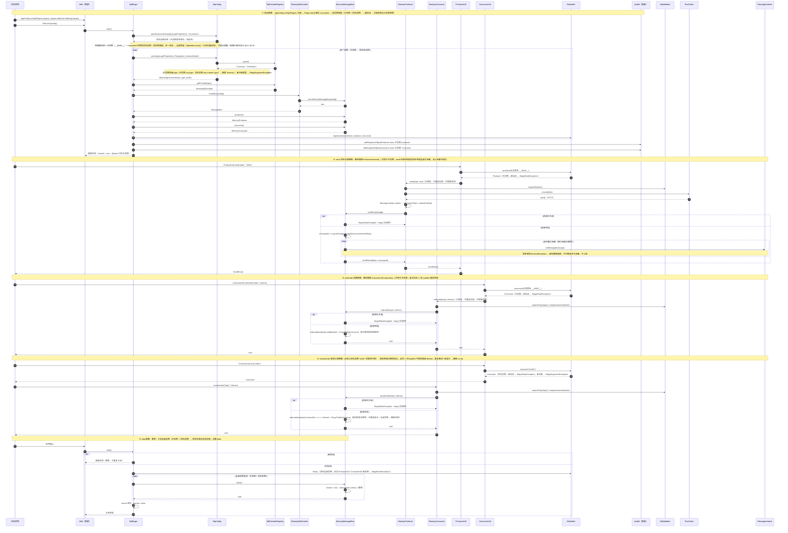
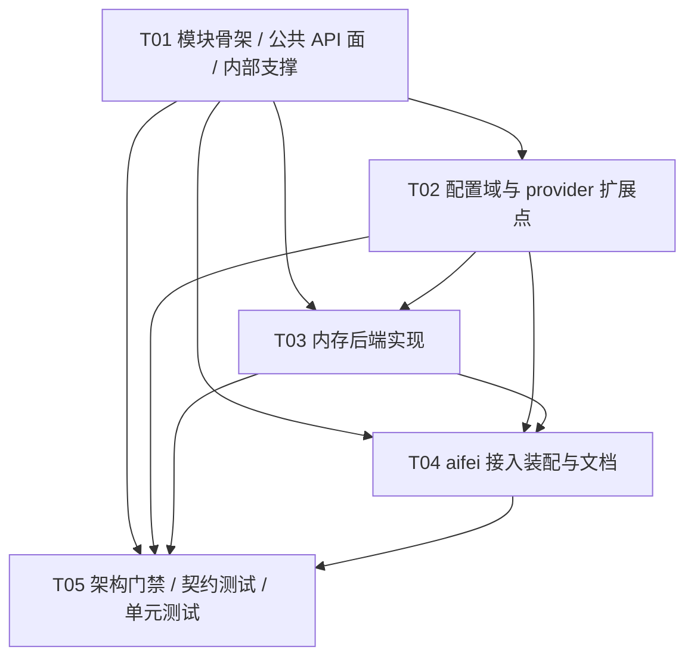
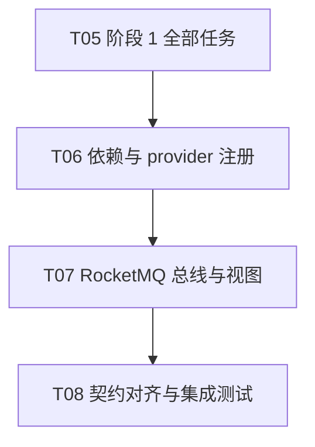
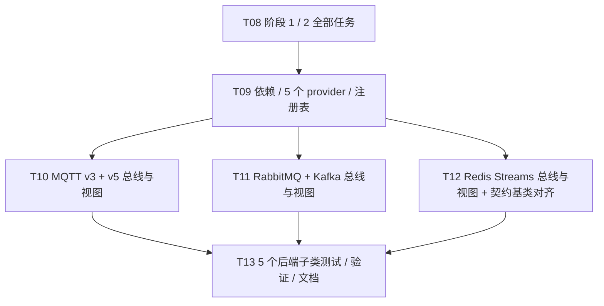

# aifei-mq 设计文档

本文是 `aifei-mq` 的**设计事实来源**：模块定位、公共 API 契约、装配链路、provider 扩展点、任务分解与门禁设计以本文为准。面向使用者（安装 / 用法 / 配置）的说明见 `README.md`；面向开发代理的约束见模块 `AGENTS.md`；测试策略见 `docs/testing.md`。

> **交付性质**：`aifei-mq` 是 aifei 生态的**库模块（可被应用依赖的 SDK）**，**不是应用工程**。因此**没有** `AppConfig` / `Launcher` / `service/` 包 / `webapp/` / HTTP 路由 / HIO / 表结构 / Db+Row / Generator；只有「公共 API + 内部实现 + 一个装配用 `MqPlugin`」。
>
> **文档状态**：1.0.0 已按本文实现（**含本轮 R 轮的 5 个可插拔后端**），并通过模块内自测（**`Tests run: 143 / Failures: 0 / Errors: 0 / Skipped: 60`**——即模块内**执行用例 83 项** + **跳过 60 项**；执行 83 = 架构门禁 **5** 项 + 总线契约 **20** 项〔共同底线 **10** + 内存专有 **10**〕+ 单元测试 **58** 项；跳过的 **60** 项为 **6 个集成类各 10 条**〔`RocketMq` / `Mqtt` / `Mqtt5` / `RabbitMq` / `Kafka` / `RedisStream` 各一契约子类〕，**默认关闭**），**尚未对外发布**。§5 的三项裁决（投递语义 / provider 抽象粒度 / 关闭语义）与公共面（§3）属**已定档**契约；其余为实现细节。已定档项变更前**必须先更新本文**。
>
> **后端清单与计数口径（本轮 R 轮文档收口）**：**已实现** = **7** 个后端——内存后端 `memory` + 真实后端 `rocketmq` + **本轮（R 轮）新增的 5 个可插拔后端**（`mqtt`〔MQTT v3.1.1〕/ `mqtt5`〔MQTT v5.0〕/ `rabbitmq` / `kafka` / `redisstream`），当前态主源码 **45** 个 / 测试 **18** 个（即上面实测用例数所对应的当前态）。5 个新后端的**契约**（§4.6–§4.10 实现表 / §5.6 分层表 / §9 依赖 / §10.5 任务 / §11.1 唯一定义点 / §12.5 门禁合规 / §13 决策落档 / §14 裁定回填）与**代码与测试**均已落地（各 4 个主源码类 + 1 个契约测试子类，见 §8；任务 **T09–T13 已执行完毕**）。故这 5 个后端的**运行期语义仍全部未经真机 broker 验证**（本机无 Docker、无任何 broker / Redis，§13 第 28 条）。

---

## 1. 模块定位与设计原则

### 1.1 定位

`aifei-mq` 为 aifei 应用补齐框架未覆盖的**异步消息能力**（解耦、削峰）。业务代码只依赖公共接口，换 MQ 中间件只改配置、不改代码（与 `aifei-cache` 换后端、`aifei-websocket` 换实现的思路一致）。

- 坐标：`io.github.gollyhu:aifei-mq:1.0.0`
- 包名：`cn.hg.aifei.mq`
- 技术基线：**Java 8**（语法与 API 双约束，主 JAR class major version = 52）

### 1.2 为什么是「库/SDK」而非应用工程

本模块提供的是**可被别的应用依赖的能力**，自身不承载任何应用装配。对照 aifei 应用工程（`AppConfig` / 入口类 / Just Service / HIO / `webapp/`）逐项说明：

| 应用工程要素 | 本模块 | 理由 |
| --- | --- | --- |
| `AppConfig implements AifeiConfig` | **不提供** | 装配由**使用方应用**的 `AppConfig` 完成，本模块只提供 `MqPlugin` 供其 `plugins.add(...)` |
| `Launcher`（`Aifei.start`） | **不提供** | 入口属应用 |
| `service/` 包（Just Service） | **不提供** | 本模块是基础设施 SDK，不是业务 |
| HIO / 路由 / `webapp/` | **不提供** | 无 HTTP 面 |
| 表结构 / Db+Row / Generator | **不提供** | 无持久化（消息不落库，本版无持久化需求） |

模块目录内 `mvn clean verify` 必须 **0 failure / 0 error**（含架构门禁测试）。

### 1.3 「单一内建默认后端 + provider 扩展点」

按已拍板决策（需求文档第三节第 1 条），**首批后端 = 内存/本地实现**：零第三方运行依赖，无中间件即可完整单测跑通框架；真实后端以 **provider 扩展点**追加。

- 默认后端标识 `"memory"`，其实现落 `cn.hg.aifei.mq.memory`；
- **阶段 2 新增的真实后端 = RocketMQ**（用户拍板，非 Kafka），实现落 `cn.hg.aifei.mq.rocketmq`，标识 `"rocketmq"`；客户端用经典 `org.apache.rocketmq:rocketmq-client:4.9.7`，以 `<optional>true</optional>` 声明、**仅实现包使用、不向下游传递**（§9）；
- 新增后端 = 新增 `XxxMqProvider`（`extends AbstractMqProvider`）+ 在 `MqProviderRegistry` 静态初始化块加**一行**注册；**不回头改 `MqPlugin` 装配逻辑**（与 `aifei-cache` 完全同构）；
- 后端配置沿用 `mq.<type>.*`；**内存后端无额外键**（**不引入** `mq.memory.*`）；RocketMQ 后端键见 §4.3 / §5.5；
- provider 扩展点已由需求文档明文要求，属**需求内**；除此之外**不自增**扩展点或抽象层。
- **本轮（R 轮）新增 5 个真实后端（已实现）**：`mqtt`（MQTT v3.1.1）/ `mqtt5`（MQTT v5.0）/ `rabbitmq` / `kafka` / `redisstream`，实现分别落 `cn.hg.aifei.mq.mqtt` / `.mqtt5` / `.rabbitmq` / `.kafka` / `.redisstream`，后端标识字面量与包名同名（`"mqtt"` / `"mqtt5"` / `"rabbitmq"` / `"kafka"` / `"redisstream"`）；客户端版本见 §9，一律 `<optional>true</optional>`、**仅实现包使用、不向下游传递**。**MQTT 拆为两个独立后端**（v3 与 v5 各有自己的 provider / 总线 / 配置命名空间 `mq.mqtt.*` 与 `mq.mqtt5.*`，**不引入** `mq.mqtt.version` 键）。各后端实现表见 §4.6–§4.10，差异落点见 §5.6 (C)，依赖见 §9，任务见 §10.5（T09–T13，**已执行完毕**）。

> ⚠️ 本模块的 provider 路线**学 `aifei-cache`（`CacheProvider` / `CacheProviderRegistry` / `AbstractCacheProvider`）**；`aifei-websocket` 已删除 provider/SPI/type 配置（纯 JDK 自实现路线），**其 provider 路线不可照搬**。

### 1.4 公共面收敛纪律（硬约束）

| # | 纪律 |
| --- | --- |
| 1 | **公共 API 零第三方类型**：根包 8 个公共类型**不含**任何第三方类型 |
| 2 | **公共 API 零框架类型**：`cn.aifei.*` 只允许出现在 `cn.hg.aifei.mq.aifei` 接入包（即只允许 `MqPlugin` 一个类引用框架） |
| 3 | 根包公共类型**逐个列出并说明职责**（§3），**精确 8 个**；新增公共类型必须先过设计决策 |
| 4 | **第三方依赖分层隔离**：内存后端**零第三方运行依赖**；真实后端**按其 provider 实现包自带 `optional` 依赖**（如 `rocketmq-client`），**不向下游传递**；**公共面（根包）零第三方类型**。框架内核 `cn.aifei:aifei-all` 为 `provided`，测试依赖 `junit` 为 `test` |
| 5 | Java 8 语法与 API；主 JAR class major version = 52 |
| 6 | 每类规则只有一个定义点（校验 / 配置域常量 / 编解码 / 注册表 / 总线投递 / 单例持有） |

> 第 1、2 条由**架构门禁测试** `ArchitectureBoundaryTest` 强制（§12），不得放宽或绕过；门禁扫描源码文本，**必须在模块根目录执行**。

### 1.5 设计原则

1. **接口极简、实现无关**：业务只依赖根包 8 类型与 `ProducerUtil` / `ConsumerUtil`；实现经 `@Inject Producer` / `@Inject Consumer` 或 `ProducerUtil` / `ConsumerUtil` 取用。
2. **零依赖优先**：默认内存后端零第三方依赖；`aifei-all` 为 `provided`。
3. **行为契约可测**：投递语义、异常分类、关闭语义、配置键名全部定档到「可写断言」的程度（§5）。
4. **保持极简**：不做未被需求驱动的抽象；provider 扩展点是需求内唯一允许的抽象。
5. **基线一致**：无页面，故无 UI 基线；公共面与配置键名对齐需求文档第四节。
6. **公共面准入判据**：公共 API 的**每个参数**与共同底线 (A) 的**每条条款**，都必须能被**每一个后端有意义地实现**；只能被部分后端实现的后端特有概念**不得**进入 (A) 与公共方法签名。正式表述与来源见 §5.7。

---

## 2. 术语表

| 术语 | 含义 | 归属 |
| --- | --- | --- |
| **主题 topic** | 消息的投递通道名；订阅与发送都以它配对 | 根包 / 配置 |
| **消息 Message** | 一次消息载荷：主题 + `byte[]`，不可变、防御性拷贝 | 根包（公共） |
| **载荷 payload** | `Message.payload()` 的 `byte[]`；UTF-8 文本经 `send(topic, String)` 便捷编码后进入 | 根包 |
| **生产者 Producer** | 发送端视图：3 个 `send` 重载 | 根包（公共接口） |
| **消费者 Consumer** | 订阅端视图：`subscribe` / `unsubscribe` | 根包（公共接口） |
| **监听器 MessageListener** | 消费回调：`onMessage(Message)`，函数式接口 | 根包（公共接口） |
| **发送结果 SendResult** | `topic` + `messageId`；失败即抛异常，**无 success 布尔** | 根包（公共） |
| **生产者工具类 ProducerUtil** | 静态取用 `use()` / `use(instanceName)` + `send`×3 静态镜像 | 根包（公共） |
| **消费者工具类 ConsumerUtil** | 静态取用 `use()` / `use(instanceName)` + `subscribe` / `unsubscribe` 静态镜像 | 根包（公共） |
| **命名实例** | 由 `mq.names` 声明的扩展实例；主实例走根级 `mq.*`，命名实例走 `mq.<name>.*` | 配置域 |
| **总线 MessageBus** | 后端统一内部对象：产出 Producer / Consumer 两个视图 + 生命周期 | `internal`（契约）/ `memory`（实现） |
| **后端标识 type** | `mq.type` 取值，如 `"memory"`；白名单由注册表派生 | `internal` |
| **后端 provider** | 一种后端的装配契约：解析配置并建总线；**必须无状态** | `internal`（契约）/ 各实现包 |
| **注册表** | `type` → 无状态 provider 的映射，静态初始化块注册 | `internal.MqProviderRegistry` |
| **实例注册表 MqHolder** | 运行期按**实例名**登记 / 取用 `Producer` / `Consumer`（多实例），供 `ProducerUtil` / `ConsumerUtil` 取用 | `internal` |

---

## 3. 公共 API 契约（根包精确 8 类型）

根包 `cn.hg.aifei.mq` **精确 8 个公共类型**：`Message` / `Producer` / `Consumer` / `MessageListener` / `SendResult` / `MqException` / `ProducerUtil` / `ConsumerUtil`。此清单为门禁断言 `EXPECTED_PUBLIC_TYPES` 的**唯一事实来源**。

> **定档变更记录**：`MqKit`（原单一静态门面）已**删除**，拆分为 `ProducerUtil` + `ConsumerUtil` 两个公共工具类（形态照 `aifei-cache` 的 `CacheUtil` / `CounterUtil` 范式）；根包公共类型 **7 → 8**。此属**有意的公共面扩张**，经**项目所有者拍板**（见 §13）。

### 3.1 `Message`（不可变值对象）

```java
public final class Message {
    private final String topic;
    private final byte[] payload;

    private Message(String topic, byte[] payload) { ... }

    public static Message of(String topic, byte[] payload);   // 唯一工厂
    public String topic();
    public byte[] payload();                                  // 防御性拷贝（出参）
    // equals / hashCode / toString（值语义）
}
```

- **私有构造 + 唯一静态工厂 `of`**；**不提供** String 工厂、**不提供**任何解码访问器（如 `asString()` / `text()`）。
- 校验经 `internal.MqValidator`（`requireTopic` 非空非空白 + `requirePayload` 非空）——**校验唯一定义点**，不在本类内联复制规则。
- `payload` **入参出参双向防御性拷贝**（`of` 时 clone、`payload()` 返回 clone）。
- `equals` 按「`topic` + `payload` 字节内容」判定；`hashCode` 用 `Arrays.hashCode`。

### 3.2 `Producer`（公共接口）

```java
public interface Producer {
    SendResult send(Message message);
    SendResult send(String topic, byte[] payload);
    SendResult send(String topic, String text);   // 便捷重载：text 以 UTF-8 编码为 payload
}
```

- **恰好 3 个 `send` 重载**，不多不少。
- 语义：**同步投递**（§5.1）；**无订阅者时 `send` 仍成功返回 `SendResult`（含 `messageId`）——属跨后端共同底线（§5.6 A5）**；而消息**被丢弃还是留存随后端而变**（内存后端丢弃，broker 独立存储、待消费者上线后消费，§5.6 B6）。

### 3.3 `Consumer`（公共接口）

```java
public interface Consumer {
    void subscribe(String topic, MessageListener listener);
    void unsubscribe(String topic, MessageListener listener);
}
```

- 两个方法均返回 **`void`**。
- `subscribe`：**登记**——把监听器登记到该主题，此后该主题上的消息都会回调该监听器；**登记语义属共同底线**（§5.6 A3）。
- `unsubscribe`：**取消**——从该主题的登记列表中移除**该监听器实例**。语义定档如下：

| 维度 | 定档 |
| --- | --- |
| 签名 | `void unsubscribe(String topic, MessageListener listener)` |
| 取消粒度 | 移除该主题登记列表中**该 listener 实例**；**按实例身份（引用相等）判定，不用 `equals`** |
| 重复取消 | **幂等静默 no-op**（不抛） |
| 取消未登记的订阅 | **幂等静默 no-op**（不抛）——与「取消已被取消的 listener」表现相同 |
| `close()` / `stop()` 后调用 | **`IllegalStateException`**（状态非法；与 `subscribe` 停止后语义一致，§5.4 / §5.6 A9） |
| 参数非法 | `topic` 空 / 空白、`listener` 为 `null` → **`IllegalArgumentException`**，校验复用 `internal.MqValidator.requireTopic` / `requireListener`（**校验唯一定义点**，§5.6 A8；**无需为其新增校验方法**） |

- **为何按实例身份（引用相等）而非 `equals`**：`MessageListener` 是**函数式接口**，实际入参多为 lambda 或方法引用，其 `equals` **无可靠语义**（同一「逻辑」在不同调用点可能是不等实例，接口也未约定值语义）；按**实例身份**移除才能与「`subscribe` 当时登记的就是这个实例」严格对应，语义可判定、可断言。
- **跨后端分层**：`unsubscribe` 的**共同底线**只保证「**取消后本进程不再向该 listener 派发该主题的消息**」（§5.6 A3）；真实后端（RocketMQ 等）在**拉取 / 消费组**模型下的「按 listener 取消」属**尽力语义**（§5.6 B10）。此外，「无订阅者」须区分**共同底线**（`send` 仍成功返回 `SendResult`，§5.6 A5）与**后端差异**（消息被丢弃 / 留存，§5.6 B6）；消费位点 / 消费组等其它差异维度见 §5.6（B）。

### 3.4 `MessageListener`（公共函数式接口）

```java
@FunctionalInterface
public interface MessageListener {
    void onMessage(Message message);
}
```

### 3.5 `SendResult`（不可变值对象）

```java
public final class SendResult {
    private final String topic;
    private final String messageId;

    private SendResult(String topic, String messageId) { ... }

    public static SendResult of(String topic, String messageId);   // 唯一工厂
    public String topic();
    public String messageId();
    // equals / hashCode / toString（值语义）
}
```

- 字段**仅** `topic` + `messageId`，**无 success 布尔**（失败即抛 `MqException`；参数非法抛 `IllegalArgumentException`）。
- `messageId` 由**实现**（**后端或适配器**）生成且**恒非空**（此为本轮 **R1 裁定**后的口径，原「由**后端**生成」的措辞已放宽，见 §14.2 R1）；内存后端格式见 §5.1，各后端取值口径与「本地生成」格式见 §5.6 B7。
- 校验经 `internal.MqValidator`（`requireTopic` + `requireMessageId`）。

### 3.6 `MqException`（唯一未受检异常）

```java
public class MqException extends RuntimeException {
    public MqException(String message);
    public MqException(String message, Throwable cause);
}
```

- **单一未受检异常**，**不细分**连接异常（层次不细分）。
- **仅在「运行时故障」场景抛出**；参数非法用 `IllegalArgumentException`、状态非法用 `IllegalStateException`（分类见 §5.4）。
- 内存后端**无外部运行时故障源**，故本版不会从 `memory` 抛出 `MqException`；该类型为后续真实后端与运行时故障保留。

### 3.7 `ProducerUtil` 与 `ConsumerUtil`（公共静态工具类）

`MqKit`（原单一静态门面）已**删除**，其门面职责拆分为**两个**公共工具类，形态照 `aifei-cache` 的 `CacheUtil` / `CounterUtil` 范式——「静态方法与『实例方法』分属两个不同类，故无同名冲突」。两者均为 `final` + 私有构造的**零状态工具类**，只在取用期经 `internal.MqHolder` 按实例名取运行期实例。

#### 3.7.1 `ProducerUtil`

```java
public final class ProducerUtil {
    private ProducerUtil() { }

    public static Producer use();                          // 主实例（对齐 Config.MAIN_INSTANCE_NAME 机制）
    public static Producer use(String instanceName);       // 命名实例
    // ↓ 静态镜像方法，一律作用于主实例（转发，不重复校验、不转换异常）
    public static SendResult send(Message message);
    public static SendResult send(String topic, byte[] payload);
    public static SendResult send(String topic, String text);
}
```

- **`use()` / `use(instanceName)`**：经 `internal.MqHolder` 取运行期已登记的生产者视图。`use()` 取**主实例**（对齐 `Config.MAIN_INSTANCE_NAME` 机制，取值与语义见 §5.5）；`use(instanceName)` 取 `mq.names` 声明的**命名实例**。**取到的是与 `@Inject Producer` 注入的同一个对象**——`@Inject` 只对应**主实例**，命名实例只能经 `use(name)` 取（见 §5.5）。
- **静态镜像**：`send`×3 **只做转发**——**不重复校验、不转换异常**；参数与异常契约同 `Producer` 的对应方法（`send(topic, text)` 的 UTF-8 编码仍由后端实现经 `internal.TextCodec` 完成）。
- **异常口径**（与 `aifei-cache` 的 `CacheManager.lookup` 逐条对齐，**先判状态、后判参数**）：
  - **先判状态**：未启动 / 已停止 → **`IllegalStateException`**（`use()` 与三个 `send` 镜像同此）。
  - **后判参数**：实例名为空 / 含非法字符 / 为保留名 / 未注册 → **`IllegalArgumentException`**（仅 `use(instanceName)` 会命中）。

#### 3.7.2 `ConsumerUtil`

```java
public final class ConsumerUtil {
    private ConsumerUtil() { }

    public static Consumer use();                          // 主实例（对齐 Config.MAIN_INSTANCE_NAME 机制）
    public static Consumer use(String instanceName);       // 命名实例
    // ↓ 静态镜像方法，一律作用于主实例（转发，不重复校验、不转换异常）
    public static void subscribe(String topic, MessageListener listener);
    public static void unsubscribe(String topic, MessageListener listener);
}
```

- **`use()` / `use(instanceName)`**：同 `ProducerUtil`（**取到的是与 `@Inject Consumer` 注入的同一个对象**）。
- **静态镜像**：`subscribe` **与** `unsubscribe` **均镜像**（`unsubscribe` 是阶段 1 已落地的能力，本轮一并镜像）；两者**只做转发**——**不重复校验、不转换异常**；参数与异常契约同 `Consumer` 的对应方法（含「按实例身份移除 listener」「重复取消 / 未登记为幂等 no-op」的既有定档，§3.3）。
- **异常口径**：同 `ProducerUtil`（**先状态、后参数**；`IllegalStateException` / `IllegalArgumentException`）。

> **与 `CacheUtil` / `CounterUtil` 的一致性**：① `use()` 取主实例；② `use(name)` 取命名实例；③ 静态镜像一律转发到主实例；④ 只做转发、不重复校验、不转换异常——四点逐条对齐。差异仅在于本模块的运行期注册表为 `internal.MqHolder`（cache 为 `internal.CacheManager`），且 `Producer` / `Consumer` 是两个类型、故镜像方法落在两个工具类。

### 3.8 公共面计数口径（供门禁复用）

「根包公共类型」= `src/main/java/cn/hg/aifei/mq/` **目录直接子级的 `.java` 文件**（不含任何子包目录）。`MqPlugin` 位于接入包 `.../mq/aifei/`，**不计入**；`internal` / `memory` 下文件不计入。

| # | 类型 | 形态 |
| --- | --- | --- |
| 1 | `Message` | final class |
| 2 | `Producer` | interface |
| 3 | `Consumer` | interface |
| 4 | `MessageListener` | interface（函数式） |
| 5 | `SendResult` | final class |
| 6 | `MqException` | class（extends RuntimeException） |
| 7 | `ProducerUtil` | final class（静态工具） |
| 8 | `ConsumerUtil` | final class（静态工具） |

> **计数口径**：本表**精确 8 个**，为门禁断言 `EXPECTED_PUBLIC_TYPES` / `EXPECTED_ROOT_TYPES` 的唯一事实来源（§12.2）。本次 **7 → 8** 系 `MqKit` 拆分的结果（`-MqKit` / `+ProducerUtil` / `+ConsumerUtil`，净 +1）。

---

## 4. 内部结构

### 4.1 `internal`（非承诺 API，**框架无关**）

> 关键约束：门禁规定 `cn.aifei.*` 只允许出现在 `aifei` 接入包，**故 `internal` 与 `memory` 一律不得 import `Prop` 等框架类型**。配置**对象**与**键常量**留 `internal`；把 `Prop` 转为 JDK `Properties` 的**一行读取**留在 `aifei.MqPlugin`（§4.4）。

| 类型 | 形态 | 职责 |
| --- | --- | --- |
| `MqValidator` | final + 静态方法 | **参数校验唯一定义点**：`requireTopic` / `requirePayload` / `requireText` / `requireMessage` / `requireMessageId` / `requireListener` / `requireProducer` / `requireConsumer`（违规抛 `IllegalArgumentException`） |
| `MqConfig` | final 值对象 | **配置域与键常量唯一定义点**：`ROOT_PREFIX="mq"`、`TYPE_KEY="mq.type"`、`NAMES_KEY="mq.names"`、`DEFAULT_TYPE="memory"`、`MAIN_INSTANCE_NAME="__MAIN__"`；`parseInstanceNames(Properties, String)`（解析并校验 `mq.names`：空项 / 重名 / 保留名 / `__MAIN__` 即 `IllegalArgumentException`）；`requireInstanceName(String)`（实例名合法性唯一定义点）；`parse(Properties, Set, String instanceName)`（按实例名派生**实例前缀**——主实例 `mq`、命名实例 `mq.<name>`——读 `<实例前缀>.type`，缺省 `memory`，未注册类型抛 `IllegalArgumentException`）；`instanceName()` / `type()` / `prefix()`（实例前缀）/ `get(relativeKey)`（读 `<实例前缀>.<type>.<relativeKey>`） |
| `TextCodec` | final + 静态方法 | **编解码唯一定义点**：`encode(String) : byte[]`（UTF-8）；本版只提供编码方向（`Message` 不解码） |
| `MqHolder` | final + 静态方法 | **运行期实例注册表唯一定义点（多实例）**：`register(String instanceName, Producer, Consumer)` / `producer(String instanceName)` / `consumer(String instanceName)` / `clear()`（清空全部实例）；**取用期先生命周期后参数**——未启动 / 已停止（尚未登记过任何实例、或已 `clear()`）抛 `IllegalStateException`，实例名为空 / 非法 / 未注册抛 `IllegalArgumentException` |
| `MessageBus` | interface（`extends AutoCloseable`） | **总线契约**：`producer()` / `consumer()`（同一总线上的两个视图）/ `close()`；后端实现另提供**消费者侧委托操作** `subscribe(String, MessageListener)` / `unsubscribe(String, MessageListener)`（登记 / 取消），其**方法集与公共 `Consumer` 一一对应**，供消费视图委托 |
| `MqProvider` | interface | **后端扩展点**：`type()` / `createBus(MqConfig)` |
| `AbstractMqProvider` | abstract | **provider 装配骨架**：`createBus` 为 `final` 模板方法（校验 `config` 非空后委托），`buildBus(MqConfig)` 抽象；基类**不持有实例字段**、可多线程复用 |
| `MqProviderRegistry` | final | **注册表**：静态 `LinkedHashMap<String, MqProvider>` + 静态初始化块注册 `"memory"`；`getProvider(String)`（未注册抛 `IllegalArgumentException`，消息含支持类型集合）/ `types()`（供 `MqConfig` 派生白名单） |

> **不提供** `MqProviderRegistry.register(String, MqProvider)` 公开方法：扩展后端的既定方式是**改静态初始化块一行**，避免未使用的 API 面（对齐需求「注册表静态初始化里注册一行」）。

### 4.2 `memory`（默认后端实现，`cn.hg.aifei.mq.memory`）

| 类型 | 形态 | 职责 |
| --- | --- | --- |
| `MemoryMqProvider` | extends `AbstractMqProvider` | 后端 provider：`TYPE` 引用 `MqConfig.DEFAULT_TYPE`；`type()`；`buildBus(config)` → `new MemoryMessageBus(config)` |
| `MemoryMessageBus` | implements `MessageBus` | 进程内发布-订阅总线：持有 `ConcurrentHashMap<String, CopyOnWriteArrayList<MessageListener>>`（订阅登记）、`AtomicLong`（messageId 序号）、`volatile boolean closed`；构造时创建两个视图；包级 `publish(Message)` / `subscribe(topic, listener)` / `unsubscribe(topic, listener)` 供视图委托；`close()` 幂等 |
| `MemoryProducer` | implements `Producer` | 生产视图：委托 `bus.publish`；`send(topic, String)` 经 `TextCodec.encode` |
| `MemoryConsumer` | implements `Consumer` | 消费视图：经 `MqValidator` 校验后委托 `bus.subscribe` / `bus.unsubscribe` |

**投递实现要点**：`publish` 先判 `closed`，再分配 `messageId`，再**按订阅登记顺序**逐个同步回调；单个监听器抛出的 `RuntimeException` **就地隔离捕获**（不中断其余订阅者、不上抛），返回 `SendResult`。`subscribe` 判 `closed` 后追加登记。

**取消登记实现要点**：`unsubscribe` 先判 `closed`（已关闭抛 `IllegalStateException`），再从该主题的 `CopyOnWriteArrayList` 中**按实例身份**移除该 listener——即迭代列表、以 `==` 比对引用、移除**首个引用相等**的元素（等价 `list.removeIf(e -> e == listener)`）；目标主题未登记或列表内无该实例时**静默返回**（幂等 no-op、不抛）。要点与理由：

1. **空列表保留、不移除主题键**：取消最后一个监听器后**保留该主题的空列表**，不 `remove` 主题键。理由：① 值的列表对象在并发 `subscribe`（`computeIfAbsent`）下是稳定锚点，删键会与并发追加竞争、可能丢失登记；② 「未订阅」与「曾订阅后全部取消」表现一致（均为不再派发），无需引入键移除的额外同步面。
2. **迭代安全**：`CopyOnWriteArrayList` 的迭代基于**快照**，取消不影响**正在进行**的 `publish` 迭代；`unsubscribe` 返回后**后续** `send` 不再回调该 listener。同步投递下，`unsubscribe` 的**事后语义**（返回后新发起的投递不再派发该 listener）成立；与**并发** `send` 的竞态不作保证（与「并发 `send` 相对顺序不作保证」同一取舍，§5.1）。
3. **值类型仍是 `List<MessageListener>`**：实现以 `Map<String, List<MessageListener>>` 声明、值对象为 `CopyOnWriteArrayList`，`unsubscribe` 不改变该结构约定。

### 4.3 `rocketmq`（真实后端实现，`cn.hg.aifei.mq.rocketmq`）

> 阶段 2 新增。本包是**第三方类型（`org.apache.rocketmq.*`）唯一允许的落点之一**（与 `memory` 同属实现包，门禁自动放行，§12.4）。

| 类型 | 形态 | 职责 |
| --- | --- | --- |
| `RocketMqProvider` | extends `AbstractMqProvider`；`public`（供 `internal.MqProviderRegistry` 跨包引用） | 后端 provider：`TYPE = "rocketmq"`（后端标识字面量唯一定义点）；`type()`；`buildBus(config)` → `new RocketMqMessageBus(config)`；**无实例字段** |
| `RocketMqMessageBus` | implements `MessageBus` | RocketMQ 总线：构造内读配置并启动 `DefaultMQProducer`、创建 `DefaultMQPushConsumer`；持有本地订阅登记 `ConcurrentHashMap<String, List<MessageListener>>` 与 `volatile boolean closed`；包级 `publish(Message)` / `subscribe(topic, listener)` / `unsubscribe(topic, listener)` 供视图委托；`close()` 幂等 |
| `RocketMqProducer` | implements `Producer`（包级 `final`） | 生产视图：经 `MqValidator` 校验后委托 `bus.publish`；`send(topic, String)` 经 `TextCodec.encode` |
| `RocketMqConsumer` | implements `Consumer`（包级 `final`） | 消费视图：经 `MqValidator` 校验后委托 `bus.subscribe` / `bus.unsubscribe` |

**配置键**（经 `MqConfig.get(relativeKey)` 读取；键名字面量集中在本实现包，**不得**手写 `"mq.rocketmq."` 前缀——命名实例下实际前缀为 `mq.<name>.rocketmq.`，仍由 `MqConfig.get(relativeKey)` 统一拼装）：

| 键（相对 `<实例前缀>.rocketmq.`；主实例即 `mq.rocketmq.`） | 必填 | 默认 | 说明 |
| --- | --- | --- | --- |
| `namesrv-addr` | **是** | — | nameserver 地址，形如 `host:port`（多个以 `;` 分隔）；缺失即 `MqException`（**配置错误**：启动期失败，不留半装配；**不校验连通性**，见下方「装配与建连时机」与 §5.6 B12） |
| `producer-group` | 否 | `DEFAULT_PRODUCER` | `DefaultMQProducer` 生产者组 |
| `consumer-group` | 否 | `DEFAULT_CONSUMER` | `DefaultMQPushConsumer` 消费者组 |

> **无 topic 相关键**：发送 / 订阅主题由调用方在 `send` / `subscribe` 时给定；topic 是否自动创建属 broker 侧设置（§5.6 B6 / B11）。

**装配与建连时机（须区分「配置」与「连通性」）**：链路为 `MqPlugin.start()` → `createBus` → `buildBus` → `new RocketMqMessageBus(config)`。

- **配置层面（启动期完成，失败即启动失败，不留半装配）**：`mq.type` 指向未注册后端、必填键 `namesrv-addr` 缺失或值非法，均在 `MqPlugin.start()` 链路内**立即**抛出（`IllegalArgumentException` / `MqException`）；此时尚未注册任何实例，**不留半装配状态**（§5.5）。
- **连通性层面（随后端而定，RocketMQ 不保证启动期暴露）**：producer 在总线构造内调用 `DefaultMQProducer#start()`，但**该调用不校验 nameserver 连通性**（懒连接：初始化即可成功，真正连网发生在首次发送 / 拉取）。故 nameserver 不可达时 `MqPlugin.start()` **不会失败**，应用照常启动，故障**延迟到首次 `send`（或消费拉取）才暴露**为 `MqException`。即**「启动成功」≠「后端可达」**（§5.6 B12 与 (C) B12）。
- **consumer 延迟启动**：订阅主题在启动时未知，故 `consumer.subscribe(topic, "*")` + `consumer.start()` 延迟到**首次 `subscribe(topic, listener)`**；后续新增主题再次 `consumer.subscribe(...)`。首次 `subscribe` 时 consumer 启动失败抛 `MqException`（运行时故障，§5.4）。

**投递 / 消费映射**：`publish` → `DefaultMQProducer.send(org.apache.rocketmq.common.message.Message)`（**同步发送**）→ 取 broker 返回的 `SendResult.getMsgId()` 作为 `messageId`（§5.6 B7）；非 `SEND_OK` 或抛出 `MQClientException` / `MQBrokerException` / `RemotingException` / `InterruptedException` → 包装为 `MqException`（`InterruptedException` 需回填中断标志）。消费适配器在 RocketMQ **消费线程**内按本地登记顺序回调，`MessageExt.getBody()` 经 `Message.of(topic, body)` 构造 `Message`；单个监听器异常就地隔离（§5.6 A4）。

### 4.4 `aifei`（装配接入，`cn.hg.aifei.mq.aifei`）

| 类型 | 形态 | 职责 |
| --- | --- | --- |
| `MqPlugin` | implements `cn.aifei.plugin.Plugin` | **全模块唯一 import 框架类型的类**；构造只持 `Prop`；`start()` 按 `mq.names` 装配**多个实例**（主实例 + 命名实例）并注册，`stop()` 注销并关闭**全部**实例 |

装配细节：`MqPlugin` 构造器 `MqPlugin(Prop prop)`（`prop == null` 抛 `IllegalArgumentException`），**单构造器**（已拍板决策第 4 条：单个 `MqPlugin` 同时装配 `Producer` / `Consumer`，共用 `mq.*` 配置体系）。

**多实例装配口径（对齐 `aifei-cache` 的 `CachePlugin`）**：

- **实例名单**：`MqConfig.parseInstanceNames(prop.getProperties(), MqConfig.NAMES_KEY)` 解析 `mq.names` 得到命名实例；待装配名单 = **主实例（恒在首位）** + 命名实例（`mq.names` 顺序）。
- **逐实例装配**：对每个实例名，`MqConfig.parse(prop.getProperties(), registry.types(), instanceName)` → `registry.getProvider(type)` → `provider.createBus(config)` → 取 `producer()` / `consumer()` → `MqHolder.register(instanceName, producer, consumer)`；同时把该实例的总线纳入本次装配的关闭清单。
- **主实例与命名实例的注册**：`@Inject` 只注入**主实例**（`AopKit.addSingletonObject(Producer.class, 主实例 producer)` / `addSingletonObject(Consumer.class, 主实例 consumer)`）——`AopKit` **按类型注册、无按名通道**（与 `aifei-cache` 现状一致），命名实例只能经 `ProducerUtil.use(name)` / `ConsumerUtil.use(name)` 取。主实例名取 `MqConfig.MAIN_INSTANCE_NAME`（`"__MAIN__"`，沿用 `aifei-cache` 的 `Config.MAIN_INSTANCE_NAME` 机制，§5.5）。
- **装配原子性**：任一实例装配失败（配置非法 / `mq.type` 未注册 / 建总线失败）→ **立即抛出**（`IllegalArgumentException` / `MqException`），`start()` **不留半装配**——已登记的实例全部回滚（`MqHolder.clear()`）并关闭已建成的总线，应用启动失败。
- **生命周期**：`stop()` 关闭**全部**实例（幂等，§5.3）。

### 4.5 本轮新增 5 个实现包的共用约定（`mqtt` / `mqtt5` / `rabbitmq` / `kafka` / `redisstream`）

> 本轮新增 5 个真实后端，**各包 4 个类**，职责与 `memory` / `rocketmq` **完全对位**；本节先给共用约定，再逐后端给实现表（§4.6–§4.10）。这 5 个包与 `memory` / `rocketmq` 一样是**实现包**：第三方类型（`org.eclipse.paho.*` / `com.rabbitmq.*` / `org.apache.kafka.*` / `redis.clients.*`）**只允许**出现在实现包内，门禁自动放行（§12.4 / §12.5）。

**命名约定**：类名取「**`<产品名>` + `Provider` / `MessageBus` / `Producer` / `Consumer`**」，产品名分别为 `Mqtt` / `Mqtt5` / `RabbitMq` / `Kafka` / `RedisStream`——与既有 `MemoryMqProvider` / `RocketMqProvider`（产品名 `MemoryMq` / `RocketMq`）**同构**。故不采用 `MqttMqProvider` 这类**叠字**写法（`Mqtt` 本身已含「MQ」）。包名与后端标识字面量同名：`cn.hg.aifei.mq.mqtt` / `.mqtt5` / `.rabbitmq` / `.kafka` / `.redisstream`，`TYPE` 分别取 `"mqtt"` / `"mqtt5"` / `"rabbitmq"` / `"kafka"` / `"redisstream"`。

**共用骨架（每个后端逐条遵守）**：

| # | 约定 |
| --- | --- |
| 1 | `XxxProvider extends AbstractMqProvider`：`TYPE` 常量（该后端标识字面量唯一定义点）、`type()`、`buildBus(config)` → `new XxxMessageBus(config)`；**无实例字段**（provider 无状态，A10） |
| 2 | `XxxMessageBus implements internal.MessageBus`：**该后端专有配置键名常量集中于此**（键名常量唯一定义点），键值一律经 `MqConfig.get(relativeKey)` 读取，**不得手写** `"mq.mqtt."` / `"mq.kafka."` 之类前缀（命名实例下实际前缀为 `mq.<name>.<type>.`，§5.5）；持有本地订阅登记（`ConcurrentHashMap<String, List<MessageListener>>`，值对象 `CopyOnWriteArrayList`）、`volatile boolean closed`，以及该后端必要的客户端对象；包级 `publish(Message)` / `subscribe(topic, listener)` / `unsubscribe(topic, listener)` 供两个视图委托；`close()` 幂等 |
| 3 | `XxxProducer` / `XxxConsumer implements Producer` / `Consumer`（均**包级 `final`**）：经 `MqValidator` 校验后委托总线；`send(topic, String)` 经 `TextCodec.encode`；本体不做后端专有逻辑 |
| 4 | **注册**：`MqProviderRegistry` 静态初始化块**加一行**（`PROVIDERS.put(XxxProvider.TYPE, new XxxProvider());`）；**不回头改** `MqPlugin` |
| 5 | **配置键名风格**：一律 kebab-case（与既有 `namesrv-addr` / `producer-group` 一致）；每后端一张键表，列「键 / 必填 / 默认 / 说明」，键名相对 `<实例前缀>.<type>.` |
| 6 | **公共面零扩张**：不新增公共类型、不改 `Producer.send`（仍恰好 3 个重载）、不改 `Consumer` 签名；新能力一律经「provider + 配置域 + §5.6 (B)/(C)」表达 |

### 4.6 `mqtt`（MQTT v3.1.1 后端实现，`cn.hg.aifei.mq.mqtt`）

| 类型 | 形态 | 职责 |
| --- | --- | --- |
| `MqttProvider` | extends `AbstractMqProvider`；`public`（供注册表跨包引用） | `TYPE = "mqtt"`；`type()`；`buildBus(config)` → `new MqttMessageBus(config)`；**无实例字段** |
| `MqttMessageBus` | implements `MessageBus` | MQTT 总线：构造内读配置并创建、连接**单一 MQTT 客户端**（生产与消费**共用同一连接**）；持有本地订阅登记、`AtomicLong`（**本地** `messageId` 序号）、`volatile boolean closed`；包级 `publish` / `subscribe` / `unsubscribe`；`close()` 幂等 |
| `MqttProducer` | implements `Producer`（包级 `final`） | 经 `MqValidator` 校验后委托 `bus.publish`；`send(topic, String)` 经 `TextCodec.encode` |
| `MqttConsumer` | implements `Consumer`（包级 `final`） | 经 `MqValidator` 校验后委托 `bus.subscribe` / `bus.unsubscribe` |

**配置键**（相对 `<实例前缀>.mqtt.`；主实例即 `mq.mqtt.`）：

| 键 | 必填 | 默认 | 说明 |
| --- | --- | --- | --- |
| `broker-url` | **是** | — | broker 地址（客户端口径的 server URI，形如 `tcp://host:1883` / `ssl://host:8883`）；缺失即 `MqException`（**配置错误**：启动期失败、不留半装配，§5.5） |
| `client-id` | 否 | 由客户端生成 | 客户端标识；同一 broker 下需唯一（同 `client-id` 的连接会互相顶掉） |
| `clean-session` | 否 | `true` | v3 的 clean session 标志（`false` 时依赖 broker 保留会话与离线消息） |
| `qos` | 否 | `0` | 订阅与发布的默认 QoS（`0` / `1` / `2`）；**逐条消息属性只落配置域**（§5.6 B15），**不进** `Producer.send` 签名（R3） |
| `retain` | 否 | `false` | 发布是否设置 retain 标志（同样只落配置域） |
| `username` | 否 | — | 认证用户名（**只进配置域**——公共 API 不出现凭据，§11.2 硬纪律） |
| `password` | 否 | — | 认证口令（同上） |
| `keep-alive-seconds` | 否 | `60` | 心跳间隔（秒） |
| `connection-timeout-seconds` | 否 | `30` | 连接超时（秒） |
| `auto-reconnect` | 否 | `true` | 是否启用**客户端原生**自动重连（自愈由客户端承担，本模块**不自建**重连循环；§5.6 B13） |
| `reconnect-delay-millis` | 否 | `1000` | 重连退避**起始**间隔（毫秒）；**Paho v3 客户端无对应 API → 该键无直接落点**（实现仅校验取值，退避起始由客户端内部策略承担；v5 客户端则有对应 API，见 §4.7） |
| `reconnect-delay-max-millis` | 否 | `30000` | 重连退避上限（毫秒） |
| （序列化口径） | — | — | **无专用键**：载荷按**原始字节**投递（文本经 `internal.TextCodec` 以 UTF-8 编码），不引入任何序列化 / 反序列化层 |
| （topic / 消费组） | — | — | **无键**：topic 由调用方在 `send` / `subscribe` 时给定，订阅侧支持 `+` / `#` 过滤器（§5.6 B14）；**v3 无消费组概念**（broker 若支持共享订阅，只能由调用方在 topic 内自行表达，非本模块键） |

> **退避两键的行为要求**：客户端须支持「自动重连 + 退避间隔」设置；**具体 API 名以真实客户端为准，本文不钉 API**（实现层按 §11.1 的行为要求落地，§4.5 约定 5）。
>
> **实现期决策（R 轮落地补记）**：`reconnect-delay-max-millis` 有直接落点（经客户端连接选项设置自动重连退避**上限**，仅在 `auto-reconnect=true` 时设置）；**`reconnect-delay-millis` 在 Paho v3 客户端无对应 API，故无直接落点**——实现仅校验其取值非负，退避**起始**间隔由客户端内部策略决定。该差异与 `mqtt5`（v5 客户端两侧皆可设置）的落点差异见 §4.7 与 §5.6 (C) 的 B13 行。

**装配与建连时机**：链路 `MqPlugin.start()` → `createBus` → `buildBus` → `new MqttMessageBus(config)`。

- **与 RocketMQ 的关键差异：MQTT 生产与消费共用一个客户端（一条连接）**——3.1.1 的客户端模型是「一个 `client-id` 一条连接」，故**不存在**「producer 先启动、consumer 延迟到首次 `subscribe`」的分段：总线构造内即创建客户端并**建立连接**，`subscribe` 只做「本地登记 + 向客户端登记该 topic 过滤器」。
- **配置错误**（`mq.type` 未注册 / 缺 `broker-url` / 数值键非法）在 `MqPlugin.start()` 链路上**立即**抛（`IllegalArgumentException` / `MqException`），**不留半装配**（§5.5）。
- **连通性**：broker 不可达时**构造期建连即失败**，映射为 `MqException`（运行时故障）→ `MqPlugin.start()` **失败并回滚**（§4.4）。即 MQTT 后端**在启动期即暴露连通性故障**——与 RocketMQ 的懒连接**相反**（§5.6 B12）。
- 运行期连接断开由**客户端原生自动重连**承担（`auto-reconnect`，§5.6 B13）；**`close()` 之后不再重连**（A9 + B13）。
- **验证程度**：以上均为**已实现**，**运行期语义未经真机 broker 验证**（§13 第 28 条）。

**投递 / 消费映射**：`publish` → 客户端以配置 `qos` / `retain` 发布 `payload`，`messageId` 由**适配器本地生成**（R1 裁定；格式见 §5.6 B7）。消费回调发生在**客户端网络 / 回调线程**（**非**生产者调用线程），按本地登记顺序回调；单个监听器异常就地隔离（§5.6 A4）。`unsubscribe` 只从本地登记表按实例身份移除（**不**向 broker 发送 unsubscribe，尽力语义，§5.6 B10）。

**重复登记保护（实现细节）**：同一 topic 过滤器只向客户端登记订阅一次（实现以「已登记过滤器」集合去重），多个监听器订阅同一过滤器时仅登记一次，派发时仍按本地登记顺序逐个回调——避免同过滤器重复登记导致的重复派发。

### 4.7 `mqtt5`（MQTT v5.0 后端实现，`cn.hg.aifei.mq.mqtt5`）

> **独立后端**：与 `mqtt` **各有** provider / 总线 / 配置命名空间，**不共享**任何键，**不引入** `mq.mqtt.version` 键。类清单与 `mqtt` 逐项对位（`Mqtt5Provider` / `Mqtt5MessageBus` / `Mqtt5Producer` / `Mqtt5Consumer`），本表只列**差异键**与**与 v3 的差别**。

**配置键**（相对 `<实例前缀>.mqtt5.`；主实例即 `mq.mqtt5.`）：

| 键 | 必填 | 默认 | 说明 |
| --- | --- | --- | --- |
| `broker-url` | **是** | — | 同 §4.6（v5 客户端口径的 server URI） |
| `client-id` | 否 | 由**适配器**生成 | **与 §4.6 不同**：v5 客户端无「生成 client-id」的 API，未配置时由适配器生成非空标识 `aifei-mq-<纳秒时间戳>`（仅用于建连，**不写回配置**） |
| `clean-start` | 否 | `true` | **v5 的 clean start 标志**（替代 v3 的 `clean-session`；v5 无 `clean-session` 键） |
| `session-expiry-interval-seconds` | 否 | `0` | **v5 会话过期时间**（秒）：配合 `clean-start = false` 表达「断线后由 broker 保留会话」 |
| `qos` | 否 | `0` | 同 §4.6（只落配置域） |
| `retain` | 否 | `false` | 同 §4.6 |
| `username` / `password` | 否 | — | 同上（只进配置域） |
| `keep-alive-seconds` | 否 | `60` | 同 §4.6 |
| `connection-timeout-seconds` | 否 | `30` | 同 §4.6 |
| `auto-reconnect` | 否 | `true` | 同 §4.6（客户端原生自动重连；§5.6 B13） |
| `reconnect-delay-millis` | 否 | `1000` | 重连退避**起始**间隔（毫秒）；**与 `mqtt` 不同**——v5 客户端提供「自动重连退避 min/max」的对应 API，故本键**有直接落点** |
| `reconnect-delay-max-millis` | 否 | `30000` | 重连退避上限（毫秒）；同上，v5 客户端**有直接落点** |
| （序列化口径） | — | — | 同 §4.6（原始字节，无键） |
| （topic / 消费组） | — | — | topic 由调用方给定（过滤器，§5.6 B14）；v5 的**共享订阅** `$share/<group>/<topic>` 亦由**调用方在 topic 内**表达，**不新增** `Consumer.subscribe` 参数（§13 第 23 条）；**无消费组键** |

**装配与建连时机 / 投递消费映射**：与 §4.6 **同构**（单一客户端、构造内建连、启动期暴露连通性故障；回调在客户端线程；`messageId` 由适配器本地生成；`unsubscribe` 为本地尽力语义）。字段名 / 报文层面的 v3↔v5 差异（属性、原因码等）**属实现包内自由**，不进公共面、不进配置域。**验证程度同 §4.6**：已实现、**运行期语义未经真机 broker 验证**。

### 4.8 `rabbitmq`（RabbitMQ 后端实现，`cn.hg.aifei.mq.rabbitmq`）

| 类型 | 形态 | 职责 |
| --- | --- | --- |
| `RabbitMqProvider` | extends `AbstractMqProvider`；`public` | `TYPE = "rabbitmq"`；`type()`；`buildBus(config)` → `new RabbitMqMessageBus(config)`；**无实例字段** |
| `RabbitMqMessageBus` | implements `MessageBus` | RabbitMQ 总线：构造内读配置、建 `Connection` 与发布 `Channel`（**eager**）；**消费侧延迟到首次 `subscribe`**（声明队列 / 绑定 + 开始投递）；持有本地订阅登记、`AtomicLong`（本地 `messageId` 序号）、`volatile boolean closed`；`close()` 幂等 |
| `RabbitMqProducer` | implements `Producer`（包级 `final`） | 经 `MqValidator` 校验后委托 `bus.publish`；`send(topic, String)` 经 `TextCodec.encode` |
| `RabbitMqConsumer` | implements `Consumer`（包级 `final`） | 经 `MqValidator` 校验后委托 `bus.subscribe` / `bus.unsubscribe` |

**配置键**（相对 `<实例前缀>.rabbitmq.`；主实例即 `mq.rabbitmq.`）：

| 键 | 必填 | 默认 | 说明 |
| --- | --- | --- | --- |
| `host` | **是** | — | broker 主机名 / IP；缺失即 `MqException`（配置错误，启动期失败） |
| `port` | 否 | `5672` | broker 端口 |
| `virtual-host` | 否 | `/` | vhost |
| `username` / `password` | 否 | — | 认证凭据（**只进配置域**，§11.2） |
| `exchange` | 否 | 空（**默认交换机**） | **高级键**：为空走默认交换机——此时 `topic` **即队列名**、直接路由（§5.6 B14） |
| `exchange-type` | 否 | `topic` | **高级键**：仅在配置了 `exchange` 时生效（`direct` / `topic` / `fanout` 等）；`topic` 类型下**通配匹配由 broker 侧的绑定（binding key）承担**，本模块的 `topic` 仍是**精确 routing key** |
| `durable` | 否 | `true` | 订阅侧声明队列时是否持久化 |
| `prefetch` | 否 | `0` | 消费预取上限（`0` = 不限，按客户端语义） |
| `publisher-confirms` | 否 | `false` | 发布确认：**关闭**时 broker 不回标识 → `messageId` 由**适配器本地生成**；**开启**时可用确认序号（§5.6 B7） |
| `connection-timeout-millis` | 否 | `60000` | 建连超时（毫秒） |
| `auto-reconnect` | 否 | `true` | 是否启用客户端**原生自动恢复**（连接恢复 + 拓扑恢复；§5.6 B13） |
| `network-recovery-interval-millis` | 否 | `5000` | 网络恢复重试间隔（毫秒） |
| `topology-recovery` | 否 | `true` | 恢复后是否自动重建队列 / 绑定等拓扑 |
| （序列化口径） | — | — | **无专用键**：载荷按**原始字节**投递（不引入序列化层） |
| （topic / 消费组） | — | — | `topic` = **队列名**（routing key = topic，默认交换机）；**无消费者组键**——RabbitMQ 的「组」即「队列」，同一队列多消费者**天然竞争消费**，故「多组」以**命名实例**表达（§13 第 23 / 24 条） |

**装配与建连时机**：`Connection` + 发布 `Channel` 在总线构造内建立（**eager**；broker 不可达 → `MqException`，**启动期暴露连通性故障**，§5.6 B12）；**消费侧延迟到首次 `subscribe`**——声明队列（按 `durable`）、在配置了 `exchange` 时完成绑定、随后开始投递。`close()` 幂等：关闭 channel / connection、停止投递、**不再重连**（A9 + B13）。

**投递 / 消费映射**：`publish` → `basicPublish`（routing key = topic，走默认交换机或配置的 `exchange`）；关闭确认时 `messageId` 由适配器本地生成。消费回调在**客户端投递线程**内按本地登记顺序派发，监听器异常就地隔离（§5.6 A4）。`unsubscribe` 只解除本地按实例身份的登记（**不**发取消投递指令，避免影响同 topic 其它本地监听器，§5.6 B10）。**验证程度**：已实现、**运行期语义未经真机 broker 验证**（§13 第 28 条）。

**实现期决策（R 轮落地补记）**：以下三项为实现层的事实，均与 §5.6 (C) `rabbitmq` 表的既定落点一致：

1. **声明交换机使 `exchange-type` 有落点**：仅当配置了 `exchange`（非默认交换机）时，消费侧首次 `subscribe` 才按配置的 `exchange-type`（默认 `topic`）**声明交换机**并完成队列绑定；未配置 `exchange` 时走默认交换机、不声明。该动作只影响 broker 侧拓扑，不改变「按实例身份本地取消」的尽力语义（与 (C) B10 一致）。
2. **`publisher-confirms=true` 时使用发布确认等待**：实现把发布通道置为确认模式，并在每次 `publish` 后**同步等待** broker 确认（未被确认即 `MqException`）；**无超时键**，超时行为按**客户端默认**。该等待只影响「发送是否成功」的判定，不改变 at-least-once 的重复面（与 (C) B4 一致；开启确认时 `messageId` 取确认序号，见 B7）。
3. **消费侧 `autoAck=false` + 派发后确认**：实现以**手动确认**消费，在**逐条派发完成之后**确认该投递（监听器异常就地隔离、**不**触发协议层重投）；未确认即断开时 broker 重投，即 at-least-once（与 (C) B4 一致）。确认动作只影响 broker 侧投递闭环，不改动本地取消语义（与 B10 一致）。

### 4.9 `kafka`（Apache Kafka 后端实现，`cn.hg.aifei.mq.kafka`）

| 类型 | 形态 | 职责 |
| --- | --- | --- |
| `KafkaProvider` | extends `AbstractMqProvider`；`public` | `TYPE = "kafka"`；`type()`；`buildBus(config)` → `new KafkaMessageBus(config)`；**无实例字段** |
| `KafkaMessageBus` | implements `MessageBus` | Kafka 总线：构造内读配置并创建**生产者客户端**（客户端自身懒连接）；**消费者延迟到首次 `subscribe`** 创建并订阅，随后由实现启动**拉取循环线程**；持有本地订阅登记、`volatile boolean closed`；`close()` 幂等 |
| `KafkaProducer` | implements `Producer`（包级 `final`） | 经 `MqValidator` 校验后委托 `bus.publish`；`send(topic, String)` 经 `TextCodec.encode` |
| `KafkaConsumer` | implements `Consumer`（包级 `final`） | 经 `MqValidator` 校验后委托 `bus.subscribe` / `bus.unsubscribe` |

**配置键**（相对 `<实例前缀>.kafka.`；主实例即 `mq.kafka.`）：

| 键 | 必填 | 默认 | 说明 |
| --- | --- | --- | --- |
| `bootstrap-servers` | **是** | — | broker 地址列表（`host:port`，多个以 `,` 分隔）；缺失即 `MqException` |
| `group-id` | 否 | `aifei-mq` | **消费组**（同组多实例**竞争消费**——「组」的实现载体，§13 第 23 条） |
| `auto-offset-reset` | 否 | `earliest` | 无位点 / 位点越界时的**起始策略**（`earliest` / `latest` / `none`）；**默认 `earliest`**，与既有 RocketMQ 后端 `CONSUME_FROM_FIRST_OFFSET` 的取舍一致（§5.6 (C) 实现期决策 1 / §13 第 28 条） |
| `acks` | 否 | `1` | 生产者应答级别（`0` / `1` / `all`） |
| `client-id` | 否 | 实现生成 | 客户端标识 |
| `security-protocol` | 否 | 客户端默认（明文） | 安全协议（如 `PLAINTEXT` / `SASL_PLAINTEXT` / `SASL_SSL`） |
| `sasl-mechanism` | 否 | — | SASL 机制 |
| `username` / `password` | 否 | — | 凭据：SASL 用户名 / 口令（未直接给 `sasl-jaas-config` 时，**仅当 `sasl-mechanism` 为 `PLAIN` / `SCRAM-SHA-256` / `SCRAM-SHA-512`** 三种机制才由适配器按机制拼装 JAAS；**其它机制须显式提供 `sasl-jaas-config`**，否则本键不生效；**只进配置域**） |
| `sasl-jaas-config` | 否 | — | 完整 JAAS 配置串（**凭据整体落此**；只进配置域，§11.2） |
| `request-timeout-ms` | 否 | `30000` | 请求超时（毫秒） |
| `reconnect-backoff-ms` | 否 | `50` | 连接层重连退避（毫秒） |
| `retry-backoff-ms` | 否 | `100` | 可重试请求的重试退避（毫秒） |
| `poll-timeout-ms` | 否 | `1000` | 消费拉取循环单次阻塞上限（毫秒，**实现参数**） |
| （序列化口径） | — | — | **无专用键**：消息 key 恒为 `null`，value = 载荷**原始字节**（实现固定使用字节序列化器，不引入序列化层） |
| （topic） | — | — | **无键**：`topic` = **Kafka topic 名**，由调用方给出（精确名，§5.6 B14）；组名走 `group-id` |

**装配与建连时机**：生产者客户端在总线构造内创建，但**客户端自身懒连接**（构造不校验 broker 连通性）→ **「启动成功」≠「broker 可达」**，与 RocketMQ 同构（§5.6 B12）；**消费者延迟到首次 `subscribe`** 创建并订阅该 topic，随后启动**拉取循环线程**（以 `poll-timeout-ms` 阻塞）。`close()` 幂等：停止拉取循环、关闭消费者与生产者、**不再重连**（A9 + B13）。

**投递 / 消费映射**：`publish` → 生产者发送（`acks` 生效），`messageId` 取 broker 返回的**分区 + 位点**元数据拼装（属**broker 生成**，§5.6 B7）。消费：拉取循环按批拉取，逐条按本地登记顺序回调，监听器异常就地隔离（§5.6 A4）；**位点由消费组（`group-id`）维护**，起始策略见 `auto-offset-reset`。`unsubscribe` 只解除本地登记（不离开消费组、不撤销 broker 侧订阅，§5.6 B10）。**验证程度**：已实现、**运行期语义未经真机 broker 验证**（§13 第 28 条）。

**实现期决策（R 轮落地补记）**：

1. **`messageId` 拼装形式**：实际取发送返回的元数据拼为 `<topic>-<partition>@<offset>`（如 `orders-0@42`），属 broker 生成（§5.6 B7）。
2. **缺省 `client-id` 生成形式**：未配置 `client-id` 时由实现生成 `kafka-<UUID>`（非空，避免空标识），并同时用于生产者与消费者客户端。
3. **`enable.auto.commit` 走客户端默认**：实现**未**暴露对应配置键；消费者属性中将其显式置为 `true`（与 Kafka 客户端默认一致），故位点自动提交、由消费组统一维护（与 §5.6 (C) B9 一致）。
4. **连接恢复无独立开关**：Kafka 客户端**无**与其它后端 `auto-reconnect` 对应的独立开关，连接恢复由**客户端内部退避**承担（经 `reconnect-backoff-ms` / `retry-backoff-ms` 调节）——故 §4.9 键表**不列** `auto-reconnect`，§5.6 (C) 的 B13 行亦**不再提及**该键。

### 4.10 `redisstream`（Redis Streams 后端实现，`cn.hg.aifei.mq.redisstream`）

> **Jedis 直连**：本模块**直接**使用 `redis.clients:jedis`，**不**依赖 `io.github.gollyhu:aifei-cache`（仅**版本对齐**，§9）。

| 类型 | 形态 | 职责 |
| --- | --- | --- |
| `RedisStreamProvider` | extends `AbstractMqProvider`；`public` | `TYPE = "redisstream"`；`type()`；`buildBus(config)` → `new RedisStreamMessageBus(config)`；**无实例字段** |
| `RedisStreamMessageBus` | implements `MessageBus` | Redis Streams 总线：构造内读配置并创建 **Jedis 连接池**（池懒建连）；**消费侧延迟到首次 `subscribe`**（建消费组 + 启动拉取循环线程）；持有本地订阅登记、`volatile boolean closed`；`close()` 幂等 |
| `RedisStreamProducer` | implements `Producer`（包级 `final`） | 经 `MqValidator` 校验后委托 `bus.publish`；`send(topic, String)` 经 `TextCodec.encode` |
| `RedisStreamConsumer` | implements `Consumer`（包级 `final`） | 经 `MqValidator` 校验后委托 `bus.subscribe` / `bus.unsubscribe` |

**配置键**（相对 `<实例前缀>.redisstream.`；主实例即 `mq.redisstream.`）：

| 键 | 必填 | 默认 | 说明 |
| --- | --- | --- | --- |
| `host` | **是** | — | Redis 主机；缺失即 `MqException`（配置错误，启动期失败） |
| `port` | 否 | `6379` | 端口 |
| `database` | 否 | `0` | 库号 |
| `username` / `password` | 否 | — | 认证凭据（Redis 6+ ACL；**只进配置域**，§11.2） |
| `group` | 否 | `aifei-mq` | **消费组名**（流不存在时由实现创建该组） |
| `consumer-name` | 否 | 实现生成 | **消费者名**（同一组内标识本进程消费者；未配置时实现生成非空标识） |
| `start-mode` | 否 | `new` | **读取起始策略**：`new` = 只读**新消息**；`pending` = 先重读**本消费者**的 pending（未确认）消息，再转新消息 |
| `claim-enabled` | 否 | `true` | 是否回收本组**空闲超时**的 pending 消息（交由其它消费者处理） |
| `claim-idle-millis` | 否 | `60000` | pending 空闲超过该值即视为可回收（仅在 `claim-enabled=true` 时生效） |
| `count` | 否 | `100` | 单次读取条数上限 |
| `block-ms` | 否 | `2000` | 单次阻塞读取上限（毫秒） |
| `maxlen` | 否 | 空（**不裁剪**） | 流长度上限（近似裁剪）；为空表示不设置 |
| `timeout-millis` | 否 | `2000` | 连接 / 读写超时（毫秒） |
| `auto-reconnect` | 否 | `true` | 是否启用**连接池**原生自愈（借出时校验失效连接并重建；本模块**不自建**重连循环；§5.6 B13） |
| （序列化口径） | — | — | **无专用键**：载荷按**原始字节**投递 |
| （topic） | — | — | **无键**：`topic` = **流键（stream key）**，由调用方给出（精确名，§5.6 B14）；组名走 `group`、消费者名走 `consumer-name` |

**装配与建连时机**：**Jedis 连接池**在总线构造内创建；池本身**懒建连**，故构造期**不校验** Redis 连通性（与 RocketMQ / Kafka 同为「启动成功 ≠ 后端可达」，§5.6 B12）；**消费者延迟到首次 `subscribe`**——创建消费组并启动**拉取循环线程**（以 `block-ms` 阻塞读；`claim-enabled` 时空闲回收）。`close()` 幂等：停止拉取循环、销毁连接池、**不再重连**（A9 + B13）。

**投递 / 消费映射**：`publish` → 追加到流（`maxlen` 生效），`messageId` 取追加返回的**流条目 ID**（形如 `毫秒-序号`，属 **broker 生成**，§5.6 B7）。消费：拉取循环按批读取（`count`）后逐条按本地登记顺序回调，监听器异常就地隔离（§5.6 A4）；**位点（pending）与消费组**由 Redis 维护；起始与回收见 `start-mode` / `claim-enabled` / `claim-idle-millis`。`unsubscribe` 只解除本地登记（**不**删除消费者、不删流，§5.6 B10）。

**消息字段形态（实现期决策）**：Redis Stream 条目是「字段 → 值」的映射，实现**固定以单一字段 `payload`** 承载消息载荷的**原始字节**（不引入任何序列化层）；该字段名常量位于 `cn.hg.aifei.mq.redisstream.RedisStreamMessageBus`（`PAYLOAD_FIELD`），投递与读取两侧共用。

> **待验证项（诚实标注）**：`start-mode` 的两种起始语义、pending 回收（含回收后是否**重复派发**、与确认动作的交互）**均未经真机验证**（本机无 Docker、无 Redis，§13 第 28 条）；须在具备 Redis 的环境验证后回填 §5.6 (C) 与 §13 第 28 条。

---

## 5. 契约决策（三项定档 + 异常 + 配置）

### 5.1 编辑项 1 —— 投递语义（**背书拟定稿 + 精度补充**）

**结论**：

| 维度 | 定档 |
| --- | --- |
| 投递模型 | **同步投递**：`send` 在**调用线程内**依次同步回调订阅者，返回前回调已完成 |
| 线程模型 | 回调**在同一线程直接执行**（生产者的调用线程），本模块**不引入任何线程池 / 队列 / 背压** |
| 有序范围 | **单主题 FIFO**：同一主题内，`publish` 的完成顺序即投递顺序；**不保证跨主题顺序** |
| 多订阅者顺序 | 同一主题多个订阅者按 **`subscribe` 登记顺序**（`CopyOnWriteArrayList` 迭代顺序）依次回调 |
| 无订阅者 | **视为成功**：消息丢弃，仍返回 `SendResult`（`messageId` 已分配） |
| `messageId`（内存后端） | 进程内**全局单调递增**的长整型**十进制字符串**（`Long.toString(messageSeq.incrementAndGet())`）；唯一定义点 `MemoryMessageBus` |

**补充说明（拟定稿未覆盖，由架构师定档）**：

1. **跨线程并发**：多个线程并发 `send` 同一主题时，二者相对顺序不作保证（各自仍在自己的调用线程内同步完成）；单线程连续 `send` 的次序**严格保序**。
2. **重入**：允许在 `onMessage` 内再次 `send`（同步、可重入）；调用方自行避免无限递归。

> **分层提示**：本节为**内存后端**的定档行为；其中「同步投递 / 不引入线程池与背压 / 单主题 FIFO / `messageId` 十进制递增格式」等**不属跨后端共同底线**。**「无订阅者」须区分**：**`send` 仍成功返回 `SendResult`（含 `messageId`）属共同底线（§5.6 A5）**；**消息被丢弃还是留存属后端差异（§5.6 B6）**。跨后端的**共同底线**与**允许差异**清单见 §5.6（唯一分层事实来源）。

### 5.2 编辑项 3 —— provider 抽象粒度（**背书拟定稿 + 精确签名**）

**结论**：provider 创建**统一内部消息总线**；**Producer / Consumer 是同一总线上的两个视图**（单 `MqPlugin` 共用一个后端实例，避免二者各建连）。

精确签名定格：

```java
// internal.MqProvider —— 后端装配契约（无状态）
public interface MqProvider {
    String type();
    MessageBus createBus(MqConfig config);
}

// internal.MessageBus —— 统一内部总线契约
public interface MessageBus extends AutoCloseable {
    Producer producer();
    Consumer consumer();
    void close();
}

// internal.AbstractMqProvider —— 装配骨架（无状态、无实例字段）
public abstract class AbstractMqProvider implements MqProvider {
    @Override public abstract String type();
    @Override public final MessageBus createBus(MqConfig config) {
        if (config == null) throw new IllegalArgumentException("config can not be null");
        return buildBus(config);
    }
    protected abstract MessageBus buildBus(MqConfig config);
}

// internal.MqProviderRegistry —— 静态注册表（对齐 CacheProviderRegistry）
public final class MqProviderRegistry {
    private static final Map<String, MqProvider> PROVIDERS = new LinkedHashMap<>();
    static {
        PROVIDERS.put(MemoryMqProvider.TYPE, new MemoryMqProvider());   // ← 新增后端加这一行
    }
    public MqProvider getProvider(String type);   // 未注册 → IllegalArgumentException（含 types()）
    public Set<String> types();                   // 供 MqConfig 派生白名单
}
```

**理由**：单 Plugin 需要一个后端实例、两个公共视图；若 provider 分别产出 producer / consumer，会迫使真实后端（如 Kafka）两次建连且各自持配置，违背「统一总线、共用一个后端」的取舍。让总线产出两个视图，使「单一后端实例」在装配层天然成立。

**与 `aifei-cache` 的对齐**：`MqProvider` / `MqProviderRegistry` / `AbstractMqProvider` 三层职责与 cache 完全同构（无状态契约 + 静态注册表 + 装配骨架）；差异仅在 cache 的 provider 返回 `Cache`，本模块返回 `MessageBus`。

### 5.3 编辑项 6 —— 关闭语义（**背书拟定稿 + 一处修正**）

| 维度 | 定档 |
| --- | --- |
| `MqPlugin.stop()` 幂等 | **是**：未启动时直接返回，不重复关闭 |
| `stop()` 关闭范围 | **全部实例**：关闭**主实例与全部命名实例**（`mq.names` 声明的每个实例各一条总线），**不是**只关主实例 |
| drain 在途消息 | **不需要**：同步投递下 `send` 返回即已投递完毕，总线上无在途消息 |
| `stop()` 后 `send` / `subscribe` / `unsubscribe` | **抛 `IllegalStateException`**（见下方⚠️修正；`unsubscribe` 与 `subscribe` 同属「状态非法」） |
| 监听器运行时异常 | **由总线就地隔离捕获**：不中断同主题其他订阅者、**不上抛**给生产者 |
| `MqPlugin.stop()` 与总线 `close()` 关系 | `stop()` 内**先** `MqHolder.clear()`（此后 `ProducerUtil` / `ConsumerUtil` 取实例即失败——`use()` 与静态镜像均命中）、**再**逐个 `bus.close()`（**关闭全部实例**，各总线 `close()` 幂等）、最后清空实例清单；`started=false` |
| plugin 生命周期 | `start()`：解析配置（`mq.names`）→ **逐实例装配**（`MqHolder.register(instanceName, producer, consumer)` + **主实例** `AopKit.addSingletonObject(Producer.class/Consumer.class)`）；`stop()`：注销（`MqHolder.clear()`）→ 关闭**全部**实例总线 |

> ⚠️ **对拟定稿的修正**：拟定稿写「`stop()` 后 `send`/`subscribe` 抛 `MqException`」。这与§4 已锁定的**异常分类**（「**状态非法（`stop()` 后调用 / 未启动）→ `IllegalStateException`**」）冲突。**以已锁定的分类为准**，本设计定档为 **`IllegalStateException`**：`stop()` 后属**状态非法**，不是运行时故障。`MqException` 只留「运行时故障」一档。

**监听器异常隔离的取舍**：本模块零第三方依赖、公共面无框架类型，**不引入任何日志依赖**，故监听器抛出的 `RuntimeException` **静默丢弃**（不上抛、不打印）。这是本版已知取舍；后续真实后端 provider 可自行补充可观测性（属实现包自由，不进公共面）。

> **分层提示**：「`close()` 幂等」「`stop()` 后 `send` / `subscribe` / `unsubscribe` 抛 `IllegalStateException`」「监听器异常就地隔离、不中断同主题其它订阅者、不上抛」属**共同底线**（§5.6 A4 / A9）；而「异常隔离后是否可观测（静默 / 打印 / 上报）」属**允许差异**（§5.6 B8）。

### 5.4 异常分类（对齐已锁定契约）

| 场景 | 异常 |
| --- | --- |
| **参数非法**（topic 空、payload / text / listener / message / prop / messageId 为 null、`mq.type` 未注册；`use(instanceName)` 的实例名为空 / 含非法字符 / 为保留名 / 未注册；含 `unsubscribe` 的 topic 空 / 空白与 listener 为 null） | `IllegalArgumentException` |
| **状态非法**（`stop()` 后 `send` / `subscribe` / `unsubscribe`；`ProducerUtil` / `ConsumerUtil` **未启动 / 已停止**时取 `use()` / `use(name)` 或调用静态镜像） | `IllegalStateException` |
| **运行时故障**（后端运行时错误；真实后端连接失败等） | `MqException` |

> **分层提示**：本分类属**共同底线**（§5.6 A6），任一后端一致；后端新增的**运行时故障**一律归 `MqException`，**不得新增异常类型或改变既有分类**。

### 5.5 配置域（对齐已锁定契约）

| 键 | 必填 | 默认 | 说明 |
| --- | --- | --- | --- |
| `mq.type` | **可选** | `memory` | **主实例**的后端类型；指向**未注册**后端时 `start()` **立即** `IllegalArgumentException`，**不留半装配状态** |
| `mq.names` | 可选 | — | 声明**命名实例**，逗号分隔；**主实例不在此声明**（主实例恒存在、无需声明）；空项 / 重名 / 保留名 / `__MAIN__` 即 `IllegalArgumentException`（校验口径见下） |
| `mq.<type>.*` | 后端自定 | — | **主实例**的后端专有配置，经 `MqConfig.get(relativeKey)` 读取；**内存后端无额外键**（**不引入** `mq.memory.*`） |
| `mq.rocketmq.*` | 见 §4.3 | — | **阶段 2**：**主实例**的 RocketMQ 后端专有键（`namesrv-addr` 必填；`producer-group` / `consumer-group` 可选） |
| `mq.mqtt.*` / `mq.mqtt5.*` | 见 §4.6 / §4.7 | — | **本轮定档（已实现）**：MQTT v3.1.1 与 v5.0 **两个独立后端**各自的键域（`broker-url` 必填；`client-id` / `clean-session`(v3) / `clean-start` + `session-expiry-interval-seconds`(v5) / `qos` / `retain` / 凭据 / 自动重连等）。**两域互不相通**，且**无** `mq.mqtt.version` 键（§13 第 28 条） |
| `mq.rabbitmq.*` | 见 §4.8 | — | **本轮定档（已实现）**：RabbitMQ 键域（`host` 必填；`port` / `virtual-host` / `exchange` / `exchange-type` / `durable` / `prefetch` / 凭据 / 自动恢复等） |
| `mq.kafka.*` | 见 §4.9 | — | **本轮定档（已实现）**：Kafka 键域（`bootstrap-servers` 必填；`group-id` / `auto-offset-reset` / `acks` / `security-protocol` / `sasl-*` / 退避等） |
| `mq.redisstream.*` | 见 §4.10 | — | **本轮定档（已实现）**：Redis Streams 键域（`host` 必填；`group` / `consumer-name` / `start-mode` / `claim-enabled` / `maxlen` / `block-ms` 等） |
| `mq.<name>.type` | 可选 | `memory` | **命名实例** `name` 的后端类型（命名实例的实例前缀为 `mq.<name>`，故其类型键为 `mq.<name>.type`） |
| `mq.<name>.<type>.*` | 后端自定 | — | **命名实例** `name` 的后端专有配置（如 `mq.orders.rocketmq.namesrv-addr`），同样经 `MqConfig.get(relativeKey)` 读取 |

**键归属与实例前缀**（对齐 `aifei-cache` 的 `cache.names` 做法）：

- **主实例**：配置走**根级** `mq.*`——类型键 `mq.type`、后端专有键 `mq.<type>.*`。
- **命名实例**：配置走 `mq.<name>.*`——其**实例前缀**为 `mq.<name>`，故类型键为 `mq.<name>.type`、后端专有键为 `mq.<name>.<type>.*`。
- **主实例名**：`MqConfig.MAIN_INSTANCE_NAME = "__MAIN__"`（**沿用 `aifei-cache` 的 `Config.MAIN_INSTANCE_NAME` 实际取值**）；`use()` 取主实例、`use(name)` 取命名实例，**取到的是与 `@Inject` 注入的同一对象**（`@Inject` 只对应主实例）。
- **命名实例下的前缀一致性（含本轮 5 个新后端）**：任一后端的专有键在命名实例下的前缀恒为 **`mq.<name>.<type>.*`**（如 `mq.orders.rabbitmq.prefetch`、`mq.pay.kafka.group-id`、`mq.order.mqtt.client-id`），由 `MqConfig.get(relativeKey)` **统一拼装**；实现类只持有「相对键名」，**不得**感知实例名、**不得**手写 `"mq.<type>."` 前缀（§11.1）。

**`mq.names` 校验口径**（逐项去空白后校验；任一不过即 `IllegalArgumentException`，由 `MqConfig.parseInstanceNames` 唯一实现，与 `aifei-cache` 的 `Config.parseInstanceNames` 同构）：

| 校验 | 规则 |
| --- | --- |
| 空项 | 逗号分隔后出现空白项（如 `a,,b`、尾随逗号）→ 失败 |
| 非法字符 | 实例名含 `.` / `=` / `:` 或空白字符 → 失败 |
| 保留名 | 实例名为**根级配置键名**（`type` / `names`）→ 失败 |
| 主实例名 | 实例名为 `__MAIN__` → 失败（属保留名，不可作为命名实例声明） |
| 重名 | 同一 `mq.names` 内重复出现 → 失败 |

配置解析**全部在 `MqPlugin.start()` 内**完成；构造函数只持 `Prop` 引用，不解析、不校验。使用 RocketMQ 后端时**必须显式**配 `mq.type = rocketmq`（缺省仍是 `memory`；命名实例同理，需**显式**配 `mq.<name>.type`）。

> **注意**：此处「解析」仅指**配置**层面（键存在性与取值合法性），**不含**对外部**连通性**的校验；真实后端是否在启动期校验后端可达性**随后端而定**（RocketMQ **不**校验，见 §4.3 与 §5.6 B12 / (C) B12）。

### 5.6 跨后端契约：共同底线与允许差异（**分层表述**）

> 本模块以 **provider 扩展点**支持多后端：**已实现** = 内存后端 `memory` 与真实后端 `rocketmq`；**本轮定档（已实现）** = `mqtt`（MQTT v3.1.1）/ `mqtt5`（MQTT v5.0）/ `rabbitmq` / `kafka` / `redisstream`（§4.6–§4.10）；其它真实后端后续追加。不同后端的**公共类型与公共行为并非逐一等同**——一部分属**所有后端必须一致**的**共同底线**（(A) 表），另一部分**允许随后端实现而变**（(B) 表为通用差异维度，(C) 表为 `rocketmq` 逐项落点）。本节是这一分层判定的**唯一事实来源**；**新增后端时，凡与共同底线之外的行为不同，必须在 (B) 逐项列明，并按 (C) 的样式补出该后端的实际落点**，不得只在实现包内默默不同。本节条款的**准入判据**（哪些概念有资格进入 (A) 与公共方法签名）见 §5.7。

#### （A）所有后端共同底线（任一后端都必须遵守）

| # | 类型 / 行为 | 底线条款 |
| --- | --- | --- |
| A1 | `Message` | **不可变值对象**；**唯一工厂** `Message.of(String topic, byte[] payload)`（私有构造，不额外提供 String 工厂或解码访问器）；`payload` **入参出参双向防御性拷贝**（`of` 时 clone、`payload()` 返回 clone）；`equals` / `hashCode` 按 `topic` + `payload` 字节内容判定（**值语义**）。 |
| A2 | `Producer` | **恰好 3 个 `send` 重载**（`Message` / `byte[]` / `String`），不多不少；`send(String topic, String text)` **以 UTF-8 编码**为 payload（编码唯一定义点 `internal.TextCodec`）。 |
| A3 | `Consumer` 的登记与取消 | `subscribe(String, MessageListener)`：**登记语义**——把监听器登记到该**主题标识**，此后**匹配该标识**的消息回调该监听器（**「主题标识」读作「精确主题名」或「过滤器」，精确匹配是通配匹配的特例**——本轮 **R2 裁定**后的措辞，`memory` / `rocketmq` 行为不变，逐后端匹配语义见 B14）。`unsubscribe(String, MessageListener)`：**取消语义**——从该**主题标识**的登记列表中移除**该监听器实例**（**按实例身份**判定，不用 `equals`）；**重复取消 / 取消未登记的订阅**均为**幂等静默 no-op**；`close()` / `stop()` 后调用抛 `IllegalStateException`；参数非法抛 `IllegalArgumentException`（校验唯一定义点 `internal.MqValidator`）。二者均返回 `void`。**共同底线只保证「取消后本进程不再向该 listener 派发匹配该标识的消息」**（取消的后端差异见 B10）。 |
| A4 | `MessageListener` | **函数式单方法** `onMessage(Message)`（`@FunctionalInterface`）；**监听器异常隔离**——监听器抛出的 `RuntimeException` **不中断同主题其它订阅者**、**不上抛给生产者**。 |
| A5 | `SendResult` | 字段**仅** `topic` + `messageId`，**无 success 布尔**；**失败一律抛异常**（不返回「失败结果」）；唯一工厂 `SendResult.of`。 |
| A6 | `MqException` | **唯一未受检异常**（`extends RuntimeException`，层次不细分）。**异常分类**：参数非法 → `IllegalArgumentException`；状态非法 → `IllegalStateException`；运行时故障 → `MqException`。 |
| A7 | `ProducerUtil` / `ConsumerUtil` | **未启动 / 已停止**时 `use()`、`use(name)` 与全部静态镜像（`ProducerUtil.send`×3；`ConsumerUtil.subscribe` / `unsubscribe`）→ **`IllegalStateException`**；`use(name)` 的实例名为空 / 含非法字符 / 为保留名 / **未注册** → **`IllegalArgumentException`**（**先判状态、后判参数**）。全部静态镜像**只做转发**——**不重复校验、不转换异常**。 |
| A8 | 参数校验 | **唯一定义点** `internal.MqValidator`；任一后端与门面**不得复制校验规则**（topic / payload / text / message / messageId / listener / producer / consumer）。 |
| A9 | 生命周期 | 总线 `close()` 与插件 `stop()` **幂等**；**`stop()` 后 `send` / `subscribe` / `unsubscribe` → `IllegalStateException`**。 |
| A10 | 配置契约 | 键名口径一致（`mq.type` + `mq.<type>.*`）；配置解析**一律在 `MqPlugin.start()` 内**完成，构造只持 `Prop`；**provider 必须无状态**。 |

**本轮（R 轮）A1–A10 逐条复核结论（按 §5.7 准入判据，面向 5 个新后端）**：

- **实质未变**：`mqtt` / `mqtt5` / `rabbitmq` / `kafka` / `redisstream` **均能被每一条 (A) 有意义地实现**——本轮**未放宽任何一条 A 的实质**。具体：A1 值对象与各后端无关；A2 的三个 `send` 重载任一后端可实现（QoS / retain 落配置域，R3）；A3 的登记 / 取消是**本地登记表**操作（通配过滤器只改变**匹配集合**，见 B14）；A4 的异常隔离由各适配器就地捕获实现；A5 的 `messageId` **恒非空**由「后端或适配器生成」保证（R1，本地生成格式见 B7）；A6 / A7 / A8 与后端无关；A9 的 `close()` 幂等 / 停止后 `IllegalStateException` 由本地 `closed` 标志实现，且**关闭后不再重连**（各后端落点见 B13）；A10 的配置契约与「provider 无状态」由 §4.5 共用骨架逐条满足。
- **唯一的措辞放宽**：**A3 的「该主题」按 R2 读作「主题标识（精确主题名或过滤器）」**（上表已按此措辞重写）——这是**措辞层面的正式放宽**，`memory` / `rocketmq` 的**行为不变**。
- **回弹机制（硬纪律）**：复核中若发现某条 (A) **无法**被某个新后端有意义地实现，**不得**在本节自行放宽——须**停下并回报主会话 / 项目所有者**再定夺（本轮复核**未触发**该情形；R1 / R2 / R3 三条既有风险已按 §14.2 裁定落档）。

#### （B）允许后端差异（须在本节列明）

> 下列各项**不属共同底线**：不同后端**允许给出不同行为**，**调用方不得假设这些维度跨后端一致**。**每一新增后端都必须把本后端在这些维度上的实际落点补充进下表**（「真实后端可以是什么样」一列按实际填写或确认适用）。

| # | 维度 | 内存后端（`memory`，本版定档） | 真实后端可以是什么样 |
| --- | --- | --- | --- |
| B1 | **投递模型** | **同步投递**：`send` 在调用线程内依次同步回调订阅者，返回前回调已完成（§5.1）。 | **异步生产 + 拉取消费**：`send` 只完成「已提交到 broker」，**返回 `SendResult` ≠ 已被消费**。 |
| B2 | **线程模型** | **不引入任何线程池 / 队列 / 背压**；回调在生产者的调用线程内直接执行。 | 后端**自建**拉取线程池（长轮询 / 拉取循环），消费回调发生在**后端自有线程**。 |
| B3 | **有序性** | **单主题 FIFO**（同一主题内 `publish` 完成顺序即投递顺序）；不保证跨主题顺序。 | 按**队列 / 分区**保序；**不保证全局 FIFO**（跨分区 / 跨队列可能乱序）。 |
| B4 | **投递保证与重复** | **精确一次派发**（进程内同步派发，不重复）。 | **at-least-once**：故障 / 重试 / 位点回退下**可能重复消费**，消费端需幂等。 |
| B5 | **持久化** | **不持久**：总线在内存中，进程退出即丢失。 | **broker 持久化**：消息落盘，重启后仍可消费。 |
| B6 | **无订阅者语义** | **视为发送成功**：消息丢弃，仍返回 `SendResult`（`messageId` 已分配）（§5.1）。 | broker **独立存储**：无在线消费者时消息留存，**待消费者上线后消费**。 |
| B7 | **`messageId` 生成口径（本地生成 vs broker 生成）** | 进程内**全局单调递增**的长整型**十进制字符串**（§5.1，唯一定义点 `MemoryMessageBus`）。 | **由实现（后端或适配器）生成且恒非空**——**此为 R1 裁定后的措辞**（原「由**后端**生成」已放宽，§14.2 R1）。两类口径：① **broker 生成**——取 broker 返回的标识 / 位点（RocketMQ `msgId`；Kafka「分区 + 位点」；Redis Streams 流条目 ID；RabbitMQ 开启发布确认时的确认序号）；② **适配器本地生成**——broker 不回标识时（MQTT v3/v5；RabbitMQ 未开确认）由本模块生成，**格式定档见下方「本地 `messageId` 格式」**。逐后端落点见 (C) 各表 B7 行。 |
| B8 | **可观测性** | 监听器异常**静默丢弃**（零日志依赖、公共面无框架类型，§5.3）。 | 后端可**打印 / 上报**监听器异常（属实现包自由，**不进公共面**）。 |
| B9 | **消费位点 / 消费组** | **无此概念**（进程内发布-订阅，无位点、无消费组）。 | 真实后端**特有**：消费位点（offset）与消费组（consumer group）由后端定义与维护。 |
| B10 | **取消订阅语义** | **精确移除**：`unsubscribe` 按**实例身份**从该主题登记列表中立即移除，此后本进程不再向其派发该主题消息（与 A3 一致）。 | 在**拉取 / 消费组**模型下，「按 listener 取消」属**尽力语义**：仅解除本进程对该 listener 的本地绑定 / 本地派发，**不保证** broker 侧订阅、消费组关系或已拉取批次立即撤销；「已取消」与「不再消费」之间**无强保证**（重试 / 位点回退下仍可能到达）。 |
| B11 | **消息大小上限** | **无显式上限**（仅受 JVM 内存约束）。 | 受 broker **单条消息大小上限**约束（RocketMQ 默认 4MB），超限即发送失败（`MqException`）；公共 API 不声明大小上限，调用方按后端实际能力自控。 |
| B12 | **启动期连通性校验** | **不涉及**：无任何外部中间件依赖，启动即就绪，不存在「连不上」问题。 | **随后端而定，未必在启动期校验**：客户端可能**懒连接**——如 RocketMQ 的 `producer.start()` **不校验 nameserver 连通性**，故**「启动成功」不等于「后端可达」**，故障可能**延迟到首次使用**（发送 / 拉取）才以运行时故障暴露。本维度**与共同底线（A）无关**：A 部分**不涉及任何外部连通性**，A10 的「配置解析在 `MqPlugin.start()` 内、配置错误即启动失败、不留半装配」**不受本维度影响**。 |

| B13 | **连接恢复 / 自动重连** | **不涉及**：无外部连接，不存在断线。 | **以「配置域键 + 各客户端原生自愈机制」表达**（**本轮定档**）：本模块**不自建**重连循环、**不扩张公共面**、**provider 保持无状态**。各后端以 `mq.<type>.auto-reconnect`（默认 `true`）及各自退避 / 恢复键启用**客户端原生**恢复——MQTT v3/v5 客户端自动重连（退避起始 / 上限）；RabbitMQ 自动恢复 + 拓扑恢复（网络恢复间隔）；Kafka 连接层自动重连与请求重试退避；Redis Streams 连接池借出时校验并重建失效连接。**「关闭后不再重连」属共同底线**（A9：`close()` 幂等、停止后调用抛 `IllegalStateException`）——各后端一致。逐后端实际落点见 (C) 各表 B13 行。 |
| B14 | **topic 匹配语义（精确名 vs 通配过滤器）** | **精确主题名**：`publish` 与 `subscribe` 均按精确名配对。 | **随后端而定**（**R2 裁定**）：`topic` 读作「**主题标识**」——**精确匹配是通配匹配的特例**；A3 与 §3.3 的措辞已按此放宽，而 **`Consumer.subscribe` 签名不变**。哪些后端支持 `+` / `#` 一类通配，见 (C) 各表 B14 行。 |
| B15 | **逐条消息属性（QoS / retain 等）** | **无逐条属性**：消息只有 `topic` + `payload`。 | **只落配置域，不进公共面**（**R3 裁定**）：MQTT 的 QoS / retain 由 `mq.mqtt.qos` / `mq.mqtt.retain`（v5 同构，落 `mq.mqtt5.*`）表达；Kafka 的 `acks`、RabbitMQ 的 `durable` / 发布确认、Redis Streams 的 `maxlen` 同属**配置域**。**任一后端均不得**为此新增 `send` 重载（`Producer.send` 维持恰好 3 个，A2）。 |
| B16 | **凭据 / 认证** | **不涉及**：无连接、无认证。 | **只落配置域**：`mq.<type>.username` / `password`（Kafka 另含 `security-protocol` / `sasl-mechanism` / `sasl-jaas-config`；RabbitMQ 另含 `virtual-host`；Redis Streams 另含 `database`）。**凭据不进公共 API**，也不出现在 `Message` / `SendResult` 中；**异常消息只出现键名、绝不出现取值**（§11.2 硬纪律）。逐后端键名见 §4.6–§4.10。 |

**本地 `messageId` 格式（R1 定档；broker 不回标识时的统一口径）**：

```
<type>:<token>:<seq>
```

- `<type>`：后端标识字面量（如 `mqtt` / `mqtt5` / `rabbitmq`），取自 `XxxProvider.TYPE`；
- `<token>`：该后端的**本地实例标识**，**恒非空**——MQTT 取生效的 `client-id`（未配置时为客户端自动生成的标识），RabbitMQ 取 `host:port`（或实现生成的等价非空标识）；
- `<seq>`：该总线内 `AtomicLong` **从 1 起单调递增**的十进制字符串；
- 示例：`mqtt:app-orders:17`、`rabbitmq:127.0.0.1:5672:2048`。

约定与边界：

1. **恒非空**：三段皆非空，故恒满足 A5 与 §3.5 的 `requireMessageId` 校验；
2. **唯一性范围**：**本进程内**、跨实例（含 `<type>` 与 `<token>`）**唯一**；**跨进程不承诺**（除非 `client-id` 等标识全局唯一）；
3. **与 broker 的关系**：**不是** broker 的标识——MQTT 的 QoS packet identifier 仅在该连接内有效（随重传复用），**不得**用作 `messageId`；
4. **唯一定义点**：**文档级**唯一事实来源 = 本段（并入 (B) B7 口径）；**实现级**生成点**每个后端各一处**——`mqtt.MqttMessageBus` / `mqtt5.Mqtt5MessageBus` / `rabbitmq.RabbitMqMessageBus`（§11.1）；**不得**在视图类（`XxxProducer`）中重复生成。

#### （C）`rocketmq` 后端的差异落点（阶段 2 定档）

> 下表把 (B) 各维度在 **RocketMQ 后端**的**实际行为**逐项落实。后续再增真实后端时，应照此样式另起一表（或将 (B) 第三列改为「后端实际」列），**不得**只在本表内默默扩展含义。

| # | 维度 | RocketMQ 后端（`rocketmq`）的实际落点 |
| --- | --- | --- |
| B1 | 投递模型 | **异步生产 + 拉取消费**：`send` 同步调用 `DefaultMQProducer.send`，返回 broker 的发送结果；**返回 `SendResult` ≠ 已被消费**。 |
| B2 | 线程模型 | 消费回调发生在 **RocketMQ 自有消费线程池**（`DefaultMQPushConsumer` 的 ConsumeMessage 线程），**非**生产者调用线程；本版**不暴露**线程池配置键（遵循后端默认）。 |
| B3 | 有序性 | 按**队列**保序；topic 默认多队列，故**不保证全局 FIFO**。 |
| B4 | 投递保证与重复 | **at-least-once**：监听器抛异常 / 进程异常时消费重试，**可能重复消费**，监听器须幂等（本版未开启事务消息 / 幂等去重）。 |
| B5 | 持久化 | **broker 持久化**（刷盘策略由 broker 配置决定，本模块不设置）。 |
| B6 | 无订阅者语义 | broker **独立存储**：无在线消费者时消息留存，待消费者上线后消费；依赖 broker 的 topic 自动创建（关闭自动创建时须预建 topic）。 |
| B7 | `messageId` 生成 | 取 broker 返回的 `SendResult.getMsgId()`（**全局唯一**标识，**非**十进制递增）。 |
| B8 | 可观测性 | 监听器异常**静默丢弃**（本版不调用任何日志 API）；实现包内后续可自行补充（不进公共面）。 |
| B9 | 消费位点 / 消费组 | 位点由 broker 维护；消费组经 `mq.rocketmq.consumer-group` 配置（默认 `DEFAULT_CONSUMER`）；**同一消费组的多个实例须有相同订阅集合**，否则 rebalance 异常。 |
| B10 | 取消订阅语义 | **尽力语义**：`unsubscribe` 仅从**本进程**登记表按实例身份移除该 listener（此后本进程不再向其派发）；**不调用** broker 侧 `consumer.unsubscribe`（避免影响同 topic 其它本地监听器与消费组一致性），故 broker 侧订阅关系、已拉取批次不撤销。 |
| B11 | 消息大小上限 | 受 broker 单条消息上限约束（RocketMQ 默认 4MB），超限抛 `MqException`；topic 自动创建关闭时须预建 topic。 |
| B12 | 启动期连通性校验 | **不校验**：`DefaultMQProducer#start()` **不校验 nameserver 连通性**（懒连接），nameserver 不可达时 `MqPlugin.start()` **仍成功**；故障**延迟到首次 `send`（或消费拉取）**才以 `MqException` 暴露。故 **「启动成功」≠「nameserver 可达」**；运维上须在实际收发时探活，**不能**以启动结果判定后端可用。（配置错误仍在启动期立即失败，见 (A) A10 与 §5.5。） |

**实现期决策（阶段 2 落地补记）**：

1. **消费位点策略**（属 (B) B9「消费位点 / 消费组」维度）：**设计原未规定消费位点策略**；实现**选择 `CONSUME_FROM_FIRST_OFFSET`**（经 `DefaultMQPushConsumer.setConsumeFromWhere(...)`，见 `rocketmq/RocketMqMessageBus`）——即新消费组首次消费自队列**最早**位点开始，与「无在线消费者时消息留存、消费者上线后消费」（(C) B6）一致。**该策略的副作用（如首次订阅回溯历史消息、重复消费面扩大、与 broker 位点持久化的交互）未经真机 broker 验证**，属**实现期决策**；须在具备 broker 的环境验证后回填本处与 §13。
2. **测试设施（简述）**：契约基类 `MessageBusContractTest` 提供**异步轮询等待钩子**（`awaitTrue(condition)` / `awaitTrue(condition, timeoutMillis)` 与 `awaitTimeoutMillis()`）与 `topic(name)` **命名钩子**——真实后端投递**异步**（(B) B1 / B2），故**投递类**断言一律采用「发送后**带超时等待**条件成立」。**memory 在同一钩子下首轮即通过、行为零变化**（同步投递不受影响）。

> **测试落点**：共同底线由契约测试基类 `MessageBusContractTest` 断言（各后端继承运行）；(B) / (C) 各项差异**不得**写入契约基类，须放各后端子类的测试（见 `docs/testing.md`）。其中两处**测试口径**尤须注意：**B4（投递保证与重复）**——基类只断言「**至少收到且内容正确**」，**不得**断言「**恰好一次**」（真实后端 at-least-once、可能重复消费；「恰好一次」属内存后端特性，落 `MemoryMessageBusContractTest`，见 §13 第 22 条）；**B6（无订阅者语义）**——基类只断言 (A) A5 的「**无订阅者时 `send` 仍成功返回 `SendResult`（含 `messageId`）**」，**不**断言「消息丢弃 / 留存」（后者是本 (B) B6 差异）。

#### （C）续：本轮新增 5 个后端的差异落点（R 轮定档，**已实现**；运行期语义未经真机验证）

> 下表把 (B) **B1–B16** 各维度在 5 个新后端上的**实际落点**逐项落实（样式对齐 `rocketmq` 的 (C) 表）。**共同底线 (A) 对全部后端一致**（本轮复核结论见 (A) 表下方）；下表只列**差异**。
>
> **验证程度（统一声明）**：下列 5 张表的**全部条目均已实现，但运行期语义未经真机 broker 验证**——本机无 Docker、无任何 broker / Redis（§13 第 28 条）。实现轮（§10.5 T09–T13）**已落地**；须在具备环境时执行各后端的集成测试并回填本表。

##### `mqtt`（MQTT v3.1.1）

| # | 维度 | `mqtt` 后端的实际落点 |
| --- | --- | --- |
| B1 | 投递模型 | **异步**：`send` 只表示「已交给客户端发布」，**返回 `SendResult` ≠ 已被消费**。 |
| B2 | 线程模型 | 消费回调发生在**客户端网络 / 回调线程**（**非**生产者调用线程）；本模块不自建线程池。 |
| B3 | 有序性 | 单 topic 内按 broker 投递顺序回调；**跨 topic 不保证**；QoS 0 无重传补序保证。 |
| B4 | 投递保证与重复 | **随 `qos` 而变**：QoS 0 = 至多一次（可能丢）；QoS 1 = **至少一次**（可能重复）；QoS 2 = 协议层恰好一次（实现程度依 broker）。**默认 `qos=0`**；监听器异常被就地隔离后**不**触发协议层重投（§5.6 A4）。 |
| B5 | 持久化 | **随后端而定**：retain 消息与 `clean-session=false` 的离线会话由 broker 保留；普通消息**不承诺**持久。 |
| B6 | 无订阅者语义 | broker 侧处理：**retain 消息留存**（新订阅者可见），非 retain 且无人订阅时**丢弃**；`send` 仍成功（A5）。 |
| B7 | `messageId` 生成 | **适配器本地生成**（broker 不提供消息标识）——`mqtt:<client-id>:<seq>`（§5.6 (B) 本地格式）；**禁用** QoS packet identifier 充当 `messageId`。 |
| B8 | 可观测性 | 监听器异常**静默丢弃**；连接异常不回调给调用方（仅在 `send` 当下失败时以 `MqException` 抛出）。 |
| B9 | 消费位点 / 消费组 | **v3 无位点、无消费组**；会话保留（`clean-session=false`）由 broker 承担；共享订阅（若 broker 支持）须由**调用方在 topic 内**表达，非本模块键（§13 第 23 条）。 |
| B10 | 取消订阅语义 | **尽力语义**：本进程不再向该 listener 派发（A3）；**不**向 broker 发送取消订阅（同 topic 其它本地 listener 的 filter 保持有效）。 |
| B11 | 消息大小上限 | 受 **broker / 协议**限制（实现不设本地上限）；超限即 `MqException`。 |
| B12 | 启动期连通性校验 | **校验且 fail-fast**：构造内即建连，broker 不可达 → `MqException` → `MqPlugin.start()` 失败并回滚（§4.4）——**与 RocketMQ 的懒连接相反**。 |
| B13 | 连接恢复 / 自动重连 | 客户端**原生自动重连**：`auto-reconnect`（默认 `true`）+ `reconnect-delay-max-millis`（`30000`，**有直接落点**）；**`reconnect-delay-millis`（`1000`）在 Paho v3 客户端无对应 API、无直接落点**（实现仅校验取值，退避起始由客户端内部策略承担；v5 则有落点，见 `mqtt5` B13）；**`close()` 后不再重连**（A9）。 |
| B14 | topic 匹配语义 | **过滤器**：`subscribe` 支持 `+`（单层）/ `#`（多层）**通配匹配**，精确名是其特例；`send` 的 topic 为**精确主题名**。 |
| B15 | 逐条消息属性 | **仅配置域**：`qos` / `retain`（`mq.mqtt.qos` / `mq.mqtt.retain`）；**不进** `send` 签名（R3）。 |
| B16 | 凭据 / 认证 | **仅配置域**：`username` / `password`；异常消息**只出现键名**（§11.2）。 |

##### `mqtt5`（MQTT v5.0）

| # | 维度 | `mqtt5` 后端的实际落点 |
| --- | --- | --- |
| B1–B3 | 投递模型 / 线程模型 / 有序性 | **同 `mqtt`**（异步、回调在客户端线程、单 topic 内按投递顺序）。 |
| B4 | 投递保证与重复 | **同 `mqtt`**（随 `qos` 而变；默认 `qos=0`）。 |
| B5 | 持久化 | **v5 会话**：`clean-start=false` + `session-expiry-interval-seconds` 控制 broker 端会话与离线消息保留时长；普通消息仍**不承诺**持久。 |
| B6 | 无订阅者语义 | 同 `mqtt`（retain 留存 / 非 retain 丢弃）。 |
| B7 | `messageId` 生成 | **适配器本地生成**——`mqtt5:<client-id>:<seq>`（§5.6 (B) 本地格式）。 |
| B8 | 可观测性 | 同 `mqtt`（静默丢弃）。 |
| B9 | 消费位点 / 消费组 | **无「消费组」配置键**；v5 的**共享订阅** `$share/<group>/<topic>` 由**调用方在 topic 内**表达（本模块不解析、不新增参数，§13 第 23 条）。 |
| B10 | 取消订阅语义 | 同 `mqtt`（本地尽力语义）。 |
| B11 | 消息大小上限 | 同 `mqtt`（受 broker / 协议限制）。 |
| B12 | 启动期连通性校验 | **同 `mqtt`：构造内建连、fail-fast**。 |
| B13 | 连接恢复 / 自动重连 | **与 `mqtt` 不同**：v5 客户端提供自动重连退避 **min/max** 的对应 API，故 `reconnect-delay-millis`（`1000`）与 `reconnect-delay-max-millis`（`30000`）**均有直接落点**（`auto-reconnect` 默认 `true`；键落 `mq.mqtt5.*`，两域互不相通）；**`close()` 后不再重连**（A9）。 |
| B14 | topic 匹配语义 | **过滤器**（同 `mqtt`；另可表达 `$share/...` 共享订阅）。 |
| B15 | 逐条消息属性 | **仅配置域**：`qos` / `retain`（`mq.mqtt5.qos` / `mq.mqtt5.retain`）。 |
| B16 | 凭据 / 认证 | **仅配置域**：`username` / `password`。 |

##### `rabbitmq`

| # | 维度 | `rabbitmq` 后端的实际落点 |
| --- | --- | --- |
| B1 | 投递模型 | **异步**：`basicPublish` 提交到 broker（未开 `publisher-confirms` 时**不等待** broker 回应）；返回 `SendResult` ≠ 已被消费。 |
| B2 | 线程模型 | 消费回调在**客户端投递线程**内（非生产者调用线程）。 |
| B3 | 有序性 | **单队列内**按 FIFO 派发（同一消费者串行）；**跨队列无顺序保证**；重投可能造成乱序。 |
| B4 | 投递保证与重复 | **at-least-once**：消费侧未确认即崩溃 / 断开时 broker **重投**，**可能重复**；监听器异常被就地隔离后本版**不主动重投**，但重连 / 恢复仍可能带来重复。 |
| B5 | 持久化 | **broker 持久化**：队列按 `durable` 声明；消息是否持久属 broker / 实现固定口径（本模块不暴露逐条属性，B15）。 |
| B6 | 无订阅者语义 | **留存**：无消费者时消息留在队列，待消费者上线后消费。 |
| B7 | `messageId` 生成 | **适配器本地生成**（未开 `publisher-confirms`）——`rabbitmq:<host:port>:<seq>`；**开启发布确认**时可取确认序号（仍属实现细节，不改外部契约）。 |
| B8 | 可观测性 | 监听器异常**静默丢弃**。 |
| B9 | 消费位点 / 消费组 | **无 offset 概念**；「**组 = 队列**」——同一队列多消费者**天然竞争消费**；「多组」以**命名实例**表达（§13 第 23 / 24 条）。`prefetch` 控制预取。 |
| B10 | 取消订阅语义 | **尽力语义**：只解除本地按实例身份的登记，**不**发取消投递指令（不影响同 topic 其它本地 listener）。 |
| B11 | 消息大小上限 | 受 broker 最大消息体 / 帧大小限制；超限即 `MqException`。 |
| B12 | 启动期连通性校验 | **校验且 fail-fast**：构造内建连（`Connection` + 发布 `Channel`），broker 不可达 → `MqException` → 启动失败并回滚。 |
| B13 | 连接恢复 / 自动重连 | 客户端**原生自动恢复**：`auto-reconnect`（`true`）+ `network-recovery-interval-millis`（`5000`）+ `topology-recovery`（`true`，恢复后重建队列 / 绑定）；`close()` 后不再重连。 |
| B14 | topic 匹配语义 | **精确**：`topic` = **队列名**（routing key 精确匹配，走默认交换机）；配置 `exchange` + `exchange-type=topic` 时，**通配匹配由 broker 侧「绑定」承担**，本模块的 `topic` 仍是精确 routing key。 |
| B15 | 逐条消息属性 | **仅配置域**：`durable` / `publisher-confirms`（不暴露逐条属性，`send` 签名不变）。 |
| B16 | 凭据 / 认证 | **仅配置域**：`username` / `password` / `virtual-host`。 |

##### `kafka`

| # | 维度 | `kafka` 后端的实际落点 |
| --- | --- | --- |
| B1 | 投递模型 | **异步生产 + 拉取消费**：`send` 返回「broker 已接收」（受 `acks` 影响），≠ 已被消费。 |
| B2 | 线程模型 | 消费在**实现启动的拉取循环线程**内（以 `poll-timeout-ms` 阻塞），非生产者调用线程。 |
| B3 | 有序性 | **分区内保序**；topic 默认为多分区，故**不保证全局 FIFO**。 |
| B4 | 投递保证与重复 | **at-least-once**（本版**不启用**事务 / 幂等生产者）→ 重试 / 位点回退下**可能重复消费**，监听器须幂等。 |
| B5 | 持久化 | **broker 持久化**（副本与保留 / 压缩策略由 broker 决定）。 |
| B6 | 无订阅者语义 | **留存**：消息按 topic 保留策略留存，新消费组按 `auto-offset-reset` 起始消费。 |
| B7 | `messageId` 生成 | **broker 生成**：取发送返回的**分区 + 位点**元数据拼装（字符串形式属实现细节）。 |
| B8 | 可观测性 | 监听器异常**静默丢弃**。 |
| B9 | 消费位点 / 消费组 | **位点由 `group-id` 维护**；同组多实例**竞争消费**（rebalance 由客户端承担，约束同 RocketMQ §5.6 (C) B9）；`auto-offset-reset` 默认 `earliest`。 |
| B10 | 取消订阅语义 | **尽力语义**：只解除本地登记，**不**离开消费组、**不**撤销 broker 侧订阅。 |
| B11 | 消息大小上限 | 受客户端 / broker 请求大小上限约束（实现不设本地上限）；超限即 `MqException`。 |
| B12 | 启动期连通性校验 | **不校验**（客户端懒连接）：生产者构造不探测 broker，`MqPlugin.start()` **仍成功**；故障延迟到首次 `send` / 拉取才以 `MqException` 暴露——**与 RocketMQ 同构**（「启动成功」≠「broker 可达」）。 |
| B13 | 连接恢复 / 自动重连 | 客户端**无独立自动重连开关**：连接恢复由客户端**内部退避**承担，经 `reconnect-backoff-ms`（`50`）/ `retry-backoff-ms`（`100`）调节（**无** `auto-reconnect` 键，§4.9 键表不列）；`close()` 后不再重连。 |
| B14 | topic 匹配语义 | **精确**：`topic` = Kafka topic 名（精确名）。 |
| B15 | 逐条消息属性 | **仅配置域**：`acks`（不暴露逐条属性）。 |
| B16 | 凭据 / 认证 | **仅配置域**：`security-protocol` / `sasl-mechanism` / `username` / `password` / `sasl-jaas-config`。 |

##### `redisstream`

| # | 维度 | `redisstream` 后端的实际落点 |
| --- | --- | --- |
| B1 | 投递模型 | **异步**：追加返回条目 ID，表示「已写入流」，≠ 已被消费。 |
| B2 | 线程模型 | 消费在**实现启动的拉取循环线程**内（以 `block-ms` 阻塞读），非生产者调用线程。 |
| B3 | 有序性 | **流内按条目 ID（追加序）保序**；多消费者并行时**跨消费者无顺序保证**。 |
| B4 | 投递保证与重复 | **at-least-once**：未确认（pending）消息可重读 / 被回收 → **可能重复**；`start-mode=pending` 与 `claim-enabled` 会**扩大**重复面，监听器须幂等。 |
| B5 | 持久化 | **Redis 持久化**（RDB / AOF 策略由部署决定）；`maxlen` 裁剪会**丢弃**旧条目。 |
| B6 | 无订阅者语义 | **留存**：消息留在流中（受 `maxlen` 约束），消费者上线后按 `start-mode` 消费。 |
| B7 | `messageId` 生成 | **broker 生成**：取追加返回的**流条目 ID**（形如 `毫秒-序号`）。 |
| B8 | 可观测性 | 监听器异常**静默丢弃**。 |
| B9 | 消费位点 / 消费组 | **消费组 `group` + 消费者名 `consumer-name`**；位点 = 各消费者的 **pending 列表**；起始与回收见 `start-mode` / `claim-enabled` / `claim-idle-millis`。 |
| B10 | 取消订阅语义 | **尽力语义**：只解除本地登记，**不**删除消费者、**不**删除流 / 消费组。 |
| B11 | 消息大小上限 | 受 Redis 单值 / 协议限制（实现不设本地上限）；超限即 `MqException`。 |
| B12 | 启动期连通性校验 | **不校验**（连接池懒建连）：`MqPlugin.start()` 仍成功；故障延迟到首次收发才以 `MqException` 暴露。 |
| B13 | 连接恢复 / 自动重连 | **连接池原生自愈**（借出时校验失效连接并重建）——`auto-reconnect`（`true`）；本模块**不自建**重连循环；`close()` 后不再重连。 |
| B14 | topic 匹配语义 | **精确**：`topic` = **流键（stream key）**。 |
| B15 | 逐条消息属性 | **仅配置域**：`maxlen`（近似裁剪）。 |
| B16 | 凭据 / 认证 | **仅配置域**：`username` / `password` / `database`。 |

> **待验证项（诚实标注）**：① MQTT v3/v5 的**启动期 fail-fast 建连**、`clean-session` / `clean-start` + 会话过期、通配过滤器的实际匹配面；② RabbitMQ 的**拓扑恢复**与「组 = 队列」的竞争消费行为；③ Kafka 的 `auto-offset-reset=earliest` 实际起点与 rebalance 行为；④ Redis Streams 的 `start-mode` 两种起始与 **pending 回收是否重复派发**。以上**均未经真机验证**（本机无 Docker、无 broker / Redis），须在具备环境后执行各后端集成测试并回填本表与 §13 第 28 条。

**实现期决策（R 轮落地补记；逐后端）**：

- **`mqtt` / `mqtt5` 的连接恢复键落点差异**（见 (C) 两表 B13 行）：`mqtt`（Paho v3）的 `reconnect-delay-millis` **无直接落点**（实现仅校验取值），`mqtt5`（v5）两个退避键**均有落点**；另 `mqtt5` 的 `client-id` 缺省值由**适配器**生成（`aifei-mq-<纳秒时间戳>`，不写回配置），与 `mqtt` 的「由客户端生成」不同（见 §4.7）。
- **`rabbitmq` 三项**：① 为使 `exchange-type` 有落点，配置了 `exchange` 时实现会**声明交换机**（`exchange-type` 默认 `topic`）并完成队列绑定；② `publisher-confirms=true` 时**同步等待发布确认**（**无超时键**，超时按客户端默认）；③ 消费侧 **`autoAck=false`、派发后确认**（未确认即断开时 broker 重投）。三项与 B4（投递保证与重复）/ B10（取消订阅语义）一致，详见 §4.8。
- **`kafka`**：`messageId` 拼为 `<topic>-<partition>@<offset>`；缺省 `client-id` 生成为 `kafka-<UUID>`；`enable.auto.commit` **走客户端默认**（实现显式置 `true`，无对应键）；**无** `auto-reconnect` 键——连接恢复由客户端内部退避承担（见 B13 行与 §4.9）。
- **`redisstream` 的消息字段形态**：流条目固定以**单一字段 `payload`** 承载载荷**原始字节**（不引入序列化层），该字段名常量位于 `redisstream.RedisStreamMessageBus`（`PAYLOAD_FIELD`，详见 §4.10）。

### 5.7 公共面准入判据（(A) 与公共方法签名的门槛）

> 本节给出 §5.6 分层（尤其 **(A) 共同底线**与**公共方法签名**）的**准入判据**：哪些概念**有资格**进入公共面。

**准入判据**：公共 API 的**每个参数**、共同底线 (A) 的**每条条款**，都必须能被**每一个后端有意义地实现**。只能被部分后端实现的概念（消费组、分区、QoS、保留消息等**后端特有概念**）**不得**进入 (A)，也**不得**进入公共方法签名；它们只能出现在 **(B) 允许差异**、**(C) 后端落点**，或**配置域**（`mq.<type>.*`）。

**来源**：阶段 2 引入第二个后端（`rocketmq`）时，暴露出 **6 类**「**内存后端专属却被写成普适断言**」的问题——**连通性校验**（B12）、**同步投递**（B1 / B2）、**无订阅者语义**（B6）、**`messageId` 格式**（B7）、**恰好一次**（B4）、**异常契约缺口**（A6 的「运行时故障」边界）。该判据用于**在错误进入公共面之前拦截它**：新增后端时先按本判据复核**每个参数**与**每条 (A) 条款**，凡不能被所有后端有意义实现者，一律降到 **(B) / (C) / 配置域**，**不得**留在 (A) 或写入公共方法签名。

**落地方式**：新增后端时按 §14 的体检样式逐条复核 (A)；复核结论若要求放宽某条 (A)，则**先更新本文**（按判据正式降级或新增 (B) 条款）**再改代码**——不得只在实现包内默默不同。

### 5.8 Topic 使用模式定档（E2：固定少量 topic + payload 内路由键）

> 本节为**使用模式定档**：不新增 / 不改动任何公共类型与行为契约（§3 与 §5.6 (A) 全部不变），只把「topic 集合如何设计、事件类型放哪里」定为模块推荐用法，并对动态 topic 议题给出决策留痕。**适用契约版本：`aifei-mq:1.0.0` 公共 API 面。**

#### 5.8.1 决策声明

**定档 E2**：topic 表达**稳定的业务域**（少量、启动前确定、终身不变）；**事件类型降级为 payload 内的业务字段**，由订阅侧本地分发。发送侧 `send(topic, payload)` 的 topic 取业务域，消费侧 `subscribe(topic, listener)` 的 topic 与之严格一致。

#### 5.8.2 决策依据（与动态 topic 候选路径的对比）

动态 topic（运行期增减 topic 集合）议题下评估过的候选路径及否决理由：

| 候选路径 | 否决理由 |
| --- | --- |
| broker 自动创建开关（RocketMQ `autoCreateTopicEnable` / Kafka `auto.create.topics.enable`） | 只覆盖 2 个后端；RabbitMQ 无此机制（「只 send 从未订阅的 topic」被 broker **静默丢弃且 `send` 仍成功**，§5.6 (A) A5 + (C) rabbitmq B6），MQTT / Redis Streams / memory 不适用或无需 |
| 通配订阅进公共面（`subscribe` 接受 `+` / `#`） | 仅 MQTT 原生支持、RabbitMQ 可改造获得；`memory` / `rocketmq` / `kafka` / `redisstream` 无 topic 级通配，**违反 §5.7 准入判据** |
| 预声明 API（如 `Consumer.declare(topic)`） | RocketMQ / Kafka 客户端无「预建 topic」API，无法被全部后端有意义地实现，**违反 §5.7** |
| 运行期重建后端（`stop()` + `start()` 或单实例重建） | 不改变任何 broker 能力，仅复位配置与连接；且代价大（全量停摆、订阅清空需业务重放、`@Inject` 旧引用失效——框架 `AopKit` **无移除单例的公开 API**（官方源码核实：只能加、不能删），已注入字段不会随重新注册而刷新） |

以上路径均只覆盖部分后端或需扩张公共面；**E2 是唯一零公共面扩张、全后端行为一致的解**，故定档。

#### 5.8.3 零改动论证（对现有契约逐项核对）

| 核对项 | 结论 |
| --- | --- |
| 根包公共 8 类型（§3.8 / 门禁 `publicSurfaceExact`） | **不变**：`Message` / `Producer` / `Consumer` / `MessageListener` / `SendResult` / `MqException` / `ProducerUtil` / `ConsumerUtil` 全部按现状使用 |
| (A) 共同底线（§5.6 (A) A1–A10） | **不变**：A3 的登记 / 取消语义本就按「主题标识」措辞定档（R2 裁定，§14.2），E2 只是把标识集合收窄为静态精确名 |
| topic 匹配语义（§5.6 (B) B14） | **不变**：本节不改变任何后端的匹配语义，MQTT 的 `+` / `#` 与各后端精确名维持原状 |
| 生命周期（§4.4 / §5.5） | **不变**：无新增配置键、无新增装配行为、无重建机制 |
| `Message` 载荷（A1） | **兼容**：A1 只约定不可变 + 双向防御性拷贝，payload 内容业务自有；与 `redisstream` 后端「单一字段 `payload` 承载原始字节、不引入序列化层」（§4.10）口径一致 |

#### 5.8.4 后端语义矩阵（E2 静态 topic 模式下）

引 §5.6 (B) B14 不重述；仅列 E2 模式下各后端的差异化注意点：

| 后端 | E2 模式下注意点 |
| --- | --- |
| `memory` | 启动即完成全部订阅登记，「无订阅者即丢弃」（(B) B6 内存列）的正常路径不再出现 |
| `rabbitmq` | **核心收益**：订阅集合 = topic 集合，`subscribe` 即 `queueDeclare` + `queueBind`（§4.8），「只 send 未订阅 topic 被静默丢弃且 `send` 仍成功」的坑不再出现（除非运维配错订阅集合） |
| `rocketmq` / `kafka` | 订阅集合静态化顺带消除「同一消费组多实例须相同订阅集合」约束（§5.6 (C) B9 / §13 第 14 条）的运行期风险；topic 由运维一次性预建或确认 broker 自动创建开关 |
| `mqtt` / `mqtt5` | 可继续用 `+` / `#` 过滤器（B14），也可按 E2 用精确名——两者不互斥 |
| `redisstream` | `topic` = 流键（B14）；启动即建组并起拉取循环（§4.10） |

#### 5.8.5 使用模式规范

**topic 命名约定**：小写 kebab-case 领域名（如 `order-events` / `pay-events`），单进程 topic 数量建议个位数到低两位数。归并判据：**消费方集合相同 + 保序 / 保留 / 权限需求相同**的事件进同一 topic；消费方差异大或故障域需硬隔离的，保持拆分。

**payload 结构约定**（业务侧自有，模块不解析）：JSON 对象，含 `type`（事件类型，如 `created` / `paid`）+ `version`（载荷版本，供演进）+ 业务字段。

**运维约定**：topic 集合即订阅契约——订阅在应用启动期一次性登记完毕，运行期不增减 topic；RabbitMQ 场景下不存在「先 send 后 subscribe」的合法路径。

**订阅侧过滤后置代码模式**：一个订阅入口 + 本地按 `type` 分发；新事件类型 = 分发表加一行，框架零感知。未知 `type` 的兜底策略（丢弃 / 告警 / 死信）由业务决定。

```java
// 发送侧：topic 取业务域，事件类型进 payload（文本以 UTF-8 编码，§3.2）
producer.send("order-events", "{\"type\":\"created\",\"version\":1,\"orderId\":\"A1001\"}");
producer.send("order-events", "{\"type\":\"paid\",\"version\":1,\"orderId\":\"A1001\"}");

// 订阅侧：启动期一次性登记，本地按 type 分发
ConsumerUtil.subscribe("order-events", message -> dispatch(decode(message.payload())));
```

#### 5.8.6 风险登记

| 风险 | 说明 |
| --- | --- |
| 保序语义共享（双刃剑） | 单主题 FIFO（§5.6 (B) B3）：合并后多种事件共享同一条保序流——状态变迁类事件（订单 `created` → `paid` → `cancelled`）这是**特性**；但需要独立并行保序通道的场景，共享 topic 会把它们串行化到同一队列 / 分区。且 `Message` 无 message key 字段（A1 冻结），无法像裸 Kafka（按 key 分区）/ 裸 RocketMQ（`MessageQueueSelector`）在 broker 侧再分流——要更细的并行度只能加 topic |
| 过滤后置消费侧 | broker 不再按 topic 过滤，所有事件都到达消费方，带宽与反序列化成本上升（对比 MQTT 通配过滤在 broker 侧）；低频事件混入高频 topic 时尤其明显 |
| broker 级粒度丧失 | ACL、配额、限流、保留策略、位点监控只能按粗粒度 topic 划分，「某类事件单独限流 / 单独清理」做不了；运维排查需在单 topic 内多种事件间下钻 payload |

#### 5.8.7 不适用场景与回退判据

出现以下情形之一即**不应采用 E2**，回归多 topic（并按各后端既有语义管理 topic 集合）：

1. 多租户场景需要 broker 级隔离（每租户独立配额 / 独立清理位点）；
2. 消费方差异大、故障域需要硬隔离；
3. 按事件类型有独立的保序 / 并行要求（需 broker 侧分流的 key 保序场景）。

**回退判据**：上述场景出现时拆分 topic 集合，同时重新评估「该后端是否有 broker 级过滤工具可用」（RabbitMQ 通配绑定 / MQTT 过滤器），而非回到「运行期动态增删 topic」。

#### 5.8.8 证据版本绑定声明

本节结论仅对 **E2 定档时锁定的契约版本（`aifei-mq:1.0.0` 公共 API 面）**有效。后续任何偏离——改公共面（§3 / §5.7）、改 (A) 共同底线（§5.6 (A)）、改 topic 匹配语义（§5.6 (B) B14）、或 §5.8.7 回退判据被触发后未重新定档——本节结论显式失效，须重开定档。

---

## 6. 数据结构与接口（类图）

> 源文件：`docs/diagrams/class.mermaid`（与本内嵌副本**逐字同步**）；覆盖根包 8 个公共类型、`internal` 支撑、`memory` 默认后端、`rocketmq` 真实后端（阶段 2）与**本轮新增的 5 个实现包**（`mqtt` / `mqtt5` / `rabbitmq` / `kafka` / `redisstream`，各 4 个类块及其继承 / 实现 / 委托 / 注册关系；**已实现**，运行期语义未经真机验证）、`aifei` 装配包。

```mermaid
classDiagram
    direction LR

    %% ─────────── 根包 cn.hg.aifei.mq（精确 8 个公共类型） ───────────
    class Message {
        -String topic
        -byte[] payload
        +static of(String topic, byte[] payload) Message
        +topic() String
        +payload() byte[]
    }

    class Producer {
        <<interface>>
        +send(Message message) SendResult
        +send(String topic, byte[] payload) SendResult
        +send(String topic, String text) SendResult
    }

    class Consumer {
        <<interface>>
        +subscribe(String topic, MessageListener listener) void
        +unsubscribe(String topic, MessageListener listener) void
    }

    class MessageListener {
        <<interface>>
        +onMessage(Message message) void
    }

    class SendResult {
        -String topic
        -String messageId
        +static of(String topic, String messageId) SendResult
        +topic() String
        +messageId() String
    }

    class ProducerUtil {
        +static use() Producer
        +static use(String instanceName) Producer
        +static send(Message message) SendResult
        +static send(String topic, byte[] payload) SendResult
        +static send(String topic, String text) SendResult
    }

    class ConsumerUtil {
        +static use() Consumer
        +static use(String instanceName) Consumer
        +static subscribe(String topic, MessageListener listener) void
        +static unsubscribe(String topic, MessageListener listener) void
    }

    class MqException {
        +MqException(String message)
        +MqException(String message, Throwable cause)
    }

    %% ─────────── internal（非承诺 API，框架无关） ───────────
    class MqValidator {
        <<utility>>
        +static requireTopic(String topic) void
        +static requirePayload(byte[] payload) void
        +static requireText(String text) void
        +static requireMessage(Message message) void
        +static requireMessageId(String messageId) void
        +static requireListener(MessageListener listener) void
        +static requireProducer(Producer producer) void
        +static requireConsumer(Consumer consumer) void
    }

    class MqConfig {
        +static final ROOT_PREFIX
        +static final TYPE_KEY
        +static final NAMES_KEY
        +static final DEFAULT_TYPE
        +static final MAIN_INSTANCE_NAME
        -String instanceName
        -String type
        -String prefix
        -Properties properties
        +static parseInstanceNames(Properties properties, String key) List~String~
        +static requireInstanceName(String instanceName) String
        +static parse(Properties properties, Set~String~ registeredTypes, String instanceName) MqConfig
        +instanceName() String
        +type() String
        +prefix() String
        +get(String relativeKey) String
    }

    class TextCodec {
        <<utility>>
        +static encode(String text) byte[]
    }

    class MqHolder {
        <<utility>>
        +static register(String instanceName, Producer producer, Consumer consumer) void
        +static producer(String instanceName) Producer
        +static consumer(String instanceName) Consumer
        +static clear() void
    }

    class MessageBus {
        <<interface>>
        +producer() Producer
        +consumer() Consumer
        +close() void
    }

    class MqProvider {
        <<interface>>
        +type() String
        +createBus(MqConfig config) MessageBus
    }

    class AbstractMqProvider {
        <<abstract>>
        +type() String
        +createBus(MqConfig config) MessageBus
        #buildBus(MqConfig config) MessageBus
    }

    class MqProviderRegistry {
        -static Map~String,MqProvider~ PROVIDERS
        +getProvider(String type) MqProvider
        +types() Set~String~
    }

    %% ─────────── memory 实现包（默认后端；第三方类型允许的落点之一） ───────────
    class MemoryMqProvider {
        +static final TYPE
        +type() String
        #buildBus(MqConfig config) MessageBus
    }

    class MemoryMessageBus {
        -Map~String,List~MessageListener~~ subscriptions
        -AtomicLong messageSeq
        -boolean closed
        +producer() Producer
        +consumer() Consumer
        +close() void
        ~publish(Message message) SendResult
        ~subscribe(String topic, MessageListener listener) void
        ~unsubscribe(String topic, MessageListener listener) void
    }

    class MemoryProducer {
        -MemoryMessageBus bus
        +send(Message message) SendResult
        +send(String topic, byte[] payload) SendResult
        +send(String topic, String text) SendResult
    }

    class MemoryConsumer {
        -MemoryMessageBus bus
        +subscribe(String topic, MessageListener listener) void
        +unsubscribe(String topic, MessageListener listener) void
    }

    %% ─────────── rocketmq 实现包（真实后端，阶段 2；第三方类型允许的落点之一） ───────────
    %% 消费由 RocketMQ 消费线程经总线内私有嵌套适配器（MessageListenerConcurrently）驱动，非生产者调用线程；该适配器为私有嵌套类，不单列类块

    class RocketMqProvider {
        +static final TYPE
        +type() String
        #buildBus(MqConfig config) MessageBus
    }

    class RocketMqMessageBus {
        -static final KEY_NAMESRV_ADDR
        -static final KEY_PRODUCER_GROUP
        -static final KEY_CONSUMER_GROUP
        -static final DEFAULT_PRODUCER_GROUP
        -static final DEFAULT_CONSUMER_GROUP
        -static final DEFAULT_TAG_EXPRESSION
        -Map~String,List~MessageListener~~ subscriptions
        -Set~String~ subscribedTopics
        -DefaultMQProducer producerClient
        -DefaultMQPushConsumer consumerClient
        -Object consumerLock
        -boolean consumerStarted
        -boolean closed
        +producer() Producer
        +consumer() Consumer
        +close() void
        ~publish(Message message) SendResult
        ~subscribe(String topic, MessageListener listener) void
        ~unsubscribe(String topic, MessageListener listener) void
    }

    class RocketMqProducer {
        -RocketMqMessageBus bus
        +send(Message message) SendResult
        +send(String topic, byte[] payload) SendResult
        +send(String topic, String text) SendResult
    }

    class RocketMqConsumer {
        -RocketMqMessageBus bus
        +subscribe(String topic, MessageListener listener) void
        +unsubscribe(String topic, MessageListener listener) void
    }

    %% ─────────── 本轮新增 5 个实现包（已实现；第三方类型允许的落点） ───────────
    %% 每包 4 个类：Provider（无实例字段）/ MessageBus（后端键名常量 + 本地订阅登记 + 客户端对象）/ Producer / Consumer
    %% 消费由各客户端自有线程驱动（MQTT 回调线程 / RabbitMQ 投递线程 / Kafka、Redis Streams 拉取循环线程），非生产者调用线程
    %% 键名常量字段以 KEY_* 简写；各后端实际键名见 §4.6–§4.10

    class MqttProvider {
        +static final TYPE
        +type() String
        #buildBus(MqConfig config) MessageBus
    }
    class MqttMessageBus {
        -static final KEY_*
        -Map~String,List~MessageListener~~ subscriptions
        -Object client
        -AtomicLong messageSeq
        -boolean closed
        +producer() Producer
        +consumer() Consumer
        +close() void
        ~publish(Message message) SendResult
        ~subscribe(String topic, MessageListener listener) void
        ~unsubscribe(String topic, MessageListener listener) void
    }
    class MqttProducer {
        -MqttMessageBus bus
        +send(Message message) SendResult
        +send(String topic, byte[] payload) SendResult
        +send(String topic, String text) SendResult
    }
    class MqttConsumer {
        -MqttMessageBus bus
        +subscribe(String topic, MessageListener listener) void
        +unsubscribe(String topic, MessageListener listener) void
    }

    class Mqtt5Provider {
        +static final TYPE
        +type() String
        #buildBus(MqConfig config) MessageBus
    }
    class Mqtt5MessageBus {
        -static final KEY_*
        -Map~String,List~MessageListener~~ subscriptions
        -Object client
        -AtomicLong messageSeq
        -boolean closed
        +producer() Producer
        +consumer() Consumer
        +close() void
        ~publish(Message message) SendResult
        ~subscribe(String topic, MessageListener listener) void
        ~unsubscribe(String topic, MessageListener listener) void
    }
    class Mqtt5Producer {
        -Mqtt5MessageBus bus
        +send(Message message) SendResult
        +send(String topic, byte[] payload) SendResult
        +send(String topic, String text) SendResult
    }
    class Mqtt5Consumer {
        -Mqtt5MessageBus bus
        +subscribe(String topic, MessageListener listener) void
        +unsubscribe(String topic, MessageListener listener) void
    }

    class RabbitMqProvider {
        +static final TYPE
        +type() String
        #buildBus(MqConfig config) MessageBus
    }
    class RabbitMqMessageBus {
        -static final KEY_*
        -Map~String,List~MessageListener~~ subscriptions
        -Object connection
        -Object publishChannel
        -Object consumerClient
        -Object consumerLock
        -boolean consumerStarted
        -AtomicLong messageSeq
        -boolean closed
        +producer() Producer
        +consumer() Consumer
        +close() void
        ~publish(Message message) SendResult
        ~subscribe(String topic, MessageListener listener) void
        ~unsubscribe(String topic, MessageListener listener) void
    }
    class RabbitMqProducer {
        -RabbitMqMessageBus bus
        +send(Message message) SendResult
        +send(String topic, byte[] payload) SendResult
        +send(String topic, String text) SendResult
    }
    class RabbitMqConsumer {
        -RabbitMqMessageBus bus
        +subscribe(String topic, MessageListener listener) void
        +unsubscribe(String topic, MessageListener listener) void
    }

    class KafkaProvider {
        +static final TYPE
        +type() String
        #buildBus(MqConfig config) MessageBus
    }
    class KafkaMessageBus {
        -static final KEY_*
        -Map~String,List~MessageListener~~ subscriptions
        -Object producerClient
        -Object consumerClient
        -Thread pollThread
        -Object consumerLock
        -boolean consumerStarted
        -boolean closed
        +producer() Producer
        +consumer() Consumer
        +close() void
        ~publish(Message message) SendResult
        ~subscribe(String topic, MessageListener listener) void
        ~unsubscribe(String topic, MessageListener listener) void
    }
    class KafkaProducer {
        -KafkaMessageBus bus
        +send(Message message) SendResult
        +send(String topic, byte[] payload) SendResult
        +send(String topic, String text) SendResult
    }
    class KafkaConsumer {
        -KafkaMessageBus bus
        +subscribe(String topic, MessageListener listener) void
        +unsubscribe(String topic, MessageListener listener) void
    }

    class RedisStreamProvider {
        +static final TYPE
        +type() String
        #buildBus(MqConfig config) MessageBus
    }
    class RedisStreamMessageBus {
        -static final KEY_*
        -Map~String,List~MessageListener~~ subscriptions
        -Object jedisPool
        -Thread pollThread
        -Object consumerLock
        -boolean consumerStarted
        -boolean closed
        +producer() Producer
        +consumer() Consumer
        +close() void
        ~publish(Message message) SendResult
        ~subscribe(String topic, MessageListener listener) void
        ~unsubscribe(String topic, MessageListener listener) void
    }
    class RedisStreamProducer {
        -RedisStreamMessageBus bus
        +send(Message message) SendResult
        +send(String topic, byte[] payload) SendResult
        +send(String topic, String text) SendResult
    }
    class RedisStreamConsumer {
        -RedisStreamMessageBus bus
        +subscribe(String topic, MessageListener listener) void
        +unsubscribe(String topic, MessageListener listener) void
    }

    %% ─────────── aifei 接入包（框架类型唯一允许的落点） ───────────
    class MqPlugin {
        -Prop prop
        -MqProviderRegistry registry
        -List~MessageBus~ buses
        -boolean started
        +MqPlugin(Prop prop)
        +start() void
        +stop() void
    }

    class Plugin {
        <<framework cn.aifei.plugin>>
    }
    class Prop {
        <<framework cn.aifei.util>>
    }

    %% ─────────── 关系 ───────────
    MqException --|> RuntimeException
    MemoryMqProvider --|> AbstractMqProvider
    AbstractMqProvider ..|> MqProvider
    MemoryMessageBus ..|> MessageBus
    MemoryProducer ..|> Producer
    MemoryConsumer ..|> Consumer
    RocketMqProvider --|> AbstractMqProvider
    RocketMqMessageBus ..|> MessageBus
    RocketMqProducer ..|> Producer
    RocketMqConsumer ..|> Consumer
    MqPlugin ..|> Plugin
    MqPlugin --> Prop

    MemoryMessageBus --> MemoryProducer : creates
    MemoryMessageBus --> MemoryConsumer : creates
    MemoryProducer --> MemoryMessageBus : delegates publish
    MemoryConsumer --> MemoryMessageBus : delegates subscribe / unsubscribe
    MemoryProducer ..> Message : creates
    MemoryProducer ..> TextCodec : encode
    MemoryProducer ..> MqValidator : validates
    MemoryConsumer ..> MqValidator : validates
    MemoryMessageBus ..> SendResult : creates
    MemoryMessageBus ..> MessageListener : invokes
    Message ..> MqValidator : validates
    SendResult ..> MqValidator : validates

    MqProvider ..> MessageBus : creates
    MqProvider ..> MqConfig : reads
    MqProviderRegistry o-- MqProvider : holds
    MqProviderRegistry ..> MemoryMqProvider : registers
    MqProviderRegistry ..> RocketMqProvider : registers
    MqProviderRegistry ..> MqttProvider : registers
    MqProviderRegistry ..> Mqtt5Provider : registers
    MqProviderRegistry ..> RabbitMqProvider : registers
    MqProviderRegistry ..> KafkaProvider : registers
    MqProviderRegistry ..> RedisStreamProvider : registers

    RocketMqMessageBus --> RocketMqProducer : creates
    RocketMqMessageBus --> RocketMqConsumer : creates
    RocketMqProducer --> RocketMqMessageBus : delegates publish
    RocketMqConsumer --> RocketMqMessageBus : delegates subscribe / unsubscribe
    RocketMqProducer ..> Message : creates
    RocketMqProducer ..> TextCodec : encode
    RocketMqProducer ..> MqValidator : validates
    RocketMqConsumer ..> MqValidator : validates
    RocketMqMessageBus ..> SendResult : creates
    RocketMqMessageBus ..> MessageListener : invokes
    RocketMqMessageBus ..> MqConfig : reads config

    %% 本轮新增 5 个实现包：继承 / 实现 / 委托 / 依赖关系（逐包同构）
    MqttProvider --|> AbstractMqProvider
    MqttMessageBus ..|> MessageBus
    MqttProducer ..|> Producer
    MqttConsumer ..|> Consumer
    MqttMessageBus --> MqttProducer : creates
    MqttMessageBus --> MqttConsumer : creates
    MqttProducer --> MqttMessageBus : delegates publish
    MqttConsumer --> MqttMessageBus : delegates subscribe / unsubscribe
    MqttProducer ..> Message : creates
    MqttProducer ..> TextCodec : encode
    MqttProducer ..> MqValidator : validates
    MqttConsumer ..> MqValidator : validates
    MqttMessageBus ..> SendResult : creates
    MqttMessageBus ..> MessageListener : invokes
    MqttMessageBus ..> MqConfig : reads config

    Mqtt5Provider --|> AbstractMqProvider
    Mqtt5MessageBus ..|> MessageBus
    Mqtt5Producer ..|> Producer
    Mqtt5Consumer ..|> Consumer
    Mqtt5MessageBus --> Mqtt5Producer : creates
    Mqtt5MessageBus --> Mqtt5Consumer : creates
    Mqtt5Producer --> Mqtt5MessageBus : delegates publish
    Mqtt5Consumer --> Mqtt5MessageBus : delegates subscribe / unsubscribe
    Mqtt5Producer ..> Message : creates
    Mqtt5Producer ..> TextCodec : encode
    Mqtt5Producer ..> MqValidator : validates
    Mqtt5Consumer ..> MqValidator : validates
    Mqtt5MessageBus ..> SendResult : creates
    Mqtt5MessageBus ..> MessageListener : invokes
    Mqtt5MessageBus ..> MqConfig : reads config

    RabbitMqProvider --|> AbstractMqProvider
    RabbitMqMessageBus ..|> MessageBus
    RabbitMqProducer ..|> Producer
    RabbitMqConsumer ..|> Consumer
    RabbitMqMessageBus --> RabbitMqProducer : creates
    RabbitMqMessageBus --> RabbitMqConsumer : creates
    RabbitMqProducer --> RabbitMqMessageBus : delegates publish
    RabbitMqConsumer --> RabbitMqMessageBus : delegates subscribe / unsubscribe
    RabbitMqProducer ..> Message : creates
    RabbitMqProducer ..> TextCodec : encode
    RabbitMqProducer ..> MqValidator : validates
    RabbitMqConsumer ..> MqValidator : validates
    RabbitMqMessageBus ..> SendResult : creates
    RabbitMqMessageBus ..> MessageListener : invokes
    RabbitMqMessageBus ..> MqConfig : reads config

    KafkaProvider --|> AbstractMqProvider
    KafkaMessageBus ..|> MessageBus
    KafkaProducer ..|> Producer
    KafkaConsumer ..|> Consumer
    KafkaMessageBus --> KafkaProducer : creates
    KafkaMessageBus --> KafkaConsumer : creates
    KafkaProducer --> KafkaMessageBus : delegates publish
    KafkaConsumer --> KafkaMessageBus : delegates subscribe / unsubscribe
    KafkaProducer ..> Message : creates
    KafkaProducer ..> TextCodec : encode
    KafkaProducer ..> MqValidator : validates
    KafkaConsumer ..> MqValidator : validates
    KafkaMessageBus ..> SendResult : creates
    KafkaMessageBus ..> MessageListener : invokes
    KafkaMessageBus ..> MqConfig : reads config

    RedisStreamProvider --|> AbstractMqProvider
    RedisStreamMessageBus ..|> MessageBus
    RedisStreamProducer ..|> Producer
    RedisStreamConsumer ..|> Consumer
    RedisStreamMessageBus --> RedisStreamProducer : creates
    RedisStreamMessageBus --> RedisStreamConsumer : creates
    RedisStreamProducer --> RedisStreamMessageBus : delegates publish
    RedisStreamConsumer --> RedisStreamMessageBus : delegates subscribe / unsubscribe
    RedisStreamProducer ..> Message : creates
    RedisStreamProducer ..> TextCodec : encode
    RedisStreamProducer ..> MqValidator : validates
    RedisStreamConsumer ..> MqValidator : validates
    RedisStreamMessageBus ..> SendResult : creates
    RedisStreamMessageBus ..> MessageListener : invokes
    RedisStreamMessageBus ..> MqConfig : reads config

    ProducerUtil ..> MqHolder : uses
    ProducerUtil ..> Producer : returns / delegates
    ConsumerUtil ..> MqHolder : uses
    ConsumerUtil ..> Consumer : returns / delegates
    MqHolder o-- Producer
    MqHolder o-- Consumer

    MqPlugin ..> MqConfig : parse / parseInstanceNames
    MqPlugin ..> MqProviderRegistry : getProvider
    MqPlugin ..> MessageBus : createBus / close
    MqPlugin ..> MqHolder : register / clear
```

---

## 7. 程序调用流程（时序图）

> 源文件：`docs/diagrams/sequence.mermaid`；覆盖 ① 启动链路 ② send 同步投递链路 ③ subscribe 消费链路 ④ unsubscribe 取消订阅链路 ⑤ stop 链路。
>
> **链路入口（双 Util）**：静态镜像 `ProducerUtil.send(...)` / `ConsumerUtil.subscribe(...)` **作用于主实例**，`use(name)` 取 **`mq.names` 声明的命名实例**；两者取用一律经 `internal.MqHolder` **按实例名**。启动段与停止段示意**多实例**（主实例 + 命名实例）——**图仅示意**，多实例装配的权威口径见 §4.4 / §5.5。
>
> **适用范围（不误导声明）**：上述五段链路均以**内存后端（`memory`，同步投递）**为例（参与者也以 `Memory*` 命名），**不是**真实后端的链路。阶段 2 的**真实后端（`rocketmq`）**为**异步生产 + 拉取消费**：`send` 只把消息提交到 broker（返回 `SendResult` ≠ 已被消费），消费回调发生在 **RocketMQ 自有消费线程**而非生产者调用线程——本图**未**把该异步语义画成同步；`rocketmq` 链路的权威描述见 §5.6 (C)（与 §4.3）。
>
> **适用范围扩展（本轮 R 轮）**：**本轮新增的 5 个后端（`mqtt` / `mqtt5` / `rabbitmq` / `kafka` / `redisstream`）同样不在本图范围内**——它们**无一**是「同步投递」：MQTT v3/v5 的回调发生在**客户端回调线程**，RabbitMQ 在**客户端投递线程**，Kafka / Redis Streams 为**异步生产 + 实现自建的拉取循环线程**（§5.6 (C) 续的 5 张表）。故本图**既不表示**这 5 条链路，**也不表示**它们的建连时机（MQTT / RabbitMQ 构造期建连并 fail-fast，Kafka / Redis Streams 懒连接）。本图**只**描述 `memory` 的同步链路；其余后端的权威描述一律见 §4.3–§4.10 与 §5.6 (C)。



---

## 8. 文件清单（库模块布局）

```
aifei-mq/
├── pom.xml                                   # Java 8；aifei-all provided；junit test；无第三方运行依赖
├── README.md                                 # 用法 / 配置（面向使用者）
├── AGENTS.md                                 # 开发约束（面向开发代理）
├── docs/
│   ├── design.md                             # ★ 本文（契约事实来源）
│   ├── testing.md                            # 测试策略与用例清单
│   └── diagrams/
│       ├── class.mermaid                     # 类图
│       └── sequence.mermaid                  # 时序图
└── src/
    ├── main/java/cn/hg/aifei/mq/
    │   ├── Message.java                      # 【公共】不可变值对象
    │   ├── Producer.java                     # 【公共】接口
    │   ├── Consumer.java                     # 【公共】接口
    │   ├── MessageListener.java              # 【公共】函数式接口
    │   ├── SendResult.java                   # 【公共】不可变值对象
    │   ├── MqException.java                  # 【公共】唯一未受检异常
    │   ├── ProducerUtil.java                 # 【公共】生产者静态工具类
    │   ├── ConsumerUtil.java                 # 【公共】消费者静态工具类
    │   ├── internal/                         # 非承诺 API（框架无关）
    │   │   ├── MqValidator.java              # 参数校验唯一定义点
    │   │   ├── MqConfig.java                 # 配置域与键常量唯一定义点
    │   │   ├── TextCodec.java                # 编解码唯一定义点（UTF-8）
    │   │   ├── MqHolder.java                 # 运行期实例注册表唯一定义点（多实例）
    │   │   ├── MessageBus.java               # 总线契约
    │   │   ├── MqProvider.java               # 后端扩展点契约
    │   │   ├── AbstractMqProvider.java       # provider 装配骨架
    │   │   └── MqProviderRegistry.java       # 后端注册表（静态初始化块）
    │   ├── memory/                           # 默认后端实现包
    │   │   ├── MemoryMqProvider.java         # 内存后端 provider
    │   │   ├── MemoryMessageBus.java         # 内存消息总线
    │   │   ├── MemoryProducer.java           # 生产视图
    │   │   └── MemoryConsumer.java           # 消费视图
    │   ├── rocketmq/                         # 真实后端实现包（阶段 2）
    │   │   ├── RocketMqProvider.java         # RocketMQ 后端 provider（无实例字段）
    │   │   ├── RocketMqMessageBus.java       # RocketMQ 总线（构造内启动 producer；首次 subscribe 启动 consumer）
    │   │   ├── RocketMqProducer.java         # 生产视图（委托 bus.publish，同步发送）
    │   │   └── RocketMqConsumer.java         # 消费视图（委托 bus.subscribe / unsubscribe）
    │   ├── mqtt/                             # MQTT v3.1.1 后端实现包（已实现）
    │   │   ├── MqttProvider.java             # MQTT v3 provider（TYPE="mqtt"，无实例字段）
    │   │   ├── MqttMessageBus.java           # MQTT v3 总线（构造内建连并 fail-fast；本地 messageId 生成）
    │   │   ├── MqttProducer.java             # 生产视图（委托 bus.publish）
    │   │   └── MqttConsumer.java             # 消费视图（委托 bus.subscribe / unsubscribe）
    │   ├── mqtt5/                            # MQTT v5.0 后端实现包（已实现）
    │   │   ├── Mqtt5Provider.java            # MQTT v5 provider（TYPE="mqtt5"；与 mqtt 独立）
    │   │   ├── Mqtt5MessageBus.java          # MQTT v5 总线（clean-start / 会话过期；本地 messageId 生成）
    │   │   ├── Mqtt5Producer.java            # 生产视图
    │   │   └── Mqtt5Consumer.java            # 消费视图
    │   ├── rabbitmq/                         # RabbitMQ 后端实现包（已实现）
    │   │   ├── RabbitMqProvider.java         # RabbitMQ provider（TYPE="rabbitmq"）
    │   │   ├── RabbitMqMessageBus.java       # RabbitMQ 总线（构造内建连；首次 subscribe 声明队列并投递）
    │   │   ├── RabbitMqProducer.java         # 生产视图（委托 bus.publish）
    │   │   └── RabbitMqConsumer.java         # 消费视图
    │   ├── kafka/                            # Apache Kafka 后端实现包（已实现）
    │   │   ├── KafkaProvider.java            # Kafka provider（TYPE="kafka"）
    │   │   ├── KafkaMessageBus.java          # Kafka 总线（构造内建 producer；首次 subscribe 起拉取循环）
    │   │   ├── KafkaProducer.java            # 生产视图（委托 bus.publish）
    │   │   └── KafkaConsumer.java            # 消费视图
    │   ├── redisstream/                      # Redis Streams 后端实现包（已实现）
    │   │   ├── RedisStreamProvider.java      # Redis Streams provider（TYPE="redisstream"；Jedis 直连）
    │   │   ├── RedisStreamMessageBus.java    # Redis Streams 总线（连接池；首次 subscribe 建组并起拉取循环）
    │   │   ├── RedisStreamProducer.java      # 生产视图（委托 bus.publish）
    │   │   └── RedisStreamConsumer.java      # 消费视图
    │   └── aifei/                            # 接入包（框架类型唯一落点）
    │       └── MqPlugin.java                 # 唯一 import 框架类型的类
    └── test/java/cn/hg/aifei/mq/
        ├── ArchitectureBoundaryTest.java     # 架构门禁（源码文本扫描）
        ├── MessageBusContractTest.java       # 契约测试基类（abstract）
        ├── MemoryMessageBusContractTest.java # 内存实现继承运行
        ├── MqConfigTest.java                 # 配置域单测
        ├── MessageTest.java                  # 值对象单测（含防御性拷贝）
        ├── SendResultTest.java               # 值对象单测
        ├── MqValidatorTest.java              # 校验规则与异常类型
        ├── MqHolderTest.java                 # 运行期实例注册表 / 未启动异常
        ├── ProducerUtilTest.java             # 静态工具类：转发与状态 / 参数异常（P2：由 MqKitTest 拆分而来）
        ├── ConsumerUtilTest.java             # 静态工具类：转发与状态 / 参数异常（P2：由 MqKitTest 拆分而来）
        ├── MqPluginTest.java                 # 装配生命周期与幂等
        ├── BackendConfigValidationTest.java  # 5 个新后端缺必填键时构造期快速失败（默认执行、不建连）
        ├── rocketmq/                         # 真实后端测试（阶段 2）
        │   └── RocketMqMessageBusContractTest.java  # RocketMQ 集成契约（默认关闭）
        ├── mqtt/                             # 本轮后端测试（已实现；集成默认关闭）
        │   └── MqttMessageBusContractTest.java       # MQTT v3 契约 + 集成（默认关闭）
        ├── mqtt5/                            # 本轮后端测试（已实现；集成默认关闭）
        │   └── Mqtt5MessageBusContractTest.java      # MQTT v5 契约 + 集成（默认关闭）
        ├── rabbitmq/                         # 本轮后端测试（已实现；集成默认关闭）
        │   └── RabbitMqMessageBusContractTest.java   # RabbitMQ 契约 + 集成（默认关闭）
        ├── kafka/                            # 本轮后端测试（已实现；集成默认关闭）
        │   └── KafkaMessageBusContractTest.java      # Kafka 契约 + 集成（默认关闭）
        └── redisstream/                      # 本轮后端测试（已实现；集成默认关闭）
            └── RedisStreamMessageBusContractTest.java  # Redis Streams 契约 + 集成（默认关闭）
```

**文件计数（当前态，实测）**：主源码 **45** 个（根包 **8** + internal **8** + memory **4** + rocketmq **4** + **本轮 5 个实现包各 4 = 20** + aifei **1**）；测试 **18** 个（根包 **12** + rocketmq **1** + **本轮 5 个后端子类各 1 = 5**）。5 个后端测试类均为**契约基类子类**（继承 `MessageBusContractTest`，只跑共同底线），各自另承载本后端差异用例；**集成用例默认关闭**，开关命名见 `docs/testing.md`。根包 12 个测试文件 = `ArchitectureBoundaryTest` / `MessageBusContractTest` / `MemoryMessageBusContractTest` / `MqConfigTest` / `MessageTest` / `SendResultTest` / `MqValidatorTest` / `MqHolderTest` / `ProducerUtilTest` / `ConsumerUtilTest` / `MqPluginTest` / `BackendConfigValidationTest`（**`MqKitTest` 已随 P2 拆分为 `ProducerUtilTest` / `ConsumerUtilTest`**）。逐类实测用例数见 §10 执行状态。

---

## 9. 依赖包

```xml
<!-- 框架内核：provided，消费方自带，不向下游传递 -->
<dependency>
    <groupId>cn.aifei</groupId>
    <artifactId>aifei-all</artifactId>
    <version>1.1.1</version>
    <scope>provided</scope>
</dependency>

<!-- RocketMQ 真实后端客户端：optional，仅 rocketmq 实现包使用，不向下游传递 -->
<dependency>
    <groupId>org.apache.rocketmq</groupId>
    <artifactId>rocketmq-client</artifactId>
    <version>4.9.7</version>
    <optional>true</optional>
</dependency>

<!-- 本轮新增 5 个真实后端客户端：一律 optional，仅各自实现包使用，不向下游传递 -->

<!-- MQTT v3.1.1 客户端：仅 mqtt 实现包使用 -->
<dependency>
    <groupId>org.eclipse.paho</groupId>
    <artifactId>org.eclipse.paho.client.mqttv3</artifactId>
    <version>1.2.5</version>
    <optional>true</optional>
</dependency>

<!-- MQTT v5.0 客户端：仅 mqtt5 实现包使用 -->
<dependency>
    <groupId>org.eclipse.paho</groupId>
    <artifactId>org.eclipse.paho.mqttv5.client</artifactId>
    <version>1.2.5</version>
    <optional>true</optional>
</dependency>

<!-- RabbitMQ 客户端：仅 rabbitmq 实现包使用 -->
<dependency>
    <groupId>com.rabbitmq</groupId>
    <artifactId>amqp-client</artifactId>
    <version>5.21.0</version>
    <optional>true</optional>
</dependency>

<!-- Kafka 客户端：仅 kafka 实现包使用；必须停 3.x（4.x 要求 Java 11+，违反 Java 8 基线） -->
<dependency>
    <groupId>org.apache.kafka</groupId>
    <artifactId>kafka-clients</artifactId>
    <version>3.9.1</version>
    <optional>true</optional>
</dependency>

<!-- Redis 客户端：仅 redisstream 实现包使用；版本与 aifei-cache 对齐（8.0.1），Jedis 直连、不跨模块依赖 aifei-cache -->
<dependency>
    <groupId>redis.clients</groupId>
    <artifactId>jedis</artifactId>
    <version>8.0.1</version>
    <optional>true</optional>
</dependency>

<!-- 测试：单元测试 + 门禁 -->
<dependency>
    <groupId>junit</groupId>
    <artifactId>junit</artifactId>
    <version>4.13.2</version>
    <scope>test</scope>
</dependency>
```

| 依赖 | 范围 | 用途 |
| --- | --- | --- |
| `cn.aifei:aifei-all:1.1.1` | `provided` | 框架内核：`cn.aifei.plugin.Plugin` / `cn.aifei.aop.AopKit` / `cn.aifei.util.Prop`（**仅 `aifei` 接入包使用**） |
| `org.apache.rocketmq:rocketmq-client:4.9.7` | `compile` + `optional=true` | **真实后端（RocketMQ）** 客户端；**仅 `rocketmq` 实现包使用**；`optional` 使本依赖**及其传递依赖**均**不向下游传递**；内存后端不使用 |
| `org.eclipse.paho:org.eclipse.paho.client.mqttv3:1.2.5` | `compile` + `optional=true` | **`mqtt` 后端（MQTT v3.1.1）** 客户端；**仅 `mqtt` 实现包使用**；`optional` 使本依赖**及其传递依赖**均**不向下游传递** |
| `org.eclipse.paho:org.eclipse.paho.mqttv5.client:1.2.5` | `compile` + `optional=true` | **`mqtt5` 后端（MQTT v5.0）** 客户端；**仅 `mqtt5` 实现包使用**——与 v3 客户端**互不替代**（两个独立后端，§13 第 28 条） |
| `com.rabbitmq:amqp-client:5.21.0` | `compile` + `optional=true` | **`rabbitmq` 后端**客户端；**仅 `rabbitmq` 实现包使用**；经 `commons-pool2` / `slf4j-api`（门面）带来传递依赖（`optional` 已隐藏） |
| `org.apache.kafka:kafka-clients:3.9.1` | `compile` + `optional=true` | **`kafka` 后端**客户端；**仅 `kafka` 实现包使用**；**必须停 3.x**（4.x 要求 Java 11+） |
| `redis.clients:jedis:8.0.1` | `compile` + `optional=true` | **`redisstream` 后端**客户端；**仅 `redisstream` 实现包使用**；**与 `aifei-cache` 的 Jedis 版本对齐**，但**Jedis 直连、不跨模块依赖 `io.github.gollyhu:aifei-cache`** |
| `junit:junit:4.13.2` | `test` | 单元测试与架构门禁 |

- **第三方依赖分层**：内存后端**零第三方运行依赖**；真实后端按其 **provider 实现包自带 `optional` 依赖**、**不向下游传递**。**公共面（根包 / `internal` / `aifei`）不得出现任何第三方类型**；`cn.aifei:aifei-all` 仅 `aifei` 接入包使用；**不引入日志绑定**（`rocketmq-client:4.9.7` 经 `rocketmq-logging` 引入的 `slf4j-api` 为 `optional`，不进入运行时传递链）。
- **`rocketmq-client:4.9.7` 关键传递依赖**（因 `optional` 已隐藏，**无需额外显式声明**）：`rocketmq-common` / `rocketmq-remoting` / `rocketmq-logging`（皆 4.9.7）、`com.alibaba:fastjson:1.2.69_noneautotype`、`io.netty:netty-all:4.1.65.Final`、`commons-validator:commons-validator:1.7`（含 `commons-beanutils` / `commons-digester` / `commons-logging` / `commons-collections`）、`com.github.luben:zstd-jni:1.5.2-2`、`org.lz4:lz4-java:1.8.0`、`org.apache.commons:commons-lang3:3.4`。`io.opentracing:opentracing-api` 与 `opentracing-mock` 在 `rocketmq-all` 父 POM 中分别为 `provided` / `test`，**不进入运行时传递链**。
- **Java 8 兼容性**：`rocketmq-client:4.9.7` 以 `source/target 1.6` 编译，class major version = **50**（≤ 52），与本模块 Java 8 基线兼容。
- **本轮 5 个客户端的 Java 8 兼容性（已实测）**：`org.eclipse.paho.client.mqttv3:1.2.5` / `org.eclipse.paho.mqttv5.client:1.2.5` / `amqp-client:5.21.0` / `kafka-clients:3.9.1` / `jedis:8.0.1` 的**全部 class major version = 52**（主会话对本机仓库内的这些 jar **逐类实测**），故在 **Java 8 下加载无障碍**。**`kafka-clients` 必须停 3.x**——4.x 以 Java 11+ 编译，会直接破坏本模块的 Java 8 基线。
- **传递依赖口径（可接受，与 `rocketmq-client` 同构）**：5 个客户端的**传递依赖**（如 `amqp-client` / `jedis` 引入的 `commons-pool2`、`slf4j-api` **门面**等）**可接受**——`<optional>true</optional>` 已隐藏、**不向下游传递**，与既有 `rocketmq-client` 的口径同构。
- **依赖边界硬约束**：**除这 5 个客户端外不新增任何直接依赖**；**不得引入任何日志绑定**（`slf4j-simple` / `logback` / `log4j` 等一律禁止，`slf4j-api` 只以**门面**身份随传递依赖出现）。
- 构建插件：`maven-compiler-plugin:3.15.0`（`source`/`target` = `1.8`，UTF-8）、`maven-surefire-plugin:3.2.5`。与 `aifei-websocket/pom.xml` 一致。

---

## 10. 任务分解

> **执行角色**：本任务**只激活 `aifei-service-engineer`**（数据层与前端不激活——无表结构、无 UI）。下列 5 个任务设计为**由服务工程师单角色顺序执行**。
>
> **执行状态**：阶段 1（T01–T05）、阶段 2（T06–T08）、**P2 公共面重构**与**本轮 R 轮（T09–T13，5 个可插拔后端）**均已执行完毕（**已实现**：主源码 **45** 个、测试 **18** 个齐备），模块内自测通过（**`Tests run: 143 / Failures: 0 / Errors: 0 / Skipped: 60`**——即模块内**执行用例 83 项** + **跳过 60 项**；执行 83 = 架构门禁 **5** 项 + 总线契约 **20** 项〔共同底线 **10** + 内存专有 **10**〕+ 单元测试 **58** 项；跳过的 **60** 项为 6 个集成类各 10 条〔RocketMQ / MQTT / MQTT5 / RabbitMQ / Kafka / RedisStream〕，**默认关闭**）；**尚未对外发布**。
>
> **逐类实测用例数（`mvn clean verify`，总 143）**：`ArchitectureBoundaryTest` **5** · `BackendConfigValidationTest` **6** · `ConsumerUtilTest` **4** · `KafkaMessageBusContractTest` **10（全部跳过）** · `MemoryMessageBusContractTest` **20**（共同底线 10 + 内存专有 10）· `MessageTest` **5** · `MqConfigTest` **11** · `MqHolderTest` **5** · `MqPluginTest` **12** · `MqttMessageBusContractTest` **10（全部跳过）** · `Mqtt5MessageBusContractTest` **10（全部跳过）** · `MqValidatorTest` **8** · `ProducerUtilTest` **4** · `RabbitMqMessageBusContractTest` **10（全部跳过）** · `RedisStreamMessageBusContractTest` **10（全部跳过）** · `RocketMqMessageBusContractTest` **10（全部跳过）** · `SendResultTest` **3**。
>
> **P2 已实现（如实标注）**：本文件已定档并**已落地**的**公共面重构**——`MqKit` 删除 → `ProducerUtil` + `ConsumerUtil`（§3.7）、命名实例（§5.5）、多实例 `MqPlugin` / `MqHolder`（§4.4 / §5.3）——均已实现，即 §8 所列 **P2 当时的当前态**（主源码 **25** 个）；`MqKitTest` 已拆分为 `ProducerUtilTest` / `ConsumerUtilTest`，测试文件计数已随之校准（**测试 12 个**）。
>
> **硬上限 ≤ 5 个任务**；每任务 ≥ 3 个相关文件；按**功能**分组，不按单文件拆分。
>
> **本轮（R 轮，5 个可插拔后端）**：任务为 **T09–T13**（**已全部执行完毕**，见 §10.5 / §10.6）——契约定档与实现均已完成（§8 主源码 **45** / 测试 **18**）。

### 10.1 任务列表（按依赖排序）

| 任务 ID | 任务名称 | 源文件 | 依赖 | 优先级 | 建议执行者 |
| --- | --- | --- | --- | --- | --- |
| **T01** | 模块骨架、公共 API 面与内部支撑 | `pom.xml`；`Message.java`、`Producer.java`、`Consumer.java`、`MessageListener.java`、`SendResult.java`、`MqException.java`、`ProducerUtil.java`、`ConsumerUtil.java`；`internal/MqValidator.java`、`internal/TextCodec.java`、`internal/MqHolder.java` | — | P0 | `aifei-service-engineer` |
| **T02** | 配置域与 provider 扩展点 | `internal/MqConfig.java`、`internal/MessageBus.java`、`internal/MqProvider.java`、`internal/AbstractMqProvider.java`、`internal/MqProviderRegistry.java` | T01 | P0 | `aifei-service-engineer` |
| **T03** | 内存后端实现 | `memory/MemoryMqProvider.java`、`memory/MemoryMessageBus.java`、`memory/MemoryProducer.java`、`memory/MemoryConsumer.java` | T01, T02 | P0 | `aifei-service-engineer` |
| **T04** | aifei 接入装配与文档 | `aifei/MqPlugin.java`；`README.md`、`AGENTS.md`、`docs/testing.md` | T01, T02, T03 | P0 | `aifei-service-engineer` |
| **T05** | 架构门禁、契约测试与单元测试 | `ArchitectureBoundaryTest.java`、`MessageBusContractTest.java`、`MemoryMessageBusContractTest.java`、`MqConfigTest.java`、`MessageTest.java`、`SendResultTest.java`、`MqValidatorTest.java`、`MqHolderTest.java`、`ProducerUtilTest.java`、`ConsumerUtilTest.java`、`MqPluginTest.java` | T01–T04 | P0 | `aifei-service-engineer` |

**任务要点**：

- **T01**：先落 `pom.xml`（Java 8 / `aifei-all` provided / junit test），再落 8 个公共类型与 3 个内部支撑。`Message.of` / `SendResult.of` 的校验经 `MqValidator`；`ProducerUtil` / `ConsumerUtil` 经 `MqHolder` 按实例名取用。完成后应可独立 `mvn clean compile`。
- **T02**：`MqProviderRegistry` 静态初始化块注册 `"memory"`（引用 `MemoryMqProvider.TYPE`）——此时 `memory` 包尚未建，允许先以引用占位、由 T03 补齐（或 T02/T03 连做一次编译）。`MqConfig` 为纯 JDK 依赖，不得 import `Prop`。
- **T03**：`MemoryMessageBus` 实现同步投递、订阅登记、`close()` 幂等与监听器异常隔离（§5.1 / §5.3）。
- **T04**：`MqPlugin` 是**唯一** import `cn.aifei.*` 的类；`start()` 读 `prop.getProperties()` 后交 `MqConfig.parse`。
- **T05**：门禁测试**须在模块根目录执行**；契约测试基类用抽象工厂 `protected abstract MessageBus newBus();`，内存实现继承运行。

### 10.2 任务依赖图



### 10.3 阶段 2 任务列表（RocketMQ 真实后端）

> **执行角色**：仍**只激活 `aifei-service-engineer`**（无表结构、无 UI；前端不激活）。下列 3 个任务按依赖顺序执行，**硬上限 ≤ 5 个任务、每任务 ≥ 3 个相关文件**。
>
> **设计轮已完成文档改动**（`docs/design.md` / `AGENTS.md` / `README.md` / `docs/testing.md`）。
>
> **执行状态**：T06–T08 均已执行完毕（`rocketmq/` 4 个类；`internal/MqProviderRegistry` 静态初始化块加**一行**注册；`pom.xml` 加 `rocketmq-client:4.9.7`〔`<optional>true</optional>`〕；契约基类新增异步等待钩子与 `rocketmq/RocketMqMessageBusContractTest`〔默认关闭〕齐备）。模块内 `mvn clean verify` **通过**（RocketMQ 集成用例**默认关闭**，不计入模块内执行用例）；**RocketMQ 语义未经真实 broker 验证**（本机无 Docker、无 RocketMQ，见 §13）；**尚未对外发布**。

| 任务 ID | 任务名称 | 源文件 | 依赖 | 优先级 | 建议执行者 |
| --- | --- | --- | --- | --- | --- |
| **T06** | 真实后端依赖与 provider 注册 | `pom.xml`（新增 `rocketmq-client:4.9.7` `optional`）；`rocketmq/RocketMqProvider.java`；`internal/MqProviderRegistry.java`（静态初始化块加一行 `PROVIDERS.put(RocketMqProvider.TYPE, new RocketMqProvider());`） | T01–T05 | P0 | `aifei-service-engineer` |
| **T07** | RocketMQ 总线与生产 / 消费视图 | `rocketmq/RocketMqMessageBus.java`；`rocketmq/RocketMqProducer.java`；`rocketmq/RocketMqConsumer.java` | T06 | P0 | `aifei-service-engineer` |
| **T08** | 契约基类对齐与 RocketMQ 集成测试 | `MessageBusContractTest.java`（加异步等待钩子、把 memory 专有用例移出）；`MemoryMessageBusContractTest.java`（接收被移出的 memory 专有用例）；`rocketmq/RocketMqMessageBusContractTest.java`（集成测试，默认关闭） | T07 | P0 | `aifei-service-engineer` |

**任务要点**：

- **T06**：`rocketmq-client` 依赖必须 `optional=true`；`RocketMqProvider` **无实例字段**、`buildBus` 只做 `new RocketMqMessageBus(config)`；注册表加一行后 `MqConfig` 白名单自动含 `"rocketmq"`，**不改** `MqPlugin`。
- **T07**：producer 在总线构造内 `start()`（**该调用不校验 nameserver 连通性，启动成功 ≠ 后端可达**，见 §4.3 与 §5.6 B12）；consumer 延迟到首次 `subscribe` 启动；`publish` 用同步 `send` 并把异常映射为 `MqException`；第三方类型**只允许出现在本实现包**（门禁自动放行，§12.4）。
- **T08**：契约基类只留**共同底线**；异步可见性用**轮询等待**（不影响 memory 的同步断言）；**集成测试默认关闭**（`-Drocketmq.integration=true`），开启后连不上必须失败（§13）。

### 10.4 阶段 2 任务依赖图



### 10.5 本轮任务列表（R 轮：5 个可插拔后端）

> **执行角色**：仍**只激活 `aifei-service-engineer`**（无表结构、无 UI；数据层与前端不激活）。下列 5 个任务按依赖顺序执行，**硬上限 ≤ 5 个任务、每任务 ≥ 3 个相关文件**；按**功能**分组（一个功能 = 后端实现包 + 其测试），**不按单文件拆分**。
>
> **执行状态：T09–T13 全部「已执行完毕」**（5 个实现包共 **20** 个主源码文件 + **6** 个测试文件〔5 个 `*MessageBusContractTest` + `BackendConfigValidationTest`〕已落地；`internal.MqProviderRegistry` 静态初始化块加**五行**注册；`pom.xml` 加 5 个 `<optional>true</optional>` 客户端依赖）。各后端**运行期语义未经真机 broker 验证**（§13 第 28 条）。

| 任务 ID | 任务名称 | 源文件 | 依赖 | 优先级 | 建议执行者 |
| --- | --- | --- | --- | --- | --- |
| **T09** | 后端依赖、5 个 provider 与注册表 | `pom.xml`（新增 5 个客户端依赖，全部 `<optional>true</optional>`，见 §9）；`mqtt/MqttProvider.java`、`mqtt5/Mqtt5Provider.java`、`rabbitmq/RabbitMqProvider.java`、`kafka/KafkaProvider.java`、`redisstream/RedisStreamProvider.java`；`internal/MqProviderRegistry.java`（静态初始化块加**五行**注册，§4.5 约定 4） | T05–T08 | P0 | `aifei-service-engineer` |
| **T10** | MQTT v3 + v5 总线与生产 / 消费视图 | `mqtt/MqttMessageBus.java`、`mqtt/MqttProducer.java`、`mqtt/MqttConsumer.java`；`mqtt5/Mqtt5MessageBus.java`、`mqtt5/Mqtt5Producer.java`、`mqtt5/Mqtt5Consumer.java` | T09 | P0 | `aifei-service-engineer` |
| **T11** | RabbitMQ + Kafka 总线与生产 / 消费视图 | `rabbitmq/RabbitMqMessageBus.java`、`rabbitmq/RabbitMqProducer.java`、`rabbitmq/RabbitMqConsumer.java`；`kafka/KafkaMessageBus.java`、`kafka/KafkaProducer.java`、`kafka/KafkaConsumer.java` | T09 | P0 | `aifei-service-engineer` |
| **T12** | Redis Streams 总线与视图 + 契约基类对齐 | `redisstream/RedisStreamMessageBus.java`、`redisstream/RedisStreamProducer.java`、`redisstream/RedisStreamConsumer.java`；`MessageBusContractTest.java`（**契约基类对齐**：确认既有异步等待钩子 / `topic(name)` 命名钩子 / 投递强度口径对 5 个新后端**均适用**，仅按需放宽 `awaitTimeoutMillis()` 类钩子，**不得**把 (B)/(C) 差异写入基类） | T09 | P0 | `aifei-service-engineer` |
| **T13** | 5 个后端子类契约 / 集成测试、验证与文档 | `mqtt/MqttMessageBusContractTest.java`、`mqtt5/Mqtt5MessageBusContractTest.java`、`rabbitmq/RabbitMqMessageBusContractTest.java`、`kafka/KafkaMessageBusContractTest.java`、`redisstream/RedisStreamMessageBusContractTest.java`（各继承契约基类跑共同底线 + 承载本后端差异用例；**集成默认关闭**、开启须连上）；`README.md`、`AGENTS.md`、`docs/testing.md`、`docs/design.md`（回填实测计数与各表「验证程度」） | T10, T11, T12 | P0 | `aifei-service-engineer` |

**任务要点**：

- **T09**：依赖必须 `optional=true`（§9）；5 个 provider **均无实例字段**、`buildBus` 只做 `new XxxMessageBus(config)`；注册表加五行后 `MqConfig` 白名单自动含 5 个新标识，**不改** `MqPlugin`（§4.5 约定 4）。
- **T10**：**MQTT 生产与消费共用单一客户端**（§4.6 / §4.7）——构造内建连并 **fail-fast**（`MqException` → 启动失败回滚）；`messageId` 由**适配器本地生成**（`<type>:<client-id>:<seq>`，§5.6 (B)）；QoS / retain **只读配置域**；订阅侧支持 `+` / `#`**过滤器**。
- **T11**：RabbitMQ 构造内建连（**fail-fast**）、消费侧延迟到首次 `subscribe`（声明队列 / 绑定）；Kafka 生产者构造内创建（**懒连接**，启动成功 ≠ broker 可达）、消费者延迟到首次 `subscribe` 并起**拉取循环线程**；两包 `messageId` 口径分别为「本地生成」与「broker 分区 + 位点」（§5.6 B7 与 (C) 续）。
- **T12**：Redis Streams 用**连接池**（懒建连）；消费侧延迟到首次 `subscribe`（建消费组 + 起拉取循环）；`start-mode` / `claim-enabled` 按 §4.10 落地，**并在 §4.10 与 §5.6 (C) 续 的「待验证项」上如实标注未验证**。
- **T13**：契约子类**只继承共同底线**；差异用例（投递模型、有序性、`messageId` 口径、无订阅者留存、位点 / 组、取消尽力语义、自动重连、topic 匹配、逐条属性、凭据）**不得**写入契约基类（§12.3 与 `docs/testing.md`）；**集成开关**命名与既有 `-Drocketmq.integration=true` **同范式**（`-Dmqtt.integration` / `-Dmqtt5.integration` / `-Drabbitmq.integration` / `-Dkafka.integration` / `-Dredisstream.integration`），**默认关闭，开启后连不上必须失败**（**不得**用 `Assume` 掩盖）；**不得引入任何日志绑定**（§9）。

### 10.6 本轮任务依赖图



> **依赖链口径**：T09 是**公共前置**（依赖 = 既有 T05–T08 全部完成）；T10 / T11 / T12 **三者互相独立**（各自一个后端实现包），**只依赖 T09**，可并行；T13 汇总三者（测试 + 验证 + 文档收口）。**不引入** T10→T11→T12 这类人为串行链。

---

## 11. 共享知识（跨文件横切约定）

### 11.1 唯一定义点清单（实现类不得复制）

| 规则 | 唯一定义点 |
| --- | --- |
| 参数校验（topic / payload / text / message / messageId / listener / producer / consumer） | `internal.MqValidator` |
| 配置域与键常量、`mq.type` 解析与校验、`mq.names` 解析与实例名校验、`<实例前缀>.<type>.<relative>` 键拼装 | `internal.MqConfig` |
| `String` → `byte[]` 编码（UTF-8） | `internal.TextCodec` |
| 后端扩展点契约 | `internal.MqProvider` |
| provider 装配骨架 | `internal.AbstractMqProvider` |
| 后端注册表（静态初始化块一行） | `internal.MqProviderRegistry` |
| 总线契约 | `internal.MessageBus` |
| 运行期实例注册表（多实例，按实例名登记 / 取用） | `internal.MqHolder` |
| 内存订阅登记、投递、`close()` | `memory.MemoryMessageBus` |
| 内存 `messageId` 生成 | `memory.MemoryMessageBus` |
| 后端标识字面量 `"memory"` | `internal.MqConfig.DEFAULT_TYPE`（`MemoryMqProvider.TYPE` 引用之） |
| 后端标识字面量 `"rocketmq"` | `rocketmq.RocketMqProvider.TYPE` |
| RocketMQ 订阅登记、投递（同步 `send`）、`close()`、建连 | `rocketmq.RocketMqMessageBus` |
| RocketMQ 后端专有配置键名（`namesrv-addr` / `producer-group` / `consumer-group`） | `rocketmq.RocketMqMessageBus`（键名常量集中于此；前缀经 `MqConfig.get(relativeKey)` 拼装，不手写 `"mq.rocketmq."`） |
| 后端标识字面量 `"mqtt"` | `mqtt.MqttProvider.TYPE` |
| 后端标识字面量 `"mqtt5"` | `mqtt5.Mqtt5Provider.TYPE` |
| 后端标识字面量 `"rabbitmq"` | `rabbitmq.RabbitMqProvider.TYPE` |
| 后端标识字面量 `"kafka"` | `kafka.KafkaProvider.TYPE` |
| 后端标识字面量 `"redisstream"` | `redisstream.RedisStreamProvider.TYPE` |
| 各新后端专有配置键名（§4.6–§4.10 各键表；**一后端一处**） | 各后端**各自**的 `XxxMessageBus`——`mqtt.MqttMessageBus`（`broker-url` / `client-id` / `clean-session` / `qos` / `retain` / `username` / `password` / `keep-alive-seconds` / `connection-timeout-seconds` / `auto-reconnect` / `reconnect-delay-millis` / `reconnect-delay-max-millis`）、`mqtt5.Mqtt5MessageBus`（`clean-start` / `session-expiry-interval-seconds` 等，见 §4.7）、`rabbitmq.RabbitMqMessageBus`（`host` / `port` / `virtual-host` / `exchange` / `exchange-type` / `durable` / `prefetch` / `publisher-confirms` 等，见 §4.8）、`kafka.KafkaMessageBus`（`bootstrap-servers` / `group-id` / `auto-offset-reset` / `acks` / `security-protocol` / `sasl-*` / 退避等，见 §4.9）、`redisstream.RedisStreamMessageBus`（`host` / `port` / `database` / `group` / `consumer-name` / `start-mode` / `claim-enabled` / `claim-idle-millis` / `count` / `block-ms` / `maxlen` / `timeout-millis` 等，见 §4.10）。键名常量集中于此；前缀经 `MqConfig.get(relativeKey)` 拼装，**不得手写** `"mq.mqtt."` / `"mq.kafka."` 等字面量 |
| 各新后端的订阅登记、投递、建连时机、`close()`（**一后端一处**） | 各后端**各自**的 `XxxMessageBus`——`mqtt.MqttMessageBus`（构造内建连 + 投递 + `close()`）/ `mqtt5.Mqtt5MessageBus`（同构）/ `rabbitmq.RabbitMqMessageBus`（构造内建连；首次 `subscribe` 声明队列并投递）/ `kafka.KafkaMessageBus`（构造内建 producer；首次 `subscribe` 起拉取循环）/ `redisstream.RedisStreamMessageBus`（连接池；首次 `subscribe` 建组并起拉取循环）。视图类（`XxxProducer` / `XxxConsumer`）**只委托**，不得复制登记 / 建连 / 投递逻辑 |
| 本地 `messageId` 生成（`<type>:<token>:<seq>`） | **文档级**唯一事实来源 = §5.6 (B) 「本地 `messageId` 格式（R1 定档）」段；**实现级**生成点**各后端一处**：`mqtt.MqttMessageBus` / `mqtt5.Mqtt5MessageBus` / `rabbitmq.RabbitMqMessageBus`（**仅** broker 不回消息标识的后端才有本地生成点；Kafka / Redis Streams 取 broker 标识，**无**本地生成点） |

### 11.2 通用约定

- **语言 / 编码**：源码 UTF-8；缩进 4 空格；注释一律**简体中文**（保留英文原文的只有 javadoc 标签名、代码标识符、配置键名与异常消息）。
- **版权头**：原创 Java 文件使用统一版权头：
  ```java
  /*
   * Copyright 2014-2026 糊搞 (3722711@qq.com)
   *
   * https://gitee.com/gollyhu
   */
  ```
- **javadoc**：公共类型与公共成员**必须**写全 javadoc（`@param` / `@return` / `@throws`）；`internal` / `memory` 成员在非自明处书写；`aifei` 包公共类写全。公共面不得出现 `internal` 包行话（唯一定义点、注册表、总线、视图等）。
- **Java 8 双约束**：禁 `var` / `record` / `switch` 表达式 / text block / `sealed` / pattern matching；禁 `List.of` / `Map.of` 等 Java 9+ API；主 JAR class major = 52。
- **框架隔离**：`cn.aifei.*` 只出现在 `cn.hg.aifei.mq.aifei`；`internal` / `memory` **一律不 import** `Prop` 等框架类型。
- **第三方隔离**：第三方类型只允许出现在实现包（`memory` / `rocketmq` 及未来后端实现包）；内存后端零第三方，`rocketmq` 后端的第三方依赖为 `optional`、**不向下游传递**；公共面（根包 / `internal` / `aifei`）零第三方类型。
- **服务方法契约**：`send` / `subscribe` / `unsubscribe` 失败时的异常分类见 §5.4；参数非法 `IllegalArgumentException`、状态非法 `IllegalStateException`、运行时故障 `MqException`。
- **配置解析时机**：一律在 `MqPlugin.start()` 内完成；构造函数只保留 `Prop` 引用，不解析、不校验、不建总线。
- **配置读取唯一口径**：后端专有键一律经 `MqConfig.get(relativeKey)`（内部拼 `prefix + "." + relativeKey`），**不得手写** `"mq.memory."` 等字面量。
- **凭据硬纪律（本轮定档）**：`username` / `password`（Kafka 另含 `security-protocol` / `sasl-mechanism` / `sasl-jaas-config`；RabbitMQ 另含 `virtual-host`；Redis Streams 另含 `database`）**只进配置域** `mq.<type>.*`，**不进公共 API**——既不进任何方法签名，也不进 `Message` / `SendResult`；**异常消息只出现键名、绝不出现取值**（`MqException` / `IllegalArgumentException` 的消息串**不得**拼接凭据内容）。
- **provider 必须无状态**：不得声明实例字段保存解析结果；配置在 `createBus(config)` 内经参数现读现用；总线由子类 `buildBus` 创建。
- **命名一致**：术语一律用「主题 topic / 消息 Message / 生产者 Producer / 消费者 Consumer / 监听器 MessageListener / 总线 MessageBus / 后端 provider / 后端标识 type」，不得另起叫法。
- **门禁执行**：`ArchitectureBoundaryTest` 依赖相对路径 `src/main/java`，**必须在 `aifei-mq` 模块根目录执行** `mvn clean verify`。
- **文档同步**：公共行为变化须同步 `docs/design.md`（契约）与 `README.md`（用法 / 配置），并更新 `docs/testing.md`。

---

## 12. 架构门禁设计（`ArchitectureBoundaryTest`）

- **位置**：`src/test/java/cn/hg/aifei/mq/ArchitectureBoundaryTest.java`
- **机制**：`Files.walk(Paths.get("src/main/java"))` 收集全部 `.java`，按**源码文本**断言；路径分隔符归一化为 `/`。
- **执行位置**：**必须在 `aifei-mq` 模块根目录**（相对路径依赖），不得放宽断言。
- **关键常量**：
  - `SOURCE_ROOT = "src/main/java"`
  - `ROOT_PACKAGE = "cn/hg/aifei/mq/"`
  - `BRIDGE_PACKAGE = "cn/hg/aifei/mq/aifei/"`
  - `EXPECTED_PUBLIC_TYPES = 8`

### 12.1 断言清单

| # | 测试方法 | 断言口径 |
| --- | --- | --- |
| ① | `thirdPartyOnlyInImplementationPackage` | 对每个 `.java` 的每条 `import`：若 FQN **不以** `java.` / `javax.` / `cn.aifei.` / `cn.hg.aifei.mq.` 开头（即第三方或其它模块），则该文件路径**必须位于实现包**（既不是根包直接子文件、也不含 `/internal/`、也不含 `/aifei/`）；否则失败。实现包（`memory` / `rocketmq`）自动放行；**阶段 2 的 `rocketmq` 包引入 `org.apache.rocketmq.*` 无需改动本门禁**。 |
| ② | `frameworkOnlyInBridgePackage` | 含框架 import（`import cn.aifei.…` 且**不是** `import cn.hg.aifei.mq.…`）的文件，其路径必须包含 `BRIDGE_PACKAGE`，否则失败。 |
| ③ | `noSqlReference` | 全模块不得出现 `import java.sql.`，否则失败。 |
| ④ | `aifeiBridgePackageExists` | `SOURCE_ROOT/BRIDGE_PACKAGE` 必须为目录（接入包非空）；且存在以 `BRIDGE_PACKAGE + "MqPlugin.java"` 结尾的源文件。 |
| ⑤ | `publicSurfaceExact` | 根包**直接子文件**（路径含 `ROOT_PACKAGE` 且其后不再含 `/`）的 `.java` 数量**精确等于** `EXPECTED_PUBLIC_TYPES`（= 8）；且其文件名集合**精确等于**下方 8 个名字。 |

### 12.2 `EXPECTED_PUBLIC_TYPES` 钉死（唯一事实来源）

```java
private static final int EXPECTED_PUBLIC_TYPES = 8;

// 断言 ⑤ 同时校验文件名集合精确相等（防同名替换）
private static final Set<String> EXPECTED_ROOT_TYPES = new LinkedHashSet<>(Arrays.asList(
        "Message.java",
        "Producer.java",
        "Consumer.java",
        "MessageListener.java",
        "SendResult.java",
        "MqException.java",
        "ProducerUtil.java",
        "ConsumerUtil.java"
));
```

> 口径说明：**「根包公共类型数量」= `src/main/java/cn/hg/aifei/mq/` 目录的直接子 `.java` 文件数**（子包 `internal` / `memory` / `aifei` 下的文件不计入；`MqPlugin` 在 `aifei/` 故不计入）。`isDirectRootFile(path)` 判定：`path` 含 `ROOT_PACKAGE` 且 `ROOT_PACKAGE` 之后的相对路径**不含 `/`**。
>
> **本次变更（P1 定档，P2 已落地）**：`EXPECTED_PUBLIC_TYPES` 由 **7 → 8**、`EXPECTED_ROOT_TYPES` 文件名集合同步更新（`-MqKit.java` / `+ProducerUtil.java` / `+ConsumerUtil.java`）。此属**有意的公共面扩张**（经**项目所有者拍板**，§3 / §13），**不是**放宽或绕过门禁；门禁测试的这两个常量**已随 P2 同步改毕**。

### 12.3 契约测试与单元测试（同属 T05）

- `MessageBusContractTest`（abstract）：抽象工厂 `protected abstract MessageBus newBus();`，只覆盖**共同底线**（§5.6 A）：「生产 → 订阅 → 消费」闭环（**只断言「至少收到且内容正确」**）、无订阅者成功（**仅断言 (A) A5 的「`send` 仍成功返回 `SendResult`（含 `messageId`）」；「消息丢弃 / 留存」属 (B) B6，不在该用例断言范围**）、`close()` 幂等、`close()` 后 `send`/`subscribe`/`unsubscribe` 抛 `IllegalStateException`、监听器异常隔离不中断其余订阅者、「取消后不再向该 listener 派发」（`unsubscribe` 生效）、「重复 / 未登记的取消为幂等 no-op」（`unsubscribe` 幂等）；为真实后端提供**异步轮询等待钩子**。**投递强度**：基类只断言「**至少收到且内容正确**」，**不得**断言「**恰好一次**」——「恰好一次」属 (B) B4 差异（真实后端 at-least-once、可能重复消费），其强度落**内存专有**子类 `MemoryMessageBusContractTest`。**单主题 FIFO / 多订阅者登记顺序 / `messageId` 递增格式 / 同一消息对象**属 §5.6 (B) 差异，**已移出基类**、放 `MemoryMessageBusContractTest`（阶段 2，见 `docs/testing.md`）。
- `MemoryMessageBusContractTest extends MessageBusContractTest`：`newBus()` 返回 `new MemoryMessageBus(config)`；另承载内存专有用例（含上述被移入的 4 项）。
- `RocketMqMessageBusContractTest extends MessageBusContractTest`（阶段 2）：`newBus()` 返回 RocketMQ 总线；**默认关闭**，`-Drocketmq.integration=true` 开启后须连上 broker（后端不可达时用例失败，**不得**用 `Assume` 掩盖；因 `producer.start()` **不校验**连通性，失败通常出现在**首个 `send` / `subscribe`** 而非 `newBus()` 建总线处，见 §5.6 B12 与 `docs/testing.md`）。
- **本轮 R 轮的 5 个后端子类**（`MqttMessageBusContractTest` / `Mqtt5MessageBusContractTest` / `RabbitMqMessageBusContractTest` / `KafkaMessageBusContractTest` / `RedisStreamMessageBusContractTest`，均 `extends MessageBusContractTest`）：只继承运行**共同底线**、不写后端差异断言；**默认关闭**（各自整类经 `Assume` 跳过），开关为 `-Dmqtt.integration=true` / `-Dmqtt5.integration=true` / `-Drabbitmq.integration=true` / `-Dkafka.integration=true` / `-Dredisstream.integration=true`（沿用既有 `-Drocketmq.integration=true` 范式）；**开启后连不上必须失败**（**不得**用 `Assume` 掩盖）——`kafka` / `redisstream` 客户端懒连接，故障通常延迟到首次收发（见 `docs/testing.md`）。**每个子类固定 10 项**（即共同底线用例数），故 6 个集成子类（RocketMQ + 本轮 5 个）合计**跳过 60 项**。
- 单元测试（括号内为**逐类实测用例数**）：`MqConfigTest`（11：默认值 / 未注册类型 / `prefix` / `get` / `mq.names` 解析与校验）、`MessageTest`（5：校验 + 双向防御性拷贝）、`SendResultTest`（3）、`MqValidatorTest`（8：异常类型）、`MqHolderTest`（5：多实例登记 / 按名取用 / 清除，先状态后参数）、`ProducerUtilTest`（4：未启动状态异常 / `use(name)` 实例名校验与判定顺序 / 静态短写转发）、`ConsumerUtilTest`（4：同前 + `subscribe` / `unsubscribe` 转发）、`MqPluginTest`（12：生命周期 + 幂等 + 多实例装配与实例隔离 + 未注册后端 / 非法实例名 / 命名实例失败 / 框架桥失败均不留半装配）、`BackendConfigValidationTest`（6：5 个新后端缺必填键时**构造期在建连之前**快速失败 + 5 个新类型均已在注册表；**默认执行、不建连、无外部中间件依赖**）。跨后端**共同底线**由契约基类 `MessageBusContractTest` 承载（内存实现 `MemoryMessageBusContractTest` 实测 **20** 项 = 共同底线 **10** + 内存专有 **10**）；**架构门禁** `ArchitectureBoundaryTest` **5** 项；6 个集成子类各 **10** 项、合计 **60** 项**默认跳过**。模块内 `mvn clean verify` 实测 **`Tests run: 143 / Failures: 0 / Errors: 0 / Skipped: 60`**（执行 **83** 项）。

### 12.4 阶段 2：新实现包与门禁的合规性（**无需改断言**）

- **根包精确 8 类型**（P1 定档，原 7）：`RocketMqProvider` 等落 `cn.hg.aifei.mq.rocketmq` **子包**，不计入「根包直接子 `.java`」，门禁⑤ `publicSurfaceExact` 不受影响。
- **门禁① 自动放行**：`rocketmq` 包文件路径**既非**根包直接子文件、**也不含** `/internal/`、**也不含** `cn/hg/aifei/mq/aifei/`，故 `inImplementationPackage` 为真，其 `org.apache.rocketmq.*` import 合规。
- **`internal.MqProviderRegistry` 引用新实现类合规**：`cn.hg.aifei.mq.rocketmq.RocketMqProvider` 以 `cn.hg.aifei.mq.` 开头，属允许 import（门禁① `isAllowedImport`），且非框架类型（门禁②不涉及）——与既有 `import cn.hg.aifei.mq.memory.MemoryMqProvider` **同构**。
- **门禁② 不受影响**：`rocketmq` 实现包**不得** import `cn.aifei.*`（配置经 `internal.MqConfig` 读取，不经框架类型）。
- **结论**：新增 `rocketmq` 实现包**不需要修改 `ArchitectureBoundaryTest` 的任何断言**。

### 12.5 本轮（R 轮）：5 个新实现包与门禁的合规性（**无需改断言**）

- **根包仍精确 8 类型**：`MqttProvider` / `Mqtt5Provider` / `RabbitMqProvider` / `KafkaProvider` / `RedisStreamProvider` 等 20 个类**全部落子包**（`cn.hg.aifei.mq.mqtt` / `.mqtt5` / `.rabbitmq` / `.kafka` / `.redisstream`），**不计入**「根包直接子 `.java`」，故门禁⑤ `publicSurfaceExact` 的 `EXPECTED_PUBLIC_TYPES` **仍为 8**、`EXPECTED_ROOT_TYPES` 文件名集合**不变**（§12.2）。
- **门禁① 自动放行**：5 个实现包的文件路径**既非**根包直接子文件、**也不含** `/internal/`、**也不含** `cn/hg/aifei/mq/aifei/`，故 `inImplementationPackage` 为真——其 `org.eclipse.paho.*` / `com.rabbitmq.*` / `org.apache.kafka.*` / `redis.clients.*` import **合规**（与既有 `memory` / `rocketmq` 同构）。
- **门禁② 不受影响**：5 个实现包**不得** import `cn.aifei.*`（配置经 `internal.MqConfig` 读取，不经框架类型）；`MqPlugin` 仍是全模块唯一的框架类型引用点。
- **`internal.MqProviderRegistry` 引用新实现类合规**：`cn.hg.aifei.mq.mqtt.MqttProvider` 等以 `cn.hg.aifei.mq.` 开头，属允许 import（门禁① `isAllowedImport`），且非框架类型（门禁②不涉及）——与既有 `MemoryMqProvider` / `RocketMqProvider` 同构。
- **门禁③ / ④ 不受影响**：新增类不引用 `java.sql.*`；`aifei` 接入包与 `MqPlugin.java` 维持不变。
- **结论**：新增这 5 个实现包（20 个主源码文件）**不需要修改 `ArchitectureBoundaryTest` 的任何断言**，`publicSurfaceExact` 仍为 8——**公共面零扩张**（§1.4）。

---

## 13. 待明确事项与假设

| # | 事项 | 处理 / 假设 |
| --- | --- | --- |
| 1 | 编辑项 6 拟定稿「`stop()` 后 `send`/`subscribe` 抛 `MqException`」与已锁定异常分类冲突 | **已定档修正**为 `IllegalStateException`（§5.3）；理由：属「状态非法」一档，非运行时故障 |
| 2 | 配置**装载**（读 `Prop`）落在何处 | `internal` 不得 import 框架类型（门禁），故由 `aifei.MqPlugin` 做 `prop.getProperties()` 一行读取，`internal.MqConfig.parse(Properties, Set)` 承接解析/校验（框架无关）。**与需求文档第六节「internal：配置对象与装载」的差异已显式声明**：装载的**框架耦合部分**在接入包，配置对象与全部键常量/校验仍在 `internal` |
| 3 | 监听器异常隔离后是否需要可观测性 | 本版**静默丢弃**（零日志依赖、公共面无框架类型）；属已知取舍，后续真实后端 provider 可自行补充 |
| 4 | `SendResult` 构造方式 | 采用**私有构造 + 公开静态工厂 `of`**（对齐 `Message` 值对象惯例） |
| 5 | `MqProviderRegistry` 是否提供 `register` 公开方法 | **不提供**；扩展后端 = 改静态初始化块一行，避免未使用的 API 面（符合「简洁优先」） |
| 6 | `MqException` 在内存实现中是否会被抛出 | **不会**（无外部运行时故障源）；该类型为后续真实后端与运行时故障保留 |
| 7 | 后端标识字面量与 `mq.type` 默认值的单一来源 | `MqConfig.DEFAULT_TYPE = "memory"` 为唯一字面量；`MemoryMqProvider.TYPE` 引用之 |
| 8 | 跨线程并发 `send` 的顺序 | 不保证相对顺序（各调用线程内同步完成）；单线程连续 `send` 严格保序（§5.1） |
| 9 | 是否支持消费组 / 重试 / 持久化 | **不在本模块承诺范围**（P1/P2，需求文档第四节）；**取消订阅 `unsubscribe` 已纳入本版**（§3.3 / §5.6 A3 / B10）。**注**：RocketMQ 后端由 broker **天然提供**消费组 / 重试 / 持久化，属**后端特性**（§5.6 (C) B4 / B5 / B9），**非**本模块新增的承诺 API |
| 10 | `ConsumerUtil` 是否镜像 `unsubscribe`（原 `MqKit` 门面镜像问题） | **已随 P1 定档变更：镜像**。原 `MqKit` 单一门面按「无需求驱动的门面扩张不做」**不镜像** `unsubscribe`；现 `MqKit` 已**删除**、拆为 `ProducerUtil` / `ConsumerUtil`（§3.7），工具类采用「**静态镜像与其对应接口的方法一一对应**」范式（照 `CacheUtil` / `CounterUtil`），故 `ConsumerUtil` **同时镜像** `subscribe` 与 `unsubscribe`——`unsubscribe` 是**阶段 1 已落地的接口能力**，镜像它不属新能力扩张。**实现状态**：**已随 P2 落地**。 |
| 11 | **RocketMQ broker 验证盲区** | 本机**无 Docker / 无 RocketMQ 环境**（`docker` 命令不存在），真实 broker 需 **nameserver + broker 两进程**。故 RocketMQ 集成测试**默认关闭**（`-Drocketmq.integration=true` 开启），**本设计未在真实 broker 上验证**；语义正确性依赖后续在具备 broker 的环境执行集成测试（§5.6 (C) 与 `docs/testing.md`）。**本轮 R 轮把该事实口径扩展到 5 个新后端**：本机同样**无 Docker、无任何 broker（含 Redis）**，故 `mqtt` / `mqtt5` / `rabbitmq` / `kafka` / `redisstream` 的运行期语义**一律未经真机验证**（各自集成开关见 §10.5 T13，统一声明见 §13 第 28 条） |
| 12 | **consumer 延迟启动与「不留半装配」的适用范围** | consumer 订阅主题在 `start()` 时未知，故其 `start()` 延迟到**首次 `subscribe`**。**「不留半装配」只适用于配置错误**（未注册后端 / 必填键缺失或非法）——仍由 `MqPlugin.start()` 链路内**立即失败**保证（§5.5）。**连通性不在此列**：RocketMQ 的 `producer.start()` **不校验 nameserver 连通性**，nameserver 不可达时启动仍成功、故障延迟到首次使用（§4.3 / §5.6 B12 / (C) B12）。首次 `subscribe` 时 consumer 启动失败抛 `MqException`（运行时故障，§5.4） |
| 13 | **契约基类需新增异步等待钩子** | 基类现有用例多为**同步即时**断言；真实后端投递异步。故 T08 为基类加**轮询等待**钩子，并把 §5.6 明确**非共同底线**的用例（单主题 FIFO、多订阅者登记顺序、`messageId` 递增格式）**移出基类、移入 `MemoryMessageBusContractTest`**。此为**对齐 §5.6 的同步修订**，**不改动** §5.6 (A) 共同底线与 (B) 差异定档 |
| 14 | **RocketMQ 消费组一致性约束** | 同一 `consumer-group` 的多个实例须有**相同订阅集合**，否则 rebalance 异常（§5.6 (C) B9）。本模块**不**为每个 topic 派生独立消费组（保持「单消费者、单组」，与「一个 bus 一个后端实例」一致）；需严格隔离时，调用方可为不同订阅集合配置不同 `consumer-group` |
| 15 | **`unsubscribe` 是否调用 broker 侧取消** | **不调用** `consumer.unsubscribe(topic)`：避免影响**同 topic 其它本地监听器**与消费组一致性；仅做本地按实例身份解绑（尽力语义，§5.6 (C) B10） |
| 16 | **类图 / 时序图的 `rocketmq` 部分** | **本轮（图谱同步）已处置**：`docs/diagrams/class.mermaid` 与 §6 内嵌副本**已补入 `rocketmq` 实现包 4 个类块**（`RocketMqProvider` / `RocketMqMessageBus` / `RocketMqProducer` / `RocketMqConsumer`）及其继承 / 实现 / 委托 / 注册关系（含与 `MqProviderRegistry` 的注册边），既有 `memory` 内容**不丢不改**。`docs/diagrams/sequence.mermaid` 与 §7 内嵌副本**仍保持「内存后端五段」的结构**（**未**新增真实后端链路），但已由 `MqKit` 单一门面**改为双 Util**（`ProducerUtil` / `ConsumerUtil`）+ **命名实例**语义（第 19 条曾修标点，本轮 P3 进一步改写，见第 27 条）：静态镜像（`ProducerUtil.send` / `ConsumerUtil.subscribe`）**作用于主实例**、其取用经 `internal.MqHolder` **按实例名**；启动段以 `loop` 示意**多实例装配**（主实例 + `mq.names`）、`stop` 段示意关闭**全部**实例（多实例装配的**权威口径仍是 §4.4 / §5.5**，图仅示意、不作第二事实来源）；改在 §7 引言声明适用范围：五段以内存后端（同步投递）为例，真实后端为**异步生产 + 拉取消费**、回调在后端自有线程，**不把异步语义画成同步**。**残余落差**：`rocketmq` 运行时语义仍**未经真机 broker 验证**（第 11 / 17 / 20 条）；`rocketmq` 类型与行为的权威仍为 §4.3 表与 §5.6 (C) |
| 17 | **RocketMQ 消费位点策略（`CONSUME_FROM_FIRST_OFFSET`）** | 设计**未规定**消费位点策略（属 §5.6 (B) B9 维度）；实现**选择 `CONSUME_FROM_FIRST_OFFSET`**（新消费组首次消费自队列**最早**位点开始，见 §5.6 (C) 实现期决策 1）。**该选择的副作用未经真机 broker 验证**（首次订阅可能回溯历史消息、重复消费面扩大、与 broker 位点持久化的交互未核）；须在具备 broker 的环境验证后回填 §5.6 (C) 与本节 |
| 18 | **RocketMQ 依赖安全面** | `rocketmq-client:4.9.7` 的**传递依赖**含 `com.alibaba:fastjson:1.2.69_noneautotype`、`io.netty:netty-all:4.1.65.Final` 等（属该客户端**既有依赖面**，§9）。模块侧已以 `<optional>true</optional>` 声明、**不向下游传递**；但**使用者自行引入该客户端时需自行评估 CVE 与版本** |
| 19 | **时序图既有的 Mermaid 语法缺陷（本轮发现并修正）** | `docs/diagrams/sequence.mermaid` 有两条**消息文本**（`Bus->>Bus: closed = true; subscriptions.clear()（幂等）` 与 `Plugin->>Plugin: bus = null; started = false`）含**半角分号**——Mermaid 的 sequence **消息文本不接受**半角分号（`Note` 内可以），实测 **mermaid v11 与 v12 均解析失败**（`Parse error ... got 'ACTOR'`），即该图**修正前无法渲染**。本轮**最小修正**：两处改为**全角分号**（语义不变，与该文件既有中文标点写法一致），源文件与 §7 内联副本**同步同改**；修正后 `class.mermaid` 与 `sequence.mermaid` 在 **v11 / v12 双版本下均 `mermaid.parse` 通过**。**影响面（当时）**：sequence.mermaid 与阶段 1 版本**仅 2 行标点差异**，五段链路的结构与语义未变（**其后 P3 又对 `sequence.mermaid` 做过双 Util / 命名实例改写，见第 16 / 27 条**）。 |
| 20 | **RocketMQ 运行时行为未经真机验证（消费组 / 位点 / 重试 / 取消）** | 消费位点、rebalance、`at-least-once` 重试与**重复消费**、broker 持久化等**运行时行为均依赖 broker**，本模块**未在真机 broker 上验证**（§5.6 (C) B4 / B5 / B9）；`unsubscribe` **不调用** broker 侧取消（尽力语义，§5.6 (C) B10），其运行时效果亦未验证；同一 `consumer-group` 多实例须有相同订阅集合的约束（第 14 条）同样未在真机验证。**本轮同性质盲区扩展**：`mqtt` / `mqtt5` / `rabbitmq` / `kafka` / `redisstream` 的**消费组 / 位点 / 重试 / 取消订阅**语义同样**未经真机验证**（逐后端落点见 §5.6 (C) 续 的 5 张表及其「待验证项」，统一声明见 §13 第 28 条） |
| 21 | **RocketMQ 启动期不校验 nameserver 连通性（「启动成功」≠「后端可达」）** | 据**源码核对**（`DefaultMQProducer#start()` 不做连通性探测，属懒连接）与**无 broker 环境实测**（nameserver 不可达时 `MqPlugin.start()` 不抛、应用照常启动）推断：`mq.type=rocketmq` 时**启动成功不等于 nameserver 可达**，故障**延迟到首次 `send` / 消费拉取**才以 `MqException` 暴露（§4.3 / §5.6 B12 与 (C) B12）。**验证程度：源码核对 + 无 broker 环境实测推断，未经真机 broker 复核**；真机复核待环境就绪后补验（与第 11 / 20 条同属 broker 验证盲区）。**配置层面**（未注册后端 / 必填键缺失 / 值非法）仍在启动期立即失败且不留半装配，不受本条影响。**本轮 5 个新后端并非同一落点**（属 §5.6 B12 的后端差异）：`mqtt` / `mqtt5` / `rabbitmq` **构造期建连并 fail-fast**（broker 不可达即启动失败回滚），`kafka` / `redisstream` 为**懒连接**（启动成功 ≠ 后端可达）——**两类落点均未经真机复核**（§5.6 (C) 续 5 张表 B12 行） |
| 22 | **契约基类「恰好一次」断言与 at-least-once 的测试风险** | 真实后端为 **at-least-once**（§5.6 B4）：故障 / 重试 / 位点回退下**可能重复消费**。若契约测试用例断言「**恰好一次**」，在**真机 broker 上可能偶发失败**（重复投递使计数 > 1）。**现状处置**：契约基类 `MessageBusContractTest` 已只断言「**至少收到且内容正确**」，**不含**「恰好一次」；「恰好一次」作为**内存后端特性**（B4 差异）已归**内存专有**子类 `MemoryMessageBusContractTest`（§12.3 / `docs/testing.md`）。**验证程度**：本机**无 broker**（无 Docker、无 RocketMQ），该风险**未经真机验证**；真机复核待环境就绪后补验（与第 11 / 20 / 21 条同属 broker 验证盲区）。**本轮扩展**：5 个新后端**同属 at-least-once 一族**（MQTT QoS 0/1、RabbitMQ、Kafka、Redis Streams；其中 Redis Streams 的 pending 重读 / 回收会**进一步扩大**重复面），故该风险对 T13 的 5 个契约子类**同样适用**——契约基类口径**不变**（只断言「至少收到且内容正确」，**不得**断言「恰好一次」，§12.3）。 |
| 23 | **消费组是否进入公共 API（决策）** | **决策：维持现状、由配置表达**（`mq.<type>.consumer-group`），**不进公共 API**——`Consumer.subscribe` 维持 `subscribe(String topic, MessageListener listener)`，**不增** `group` 参数（§3.3 签名不变）。**理由**：① RocketMQ / Kafka 的消费组由 **broker 天然提供**——**多实例同组即竞争消费**，无需我们的 API 参与；② **MQTT 3.1.1 根本没有消费组概念**（若加该参数，后端只能**忽略**它 → 参数沦为**装饰品**），**MQTT 5.0** 需依赖 broker 的**共享订阅** `$share/{group}/{topic}`（**非所有 broker、且非 3.1.1**）；③ 故 `group` **不满足 §5.7 准入判据**，写进 `Consumer.subscribe` 签名即**违反本原则**。**与既有条目的关系**：第 9 条（消费组不在本模块承诺范围）、§5.6 (C) B9（RocketMQ 消费组由 broker 提供、经 `mq.rocketmq.consumer-group` 配置）、第 14 条（同组多实例须相同订阅集合）、第 15 条（`unsubscribe` 不调用 broker 侧取消）——四条均与本决策**一致、无冲突**。 |
| 24 | **进程内多个消费组 → 命名实例（本轮已定档）** | **本轮决策（P1 定档；P2 已落地）**：已确认采用**命名实例**——`mq.names` 声明多个命名实例，各自一份配置（含自己的 `consumer-group`），经 `ProducerUtil.use("name")` / `ConsumerUtil.use("name")` 取用（§3.7）；**组名藏在实例配置里，不进公共 API 签名**（`Consumer.subscribe` 签名不变，§3.3）。**与原方向一致之处**：① 不把后端特有概念钉进公共面（满足 §5.7）；② 与 `aifei-cache` 的「**实例名 / 缓存名 / 命名空间**」**三层名字** + `use()` 范式**同构**，认知成本最低；③ MQTT 后端可把组名映射为 `$share/<group>/<topic>`（**实现包内的事**，公共面零感知）。**本轮已落地为设计定档**：配置域扩展（`mq.names` + `mq.<name>.*`，§5.5）、`MqHolder` 支持多实例（§4.1）、`MqPlugin` 按 `mq.names` 装配多实例（§4.4）、`@Inject` 只给**主实例**（`__MAIN__`）、其余经 `use(name)` 取——与 `aifei-cache` **现状一致**。**实现状态**：**已落地**（P2 服务工程师已按 §3.7 / §4.1 / §4.4 / §5.5 实现）。**与第 23 条的关系**：第 23 条（消费组不进公共 API）仍成立；本条在该前提下给出「进程内多组」的实现载体——两者**互补不冲突**（都坚持「组名不进公共 API 签名」）。 |
| 25 | **`MqKit` 拆分 → `ProducerUtil` + `ConsumerUtil`（公共面 7 → 8，拍板）** | **本轮决策（P1 定档；经项目所有者拍板；P2 已落地）**：删除 `MqKit`，替换为 `ProducerUtil` + `ConsumerUtil` 两个公共工具类，形态照 `aifei-cache` 的 `CacheUtil` / `CounterUtil`（静态方法与「实例方法」分属两个类、无同名冲突）。**根包公共类型 7 → 8**（§3.8），门禁 `EXPECTED_PUBLIC_TYPES` / `EXPECTED_ROOT_TYPES` 同步为 8（§12.2）——属**有意的公共面扩张**，**不是**放宽或绕过门禁。`unsubscribe` 镜像见第 10 条；命名实例取用见第 24 条。**实现状态**：**已随 P2 落地**。 |
| 26 | **延迟消息：本轮不做（决策落档）** | **决策结论：本轮不做。** **理由链（如实落档）**：项目所有者明确**不允许内存后端引入调度线程** → 内存后端**无法实现「到点才投递」** → 延迟参数在内存后端下**无意义** → 按本文 **§5.7 准入判据**「**只能被部分后端实现的概念不得进方法签名**」⇒ **`delayMillis` / `delayLevel` 不得进公共 API**（`Producer.send` 维持恰好 3 个重载，§3.2 / §5.6 A2 不变）。**替代方式（模块零改动）**：需要延迟由**调用方自调度**——业务侧自行定时后（如 `ScheduledExecutorService`）再 `send`；本模块**不**引入任何延迟相关配置键或实现包能力。**未来重启触发条件**：① 项目所有者**放行内存后端引入调度线程**（届时须按 §5.7 正式修订 §5.1 与 §5.6 (B) B2 内存列，先改本文再改代码），**或** ② 需求变更为「仅真实后端原生延迟、公共面**不承诺**跨后端一致」且接受（`delayMillis` / `delayLevel`）**不进公共签名**的表达方式。**论证留痕**：`docs/delayed-message-proposal.md`（草案全文保留，含判据裁定、候选对比、各后端落地与验证程度）。 |
| 27 | **P3 文档与图谱收口（本轮）** | **本轮（P3）只改文档、不改任何代码**：① 时序图 `docs/diagrams/sequence.mermaid` 与 §7 内嵌副本**同步改写**为**双 Util + 命名实例**链路（见第 16 条；两处**逐字一致**，核验方式：内联块正文与源文件 `TrimEnd(LF)` 逐字节比对）；② 测试计数校准为**逐类实测**值——模块内 `mvn clean verify` 实测 `Tests run: 86 / Failures: 0 / Errors: 0 / Skipped: 10`（**执行 76 项** + **默认跳过的 RocketMQ 集成 10 项**），据此更新首部「文档状态」、§10 执行状态（含逐类明细）、§12.3，及 `docs/testing.md`；③ 把 `MqKit` 的**过时引用**（§8 文件清单 / §10.1 T05 / §12.2 / §12.3）更正为 `ProducerUtil` / `ConsumerUtil`，**保留**如实的历史说明（§3.7「`MqKit` 已删除」、第 10 / 19 / 25 条的变更记录）。**契约实质不变**：§3 / §5.6 / §5.7 与阶段 0 / 1 / 2 已定档条款**均未改**。**（P4 收口后计数）**：P4 新增 1 个装配回滚断言用例，实测变为 `Tests run: 87 / Failures: 0 / Errors: 0 / Skipped: 10`（执行 **77**）——见首部「文档状态」 |
| 28 | **R 轮：5 个可插拔后端（本轮拍板决策落档，**已实现**）** | **本轮已落地实现**（5 个实现包共 **20** 个主源码类 + **6** 个测试文件；`pom.xml` 加 5 个 `<optional>true</optional>` 客户端依赖）；本轮定档的 **12 项**（均已实现）：① **客户端选型与版本**——MQTT v3 `org.eclipse.paho:org.eclipse.paho.client.mqttv3:1.2.5`、MQTT v5 `org.eclipse.paho:org.eclipse.paho.mqttv5.client:1.2.5`、RabbitMQ `com.rabbitmq:amqp-client:5.21.0`、Kafka `org.apache.kafka:kafka-clients:3.9.1`（**必须停 3.x**，4.x 要 Java 11+）、Redis Streams `redis.clients:jedis:8.0.1`（**与 `aifei-cache` 对齐，Jedis 直连、不跨模块依赖 `aifei-cache`**）；**全部 class major = 52、Java 8 加载无障碍（已实测）**，全部 `<optional>true</optional>`、**仅实现包使用、不向下游传递**（§9）。② **MQTT 拆两个独立后端**（`mqtt` = v3.1.1 / `mqtt5` = v5.0，各自 provider / 总线 / 配置命名空间 `mq.mqtt.*` / `mq.mqtt5.*`），**不引入** `mq.mqtt.version` 键。③ **R1 裁定**——**保留** (A) A5「`messageId` 强制非空」，MQTT 由**适配器本地生成** `messageId`；同时把 (B) B7 措辞由「由**后端**生成」放宽为「由**实现**（后端或适配器）生成」，并**定档本地 ID 格式** `<type>:<token>:<seq>`（§5.6 (B)「本地 `messageId` 格式（R1 定档）」段；`§3.5` 措辞同步放宽）。④ **R2 裁定**——**正式放宽** A3 与 §3.3 措辞：`topic` 读作「**主题标识**（精确主题名 **或** 过滤器）」，精确匹配是通配匹配的**特例**；并在 (B) **新增 B14「topic 匹配语义」**逐后端填实（`memory` / `rocketmq` / RabbitMQ / Kafka / Redis Streams = 精确名；MQTT v3/v5 = 过滤器，支持 `+` / `#`）；**`Consumer.subscribe` 签名不变**。⑤ **R3 裁定**——MQTT 的 QoS / retain **只落配置域**（`mq.mqtt.qos` / `mq.mqtt.retain`），`Producer.send` **维持恰好 3 个重载**，不加签名级能力。⑥ **自动重连 / 连接管理**——不扩张公共面、provider 保持无状态；表达方式 = **配置域键**（`mq.<type>.auto-reconnect` 及各自退避 / 重试键）+ **各客户端原生自愈机制**，并在 (B) **新增 B13** 逐后端填实；**A9 不动**（`close()` 幂等、停止后抛 `IllegalStateException`、**关闭后不再重连**）、**A6 不动**（运行期故障 → `MqException`）。⑦ **凭据**——`username` / `password`（Kafka 另含 `security-protocol` / `sasl-mechanism` / `sasl-jaas-config`）**只进配置域**、不进公共 API；(B) **新增 B16**，并在 **§11.2 写入硬纪律**「**异常消息只出现键名、绝不出现取值**」。⑧ **依赖边界**——客户端**传递依赖**（`commons-pool2`、`slf4j-api` 门面等）**可接受**（`optional` 已隐藏、不向下游传递，与 `rocketmq-client` 同构）；**硬约束：不得引入任何日志绑定**（`slf4j-simple` / `logback` / `log4j`），除这 5 个客户端外**不新增直接依赖**（§9）。⑨ **集成测试开关**（与既有 `-Drocketmq.integration=true` 同范式）：`-Dmqtt.integration` / `-Dmqtt5.integration` / `-Drabbitmq.integration` / `-Dkafka.integration` / `-Dredisstream.integration`，**默认关闭、开启后连不上必须失败**（**不得**用 `Assume` 掩盖）；测试文件与开关细节在**文档收口轮**同步 `docs/testing.md`。⑩ **位点 / 起始策略**——Kafka `auto-offset-reset` 默认 `earliest`（呼应既有 `CONSUME_FROM_FIRST_OFFSET` 取舍）；Redis Streams 以 `start-mode`（`new` / `pending`）与 `claim-enabled` + `claim-idle-millis`（pending 回收）表达，**并明确标注「未经真机验证」**。⑪ **topic 映射**——RabbitMQ 默认 `topic` = **队列名**（routing key = topic，走默认交换机；可选 `exchange` / `exchange-type` 高级键）；Kafka `topic` = **Kafka topic**（组取 `group-id`）；Redis Streams `topic` = **流键**（组取 `group`、消费者名取 `consumer-name`）。⑫ **文档同步范围**——本轮 = `docs/design.md` + 类图（`docs/diagrams/class.mermaid` 与 §6 内嵌副本）；`README.md` / `AGENTS.md` / `docs/testing.md` 属**文档收口轮**。**本轮新增的 broker 验证盲区**：**5 个后端的运行期语义全部未经真机验证**——本机**无 Docker、无任何 broker（含 Redis）**；统一声明见 §5.6 (C) 续 5 张表下方的「待验证项」与本节第 11 / 20 / 21 / 22 条（均已按本轮扩展）。**实测口径（文档收口轮）**：模块内 `mvn clean verify` 实测 **`Tests run: 143 / Failures: 0 / Errors: 0 / Skipped: 60`**（执行 **83** 项 = 架构门禁 **5** + 总线契约 **20** + 单元测试 **58**；跳过的 **60** 项为 **6 个集成子类各 10 条**，**默认关闭**）。**落档位置索引**：实现表 §4.6–§4.10；分层 §5.6 (A) A3 措辞 / (B) B7·B13–B16 / (C) 续 5 张表；配置域 §5.5；文件与计数 §8；依赖 §9；任务 §10.5–§10.6；唯一定义点 §11.1；门禁 §12.5；裁定回填 §14.2 |
| 29 | **本轮文档计数口径与图谱状态（如实标注，文档收口轮更新）** | ① **计数口径（实测当前态）**：主源码 **25 → 45**（新增 5 个实现包各 4 个 = 20，**均已实现**）；测试 **12 → 18**（新增 5 个后端子类 + `BackendConfigValidationTest`，**均已实现**）——见 §8；模块内 `mvn clean verify` 实测 **`Tests run: 143 / Failures: 0 / Errors: 0 / Skipped: 60`**（执行 **83** 项；跳过 **60** 项 = 6 个集成子类各 10 条，**默认关闭**）。② **类图**：`docs/diagrams/class.mermaid` 曾在仓库中被删除（commit `bd4f3c7`）——R 轮**按 §6 内嵌副本重建该文件**并加入 5 个新实现包的 20 个类块与注册 / 委托关系（**既有 `memory` / `rocketmq` 内容不丢不改**），恢复「源文件 ↔ 内嵌副本」**逐字一致**；文档收口轮**未改 §6 与类图**，二者**仍逐字一致**。③ **时序图**：`docs/diagrams/sequence.mermaid` 同样已被上述提交删除、**未重建**；§7 的**内嵌副本**是当前唯一副本，其**适用范围声明**已扩展为「同样不代表 5 个新后端的链路」，**五段链路结构不变**。④ **执行状态**：**T09–T13 全部「已执行完毕」**（§10.5）——但 5 个后端的**运行期语义仍未经真机 broker 验证**（本机无 Docker、无任何 broker / Redis），**不得当作已验证事实**。 |
| 30 | **E2：固定少量 topic + payload 内路由键（本轮定档，零代码改动）** | **本轮决策（经项目所有者拍板）**：topic 表达稳定业务域、事件类型降级为 payload 业务字段、订阅侧本地分发、运行期不增减 topic——决策记录全文见 **§5.8**（含动态 topic 四条候选路径的否决理由、零改动论证、后端语义矩阵、风险登记与回退判据）。**实现状态：无代码改动**（使用模式定档；公共 API 面 8 类型、(A) 共同底线、生命周期均不变）。**文档同步**：`README.md` 增补「Topic 使用模式（E2 定档）」使用小节、`AGENTS.md` 增补开发检查点（不得引入运行期动态 topic 机制），三份文档同源同口径。**证据版本绑定**：仅对 `aifei-mq:1.0.0` 公共 API 面有效（§5.8.8）。 |

---

## 14. 未来后端兼容性体检与 R 轮裁定回填（R1–R3 已裁定）

> **本章性质（本轮 R 轮更新）**：本章原为「**未来风险与预案**」（**非当前定档**）。**本轮已把 R1 / R2 / R3 三条风险全部裁定**，并**正式落地**到 §5.6 与 §3.3 / §3.5 的措辞——按本模块纪律「**先改本文，再改代码**」，**本文已改毕**，实现轮（§10.5 T09–T13）据此编写，**不得在实现时另行改口径**。三条的**原推断正文保留为历史依据**（下方以「原推断」标出），但**结论以 §14.2 的「裁定」为准**。
>
> **体检对象（本轮扩展）**：用 §5.7 判据**逐条过 (A) A1–A10**，体检对象由「尚未实现的未来后端」扩展为**本轮定档的 5 个后端**（`mqtt` / `mqtt5` / `rabbitmq` / `kafka` / `redisstream`）。**体检结论：无一条 (A) 需要放宽实质**——唯一放宽为**措辞**（A3 的「该主题」读作「**主题标识**」，见 R2；`memory` / `rocketmq` 行为不变）；逐条结论见 §5.6 (A) 表下方的「本轮 A1–A10 逐条复核结论」。已实现后端（`memory` / `rocketmq`）**不受本章影响**。
>
> **验证程度**：本体检依据**各后端的公开协议特性**（MQTT 规范，Kafka / RabbitMQ / Redis 官方文档等）与既有契约条款逐条比照得出。**R1 / R2 / R3 现为「已裁定的设计定档」**（不再是「待验证的推断」），但其**运行期行为仍未在真机 broker 上验证**——本机**无 Docker、无任何 broker（含 Redis）**，与 §13 第 11 / 20 / 21 / 22 / 28 条同属 broker 验证盲区。

### 14.1 逐条结论表（A1–A10）

| 条款 | 结论 | 理由 / 预案 |
| --- | --- | --- |
| A1 | **经评估无风险** | A1 只约定 `Message` 为 `topic` + `payload` 的**值语义**（不可变、双向防御性拷贝、按内容判等）；任一后端都能构造该对象。MQTT 的 **QoS / retain / user property** 等属**投递元数据**，**不进** `Message`，故不违反 A1（其去处见 R3 与配置域）。 |
| A2 | **经裁定可实现** | A2 的「**恰好 3 个 `send` 重载**」任一后端可实现——**R3 已裁定**：QoS / retain 一类**逐条消息属性只落配置域**，**不加**签名级能力（`Producer.send` 维持 3 个重载）。 |
| A3 | **经裁定无风险**（**R2 已放宽措辞**） | 登记 / 取消（按**实例身份**、幂等、`close()` 后 `IllegalStateException`、参数非法 `IllegalArgumentException`）都是**本地登记表**上的操作，任一后端都能实现；MQTT 的通配符 / 共享订阅只改变**匹配集合**，不改变「登记该 listener、按实例身份移除该 listener」的**本地语义**。**R2 裁定后的措辞**：「该主题」读作「**主题标识**（**精确主题名**或**过滤器**）」——**已落地**到 §5.6 (A) A3 与 §3.3；`memory` / `rocketmq` **行为不变**。 |
| A4 | **经评估无风险**（**有交互注记**） | 「监听器异常**不中断**同主题其它订阅者、**不上抛**生产者」是**本地捕获**行为，任一后端可实现。**注记**：MQTT **QoS≥1** 的**重投递**（ack 时机）与隔离的交互会影响**重复消费面**——但重复面属 **(B) B4** 范畴，**不由 A4 约束**（与 §5.6 测试口径一致）。 |
| A5 | **经裁定可实现**（**R1 已裁定：保留强制非空**） | 「字段仅 `topic` + `messageId`、无 success 布尔、失败抛异常」任一后端可实现。**`messageId` 恒非空**（§3.5 经 `internal.MqValidator.requireMessageId` 校验）**保持不变**——**R1 裁定**由**适配器本地生成**该标识（本地格式 `<type>:<token>:<seq>`，见 §5.6 (B)），并同时把 (B) B7 措辞放宽为「由**实现**（后端或适配器）生成」。 |
| A6 | **经评估无风险**（**有边界界定注记**） | 三类分类（参数非法 / 状态非法 / 运行时故障）与「**唯一未受检异常**」是**后端无关**约定，任一后端可实现。**注记**：新后端须自行界定其「运行时故障」边界（阶段 2 的既有经验），该界定属**实现包内映射**，**不进 (A)**。 |
| A7 | **经评估无风险** | `ProducerUtil` / `ConsumerUtil` 只做**实例取用与转发**（未启动 / 已停止取实例 → `IllegalStateException`；`use(name)` 实例名非法 / 未注册 → `IllegalArgumentException`，**先状态、后参数**）；任一后端共用同一工具类，语义不变。**命名实例已随 P1 定档落地**为 `ProducerUtil.use(name)` / `ConsumerUtil.use(name)`（§3.7）——该「公共面扩张」已在 **§13 第 25 条**记录，且属对 A7 的**合法实现**（仅增加取用入口，未改变「只做取用与转发、不重复校验、不转换异常」的底线），**非**对 A7 的违背。 |
| A8 | **经评估无风险** | 参数校验集中于 `internal.MqValidator`，与后端无关；任一后端复用同一校验点。 |
| A9 | **经评估无风险** | 「`close()` / `stop()` 幂等」与「停止后 `send` / `subscribe` / `unsubscribe` 抛 `IllegalStateException`」由本地 `closed` 标志实现，任一后端一致；MQTT 的连接断开顺序不影响该语义。 |
| A10 | **经评估无风险**（**有适配注记**） | `mq.type` + `mq.<type>.*` 口径、解析**一律在 `MqPlugin.start()` 内**、**provider 无状态**——任一后端均可满足。**注记**：MQTT 需**额外**的会话 / 客户端标识键（`clientId` / `cleanSession` 等），一律落 **`mq.mqtt.*`**，**不改 A10 口径**（与 `mq.rocketmq.*` 同构）。 |

### 14.2 R1–R3 裁定回填（**本轮已裁定**；原推断正文保留为历史依据）

> 三条风险的**裁定**如下（裁定即定档）。每条随后附**原推断正文**（历史依据，**结论以裁定为准**）；并给出**落地位置**与「**先改本文再改码**」的时序说明。

**R1 — `SendResult.messageId` 强制非空** —— **已裁定：采纳预案 ①（适配器本地生成）+ 措辞放宽**

- **裁定内容（本轮定档）**：**采纳原预案 ①**，并作两处定档——① **保留** (A) A5 与 §3.5 的「**`messageId` 恒非空**」（§3.5 经 `internal.MqValidator.requireMessageId` 的校验**不变**）；② MQTT 后端（`mqtt` / `mqtt5`）与**未开**发布确认的 RabbitMQ 由**适配器本地生成** `messageId`；同时把 **(B) B7 的措辞正式放宽**为「由**实现**（**后端或适配器**）生成」（原措辞「由**后端**生成」**作废**）。**预案 ②（把「非空」由强制降为「可实现则实现」）未采纳**——**不**改动已定档的 A5 与 §3.5 的校验强度。
- **本地 `messageId` 格式（本轮定档）**：`<type>:<token>:<seq>`——`<type>` = 后端标识（`mqtt` / `mqtt5` / `rabbitmq`）；`<token>` = 本地实例标识（MQTT 取生效的 `client-id`；RabbitMQ 取 `host:port`）；`<seq>` = 该总线内 `AtomicLong` **自 1 起单调递增**的十进制。完整定义、**唯一性范围**（**本进程内**跨实例唯一、**跨进程不承诺**）与**唯一定义点**（文档级 = §5.6 (B) 该段；实现级 = 各后端总线一处）见 §5.6 (B)「本地 `messageId` 格式（R1 定档）」。
- **落地位置**：§3.5（措辞放宽为「由实现（后端或适配器）生成」）；§5.6 **(A) A5**（**保持**，实质未改）；§5.6 **(B) B7**（措辞放宽 + 本地格式定档）；§5.6 **(C) 续** 5 张表的 **B7 行**（逐后端落点）；**§11.1**（本地生成点，各后端一处）；§4.6 / §4.7 / §4.8（各后端表）；**本 §14.1 A5 行**。
- **时序说明**：按本模块纪律「**先改本文再改码**」——**本文已改毕**，实现轮（§10.5 **T10** / **T11**）据此落地，**不得**在实现时另行改口径。
- **残余验证**：本地 ID 的**格式与唯一性范围**属**设计定档**，**未经真机验证**（§13 第 28 条）。

**原推断（历史依据，结论以上方裁定为准）**：

- **原既有落点**：§3.5（「校验经 `internal.MqValidator`（`requireTopic` + **`requireMessageId`**）」）；共同底线 **A5**（`SendResult` 字段含 `messageId`）；差异维度 **(B) B7**（「`messageId` 由**后端**生成」——该措辞已按上方裁定放宽）。
- **原违反判据**：**MQTT 没有 broker 分配的全局唯一消息 ID**——QoS≥1 的 **packet identifier** 仅在**该连接内**用于 QoS 流程（随重传复用），**不是消息标识**。故「`messageId` 由**后端**生成且**非空**」这条**无法在 MQTT 后端有意义地实现**（强行实现只能由**我们**造本地 ID，既不符 (B) B7 的「由后端生成」措辞，也不再是「后端提供的标识」）。
- **原降级预案（二选一，已被上述裁定取代）**：
  - **① 后端造本地 ID**：MQTT 后端自造进程内 ID（如 `clientId` + 序号）。**代价**：不符 A5 / B7 的「由后端生成」措辞，该口径须相应改为「由**实现**生成」，且 ID 不再跨实例 / 跨进程可关联；**须真实后端接入时驱动**。→ **本轮采纳本方案**，并把口径按上述放宽、格式按 `<type>:<token>:<seq>` 定档。
  - **② 放宽 A5 / 校验**：把「`messageId` 非空」由**强制**降为**可实现则实现**（MQTT 返回本地占位 ID 或空值）。**代价**：改动**已定档**的 A5 与 §3.5 校验，属**公共面契约变更**；**须真实后端接入时驱动**。→ **未采纳**。
- **原触发条件（已达成）**：接入 **MQTT** 后端（或任何**不提供 broker 侧消息标识**的后端）时，**必须**先在此二选一中定夺，并按 §5.7 判据**正式降级 / 新增 (B) 条款**——本轮即该场景，**已按上述裁定办结**（A5 未降级，(B) B7 措辞已放宽）。

**R2 — `topic` 参数语义（**精确主题名** vs **通配符过滤器**）** —— **已裁定：正式放宽 A3 与 §3.3 措辞 + (B) 新增「topic 匹配语义」**

- **裁定内容（本轮定档）**：**采纳原降级预案并按其「须复核牵连」结论执行**——`topic` 正式读作「**主题标识**：**精确主题名** **或** **过滤器**」，**精确匹配是通配匹配的特例**：① **A3 与 §3.3 的措辞正式放宽**（「投递到**该主题**的消息」→「**匹配该标识**的消息」）；② 在 §5.6 **(B) 新增一行 B14「topic 匹配语义（精确名 vs 通配过滤器）」**，逐后端填实际落点（`memory` / `rocketmq` / RabbitMQ / Kafka / Redis Streams = **精确名**；MQTT v3 / v5 = **过滤器**，支持 `+` / `#`）；③ **`Consumer.subscribe` 签名不变**（`subscribe(String topic, MessageListener listener)`），`unsubscribe` 的 `topic` 按**同一放宽口径**理解。**行为影响面**：`memory` / `rocketmq` 的**现有行为不变**（本就按精确名匹配，放宽后仍成立）。
- **落地位置**：§3.3（措辞放宽）；§5.6 **(A) A3**（措辞放宽，实质不变）；§5.6 **(B) B14**（新增行，逐后端落点）；§5.6 **(C) 续** 5 张表的 **B14 行**；§4.6 / §4.7 / §4.10（MQTT 过滤器、Redis Streams 流键等映射）；**本 §14.1 A3 行**。
- **时序说明**：按「**先改本文再改码**」——**本文已改毕**（A3 / §3.3 措辞与 (B) B14 均已在本文落地），实现轮（§10.5 **T10**–**T12**）据此落地，**不得**在实现时另行改口径。
- **残余验证**：MQTT 通配过滤器的**实际匹配集合**（含 `+` / `#` 边界）**未经真机验证**（§13 第 28 条）。

**原推断（历史依据，结论以上方裁定为准）**：

- **原既有落点**：**A1**（`Message.topic`）、**A2**（`send(String topic, …)`）、**A3**（`subscribe(String topic, …)`）；§3.3（「把监听器登记到**该主题**」）。
- **原违反判据**：`memory` / `rocketmq` 把 `topic` 当**精确主题名**；而 **MQTT 的订阅是通配符过滤器**（`+` 单层、`#` 多层）——同一 `topic` 字符串在 MQTT 下**匹配一个集合**而非一个精确名。若公共面断言 `topic` 是「精确主题名」，该断言**在 MQTT 下无意义**（写死只能订阅精确主题，MQTT 的主要能力被废），且 `subscribe("orders/#", …)` **无法**被「精确主题名」表述。
- **原降级预案（本轮采纳并落地）**：把 `topic` 语义**放宽为「主题名 / 过滤器」**——公共面只说「订阅 / 发送的**主题标识**」，**精确匹配 or 通配匹配随后端而定**（精确匹配是通配匹配的**特例**）。**放宽的性质判定**：该放宽**只改变公共面的措辞与调用方假设**，**不改变** `memory` / `rocketmq` 的**现有行为**（它们本就按精确名匹配，放宽后仍成立），故**主要内容属 (B) 降级**（在 (B) 增一条「`topic` 匹配语义：精确名 vs 通配过滤器」维度，`memory` / `rocketmq` 落「精确名」）。**牵连复核结论（本轮执行）**：① **A3 措辞**（「投递到**该主题**的消息」→「**匹配该标识**的消息」）**已随之一并放宽**（否则 A3 与放宽后的 `topic` 语义**不自洽**）；② `unsubscribe(topic, listener)` 的 `topic` **已按同一放宽口径**理解。**故本轮不再「只当 (B) 处理」**：A3 的表述已按判据**正式放宽措辞**（实质未降级——A3 的所有行为要求对 5 个后端均可实现）。
- **原触发条件（已达成）**：接入 **MQTT** 后端且需支持**通配订阅**（`+` / `#`）时——本轮即该场景，**已按上述裁定办结**。

**R3 — `send` 重载数目（A2「恰好 3 个」）与 MQTT 的 QoS / retain 维度** —— **已裁定：QoS / retain 只落配置域，维持恰好 3 个重载**

- **裁定内容（本轮定档）**：**采纳原降级预案并直接定档**——MQTT 的 **QoS / retain**（及其它**逐条消息属性**）**只落配置域**（`mq.mqtt.qos` / `mq.mqtt.retain`；v5 同构落 `mq.mqtt5.*`），**`Producer.send` 维持恰好 3 个重载不变**，**不加**任何签名级能力；并在 §5.6 **(B) 新增一行 B15「逐条消息属性（QoS / retain 等）」**，逐后端填落点（MQTT / MQTT5 = 配置域 `qos` / `retain`；Kafka 的 `acks`、RabbitMQ 的 `durable` / 发布确认、Redis Streams 的 `maxlen` 同属配置域；`memory` / `rocketmq` = 无逐条属性）。**未发生** (A) 的实质降级。
- **落地位置**：§3.2（**不变**，「恰好 3 个重载」维持）；§5.6 **(A) A2**（**不变**）；§5.6 **(B) B15**（新增行，逐后端落点）；§5.6 **(C) 续** 5 张表的 **B15 行**；§4.6 / §4.7（MQTT 键表）；**本 §14.1 A2 行**。
- **时序说明**：按「**先改本文再改码**」——**本文已改毕**，实现轮（§10.5 **T10** / **T11**）据此落地（**不得**在实现时新增 `send` 重载）。
- **残余验证**：各后端「逐条消息属性」的实际效果（如 MQTT QoS 1/2 的握手与重投）**未经真机验证**（§13 第 28 条）。

**原推断（历史依据，结论以上方裁定为准）**：

- **原既有落点**：**A2**（「**恰好 3 个 `send` 重载**，不多不少」）；§3.2（同）。
- **原违反判据（潜在）**：MQTT 的 publish 有 **QoS（0/1/2）** 与 **retain** 等**逐条消息属性**。若调用方需**按消息**设定这些属性，直观做法是给 `send` 加带 QoS / retain 的重载——那将**突破「恰好 3 个」**；而 QoS / retain 又是 **MQTT 特有概念**（`memory` / `rocketmq` 无对应语义），**不满足判据**（不得进入公共方法签名）。
- **原降级预案（本轮采纳并落地）**：把 QoS / retain 放**配置域**（`mq.mqtt.qos` / `mq.mqtt.retain`），公共面**保持 3 个重载不变**。**仅当**「确有**按消息**设定 QoS / retain 的需求」时再讨论——届时按判据，这些能力**只能**以 **(B)**（「逐条消息 QoS / retain 是否可指定」维度）或**配置域**表达，**不得**加进 `send` 签名；若确需**签名级**能力，则属 (A) 的**正式降级**（**须真实后端接入时驱动**）。**本轮结论**：**尚无「按消息设定」的需求**，故按本预案直接定档为**配置域**，**(A) 不降级**。
- **原触发条件（已达成）**：接入 **MQTT** 后端、且调用方提出**按消息指定 QoS / retain** 的需求时——本轮接入 MQTT，**但未出现签名级需求**，故**按配置域办结**。

---

> **一句话总览**：根包 8 个公共类型（`Message` / `Producer` / `Consumer` / `MessageListener` / `SendResult` / `MqException` / `ProducerUtil` / `ConsumerUtil`）+ `internal` 非承诺支撑（校验 / 配置 / 编解码 / 多实例注册表 / 总线契约 / provider 契约与注册表）+ `memory` 默认后端（同步投递、单主题 FIFO、无订阅者成功、`close()` 幂等、监听器异常隔离）+ `rocketmq` 真实后端（阶段 2，RocketMQ 4.9.7、异步投递 / 拉取消费、broker 持久化，`optional` 依赖）+ `aifei.MqPlugin` 单一装配入口（按 `mq.names` 装配**多实例**，关闭**全部**实例）；后端可替换 = provider + 注册表一行。**（公共面 7 → 8、双工具类、命名实例为 P1 定档，**已随 P2 落地**。）**
>
> **本轮 R 轮（新增 5 个可插拔后端，已实现）**：`mqtt`（MQTT v3.1.1）/ `mqtt5`（MQTT v5.0）/ `rabbitmq` / `kafka` / `redisstream` 各自 provider + 总线 + 生成 / 消费视图 + 配置域（§4.6–§4.10），差异落点见 §5.6 (C) 续 5 张表，R1 / R2 / R3 已裁定回填（§14.2），依赖见 §9，任务 **T09–T13 已执行完毕**见 §10.5–§10.6；**公共面零扩张**（根包仍 8 类型、`send` 仍 3 重载、`Consumer` 签名不变，§12.5），**5 个后端的运行期语义一律未经真机验证**（§13 第 28 条）。
