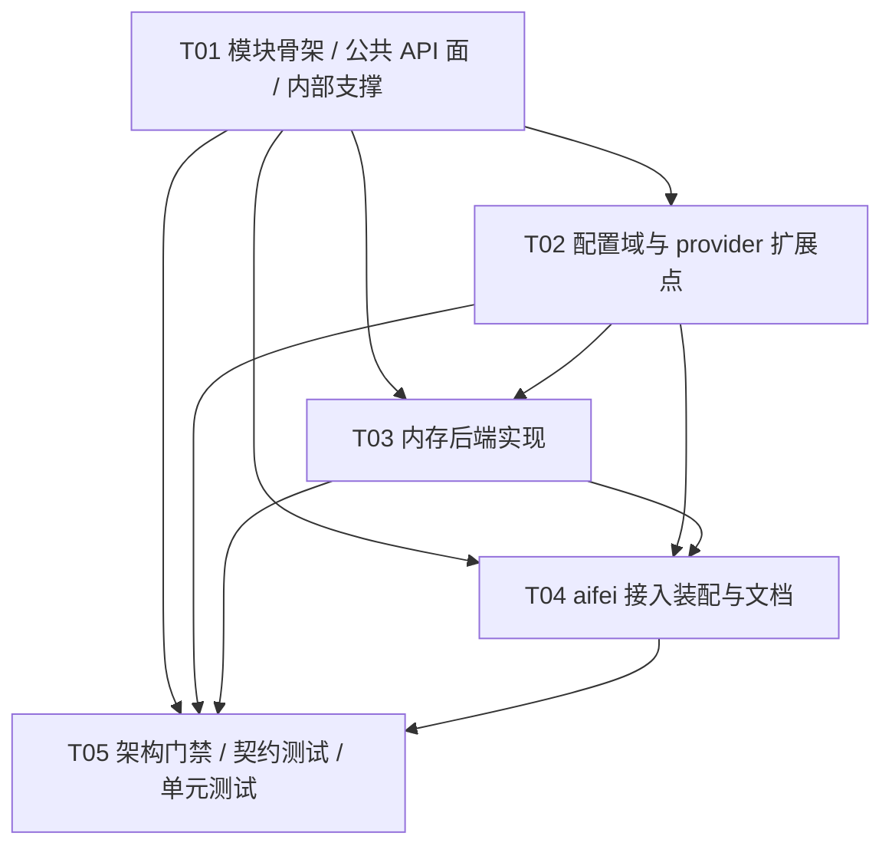

# aifei-mq 设计文档

本文是 `aifei-mq` 的**设计事实来源**：模块定位、公共 API 契约、装配链路、provider 扩展点、任务分解与门禁设计以本文为准。面向使用者（安装 / 用法 / 配置）的说明见 `README.md`；面向开发代理的约束见模块 `AGENTS.md`；测试策略见 `docs/testing.md`。

> **交付性质**：`aifei-mq` 是 aifei 生态的**库模块（可被应用依赖的 SDK）**，**不是应用工程**。因此**没有** `AppConfig` / `Launcher` / `service/` 包 / `webapp/` / HTTP 路由 / HIO / 表结构 / Db+Row / Generator；只有「公共 API + 内部实现 + 一个装配用 `MqPlugin`」。
>
> **文档状态**：1.0.0 已按本文实现，并通过模块内自测（架构门禁 5 项 + 总线契约 11 项），**尚未对外发布**。§5 的三项裁决（投递语义 / provider 抽象粒度 / 关闭语义）与公共面（§3）属**已定档**契约；其余为实现细节。已定档项变更前**必须先更新本文**。

---

## 1. 模块定位与设计原则

### 1.1 定位

`aifei-mq` 为 aifei 应用补齐框架未覆盖的**异步消息能力**（解耦、削峰）。业务代码只依赖公共接口，换 MQ 中间件只改配置、不改代码（与 `aifei-cache` 换后端、`aifei-websocket` 换实现的思路一致）。

- 坐标：`io.github.gollyhu:aifei-mq:1.0.0`
- 包名：`cn.hg.aifei.mq`
- 技术基线：**Java 8**（语法与 API 双约束，主 JAR class major version = 52）

### 1.2 为什么是「库/SDK」而非应用工程

本模块提供的是**可被别的应用依赖的能力**，自身不承载任何应用装配。对照 aifei 应用工程（`AppConfig` / 入口类 / Just Service / HIO / `webapp/`）逐项说明：

| 应用工程要素 | 本模块 | 理由 |
| --- | --- | --- |
| `AppConfig implements AifeiConfig` | **不提供** | 装配由**使用方应用**的 `AppConfig` 完成，本模块只提供 `MqPlugin` 供其 `plugins.add(...)` |
| `Launcher`（`Aifei.start`） | **不提供** | 入口属应用 |
| `service/` 包（Just Service） | **不提供** | 本模块是基础设施 SDK，不是业务 |
| HIO / 路由 / `webapp/` | **不提供** | 无 HTTP 面 |
| 表结构 / Db+Row / Generator | **不提供** | 无持久化（消息不落库，本版无持久化需求） |

模块目录内 `mvn clean verify` 必须 **0 failure / 0 error**（含架构门禁测试）。

### 1.3 「单一内建默认后端 + provider 扩展点」

按已拍板决策（需求文档第三节第 1 条），**首批后端 = 内存/本地实现**：零第三方运行依赖，无中间件即可完整单测跑通框架；真实后端（Kafka / RocketMQ 等）后续以 **provider 扩展点**追加。

- 默认后端标识 `"memory"`，其实现落 `cn.hg.aifei.mq.memory`；
- 新增后端 = 新增 `XxxMqProvider`（`extends AbstractMqProvider`）+ 在 `MqProviderRegistry` 静态初始化块加**一行**注册；**不回头改 `MqPlugin` 装配逻辑**（与 `aifei-cache` 完全同构）；
- 后端配置沿用 `mq.<type>.*`；**内存后端无额外键**（**不引入** `mq.memory.*`）；
- provider 扩展点已由需求文档明文要求，属**需求内**；除此之外**不自增**扩展点或抽象层。

> ⚠️ 本模块的 provider 路线**学 `aifei-cache`（`CacheProvider` / `CacheProviderRegistry` / `AbstractCacheProvider`）**；`aifei-websocket` 已删除 provider/SPI/type 配置（纯 JDK 自实现路线），**其 provider 路线不可照搬**。

### 1.4 公共面收敛纪律（硬约束）

| # | 纪律 |
| --- | --- |
| 1 | **公共 API 零第三方类型**：根包 7 个公共类型**不含**任何第三方类型 |
| 2 | **公共 API 零框架类型**：`cn.aifei.*` 只允许出现在 `cn.hg.aifei.mq.aifei` 接入包（即只允许 `MqPlugin` 一个类引用框架） |
| 3 | 根包公共类型**逐个列出并说明职责**（§3），**精确 7 个**；新增公共类型必须先过设计决策 |
| 4 | **零第三方运行依赖**：仅 `cn.aifei:aifei-all`（`provided`）；测试依赖 `junit`（`test`） |
| 5 | Java 8 语法与 API；主 JAR class major version = 52 |
| 6 | 每类规则只有一个定义点（校验 / 配置域常量 / 编解码 / 注册表 / 总线投递 / 单例持有） |

> 第 1、2 条由**架构门禁测试** `ArchitectureBoundaryTest` 强制（§12），不得放宽或绕过；门禁扫描源码文本，**必须在模块根目录执行**。

### 1.5 设计原则

1. **接口极简、实现无关**：业务只依赖根包 7 类型与 `MqKit`；实现经 `@Inject Producer` / `@Inject Consumer` 或 `MqKit` 取用。
2. **零依赖优先**：默认内存后端零第三方依赖；`aifei-all` 为 `provided`。
3. **行为契约可测**：投递语义、异常分类、关闭语义、配置键名全部定档到「可写断言」的程度（§5）。
4. **保持极简**：不做未被需求驱动的抽象；provider 扩展点是需求内唯一允许的抽象。
5. **基线一致**：无页面，故无 UI 基线；公共面与配置键名对齐需求文档第四节。

---

## 2. 术语表

| 术语 | 含义 | 归属 |
| --- | --- | --- |
| **主题 topic** | 消息的投递通道名；订阅与发送都以它配对 | 根包 / 配置 |
| **消息 Message** | 一次消息载荷：主题 + `byte[]`，不可变、防御性拷贝 | 根包（公共） |
| **载荷 payload** | `Message.payload()` 的 `byte[]`；UTF-8 文本经 `send(topic, String)` 便捷编码后进入 | 根包 |
| **生产者 Producer** | 发送端视图：3 个 `send` 重载 | 根包（公共接口） |
| **消费者 Consumer** | 订阅端视图：`subscribe` | 根包（公共接口） |
| **监听器 MessageListener** | 消费回调：`onMessage(Message)`，函数式接口 | 根包（公共接口） |
| **发送结果 SendResult** | `topic` + `messageId`；失败即抛异常，**无 success 布尔** | 根包（公共） |
| **门面 MqKit** | `send`×3 + `subscribe` + `producer()` / `consumer()` | 根包（公共） |
| **总线 MessageBus** | 后端统一内部对象：产出 Producer / Consumer 两个视图 + 生命周期 | `internal`（契约）/ `memory`（实现） |
| **后端标识 type** | `mq.type` 取值，如 `"memory"`；白名单由注册表派生 | `internal` |
| **后端 provider** | 一种后端的装配契约：解析配置并建总线；**必须无状态** | `internal`（契约）/ 各实现包 |
| **注册表** | `type` → 无状态 provider 的映射，静态初始化块注册 | `internal.MqProviderRegistry` |
| **单例持有 MqHolder** | 运行期登记 `Producer` / `Consumer` 单例，供 `MqKit` 取用 | `internal` |

---

## 3. 公共 API 契约（根包精确 7 类型）

根包 `cn.hg.aifei.mq` **精确 7 个公共类型**：`Message` / `Producer` / `Consumer` / `MessageListener` / `SendResult` / `MqKit` / `MqException`。此清单为门禁断言 `EXPECTED_PUBLIC_TYPES` 的**唯一事实来源**。

### 3.1 `Message`（不可变值对象）

```java
public final class Message {
    private final String topic;
    private final byte[] payload;

    private Message(String topic, byte[] payload) { ... }

    public static Message of(String topic, byte[] payload);   // 唯一工厂
    public String topic();
    public byte[] payload();                                  // 防御性拷贝（出参）
    // equals / hashCode / toString（值语义）
}
```

- **私有构造 + 唯一静态工厂 `of`**；**不提供** String 工厂、**不提供**任何解码访问器（如 `asString()` / `text()`）。
- 校验经 `internal.MqValidator`（`requireTopic` 非空非空白 + `requirePayload` 非空）——**校验唯一定义点**，不在本类内联复制规则。
- `payload` **入参出参双向防御性拷贝**（`of` 时 clone、`payload()` 返回 clone）。
- `equals` 按「`topic` + `payload` 字节内容」判定；`hashCode` 用 `Arrays.hashCode`。

### 3.2 `Producer`（公共接口）

```java
public interface Producer {
    SendResult send(Message message);
    SendResult send(String topic, byte[] payload);
    SendResult send(String topic, String text);   // 便捷重载：text 以 UTF-8 编码为 payload
}
```

- **恰好 3 个 `send` 重载**，不多不少。
- 语义：**同步投递**（§5.1）；无订阅者时**视为成功**（消息丢弃，仍返回 `SendResult`）。

### 3.3 `Consumer`（公共接口）

```java
public interface Consumer {
    void subscribe(String topic, MessageListener listener);
}
```

- 返回 **`void`**；**本版不提供取消订阅**（无 `unsubscribe`）。

### 3.4 `MessageListener`（公共函数式接口）

```java
@FunctionalInterface
public interface MessageListener {
    void onMessage(Message message);
}
```

### 3.5 `SendResult`（不可变值对象）

```java
public final class SendResult {
    private final String topic;
    private final String messageId;

    private SendResult(String topic, String messageId) { ... }

    public static SendResult of(String topic, String messageId);   // 唯一工厂
    public String topic();
    public String messageId();
    // equals / hashCode / toString（值语义）
}
```

- 字段**仅** `topic` + `messageId`，**无 success 布尔**（失败即抛 `MqException`；参数非法抛 `IllegalArgumentException`）。
- `messageId` 由**后端**生成（内存后端格式见 §5.1）。
- 校验经 `internal.MqValidator`（`requireTopic` + `requireMessageId`）。

### 3.6 `MqException`（唯一未受检异常）

```java
public class MqException extends RuntimeException {
    public MqException(String message);
    public MqException(String message, Throwable cause);
}
```

- **单一未受检异常**，**不细分**连接异常（层次不细分）。
- **仅在「运行时故障」场景抛出**；参数非法用 `IllegalArgumentException`、状态非法用 `IllegalStateException`（分类见 §5.4）。
- 内存后端**无外部运行时故障源**，故本版不会从 `memory` 抛出 `MqException`；该类型为后续真实后端与运行时故障保留。

### 3.7 `MqKit`（公共门面）

```java
public final class MqKit {
    private MqKit() { }

    public static Producer producer();                    // 未启动 → IllegalStateException
    public static Consumer consumer();                    // 未启动 → IllegalStateException
    public static SendResult send(Message message);
    public static SendResult send(String topic, byte[] payload);
    public static SendResult send(String topic, String text);
    public static void subscribe(String topic, MessageListener listener);
}
```

- 镜像 `CacheUtil` / `WebSocketKit` 的便捷入口范式：`producer()` / `consumer()` 经 `internal.MqHolder` 取运行期单例；`send`×3 与 `subscribe` 只做转发（**不重复校验、不转换异常**）。
- 未启动 / 已停止时取单例 → `IllegalStateException`（与 `CacheUtil.use()` 语义一致）。

### 3.8 公共面计数口径（供门禁复用）

「根包公共类型」= `src/main/java/cn/hg/aifei/mq/` **目录直接子级的 `.java` 文件**（不含任何子包目录）。`MqPlugin` 位于接入包 `.../mq/aifei/`，**不计入**；`internal` / `memory` 下文件不计入。

| # | 类型 | 形态 |
| --- | --- | --- |
| 1 | `Message` | final class |
| 2 | `Producer` | interface |
| 3 | `Consumer` | interface |
| 4 | `MessageListener` | interface（函数式） |
| 5 | `SendResult` | final class |
| 6 | `MqKit` | final class（静态门面） |
| 7 | `MqException` | class（extends RuntimeException） |

---

## 4. 内部结构

### 4.1 `internal`（非承诺 API，**框架无关**）

> 关键约束：门禁规定 `cn.aifei.*` 只允许出现在 `aifei` 接入包，**故 `internal` 与 `memory` 一律不得 import `Prop` 等框架类型**。配置**对象**与**键常量**留 `internal`；把 `Prop` 转为 JDK `Properties` 的**一行读取**留在 `aifei.MqPlugin`（§4.3）。

| 类型 | 形态 | 职责 |
| --- | --- | --- |
| `MqValidator` | final + 静态方法 | **参数校验唯一定义点**：`requireTopic` / `requirePayload` / `requireText` / `requireMessage` / `requireMessageId` / `requireListener` / `requireProducer` / `requireConsumer`（违规抛 `IllegalArgumentException`） |
| `MqConfig` | final 值对象 | **配置域与键常量唯一定义点**：`ROOT_PREFIX="mq"`、`TYPE_KEY="mq.type"`、`DEFAULT_TYPE="memory"`；`parse(Properties, Set)`（读 `mq.type`，缺省 `memory`，未注册类型抛 `IllegalArgumentException`）；`type()` / `prefix()`（`"mq." + type`）/ `get(relativeKey)`（读 `mq.<type>.<relativeKey>`） |
| `TextCodec` | final + 静态方法 | **编解码唯一定义点**：`encode(String) : byte[]`（UTF-8）；本版只提供编码方向（`Message` 不解码） |
| `MqHolder` | final + 静态方法 | **运行期单例持有唯一定义点**：`register(Producer, Consumer)` / `producer()` / `consumer()` / `clear()`；未登记时取用抛 `IllegalStateException` |
| `MessageBus` | interface（`extends AutoCloseable`） | **总线契约**：`producer()` / `consumer()`（同一总线上的两个视图）/ `close()` |
| `MqProvider` | interface | **后端扩展点**：`type()` / `createBus(MqConfig)` |
| `AbstractMqProvider` | abstract | **provider 装配骨架**：`createBus` 为 `final` 模板方法（校验 `config` 非空后委托），`buildBus(MqConfig)` 抽象；基类**不持有实例字段**、可多线程复用 |
| `MqProviderRegistry` | final | **注册表**：静态 `LinkedHashMap<String, MqProvider>` + 静态初始化块注册 `"memory"`；`getProvider(String)`（未注册抛 `IllegalArgumentException`，消息含支持类型集合）/ `types()`（供 `MqConfig` 派生白名单） |

> **不提供** `MqProviderRegistry.register(String, MqProvider)` 公开方法：扩展后端的既定方式是**改静态初始化块一行**，避免未使用的 API 面（对齐需求「注册表静态初始化里注册一行」）。

### 4.2 `memory`（默认后端实现，`cn.hg.aifei.mq.memory`）

| 类型 | 形态 | 职责 |
| --- | --- | --- |
| `MemoryMqProvider` | extends `AbstractMqProvider` | 后端 provider：`TYPE` 引用 `MqConfig.DEFAULT_TYPE`；`type()`；`buildBus(config)` → `new MemoryMessageBus(config)` |
| `MemoryMessageBus` | implements `MessageBus` | 进程内发布-订阅总线：持有 `ConcurrentHashMap<String, CopyOnWriteArrayList<MessageListener>>`（订阅登记）、`AtomicLong`（messageId 序号）、`volatile boolean closed`；构造时创建两个视图；包级 `publish(Message)` / `subscribe(topic, listener)` 供视图委托；`close()` 幂等 |
| `MemoryProducer` | implements `Producer` | 生产视图：委托 `bus.publish`；`send(topic, String)` 经 `TextCodec.encode` |
| `MemoryConsumer` | implements `Consumer` | 消费视图：经 `MqValidator` 校验后委托 `bus.subscribe` |

**投递实现要点**：`publish` 先判 `closed`，再分配 `messageId`，再**按订阅登记顺序**逐个同步回调；单个监听器抛出的 `RuntimeException` **就地隔离捕获**（不中断其余订阅者、不上抛），返回 `SendResult`。`subscribe` 判 `closed` 后追加登记。

### 4.3 `aifei`（装配接入，`cn.hg.aifei.mq.aifei`）

| 类型 | 形态 | 职责 |
| --- | --- | --- |
| `MqPlugin` | implements `cn.aifei.plugin.Plugin` | **全模块唯一 import 框架类型的类**；构造只持 `Prop`；`start()` 解析配置并注册单例，`stop()` 注销并关闭总线 |

装配细节：`MqPlugin` 构造器 `MqPlugin(Prop prop)`（`prop == null` 抛 `IllegalArgumentException`），**单构造器**（已拍板决策第 4 条：单个 `MqPlugin` 同时注册 `Producer` / `Consumer` 单例，共用 `mq.*` 配置）。

---

## 5. 契约决策（三项定档 + 异常 + 配置）

### 5.1 编辑项 1 —— 投递语义（**背书拟定稿 + 精度补充**）

**结论**：

| 维度 | 定档 |
| --- | --- |
| 投递模型 | **同步投递**：`send` 在**调用线程内**依次同步回调订阅者，返回前回调已完成 |
| 线程模型 | 回调**在同一线程直接执行**（生产者的调用线程），本模块**不引入任何线程池 / 队列 / 背压** |
| 有序范围 | **单主题 FIFO**：同一主题内，`publish` 的完成顺序即投递顺序；**不保证跨主题顺序** |
| 多订阅者顺序 | 同一主题多个订阅者按 **`subscribe` 登记顺序**（`CopyOnWriteArrayList` 迭代顺序）依次回调 |
| 无订阅者 | **视为成功**：消息丢弃，仍返回 `SendResult`（`messageId` 已分配） |
| `messageId`（内存后端） | 进程内**全局单调递增**的长整型**十进制字符串**（`Long.toString(messageSeq.incrementAndGet())`）；唯一定义点 `MemoryMessageBus` |

**补充说明（拟定稿未覆盖，由架构师定档）**：

1. **跨线程并发**：多个线程并发 `send` 同一主题时，二者相对顺序不作保证（各自仍在自己的调用线程内同步完成）；单线程连续 `send` 的次序**严格保序**。
2. **重入**：允许在 `onMessage` 内再次 `send`（同步、可重入）；调用方自行避免无限递归。

### 5.2 编辑项 3 —— provider 抽象粒度（**背书拟定稿 + 精确签名**）

**结论**：provider 创建**统一内部消息总线**；**Producer / Consumer 是同一总线上的两个视图**（单 `MqPlugin` 共用一个后端实例，避免二者各建连）。

精确签名定格：

```java
// internal.MqProvider —— 后端装配契约（无状态）
public interface MqProvider {
    String type();
    MessageBus createBus(MqConfig config);
}

// internal.MessageBus —— 统一内部总线契约
public interface MessageBus extends AutoCloseable {
    Producer producer();
    Consumer consumer();
    void close();
}

// internal.AbstractMqProvider —— 装配骨架（无状态、无实例字段）
public abstract class AbstractMqProvider implements MqProvider {
    @Override public abstract String type();
    @Override public final MessageBus createBus(MqConfig config) {
        if (config == null) throw new IllegalArgumentException("config can not be null");
        return buildBus(config);
    }
    protected abstract MessageBus buildBus(MqConfig config);
}

// internal.MqProviderRegistry —— 静态注册表（对齐 CacheProviderRegistry）
public final class MqProviderRegistry {
    private static final Map<String, MqProvider> PROVIDERS = new LinkedHashMap<>();
    static {
        PROVIDERS.put(MemoryMqProvider.TYPE, new MemoryMqProvider());   // ← 新增后端加这一行
    }
    public MqProvider getProvider(String type);   // 未注册 → IllegalArgumentException（含 types()）
    public Set<String> types();                   // 供 MqConfig 派生白名单
}
```

**理由**：单 Plugin 需要一个后端实例、两个公共视图；若 provider 分别产出 producer / consumer，会迫使真实后端（如 Kafka）两次建连且各自持配置，违背「统一总线、共用一个后端」的取舍。让总线产出两个视图，使「单一后端实例」在装配层天然成立。

**与 `aifei-cache` 的对齐**：`MqProvider` / `MqProviderRegistry` / `AbstractMqProvider` 三层职责与 cache 完全同构（无状态契约 + 静态注册表 + 装配骨架）；差异仅在 cache 的 provider 返回 `Cache`，本模块返回 `MessageBus`。

### 5.3 编辑项 6 —— 关闭语义（**背书拟定稿 + 一处修正**）

| 维度 | 定档 |
| --- | --- |
| `MqPlugin.stop()` 幂等 | **是**：未启动时直接返回，不重复关闭 |
| drain 在途消息 | **不需要**：同步投递下 `send` 返回即已投递完毕，总线上无在途消息 |
| `stop()` 后 `send` / `subscribe` | **抛 `IllegalStateException`**（见下方⚠️修正） |
| 监听器运行时异常 | **由总线就地隔离捕获**：不中断同主题其他订阅者、**不上抛**给生产者 |
| `MqPlugin.stop()` 与总线 `close()` 关系 | `stop()` 内**先** `MqHolder.clear()`（此后 `MqKit` 取单例即失败）、**再** `bus.close()`（幂等）、最后 `bus=null; started=false` |
| plugin 生命周期 | `start()`：解析配置 → 注册单例（`MqHolder.register` + `AopKit.addSingletonObject(Producer.class/Consumer.class)`）；`stop()`：注销单例（`MqHolder.clear()`）→ 关闭总线 |

> ⚠️ **对拟定稿的修正**：拟定稿写「`stop()` 后 `send`/`subscribe` 抛 `MqException`」。这与§4 已锁定的**异常分类**（「**状态非法（`stop()` 后调用 / 未启动）→ `IllegalStateException`**」）冲突。**以已锁定的分类为准**，本设计定档为 **`IllegalStateException`**：`stop()` 后属**状态非法**，不是运行时故障。`MqException` 只留「运行时故障」一档。

**监听器异常隔离的取舍**：本模块零第三方依赖、公共面无框架类型，**不引入任何日志依赖**，故监听器抛出的 `RuntimeException` **静默丢弃**（不上抛、不打印）。这是本版已知取舍；后续真实后端 provider 可自行补充可观测性（属实现包自由，不进公共面）。

### 5.4 异常分类（对齐已锁定契约）

| 场景 | 异常 |
| --- | --- |
| **参数非法**（topic 空、payload / text / listener / message / prop / messageId 为 null、`mq.type` 未注册） | `IllegalArgumentException` |
| **状态非法**（`stop()` 后 `send` / `subscribe`；`MqKit` 未启动时取 `producer()` / `consumer()`） | `IllegalStateException` |
| **运行时故障**（后端运行时错误；真实后端连接失败等） | `MqException` |

### 5.5 配置域（对齐已锁定契约）

| 键 | 必填 | 默认 | 说明 |
| --- | --- | --- | --- |
| `mq.type` | **可选** | `memory` | 后端类型；指向**未注册**后端时 `start()` **立即** `IllegalArgumentException`，**不留半装配状态** |
| `mq.<type>.*` | 后端自定 | — | 后端专有配置，经 `MqConfig.get(relativeKey)` 读取；**内存后端无额外键**（**不引入** `mq.memory.*`） |

配置解析**全部在 `MqPlugin.start()` 内**完成；构造函数只持 `Prop` 引用，不解析、不校验。

---

## 6. 数据结构与接口（类图）

> 源文件：`docs/diagrams/class.mermaid`

```mermaid
classDiagram
    direction LR

    %% ─────────── 根包 cn.hg.aifei.mq（精确 7 个公共类型） ───────────
    class Message {
        -String topic
        -byte[] payload
        +static of(String topic, byte[] payload) Message
        +topic() String
        +payload() byte[]
    }
    class Producer {
        <<interface>>
        +send(Message message) SendResult
        +send(String topic, byte[] payload) SendResult
        +send(String topic, String text) SendResult
    }
    class Consumer {
        <<interface>>
        +subscribe(String topic, MessageListener listener) void
    }
    class MessageListener {
        <<interface>>
        +onMessage(Message message) void
    }
    class SendResult {
        -String topic
        -String messageId
        +static of(String topic, String messageId) SendResult
        +topic() String
        +messageId() String
    }
    class MqKit {
        +static producer() Producer
        +static consumer() Consumer
        +static send(Message message) SendResult
        +static send(String topic, byte[] payload) SendResult
        +static send(String topic, String text) SendResult
        +static subscribe(String topic, MessageListener listener) void
    }
    class MqException {
        +MqException(String message)
        +MqException(String message, Throwable cause)
    }

    %% ─────────── internal（非承诺 API，框架无关） ───────────
    class MqValidator {
        <<utility>>
        +static requireTopic(String topic) void
        +static requirePayload(byte[] payload) void
        +static requireText(String text) void
        +static requireMessage(Message message) void
        +static requireMessageId(String messageId) void
        +static requireListener(MessageListener listener) void
        +static requireProducer(Producer producer) void
        +static requireConsumer(Consumer consumer) void
    }
    class MqConfig {
        +static final ROOT_PREFIX
        +static final TYPE_KEY
        +static final DEFAULT_TYPE
        -String type
        -String prefix
        -Properties properties
        +static parse(Properties properties, Set~String~ registeredTypes) MqConfig
        +type() String
        +prefix() String
        +get(String relativeKey) String
    }
    class TextCodec {
        <<utility>>
        +static encode(String text) byte[]
    }
    class MqHolder {
        <<utility>>
        +static register(Producer producer, Consumer consumer) void
        +static producer() Producer
        +static consumer() Consumer
        +static clear() void
    }
    class MessageBus {
        <<interface>>
        +producer() Producer
        +consumer() Consumer
        +close() void
    }
    class MqProvider {
        <<interface>>
        +type() String
        +createBus(MqConfig config) MessageBus
    }
    class AbstractMqProvider {
        <<abstract>>
        +type() String
        +createBus(MqConfig config) MessageBus
        #buildBus(MqConfig config) MessageBus
    }
    class MqProviderRegistry {
        -static Map~String,MqProvider~ PROVIDERS
        +getProvider(String type) MqProvider
        +types() Set~String~
    }

    %% ─────────── memory 实现包 ───────────
    class MemoryMqProvider {
        +static final TYPE
        +type() String
        #buildBus(MqConfig config) MessageBus
    }
    class MemoryMessageBus {
        -Map~String,List~MessageListener~~ subscriptions
        -AtomicLong messageSeq
        -boolean closed
        +producer() Producer
        +consumer() Consumer
        +close() void
        ~publish(Message message) SendResult
        ~subscribe(String topic, MessageListener listener) void
    }
    class MemoryProducer {
        -MemoryMessageBus bus
        +send(Message message) SendResult
        +send(String topic, byte[] payload) SendResult
        +send(String topic, String text) SendResult
    }
    class MemoryConsumer {
        -MemoryMessageBus bus
        +subscribe(String topic, MessageListener listener) void
    }

    %% ─────────── aifei 接入包 ───────────
    class MqPlugin {
        -Prop prop
        -MqProviderRegistry registry
        -MessageBus bus
        -boolean started
        +MqPlugin(Prop prop)
        +start() void
        +stop() void
    }
    class Plugin {
        <<framework cn.aifei.plugin>>
    }
    class Prop {
        <<framework cn.aifei.util>>
    }

    %% ─────────── 关系 ───────────
    MqException --|> RuntimeException
    MemoryMqProvider --|> AbstractMqProvider
    AbstractMqProvider ..|> MqProvider
    MemoryMessageBus ..|> MessageBus
    MemoryProducer ..|> Producer
    MemoryConsumer ..|> Consumer
    MqPlugin ..|> Plugin
    MqPlugin --> Prop

    MemoryMessageBus --> MemoryProducer : creates
    MemoryMessageBus --> MemoryConsumer : creates
    MemoryProducer --> MemoryMessageBus : delegates publish
    MemoryConsumer --> MemoryMessageBus : delegates subscribe
    MemoryProducer ..> Message : creates
    MemoryProducer ..> TextCodec : encode
    MemoryProducer ..> MqValidator : validates
    MemoryConsumer ..> MqValidator : validates
    MemoryMessageBus ..> SendResult : creates
    MemoryMessageBus ..> MessageListener : invokes
    Message ..> MqValidator : validates
    SendResult ..> MqValidator : validates

    MqProvider ..> MessageBus : creates
    MqProvider ..> MqConfig : reads
    MqProviderRegistry o-- MqProvider : holds
    MqProviderRegistry ..> MemoryMqProvider : registers

    MqKit ..> MqHolder : uses
    MqKit ..> Producer : returns
    MqKit ..> Consumer : returns
    MqHolder o-- Producer
    MqHolder o-- Consumer

    MqPlugin ..> MqConfig : parse
    MqPlugin ..> MqProviderRegistry : getProvider
    MqPlugin ..> MessageBus : createBus / close
    MqPlugin ..> MqHolder : register / clear
```



---

## 7. 程序调用流程（时序图）

> 源文件：`docs/diagrams/sequence.mermaid`；覆盖 ① 启动链路 ② send 同步投递链路 ③ subscribe 消费链路 ④ stop 链路。

```mermaid
sequenceDiagram
    autonumber
    participant App as 业务应用
    participant Aifei as Aifei（框架）
    participant Plugin as MqPlugin
    participant Cfg as MqConfig
    participant Reg as MqProviderRegistry
    participant Prov as MemoryMqProvider
    participant Bus as MemoryMessageBus
    participant Prod as MemoryProducer
    participant Cons as MemoryConsumer
    participant Holder as MqHolder
    participant Aop as AopKit（框架）
    participant Val as MqValidator
    participant Codec as TextCodec
    participant Listener as MessageListener

    Note over App,Aop: ① 启动链路
    App->>Aifei: AppConfig.config(Plugins): plugins.add(new MqPlugin(prop))
    App->>Aifei: Aifei.start(config)
    Aifei->>Plugin: start()
    Plugin->>Cfg: parse(prop.getProperties(), Reg.types())
    Cfg->>Reg: types()
    Reg-->>Cfg: {"memory"}
    Cfg-->>Plugin: MqConfig(type="memory", prefix="mq.memory")
    Plugin->>Reg: getProvider("memory")
    Reg-->>Plugin: MemoryMqProvider
    Plugin->>Prov: createBus(config)
    Prov->>Bus: new MemoryMessageBus(config)
    Bus-->>Prov: bus
    Prov-->>Plugin: MessageBus
    Plugin->>Bus: producer()
    Bus-->>Plugin: MemoryProducer
    Plugin->>Bus: consumer()
    Bus-->>Plugin: MemoryConsumer
    Plugin->>Holder: register(producer, consumer)
    Plugin->>Aop: addSingletonObject(Producer.class, producer)
    Plugin->>Aop: addSingletonObject(Consumer.class, consumer)
    Plugin-->>Aifei: started = true

    Note over App,Listener: ② send 同步投递链路
    App->>Holder: MqKit.send("topic", "hello")
    Holder-->>App: Producer（未启动 → IllegalStateException）
    App->>Prod: send(topic, text)
    Prod->>Val: requireText(text)
    Prod->>Codec: encode(text)
    Codec-->>Prod: byte[]（UTF-8）
    Prod->>Prod: Message.of(topic, bytes) → Val.requireTopic / requirePayload
    Prod->>Bus: publish(message)
    alt 总线已关闭
        Bus-->>Prod: IllegalStateException
    else 总线开启
        Bus->>Bus: messageId = Long.toString(messageSeq.incrementAndGet())
        loop 该主题订阅者（按登记顺序）
            Bus->>Listener: onMessage(message)
            Note over Bus,Listener: RuntimeException → 就地隔离，不中断其余、不上抛
        end
        Bus-->>Prod: SendResult(topic, messageId)
    end
    Prod-->>App: SendResult

    Note over App,Listener: ③ subscribe 消费链路
    App->>Holder: MqKit.subscribe("topic", listener)
    Holder-->>App: Consumer（未启动 → IllegalStateException）
    App->>Cons: subscribe(topic, listener)
    Cons->>Val: requireTopic(topic) / requireListener(listener)
    Cons->>Bus: subscribe(topic, listener)
    alt 总线已关闭
        Bus-->>Cons: IllegalStateException
    else 总线开启
        Bus->>Bus: subscriptions[topic].add(listener)
        Bus-->>Cons: void
    end
    Cons-->>App: void

    Note over App,Bus: ④ stop 链路
    App->>Aifei: 应用停止
    Aifei->>Plugin: stop()
    alt 未启动
        Plugin-->>Aifei: 直接返回（幂等）
    else 已启动
        Plugin->>Holder: clear()
        Plugin->>Bus: close()
        Bus->>Bus: closed = true; subscriptions.clear()
        Bus-->>Plugin: void
        Plugin->>Plugin: bus = null; started = false
        Plugin-->>Aifei: 关闭完成
    end
```

---

## 8. 文件清单（库模块布局）

```
aifei-mq/
├── pom.xml                                   # Java 8；aifei-all provided；junit test；无第三方运行依赖
├── README.md                                 # 用法 / 配置（面向使用者）
├── AGENTS.md                                 # 开发约束（面向开发代理）
├── docs/
│   ├── design.md                             # ★ 本文（契约事实来源）
│   ├── testing.md                            # 测试策略与用例清单
│   └── diagrams/
│       ├── class.mermaid                     # 类图
│       └── sequence.mermaid                  # 时序图
└── src/
    ├── main/java/cn/hg/aifei/mq/
    │   ├── Message.java                      # 【公共】不可变值对象
    │   ├── Producer.java                     # 【公共】接口
    │   ├── Consumer.java                     # 【公共】接口
    │   ├── MessageListener.java              # 【公共】函数式接口
    │   ├── SendResult.java                   # 【公共】不可变值对象
    │   ├── MqKit.java                        # 【公共】静态门面
    │   ├── MqException.java                  # 【公共】唯一未受检异常
    │   ├── internal/                         # 非承诺 API（框架无关）
    │   │   ├── MqValidator.java              # 参数校验唯一定义点
    │   │   ├── MqConfig.java                 # 配置域与键常量唯一定义点
    │   │   ├── TextCodec.java                # 编解码唯一定义点（UTF-8）
    │   │   ├── MqHolder.java                 # 运行期单例持有唯一定义点
    │   │   ├── MessageBus.java               # 总线契约
    │   │   ├── MqProvider.java               # 后端扩展点契约
    │   │   ├── AbstractMqProvider.java       # provider 装配骨架
    │   │   └── MqProviderRegistry.java       # 后端注册表（静态初始化块）
    │   ├── memory/                           # 默认后端实现包
    │   │   ├── MemoryMqProvider.java         # 内存后端 provider
    │   │   ├── MemoryMessageBus.java         # 内存消息总线
    │   │   ├── MemoryProducer.java           # 生产视图
    │   │   └── MemoryConsumer.java           # 消费视图
    │   └── aifei/                            # 接入包（框架类型唯一落点）
    │       └── MqPlugin.java                 # 唯一 import 框架类型的类
    └── test/java/cn/hg/aifei/mq/
        ├── ArchitectureBoundaryTest.java     # 架构门禁（源码文本扫描）
        ├── MessageBusContractTest.java       # 契约测试基类（abstract）
        ├── MemoryMessageBusContractTest.java # 内存实现继承运行
        ├── MqConfigTest.java                 # 配置域单测
        ├── MessageTest.java                  # 值对象单测（含防御性拷贝）
        ├── SendResultTest.java               # 值对象单测
        ├── MqValidatorTest.java              # 校验规则与异常类型
        ├── MqHolderTest.java                 # 单例持有 / 未启动异常
        ├── MqKitTest.java                    # 门面转发与状态异常
        └── MqPluginTest.java                 # 装配生命周期与幂等
```

**新增文件计数**：主源码 20 个（根包 7 + internal 8 + memory 4 + aifei 1）；测试 10 个。

---

## 9. 依赖包

```xml
<!-- 框架内核：provided，消费方自带，不向下游传递 -->
<dependency>
    <groupId>cn.aifei</groupId>
    <artifactId>aifei-all</artifactId>
    <version>1.1.1</version>
    <scope>provided</scope>
</dependency>

<!-- 测试：单元测试 + 门禁 -->
<dependency>
    <groupId>junit</groupId>
    <artifactId>junit</artifactId>
    <version>4.13.2</version>
    <scope>test</scope>
</dependency>
```

| 依赖 | 范围 | 用途 |
| --- | --- | --- |
| `cn.aifei:aifei-all:1.1.1` | `provided` | 框架内核：`cn.aifei.plugin.Plugin` / `cn.aifei.aop.AopKit` / `cn.aifei.util.Prop`（**仅 `aifei` 接入包使用**） |
| `junit:junit:4.13.2` | `test` | 单元测试与架构门禁 |

- **无第三方运行依赖**：默认内存后端零第三方；**不得**引入任何 MQ 客户端 / 日志绑定（后续真实后端按其 provider 实现包自带 `optional` 依赖，不向下游传递）。
- 构建插件：`maven-compiler-plugin:3.15.0`（`source`/`target` = `1.8`，UTF-8）、`maven-surefire-plugin:3.2.5`。与 `aifei-websocket/pom.xml` 一致。

---

## 10. 任务分解

> **执行角色**：本任务**只激活 `aifei-service-engineer`**（数据层与前端不激活——无表结构、无 UI）。下列 5 个任务设计为**由服务工程师单角色顺序执行**。
>
> **执行状态**：T01–T05 均已执行完毕（主源码 20 个、测试 10 个齐备，与 §8 文件清单一致），模块内自测通过（架构门禁 5 项 + 总线契约 11 项）；**尚未对外发布**。
>
> **硬上限 ≤ 5 个任务**；每任务 ≥ 3 个相关文件；按**功能**分组，不按单文件拆分。

### 10.1 任务列表（按依赖排序）

| 任务 ID | 任务名称 | 源文件 | 依赖 | 优先级 | 建议执行者 |
| --- | --- | --- | --- | --- | --- |
| **T01** | 模块骨架、公共 API 面与内部支撑 | `pom.xml`；`Message.java`、`Producer.java`、`Consumer.java`、`MessageListener.java`、`SendResult.java`、`MqException.java`、`MqKit.java`；`internal/MqValidator.java`、`internal/TextCodec.java`、`internal/MqHolder.java` | — | P0 | `aifei-service-engineer` |
| **T02** | 配置域与 provider 扩展点 | `internal/MqConfig.java`、`internal/MessageBus.java`、`internal/MqProvider.java`、`internal/AbstractMqProvider.java`、`internal/MqProviderRegistry.java` | T01 | P0 | `aifei-service-engineer` |
| **T03** | 内存后端实现 | `memory/MemoryMqProvider.java`、`memory/MemoryMessageBus.java`、`memory/MemoryProducer.java`、`memory/MemoryConsumer.java` | T01, T02 | P0 | `aifei-service-engineer` |
| **T04** | aifei 接入装配与文档 | `aifei/MqPlugin.java`；`README.md`、`AGENTS.md`、`docs/testing.md` | T01, T02, T03 | P0 | `aifei-service-engineer` |
| **T05** | 架构门禁、契约测试与单元测试 | `ArchitectureBoundaryTest.java`、`MessageBusContractTest.java`、`MemoryMessageBusContractTest.java`、`MqConfigTest.java`、`MessageTest.java`、`SendResultTest.java`、`MqValidatorTest.java`、`MqHolderTest.java`、`MqKitTest.java`、`MqPluginTest.java` | T01–T04 | P0 | `aifei-service-engineer` |

**任务要点**：

- **T01**：先落 `pom.xml`（Java 8 / `aifei-all` provided / junit test），再落 7 个公共类型与 3 个内部支撑。`Message.of` / `SendResult.of` 的校验经 `MqValidator`；`MqKit` 经 `MqHolder`。完成后应可独立 `mvn clean compile`。
- **T02**：`MqProviderRegistry` 静态初始化块注册 `"memory"`（引用 `MemoryMqProvider.TYPE`）——此时 `memory` 包尚未建，允许先以引用占位、由 T03 补齐（或 T02/T03 连做一次编译）。`MqConfig` 为纯 JDK 依赖，不得 import `Prop`。
- **T03**：`MemoryMessageBus` 实现同步投递、订阅登记、`close()` 幂等与监听器异常隔离（§5.1 / §5.3）。
- **T04**：`MqPlugin` 是**唯一** import `cn.aifei.*` 的类；`start()` 读 `prop.getProperties()` 后交 `MqConfig.parse`。
- **T05**：门禁测试**须在模块根目录执行**；契约测试基类用抽象工厂 `protected abstract MessageBus newBus();`，内存实现继承运行。

### 10.2 任务依赖图



---

## 11. 共享知识（跨文件横切约定）

### 11.1 唯一定义点清单（实现类不得复制）

| 规则 | 唯一定义点 |
| --- | --- |
| 参数校验（topic / payload / text / message / messageId / listener / producer / consumer） | `internal.MqValidator` |
| 配置域与键常量、`mq.type` 解析与校验、`mq.<type>.<relative>` 键拼装 | `internal.MqConfig` |
| `String` → `byte[]` 编码（UTF-8） | `internal.TextCodec` |
| 后端扩展点契约 | `internal.MqProvider` |
| provider 装配骨架 | `internal.AbstractMqProvider` |
| 后端注册表（静态初始化块一行） | `internal.MqProviderRegistry` |
| 总线契约 | `internal.MessageBus` |
| 运行期单例持有 | `internal.MqHolder` |
| 内存订阅登记、投递、`close()` | `memory.MemoryMessageBus` |
| 内存 `messageId` 生成 | `memory.MemoryMessageBus` |
| 后端标识字面量 `"memory"` | `internal.MqConfig.DEFAULT_TYPE`（`MemoryMqProvider.TYPE` 引用之） |

### 11.2 通用约定

- **语言 / 编码**：源码 UTF-8；缩进 4 空格；注释一律**简体中文**（保留英文原文的只有 javadoc 标签名、代码标识符、配置键名与异常消息）。
- **版权头**：原创 Java 文件使用统一版权头：
  ```java
  /*
   * Copyright 2014-2026 糊搞 (3722711@qq.com)
   *
   * https://gitee.com/gollyhu
   */
  ```
- **javadoc**：公共类型与公共成员**必须**写全 javadoc（`@param` / `@return` / `@throws`）；`internal` / `memory` 成员在非自明处书写；`aifei` 包公共类写全。公共面不得出现 `internal` 包行话（唯一定义点、注册表、总线、视图等）。
- **Java 8 双约束**：禁 `var` / `record` / `switch` 表达式 / text block / `sealed` / pattern matching；禁 `List.of` / `Map.of` 等 Java 9+ API；主 JAR class major = 52。
- **框架隔离**：`cn.aifei.*` 只出现在 `cn.hg.aifei.mq.aifei`；`internal` / `memory` **一律不 import** `Prop` 等框架类型。
- **第三方隔离**：本版无第三方运行依赖；第三方类型（未来）只允许出现在实现包（`memory` 及未来后端实现包）。
- **服务方法契约**：`send` / `subscribe` 失败时的异常分类见 §5.4；参数非法 `IllegalArgumentException`、状态非法 `IllegalStateException`、运行时故障 `MqException`。
- **配置解析时机**：一律在 `MqPlugin.start()` 内完成；构造函数只保留 `Prop` 引用，不解析、不校验、不建总线。
- **配置读取唯一口径**：后端专有键一律经 `MqConfig.get(relativeKey)`（内部拼 `prefix + "." + relativeKey`），**不得手写** `"mq.memory."` 等字面量。
- **provider 必须无状态**：不得声明实例字段保存解析结果；配置在 `createBus(config)` 内经参数现读现用；总线由子类 `buildBus` 创建。
- **命名一致**：术语一律用「主题 topic / 消息 Message / 生产者 Producer / 消费者 Consumer / 监听器 MessageListener / 总线 MessageBus / 后端 provider / 后端标识 type」，不得另起叫法。
- **门禁执行**：`ArchitectureBoundaryTest` 依赖相对路径 `src/main/java`，**必须在 `aifei-mq` 模块根目录执行** `mvn clean verify`。
- **文档同步**：公共行为变化须同步 `docs/design.md`（契约）与 `README.md`（用法 / 配置），并更新 `docs/testing.md`。

---

## 12. 架构门禁设计（`ArchitectureBoundaryTest`）

- **位置**：`src/test/java/cn/hg/aifei/mq/ArchitectureBoundaryTest.java`
- **机制**：`Files.walk(Paths.get("src/main/java"))` 收集全部 `.java`，按**源码文本**断言；路径分隔符归一化为 `/`。
- **执行位置**：**必须在 `aifei-mq` 模块根目录**（相对路径依赖），不得放宽断言。
- **关键常量**：
  - `SOURCE_ROOT = "src/main/java"`
  - `ROOT_PACKAGE = "cn/hg/aifei/mq/"`
  - `BRIDGE_PACKAGE = "cn/hg/aifei/mq/aifei/"`
  - `EXPECTED_PUBLIC_TYPES = 7`

### 12.1 断言清单

| # | 测试方法 | 断言口径 |
| --- | --- | --- |
| ① | `thirdPartyOnlyInImplementationPackage` | 对每个 `.java` 的每条 `import`：若 FQN **不以** `java.` / `javax.` / `cn.aifei.` / `cn.hg.aifei.mq.` 开头（即第三方或其它模块），则该文件路径**必须位于实现包**（既不是根包直接子文件、也不含 `/internal/`、也不含 `/aifei/`）；否则失败。本版无第三方依赖，全模块通过；未来后端实现包（如 `memory`）自动放行。 |
| ② | `frameworkOnlyInBridgePackage` | 含框架 import（`import cn.aifei.…` 且**不是** `import cn.hg.aifei.mq.…`）的文件，其路径必须包含 `BRIDGE_PACKAGE`，否则失败。 |
| ③ | `noSqlReference` | 全模块不得出现 `import java.sql.`，否则失败。 |
| ④ | `aifeiBridgePackageExists` | `SOURCE_ROOT/BRIDGE_PACKAGE` 必须为目录（接入包非空）；且存在以 `BRIDGE_PACKAGE + "MqPlugin.java"` 结尾的源文件。 |
| ⑤ | `publicSurfaceExact` | 根包**直接子文件**（路径含 `ROOT_PACKAGE` 且其后不再含 `/`）的 `.java` 数量**精确等于** `EXPECTED_PUBLIC_TYPES`（= 7）；且其文件名集合**精确等于**下方 7 个名字。 |

### 12.2 `EXPECTED_PUBLIC_TYPES` 钉死（唯一事实来源）

```java
private static final int EXPECTED_PUBLIC_TYPES = 7;

// 断言 ⑤ 同时校验文件名集合精确相等（防同名替换）
private static final Set<String> EXPECTED_ROOT_TYPES = new LinkedHashSet<>(Arrays.asList(
        "Message.java",
        "Producer.java",
        "Consumer.java",
        "MessageListener.java",
        "SendResult.java",
        "MqKit.java",
        "MqException.java"
));
```

> 口径说明：**「根包公共类型数量」= `src/main/java/cn/hg/aifei/mq/` 目录的直接子 `.java` 文件数**（子包 `internal` / `memory` / `aifei` 下的文件不计入；`MqPlugin` 在 `aifei/` 故不计入）。`isDirectRootFile(path)` 判定：`path` 含 `ROOT_PACKAGE` 且 `ROOT_PACKAGE` 之后的相对路径**不含 `/`**。

### 12.3 契约测试与单元测试（同属 T05）

- `MessageBusContractTest`（abstract）：抽象工厂 `protected abstract MessageBus newBus();`，覆盖「生产 → 订阅 → 消费」闭环、单主题 FIFO、多订阅者登记顺序、无订阅者成功、`close()` 幂等、`close()` 后 `send`/`subscribe` 抛 `IllegalStateException`、监听器异常隔离不中断其余订阅者。
- `MemoryMessageBusContractTest extends MessageBusContractTest`：`newBus()` 返回 `new MemoryMessageBus(config)`。
- 单元测试：`MqConfigTest`（默认值 / 未注册类型 / `prefix` / `get`）、`MessageTest`（校验 + 双向防御性拷贝）、`SendResultTest`、`MqValidatorTest`（异常类型）、`MqHolderTest`、`MqKitTest`（未启动 `IllegalStateException` + 转发）、`MqPluginTest`（生命周期 + 幂等 + 未注册后端启动失败不留半装配）。

---

## 13. 待明确事项与假设

| # | 事项 | 处理 / 假设 |
| --- | --- | --- |
| 1 | 编辑项 6 拟定稿「`stop()` 后 `send`/`subscribe` 抛 `MqException`」与已锁定异常分类冲突 | **已定档修正**为 `IllegalStateException`（§5.3）；理由：属「状态非法」一档，非运行时故障 |
| 2 | 配置**装载**（读 `Prop`）落在何处 | `internal` 不得 import 框架类型（门禁），故由 `aifei.MqPlugin` 做 `prop.getProperties()` 一行读取，`internal.MqConfig.parse(Properties, Set)` 承接解析/校验（框架无关）。**与需求文档第六节「internal：配置对象与装载」的差异已显式声明**：装载的**框架耦合部分**在接入包，配置对象与全部键常量/校验仍在 `internal` |
| 3 | 监听器异常隔离后是否需要可观测性 | 本版**静默丢弃**（零日志依赖、公共面无框架类型）；属已知取舍，后续真实后端 provider 可自行补充 |
| 4 | `SendResult` 构造方式 | 采用**私有构造 + 公开静态工厂 `of`**（对齐 `Message` 值对象惯例） |
| 5 | `MqProviderRegistry` 是否提供 `register` 公开方法 | **不提供**；扩展后端 = 改静态初始化块一行，避免未使用的 API 面（符合「简洁优先」） |
| 6 | `MqException` 在内存实现中是否会被抛出 | **不会**（无外部运行时故障源）；该类型为后续真实后端与运行时故障保留 |
| 7 | 后端标识字面量与 `mq.type` 默认值的单一来源 | `MqConfig.DEFAULT_TYPE = "memory"` 为唯一字面量；`MemoryMqProvider.TYPE` 引用之 |
| 8 | 跨线程并发 `send` 的顺序 | 不保证相对顺序（各调用线程内同步完成）；单线程连续 `send` 严格保序（§5.1） |
| 9 | 是否支持取消订阅 / 消费组 / 重试 / 持久化 | **均不在本版范围**（P1/P2，需求文档第四节） |

---

> **一句话总览**：根包 7 个公共类型（`Message` / `Producer` / `Consumer` / `MessageListener` / `SendResult` / `MqKit` / `MqException`）+ `internal` 非承诺支撑（校验 / 配置 / 编解码 / 单例持有 / 总线契约 / provider 契约与注册表）+ `memory` 默认后端（同步投递、单主题 FIFO、无订阅者成功、`close()` 幂等、监听器异常隔离）+ `aifei.MqPlugin` 单一装配入口；后端可替换 = provider + 注册表一行。
