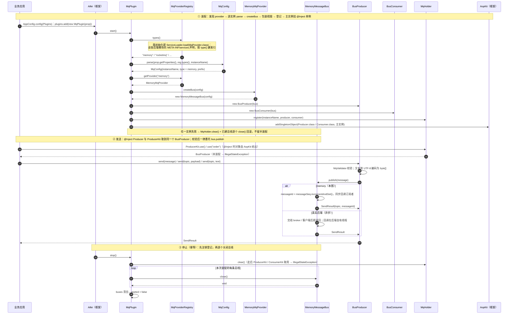

# aifei-mq 设计文档

本文是 `aifei-mq` 的**设计事实来源**：模块定位、公共 API 契约、装配链路、provider 扩展点、任务分解与门禁设计以本文为准。面向使用者（安装 / 用法 / 配置）的说明见 `README.md`；面向开发代理的约束见模块 `AGENTS.md`；测试策略见 `docs/testing.md`。

> **交付性质**：`aifei-mq` 是 aifei 生态的**库模块（可被应用依赖的 SDK）**，**不是应用工程**。因此**没有** `AppConfig` / `Launcher` / `service/` 包 / `webapp/` / HTTP 路由 / HIO / 表结构 / Db+Row / Generator；只有「公共 API + 内部实现 + 一个装配用 `MqPlugin`」。
>
> **文档状态与实测**：1.0.0 已按本文实现（7 个后端：稳定 `memory` / `rocketmq` ＋ 实验性 `mqtt` / `mqtt5` / `rabbitmq` / `kafka` / `redisstream`），**尚未对外发布**。`cd aifei-mq && mvn clean verify` → **`Tests run: 167 / Failures: 0 / Errors: 0 / Skipped: 60`**（执行 **107** + 跳过 **60**）；**9 个 reactor 模块**；主源码 **31** 个（core **17** + 7 个后端各 **2**）/ 测试文件 **30** 个（见 §8）。§3 公共面与 §5 的三项裁决（投递语义 / provider 抽象粒度 / 关闭语义）属**已定档契约**，变更前**必须先更新本文**；5 个实验性后端的**运行期语义未经真机 broker 验证**（§13 第 28 条）。
>
> **1.0.0 封版简化（已拍板并落地）**：公共 API 面与主流程不变；**稳定支持矩阵 = `memory` + `rocketmq`**；工程结构为「父工程聚合 ＋ 8 个子模块」，provider 发现改用 JDK `ServiceLoader`。目标态、14 项拍板结果与发布清单见 §15。

---

## 1. 模块定位与设计原则

### 1.1 定位

`aifei-mq` 为 aifei 应用补齐框架未覆盖的**异步消息能力**（解耦、削峰）。业务只依赖根包 8 个公共类型与 `ProducerKit` / `ConsumerKit`：**发送与订阅代码保持一致；投递、持久化、顺序和重复语义由后端决定**（不承诺「换后端只改配置即行为等价」，B2 定档）。

- 父工程坐标：`io.github.gollyhu:aifei-mq:1.0.0`（`packaging=pom`，仅聚合，不发布）
- 子模块坐标：`io.github.gollyhu:aifei-mq-core:1.0.0`（核心）、`io.github.gollyhu:aifei-mq-memory:1.0.0`、`io.github.gollyhu:aifei-mq-rocketmq:1.0.0`（稳定后端）；5 个实验性后端模块见 §15
- 包名：`cn.hg.aifei.mq`（核心模块）
- 技术基线：**Java 8**（语法与 API 双约束，主 JAR class major version = 52）

### 1.2 为什么是「库/SDK」而非应用工程

本模块提供的是**可被别的应用依赖的能力**，自身不承载任何应用装配。aifei 应用工程要素**一律不提供**：`AppConfig implements AifeiConfig`（装配由**使用方应用**完成，本模块只提供 `MqPlugin` 供 `plugins.add(...)`）、`Launcher` / `Aifei.start`（入口属应用）、`service/` 包（Just Service，本模块是基础设施 SDK 不是业务）、HIO / 路由 / `webapp/`（无 HTTP 面）、表结构 / Db+Row / Generator（无持久化，消息不落库）。

父工程 `aifei-mq/` 内 `mvn clean verify` 必须 **0 failure / 0 error**（reactor 逐模块执行，含架构门禁测试）。

### 1.3 「纯核心 + 显式选后端 + provider 扩展点」

`aifei-mq-core` 只承载**公共 API 8 类型 + `internal` + `aifei.MqPlugin`**，**不内置任何后端实现**；业务按 M2 决策**显式引入一个后端子模块**（如 `io.github.gollyhu:aifei-mq-memory:1.0.0`），即传递获得核心与该后端。

- **开箱即用口径（M2 定档）**：原「默认内存后端随核心自带」改为「**引入 `io.github.gollyhu:aifei-mq-memory:1.0.0` 一个依赖即可用、零第三方运行依赖**」；只引核心时 `MqPlugin.start()` **明确失败**并提示缺少对应后端模块，不留半装配。
- **稳定支持矩阵（A1 定档）**：1.0.0 只承诺 `memory` 与 `rocketmq` 两个后端；`mqtt` / `mqtt5` / `rabbitmq` / `kafka` / `redisstream` 以**实验性子模块**保留在仓库，**不发布、不承诺行为语义**（M4 定档，见 §15）。
- **provider 发现（M3 定档）**：核心不 import 任何后端实现，改为 JDK `ServiceLoader` 从各后端子模块的 `META-INF/services/cn.hg.aifei.mq.internal.MqProvider` 发现；provider 必须 `public`、**无参构造**、**无状态**。
- **新增后端 = 新增一个后端子模块**：`XxxMqProvider implements MqProvider`（`TYPE` 常量 + `type()` + `createBus(MqConfig)`）+ `XxxMessageBus implements MessageBus` + 一份 `META-INF/services` 声明；**不回头改 `MqPlugin` 与核心装配逻辑**。
- 后端配置沿用 `mq.<type>.*`；**内存后端无额外键**（**不引入** `mq.memory.*`）；RocketMQ 后端键见 §4.3 / §5.5；
- provider 扩展点已由需求文档明文要求，属**需求内**；除此之外**不自增**扩展点或抽象层。
- **5 个非稳定后端（实验性，不发布）**：`mqtt`（MQTT v3.1.1）/ `mqtt5`（MQTT v5.0）/ `rabbitmq` / `kafka` / `redisstream`，实现分别落 `cn.hg.aifei.mq.mqtt` / `.mqtt5` / `.rabbitmq` / `.kafka` / `.redisstream`，后端标识字面量与包名同名（`"mqtt"` / `"mqtt5"` / `"rabbitmq"` / `"kafka"` / `"redisstream"`）；客户端版本见 §9；各后端**子模块**以 `compile` 声明客户端依赖（引该子模块即传递获得，见 §9 / §15）。**MQTT 拆为两个独立后端**（v3 与 v5 各有自己的 provider / 总线 / 配置命名空间 `mq.mqtt.*` 与 `mq.mqtt5.*`，**不引入** `mq.mqtt.version` 键）。各后端实现表见 §4.6–§4.10，差异落点见 §5.6 (C)，依赖见 §9；**运行期语义零真机验证、不承诺行为**（§15）。

> provider 路线与 `aifei-cache` 的「静态注册表 + 装配骨架」**不再同构**（改为 `ServiceLoader`），原因：后端实现与发现必须分模块、核心不得反向依赖后端；`aifei-websocket` 已删除 provider/SPI 的纯 JDK 自实现路线仍**不可照搬**（本模块确有多种后端）。

### 1.4 公共面收敛纪律（硬约束）

| # | 纪律 |
| --- | --- |
| 1 | **公共 API 零第三方类型**：根包 8 个公共类型**不含**任何第三方类型 |
| 2 | **公共 API 零框架类型**：`cn.aifei.*` 只允许出现在 `cn.hg.aifei.mq.aifei` 接入包（即只允许 `MqPlugin` 一个类引用框架） |
| 3 | 根包公共类型**逐个列出并说明职责**（§3），**精确 8 个**；新增公共类型必须先过设计决策 |
| 4 | **第三方依赖分层隔离**：**核心模块零第三方运行依赖**；每个后端子模块在**自身**以 `compile` 声明其客户端依赖（引该子模块即传递获得，见 §9 / §15）；**公共面（根包）零第三方类型**。框架内核 `cn.aifei:aifei-all:1.1.2` 为 `provided`，测试依赖 `junit` 为 `test` |
| 5 | Java 8 语法与 API；主 JAR class major version = 52 |
| 6 | 每类规则只有一个定义点（校验 / 配置域常量 / 编解码 / 注册表 / 总线投递 / 单例持有） |

> 第 1、2 条由**架构门禁测试** `ArchitectureBoundaryTest` 强制（§12），不得放宽或绕过；拆模块后门禁**按模块分布**（核心 5 项断言 ＋ 各后端子模块精简断言），见 §12.6。

### 1.5 设计原则

1. **接口极简、实现无关**：业务只依赖根包 8 类型与 `ProducerKit` / `ConsumerKit`；实现经 `@Inject Producer` / `@Inject Consumer` 或 `ProducerKit` / `ConsumerKit` 取用；**业务显式引入一个后端子模块**（§1.3）。
2. **零依赖优先**：核心模块与内存后端子模块均零第三方运行依赖；`aifei-all` 为 `provided`。
3. **行为契约可测**：投递语义、异常分类、关闭语义、配置键名全部定档到「可写断言」的程度（§5）。
4. **保持极简**：不做未被需求驱动的抽象；provider 扩展点是需求内唯一允许的抽象。
5. **基线一致**：无页面，故无 UI 基线；公共面与配置键名对齐需求文档第四节。
6. **公共面准入判据**：公共 API 的**每个参数**与共同底线 (A) 的**每条条款**，都必须能被**每一个后端有意义地实现**；只能被部分后端实现的后端特有概念**不得**进入 (A) 与公共方法签名。正式表述与来源见 §5.7。

---

## 2. 术语表

| 术语 | 含义 | 归属 |
| --- | --- | --- |
| **主题 topic** | 消息的投递通道名；订阅与发送都以它配对 | 根包 / 配置 |
| **消息 Message** | 一次消息载荷：主题 + `byte[]`，不可变、防御性拷贝 | 根包（公共） |
| **生产者 Producer** | 发送端视图：3 个 `send` 重载 | 根包（公共接口） |
| **消费者 Consumer** | 订阅端视图：`subscribe` / `unsubscribe` | 根包（公共接口） |
| **监听器 MessageListener** | 消费回调：`onMessage(Message)`，函数式接口 | 根包（公共接口） |
| **发送结果 SendResult** | `topic` + `messageId`；失败即抛异常，**无 success 布尔** | 根包（公共） |
| **生产者工具类 ProducerKit** | 静态取用 `use()` / `use(instanceName)` + `send`×3 静态镜像 | 根包（公共） |
| **消费者工具类 ConsumerKit** | 静态取用 `use()` / `use(instanceName)` + `subscribe` / `unsubscribe` 静态镜像 | 根包（公共） |
| **命名实例** | 由 `mq.names` 声明的扩展实例；主实例走根级 `mq.*`，命名实例走 `mq.<name>.*` | 配置域 |
| **总线 MessageBus** | 后端统一内部对象：`publish` / `subscribe` / `unsubscribe` / `close` 四方法；Producer / Consumer 视图由装配层统一创建 | `internal`（契约）/ 各后端子模块（实现） |
| **后端标识 type** | `mq.type` 取值，如 `"memory"`；白名单由注册表派生 | `internal` |
| **后端 provider** | 一种后端的装配契约：`type()` + `createBus(MqConfig)`；**必须无状态、`public` 无参构造**，经 `ServiceLoader` 发现 | `internal`（契约）/ 各后端子模块 |
| **注册表** | `ServiceLoader` 发现结果按 `type` 建的索引；同 `type` 多实现即启动失败 | `internal.MqProviderRegistry` |
| **实例注册表 MqHolder** | 运行期按**实例名**登记 / 取用 `Producer` / `Consumer`（多实例），供 `ProducerKit` / `ConsumerKit` 取用 | `internal` |

---

## 3. 公共 API 契约（根包精确 8 类型）

根包 `cn.hg.aifei.mq` **精确 8 个公共类型**：`Message` / `Producer` / `Consumer` / `MessageListener` / `SendResult` / `MqException` / `ProducerKit` / `ConsumerKit`。此清单为门禁断言 `EXPECTED_PUBLIC_TYPES` 的**唯一事实来源**。

> **定档变更记录**：`MqKit`（原单一静态门面）已**删除**，拆分为 `ProducerKit` + `ConsumerKit` 两个公共工具类（形态照 `aifei-cache` 的 `CacheKit` / `CounterKit` 范式）；根包公共类型 **7 → 8**。此属**有意的公共面扩张**，经**项目所有者拍板**（见 §13）。

### 3.1 `Message`（不可变值对象）

```java
public final class Message {
    private final String topic;
    private final byte[] payload;

    private Message(String topic, byte[] payload) { ... }

    public static Message of(String topic, byte[] payload);   // 唯一工厂
    public String topic();
    public byte[] payload();                                  // 防御性拷贝（出参）
    // equals / hashCode / toString（值语义）
}
```

- **私有构造 + 唯一静态工厂 `of`**；**不提供** String 工厂、**不提供**任何解码访问器（如 `asString()` / `text()`）。
- 校验经 `internal.MqValidator`（`requireTopic` 非空非空白 + `requirePayload` 非空）——**校验唯一定义点**，不在本类内联复制规则。
- `payload` **入参出参双向防御性拷贝**（`of` 时 clone、`payload()` 返回 clone）。
- `equals` 按「`topic` + `payload` 字节内容」判定；`hashCode` 用 `Arrays.hashCode`。

### 3.2 `Producer`（公共接口）

```java
public interface Producer {
    SendResult send(Message message);
    SendResult send(String topic, byte[] payload);
    SendResult send(String topic, String text);   // 便捷重载：text 以 UTF-8 编码为 payload
}
```

- **恰好 3 个 `send` 重载**，不多不少。
- 语义：**同步投递**（§5.1）；**无订阅者时 `send` 仍成功返回 `SendResult`（含 `messageId`）——属跨后端共同底线（§5.6 A5）**；而消息**被丢弃还是留存随后端而变**（内存后端丢弃，broker 独立存储、待消费者上线后消费，§5.6 B6）。

### 3.3 `Consumer`（公共接口）

```java
public interface Consumer {
    void subscribe(String topic, MessageListener listener);
    void unsubscribe(String topic, MessageListener listener);
}
```

- 两个方法均返回 **`void`**。
- `subscribe`：**登记**——把监听器登记到该主题，此后该主题上的消息都会回调该监听器；**登记语义属共同底线**（§5.6 A3）。
- `unsubscribe`：**取消**——从该主题的登记列表中移除**该监听器实例**。语义定档如下：

| 维度 | 定档 |
| --- | --- |
| 签名 | `void unsubscribe(String topic, MessageListener listener)` |
| 取消粒度 | 移除该主题登记列表中**该 listener 实例**；**按实例身份（引用相等）判定，不用 `equals`** |
| 重复取消 | **幂等静默 no-op**（不抛） |
| 取消未登记的订阅 | **幂等静默 no-op**（不抛）——与「取消已被取消的 listener」表现相同 |
| `close()` / `stop()` 后调用 | **`IllegalStateException`**（状态非法；与 `subscribe` 停止后语义一致，§5.4 / §5.6 A9） |
| 参数非法 | `topic` 空 / 空白、`listener` 为 `null` → **`IllegalArgumentException`**，校验复用 `internal.MqValidator.requireTopic` / `requireListener`（**校验唯一定义点**，§5.6 A8；**无需为其新增校验方法**） |

- **为何按实例身份（引用相等）而非 `equals`**：`MessageListener` 是**函数式接口**，实际入参多为 lambda 或方法引用，其 `equals` **无可靠语义**（同一「逻辑」在不同调用点可能是不等实例，接口也未约定值语义）；按**实例身份**移除才能与「`subscribe` 当时登记的就是这个实例」严格对应，语义可判定、可断言。
- **跨后端分层**：`unsubscribe` 的**共同底线**只保证「**取消后本进程不再向该 listener 派发该主题的消息**」（§5.6 A3）；真实后端（RocketMQ 等）在**拉取 / 消费组**模型下的「按 listener 取消」属**尽力语义**（§5.6 B10）。此外，「无订阅者」须区分**共同底线**（`send` 仍成功返回 `SendResult`，§5.6 A5）与**后端差异**（消息被丢弃 / 留存，§5.6 B6）；消费位点 / 消费组等其它差异维度见 §5.6（B）。

### 3.4 `MessageListener`（公共函数式接口）

```java
@FunctionalInterface
public interface MessageListener {
    void onMessage(Message message);
}
```

### 3.5 `SendResult`（不可变值对象）

```java
public final class SendResult {
    private final String topic;
    private final String messageId;

    private SendResult(String topic, String messageId) { ... }

    public static SendResult of(String topic, String messageId);   // 唯一工厂
    public String topic();
    public String messageId();
    // equals / hashCode / toString（值语义）
}
```

- 字段**仅** `topic` + `messageId`，**无 success 布尔**（失败即抛 `MqException`；参数非法抛 `IllegalArgumentException`）。
- `messageId` 由**实现**（**后端或适配器**）生成且**恒非空**（此为本轮 **R1 裁定**后的口径，原「由**后端**生成」的措辞已放宽，见 §14.2 R1）；内存后端格式见 §5.1，各后端取值口径与「本地生成」格式见 §5.6 B7。
- 校验经 `internal.MqValidator`（`requireTopic` + `requireMessageId`）。
- **`messageId` 的使用边界（B1 定档）**：仅供诊断与排障；唯一性范围**仅本进程**，禁止用作业务幂等键、跨进程对账凭据或 broker 侧查询键（完整口径见 §5.6）。`SendResult` 保留，不改 `send` 返回类型。

### 3.6 `MqException`（唯一未受检异常）

```java
public class MqException extends RuntimeException {
    public MqException(String message);
    public MqException(String message, Throwable cause);
}
```

- **单一未受检异常**，**不细分**连接异常（层次不细分）。
- **仅在「运行时故障」场景抛出**；参数非法用 `IllegalArgumentException`、状态非法用 `IllegalStateException`（分类见 §5.4）。
- 内存后端**无外部运行时故障源**，故本版不会从 `memory` 抛出 `MqException`；该类型为后续真实后端与运行时故障保留。

### 3.7 `ProducerKit` 与 `ConsumerKit`（公共静态门面）

两个 `final` + 私有构造的**零实例状态门面类**（原 `MqKit` 已按 §13 第 25 条拆除，职责拆为这两个工具类，形态照 `aifei-cache` 的 `CacheKit` / `CounterKit`）；只在取用期经 `internal.MqHolder` 按实例名取运行期实例。

```java
public final class ProducerKit {
    public static Producer use();                          // 主实例（对齐 Config.MAIN_INSTANCE_NAME 机制）
    public static Producer use(String instanceName);       // 命名实例
    public static SendResult send(Message message);        // ↓ 静态镜像：一律作用于主实例
    public static SendResult send(String topic, byte[] payload);
    public static SendResult send(String topic, String text);
}

public final class ConsumerKit {
    public static Consumer use();
    public static Consumer use(String instanceName);
    public static void subscribe(String topic, MessageListener listener);      // ↓ 静态镜像
    public static void unsubscribe(String topic, MessageListener listener);
}
```

- **取用**：`use()` 取**主实例**（对齐 `Config.MAIN_INSTANCE_NAME` 机制，§5.5）、`use(name)` 取 `mq.names` 声明的**命名实例**；取到的是与 `@Inject` 注入的**同一个对象**（`@Inject` 只对应主实例）。
- **镜像**：`send`×3、`subscribe`、`unsubscribe` 一律**只做转发**——**不重复校验、不转换异常**；参数 / 异常契约同对应接口方法（含「按实例身份移除 listener」「重复 / 未登记取消为幂等 no-op」，§3.3；文本 UTF-8 编码由 `internal.BusProducer` 完成）。
- **异常口径（先状态、后参数）**：未启动 / 已停止 → `IllegalStateException`（`use()` 与全部镜像）；实例名为空 / 非法 / 保留名 / 未注册 → `IllegalArgumentException`（仅 `use(name)`）。与 `aifei-cache` 的 `CacheManager.lookup` 逐条对齐。

### 3.8 公共面计数口径（供门禁复用）

「根包公共类型」= `src/main/java/cn/hg/aifei/mq/` **目录直接子级的 `.java` 文件**（不含子包；`MqPlugin` 在 `.../mq/aifei/`、`internal` / 各后端实现包均不计入）：`Message`（final class）/ `Producer`（interface）/ `Consumer`（interface）/ `MessageListener`（interface，函数式）/ `SendResult`（final class）/ `MqException`（class，`extends RuntimeException`）/ `ProducerKit`（final 静态工具）/ `ConsumerKit`（final 静态工具）——**精确 8 个**，为门禁断言 `EXPECTED_PUBLIC_TYPES` / `EXPECTED_ROOT_TYPES` 的唯一事实来源（§12.2）。

---

## 4. 内部结构

### 4.1 `internal`（非承诺 API，**框架无关**）

> 关键约束：门禁规定 `cn.aifei.*` 只允许出现在 `aifei` 接入包，**故 `internal` 与 `memory` 一律不得 import `Prop` 等框架类型**。配置**对象**与**键常量**留 `internal`；把 `Prop` 转为 JDK `Properties` 的**一行读取**留在 `aifei.MqPlugin`（§4.4）。

| 类型 | 形态 | 职责 |
| --- | --- | --- |
| `MqValidator` | final + 静态方法 | **参数校验唯一定义点**：`requireTopic` / `requirePayload` / `requireText` / `requireMessage` / `requireMessageId` / `requireListener` / `requireProducer` / `requireConsumer`（违规抛 `IllegalArgumentException`） |
| `MqConfig` | final 值对象 | **配置域与键常量唯一定义点**：`ROOT_PREFIX="mq"`、`TYPE_KEY="mq.type"`、`NAMES_KEY="mq.names"`、`DEFAULT_TYPE="memory"`、`MAIN_INSTANCE_NAME="__MAIN__"`；`parseInstanceNames(Properties, String)`（解析并校验 `mq.names`：空项 / 重名 / 保留名 / `__MAIN__` 即 `IllegalArgumentException`）；`requireInstanceName(String)`（实例名合法性唯一定义点）；`parse(Properties, Set, String instanceName)`（按实例名派生**实例前缀**——主实例 `mq`、命名实例 `mq.<name>`——读 `<实例前缀>.type`，缺省 `memory`，未注册类型抛 `MqException`）；`instanceName()` / `type()` / `prefix()`（实例前缀）/ `get(relativeKey)`（读 `<实例前缀>.<type>.<relativeKey>`） |
| `MqHolder` | final + 静态方法 | **运行期实例注册表唯一定义点（多实例）**：`register(String instanceName, Producer, Consumer)` / `producer(String instanceName)` / `consumer(String instanceName)` / `clear()`（清空全部实例）；**取用期先生命周期后参数**——未启动 / 已停止（尚未登记过任何实例、或已 `clear()`）抛 `IllegalStateException`，实例名为空 / 非法 / 未注册抛 `IllegalArgumentException` |
| `MessageBus` | interface（`extends AutoCloseable`） | **总线契约（4 方法）**：`publish(Message)` / `subscribe(String, MessageListener)` / `unsubscribe(String, MessageListener)` / `close()`；**不再产出视图**，视图由装配层统一创建 |
| `BusProducer` | final（包级） | **生产视图唯一定义点**：实现公共 `Producer` 的 3 个 `send` 重载——经 `MqValidator` 校验后委托 `bus.publish`；`send(topic, String)` 在此做 UTF-8 编码 |
| `BusConsumer` | final（包级） | **消费视图唯一定义点**：实现公共 `Consumer` 的 `subscribe` / `unsubscribe`——经 `MqValidator` 校验后委托总线 |
| `MqProvider` | interface | **后端扩展点**：`type()` / `createBus(MqConfig)` |
| `MqProviderRegistry` | final | **provider 发现唯一定义点**：`ServiceLoader.load(MqProvider.class)` 一次性发现并按 `type()` 建索引；`getProvider(String type)`（未发现抛 `MqException`，消息提示需引入的后端子模块）/ `types()`（供 `MqConfig` 派生白名单）；同一 `type` 多实现 → 启动期明确报错 |

> **仍不提供** `MqProviderRegistry.register(String, MqProvider)` 公开方法：扩展后端的既定方式是**新增后端子模块 + `META-INF/services` 声明**（M3 定档，§15），核心不感知具体后端；`ServiceLoader` 是唯一发现通道。「同 `type` 多实现」属依赖或配置错误，启动期明确报错，不静默择一。

### 4.2 `memory`（默认后端实现，`cn.hg.aifei.mq.memory`）

| 类型 | 形态 | 职责 |
| --- | --- | --- |
| `MemoryMqProvider` | implements `MqProvider`；`public` 无参构造（`ServiceLoader` 要求） | 后端 provider：`TYPE` 引用 `MqConfig.DEFAULT_TYPE`；`type()`；`createBus(config)` → `new MemoryMessageBus(config)`；无实例字段 |
| `MemoryMessageBus` | implements `MessageBus` | 进程内发布-订阅总线：持有 `ConcurrentHashMap<String, CopyOnWriteArrayList<MessageListener>>`（订阅登记）、`AtomicLong`（messageId 序号）、`volatile boolean closed`；`@Override publish(Message)` / `subscribe(topic, listener)` / `unsubscribe(topic, listener)`；`close()` 幂等 |

**投递实现要点**：`publish` 先判 `closed`，再分配 `messageId`，再**按订阅登记顺序**逐个同步回调；单个监听器抛出的 `RuntimeException` **就地隔离捕获**（不中断其余订阅者、不上抛），返回 `SendResult`。`subscribe` 判 `closed` 后追加登记。

**取消登记实现要点**：`unsubscribe` 先判 `closed`（已关闭抛 `IllegalStateException`），再从该主题的 `CopyOnWriteArrayList` 中**按实例身份**移除该 listener——即迭代列表、以 `==` 比对引用、移除**首个引用相等**的元素（等价 `list.removeIf(e -> e == listener)`）；目标主题未登记或列表内无该实例时**静默返回**（幂等 no-op、不抛）。要点与理由：

1. **空列表保留、不移除主题键**：取消最后一个监听器后**保留该主题的空列表**，不 `remove` 主题键。理由：① 值的列表对象在并发 `subscribe`（`computeIfAbsent`）下是稳定锚点，删键会与并发追加竞争、可能丢失登记；② 「未订阅」与「曾订阅后全部取消」表现一致（均为不再派发），无需引入键移除的额外同步面。
2. **迭代安全**：`CopyOnWriteArrayList` 的迭代基于**快照**，取消不影响**正在进行**的 `publish` 迭代；`unsubscribe` 返回后**后续** `send` 不再回调该 listener。同步投递下，`unsubscribe` 的**事后语义**（返回后新发起的投递不再派发该 listener）成立；与**并发** `send` 的竞态不作保证（与「并发 `send` 相对顺序不作保证」同一取舍，§5.1）。
3. **值类型仍是 `List<MessageListener>`**：实现以 `Map<String, List<MessageListener>>` 声明、值对象为 `CopyOnWriteArrayList`，`unsubscribe` 不改变该结构约定。

### 4.3 `rocketmq`（真实后端实现，`cn.hg.aifei.mq.rocketmq`）

> 本包是**第三方类型（`org.apache.rocketmq.*`）唯一允许的落点**（与 `memory` 同属实现包，门禁自动放行，§12.6）。

| 类型 | 形态 | 职责 |
| --- | --- | --- |
| `RocketMqProvider` | implements `MqProvider`；`public` 无参构造（`ServiceLoader` 要求） | 后端 provider：`TYPE = "rocketmq"`（后端标识字面量唯一定义点）；`type()`；`createBus(config)` → `new RocketMqMessageBus(config)`；**无实例字段** |
| `RocketMqMessageBus` | implements `MessageBus` | RocketMQ 总线：构造内读配置并启动 `DefaultMQProducer`、创建 `DefaultMQPushConsumer`；持有本地订阅登记 `ConcurrentHashMap<String, List<MessageListener>>` 与 `volatile boolean closed`；`@Override publish(Message)` / `subscribe(topic, listener)` / `unsubscribe(topic, listener)`；`close()` 幂等 |

**配置键**（经 `MqConfig.get(relativeKey)` 读取；键名字面量集中在本实现包，**不得**手写 `"mq.rocketmq."` 前缀——命名实例下实际前缀为 `mq.<name>.rocketmq.`，仍由 `MqConfig.get(relativeKey)` 统一拼装）：

| 键（相对 `<实例前缀>.rocketmq.`；主实例即 `mq.rocketmq.`） | 必填 | 默认 | 说明 |
| --- | --- | --- | --- |
| `namesrv-addr` | **是** | — | nameserver 地址，形如 `host:port`（多个以 `;` 分隔）；缺失即 `MqException`（**配置错误**：启动期失败，不留半装配；**不校验连通性**，见下方「装配与建连时机」与 §5.6 B12） |
| `producer-group` | 否 | `DEFAULT_PRODUCER` | `DefaultMQProducer` 生产者组 |
| `consumer-group` | 否 | `DEFAULT_CONSUMER` | `DefaultMQPushConsumer` 消费者组 |

> **无 topic 相关键**：发送 / 订阅主题由调用方在 `send` / `subscribe` 时给定；topic 是否自动创建属 broker 侧设置（§5.6 B6 / B11）。

**装配与建连时机（须区分「配置」与「连通性」）**：链路为 `MqPlugin.start()` → `MqProviderRegistry.provider(type)` → `createBus` → `new RocketMqMessageBus(config)`。

- **配置层面（启动期完成，失败即启动失败，不留半装配）**：`mq.type` 指向缺后端模块（未发现）、必填键 `namesrv-addr` 缺失或值非法，均在 `MqPlugin.start()` 链路内**立即**抛出（`IllegalArgumentException` / `MqException`）；此时尚未注册任何实例，**不留半装配状态**（§5.5）。
- **连通性层面（随后端而定，RocketMQ 不保证启动期暴露）**：producer 在总线构造内调用 `DefaultMQProducer#start()`，但**该调用不校验 nameserver 连通性**（懒连接：初始化即可成功，真正连网发生在首次发送 / 拉取）。故 nameserver 不可达时 `MqPlugin.start()` **不会失败**，应用照常启动，故障**延迟到首次 `send`（或消费拉取）才暴露**为 `MqException`。即**「启动成功」≠「后端可达」**（§5.6 B12 与 (C) B12）。
- **consumer 延迟启动**：订阅主题在启动时未知，故 `consumer.subscribe(topic, "*")` + `consumer.start()` 延迟到**首次 `subscribe(topic, listener)`**；后续新增主题再次 `consumer.subscribe(...)`。首次 `subscribe` 时 consumer 启动失败抛 `MqException`（运行时故障，§5.4）。

**投递 / 消费映射**：`publish` → `DefaultMQProducer.send(org.apache.rocketmq.common.message.Message)`（**同步发送**）→ 取 broker 返回的 `SendResult.getMsgId()` 作为 `messageId`（§5.6 B7）；非 `SEND_OK` 或抛出 `MQClientException` / `MQBrokerException` / `RemotingException` / `InterruptedException` → 包装为 `MqException`（`InterruptedException` 需回填中断标志）。消费适配器在 RocketMQ **消费线程**内按本地登记顺序回调，`MessageExt.getBody()` 经 `Message.of(topic, body)` 构造 `Message`；单个监听器异常就地隔离（§5.6 A4）。

### 4.4 `aifei`（装配接入，`cn.hg.aifei.mq.aifei`）

| 类型 | 形态 | 职责 |
| --- | --- | --- |
| `MqPlugin` | implements `cn.aifei.plugin.Plugin` | **全模块唯一 import 框架类型的类**；构造只持 `Prop`；`start()` 按 `mq.names` 装配**多个实例**（主实例 + 命名实例）并注册，`stop()` 注销并关闭**全部**实例 |

装配细节：`MqPlugin` 构造器 `MqPlugin(Prop prop)`（`prop == null` 抛 `IllegalArgumentException`），**单构造器**（已拍板决策第 4 条：单个 `MqPlugin` 同时装配 `Producer` / `Consumer`，共用 `mq.*` 配置体系）。

**多实例装配口径（对齐 `aifei-cache` 的 `CachePlugin`）**：

- **实例名单**：`MqConfig.parseInstanceNames(prop.getProperties(), MqConfig.NAMES_KEY)` 解析 `mq.names` 得到命名实例；待装配名单 = **主实例（恒在首位）** + 命名实例（`mq.names` 顺序）。
- **逐实例装配**：对每个实例名，`MqConfig.parse(prop.getProperties(), registry.types(), instanceName)` → `registry.getProvider(type)` → `provider.createBus(config)` → 装配层 `new BusProducer(bus)` / `new BusConsumer(bus)` → `MqHolder.register(instanceName, producer, consumer)`；同时把该实例的总线纳入本次装配的关闭清单。
- **主实例与命名实例的注册**：`@Inject` 只注入**主实例**（`AopKit.addSingletonObject(Producer.class, 主实例 producer)` / `addSingletonObject(Consumer.class, 主实例 consumer)`）——`AopKit` **按类型注册、无按名通道**（与 `aifei-cache` 现状一致），命名实例只能经 `ProducerKit.use(name)` / `ConsumerKit.use(name)` 取。主实例名取 `MqConfig.MAIN_INSTANCE_NAME`（`"__MAIN__"`，沿用 `aifei-cache` 的 `Config.MAIN_INSTANCE_NAME` 机制，§5.5）。
- **装配原子性**：任一实例装配失败（配置非法 / `mq.type` 未发现对应后端模块 / 同 `type` 多实现 / 建总线失败）→ **立即抛出**（`IllegalArgumentException` / `MqException`），`start()` **不留半装配**——已登记的实例全部回滚（`MqHolder.clear()`）并关闭已建成的总线，应用启动失败。
- **生命周期**：`stop()` 关闭**全部**实例（幂等，§5.3）。

### 4.5 后端子模块的共用约定（各后端模块通用）

> 每个后端是一个**独立子模块**（`aifei-mq-memory` / `aifei-mq-rocketmq` / 5 个实验性子模块），**各模块 2 个类 + 1 份 `META-INF/services` 声明**。第三方客户端类型**只允许**出现在该后端模块的实现包内；核心模块不含任何后端实现（§15）。

**命名约定**：类名取「**`<产品名>` + `Provider` / `MessageBus`**」，产品名分别为 `MemoryMq` / `RocketMq` / `Mqtt` / `Mqtt5` / `RabbitMq` / `Kafka` / `RedisStream`。包名与后端标识字面量同名：`cn.hg.aifei.mq.memory` / `.rocketmq` / `.mqtt` / `.mqtt5` / `.rabbitmq` / `.kafka` / `.redisstream`，`TYPE` 分别取 `"memory"` / `"rocketmq"` / `"mqtt"` / `"mqtt5"` / `"rabbitmq"` / `"kafka"` / `"redisstream"`。

**共用骨架（每个后端逐条遵守）**：

| # | 约定 |
| --- | --- |
| 1 | `XxxProvider implements MqProvider`（`public` 无参构造）：`TYPE` 常量（该后端标识字面量唯一定义点）、`type()`、`createBus(config)` → `new XxxMessageBus(config)`；**无实例字段**（provider 无状态，A10） |
| 2 | `XxxMessageBus implements internal.MessageBus`：**该后端专有配置键名常量集中于此**（键名常量唯一定义点），键值一律经 `MqConfig.get(relativeKey)` 读取，**不得手写** `"mq.mqtt."` / `"mq.kafka."` 之类前缀（命名实例下实际前缀为 `mq.<name>.<type>.`，§5.5）；持有本地订阅登记（`ConcurrentHashMap<String, List<MessageListener>>`，值对象 `CopyOnWriteArrayList`）、`volatile boolean closed`，以及该后端必要的客户端对象；`@Override publish(Message)` / `subscribe(topic, listener)` / `unsubscribe(topic, listener)`；`close()` 幂等。**不再编写 `XxxProducer` / `XxxConsumer`**——视图由核心的 `BusProducer` / `BusConsumer` 统一承担 |
| 3 | **发现声明**：该模块 `src/main/resources/META-INF/services/cn.hg.aifei.mq.internal.MqProvider` 写一行 provider 全限定类名；核心经 `ServiceLoader` 发现；**不回头改** `MqPlugin` 与核心装配逻辑 |
| 4 | **配置键名风格**：一律 kebab-case（与既有 `namesrv-addr` / `producer-group` 一致）；键名相对 `<实例前缀>.<type>.`；面向使用者的键表见 `README.md`，本文只列「必填 + 改变可观测行为」的键 |
| 5 | **公共面零扩张**：不新增公共类型、不改 `Producer.send`（仍恰好 3 个重载）、不改 `Consumer` 签名；新能力一律经「provider + 配置域 + §5.6 (B)/(C)」表达 |

> **§4.6–§4.10 的定位**：只写**该后端相对共同骨架（本节）的差异要点**——类清单恒为「provider + 总线」2 类，配置键名以各总线键名常量为准（§11.1），行为差异的权威表在 §5.6 (C)；5 个后端**运行期语义零真机验证、不发布**（§15）。

### 4.6 `mqtt`（MQTT v3.1.1，实验性 · 不发布，`cn.hg.aifei.mq.mqtt`）

恒为两类：`MqttProvider`（`TYPE = "mqtt"`）＋ `MqttMessageBus`（4 方法总线，持单一 MQTT 客户端、本地订阅登记、本地 `messageId` 序号、`volatile closed`）。**配置键**以 `MqttMessageBus` 键名常量为准（§11.1），取值经 `MqConfig.get(relativeKey)`；必填 `broker-url`（缺失即启动期失败、不留半装配），改变可观测行为的键为 `client-id` / `clean-session` / `qos` / `retain` / `auto-reconnect` / `reconnect-delay-max-millis`，其余（`keep-alive-seconds` / `connection-timeout-seconds`）透传客户端默认值。

- **生产与消费共用一个客户端（一条连接）**：3.1.1 是「一个 `client-id` 一条连接」，故无「producer 先启、consumer 延迟」的分段——总线构造内即建连并 **fail-fast**（broker 不可达 → `MqException` → `MqPlugin.start()` 失败并回滚，§4.4），**与 RocketMQ 的懒连接相反**（§5.6 B12）。
- **投递 / 消费映射**：`publish` 以配置 `qos` / `retain` 发布原始字节（无序列化层）；`messageId` 由**适配器本地生成**（R1，格式见 §5.6 (B)）；回调在**客户端回调线程**、按本地登记顺序派发，监听器异常就地隔离（A4）；同一过滤器只向客户端登记一次（去重），派发仍按本地登记顺序。
- **`unsubscribe` 只解除本地按实例身份登记**（不向 broker 发送，§5.6 B10）；`close()` 后不再重连。
- **运行期语义未经真机 broker 验证**（§13 第 28 条）。

### 4.7 `mqtt5`（MQTT v5.0，实验性 · 不发布，`cn.hg.aifei.mq.mqtt5`）

**独立后端**：与 `mqtt` 各有 provider / 总线 / 命名空间（`mq.mqtt5.*` 与 `mq.mqtt.*` 互不相通），**不引入** `mq.mqtt.version` 键。恒为 `Mqtt5Provider`（`TYPE = "mqtt5"`）＋ `Mqtt5MessageBus`。

- **与 v3 的键面差异**：`clean-session` → `clean-start` + `session-expiry-interval-seconds`；`client-id` 缺省由**适配器**生成（v5 客户端无「生成 client-id」API，仅用于建连、不写回配置）；退避 `reconnect-delay-millis` / `reconnect-delay-max-millis`（`1000` / `30000`）**均有直接落点**（v5 客户端提供退避 min/max API，v3 无）。
- **建连与投递语义**与 §4.6 **同构**：单一客户端、构造内建连 **fail-fast**、回调在客户端线程、`messageId` 适配器本地生成、`unsubscribe` 本地尽力语义；v5 的**共享订阅** `$share/<group>/<topic>` 由**调用方在 topic 内**表达（不新增签名参数，§13 第 23 条）。
- **运行期语义未经真机 broker 验证**（§13 第 28 条）。

### 4.8 `rabbitmq`（RabbitMQ，实验性 · 不发布，`cn.hg.aifei.mq.rabbitmq`）

恒为 `RabbitMqProvider`（`TYPE = "rabbitmq"`）＋ `RabbitMqMessageBus`。**配置键**以总线键名常量为准（§11.1）：必填 `host`；改变可观测行为的键为 `virtual-host` / `exchange` + `exchange-type` / `durable` / `prefetch` / `publisher-confirms` / `auto-reconnect` / `topology-recovery` / 凭据；`port` / `connection-timeout-millis` / `network-recovery-interval-millis` 透传客户端默认值。

- **建连时机**：`Connection` + 发布 `Channel` 在总线构造内建立（**eager**）——broker 不可达即 `MqException`、**启动期暴露连通性故障**（§5.6 B12）；**消费侧延迟到首次 `subscribe`**：按 `durable` 声明队列 →（配置了 `exchange` 时按 `exchange-type` 声明交换机并绑定，binding key = topic）→ 开始投递。
- **投递 / 消费映射**：`publish` → `basicPublish`（routing key = topic）；未开 `publisher-confirms` 时 `messageId` 由适配器本地生成，开启时取确认序号；消费侧 **`autoAck=false` + 逐条派发后确认**（监听器异常就地隔离、不触发协议层重投，未确认即断开则 broker 重投 = at-least-once）；`publisher-confirms=true` 时 `publish` **同步等待**确认（无超时键，按客户端默认）。
- **`unsubscribe` 只解除本地按实例身份登记**（不发取消投递指令，避免影响同 topic 其它本地监听器，§5.6 B10）；`close()` 幂等且不再重连。
- **运行期语义未经真机 broker 验证**（§13 第 28 条）。

### 4.9 `kafka`（Apache Kafka，实验性 · 不发布，`cn.hg.aifei.mq.kafka`）

恒为 `KafkaProvider`（`TYPE = "kafka"`）＋ `KafkaMessageBus`。**配置键**以总线键名常量为准（§11.1）：必填 `bootstrap-servers`；改变可观测行为的键为 `group-id`（默认 `aifei-mq`，消费组唯一载体）、`auto-offset-reset`（默认 `earliest`，与 RocketMQ 的 `CONSUME_FROM_FIRST_OFFSET` 取舍一致）、`acks`（默认 `1`）、`security-protocol` / `sasl-mechanism` / `username` / `password` / `sasl-jaas-config`；`client-id` / 超时 / 退避类键透传客户端默认值。

- **建连时机**：生产者客户端在总线构造内创建但**自身懒连接** → **「启动成功」≠「broker 可达」**（与 RocketMQ 同构，§5.6 B12）；**消费者延迟到首次 `subscribe`** 创建并订阅，随后启动**拉取循环线程**（按 `poll-timeout-ms` 阻塞）。
- **投递 / 消费映射**：`publish` 走生产者（`acks` 生效），`messageId` 由 **broker 生成**（拼为 `<topic>-<partition>@<offset>`）；拉取循环按批读取、逐条按本地登记顺序回调（监听器异常就地隔离，A4）；位点由 `group-id` 维护、`enable.auto.commit` 走客户端默认（`true`）；缺省 `client-id` 生成为 `kafka-<UUID>`。
- **连接恢复无独立开关**（客户端内部退避承担，对应 `reconnect-backoff-ms` / `retry-backoff-ms`，故**不列** `auto-reconnect`）；`unsubscribe` 只解除本地登记（不离开消费组，§5.6 B10）。
- **运行期语义未经真机 broker 验证**（§13 第 28 条）。

### 4.10 `redisstream`（Redis Streams，实验性 · 不发布，`cn.hg.aifei.mq.redisstream`）

恒为 `RedisStreamProvider`（`TYPE = "redisstream"`）＋ `RedisStreamMessageBus`；**Jedis 直连**（不依赖 `aifei-cache`，仅版本对齐，§9）。**配置键**以总线键名常量为准（§11.1）：必填 `host`；改变可观测行为的键为 `group`（默认 `aifei-mq`）/ `consumer-name` / `start-mode`（`new` 只读新消息、`pending` 先重读本消费者未确认消息）/ `claim-enabled` + `claim-idle-millis`（默认 `true` / `60000`）/ `maxlen`（近似裁剪）/ `auto-reconnect`；`port` / `database` / `count` / `block-ms` / 超时类键透传客户端默认值。

- **建连时机**：**Jedis 连接池**在总线构造内创建但**池懒建连**，故构造期不校验连通性（「启动成功」≠「Redis 可达」，§5.6 B12）；**消费者延迟到首次 `subscribe`**——创建消费组并启动**拉取循环线程**（按 `block-ms` 阻塞读，`claim-enabled` 时空闲回收）。
- **投递 / 消费映射**：`publish` 追加到流（`maxlen` 生效），`messageId` 取**流条目 ID**（`毫秒-序号`，broker 生成）；拉取按批（`count`）逐条按本地登记顺序回调（监听器异常就地隔离，A4）；位点 = 各消费者的 pending 列表；**流条目固定以单一字段 `payload` 承载原始字节**（常量 `PAYLOAD_FIELD` 在 `RedisStreamMessageBus`，投递与读取共用，不引入序列化层）；`unsubscribe` 只解除本地登记（不删消费者、不删流，§5.6 B10）。
- **待验证项**：`start-mode` 两种起始语义、pending 回收（含回收后是否重复派发）**未经真机验证**（§13 第 28 条）。

---

## 5. 契约决策（三项定档 + 异常 + 配置）

### 5.1 编辑项 1 —— 投递语义（**背书拟定稿 + 精度补充**）

**结论**：

| 维度 | 定档 |
| --- | --- |
| 投递模型 | **同步投递**：`send` 在**调用线程内**依次同步回调订阅者，返回前回调已完成 |
| 线程模型 | 回调**在同一线程直接执行**（生产者的调用线程），本模块**不引入任何线程池 / 队列 / 背压** |
| 有序范围 | **单主题 FIFO**：同一主题内，`publish` 的完成顺序即投递顺序；**不保证跨主题顺序** |
| 多订阅者顺序 | 同一主题多个订阅者按 **`subscribe` 登记顺序**（`CopyOnWriteArrayList` 迭代顺序）依次回调 |
| 无订阅者 | **视为成功**：消息丢弃，仍返回 `SendResult`（`messageId` 已分配） |
| `messageId`（内存后端） | 进程内**全局单调递增**的长整型**十进制字符串**（`Long.toString(messageSeq.incrementAndGet())`）；唯一定义点 `MemoryMessageBus` |

**补充说明**：① **跨线程并发**——多个线程并发 `send` 同一主题时相对顺序不作保证（各自仍在自己的调用线程内同步完成），单线程连续 `send` 的次序**严格保序**；② **重入**——允许在 `onMessage` 内再次 `send`（同步、可重入），调用方自行避免无限递归。

> **分层提示**：本节为**内存后端**的定档行为；其中「同步投递 / 不引入线程池与背压 / 单主题 FIFO / `messageId` 十进制递增格式」等**不属跨后端共同底线**。**「无订阅者」须区分**：**`send` 仍成功返回 `SendResult`（含 `messageId`）属共同底线（§5.6 A5）**；**消息被丢弃还是留存属后端差异（§5.6 B6）**。跨后端的**共同底线**与**允许差异**清单见 §5.6（唯一分层事实来源）。

### 5.2 编辑项 3 —— provider 抽象粒度（**1.0.0 版：4 方法总线 + ServiceLoader 发现**）

**结论**：provider 创建**统一内部消息总线**；总线只暴露**四个后端原语**，Producer / Consumer 两个视图由**装配层统一创建**（单 `MqPlugin` 共用一个后端实例，避免二者各建连）。

精确签名定格：

```java
// internal.MqProvider —— 后端装配契约（无状态、public 无参构造，供 ServiceLoader 发现）
public interface MqProvider {
    String type();
    MessageBus createBus(MqConfig config);
}
// internal.MessageBus —— 统一内部总线契约（4 方法）
public interface MessageBus extends AutoCloseable {
    SendResult publish(Message message);
    void subscribe(String topic, MessageListener listener);
    void unsubscribe(String topic, MessageListener listener);
    @Override void close();
}
// internal.BusProducer / internal.BusConsumer —— 视图唯一定义点（核心持有）
public final class BusProducer implements Producer { /* 3 个 send 重载：校验 → UTF-8 编码 → bus.publish */ }
public final class BusConsumer implements Consumer { /* subscribe / unsubscribe：校验 → 委托总线 */ }
// internal.MqProviderRegistry —— ServiceLoader 发现（核心不 import 任何后端）
public final class MqProviderRegistry {
    public MqProvider getProvider(String type);   // 未发现 → MqException（消息提示需引入的后端子模块）
    public Set<String> types();                   // 供 MqConfig 派生白名单
}
```

**与提案 / 审查的取舍**：采用**4 方法**接口（proposal 形状）而非把 3 个委托方法上提接口（review 形状）——后端只需实现真正不同的原语，视图与校验 / 编码只有一处实现；`AbstractMqProvider` 一并删除（`config == null` 校验上移 `MqPlugin` 装配入口一次完成），`TextCodec` 并入 `BusProducer`。

**理由**：单 Plugin 需要一个后端实例、两个公共视图；若 provider 分别产出 producer / consumer，会迫使真实后端（如 Kafka）两次建连且各自持配置，违背「统一总线、共用一个后端」的取舍。

**与 `aifei-cache` 的关系**：不再同构——cache 用静态注册表 + 装配骨架，本模块因**后端实现必须分模块**而改用 `ServiceLoader` 发现；`MqProvider` 仍保持**无状态契约**，这是两者共同点。

### 5.3 编辑项 6 —— 关闭语义（**背书拟定稿 + 一处修正**）

| 维度 | 定档 |
| --- | --- |
| `MqPlugin.stop()` 幂等 | **是**：未启动时直接返回，不重复关闭 |
| `stop()` 关闭范围 | **全部实例**：关闭**主实例与全部命名实例**（`mq.names` 声明的每个实例各一条总线），**不是**只关主实例 |
| drain 在途消息 | **不需要**：同步投递下 `send` 返回即已投递完毕，总线上无在途消息 |
| `stop()` 后 `send` / `subscribe` / `unsubscribe` | **抛 `IllegalStateException`**（见下方⚠️修正；`unsubscribe` 与 `subscribe` 同属「状态非法」） |
| 监听器运行时异常 | **由总线就地隔离捕获**：不中断同主题其他订阅者、**不上抛**给生产者 |
| `MqPlugin.stop()` 与总线 `close()` 关系 | `stop()` 内**先** `MqHolder.clear()`（此后 `ProducerKit` / `ConsumerKit` 取实例即失败——`use()` 与静态镜像均命中）、**再**逐个 `bus.close()`（**关闭全部实例**，各总线 `close()` 幂等）、最后清空实例清单；`started=false` |
| plugin 生命周期 | `start()`：解析配置（`mq.names`）→ **逐实例装配**（`MqHolder.register(instanceName, producer, consumer)` + **主实例** `AopKit.addSingletonObject(Producer.class/Consumer.class)`）；`stop()`：注销（`MqHolder.clear()`）→ 关闭**全部**实例总线 |
| 单次启动契约（B3 定档） | **插件只支持单次启动，不支持 `stop()` 后原地重启**：`AopKit` 无移除已注册单例的公开通道，重启后新注册对象不会刷新业务字段中已注入的旧 `Producer` / `Consumer` 引用；需再现时请重启应用进程 |

> ⚠️ **对拟定稿的修正**：拟定稿写「`stop()` 后 `send`/`subscribe` 抛 `MqException`」。这与§4 已锁定的**异常分类**（「**状态非法（`stop()` 后调用 / 未启动）→ `IllegalStateException`**」）冲突。**以已锁定的分类为准**，本设计定档为 **`IllegalStateException`**：`stop()` 后属**状态非法**，不是运行时故障。`MqException` 只留「运行时故障」一档。

**监听器异常隔离的取舍**：本模块零第三方依赖、公共面无框架类型，**不引入任何日志依赖**，故监听器抛出的 `RuntimeException` **静默丢弃**（不上抛、不打印）。这是本版已知取舍；后续真实后端 provider 可自行补充可观测性（属实现包自由，不进公共面）。

> **分层提示**：「`close()` 幂等」「`stop()` 后 `send` / `subscribe` / `unsubscribe` 抛 `IllegalStateException`」「监听器异常就地隔离、不中断同主题其它订阅者、不上抛」属**共同底线**（§5.6 A4 / A9）；而「异常隔离后是否可观测（静默 / 打印 / 上报）」属**允许差异**（§5.6 B8）。

### 5.4 异常分类（对齐已锁定契约）

| 场景 | 异常 |
| --- | --- |
| **参数非法**（topic 空、payload / text / listener / message / prop / messageId 为 null；`use(instanceName)` 的实例名为空 / 含非法字符 / 为保留名 / 未注册；含 `unsubscribe` 的 topic 空 / 空白与 listener 为 null） | `IllegalArgumentException` |
| **状态非法**（`stop()` 后 `send` / `subscribe` / `unsubscribe`；`ProducerKit` / `ConsumerKit` **未启动 / 已停止**时取 `use()` / `use(name)` 或调用静态镜像） | `IllegalStateException` |
| **运行时故障 / 装配失败**（后端运行时错误；真实后端连接失败；`mq.type` 未发现对应后端模块或同 `type` 多实现） | `MqException` |

> **分层提示**：本分类属**共同底线**（§5.6 A6），任一后端一致；后端新增的**运行时故障**一律归 `MqException`，**不得新增异常类型或改变既有分类**。

### 5.5 配置域（对齐已锁定契约）

| 键 | 必填 | 默认 | 说明 |
| --- | --- | --- | --- |
| `mq.type` | **可选** | `memory` | **主实例**的后端类型；指向**未发现**后端（缺后端子模块）或同 `type` 多实现时 `start()` **立即** `MqException`（消息提示需引入的后端子模块），**不留半装配状态** |
| `mq.names` | 可选 | — | 声明**命名实例**，逗号分隔；**主实例不在此声明**（主实例恒存在、无需声明）；空项 / 重名 / 保留名 / `__MAIN__` 即 `IllegalArgumentException`（校验口径见下） |
| `mq.<type>.*` | 后端自定 | — | **主实例**的后端专有配置，经 `MqConfig.get(relativeKey)` 读取；**内存后端无额外键**（**不引入** `mq.memory.*`） |
| `mq.rocketmq.*` | 见 §4.3 | — | **阶段 2**：**主实例**的 RocketMQ 后端专有键（`namesrv-addr` 必填；`producer-group` / `consumer-group` 可选） |
| `mq.mqtt.*` / `mq.mqtt5.*` / `mq.rabbitmq.*` / `mq.kafka.*` / `mq.redisstream.*` | 见 §4.6–§4.10 | — | **实验性后端的键域**（已实现、不发布）：必填键分别为 `broker-url` ×2 / `host` / `bootstrap-servers` / `host`；其余键见各节差异要点与源码常量（§11.1）。**MQTT 两域互不相通**，且**无** `mq.mqtt.version` 键（§13 第 28 条） |
| `mq.<name>.type` | 可选 | `memory` | **命名实例** `name` 的后端类型（命名实例的实例前缀为 `mq.<name>`，故其类型键为 `mq.<name>.type`） |
| `mq.<name>.<type>.*` | 后端自定 | — | **命名实例** `name` 的后端专有配置（如 `mq.orders.rocketmq.namesrv-addr`），同样经 `MqConfig.get(relativeKey)` 读取 |

**配置键面纪律（D1 定档）**：

- **判据**：每个公开配置键必须对应一个**可观察行为**；仅透传客户端默认值的参数键（轮询超时、请求超时、退避间隔等）不保留；「配置了却无效果」的键属负资产，必须删除。
- **稳定模块（`aifei-mq-memory` / `aifei-mq-rocketmq`）**：**P4 复核结论——稳定模块自身无可删键，删键数 = 0**（`aifei-mq-memory` 无后端键；`aifei-mq-rocketmq` 的 `namesrv-addr` / `producer-group` / `consumer-group` 均改变可观测行为，全部保留）；凭据类键同属保留项。
- **实验性子模块（`mqtt` / `mqtt5` / `rabbitmq` / `kafka` / `redisstream`，M4）**：键域**冻结**，仅删除死键 `mq.mqtt.reconnect-delay-millis`（已于 P4 删除）；透传键瘦身随 1.1.0 启用时一并处理。
- **键只增不破坏**：未来按需加回键零兼容负担；先删后加优于先加后删。

**键归属与实例前缀**（对齐 `aifei-cache` 的 `cache.names` 做法）：

- **主实例**：配置走**根级** `mq.*`——类型键 `mq.type`、后端专有键 `mq.<type>.*`。
- **命名实例**：配置走 `mq.<name>.*`——其**实例前缀**为 `mq.<name>`，故类型键为 `mq.<name>.type`、后端专有键为 `mq.<name>.<type>.*`。
- **主实例名**：`MqConfig.MAIN_INSTANCE_NAME = "__MAIN__"`（**沿用 `aifei-cache` 的 `Config.MAIN_INSTANCE_NAME` 实际取值**）；`use()` 取主实例、`use(name)` 取命名实例，**取到的是与 `@Inject` 注入的同一对象**（`@Inject` 只对应主实例）。
- **命名实例下的前缀一致性（含本轮 5 个新后端）**：任一后端的专有键在命名实例下的前缀恒为 **`mq.<name>.<type>.*`**（如 `mq.orders.rabbitmq.prefetch`、`mq.pay.kafka.group-id`、`mq.order.mqtt.client-id`），由 `MqConfig.get(relativeKey)` **统一拼装**；实现类只持有「相对键名」，**不得**感知实例名、**不得**手写 `"mq.<type>."` 前缀（§11.1）。

**`mq.names` 校验口径**（逐项去空白后校验；任一不过即 `IllegalArgumentException`，由 `MqConfig.parseInstanceNames` 唯一实现，与 `aifei-cache` 的 `Config.parseInstanceNames` 同构）：

| 校验 | 规则 |
| --- | --- |
| 空项 | 逗号分隔后出现空白项（如 `a,,b`、尾随逗号）→ 失败 |
| 非法字符 | 实例名含 `.` / `=` / `:` 或空白字符 → 失败 |
| 保留名 | 实例名为**根级配置键名**（`type` / `names`）→ 失败 |
| 主实例名 | 实例名为 `__MAIN__` → 失败（属保留名，不可作为命名实例声明） |
| 重名 | 同一 `mq.names` 内重复出现 → 失败 |

配置解析**全部在 `MqPlugin.start()` 内**完成；构造函数只持 `Prop` 引用，不解析、不校验。使用 RocketMQ 后端时**必须显式**配 `mq.type = rocketmq`（缺省仍是 `memory`；命名实例同理，需**显式**配 `mq.<name>.type`）。

> **注意**：此处「解析」仅指**配置**层面（键存在性与取值合法性），**不含**对外部**连通性**的校验；真实后端是否在启动期校验后端可达性**随后端而定**（RocketMQ **不**校验，见 §4.3 与 §5.6 B12 / (C) B12）。

### 5.6 跨后端契约：共同底线与允许差异（**分层表述**）

> 本模块以 **provider 扩展点**支持多后端：**已实现** = 内存后端 `memory` 与真实后端 `rocketmq`；**本轮定档（已实现）** = `mqtt`（MQTT v3.1.1）/ `mqtt5`（MQTT v5.0）/ `rabbitmq` / `kafka` / `redisstream`（§4.6–§4.10）；其它真实后端后续追加。不同后端的**公共类型与公共行为并非逐一等同**——一部分属**所有后端必须一致**的**共同底线**（(A) 表），另一部分**允许随后端实现而变**（(B) 表为通用差异维度，(C) 表为 `rocketmq` 逐项落点）。本节是这一分层判定的**唯一事实来源**；**新增后端时，凡与共同底线之外的行为不同，必须在 (B) 逐项列明，并按 (C) 的样式补出该后端的实际落点**，不得只在实现包内默默不同。本节条款的**准入判据**（哪些概念有资格进入 (A) 与公共方法签名）见 §5.7。

#### （A）所有后端共同底线（任一后端都必须遵守）

| # | 类型 / 行为 | 底线条款 |
| --- | --- | --- |
| A1 | `Message` | **不可变值对象**；**唯一工厂** `Message.of(String topic, byte[] payload)`（私有构造，不额外提供 String 工厂或解码访问器）；`payload` **入参出参双向防御性拷贝**（`of` 时 clone、`payload()` 返回 clone）；`equals` / `hashCode` 按 `topic` + `payload` 字节内容判定（**值语义**）。 |
| A2 | `Producer` | **恰好 3 个 `send` 重载**（`Message` / `byte[]` / `String`），不多不少；`send(String topic, String text)` **以 UTF-8 编码**为 payload（编码唯一定义点 `internal.BusProducer`）。 |
| A3 | `Consumer` 的登记与取消 | `subscribe(String, MessageListener)`：**登记语义**——把监听器登记到该**主题标识**，此后**匹配该标识**的消息回调该监听器（**「主题标识」读作「精确主题名」或「过滤器」，精确匹配是通配匹配的特例**——本轮 **R2 裁定**后的措辞，`memory` / `rocketmq` 行为不变，逐后端匹配语义见 B14）。`unsubscribe(String, MessageListener)`：**取消语义**——从该**主题标识**的登记列表中移除**该监听器实例**（**按实例身份**判定，不用 `equals`）；**重复取消 / 取消未登记的订阅**均为**幂等静默 no-op**；`close()` / `stop()` 后调用抛 `IllegalStateException`；参数非法抛 `IllegalArgumentException`（校验唯一定义点 `internal.MqValidator`）。二者均返回 `void`。**共同底线只保证「取消后本进程不再向该 listener 派发匹配该标识的消息」**（取消的后端差异见 B10）。 |
| A4 | `MessageListener` | **函数式单方法** `onMessage(Message)`（`@FunctionalInterface`）；**监听器异常隔离**——监听器抛出的 `RuntimeException` **不中断同主题其它订阅者**、**不上抛给生产者**。 |
| A5 | `SendResult` | 字段**仅** `topic` + `messageId`，**无 success 布尔**；**失败一律抛异常**（不返回「失败结果」）；唯一工厂 `SendResult.of`。 |
| A6 | `MqException` | **唯一未受检异常**（`extends RuntimeException`，层次不细分）。**异常分类**：参数非法 → `IllegalArgumentException`；状态非法 → `IllegalStateException`；运行时故障 → `MqException`。 |
| A7 | `ProducerKit` / `ConsumerKit` | **未启动 / 已停止**时 `use()`、`use(name)` 与全部静态镜像（`ProducerKit.send`×3；`ConsumerKit.subscribe` / `unsubscribe`）→ **`IllegalStateException`**；`use(name)` 的实例名为空 / 含非法字符 / 为保留名 / **未注册** → **`IllegalArgumentException`**（**先判状态、后判参数**）。全部静态镜像**只做转发**——**不重复校验、不转换异常**。 |
| A8 | 参数校验 | **唯一定义点** `internal.MqValidator`；任一后端与门面**不得复制校验规则**（topic / payload / text / message / messageId / listener / producer / consumer）。 |
| A9 | 生命周期 | 总线 `close()` 与插件 `stop()` **幂等**；**`stop()` 后 `send` / `subscribe` / `unsubscribe` → `IllegalStateException`**。 |
| A10 | 配置契约 | 键名口径一致（`mq.type` + `mq.<type>.*`）；配置解析**一律在 `MqPlugin.start()` 内**完成，构造只持 `Prop`；**provider 必须无状态**。 |

**本轮（R 轮）A1–A10 逐条复核结论（按 §5.7 准入判据，面向 5 个新后端）**：

- **实质未变**：`mqtt` / `mqtt5` / `rabbitmq` / `kafka` / `redisstream` **均能被每一条 (A) 有意义地实现**——本轮**未放宽任何一条 A 的实质**。具体：A1 值对象与各后端无关；A2 的三个 `send` 重载任一后端可实现（QoS / retain 落配置域，R3）；A3 的登记 / 取消是**本地登记表**操作（通配过滤器只改变**匹配集合**，见 B14）；A4 的异常隔离由各适配器就地捕获实现；A5 的 `messageId` **恒非空**由「后端或适配器生成」保证（R1，本地生成格式见 B7）；A6 / A7 / A8 与后端无关；A9 的 `close()` 幂等 / 停止后 `IllegalStateException` 由本地 `closed` 标志实现，且**关闭后不再重连**（各后端落点见 B13）；A10 的配置契约与「provider 无状态」由 §4.5 共用骨架逐条满足。
- **唯一的措辞放宽**：**A3 的「该主题」按 R2 读作「主题标识（精确主题名或过滤器）」**（上表已按此措辞重写）——这是**措辞层面的正式放宽**，`memory` / `rocketmq` 的**行为不变**。
- **回弹机制（硬纪律）**：复核中若发现某条 (A) **无法**被某个新后端有意义地实现，**不得**在本节自行放宽——须**停下并回报主会话 / 项目所有者**再定夺（本轮复核**未触发**该情形；R1 / R2 / R3 三条既有风险已按 §14.2 裁定落档）。

#### （B）允许后端差异（须在本节列明）

> 下列各项**不属共同底线**：不同后端**允许给出不同行为**，**调用方不得假设这些维度跨后端一致**。**每一新增后端都必须把本后端在这些维度上的实际落点补充进下表**（「真实后端可以是什么样」一列按实际填写或确认适用）。

| # | 维度 | 内存后端（`memory`，本版定档） | 真实后端可以是什么样 |
| --- | --- | --- | --- |
| B1 | **投递模型** | **同步投递**：`send` 在调用线程内依次同步回调订阅者，返回前回调已完成（§5.1）。 | **异步生产 + 拉取消费**：`send` 只完成「已提交到 broker」，**返回 `SendResult` ≠ 已被消费**。 |
| B2 | **线程模型** | **不引入任何线程池 / 队列 / 背压**；回调在生产者的调用线程内直接执行。 | 后端**自建**拉取线程池（长轮询 / 拉取循环），消费回调发生在**后端自有线程**。 |
| B3 | **有序性** | **单主题 FIFO**（同一主题内 `publish` 完成顺序即投递顺序）；不保证跨主题顺序。 | 按**队列 / 分区**保序；**不保证全局 FIFO**（跨分区 / 跨队列可能乱序）。 |
| B4 | **投递保证与重复** | **精确一次派发**（进程内同步派发，不重复）。 | **at-least-once**：故障 / 重试 / 位点回退下**可能重复消费**，消费端需幂等。 |
| B5 | **持久化** | **不持久**：总线在内存中，进程退出即丢失。 | **broker 持久化**：消息落盘，重启后仍可消费。 |
| B6 | **无订阅者语义** | **视为发送成功**：消息丢弃，仍返回 `SendResult`（`messageId` 已分配）（§5.1）。 | broker **独立存储**：无在线消费者时消息留存，**待消费者上线后消费**。 |
| B7 | **`messageId` 生成口径（本地生成 vs broker 生成）** | 进程内**全局单调递增**的长整型**十进制字符串**（§5.1，唯一定义点 `MemoryMessageBus`）。 | **由实现（后端或适配器）生成且恒非空**——**此为 R1 裁定后的措辞**（原「由**后端**生成」已放宽，§14.2 R1）。两类口径：① **broker 生成**——取 broker 返回的标识 / 位点（RocketMQ `msgId`；Kafka「分区 + 位点」；Redis Streams 流条目 ID；RabbitMQ 开启发布确认时的确认序号）；② **适配器本地生成**——broker 不回标识时（MQTT v3/v5；RabbitMQ 未开确认）由本模块生成，**格式定档见下方「本地 `messageId` 格式」**。逐后端落点见 (C) 各表 B7 行。 |
| B8 | **可观测性** | 监听器异常**静默丢弃**（零日志依赖、公共面无框架类型，§5.3）。 | 后端可**打印 / 上报**监听器异常（属实现包自由，**不进公共面**）。 |
| B9 | **消费位点 / 消费组** | **无此概念**（进程内发布-订阅，无位点、无消费组）。 | 真实后端**特有**：消费位点（offset）与消费组（consumer group）由后端定义与维护。 |
| B10 | **取消订阅语义** | **精确移除**：`unsubscribe` 按**实例身份**从该主题登记列表中立即移除，此后本进程不再向其派发该主题消息（与 A3 一致）。 | 在**拉取 / 消费组**模型下，「按 listener 取消」属**尽力语义**：仅解除本进程对该 listener 的本地绑定 / 本地派发，**不保证** broker 侧订阅、消费组关系或已拉取批次立即撤销；「已取消」与「不再消费」之间**无强保证**（重试 / 位点回退下仍可能到达）。 |
| B11 | **消息大小上限** | **无显式上限**（仅受 JVM 内存约束）。 | 受 broker **单条消息大小上限**约束（RocketMQ 默认 4MB），超限即发送失败（`MqException`）；公共 API 不声明大小上限，调用方按后端实际能力自控。 |
| B12 | **启动期连通性校验** | **不涉及**：无任何外部中间件依赖，启动即就绪，不存在「连不上」问题。 | **随后端而定，未必在启动期校验**：客户端可能**懒连接**——如 RocketMQ 的 `producer.start()` **不校验 nameserver 连通性**，故**「启动成功」不等于「后端可达」**，故障可能**延迟到首次使用**（发送 / 拉取）才以运行时故障暴露。本维度**与共同底线（A）无关**：A 部分**不涉及任何外部连通性**，A10 的「配置解析在 `MqPlugin.start()` 内、配置错误即启动失败、不留半装配」**不受本维度影响**。 |
| B13 | **连接恢复 / 自动重连** | **不涉及**：无外部连接，不存在断线。 | **以「配置域键 + 各客户端原生自愈机制」表达**（**本轮定档**）：本模块**不自建**重连循环、**不扩张公共面**、**provider 保持无状态**。各后端以 `mq.<type>.auto-reconnect`（默认 `true`）及各自退避 / 恢复键启用**客户端原生**恢复——MQTT v3 客户端自动重连（退避上限）、v5 客户端自动重连（退避 min / max）；RabbitMQ 自动恢复 + 拓扑恢复（网络恢复间隔）；Kafka 连接层自动重连与请求重试退避；Redis Streams 连接池借出时校验并重建失效连接。**「关闭后不再重连」属共同底线**（A9：`close()` 幂等、停止后调用抛 `IllegalStateException`）——各后端一致。逐后端实际落点见 (C) 各表 B13 行。 |
| B14 | **topic 匹配语义（精确名 vs 通配过滤器）** | **精确主题名**：`publish` 与 `subscribe` 均按精确名配对。 | **随后端而定**（**R2 裁定**）：`topic` 读作「**主题标识**」——**精确匹配是通配匹配的特例**；A3 与 §3.3 的措辞已按此放宽，而 **`Consumer.subscribe` 签名不变**。哪些后端支持 `+` / `#` 一类通配，见 (C) 各表 B14 行。 |
| B15 | **逐条消息属性（QoS / retain 等）** | **无逐条属性**：消息只有 `topic` + `payload`。 | **只落配置域，不进公共面**（**R3 裁定**）：MQTT 的 QoS / retain 由 `mq.mqtt.qos` / `mq.mqtt.retain`（v5 同构，落 `mq.mqtt5.*`）表达；Kafka 的 `acks`、RabbitMQ 的 `durable` / 发布确认、Redis Streams 的 `maxlen` 同属**配置域**。**任一后端均不得**为此新增 `send` 重载（`Producer.send` 维持恰好 3 个，A2）。 |
| B16 | **凭据 / 认证** | **不涉及**：无连接、无认证。 | **只落配置域**：`mq.<type>.username` / `password`（Kafka 另含 `security-protocol` / `sasl-mechanism` / `sasl-jaas-config`；RabbitMQ 另含 `virtual-host`；Redis Streams 另含 `database`）。**凭据不进公共 API**，也不出现在 `Message` / `SendResult` 中；**异常消息只出现键名、绝不出现取值**（§11.2 硬纪律）。逐后端键名见 §4.6–§4.10 与各总线常量（§11.1）。 |

**`messageId` 使用语义（B1 定档，公共面承诺边界）**：

- `messageId` **仅供诊断与排障**（日志、问题定位）；
- **唯一性范围仅本进程**——即使是 broker 生成的标识，也不承诺跨后端口径一致、不承诺跨进程唯一、不承诺可在 broker 侧查询；
- **禁止**用作业务幂等键、跨进程对账凭据；
- `SendResult` 保留（承载「无订阅者时 `send` 仍成功返回结果」的语义），**不改 `send` 返回类型**。

**本地 `messageId` 格式（R1 定档；broker 不回标识时的统一口径）**：

```
<type>:<token>:<seq>
```

- `<type>`：后端标识字面量（如 `mqtt` / `mqtt5` / `rabbitmq`），取自 `XxxProvider.TYPE`；
- `<token>`：该后端的**本地实例标识**，**恒非空**——MQTT 取生效的 `client-id`（未配置时为客户端自动生成的标识），RabbitMQ 取 `host:port`（或实现生成的等价非空标识）；
- `<seq>`：该总线内 `AtomicLong` **从 1 起单调递增**的十进制字符串；
- 示例：`mqtt:app-orders:17`、`rabbitmq:127.0.0.1:5672:2048`。

约定与边界：

1. **恒非空**：三段皆非空，故恒满足 A5 与 §3.5 的 `requireMessageId` 校验；
2. **唯一性范围**：**本进程内**、跨实例（含 `<type>` 与 `<token>`）**唯一**；**跨进程不承诺**（除非 `client-id` 等标识全局唯一）；
3. **与 broker 的关系**：**不是** broker 的标识——MQTT 的 QoS packet identifier 仅在该连接内有效（随重传复用），**不得**用作 `messageId`；
4. **唯一定义点**：**文档级**唯一事实来源 = 本段（并入 (B) B7 口径）；**实现级**生成点**每个后端各一处**——`mqtt.MqttMessageBus` / `mqtt5.Mqtt5MessageBus` / `rabbitmq.RabbitMqMessageBus`（§11.1）；**不得**在视图类（`XxxProducer`）中重复生成。

#### （C）`rocketmq` 后端的差异落点（阶段 2 定档）

> 下表把 (B) 各维度在 **RocketMQ 后端**的**实际行为**逐项落实。后续再增真实后端时，应照此样式另起一表（或将 (B) 第三列改为「后端实际」列），**不得**只在本表内默默扩展含义。

| # | 维度 | RocketMQ 后端（`rocketmq`）的实际落点 |
| --- | --- | --- |
| B1 | 投递模型 | **异步生产 + 拉取消费**：`send` 同步调用 `DefaultMQProducer.send`，返回 broker 的发送结果；**返回 `SendResult` ≠ 已被消费**。 |
| B2 | 线程模型 | 消费回调发生在 **RocketMQ 自有消费线程池**（`DefaultMQPushConsumer` 的 ConsumeMessage 线程），**非**生产者调用线程；本版**不暴露**线程池配置键（遵循后端默认）。 |
| B3 | 有序性 | 按**队列**保序；topic 默认多队列，故**不保证全局 FIFO**。 |
| B4 | 投递保证与重复 | **at-least-once**：监听器抛异常 / 进程异常时消费重试，**可能重复消费**，监听器须幂等（本版未开启事务消息 / 幂等去重）。 |
| B5 | 持久化 | **broker 持久化**（刷盘策略由 broker 配置决定，本模块不设置）。 |
| B6 | 无订阅者语义 | broker **独立存储**：无在线消费者时消息留存，待消费者上线后消费；依赖 broker 的 topic 自动创建（关闭自动创建时须预建 topic）。 |
| B7 | `messageId` 生成 | 取 broker 返回的 `SendResult.getMsgId()`（**全局唯一**标识，**非**十进制递增）。 |
| B8 | 可观测性 | 监听器异常**静默丢弃**（本版不调用任何日志 API）；实现包内后续可自行补充（不进公共面）。 |
| B9 | 消费位点 / 消费组 | 位点由 broker 维护；消费组经 `mq.rocketmq.consumer-group` 配置（默认 `DEFAULT_CONSUMER`）；**同一消费组的多个实例须有相同订阅集合**，否则 rebalance 异常。 |
| B10 | 取消订阅语义 | **尽力语义**：`unsubscribe` 仅从**本进程**登记表按实例身份移除该 listener（此后本进程不再向其派发）；**不调用** broker 侧 `consumer.unsubscribe`（避免影响同 topic 其它本地监听器与消费组一致性），故 broker 侧订阅关系、已拉取批次不撤销。 |
| B11 | 消息大小上限 | 受 broker 单条消息上限约束（RocketMQ 默认 4MB），超限抛 `MqException`；topic 自动创建关闭时须预建 topic。 |
| B12 | 启动期连通性校验 | **不校验**：`DefaultMQProducer#start()` **不校验 nameserver 连通性**（懒连接），nameserver 不可达时 `MqPlugin.start()` **仍成功**；故障**延迟到首次 `send`（或消费拉取）**才以 `MqException` 暴露。故 **「启动成功」≠「nameserver 可达」**；运维上须在实际收发时探活，**不能**以启动结果判定后端可用。（配置错误仍在启动期立即失败，见 (A) A10 与 §5.5。） |

**实现期决策（阶段 2 落地补记）**：

1. **消费位点策略**（属 (B) B9「消费位点 / 消费组」维度）：**设计原未规定消费位点策略**；实现**选择 `CONSUME_FROM_FIRST_OFFSET`**（经 `DefaultMQPushConsumer.setConsumeFromWhere(...)`，见 `rocketmq/RocketMqMessageBus`）——即新消费组首次消费自队列**最早**位点开始，与「无在线消费者时消息留存、消费者上线后消费」（(C) B6）一致。**该策略的副作用（如首次订阅回溯历史消息、重复消费面扩大、与 broker 位点持久化的交互）未经真机 broker 验证**，属**实现期决策**；须在具备 broker 的环境验证后回填本处与 §13。
2. **测试设施（简述）**：契约基类 `MessageBusContractTest` 提供**异步轮询等待钩子**（`awaitTrue(condition)` / `awaitTrue(condition, timeoutMillis)` 与 `awaitTimeoutMillis()`）与 `topic(name)` **命名钩子**——真实后端投递**异步**（(B) B1 / B2），故**投递类**断言一律采用「发送后**带超时等待**条件成立」。**memory 在同一钩子下首轮即通过、行为零变化**（同步投递不受影响）。

> **测试落点**：共同底线由契约测试基类 `MessageBusContractTest` 断言（各后端继承运行）；(B) / (C) 各项差异**不得**写入契约基类，须放各后端子类的测试（见 `docs/testing.md`）。其中两处**测试口径**尤须注意：**B4（投递保证与重复）**——基类只断言「**至少收到且内容正确**」，**不得**断言「**恰好一次**」（真实后端 at-least-once、可能重复消费；「恰好一次」属内存后端特性，落 `MemoryMessageBusContractTest`，见 §13 第 22 条）；**B6（无订阅者语义）**——基类只断言 (A) A5 的「**无订阅者时 `send` 仍成功返回 `SendResult`（含 `messageId`）**」，**不**断言「消息丢弃 / 留存」（后者是本 (B) B6 差异）。

#### （C）续：本轮新增 5 个后端的差异落点（R 轮定档，**已实现**；运行期语义未经真机验证）

> 下表把 (B) **B1–B16** 各维度在 5 个新后端上的**实际落点**逐项落实（样式对齐 `rocketmq` 的 (C) 表）。**共同底线 (A) 对全部后端一致**（本轮复核结论见 (A) 表下方）；下表只列**差异**。
>
> **验证程度（统一声明）**：下列 5 张表的**全部条目均已实现，但运行期语义未经真机 broker 验证**——本机无 Docker、无任何 broker / Redis（§13 第 28 条）。实现轮（§10 的 T09–T13）**已落地**；须在具备环境时执行各后端的集成测试并回填本表。

##### `mqtt`（MQTT v3.1.1）

| # | 维度 | `mqtt` 后端的实际落点 |
| --- | --- | --- |
| B1 | 投递模型 | **异步**：`send` 只表示「已交给客户端发布」，**返回 `SendResult` ≠ 已被消费**。 |
| B2 | 线程模型 | 消费回调发生在**客户端网络 / 回调线程**（**非**生产者调用线程）；本模块不自建线程池。 |
| B3 | 有序性 | 单 topic 内按 broker 投递顺序回调；**跨 topic 不保证**；QoS 0 无重传补序保证。 |
| B4 | 投递保证与重复 | **随 `qos` 而变**：QoS 0 = 至多一次（可能丢）；QoS 1 = **至少一次**（可能重复）；QoS 2 = 协议层恰好一次（实现程度依 broker）。**默认 `qos=0`**；监听器异常被就地隔离后**不**触发协议层重投（§5.6 A4）。 |
| B5 | 持久化 | **随后端而定**：retain 消息与 `clean-session=false` 的离线会话由 broker 保留；普通消息**不承诺**持久。 |
| B6 | 无订阅者语义 | broker 侧处理：**retain 消息留存**（新订阅者可见），非 retain 且无人订阅时**丢弃**；`send` 仍成功（A5）。 |
| B7 | `messageId` 生成 | **适配器本地生成**（broker 不提供消息标识）——`mqtt:<client-id>:<seq>`（§5.6 (B) 本地格式）；**禁用** QoS packet identifier 充当 `messageId`。 |
| B8 | 可观测性 | 监听器异常**静默丢弃**；连接异常不回调给调用方（仅在 `send` 当下失败时以 `MqException` 抛出）。 |
| B9 | 消费位点 / 消费组 | **v3 无位点、无消费组**；会话保留（`clean-session=false`）由 broker 承担；共享订阅（若 broker 支持）须由**调用方在 topic 内**表达，非本模块键（§13 第 23 条）。 |
| B10 | 取消订阅语义 | **尽力语义**：本进程不再向该 listener 派发（A3）；**不**向 broker 发送取消订阅（同 topic 其它本地 listener 的 filter 保持有效）。 |
| B11 | 消息大小上限 | 受 **broker / 协议**限制（实现不设本地上限）；超限即 `MqException`。 |
| B12 | 启动期连通性校验 | **校验且 fail-fast**：构造内即建连，broker 不可达 → `MqException` → `MqPlugin.start()` 失败并回滚（§4.4）——**与 RocketMQ 的懒连接相反**。 |
| B13 | 连接恢复 / 自动重连 | 客户端**原生自动重连**：`auto-reconnect`（默认 `true`）+ `reconnect-delay-max-millis`（`30000`，**有直接落点**）；**`close()` 后不再重连**（A9）。 |
| B14 | topic 匹配语义 | **过滤器**：`subscribe` 支持 `+`（单层）/ `#`（多层）**通配匹配**，精确名是其特例；`send` 的 topic 为**精确主题名**。 |
| B15 | 逐条消息属性 | **仅配置域**：`qos` / `retain`（`mq.mqtt.qos` / `mq.mqtt.retain`）；**不进** `send` 签名（R3）。 |
| B16 | 凭据 / 认证 | **仅配置域**：`username` / `password`；异常消息**只出现键名**（§11.2）。 |

##### `mqtt5`（MQTT v5.0）

| # | 维度 | `mqtt5` 后端的实际落点 |
| --- | --- | --- |
| B1–B3 | 投递模型 / 线程模型 / 有序性 | **同 `mqtt`**（异步、回调在客户端线程、单 topic 内按投递顺序）。 |
| B4 | 投递保证与重复 | **同 `mqtt`**（随 `qos` 而变；默认 `qos=0`）。 |
| B5 | 持久化 | **v5 会话**：`clean-start=false` + `session-expiry-interval-seconds` 控制 broker 端会话与离线消息保留时长；普通消息仍**不承诺**持久。 |
| B6 | 无订阅者语义 | 同 `mqtt`（retain 留存 / 非 retain 丢弃）。 |
| B7 | `messageId` 生成 | **适配器本地生成**——`mqtt5:<client-id>:<seq>`（§5.6 (B) 本地格式）。 |
| B8 | 可观测性 | 同 `mqtt`（静默丢弃）。 |
| B9 | 消费位点 / 消费组 | **无「消费组」配置键**；v5 的**共享订阅** `$share/<group>/<topic>` 由**调用方在 topic 内**表达（本模块不解析、不新增参数，§13 第 23 条）。 |
| B10 | 取消订阅语义 | 同 `mqtt`（本地尽力语义）。 |
| B11 | 消息大小上限 | 同 `mqtt`（受 broker / 协议限制）。 |
| B12 | 启动期连通性校验 | **同 `mqtt`：构造内建连、fail-fast**。 |
| B13 | 连接恢复 / 自动重连 | **与 `mqtt` 不同**：v5 客户端提供自动重连退避 **min/max** 的对应 API，故 `reconnect-delay-millis`（`1000`）与 `reconnect-delay-max-millis`（`30000`）**均有直接落点**（`auto-reconnect` 默认 `true`；键落 `mq.mqtt5.*`，两域互不相通）；**`close()` 后不再重连**（A9）。 |
| B14 | topic 匹配语义 | **过滤器**（同 `mqtt`；另可表达 `$share/...` 共享订阅）。 |
| B15 | 逐条消息属性 | **仅配置域**：`qos` / `retain`（`mq.mqtt5.qos` / `mq.mqtt5.retain`）。 |
| B16 | 凭据 / 认证 | **仅配置域**：`username` / `password`。 |

##### `rabbitmq`

| # | 维度 | `rabbitmq` 后端的实际落点 |
| --- | --- | --- |
| B1 | 投递模型 | **异步**：`basicPublish` 提交到 broker（未开 `publisher-confirms` 时**不等待** broker 回应）；返回 `SendResult` ≠ 已被消费。 |
| B2 | 线程模型 | 消费回调在**客户端投递线程**内（非生产者调用线程）。 |
| B3 | 有序性 | **单队列内**按 FIFO 派发（同一消费者串行）；**跨队列无顺序保证**；重投可能造成乱序。 |
| B4 | 投递保证与重复 | **at-least-once**：消费侧未确认即崩溃 / 断开时 broker **重投**，**可能重复**；监听器异常被就地隔离后本版**不主动重投**，但重连 / 恢复仍可能带来重复。 |
| B5 | 持久化 | **broker 持久化**：队列按 `durable` 声明；消息是否持久属 broker / 实现固定口径（本模块不暴露逐条属性，B15）。 |
| B6 | 无订阅者语义 | **留存**：无消费者时消息留在队列，待消费者上线后消费。 |
| B7 | `messageId` 生成 | **适配器本地生成**（未开 `publisher-confirms`）——`rabbitmq:<host:port>:<seq>`；**开启发布确认**时可取确认序号（仍属实现细节，不改外部契约）。 |
| B8 | 可观测性 | 监听器异常**静默丢弃**。 |
| B9 | 消费位点 / 消费组 | **无 offset 概念**；「**组 = 队列**」——同一队列多消费者**天然竞争消费**；「多组」以**命名实例**表达（§13 第 23 / 24 条）。`prefetch` 控制预取。 |
| B10 | 取消订阅语义 | **尽力语义**：只解除本地按实例身份的登记，**不**发取消投递指令（不影响同 topic 其它本地 listener）。 |
| B11 | 消息大小上限 | 受 broker 最大消息体 / 帧大小限制；超限即 `MqException`。 |
| B12 | 启动期连通性校验 | **校验且 fail-fast**：构造内建连（`Connection` + 发布 `Channel`），broker 不可达 → `MqException` → 启动失败并回滚。 |
| B13 | 连接恢复 / 自动重连 | 客户端**原生自动恢复**：`auto-reconnect`（`true`）+ `network-recovery-interval-millis`（`5000`）+ `topology-recovery`（`true`，恢复后重建队列 / 绑定）；`close()` 后不再重连。 |
| B14 | topic 匹配语义 | **精确**：`topic` = **队列名**（routing key 精确匹配，走默认交换机）；配置 `exchange` + `exchange-type=topic` 时，**通配匹配由 broker 侧「绑定」承担**，本模块的 `topic` 仍是精确 routing key。 |
| B15 | 逐条消息属性 | **仅配置域**：`durable` / `publisher-confirms`（不暴露逐条属性，`send` 签名不变）。 |
| B16 | 凭据 / 认证 | **仅配置域**：`username` / `password` / `virtual-host`。 |

##### `kafka`

| # | 维度 | `kafka` 后端的实际落点 |
| --- | --- | --- |
| B1 | 投递模型 | **异步生产 + 拉取消费**：`send` 返回「broker 已接收」（受 `acks` 影响），≠ 已被消费。 |
| B2 | 线程模型 | 消费在**实现启动的拉取循环线程**内（以 `poll-timeout-ms` 阻塞），非生产者调用线程。 |
| B3 | 有序性 | **分区内保序**；topic 默认为多分区，故**不保证全局 FIFO**。 |
| B4 | 投递保证与重复 | **at-least-once**（本版**不启用**事务 / 幂等生产者）→ 重试 / 位点回退下**可能重复消费**，监听器须幂等。 |
| B5 | 持久化 | **broker 持久化**（副本与保留 / 压缩策略由 broker 决定）。 |
| B6 | 无订阅者语义 | **留存**：消息按 topic 保留策略留存，新消费组按 `auto-offset-reset` 起始消费。 |
| B7 | `messageId` 生成 | **broker 生成**：取发送返回的**分区 + 位点**元数据拼装（字符串形式属实现细节）。 |
| B8 | 可观测性 | 监听器异常**静默丢弃**。 |
| B9 | 消费位点 / 消费组 | **位点由 `group-id` 维护**；同组多实例**竞争消费**（rebalance 由客户端承担，约束同 RocketMQ §5.6 (C) B9）；`auto-offset-reset` 默认 `earliest`。 |
| B10 | 取消订阅语义 | **尽力语义**：只解除本地登记，**不**离开消费组、**不**撤销 broker 侧订阅。 |
| B11 | 消息大小上限 | 受客户端 / broker 请求大小上限约束（实现不设本地上限）；超限即 `MqException`。 |
| B12 | 启动期连通性校验 | **不校验**（客户端懒连接）：生产者构造不探测 broker，`MqPlugin.start()` **仍成功**；故障延迟到首次 `send` / 拉取才以 `MqException` 暴露——**与 RocketMQ 同构**（「启动成功」≠「broker 可达」）。 |
| B13 | 连接恢复 / 自动重连 | 客户端**无独立自动重连开关**：连接恢复由客户端**内部退避**承担，经 `reconnect-backoff-ms`（`50`）/ `retry-backoff-ms`（`100`）调节（**无** `auto-reconnect` 键，§4.9 键表不列）；`close()` 后不再重连。 |
| B14 | topic 匹配语义 | **精确**：`topic` = Kafka topic 名（精确名）。 |
| B15 | 逐条消息属性 | **仅配置域**：`acks`（不暴露逐条属性）。 |
| B16 | 凭据 / 认证 | **仅配置域**：`security-protocol` / `sasl-mechanism` / `username` / `password` / `sasl-jaas-config`。 |

##### `redisstream`

| # | 维度 | `redisstream` 后端的实际落点 |
| --- | --- | --- |
| B1 | 投递模型 | **异步**：追加返回条目 ID，表示「已写入流」，≠ 已被消费。 |
| B2 | 线程模型 | 消费在**实现启动的拉取循环线程**内（以 `block-ms` 阻塞读），非生产者调用线程。 |
| B3 | 有序性 | **流内按条目 ID（追加序）保序**；多消费者并行时**跨消费者无顺序保证**。 |
| B4 | 投递保证与重复 | **at-least-once**：未确认（pending）消息可重读 / 被回收 → **可能重复**；`start-mode=pending` 与 `claim-enabled` 会**扩大**重复面，监听器须幂等。 |
| B5 | 持久化 | **Redis 持久化**（RDB / AOF 策略由部署决定）；`maxlen` 裁剪会**丢弃**旧条目。 |
| B6 | 无订阅者语义 | **留存**：消息留在流中（受 `maxlen` 约束），消费者上线后按 `start-mode` 消费。 |
| B7 | `messageId` 生成 | **broker 生成**：取追加返回的**流条目 ID**（形如 `毫秒-序号`）。 |
| B8 | 可观测性 | 监听器异常**静默丢弃**。 |
| B9 | 消费位点 / 消费组 | **消费组 `group` + 消费者名 `consumer-name`**；位点 = 各消费者的 **pending 列表**；起始与回收见 `start-mode` / `claim-enabled` / `claim-idle-millis`。 |
| B10 | 取消订阅语义 | **尽力语义**：只解除本地登记，**不**删除消费者、**不**删除流 / 消费组。 |
| B11 | 消息大小上限 | 受 Redis 单值 / 协议限制（实现不设本地上限）；超限即 `MqException`。 |
| B12 | 启动期连通性校验 | **不校验**（连接池懒建连）：`MqPlugin.start()` 仍成功；故障延迟到首次收发才以 `MqException` 暴露。 |
| B13 | 连接恢复 / 自动重连 | **连接池原生自愈**（借出时校验失效连接并重建）——`auto-reconnect`（`true`）；本模块**不自建**重连循环；`close()` 后不再重连。 |
| B14 | topic 匹配语义 | **精确**：`topic` = **流键（stream key）**。 |
| B15 | 逐条消息属性 | **仅配置域**：`maxlen`（近似裁剪）。 |
| B16 | 凭据 / 认证 | **仅配置域**：`username` / `password` / `database`。 |

> **待验证项（诚实标注）**：① MQTT v3/v5 的**启动期 fail-fast 建连**、`clean-session` / `clean-start` + 会话过期、通配过滤器的实际匹配面；② RabbitMQ 的**拓扑恢复**与「组 = 队列」的竞争消费行为；③ Kafka 的 `auto-offset-reset=earliest` 实际起点与 rebalance 行为；④ Redis Streams 的 `start-mode` 两种起始与 **pending 回收是否重复派发**。以上**均未经真机验证**（本机无 Docker、无 broker / Redis），须在具备环境后执行各后端集成测试并回填本表与 §13 第 28 条。

**实现期决策（R 轮落地补记；逐后端）**：

- **`mqtt` / `mqtt5` 的连接恢复键落点差异**（见 (C) 两表 B13 行）：`mqtt`（Paho v3）只保留有直接落点的**退避上限**键（退避**起始**间隔无对应 API，该键已于 P4 删除），`mqtt5`（v5）退避 **min/max** 两键**均有落点**；另 `mqtt5` 的 `client-id` 缺省值由**适配器**生成（`aifei-mq-<纳秒时间戳>`，不写回配置），与 `mqtt` 的「由客户端生成」不同（见 §4.7）。
- **`rabbitmq` 三项**：① 为使 `exchange-type` 有落点，配置了 `exchange` 时实现会**声明交换机**（`exchange-type` 默认 `topic`）并完成队列绑定；② `publisher-confirms=true` 时**同步等待发布确认**（**无超时键**，超时按客户端默认）；③ 消费侧 **`autoAck=false`、派发后确认**（未确认即断开时 broker 重投）。三项与 B4（投递保证与重复）/ B10（取消订阅语义）一致，详见 §4.8。
- **`kafka`**：`messageId` 拼为 `<topic>-<partition>@<offset>`；缺省 `client-id` 生成为 `kafka-<UUID>`；`enable.auto.commit` **走客户端默认**（实现显式置 `true`，无对应键）；**无** `auto-reconnect` 键——连接恢复由客户端内部退避承担（见 B13 行与 §4.9）。
- **`redisstream` 的消息字段形态**：流条目固定以**单一字段 `payload`** 承载载荷**原始字节**（不引入序列化层），该字段名常量位于 `redisstream.RedisStreamMessageBus`（`PAYLOAD_FIELD`，详见 §4.10）。

### 5.7 公共面准入判据（(A) 与公共方法签名的门槛）

**准入判据**：公共 API 的**每个参数**、共同底线 (A) 的**每条条款**，都必须能被**每一个后端有意义地实现**；只能被部分后端实现的概念（消费组、分区、QoS、保留消息等**后端特有概念**）**不得**进入 (A)，也**不得**进入公共方法签名——只能落在 **(B) 允许差异**、**(C) 后端落点**或**配置域**（`mq.<type>.*`）。该判据源于阶段 2 引入第二个后端时暴露的 6 类「内存后端专属却被写成普适断言」问题（B12 连通性 / B1·B2 同步投递 / B6 无订阅者 / B7 `messageId` / B4 恰好一次 / A6 运行时故障边界）。

**落地方式**：新增后端时按 §14 的样式逐条复核 (A)；若结论要求放宽某条 (A)，**先更新本文再改代码**——不得只在实现包内默默不同。

### 5.8 Topic 使用模式定档（E2：固定少量 topic + payload 内路由键）

> 本节为**使用模式定档**：不新增 / 不改动任何公共类型与行为契约（§3 与 §5.6 (A) 全部不变），只把「topic 集合如何设计、事件类型放哪里」定为模块推荐用法，并对动态 topic 议题给出决策留痕。**适用契约版本：`aifei-mq:1.0.0` 公共 API 面。**

#### 5.8.1 决策声明

**定档 E2**：topic 表达**稳定的业务域**（少量、启动前确定、终身不变）；**事件类型降级为 payload 内的业务字段**，由订阅侧本地分发。发送侧 `send(topic, payload)` 的 topic 取业务域，消费侧 `subscribe(topic, listener)` 的 topic 与之严格一致。

#### 5.8.2 决策依据（与动态 topic 候选路径的对比）

动态 topic（运行期增减 topic 集合）议题下评估过的候选路径及否决理由：

| 候选路径 | 否决理由 |
| --- | --- |
| broker 自动创建开关（RocketMQ `autoCreateTopicEnable` / Kafka `auto.create.topics.enable`） | 只覆盖 2 个后端；RabbitMQ 无此机制（「只 send 从未订阅的 topic」被 broker **静默丢弃且 `send` 仍成功**，§5.6 (A) A5 + (C) rabbitmq B6），MQTT / Redis Streams / memory 不适用或无需 |
| 通配订阅进公共面（`subscribe` 接受 `+` / `#`） | 仅 MQTT 原生支持、RabbitMQ 可改造获得；`memory` / `rocketmq` / `kafka` / `redisstream` 无 topic 级通配，**违反 §5.7 准入判据** |
| 预声明 API（如 `Consumer.declare(topic)`） | RocketMQ / Kafka 客户端无「预建 topic」API，无法被全部后端有意义地实现，**违反 §5.7** |
| 运行期重建后端（`stop()` + `start()` 或单实例重建） | 不改变任何 broker 能力，仅复位配置与连接；且代价大（全量停摆、订阅清空需业务重放、`@Inject` 旧引用失效——框架 `AopKit` **无移除单例的公开 API**（官方源码核实：只能加、不能删），已注入字段不会随重新注册而刷新） |

以上路径均只覆盖部分后端或需扩张公共面；**E2 是唯一零公共面扩张、全后端行为一致的解**，故定档。

#### 5.8.3 零改动论证（对现有契约逐项核对）

| 核对项 | 结论 |
| --- | --- |
| 根包公共 8 类型（§3.8 / 门禁 `publicSurfaceExact`） | **不变**：`Message` / `Producer` / `Consumer` / `MessageListener` / `SendResult` / `MqException` / `ProducerKit` / `ConsumerKit` 全部按现状使用 |
| (A) 共同底线（§5.6 (A) A1–A10） | **不变**：A3 的登记 / 取消语义本就按「主题标识」措辞定档（R2 裁定，§14.2），E2 只是把标识集合收窄为静态精确名 |
| topic 匹配语义（§5.6 (B) B14） | **不变**：本节不改变任何后端的匹配语义，MQTT 的 `+` / `#` 与各后端精确名维持原状 |
| 生命周期（§4.4 / §5.5） | **不变**：无新增配置键、无新增装配行为、无重建机制 |
| `Message` 载荷（A1） | **兼容**：A1 只约定不可变 + 双向防御性拷贝，payload 内容业务自有；与 `redisstream` 后端「单一字段 `payload` 承载原始字节、不引入序列化层」（§4.10）口径一致 |

#### 5.8.4 后端语义矩阵（E2 静态 topic 模式下）

引 §5.6 (B) B14 不重述；仅列 E2 模式下各后端的差异化注意点：

| 后端 | E2 模式下注意点 |
| --- | --- |
| `memory` | 启动即完成全部订阅登记，「无订阅者即丢弃」（(B) B6 内存列）的正常路径不再出现 |
| `rabbitmq` | **核心收益**：订阅集合 = topic 集合，`subscribe` 即 `queueDeclare` + `queueBind`（§4.8），「只 send 未订阅 topic 被静默丢弃且 `send` 仍成功」的坑不再出现（除非运维配错订阅集合） |
| `rocketmq` / `kafka` | 订阅集合静态化顺带消除「同一消费组多实例须相同订阅集合」约束（§5.6 (C) B9 / §13 第 14 条）的运行期风险；topic 由运维一次性预建或确认 broker 自动创建开关 |
| `mqtt` / `mqtt5` | 可继续用 `+` / `#` 过滤器（B14），也可按 E2 用精确名——两者不互斥 |
| `redisstream` | `topic` = 流键（B14）；启动即建组并起拉取循环（§4.10） |

#### 5.8.5 使用模式规范

**topic 命名约定**：小写 kebab-case 领域名（如 `order-events` / `pay-events`），单进程 topic 数量建议个位数到低两位数。归并判据：**消费方集合相同 + 保序 / 保留 / 权限需求相同**的事件进同一 topic；消费方差异大或故障域需硬隔离的，保持拆分。

**payload 结构约定**（业务侧自有，模块不解析）：JSON 对象，含 `type`（事件类型，如 `created` / `paid`）+ `version`（载荷版本，供演进）+ 业务字段。

**运维约定**：topic 集合即订阅契约——订阅在应用启动期一次性登记完毕，运行期不增减 topic；RabbitMQ 场景下不存在「先 send 后 subscribe」的合法路径。

**订阅侧过滤后置代码模式**：一个订阅入口 + 本地按 `type` 分发；新事件类型 = 分发表加一行，框架零感知。未知 `type` 的兜底策略（丢弃 / 告警 / 死信）由业务决定。

```java
// 发送侧：topic 取业务域，事件类型进 payload（文本以 UTF-8 编码，§3.2）
producer.send("order-events", "{\"type\":\"created\",\"version\":1,\"orderId\":\"A1001\"}");
producer.send("order-events", "{\"type\":\"paid\",\"version\":1,\"orderId\":\"A1001\"}");

// 订阅侧：启动期一次性登记，本地按 type 分发
ConsumerKit.subscribe("order-events", message -> dispatch(decode(message.payload())));
```

#### 5.8.6 风险登记

| 风险 | 说明 |
| --- | --- |
| 保序语义共享（双刃剑） | 单主题 FIFO（§5.6 (B) B3）：合并后多种事件共享同一条保序流——状态变迁类事件（订单 `created` → `paid` → `cancelled`）这是**特性**；但需要独立并行保序通道的场景，共享 topic 会把它们串行化到同一队列 / 分区。且 `Message` 无 message key 字段（A1 冻结），无法像裸 Kafka（按 key 分区）/ 裸 RocketMQ（`MessageQueueSelector`）在 broker 侧再分流——要更细的并行度只能加 topic |
| 过滤后置消费侧 | broker 不再按 topic 过滤，所有事件都到达消费方，带宽与反序列化成本上升（对比 MQTT 通配过滤在 broker 侧）；低频事件混入高频 topic 时尤其明显 |
| broker 级粒度丧失 | ACL、配额、限流、保留策略、位点监控只能按粗粒度 topic 划分，「某类事件单独限流 / 单独清理」做不了；运维排查需在单 topic 内多种事件间下钻 payload |

#### 5.8.7 不适用场景与回退判据

出现以下情形之一即**不应采用 E2**，回归多 topic（并按各后端既有语义管理 topic 集合）：

1. 多租户场景需要 broker 级隔离（每租户独立配额 / 独立清理位点）；
2. 消费方差异大、故障域需要硬隔离；
3. 按事件类型有独立的保序 / 并行要求（需 broker 侧分流的 key 保序场景）。

**回退判据**：上述场景出现时拆分 topic 集合，同时重新评估「该后端是否有 broker 级过滤工具可用」（RabbitMQ 通配绑定 / MQTT 过滤器），而非回到「运行期动态增删 topic」。

#### 5.8.8 证据版本绑定声明

本节结论仅对 **E2 定档时锁定的契约版本（`aifei-mq:1.0.0` 公共 API 面）**有效。后续任何偏离——改公共面（§3 / §5.7）、改 (A) 共同底线（§5.6 (A)）、改 topic 匹配语义（§5.6 (B) B14）、或 §5.8.7 回退判据被触发后未重新定档——本节结论显式失效，须重开定档。

---

## 6. 数据结构与接口（类图）

> **类图唯一来源**：`docs/diagrams/class.mermaid`（1.0.0 目标态）；本文不再内嵌副本，避免两处双写漂移，类与关系要点见 §6.1。
>
> 目标态结构：父 pom（`packaging=pom`，图中不画类）聚合 8 个子模块；`aifei-mq-core` 承载公共面 8 类型 + `internal` 8 类型 + `MqPlugin`；每个后端模块只有 2 个类——`XxxProvider`（`type()` + `createBus`）与 `XxxMessageBus`（`publish` / `subscribe` / `unsubscribe` / `close` 的 4 方法总线），面向应用的 `Producer` / `Consumer` 视图统一由 `BusProducer` / `BusConsumer` 提供；后端经 `ServiceLoader` 从各模块 `META-INF/services` 发现并按 `type()` 建索引。

### 6.1 类图事实要点（摘要）

- **`aifei-mq-core` / 根包（公共 8 类型）**：`Message`（`of` 唯一工厂，`topic` + `payload` 值语义）、`Producer`（3 个 `send`）、`Consumer`（`subscribe` / `unsubscribe`）、`MessageListener`（`@FunctionalInterface`）、`SendResult`（`of`，`topic` + `messageId`）、`MqException`、`ProducerKit` / `ConsumerKit`（静态门面，经 `MqHolder` 按实例名取）。
- **`aifei-mq-core` / `internal`**：`MqValidator`（校验唯一定义点）、`MqConfig`（键常量 + `parse` / `parseInstanceNames`）、`MqHolder`（多实例运行期注册表）、`MessageBus`（4 方法总线）、`BusProducer` / `BusConsumer`（视图唯一定义点，分别实现公共 `Producer` / `Consumer`）、`MqProvider`（`type()` + `createBus`）、`MqProviderRegistry`（`ServiceLoader` 发现 + 按 `type` 索引）。
- **`aifei-mq-core` / `aifei`**：`MqPlugin implements cn.aifei.plugin.Plugin`——唯一引用框架类型的类；`start()` 经 `AopKit` 挂主实例、`stop()` 关闭全部实例。
- **各后端子模块**：恒为 `XxxProvider implements MqProvider` ＋ `XxxMessageBus implements MessageBus` 两个类 ＋ 一行 `META-INF/services/cn.hg.aifei.mq.internal.MqProvider`；依赖方向恒为「后端子模块 → 核心」，核心不 import 任何后端实现或第三方客户端类型。

---

## 7. 程序调用流程（时序图）

> 覆盖 1.0.0 目标态的三段关键链路：① **装配**（`MqPlugin.start()` → `MqProviderRegistry` → `MqConfig.parse` → `MqProvider.createBus` → `BusProducer` / `BusConsumer` → `MqHolder.register` → `AopKit`）② **发送**（`@Inject Producer` 或 `ProducerKit` → `BusProducer.send` → `MessageBus.publish`）③ **停止**（`MqHolder.clear` → 逐个 `MessageBus.close`）。参与者名与代码类名一致，类结构见 §6。
>
> **适用范围（不误导声明）**：本图以 `memory` 后端（**同步投递**）为例——`publish` 在调用线程内按订阅登记顺序同步回调全部订阅者，无订阅者也成功。`rocketmq` 与其余 5 个实验性后端（`mqtt` / `mqtt5` / `rabbitmq` / `kafka` / `redisstream`）均为**异步生产 + 拉取（或回调）消费**：`send` 只把消息交给 broker / 客户端即返回 `SendResult`（**≠ 已被消费**），`subscribe` 的回调发生在**后端自有线程**（RocketMQ 消费线程 / MQTT 客户端回调线程 / RabbitMQ 投递线程 / Kafka、Redis Streams 拉取循环线程），而非生产者调用线程；本图**未**把该异步语义画成同步，各后端的权威描述见 §4.3–§4.10 与 §5.6 (C)。
>
> **多实例**：`MqPlugin.start()` 按「主实例（`__MAIN__`）+ `mq.names` 声明的命名实例」逐实例装配，图中以单实例示意；`@Inject Producer` / `@Inject Consumer` 只对应主实例，命名实例经 `ProducerKit.use(name)` / `ConsumerKit.use(name)` 取用。



---

## 8. 模块与文件清单（1.0.0 目标态）

> **实测口径**：以下树为**实测当前态**（`Get-ChildItem -Recurse` 逐模块核对，排除 `target/`）：父工程 **1 个**（`pom.xml`，仅聚合）+ **8 个子模块**；主源码 **31** 个（core **17** + 7 个后端各 **2**）、测试文件 **30** 个（core **10** + memory **3** + rocketmq **2** + 其余 5 个各 **3**）。
>
> **公共面收敛**：每个后端模块**只有** 一个 `XxxProvider` + **一条** `XxxMessageBus`，**不含任何生产者 / 消费者视图类**（视图已收敛为 core 的 `BusProducer` / `BusConsumer`，§5.2 与 §15.1 C1）。后端替换 = **引一个后端子模块 + `META-INF/services` 一行声明**（§15.1 M2 / M3）。

### 8.1 父工程（聚合，不发布）

```text
aifei-mq/                                  【父工程】io.github.gollyhu:aifei-mq:1.0.0（packaging=pom，仅聚合）
├── pom.xml                                # <modules> 列 8 个子模块；子模块不声明 <parent>
├── README.md                              # 用法 / 配置（面向使用者）
├── AGENTS.md                              # 开发约束（面向开发代理）
└── docs/
    ├── design.md                          # ★ 本文（契约事实来源）
    ├── testing.md                         # 测试策略与用例清单
    └── diagrams/
        └── class.mermaid                  # 类图（源文件，与 §6 内嵌副本一致）
```

### 8.2 `aifei-mq-core`（【稳定·发布】主源 17 / 测试 10）

```text
aifei-mq-core/  pom.xml：aifei-all（provided）+ junit（test），零第三方运行依赖
  main/java/cn/hg/aifei/mq/
    Message / Producer / Consumer / MessageListener /
    SendResult / MqException / ProducerKit / ConsumerKit   公共 8 类型（§3）
    internal/  MqValidator · MqConfig · MqHolder           校验 / 配置 / 实例注册表唯一定义点
               MessageBus · BusProducer · BusConsumer      4 方法总线 + 生产 / 消费视图
               MqProvider · MqProviderRegistry             扩展点契约 + ServiceLoader 发现
    aifei/MqPlugin.java                                    唯一 import 框架类型的类
  test/java/cn/hg/aifei/mq/
    ArchitectureBoundaryTest（门禁 6 例，§12.6）· MessageBusContractTest（契约基类，test-jar 复用）
    Message / SendResult / MqConfig / MqValidator / MqHolder / ProducerKit / ConsumerKit 各 *Test
    internal/MqProviderRegistryTest（provider 注册表：重复 / 缺失类型）
```

### 8.3 稳定后端子模块（`aifei-mq-memory` / `aifei-mq-rocketmq`）

| 模块 | 实现类（主源 2） | 测试 | pom 依赖 |
| --- | --- | --- | --- |
| `aifei-mq-memory`（测试 3） | `MemoryMqProvider`（`TYPE` 引用 `MqConfig.DEFAULT_TYPE`）＋ `MemoryMessageBus`（同步投递、订阅登记、`close()` 幂等） | `MemoryMessageBusContractTest`（共同底线 + 内存专有）、`MqPluginTest`（装配 / 多实例 / 回滚）、`memory/MemoryBoundaryGateTest`（门禁 3 例） | 仅 `aifei-mq-core`（零第三方运行依赖） |
| `aifei-mq-rocketmq`（测试 2） | `RocketMqProvider`（`TYPE = "rocketmq"`，无实例字段）＋ `RocketMqMessageBus`（构造内启 producer、首次 `subscribe` 启 consumer） | `RocketMqMessageBusContractTest`（集成，默认关闭）、`RocketMqBoundaryGateTest`（门禁 3 例） | `rocketmq-client:4.9.7`（`compile`） |

两模块目录结构与 §8.4 同构：`main/java/<实现包>` ＋ `main/resources/META-INF/services/cn.hg.aifei.mq.internal.MqProvider`（单行声明）＋ `test/java`。

### 8.4 实验性后端子模块（`mqtt` / `mqtt5` / `rabbitmq` / `kafka` / `redisstream`，结构同构，不发布）

五个实验性模块**目录结构逐项同构**，各为「主源 2 / 测试 3」，仅产品名与客户端依赖不同（`maven.deploy.skip=true`，§15.3）：

| 模块 | 实现包 | 客户端依赖（`compile`，随模块传递） |
| --- | --- | --- |
| `aifei-mq-mqtt` | `cn.hg.aifei.mq.mqtt` | `org.eclipse.paho:org.eclipse.paho.client.mqttv3:1.2.5` |
| `aifei-mq-mqtt5` | `cn.hg.aifei.mq.mqtt5` | `org.eclipse.paho:org.eclipse.paho.mqttv5.client:1.2.5` |
| `aifei-mq-rabbitmq` | `cn.hg.aifei.mq.rabbitmq` | `com.rabbitmq:amqp-client:5.21.0` |
| `aifei-mq-kafka` | `cn.hg.aifei.mq.kafka` | `org.apache.kafka:kafka-clients:3.9.1`（**必须停 3.x**，4.x 要求 Java 11+） |
| `aifei-mq-redisstream` | `cn.hg.aifei.mq.redisstream` | `redis.clients:jedis:8.0.1`（与 `aifei-cache` 对齐，Jedis 直连） |

```text
aifei-mq-<backend>/
├── pom.xml                                   # aifei-mq-core（compile）+ 上表客户端（compile）+ core test-jar（test）
└── src/
    ├── main/java/cn/hg/aifei/mq/<backend>/
    │   ├── XxxProvider.java                  # TYPE = "<type>"，无实例字段
    │   └── XxxMessageBus.java                # 4 方法总线（该后端键名常量集中于此）
    ├── main/resources/META-INF/services/
    │   └── cn.hg.aifei.mq.internal.MqProvider    # 单行：该模块 provider 的 FQN
    └── test/java/cn/hg/aifei/mq/<backend>/
        ├── XxxMessageBusContractTest.java    # 契约子类（集成，默认关闭）
        ├── XxxBoundaryGateTest.java          # 架构门禁（3 例）
        └── XxxConfigValidationTest.java      # 缺必填键构造期快速失败（1 例，默认执行）
```

### 8.5 发表状态与计数（实测，`Get-ChildItem -Recurse`）

| 模块 | 发表状态 | 主源 | 测试 | 后端标识（`mq.type`） |
| --- | --- | --- | --- | --- |
| `aifei-mq`（父） | 不发布（`pom`，仅聚合） | — | — | — |
| `aifei-mq-core` | **稳定 · 发布** | 17 | 10 | — |
| `aifei-mq-memory` | **稳定 · 发布** | 2 | 3 | `memory`（默认值） |
| `aifei-mq-rocketmq` | **稳定 · 发布** | 2 | 2 | `rocketmq` |
| `aifei-mq-mqtt` | 实验性 · 不发布 | 2 | 3 | `mqtt` |
| `aifei-mq-mqtt5` | 实验性 · 不发布 | 2 | 3 | `mqtt5` |
| `aifei-mq-rabbitmq` | 实验性 · 不发布 | 2 | 3 | `rabbitmq` |
| `aifei-mq-kafka` | 实验性 · 不发布 | 2 | 3 | `kafka` |
| `aifei-mq-redisstream` | 实验性 · 不发布 | 2 | 3 | `redisstream` |
| **合计** | — | **31** | **30** | — |

- **services 声明恒定单行**：每个后端模块的 `src/main/resources/META-INF/services/cn.hg.aifei.mq.internal.MqProvider` 只有一行、内容即该模块 provider 的 FQN（`ServiceLoader` 发现，§5.2 / §15.1 M3）；各后端子模块门禁 `XxxBoundaryGateTest` 断言该声明与 `type()` 一致（§12.6）。
- **rocketmq 测试为 2 个而非 3 个**：该模块无独立配置校验测试类，其必填键缺失由契约子类建总线时覆盖（§4.3）。
- **不发布口径**：父工程 `packaging=pom`；5 个实验性模块 `maven.deploy.skip=true`（§15.3）。发布件仅 `aifei-mq-core` / `aifei-mq-memory` / `aifei-mq-rocketmq` 三个 `jar`。
- **不计入本清单的目录**：`aifei-mq-demo/` 位于**仓库根**、与本工程平级（§15.2）。
- **时序图以 §7 内嵌副本为唯一来源（独立文件已删除，不再维护）**。

## 9. 依赖包

### 9.1 模块化依赖分层（1.0.0 定档）

拆模块后依赖按「**核心零第三方、后端模块自带客户端**」分层：

| 模块 | 依赖 | 说明 |
| --- | --- | --- |
| `aifei-mq-core` | `cn.aifei:aifei-all:1.1.2`（`provided`）、`junit:junit:4.13.2`（`test`） | **零第三方运行依赖**；`aifei-all` 仅供 `aifei.MqPlugin` 使用 |
| `aifei-mq-memory` | `io.github.gollyhu:aifei-mq-core:1.0.0`（`compile`） | 零第三方运行依赖 |
| `aifei-mq-rocketmq` | `io.github.gollyhu:aifei-mq-core:1.0.0`（`compile`）＋ `org.apache.rocketmq:rocketmq-client:4.9.7`（**`compile`**） | 引该子模块即传递获得客户端 |
| 5 个实验性子模块 | `io.github.gollyhu:aifei-mq-core:1.0.0`（`compile`）＋ 各自客户端（**`compile`**） | `maven.deploy.skip=true`，不发布 |

- **为什么不再 `optional`**：M2 要求「业务引一个后端子模块即可用」——若客户端仍 `optional` 且不向下游传递，业务还需自行引入客户端，契约不成立；核心模块仍零第三方、公共面仍零第三方类型。**版本与 Java 8 兼容性依据**见 §9.2（各客户端版本与 class major = 52 的实测结论继续有效）。

### 9.2 客户端版本与传递依赖口径

> 拆分前这些客户端以 `optional` 声明；§9.1 已按 M2 改为**各后端子模块内 `compile`**。下列**版本、传递依赖与 Java 8 兼容性结论继续有效**（依赖声明以各子模块 `pom.xml` 为准）。

| 依赖 | 范围 | 用途 |
| --- | --- | --- |
| `cn.aifei:aifei-all:1.1.2` | `provided` | 框架内核：`cn.aifei.plugin.Plugin` / `cn.aifei.aop.AopKit` / `cn.aifei.util.Prop`（**仅 `aifei` 接入包使用**） |
| `org.apache.rocketmq:rocketmq-client:4.9.7` | `compile`（随 `aifei-mq-rocketmq` 传递） | **RocketMQ** 客户端；仅该模块实现包使用；内存后端不使用 |
| `org.eclipse.paho:org.eclipse.paho.client.mqttv3:1.2.5` | `compile`（随 `aifei-mq-mqtt` 传递） | **`mqtt`**（v3.1.1）客户端；仅该模块实现包使用 |
| `org.eclipse.paho:org.eclipse.paho.mqttv5.client:1.2.5` | `compile`（随 `aifei-mq-mqtt5` 传递） | **`mqtt5`**（v5.0）客户端——与 v3 客户端**互不替代**（两个独立后端，§13 第 28 条） |
| `com.rabbitmq:amqp-client:5.21.0` | `compile`（随 `aifei-mq-rabbitmq` 传递） | **`rabbitmq`** 客户端；经 `commons-pool2` / `slf4j-api`（门面）带来传递依赖 |
| `org.apache.kafka:kafka-clients:3.9.1` | `compile`（随 `aifei-mq-kafka` 传递） | **`kafka`** 客户端；**必须停 3.x**（4.x 要求 Java 11+） |
| `redis.clients:jedis:8.0.1` | `compile`（随 `aifei-mq-redisstream` 传递） | **`redisstream`** 客户端；**与 `aifei-cache` 版本对齐**，但**Jedis 直连、不依赖 `aifei-cache`** |
| `junit:junit:4.13.2` | `test` | 单元测试与架构门禁 |

- **第三方依赖分层**：内存后端**零第三方运行依赖**；客户端依赖只在**各后端子模块**内声明并随该子模块传递。**公共面（根包 / `internal` / `aifei`）不得出现任何第三方类型**；`cn.aifei:aifei-all` 仅 `aifei` 接入包使用；**不引入日志绑定**（`slf4j-api` 只以门面身份随传递依赖出现）。
- **`rocketmq-client:4.9.7` 关键传递依赖**（无需额外显式声明）：`rocketmq-common` / `rocketmq-remoting` / `rocketmq-logging`（皆 4.9.7）、`com.alibaba:fastjson:1.2.69_noneautotype`、`io.netty:netty-all:4.1.65.Final`、`commons-validator:1.7`、`com.github.luben:zstd-jni:1.5.2-2`、`org.lz4:lz4-java:1.8.0`、`org.apache.commons:commons-lang3:3.4`；`io.opentracing:opentracing-api` 为 `provided`，不进入运行时传递链。
- **Java 8 兼容性**：`rocketmq-client:4.9.7` 以 `source/target 1.6` 编译，class major version = **50**（≤ 52），与本模块 Java 8 基线兼容。
- **本轮 5 个客户端的 Java 8 兼容性（已实测）**：`org.eclipse.paho.client.mqttv3:1.2.5` / `org.eclipse.paho.mqttv5.client:1.2.5` / `amqp-client:5.21.0` / `kafka-clients:3.9.1` / `jedis:8.0.1` 的**全部 class major version = 52**（主会话对本机仓库内的这些 jar **逐类实测**），故在 **Java 8 下加载无障碍**。**`kafka-clients` 必须停 3.x**——4.x 以 Java 11+ 编译，会直接破坏本模块的 Java 8 基线。
- **依赖边界硬约束**：**除上表客户端外不新增任何直接依赖**；**不得引入任何日志绑定**（`slf4j-simple` / `logback` / `log4j` 等一律禁止）；传递依赖（`commons-pool2`、`slf4j-api` 门面等）可接受。
- 构建插件：`maven-compiler-plugin:3.15.0`（`source`/`target` = `1.8`，UTF-8）、`maven-surefire-plugin:3.2.5`。与 `aifei-websocket/pom.xml` 一致。

---

## 10. 实现与落地状态（历史任务索引）

> 只保留 **T01–T13 一行式索引**（逐任务明细属历史留痕，已删除）；当前落地顺序见 **§15.4**、文件与计数见 **§8**。全部任务由 `aifei-service-engineer` 单角色顺序执行（本模块无表结构、无 UI）。

| 任务 | 目标 | 状态 |
| --- | --- | --- |
| T01 | 模块骨架、公共 API 面与内部支撑 | **已完成** → 现落 `aifei-mq-core` |
| T02 | 配置域与 provider 扩展点 | **已完成** → `aifei-mq-core`（provider 装配骨架层已按 §15.1 C2 删除，扩展点仅余 `MqProvider` 契约） |
| T03 | 内存后端实现 | **已完成** → 现落 `aifei-mq-memory` |
| T04 | aifei 接入装配与文档 | **已完成** → `aifei-mq-core` 的 `aifei.MqPlugin` |
| T05 | 架构门禁、契约测试与单元测试 | **已完成** → 门禁已按模块分布（§12.6） |
| T06 | RocketMQ 依赖与 provider 注册 | **已完成** → 现落 `aifei-mq-rocketmq` |
| T07 | RocketMQ 总线与生产 / 消费视图 | **已完成**（视图类已按 §15.1 C1 收敛为 `BusProducer` / `BusConsumer`） |
| T08 | 契约基类对齐与 RocketMQ 集成测试 | **已完成**（集成用例默认关闭） |
| T09 | 5 个后端依赖、provider 与注册表 | **已完成** → 5 个实验性子模块（不发布） |
| T10 | MQTT v3 + v5 总线 | **已完成**（视图类已删，同 T07） |
| T11 | RabbitMQ + Kafka 总线 | **已完成**（视图类已删，同 T07） |
| T12 | Redis Streams 总线 + 契约基类对齐 | **已完成**（视图类已删，同 T07） |
| T13 | 5 个契约 / 集成子类、验证与文档 | **已完成**（子类只继承共同底线；集成默认关闭） |

## 11. 共享知识（跨文件横切约定）

### 11.1 唯一定义点清单（实现类不得复制）

| 规则 | 唯一定义点 |
| --- | --- |
| 参数校验（topic / payload / text / message / messageId / listener / producer / consumer） | `internal.MqValidator` |
| 配置域与键常量、`mq.type` 解析与校验、`mq.names` 解析与实例名校验、`<实例前缀>.<type>.<relative>` 键拼装 | `internal.MqConfig` |
| `String` → `byte[]` 编码（UTF-8） | `internal.BusProducer`（原 `internal.TextCodec` 已并入） |
| 后端扩展点契约 | `internal.MqProvider` |
| provider 发现（`ServiceLoader` + 按 `type` 索引） | `internal.MqProviderRegistry` |
| 总线契约（4 方法：`publish` / `subscribe` / `unsubscribe` / `close`） | `internal.MessageBus` |
| 生产视图的 3 个 `send` 重载（校验 → UTF-8 编码 → 委托总线） | `internal.BusProducer` |
| 消费视图的 `subscribe` / `unsubscribe`（校验 → 委托总线） | `internal.BusConsumer` |
| 运行期实例注册表（多实例，按实例名登记 / 取用） | `internal.MqHolder` |
| 内存订阅登记、投递、`close()` | `memory.MemoryMessageBus` |
| 内存 `messageId` 生成 | `memory.MemoryMessageBus` |
| 后端标识字面量 `"memory"` | `internal.MqConfig.DEFAULT_TYPE`（`MemoryMqProvider.TYPE` 引用之） |
| 后端标识字面量 `"rocketmq"` | `rocketmq.RocketMqProvider.TYPE` |
| RocketMQ 订阅登记、投递（同步 `send`）、`close()`、建连 | `rocketmq.RocketMqMessageBus` |
| RocketMQ 后端专有配置键名（`namesrv-addr` / `producer-group` / `consumer-group`） | `rocketmq.RocketMqMessageBus`（键名常量集中于此；前缀经 `MqConfig.get(relativeKey)` 拼装，不手写 `"mq.rocketmq."`） |
| 后端标识字面量 `"mqtt"` / `"mqtt5"` / `"rabbitmq"` / `"kafka"` / `"redisstream"` | 各自子模块 provider 的 `TYPE`（`mqtt.MqttProvider` / `mqtt5.Mqtt5Provider` / `rabbitmq.RabbitMqProvider` / `kafka.KafkaProvider` / `redisstream.RedisStreamProvider`） |
| 各新后端专有配置键名（§4.6–§4.10 各节；**一后端一处**） | 各后端**各自**的 `XxxMessageBus`——`mqtt.MqttMessageBus`（`broker-url` / `client-id` / `clean-session` / `qos` / `retain` / `username` / `password` / `keep-alive-seconds` / `connection-timeout-seconds` / `auto-reconnect` / `reconnect-delay-max-millis`）、`mqtt5.Mqtt5MessageBus`（`clean-start` / `session-expiry-interval-seconds` 等，见 §4.7）、`rabbitmq.RabbitMqMessageBus`（`host` / `port` / `virtual-host` / `exchange` / `exchange-type` / `durable` / `prefetch` / `publisher-confirms` 等，见 §4.8）、`kafka.KafkaMessageBus`（`bootstrap-servers` / `group-id` / `auto-offset-reset` / `acks` / `security-protocol` / `sasl-*` / 退避等，见 §4.9）、`redisstream.RedisStreamMessageBus`（`host` / `port` / `database` / `group` / `consumer-name` / `start-mode` / `claim-enabled` / `claim-idle-millis` / `count` / `block-ms` / `maxlen` / `timeout-millis` 等，见 §4.10）。键名常量集中于此；前缀经 `MqConfig.get(relativeKey)` 拼装，**不得手写** `"mq.mqtt."` / `"mq.kafka."` 等字面量 |
| 各新后端的订阅登记、投递、建连时机、`close()`（**一后端一处**） | 各后端**各自**的 `XxxMessageBus`——`mqtt.MqttMessageBus`（构造内建连 + 投递 + `close()`）/ `mqtt5.Mqtt5MessageBus`（同构）/ `rabbitmq.RabbitMqMessageBus`（构造内建连；首次 `subscribe` 声明队列并投递）/ `kafka.KafkaMessageBus`（构造内建 producer；首次 `subscribe` 起拉取循环）/ `redisstream.RedisStreamMessageBus`（连接池；首次 `subscribe` 建组并起拉取循环）。视图由核心 `internal.BusProducer` / `internal.BusConsumer` 统一承担，各后端**不再编写视图类**，不得复制登记 / 建连 / 投递逻辑 |
| 本地 `messageId` 生成（`<type>:<token>:<seq>`） | **文档级**唯一事实来源 = §5.6 (B) 「本地 `messageId` 格式（R1 定档）」段；**实现级**生成点**各后端一处**：`mqtt.MqttMessageBus` / `mqtt5.Mqtt5MessageBus` / `rabbitmq.RabbitMqMessageBus`（**仅** broker 不回消息标识的后端才有本地生成点；Kafka / Redis Streams 取 broker 标识，**无**本地生成点） |

### 11.2 通用约定

- **语言 / 编码**：源码 UTF-8；缩进 4 空格；注释一律**简体中文**（保留英文原文的只有 javadoc 标签名、代码标识符、配置键名与异常消息）。
- **版权头**：原创 Java 文件使用统一版权头（`Copyright 2014-2026 糊搞 (3722711@qq.com)` + `https://gitee.com/gollyhu`，格式见既有源文件）。
- **javadoc**：公共类型与公共成员**必须**写全 javadoc（`@param` / `@return` / `@throws`）；`internal` / `memory` 成员在非自明处书写；`aifei` 包公共类写全。公共面不得出现 `internal` 包行话（唯一定义点、注册表、总线、视图等）。
- **Java 8 双约束**：禁 `var` / `record` / `switch` 表达式 / text block / `sealed` / pattern matching；禁 `List.of` / `Map.of` 等 Java 9+ API；主 JAR class major = 52。
- **框架隔离**：`cn.aifei.*` 只出现在 `cn.hg.aifei.mq.aifei`；`internal` / `memory` **一律不 import** `Prop` 等框架类型。
- **第三方隔离**：第三方类型只允许出现在**后端子模块**的实现包内；核心模块（根包 / `internal` / `aifei`）**零第三方类型、零第三方运行依赖**；后端子模块在自身以 `compile` 声明客户端依赖（引该子模块即传递获得，§9.1）。
- **服务方法契约**：`send` / `subscribe` / `unsubscribe` 失败时的异常分类见 §5.4；参数非法 `IllegalArgumentException`、状态非法 `IllegalStateException`、运行时故障 `MqException`。
- **配置解析时机**：一律在 `MqPlugin.start()` 内完成；构造函数只保留 `Prop` 引用，不解析、不校验、不建总线。
- **配置读取唯一口径**：后端专有键一律经 `MqConfig.get(relativeKey)`（内部拼 `prefix + "." + relativeKey`），**不得手写** `"mq.memory."` 等字面量。
- **凭据硬纪律（本轮定档）**：`username` / `password`（Kafka 另含 `security-protocol` / `sasl-mechanism` / `sasl-jaas-config`；RabbitMQ 另含 `virtual-host`；Redis Streams 另含 `database`）**只进配置域** `mq.<type>.*`，**不进公共 API**——既不进任何方法签名，也不进 `Message` / `SendResult`；**异常消息只出现键名、绝不出现取值**（`MqException` / `IllegalArgumentException` 的消息串**不得**拼接凭据内容）。
- **provider 必须无状态**：不得声明实例字段保存解析结果；配置在 `createBus(config)` 内经参数现读现用；provider 必须 `public`、具备**无参构造**（`ServiceLoader` 要求）。
- **命名一致**：术语一律用「主题 topic / 消息 Message / 生产者 Producer / 消费者 Consumer / 监听器 MessageListener / 总线 MessageBus / 后端 provider / 后端标识 type」，不得另起叫法。
- **门禁执行**：拆模块后由 `aifei-mq` 父工程聚合构建**逐模块**执行门禁（各模块内仍依赖相对路径 `src/main/java`）；单模块调试在其子目录执行 `mvn clean verify`，见 §12.6。
- **文档同步**：公共行为变化须同步 `docs/design.md`（契约）与 `README.md`（用法 / 配置），并更新 `docs/testing.md`。

---

## 12. 架构门禁设计（`ArchitectureBoundaryTest`）

- **位置 / 机制**：`src/test/java/cn/hg/aifei/mq/ArchitectureBoundaryTest.java`；`Files.walk(Paths.get("src/main/java"))` 收集全部 `.java`，按**源码文本**断言（路径分隔符归一化为 `/`）。
- **执行位置**：**必须在各模块根目录**（依赖相对路径 `src/main/java`），不得放宽断言。
- **关键常量**：`SOURCE_ROOT = "src/main/java"`、`ROOT_PACKAGE = "cn/hg/aifei/mq/"`、`BRIDGE_PACKAGE = "cn/hg/aifei/mq/aifei/"`、`EXPECTED_PUBLIC_TYPES = 8`。

### 12.1 断言清单

| # | 测试方法 | 断言口径 |
| --- | --- | --- |
| ① | `thirdPartyOnlyInImplementationPackage` | 对每个 `.java` 的每条 `import`：若 FQN **不以** `java.` / `javax.` / `cn.aifei.` / `cn.hg.aifei.mq.` 开头（即第三方或其它模块），则该文件路径**必须位于实现包**（既不是根包直接子文件、也不含 `/internal/`、也不含 `/aifei/`）；否则失败。实现包（`memory` / `rocketmq`）自动放行；**阶段 2 的 `rocketmq` 包引入 `org.apache.rocketmq.*` 无需改动本门禁**。 |
| ② | `frameworkOnlyInBridgePackage` | 含框架 import（`import cn.aifei.…` 且**不是** `import cn.hg.aifei.mq.…`）的文件，其路径必须包含 `BRIDGE_PACKAGE`，否则失败。 |
| ③ | `noSqlReference` | 全模块不得出现 `import java.sql.`，否则失败。 |
| ④ | `aifeiBridgePackageExists` | `SOURCE_ROOT/BRIDGE_PACKAGE` 必须为目录（接入包非空）；且存在以 `BRIDGE_PACKAGE + "MqPlugin.java"` 结尾的源文件。 |
| ⑤ | `publicSurfaceExact` | 根包**直接子文件**（路径含 `ROOT_PACKAGE` 且其后不再含 `/`）的 `.java` 数量**精确等于** `EXPECTED_PUBLIC_TYPES`（= 8）；且其文件名集合**精确等于**下方 8 个名字。 |

### 12.2 `EXPECTED_PUBLIC_TYPES` 钉死（唯一事实来源）

```java
private static final int EXPECTED_PUBLIC_TYPES = 8;
// 断言 ⑤ 同时校验文件名集合精确相等（防同名替换）
private static final Set<String> EXPECTED_ROOT_TYPES = new LinkedHashSet<>(Arrays.asList(
        "Message.java", "Producer.java", "Consumer.java", "MessageListener.java",
        "SendResult.java", "MqException.java", "ProducerKit.java", "ConsumerKit.java"));
```

> 口径说明：**「根包公共类型数量」= `src/main/java/cn/hg/aifei/mq/` 目录的直接子 `.java` 文件数**（子包 `internal` / `aifei` / 各后端实现包均不计入；`isDirectRootFile(path)` 即 `path` 含 `ROOT_PACKAGE` 且其后不含 `/`）。这两个常量是门禁的唯一事实来源；`7 → 8` 系 `MqKit` 拆分（§13 第 25 条），属**有意的公共面扩张**而非放行。

### 12.3 契约测试与单元测试（按模块分布）

- `MessageBusContractTest`（abstract）：抽象工厂 `protected abstract MessageBus newBus();`，只覆盖**共同底线**（§5.6 A）：「生产 → 订阅 → 消费」闭环（**只断言「至少收到且内容正确」**）、无订阅者成功（**仅断言 (A) A5 的「`send` 仍成功返回 `SendResult`（含 `messageId`）」；「消息丢弃 / 留存」属 (B) B6，不在该用例断言范围**）、`close()` 幂等、`close()` 后 `send`/`subscribe`/`unsubscribe` 抛 `IllegalStateException`、监听器异常隔离不中断其余订阅者、「取消后不再向该 listener 派发」（`unsubscribe` 生效）、「重复 / 未登记的取消为幂等 no-op」（`unsubscribe` 幂等）；为真实后端提供**异步轮询等待钩子**。**投递强度**：基类只断言「**至少收到且内容正确**」，**不得**断言「**恰好一次**」——「恰好一次」属 (B) B4 差异（真实后端 at-least-once、可能重复消费），其强度落**内存专有**子类 `MemoryMessageBusContractTest`。**单主题 FIFO / 多订阅者登记顺序 / `messageId` 递增格式 / 同一消息对象**属 §5.6 (B) 差异，**已移出基类**、放 `MemoryMessageBusContractTest`（阶段 2，见 `docs/testing.md`）。
- `MemoryMessageBusContractTest extends MessageBusContractTest`：`newBus()` 返回 `new MemoryMessageBus(config)`；另承载内存专有用例（含上述被移入的 4 项）。
- `RocketMqMessageBusContractTest extends MessageBusContractTest`（阶段 2）：`newBus()` 返回 RocketMQ 总线；**默认关闭**，`-Drocketmq.integration=true` 开启后须连上 broker（后端不可达时用例失败，**不得**用 `Assume` 掩盖；因 `producer.start()` **不校验**连通性，失败通常出现在**首个 `send` / `subscribe`** 而非 `newBus()` 建总线处，见 §5.6 B12 与 `docs/testing.md`）。
- **本轮 R 轮的 5 个后端子类**（`MqttMessageBusContractTest` / `Mqtt5MessageBusContractTest` / `RabbitMqMessageBusContractTest` / `KafkaMessageBusContractTest` / `RedisStreamMessageBusContractTest`，均 `extends MessageBusContractTest`）：只继承运行**共同底线**、不写后端差异断言；**默认关闭**（各自整类经 `Assume` 跳过），开关为 `-Dmqtt.integration=true` / `-Dmqtt5.integration=true` / `-Drabbitmq.integration=true` / `-Dkafka.integration=true` / `-Dredisstream.integration=true`（沿用既有 `-Drocketmq.integration=true` 范式）；**开启后连不上必须失败**（**不得**用 `Assume` 掩盖）——`kafka` / `redisstream` 客户端懒连接，故障通常延迟到首次收发（见 `docs/testing.md`）。**每个子类固定 10 项**（即共同底线用例数），故 6 个集成子类（RocketMQ + 本轮 5 个）合计**跳过 60 项**。
- **测试按模块分布（1.0.0 拆分后实测）**：`aifei-mq-core` **49** 项（`ArchitectureBoundaryTest` **6**〔含 `#coreNoThirdParty`〕+ `MqConfigTest` 11 + `MessageTest` 5 + `MqValidatorTest` 8 + `MqHolderTest` 5 + `ProducerKitTest` 4 + `ConsumerKitTest` 4 + `SendResultTest` 3 + `MqProviderRegistryTest` 3）；`aifei-mq-memory` **35** 项（`MemoryMessageBusContractTest` 20 + `MqPluginTest` 12 + `MemoryBoundaryGateTest` 3）；`aifei-mq-rocketmq` **13** 项（契约子类 10 默认跳过 + `RocketMqBoundaryGateTest` 3）；5 个实验性后端模块各 **14** 项（契约子类 10 默认跳过 + `XxxBoundaryGateTest` 3 + `XxxConfigValidationTest` 1）。原单模块的 `BackendConfigValidationTest`（6 例）已拆为 5 个后端模块各自的 `XxxConfigValidationTest`（各 1 例），「类型均注册」由各模块门禁的 services 断言承担。聚合 `mvn clean verify` 实测 **`Tests run: 167 / Failures: 0 / Errors: 0 / Skipped: 60`**（执行 **107** + 跳过 **60**）。

> **「新实现包与门禁合规性」论证**：各后端实现包一律落**子包**（`cn.hg.aifei.mq.<type>`）、只引本模块客户端类型且不引 `cn.aifei.*`，故门禁① ② 自动放行、门禁⑤ `publicSurfaceExact` 仍为 8——**公共面零扩张**（§1.4），无需修改任何断言。

### 12.6 模块化拆分后的门禁分布（1.0.0 定档）

拆分后门禁**按模块分布**，语义不降低：

| 模块 | 门禁断言 |
| --- | --- |
| `aifei-mq-core` | ① `frameworkOnlyInBridgePackage`（`cn.aifei.*` 仅 `cn.hg.aifei.mq.aifei`）；② `noSqlReference`；③ `aifeiBridgePackageExists`（接入包非空 + `MqPlugin.java`）；④ `publicSurfaceExact`（`EXPECTED_PUBLIC_TYPES = 8` 且文件名集合精确相等）；⑤ **核心零第三方 import**（新增断言） |
| 各后端子模块 | ① 第三方客户端 import 只在该模块实现包；② `noSqlReference`；③ **不直接引用 `cn.aifei.*`**（框架只由核心接入包使用）；④ `META-INF/services/cn.hg.aifei.mq.internal.MqProvider` 存在且声明的类与 provider 的 `TYPE` 一致 |

- **复用方式**：`aifei-mq-core` 产出 test-jar，后端子模块以 `test` scope 依赖，复用 `MessageBusContractTest` 抽象基类与门禁基类；若 test-jar 配置成本高于收益，退化为每个后端子模块一份约 20 行精简门禁（仅断言第三方 import 位置 + `java.sql` + services 声明），不引入跨模块测试框架。
- **执行位置**：父工程 `aifei-mq/` 下 `mvn clean verify` 由 reactor 逐模块执行；各模块内仍以 `src/main/java` 相对路径扫描。
- **§12.1–§12.3 的地位**：其内容描述的是**单模块历史态**（全部后端与 5 项断言位于同一 `src/main/java`）；结构事实以本节为准，断言口径（精确 8 类型、第三方只在实现包、框架只在接入包、禁 `java.sql`）**继续有效**。

---

## 13. 待明确事项与假设

> **§13 为决策留痕**：每条只留**决策结论 + 仍生效约束 + 理由一句**；当前态以 **§15** 与**文首实测**为准，新增决策**追加**而不改写本表。

| # | 事项 | 处理 / 假设 |
| --- | --- | --- |
| 1 | 编辑项 6 拟定稿「`stop()` 后 `send`/`subscribe` 抛 `MqException`」与已锁定异常分类冲突 | **已定档**：抛 `IllegalStateException`（§5.3）——属「状态非法」一档，非运行时故障；**不得**改回 `MqException` |
| 2 | 配置**装载**（读 `Prop`）落在何处 | `internal` 不得 import 框架类型（门禁），故 `aifei.MqPlugin` 只做 `prop.getProperties()` 一行读取，`internal.MqConfig.parse(Properties, Set)` 承接解析与校验。与需求文档第六节的差异**已显式声明**：框架耦合的装载在接入包，配置对象与键常量 / 校验仍在 `internal` |
| 3 | 监听器异常隔离后是否需要可观测性 | 本版**静默丢弃**（零日志依赖、公共面无框架类型）；已知取舍，真实后端 provider 可自行补充 |
| 4 | `SendResult` 构造方式 | **私有构造 + 公开静态工厂 `of`**（对齐 `Message` 值对象惯例） |
| 5 | `MqProviderRegistry` 是否提供 `register` 公开方法 | **不提供**；扩展后端 = 新增后端子模块 + `META-INF/services` 声明，核心经 `ServiceLoader` 发现（§15.1 M3），不留未使用的 API 面 |
| 6 | `MqException` 在内存实现中是否会被抛出 | **不会**（无外部运行时故障源）；该类型为真实后端与运行时故障保留 |
| 7 | 后端标识字面量与 `mq.type` 默认值的单一来源 | `MqConfig.DEFAULT_TYPE = "memory"` 为唯一字面量，`MemoryMqProvider.TYPE` 引用之（§11.1） |
| 8 | 跨线程并发 `send` 的顺序 | 不保证相对顺序（各线程内同步完成）；单线程连续 `send` 严格保序（§5.1） |
| 9 | 是否支持消费组 / 重试 / 持久化 | **不在本模块承诺范围**；`unsubscribe` 已纳入本版（§3.3 / §5.6 A3 / B10）。RocketMQ 由 broker **天然提供**的消费组 / 重试 / 持久化属**后端特性**（§5.6 (C) B4 / B5 / B9），**非**本模块的新增承诺 API |
| 10 | `ConsumerKit` 是否镜像 `unsubscribe`（原 `MqKit` 门面镜像问题） | **已定档：镜像**。`MqKit` 已拆为 `ProducerKit` / `ConsumerKit`（§3.7），按「静态镜像与接口方法一一对应」范式（照 `CacheKit` / `CounterKit`），故 `ConsumerKit` **同时镜像** `subscribe` 与 `unsubscribe`——后者是已落地接口能力，镜像不属能力扩张。**已实现** |
| 11 | **RocketMQ broker 验证盲区** | 真实 broker 需 **nameserver + broker 两进程**，故集成测试**默认关闭**（`-Drocketmq.integration=true` 开启）；5 个实验性后端同属此盲区（见第 28 条）。**验证状态以 §15.6 与 `docs/testing.md` 为准**：`rocketmq` / `redisstream` 已真机 PASS，`mqtt` / `mqtt5` / `rabbitmq` / `kafka` 仍 BLOCKED |
| 12 | **consumer 延迟启动与「不留半装配」的适用范围** | consumer 的 `start()` **延迟到首次 `subscribe`**（订阅主题启动时未知），启动失败抛 `MqException`（§5.4）。**「不留半装配」只适用于配置错误**（未注册后端 / 必填键缺失或非法），由 `MqPlugin.start()` 链路内**立即失败**保证（§5.5）。**连通性不在此列**：RocketMQ `producer.start()` 不校验连通性，nameserver 不可达时启动仍成功、故障延迟到首次使用（§4.3 / §5.6 B12） |
| 13 | **契约基类需新增异步等待钩子** | 真实后端投递异步，故基类提供**轮询等待**钩子；§5.6 明确**非共同底线**的用例（单主题 FIFO、多订阅者登记顺序、`messageId` 递增格式）**移出基类、移入 `MemoryMessageBusContractTest`**。**不改动** §5.6 (A) 共同底线与 (B) 差异定档 |
| 14 | **RocketMQ 消费组一致性约束** | 同一 `consumer-group` 的多实例须有**相同订阅集合**，否则 rebalance 异常（§5.6 (C) B9）。本模块**不**为每个 topic 派生独立消费组（保持「一个 bus 一个后端实例」）；需严格隔离时由调用方为不同订阅集合配置不同 `consumer-group` |
| 15 | **`unsubscribe` 是否调用 broker 侧取消** | **不调用** `consumer.unsubscribe(topic)`——避免影响同 topic 其它本地监听器与消费组一致性；仅做本地按实例身份解绑（尽力语义，§5.6 (C) B10） |
| 16 | **类图 / 时序图的 `rocketmq` 部分** | **类图**：`docs/diagrams/class.mermaid` 为唯一来源（含 `rocketmq` 类块与对 `MqProviderRegistry` 的注册边），本文不内嵌副本；类清单以代码与 §4.3 为准（视图类已按 §15.1 C1 收敛）。**时序图**：唯一副本为 §7 内嵌块，保持「内存后端五段」、**未**新增真实后端链路，按双 Util（`ProducerKit` / `ConsumerKit`）+ 命名实例表述（静态镜像作用于主实例、经 `internal.MqHolder` 按实例名取用，`stop` 段关闭全部实例）。**权威口径是 §4.4 / §5.5，图仅示意**；五段以内存后端（同步投递）为例，真实后端为异步生产 + 拉取消费，**不把异步语义画成同步** |
| 17 | **RocketMQ 消费位点策略（`CONSUME_FROM_FIRST_OFFSET`）** | 设计**未规定**位点策略（属 §5.6 (B) B9 维度）；实现**选择 `CONSUME_FROM_FIRST_OFFSET`**（新消费组自队列**最早**位点开始，见 §5.6 (C) 实现期决策 1）。**副作用未专项复核**（首次订阅可能回溯历史消息、重复面扩大）；须在真机 broker 上专项验证后回填 §5.6 (C) 与本节 |
| 18 | **RocketMQ 依赖安全面** | `rocketmq-client:4.9.7` 的**传递依赖**含 `com.alibaba:fastjson:1.2.69_noneautotype`、`io.netty:netty-all:4.1.65.Final` 等（客户端既有依赖面，§9.2）。按 M2 已在后端子模块内以 `compile` 声明、随模块传递（§9.1），**使用者自行引入时须自行评估 CVE 与版本** |
| 19 | **时序图 Mermaid 语法缺陷（已修正）** | （历史）两处含**半角分号**的消息文本已改为全角分号。**仍生效的约束**：Mermaid sequence 的**消息文本不接受半角分号**（`Note` 内可以），否则 v11 / v12 解析失败——维护 §7 内嵌时序图时**不得**在消息文本使用半角分号；`class.mermaid` 与 §7 内嵌块须在 v11 / v12 下 `mermaid.parse` 通过 |
| 20 | **RocketMQ 运行时行为未经真机验证（消费组 / 位点 / 重试 / 取消）** | 消费位点、rebalance、at-least-once 重试与**重复消费**、broker 持久化等**依赖 broker** 的语义，`unsubscribe` 的运行时效果（第 15 条），同组多实例约束（第 14 条）——均**未专项真机验证**（§5.6 (C) B4 / B5 / B9 / B10）；端到端收发已 PASS（§15.6）**不等于**上述语义已验证。5 个实验性后端同类盲区见第 28 条 |
| 21 | **RocketMQ 启动期不校验 nameserver 连通性（「启动成功」≠「后端可达」）** | `DefaultMQProducer#start()` 属懒连接：`mq.type=rocketmq` 时故障延迟到首次 `send` / 消费拉取才以 `MqException` 暴露（§4.3 / §5.6 B12）。**配置错误**（未注册后端 / 必填键缺失或非法）仍在启动期立即失败、不留半装配。5 个新后端落点不同（§5.6 (C) 续 B12）：`mqtt` / `mqtt5` / `rabbitmq` 构造期 fail-fast，`kafka` / `redisstream` 懒连接。**不得**把「建总线未报错」当作「后端可达」 |
| 22 | **契约基类「恰好一次」断言与 at-least-once 的测试风险** | 真实后端为 **at-least-once**（§5.6 B4），重复消费使「恰好一次」断言在真机可能偶发失败。**处置**：基类 `MessageBusContractTest` **只断言「至少收到且内容正确」，不得断言「恰好一次」**（§12.3 / `docs/testing.md`）；「恰好一次」属内存后端特性，归 `MemoryMessageBusContractTest`。5 个实验性后端同属 at-least-once（Redis Streams pending 重读扩大重复面），口径不变 |
| 23 | **消费组是否进入公共 API（决策）** | **决策：不进公共 API，由配置表达**（`mq.<type>.consumer-group`）——`Consumer.subscribe(String topic, MessageListener listener)` **签名不变、不增 `group` 参数**（§3.3）。**理由**：RocketMQ / Kafka 的消费组由 broker 天然提供（多实例同组即竞争消费，无需 API 参与）；MQTT 3.1.1 无消费组概念、MQTT 5.0 需依赖 broker 共享订阅 `$share/{group}/{topic}`，参数无法被每个后端有意义地实现 → **不满足 §5.7 准入判据**。与第 9 / 14 / 15 条及 §5.6 (C) B9 一致无冲突 |
| 24 | **进程内多个消费组 → 命名实例** | **已定档并落地**：`mq.names` 声明多个命名实例（各自一份配置、含自己的 `consumer-group`），经 `ProducerKit.use("name")` / `ConsumerKit.use("name")` 取用（§3.7 / §4.1 / §4.4 / §5.5）；`@Inject` 只给主实例（`__MAIN__`）。**组名藏在实例配置、不进公共 API 签名**（与第 23 条互补，满足 §5.7），与 `aifei-cache` 的「实例名 + `use()`」范式同构；MQTT 可把组名映射为 `$share/<group>/<topic>`（实现包内的事，公共面零感知） |
| 25 | **`MqKit` 拆分 → `ProducerKit` + `ConsumerKit`（公共面 7 → 8，拍板）** | **已定档（项目所有者拍板）并落地**：删除 `MqKit`，替换为 `ProducerKit` + `ConsumerKit`，形态照 `aifei-cache` 的 `CacheKit` / `CounterKit`。根包公共类型 **8**（§3.8），门禁 `EXPECTED_PUBLIC_TYPES` / `EXPECTED_ROOT_TYPES` 同步为 8（§12.2）——属**有意的公共面扩张**，**不得**据此放宽或绕过门禁 |
| 26 | **延迟消息：不做（决策落档）** | **决策：不做。** 理由链：不允许内存后端引入调度线程 → 内存后端无法「到点才投递」→ 延迟参数在内存后端下无意义 → 按 §5.7「只能被部分后端实现的概念不得进方法签名」⇒ **`delayMillis` / `delayLevel` 不得进公共 API**（`send` 维持恰好 3 个重载，§3.2 / §5.6 A2）。**替代**：调用方自调度后再 `send`，本模块不引入任何延迟相关键或能力。**重启条件**：① 放行内存后端引入调度线程（须先按 §5.7 修订 §5.1 与 §5.6 (B) B2，先改本文再改代码）；或 ② 需求明确「仅真实后端原生延迟、公共面不承诺跨后端一致」 |
| 27 | （历史）文档与图谱收口已完成 | （历史）该轮只改文档、未改代码：时序图改写为双 Util + 命名实例、测试计数校准、`MqKit` 过时引用更正为 `ProducerKit` / `ConsumerKit`——均已完成，**契约实质未变**（§3 / §5.6 / §5.7 条款未改）。**计数以文首「文档状态」与 §8 为准**，历史计数不再保留 |
| 28 | **5 个可插拔后端（实验性，已实现）** | 每后端单独成子模块：`XxxProvider` + `XxxMessageBus` + 单行 `META-INF/services` 声明。定档结论：① **客户端与版本** — MQTT v3 `org.eclipse.paho:org.eclipse.paho.client.mqttv3:1.2.5`、MQTT v5 `org.eclipse.paho:org.eclipse.paho.mqttv5.client:1.2.5`、RabbitMQ `com.rabbitmq:amqp-client:5.21.0`、Kafka `org.apache.kafka:kafka-clients:3.9.1`（**必须停 3.x**，4.x 要 Java 11+）、Redis Streams `redis.clients:jedis:8.0.1`（与 `aifei-cache` 对齐、Jedis 直连）；**全部 class major = 52**，均在各子模块内 `compile` 声明（§9.1 / §9.2）。② **MQTT 拆两个独立后端**（`mqtt` v3.1.1 / `mqtt5` v5.0，命名空间 `mq.mqtt.*` / `mq.mqtt5.*`），**不引入** `mq.mqtt.version` 键。③ **R1**：保留 A5「`messageId` 强制非空」，MQTT 由适配器本地生成，格式 `<type>:<token>:<seq>`（§5.6 (B)）。④ **R2**：`topic` 读作「主题标识（精确名或过滤器）」，`subscribe` 签名不变（§3.3 / B14）。⑤ **R3**：QoS / retain 等**只落配置域**，`send` 维持 3 个重载（B15）。⑥ **自动重连**不扩张公共面、provider 保持无状态（配置域键 + 客户端原生自愈，B13）；A9 / A6 不动。⑦ **凭据**只进配置域、不进公共 API（B16）；**异常消息只出现键名、绝不出现取值**（§11.2）。⑧ **依赖边界**：**不得引入任何日志绑定**，除 5 个客户端外**不新增直接依赖**，传递依赖可接受。⑨ **集成开关**：`-Dmqtt.integration` / `-Dmqtt5.integration` / `-Drabbitmq.integration` / `-Dkafka.integration` / `-Dredisstream.integration`，**默认关闭、开启后连不上必须失败**（**不得**用 `Assume` 掩盖），命令见 `docs/testing.md`。⑩ **位点 / 起始策略**：Kafka `auto-offset-reset` 默认 `earliest`；Redis Streams 用 `start-mode`（`new` / `pending`）+ `claim-enabled` / `claim-idle-millis`。⑪ **topic 映射**：RabbitMQ 默认队列名（可选 `exchange` / `exchange-type`）、Kafka topic（组取 `group-id`）、Redis Streams 流键（组取 `group`）。⑫ **落档位置**：§4.6–§4.10 / §5.5 / §5.6 (B) B7·B13–B16 与 (C) 续 5 张表 / §9 / §11.1；**运行期语义未经真机验证**（第 11 / 20 / 21 / 22 条）
| 29 | （历史）文档计数口径与图谱状态 | 文件与用例计数**以 §8.5 与文首「文档状态」为准**（历史累计值不再保留）。**类图**：`docs/diagrams/class.mermaid` 为唯一来源，本文不内嵌副本。**时序图**：唯一副本为 §7 内嵌块（无独立文件），五段链路结构不变、不代表真实后端链路。**状态**：T09–T13 均已执行完毕（§10），但 5 个后端的运行期语义**不得当作已验证事实**（第 28 条） |
| 30 | **E2：固定少量 topic + payload 内路由键（零代码改动）** | **已拍板**：topic 表达稳定业务域、事件类型降级为 payload 业务字段、订阅侧本地分发、运行期不增减 topic——全文见 **§5.8**（含动态 topic 四条候选的否决理由、零改动论证、后端语义矩阵、风险与回退判据）。**无代码改动**（公共 API 8 类型、共同底线、生命周期均不变）。**约束**：`README.md` / `AGENTS.md` 与 §5.8 **同源同口径**，**不得**引入运行期动态 topic 机制。证据版本绑定 `aifei-mq:1.0.0`（§5.8.8） |
| 31 | **命名约定收口：`ProducerUtil` / `ConsumerUtil` → `ProducerKit` / `ConsumerKit`（仅改后缀）** | **纯重命名**：`XxxUtil` = 无状态工具类，`XxxKit` = 有状态门面（仓库根 `AGENTS.md` 命名约定）；本模块两个静态门面需先从 `internal.MqHolder` 取运行期实例，故用 `Kit` 后缀。公共类型仍 8（§3.8），签名 / 异常口径 / 门禁断言结构不变（`EXPECTED_ROOT_TYPES` 仅换文件名）；本模块未发布，无兼容负担 |
| 32 | **1.0.0 封版简化与模块化拆分（已拍板）** | 14 项拍板结果与目标态**全文见 §15**（稳定矩阵收缩为 `memory` + `rocketmq`、父工程聚合 ＋ 8 子模块、`ServiceLoader` 发现、`MessageBus` 4 方法 ＋ `BusProducer` / `BusConsumer`、删 `AbstractMqProvider` / `TextCodec` / 各后端视图类、`SendResult` 保留且 `messageId` 钉死为诊断用途、插件仅支持单次启动、5 个后端实验性不发布）。**落地纪律**：先按 §15 更新本文（已完成），再改代码；与 §1–§14 冲突时**以 §15 为准** |

---

## 14. 未来后端兼容性体检与 R 轮裁定回填（R1–R3 已裁定）

> **本章性质**：用 §5.7 判据逐条过 (A) A1–A10，体检对象为 5 个实验性后端（`mqtt` / `mqtt5` / `rabbitmq` / `kafka` / `redisstream`）。**结论：无一条 (A) 需要放宽实质**，唯一放宽为**措辞**（A3 的「该主题」读作「**主题标识**」，见 R2；`memory` / `rocketmq` 行为不变）。R1 / R2 / R3 **已裁定即定档**，并已落地到 §3.3 / §3.5 / §5.6——实现时**不得另行改口径**。裁定依据为各后端公开协议特性，**运行期行为仍未在真机 broker 上验证**（§13 第 11 / 20 / 21 / 22 / 28 条）。

### 14.1 逐条结论表（A1–A10）

| 条款 | 结论 | 理由 / 预案 |
| --- | --- | --- |
| A1 | **经评估无风险** | A1 只约定 `Message` 为 `topic` + `payload` 的**值语义**（不可变、双向防御性拷贝、按内容判等）；任一后端都能构造该对象。MQTT 的 **QoS / retain / user property** 等属**投递元数据**，**不进** `Message`，故不违反 A1（其去处见 R3 与配置域）。 |
| A2 | **经裁定可实现** | A2 的「**恰好 3 个 `send` 重载**」任一后端可实现——**R3 已裁定**：QoS / retain 一类**逐条消息属性只落配置域**，**不加**签名级能力（`Producer.send` 维持 3 个重载）。 |
| A3 | **经裁定无风险**（**R2 已放宽措辞**） | 登记 / 取消（按**实例身份**、幂等、`close()` 后 `IllegalStateException`、参数非法 `IllegalArgumentException`）都是**本地登记表**上的操作，任一后端都能实现；MQTT 的通配符 / 共享订阅只改变**匹配集合**，不改变「登记该 listener、按实例身份移除该 listener」的**本地语义**。**R2 裁定后的措辞**：「该主题」读作「**主题标识**（**精确主题名**或**过滤器**）」——**已落地**到 §5.6 (A) A3 与 §3.3；`memory` / `rocketmq` **行为不变**。 |
| A4 | **经评估无风险**（**有交互注记**） | 「监听器异常**不中断**同主题其它订阅者、**不上抛**生产者」是**本地捕获**行为，任一后端可实现。**注记**：MQTT **QoS≥1** 的**重投递**（ack 时机）与隔离的交互会影响**重复消费面**——但重复面属 **(B) B4** 范畴，**不由 A4 约束**（与 §5.6 测试口径一致）。 |
| A5 | **经裁定可实现**（**R1 已裁定：保留强制非空**） | 「字段仅 `topic` + `messageId`、无 success 布尔、失败抛异常」任一后端可实现。**`messageId` 恒非空**（§3.5 经 `internal.MqValidator.requireMessageId` 校验）**保持不变**——**R1 裁定**由**适配器本地生成**该标识（本地格式 `<type>:<token>:<seq>`，见 §5.6 (B)），并同时把 (B) B7 措辞放宽为「由**实现**（后端或适配器）生成」。 |
| A6 | **经评估无风险**（**有边界界定注记**） | 三类分类（参数非法 / 状态非法 / 运行时故障）与「**唯一未受检异常**」是**后端无关**约定，任一后端可实现。**注记**：新后端须自行界定其「运行时故障」边界（阶段 2 的既有经验），该界定属**实现包内映射**，**不进 (A)**。 |
| A7 | **经评估无风险** | `ProducerKit` / `ConsumerKit` 只做**实例取用与转发**（未启动 / 已停止取实例 → `IllegalStateException`；`use(name)` 实例名非法 / 未注册 → `IllegalArgumentException`，**先状态、后参数**）；任一后端共用同一工具类，语义不变。**命名实例已随 P1 定档落地**为 `ProducerKit.use(name)` / `ConsumerKit.use(name)`（§3.7）——该「公共面扩张」已在 **§13 第 25 条**记录，且属对 A7 的**合法实现**（仅增加取用入口，未改变「只做取用与转发、不重复校验、不转换异常」的底线），**非**对 A7 的违背。 |
| A8 | **经评估无风险** | 参数校验集中于 `internal.MqValidator`，与后端无关；任一后端复用同一校验点。 |
| A9 | **经评估无风险** | 「`close()` / `stop()` 幂等」与「停止后 `send` / `subscribe` / `unsubscribe` 抛 `IllegalStateException`」由本地 `closed` 标志实现，任一后端一致；MQTT 的连接断开顺序不影响该语义。 |
| A10 | **经评估无风险**（**有适配注记**） | `mq.type` + `mq.<type>.*` 口径、解析**一律在 `MqPlugin.start()` 内**、**provider 无状态**——任一后端均可满足。**注记**：MQTT 需**额外**的会话 / 客户端标识键（`clientId` / `cleanSession` 等），一律落 **`mq.mqtt.*`**，**不改 A10 口径**（与 `mq.rocketmq.*` 同构）。 |

### 14.2 R1–R3 裁定（裁定即定档）

**R1 — `SendResult.messageId` 强制非空 → 采纳「适配器本地生成」+ 措辞放宽**

- **保留** (A) A5 与 §3.5 的「`messageId` 恒非空」（`MqValidator.requireMessageId` 校验**不变**）；`mqtt` / `mqtt5` 与**未开**发布确认的 `rabbitmq` 由**适配器本地生成**；同时把 (B) B7 措辞由「由**后端**生成」放宽为「由**实现**（后端或适配器）生成」（原措辞作废）。「把非空降为可实现则实现」的方案**未采纳**。
- **本地格式** `<type>:<token>:<seq>`：`<type>` = 后端标识；`<token>` = 本地实例标识（MQTT 取生效 `client-id`，RabbitMQ 取 `host:port`）；`<seq>` = 该总线内 `AtomicLong` 自 1 递增的十进制。**唯一性范围仅本进程**（跨进程不承诺）；完整定义与实现级唯一定义点（各后端总线一处）见 §5.6 (B)「本地 `messageId` 格式」。

**R2 — `topic` 语义（精确名 vs 过滤器）→ 正式放宽 A3 与 §3.3 措辞 + (B) 新增 B14**

- `topic` 读作「**主题标识**：**精确主题名** **或** **过滤器**」，**精确匹配是通配匹配的特例**；`Consumer.subscribe` 签名**不变**，`unsubscribe` 的 `topic` 按同一口径理解；`memory` / `rocketmq` 的现有行为不变。
- 落点：`memory` / `rocketmq` / RabbitMQ / Kafka / Redis Streams = **精确名**；MQTT v3 / v5 = **过滤器**（`+` / `#`）——逐后端见 §5.6 (C) 续 B14 行。

**R3 — `send` 重载数（A2「恰好 3 个」）与 QoS / retain → 只落配置域，维持 3 个重载**

- QoS / retain（及其它逐条消息属性）**只落配置域**（`mq.mqtt.qos` / `mq.mqtt.retain`，v5 同构落 `mq.mqtt5.*`），`Producer.send` 维持**恰好 3 个重载**、A2 不变；并在 (B) 新增 **B15「逐条消息属性」**逐后端填落点（Kafka `acks`、RabbitMQ `durable` / 发布确认、Redis Streams `maxlen` 同属配置域）。

---

## 15. 1.0.0 封版简化与模块化拆分（已拍板，落地中）

> 本章是 1.0.0 封版决策的**汇总事实来源**（14 项拍板结果、目标工程结构、发布清单、落地顺序与发布门禁状态）；本章与 §1–§14 冲突时以本章为准，本文受影响的章节已按本章回填。

### 15.1 14 项拍板结果

| 编号 | 决策项 | 拍板结果 |
| --- | --- | --- |
| A1 | 1.0.0 后端支持范围 | 稳定范围仅 `memory` + `rocketmq`；工程结构拆分（见 15.2） |
| A2 | `rocketmq` 真机验证时点 | 真机端到端为 1.0.0 发布**阻断项** |
| B1 | `SendResult` 去留 | 保留；`messageId` 钉死为诊断用途、唯一性仅本进程、禁止当幂等键（§5.6） |
| B2 | 「换后端只改配置」宣传语 | 改为「发送与订阅代码保持一致；投递、持久化、顺序和重复语义由后端决定」（§1.1） |
| B3 | 单次启动契约 | 仅支持单次启动，不支持 `stop()` 后原地重启（§5.3） |
| C1 | 视图收敛接口形状 | `MessageBus` 4 方法 + `BusProducer` / `BusConsumer`（§5.2） |
| C2 | 无效层级 | 删 `AbstractMqProvider`；`TextCodec` 并入 `BusProducer`（§4.1 / §5.2） |
| C3 | 总线骨架基类 | **不做**（稳定总线仅 2 个，收益不足） |
| D1 | 配置键瘦身 | 删死键 + 透传默认值键；判据写入 §5.5 |
| D2 | 文档收口 | 结构瘦身 + 修正两处既有不一致（随实现轮 P5） |
| M1 | 工程结构 | `aifei-mq` 内 Maven 父子聚合 |
| M2 | 开箱即用 | 纯核心 + 显式选后端（引一个后端子模块即可用） |
| M3 | provider 发现 | JDK `ServiceLoader` |
| M4 | 5 个未验证后端 | 拆成子模块、标记实验性、不发布 |

### 15.2 目标工程结构

```text
aifei-mq/                      父工程 io.github.gollyhu:aifei-mq:1.0.0（packaging=pom，仅聚合，不发布）
  aifei-mq-core/               核心：公共 API 8 类型 + internal + MqPlugin
  aifei-mq-memory/             稳定后端
  aifei-mq-rocketmq/           稳定后端
  aifei-mq-kafka/              实验性，不发布
  aifei-mq-rabbitmq/           实验性，不发布
  aifei-mq-redisstream/        实验性，不发布
  aifei-mq-mqtt/               实验性，不发布
  aifei-mq-mqtt5/              实验性，不发布
aifei-mq-demo/                 仓库根平级，依赖 aifei-mq-memory
```

- 父 `pom.xml` 仅列 `<modules>`，子模块不声明 `<parent>`；各子模块独立声明坐标与 Java 8 编译参数。
- 依赖方向恒为「后端子模块 → 核心」，核心不得 import 任何后端实现或第三方客户端类型（§9.1）。

### 15.3 发布清单

- **发布**：`io.github.gollyhu:aifei-mq-core:1.0.0`、`io.github.gollyhu:aifei-mq-memory:1.0.0`、`io.github.gollyhu:aifei-mq-rocketmq:1.0.0` 三个 `jar`。
- **不发布**：父工程 `io.github.gollyhu:aifei-mq:1.0.0`（`pom`）；5 个实验性子模块（`maven.deploy.skip=true`）。
- 实验性模块声明口径：运行期语义零真机验证、不承诺行为、不在 1.0.0 稳定支持矩阵。
- **发布路径**：本仓库目前仅 `aifei-cache` 具备 Maven Central 发布配置，1.0.0 的实际发布路径须另行评估（本清单只定义「哪些 artifact 进入稳定支持矩阵」）。

### 15.4 落地顺序（每步 `mvn clean verify` 0 failure / 0 error 为门）

1. **P0 决策回流**：本文更新（已完成）。
2. **P1 结构拆分（已完成 2026-11-04）**：父 pom + 8 个子模块；迁移源码/测试/资源；`aifei-mq-core` 产出 test-jar；`aifei-mq-demo/pom.xml` 改依赖。
3. **P2 契约重构（已完成 2026-11-04）**：`MessageBus` 4 方法、新增 `BusProducer` / `BusConsumer`、删视图类与 `AbstractMqProvider` / `TextCodec`。
4. **P3 发现机制（已完成 2026-11-04）**：7 份 `META-INF/services`、`MqProviderRegistry` 改 `ServiceLoader`、补缺后端报错用例。
5. **P4 范围与配置**：5 个子模块标记实验性；稳定模块键面瘦身。
6. **P5 文档收口（已完成）**：§8 重写为模块级文件清单（父工程 + 8 个子模块，含发表状态与实测计数）、§10 压缩为历史任务索引、时序图仅保留 §7 内嵌副本，并统一 `docs/design.md` 与 `docs/testing.md` 的后端差异断言口径。
7. **P6 发布门禁（部分完成 2026-11-04）**：凭据泄露检查、字节码基线、集成开关负向验证、缺后端报错**已 PASS**；`rocketmq` 真机端到端与 Java 8 消费方冒烟 **BLOCKED**（本机无 broker / 无 JRE 8），详见 §15.6。

### 15.5 「单模块历史态」章节的同步状态

§8 文件清单（模块级目标态）与 §10（历史任务索引）**已随 P5 同步**；§6 类图与 §7 时序图以**类关系与调用链路**为主体，模块归属与文件事实以 **§8** 为准、门禁分布以 **§12.6** 为准。

### 15.6 验证环境现状与发布门禁状态（P6，2026-11-04）

| 门禁项 | 状态 | 证据 / 阻塞原因 |
| --- | --- | --- |
| 集成开关负向验证（开启后连不上必须失败） | **PASS** | `"-Drocketmq.integration=true"`（**PowerShell 下必须整体加引号**）时 `RocketMqMessageBusContractTest` **6 Error + 4 通过**（通过者是只建总线 / 关闭、不做收发的用例），`Skipped: 0`——未被 `Assume` 掩盖；错误均为 `RemotingConnectException: 127.0.0.1:9876` |
| 字节码基线（各模块 class major = 52） | **PASS** | 8 个模块代表类 `javap -verbose` 均为 `major version: 52` |
| 凭据泄露检查（静态 + 现有用例） | **PASS**（含 1 条已知边界） | 96 处抛异常点逐条核对，消息只含键名 / 类名 / topic / 非凭据数值；**已知边界**：`mqtt` / `mqtt5` / `rabbitmq` / `rocketmq` 在建连失败处拼接第三方客户端异常原文，第三方是否回显配置值不受本工程控制，因无 broker 未触发验证 |
| 缺后端依赖报错 | **PASS** | `MqProviderRegistryTest` 3/3：消息含 `mq.type=` 与 artifact 提示、不含凭据取值 |
| `rocketmq` 真机端到端 | **PASS（2026-11-05）** | 本机 RocketMQ **5.5.1**（nameserver + broker 均由本轮启动），客户端 `org.apache.rocketmq:rocketmq-client:4.9.7`；`mvn -pl aifei-mq-rocketmq test "-Drocketmq.integration=true"` → **`Tests run: 13 / Failures: 0 / Errors: 0 / Skipped: 0`**（契约 10 项**真实收发通过**，耗时 88.56s） |
| Java 8 消费方冒烟 | **BLOCKED** | 本机无 JRE 8（仅 JDK 21）；以「class major 52」作为静态兼容证据，不等价于运行时冒烟 |
| 其余 5 个后端真机验证 | **部分 PASS / 不在稳定矩阵** | **`redisstream`：PASS（2026-11-05，Redis `6379`，14 项全通过、契约 10 项真实收发通过）**；`mqtt` / `mqtt5` / `rabbitmq` / `kafka`：BLOCKED（`1883` / `5672` / `9092` 无监听） |

> **历史表述修正**：§4.6 / §4.10 / §5.6 / §13 / §14 中「本机无任何 broker（含 Redis）」为 R 轮环境口径；**当前事实以本节为准**——Redis `6379` 可用且 `redisstream` 已于 2026-11-05 通过真机集成验证；RocketMQ `5.5.1` 的 nameserver + broker 已于 2026-11-05 启动并完成端到端验证；MQTT / RabbitMQ / Kafka 不可用。

---

> **一句话总览**：根包 8 个公共类型（`Message` / `Producer` / `Consumer` / `MessageListener` / `SendResult` / `MqException` / `ProducerKit` / `ConsumerKit`）+ `internal` 非承诺支撑（校验 / 配置 / 编解码 / 多实例注册表 / 总线契约 / provider 契约与注册表）+ 稳定后端子模块 `aifei-mq-memory`（同步投递、单主题 FIFO、无订阅者成功、`close()` 幂等、监听器异常隔离）与 `aifei-mq-rocketmq`（RocketMQ 4.9.7、异步投递 / 拉取消费、broker 持久化）+ `aifei.MqPlugin` 单一装配入口（按 `mq.names` 装配**多实例**，关闭**全部**实例）；后端可替换 = **新增后端子模块 + `META-INF/services` 声明**（M3 定档）。**1.0.0 目标态见 §15**：稳定后端只有 `aifei-mq-memory` 与 `aifei-mq-rocketmq`，5 个实验性后端不发布、不承诺语义。
>
> **R 轮 5 个后端（自 1.0.0 起转为实验性子模块）**：`mqtt`（MQTT v3.1.1）/ `mqtt5`（MQTT v5.0）/ `rabbitmq` / `kafka` / `redisstream` 的代码与配置域保留在仓库，但**不发布、不承诺行为语义、不在 1.0.0 稳定支持矩阵**（§15.1 M4）；差异落点见 §5.6 (C) 续 5 张表，R1 / R2 / R3 裁定见 §14.2；**5 个后端的运行期语义一律未经真机验证**（§13 第 28 条）。
