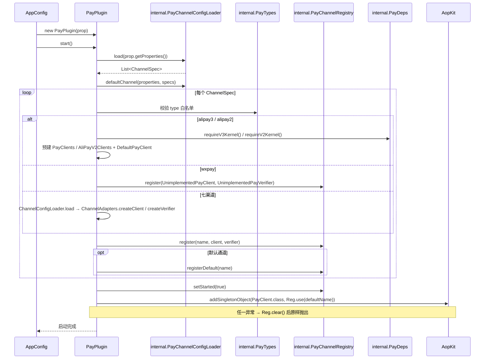
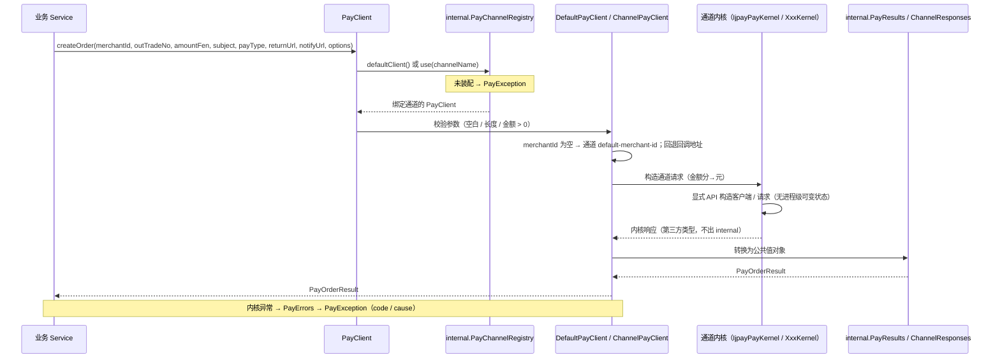
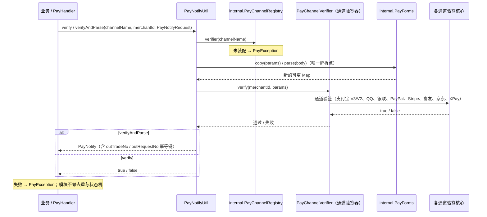
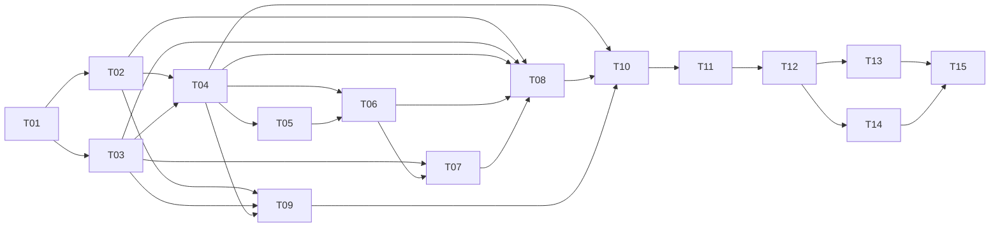

# aifei-pay 设计文档

本文是 `aifei-pay` 的**设计事实来源（契约）**：选型实证记录、包结构、公共 API 逐字签名、配置键、值对象字段、异常语义、依赖 scope 决策、AC 映射、任务分解与跨文件约定以本文为准。面向使用者的用法见 `README.md`；面向开发代理的约束见模块 `AGENTS.md`；测试策略与用例清单见 `docs/testing.md`（由编码角色在实现后产出，本文只定契约）。需求事实来源为 `docs/需求/aifei-pay.md`（下称 PRD）。

> **交付性质**：`aifei-pay` 是 aifei 生态的**库模块（可被应用依赖的 SDK）**，**不是应用工程**。模块内**没有** `AppConfig` / `Launcher` / `service/` 包 / `webapp/` / 路由 / HIO / 表结构 / `Db+Row` / `Generator` / UI 页面；只有「根包公共 API 精确 4 类型 + `model` 值对象精确 4 类型 + `spi` 2 类型 + `internal` 非承诺实现 + 一个装配用 `aifei.PayPlugin`」。
>
> **坐标**：`io.github.gollyhu:aifei-pay:1.0.0-SNAPSHOT`（`packaging=jar`）；包名 `cn.hg.aifei.pay`；**Java 8**（语法与 API 双约束，主 JAR class major = 52）。
>
> **依赖策略**：`cn.aifei:aifei-all` 为 `provided`；`IJPay-AliPay-V3` / `alipay-sdk-java-v3` / `dom4j` / `bcprov-jdk18on` 为 `optional`（阻断传递，消费方按需自带）。这是对规划文档「零第三方」口径的**已裁决变更**（PRD D-01 / D-03）。
>
> **文档状态**：1.0.0 **设计定稿**，待实现。§5 的公共类型签名与 §7 的配置键名是公共契约的唯一依据，变更前必须先改本文。

---

## V2. 多渠道聚合设计定稿（覆盖前文冲突口径）

> **生效声明**：本节是 2026-11-26 用户四项裁决后的**设计事实来源**。下文 V1.x 章节中凡涉及「支付宝单通道」「`AliPay*` 公共类型」「v1 单应用顶层配置」「禁其它渠道」「仅验签工具无 Handler」的表述均已被本节覆盖；实现、门禁与测试以本节为准。
>
> **支付宝版本矩阵（PRD V2.1）**：`type=alipay3` 对接 `IJPay-AliPay-V3` + `alipay-sdk-java-v3`，`type=alipay2` 对接 `IJPay-AliPay` + `alipay-sdk-java` 4.x；两版本共用公共 API 与通道配置键，内核、验签核心、依赖探测与客户端缓存按版本隔离。无版本含义的 `alipay` 不是合法 type。实现落点：`internal/AliPayV2Clients` / `AliPayV2PayKernel` / `AliPayV2Verifier` 与 `internal/PayDeps#requireV2Kernel()`。

### V2.1 定位与公共面

模块定位改为「基于 IJPay 的多支付通道聚合 SDK」，结构对齐 `aifei-sms`：一套 `PayClient` 聚合多通道，`PayKit` 提供默认与命名通道。根包公共类型冻结为 4 个，删除全部 `AliPay*` 兼容层：

| 包 | 精确公共类型 | 职责 |
| --- | --- | --- |
| `cn.hg.aifei.pay` | `PayClient` / `PayKit` / `PayNotifyUtil` / `PayException` | 交易动作、有状态门面、无状态验签、统一异常 |
| `cn.hg.aifei.pay.model` | `PayOrderResult` / `PayQueryResult` / `PayRefundResult` / `PayNotifyRequest` | 自有值对象，零第三方 / 零框架类型 |
| `cn.hg.aifei.pay.spi` | `PayNotify` / `PayNotifyListener` | 验签通过后的回调事件与监听器 |
| `cn.hg.aifei.pay.aifei` | `PayPlugin` / `PayHandler` / `PayIo` | 非承诺接入层：装配、入站闭环、传输桥接 |

### V2.2 公共 API 逐字签名

```java
public interface PayClient {
    PayOrderResult createOrder(String merchantId, String outTradeNo, long amountFen,
                               String subject, String payType, String returnUrl,
                               String notifyUrl, Map<String, String> options);
    PayQueryResult query(String merchantId, String outTradeNo);
    PayRefundResult refund(String merchantId, String outTradeNo, String outRequestNo,
                           long refundFen, String refundReason);
    String channelName();
}

public final class PayKit {
    public static PayClient defaultClient();
    public static PayClient use(String channelName);
    public static Set<String> channels();
}

public final class PayNotifyUtil {
    public static boolean verify(String channelName, String merchantId, PayNotifyRequest request);
    public static PayNotify verifyAndParse(String channelName, String merchantId, PayNotifyRequest request);
}

public class PayException extends RuntimeException {
    public PayException(String message);
    public PayException(String message, Throwable cause);
    public PayException(String message, String code, Throwable cause);
    public String code();
}
```

`PayClient` 实例绑定一个通道；`merchantId` 为通道内商户 / 应用标识，`null` / 空白回退该通道默认值；`payType` 为通道内下单产品（支付宝 `QRCODE` / `WAP` / `PAGE`，微信 `JSAPI` / `NATIVE` 等）；`options` 为通道扩展参数，可为 `null`。调用方参数错误抛 `IllegalArgumentException`；配置、依赖、内核、验签失败统一抛 `PayException`。

### V2.3 配置模型

```properties
pay.default-channel = alipay-main

pay.alipay-main.type = alipay
pay.alipay-main.default-merchant-id = 2021000000000001
pay.alipay-main.env = production
pay.alipay-main.private-key = @file:/etc/pay/alipay-app.pem
pay.alipay-main.verify.0.type = cert
pay.alipay-main.verify.0.value = @file:/etc/pay/alipay-cert.crt

pay.wxpay-main.type = wxpay
pay.wxpay-main.default-merchant-id = 1900000001
pay.wxpay-main.api-v3-key = @file:/etc/pay/wxpay-api-v3.key
pay.wxpay-main.cert-serial-no = 5Fxxxx
```

通道清单由 `pay.<name>.type` 推导；`pay.default-channel` 指定默认通道，单通道可缺省。`type` 白名单见 V2.5。配置解析唯一定义点为 `internal.PayConfig`，凭据读取仍为 `internal.PayResource`（`@file:` / 内联 PEM，不支持 classpath）。

### V2.4 回调双模型（共存、共用验签核心）

- `PayNotifyUtil.verify` / `verifyAndParse`：无状态、纯函数、不读 HTTP、不写响应、不调监听器；返回布尔或 `PayNotify`，失败抛 `PayException`。
- `PayHandler` + `PayNotifyListener`：可选入站闭环，路径 `/pay/notify/{channel}`；`PayIo` 抽象参数 / header / body 读取与响应写回。流程固定为：读请求 → 构造 `PayNotifyRequest` → 调 `PayNotifyUtil.verifyAndParse` → 同步分发监听器 → 按渠道写成功 / 失败应答。
- 两者**必须**调用同一 `internal.PayVerifier` 核心；源码门禁断言验签实现唯一。
- 模块不做幂等、不做状态机、不落库；`PayNotify` 透出 `outTradeNo` / `outRequestNo` 等幂等键。

### V2.5 渠道白名单与落地状态

| `type` | 内核构件 | 落地状态 |
| --- | --- | --- |
| `alipay3` | `IJPay-AliPay-V3:3.0.0` + `alipay-sdk-java-v3` | 已落地：下单 / 查单 / 退款 / 验签完整可用 |
| `alipay2` | `IJPay-AliPay:3.0.0` + `alipay-sdk-java` 4.x | 已落地：下单 / 查单 / 退款 / 验签完整可用 |
| `wxpay` | `IJPay-WxPay:3.0.0` | 白名单登记，交易适配器待补齐；与 `aifei-weixin` 并存、用户二选一 |
| `qq` | `IJPay-QQ:3.0.0` | **已落地**：下单 / 查单 / 退款 / MD5 验签完整可用 |
| `jdpay` | `IJPay-JDPay:3.0.0` | **已落地**：加密 XML 下单 / 查单 / 退款 / RSA 验签完整可用 |
| `unionpay` | `IJPay-UnionPay:3.0.0` | **已落地**：显式网关 + MD5 下单 / 查单 / 退款 / 验签完整可用 |
| `paypal` | `IJPay-PayPal:3.0.0` | **已落地**：Orders V2 下单 / 查单 / 退款 / 证书 Webhook 验签 |
| `stripe` | `IJPay-Stripe:3.0.0` + `stripe-java:34.1.0` | **已落地**：PaymentIntent / Refund / constructEvent 验签 |
| `fuiou` | `IJPay-FuiYou:3.0.0` | **已落地**：显式签名报文 + 下单 / 查单 / 退款 / 验签 |
| `xpay` | `IJPay-XPay:3.0.0` | **已落地**：PayApi.exePost + 下单 / 查单 / 退款 / 验签 |

`IJPay-AliPay` V2 已纳入，通道类型为 `alipay2`；`alipay` 不是合法 `type`。`PayTypes` 是类型白名单与必填键的唯一定义点；未知 `type` 启动即失败。`wxpay` 是唯一「已登记未落地」通道：可装配，但交易动作报「支付通道适配器未落地」。七渠道的必填键按各内核实际所需定义（见 `docs/channels.md` §3.3），不再统一只写 `default-merchant-id`。

### V2.6 包结构与唯一定义点

```text
cn.hg.aifei.pay
├── PayClient / PayKit / PayNotifyUtil / PayException
├── model: PayOrderResult / PayQueryResult / PayRefundResult / PayNotifyRequest
├── spi: PayNotify / PayNotifyListener
├── aifei: PayPlugin / PayHandler / PayIo
└── internal
    ├── PayConfig / PayTypes / PayClients / PayErrors / PayMask / PayDeps / PayAmounts / PayResults / PayForms
    ├── PayVerifier / DefaultPayClient
    ├── ijpay.alipay.* / ijpay.wxpay.*       支付宝 / 微信渠道适配器（微信本期不实现）
    └── channels/                           七渠道适配器：ChannelConfig / ChannelKernel /
                                            ChannelPayClient / ChannelVerifier / ChannelAdapters
                                            + Qq / Jd / UnionPay / PayPal / Stripe / FuiYou / XPay Kernel
```

第三方类型（`com.ijpay.*` / `com.stripe.*` / `cn.hutool.*`）只允许出现在 `internal`，公共面零第三方类型。
七渠道一律通过显式配置 API 构造客户端 / 请求，禁止 `*ApiConfigKit` / 全局 `ThreadLocal` / `CFG_MAP` 等进程级可变状态。

唯一定义点：配置与校验 `PayConfig`；类型白名单与必填键 `PayTypes`；通道注册表 `PayClients`；异常消息 `PayErrors`；脱敏 `PayMask`；依赖探测 `PayDeps`；验签核心 `PayVerifier`；值对象转换 `PayResults`；回调解析 `PayForms`；装配 `PayPlugin`；回调闭环 `PayHandler`。

### V2.7 依赖与门禁

- `aifei-all` 为 `provided`；所有 IJPay 构件与渠道 SDK（含 `stripe-java`）为 `optional`，版本属性集中（`ijpay.version=3.0.0`、`stripe.version=34.1.0`）；新增通道必须先通过 `PayDepsBytecodeTest` 的 Java 8 字节码断言（七渠道 JAR 已纳入 `EXPECTED_JARS`）。
- V2.5 落地新增 8 个 optional 直接依赖（七个 IJPay 渠道构件 + `stripe-java`），既有 `alipay2` / `alipay3` 的 exclusions 一项未减。
- G-01 公共面按 V2.1 精确断言且无 `AliPay*`；G-02 公共签名零第三方 / 零框架；G-03 无 `java.sql.`、`com.ijpay.*` 仅在 `internal`、白名单外渠道零命中、零 `cn.aifei.weixin`；G-04 `cn.aifei.*` 仅在 `aifei`；G-05 class major 52；G-06 依赖 optional。
- 新增 AC-23~AC-27：多通道注册、双模型共用核心、Handler 闭环、微信通道、渠道白名单。

### V2.8 迁移与任务顺序

1. V2-T01：需求 PRD V2.0 与本设计 V2 节（已完成）。
2. V2-T02：pom 增加 `IJPay-WxPay` optional，保留支付宝依赖锁定。
3. V2-T03：新增公共类型、删除 `AliPay*`、`model` / `spi` 落地。
4. V2-T04：配置模型与 `PayTypes` / `PayClients` 注册表。
5. V2-T05：支付宝实现迁入 `internal/ijpay/alipay`。
6. V2-T06：微信实现 `internal/ijpay/wxpay`。
7. V2-T07：`PayVerifier` + `PayNotifyUtil` + `PayHandler` / `PayIo` / `PayNotifyListener`。
8. V2-T08：门禁与测试全量改造，`mvn clean verify` 0/0。
9. V2-T09：`README` / `AGENTS` / `testing` / `CHANGELOG` / `release` / 根 `CODEBUDDY.md` 同步。

---

## 1. 模块定位与边界

> **V1.x 历史章节声明**：§1～§13 为 v1 单通道设计的历史记录。凡与开头 V2 章或当前源码冲突之处，**一律以 V2 章与当前源码为准**；§6 / §7 已按当前公共 API 与配置模型就地勘误，其余小节仅作历史参考，不得照抄为当前契约。

### 1.1 定位

`aifei-pay` 是**支付宝支付的 aifei 统一接入门面**：以 IJPay 支付宝 V3 内核为依赖底座，把「配置 → 下单 / 查单 / 退款 → 回调验签」收口为稳定、可验收的公共契约，与 `aifei-weixin` 支付侧的动作语义对齐。

四件事，一件一个落点：

| # | 目标 | 落点 |
| --- | --- | --- |
| 1 | 统一配置装配 | `pay.*` 键名、校验、凭据组、多应用（`internal.PayConfig` / `PayAppConfig` / `PayResource`） |
| 2 | 统一交易动作 | 扫码 / H5 / PC 下单、查单、退款（`internal.DefaultPayClient`） |
| 3 | 统一回调验签 | 普通公钥 / 公钥证书、多凭据轮换、同步与异步两类报文（`PayVerifier` / `PayForms`） |
| 4 | 统一类型隔离 | 内核响应 → 自有值对象（`internal.PayResults`）；内核 → `PayException`（`internal.PayErrors`） |

**IJPay 是依赖内核，不是复制代码。** 本模块通过 Maven 构件引入 `com.github.javen205:IJPay-AliPay-V3:3.0.0` 并调用其公开 API；**不复制、不 fork、不改写**其源码（PRD §7.1）。扩展形态为**包装（组合）**，非继承——本设计不依赖 IJPay 的任何可继承扩展点（§3.5 Q4 闭环）。

### 1.2 为什么是「库/SDK」而非应用工程（不适用章节声明）

| 常规章节 | 结论 | 理由 |
| --- | --- | --- |
| 表结构草案 | **不适用** | 零 DB、零表、零 `Db+Row`、零 `Generator`，运行期不连任何数据源；门禁 `G-03` 反向断言全模块无 `import java.sql.`。交易数据落在消费方业务库，不属于本模块交付物。**不为凑模板而编造表。** |
| Service 方法清单 / `@Path` | **不适用** | 模块无 Service（Just Service 是应用工程形态）；回调入口由消费方 Just Service / Handler 承载（PRD §13 入口 4）。公共面由本文 §5 定稿 |
| 低保真 UI 原型 | **不适用** | 模块无自有 UI；PRD §13 已裁决**不配 `aifei-pay-demo`** |
| `AppConfig implements AifeiConfig` / `Launcher` | **不适用** | 装配入口属**使用方应用**；本模块只提供 `PayPlugin` 供 `plugins.add(...)` |

`aifei-pay/` 内 `mvn clean verify` 必须 **0 failure / 0 error**（含架构门禁测试）。

### 1.3 公共面收敛纪律（硬约束）

| # | 纪律 |
| --- | --- |
| 1 | 根包 `cn.hg.aifei.pay` **精确 4 个公共类型**：`PayClient` / `PayKit` / `PayNotifyUtil` / `PayException`。不得增删、不得改名 |
| 2 | 值对象包 `cn.hg.aifei.pay.model` **精确 4 个公共类型**：`PayOrderResult` / `PayQueryResult` / `PayRefundResult` / `PayNotifyRequest`（回调入参）。嵌套类型（`PayOrderResult.Channel` 等）不单独计数；验签结果 + 幂等键为 `spi.PayNotify`（嵌套 `PayNotify.Type`） |
| 3 | **零第三方类型、零框架类型**出现在根包与 `model` 包：不出现 `com.ijpay.*` / `com.alipay.*` / `com.alibaba.fastjson*` / `cn.aifei.*` |
| 4 | 公共签名只用 `String` / `long` / `boolean` / `Map<String,String>` / `Throwable` / 本模块类型 |
| 5 | 每类规则只有一个定义点（§9），实现类不得复制 |
| 6 | Java 8 语法与 API 双约束；主 JAR class major = 52 |
| 7 | **不产出任何容器化产物**（无容器构建文件、无编排清单）；`internal` 侧无 `main` 方法、无嵌入式服务器 |

> 第 1、2、3、4 条由架构门禁 `ArchitectureBoundaryTest`（§10）强制，不得放宽或绕过。

### 1.4 v1 不做清单（边界，防范围蔓延）

**不做微信支付**（`aifei-weixin` 负责；本模块源码不引入 IJPay 微信模块，`G-03` 断言）；**IJPay 七渠道**（QQ / 京东 / 银联 / PayPal / Stripe / 富友 / XPay）已在 V2 落地，原「不做其余渠道」口径已被 V2 覆盖；**不做通知去重与订单状态机**（幂等键只透出，业务前置校验）；**不做订单落库与对账**（零 DB）；**不做收银台页面**（只产出支付参数与跳转载荷）；**不做 Servlet 适配**（不引 `IJPay-Servlet-*`，回调报文以 `Map` / `String` 入参）；**不做 provider 扩展点 / 多网关抽象**（单内核）；**不做主动补单轮询与送达补偿**；**不做多租户感知**（`notify_url` 的租户段解析由消费方负责）。

### 1.5 依赖来源与许可声明（PRD D-07 / AC-21）

本模块以 Maven 构件方式依赖第三方内核，保留其署名与许可：

| 构件 | 版本 | 许可 | 版权 | 用途 |
| --- | --- | --- | --- | --- |
| `com.github.javen205:IJPay-AliPay-V3` | `3.0.0` | Apache License 2.0 | Copyright (c) 2017 IJPay Authors | 支付宝 V3 内核（配置装配 + 交易接口封装） |
| `com.alipay.sdk:alipay-sdk-java-v3` | `3.1.89.ALL` | Apache License 2.0 | Ant Open（alipay.com） | 开放平台 OAS3.0 SDK（签名、验签、传输） |
| `org.bouncycastle:bcprov-jdk18on` | `1.86` | Bouncy Castle Licence（MIT 式） | The Legion of the Bouncy Castle | X.509 证书解析（证书模式必需） |
| `org.dom4j:dom4j` | `2.1.5` | BSD 式 | MetaStuff / dom4j 贡献者 | IJPay V3 内核声明的编译期依赖 |

**本模块不修改上述构件的版权信息，不复制其源码。** 上游项目地址：`gitee.com/javen205/IJPay`（可访问的完整 URL 仅出现在本文档；源码与测试源码不得出现任何 `http://` / `https://` 字面量，见 §10 附加 ④）。

---

## 2. 选型实证记录（禁止凭记忆写 API）

> **纪律**：本节每条结论均标注**取证方式**与**证据位置**。凡未能实测的点，一律标注「未验证 + 设计假设」，不编造 API 名称或签名。
>
> **取证环境**：`D:/Apache/MavenRepository`（本地仓库路径），Maven 3.8.3，临时探针工程位于系统临时目录（不入仓库）。取证日期与本文同批。

### 2.1 Maven Central 元数据与 pom 逐字核对

#### 2.1.1 `com.github.javen205:IJPay-AliPay-V3:3.0.0` 的 pom（逐字）

取证方式：`curl https://repo1.maven.org/maven2/com/github/javen205/IJPay-AliPay-V3/3.0.0/IJPay-AliPay-V3-3.0.0.pom`

```xml
<properties>
    <alipay.version>3.1.89.ALL</alipay.version>
</properties>
<dependencies>
    <dependency>
        <groupId>com.alipay.sdk</groupId>
        <artifactId>alipay-sdk-java-v3</artifactId>
        <version>${alipay.version}</version>
        <exclusions>
            <exclusion><groupId>dom4j</groupId><artifactId>dom4j</artifactId></exclusion>
            <exclusion><groupId>org.bouncycastle</groupId><artifactId>bcprov-jdk15on</artifactId></exclusion>
        </exclusions>
    </dependency>
    <dependency><groupId>org.dom4j</groupId><artifactId>dom4j</artifactId></dependency>
    <dependency><groupId>org.bouncycastle</groupId><artifactId>bcprov-jdk18on</artifactId></dependency>
</dependencies>
```

**逐字结论（F-12 闭环）**：
1. `alipay-sdk-java-v3` 精确版本 = **`3.1.89.ALL`**，由 IJPay 该模块 pom 的 `alipay.version` 属性硬写，**不是** `latest-version` 占位。
2. **排除项与替代声明由 IJPay 自己完成**：`dom4j:dom4j`（旧坐标）与 `org.bouncycastle:bcprov-jdk15on` 已被 IJPay 排除，并改声明 `org.dom4j:dom4j` 与 `org.bouncycastle:bcprov-jdk18on`（版本来自其父 pom 的 `dependencyManagement`）。
3. 因此本模块**无需重复排除**旧坐标（PRD §7.2 描述的排除动作是 IJPay pom 的既有事实，不是本模块必须执行的动作）。本模块仍**显式声明** `org.dom4j:dom4j:2.1.5` 与 `org.bouncycastle:bcprov-jdk18on:1.86`，作用是把版本**锁定成本模块 pom 的可见事实**（不依赖上游隐式定版），见 §8.1 决策 D-08。

#### 2.1.2 IJPay 父 pom `com.github.javen205:IJPay:3.0.0`（逐字）

取证方式：`curl https://repo1.maven.org/maven2/com/github/javen205/IJPay/3.0.0/IJPay-3.0.0.pom`

`<properties>`（逐字摘录）：`bc.version=1.86`、`dom4j.version=2.1.5`（注释：2.2.0 起基础字节码 55）、`okhttp.version=4.12.0`、`okio.version=3.18.2`、`kotlin.version=2.4.21`、`jackson.version=2.23.0`、`guava.version=33.6.0-jre`、`hutool.version=5.8.48`。

`<dependencies>`（非 `dependencyManagement`，逐字）：`junit`(test)、`cn.hutool:hutool-crypto`、`cn.hutool:hutool-http`、`cn.hutool:hutool-json`，版本均为 `${hutool.version}`。

**关键实证（对 PRD F-10 / F-11 的事实修正）**：
- **`okhttp 4.12.0` / `kotlin-stdlib 2.4.21` / `guava 33.6.0-jre` 这三个值对 V3 路线不生效。** 父 pom 的 `dependencyManagement` **不向消费者传播**；`IJPay-AliPay-V3` 自身 pom 未声明 okhttp / kotlin / guava，这三者只从 `alipay-sdk-java-v3` 自带的 pom 进来，实际解析为 **`okhttp 4.9.3` / `kotlin-stdlib 1.4.10` / `guava 28.1-jre`**（§2.2 依赖树逐行为证）。
- **V3 路线不含 fastjson**：V2 路线的 `fastjson 2.0.66` 说法不适用于 V3；V3 用 `gson 2.9.0` + `gson-fire 1.8.5`。
- **V3 内核额外依赖 hutool**（`hutool-crypto` / `hutool-http` / `hutool-json` / 传递 `hutool-core`），版本 `5.8.48`，class major 52（§2.3）。

#### 2.1.3 `com.alipay.sdk:alipay-sdk-java-v3:3.1.89.ALL` 的 pom（逐字摘录）

取证方式：`curl https://repo1.maven.org/maven2/com/alipay/sdk/alipay-sdk-java-v3/3.1.89.ALL/alipay-sdk-java-v3-3.1.89.ALL.pom`

`<properties>`：`java.version=1.8`、`okhttp-version=4.9.3`、`gson-version=2.9.0`、`commons-lang3-version=3.12.0`、`guava`（显式依赖写死 `28.1-jre`）、`javax.ws.rs-api-version=2.1.1`、`jsr311-api-version=1.1.1`、`jackson-databind-nullable-version=0.2.2`、`swagger-core-version=1.6.5`。

**逐字依赖列表**：`io.swagger:swagger-annotations`、`com.google.code.findbugs:jsr305:3.0.2`、`com.squareup.okhttp3:okhttp`(`${okhttp-version}`)、`okhttp3:logging-interceptor`、`okhttp3:okhttp-sse`、`com.google.code.gson:gson`、`io.gsonfire:gson-fire:1.8.5`、`org.apache.commons:commons-lang3`、`jakarta.annotation:jakarta.annotation-api:1.3.5`（**provided**）、`org.openapitools:jackson-databind-nullable:0.2.2`、`javax.ws.rs:jsr311-api:1.1.1`、`javax.ws.rs:javax.ws.rs-api:2.1.1`、`com.google.guava:guava:28.1-jre`、**`org.bouncycastle:bcprov-jdk15on:1.64`**、**`commons-logging:commons-logging:1.1.1`**、**`dom4j:dom4j:1.6.1`**（后三者已被 IJPay 侧前置排除/替换，见 2.1.1）。

### 2.2 依赖树实证（`mvn dependency:tree`）

取证方式：探针 pom 声明本文 §8.1 的定稿依赖组合，`mvn dependency:tree -DoutputFile=tree4.txt`（联网解析后快照）。**逐行输出如下（即本模块定稿依赖树）**：

```
probe:ijpay-probe4:jar:1.0.0-SNAPSHOT
+- com.github.javen205:IJPay-AliPay-V3:jar:3.0.0:compile
|  +- cn.hutool:hutool-crypto:jar:5.8.48:compile
|  |  \- cn.hutool:hutool-core:jar:5.8.48:compile
|  +- cn.hutool:hutool-http:jar:5.8.48:compile
|  \- cn.hutool:hutool-json:jar:5.8.48:compile
+- com.alipay.sdk:alipay-sdk-java-v3:jar:3.1.89.ALL:compile
|  +- io.swagger:swagger-annotations:jar:1.6.5:compile
|  +- com.google.code.findbugs:jsr305:jar:3.0.2:compile
|  +- com.squareup.okhttp3:okhttp:jar:4.9.3:compile
|  |  +- com.squareup.okio:okio:jar:2.8.0:compile
|  |  |  \- org.jetbrains.kotlin:kotlin-stdlib-common:jar:1.4.0:compile
|  |  \- org.jetbrains.kotlin:kotlin-stdlib:jar:1.4.10:compile
|  |     \- org.jetbrains:annotations:jar:13.0:compile
|  +- com.squareup.okhttp3:logging-interceptor:jar:4.9.3:compile
|  |  \- org.jetbrains.kotlin:kotlin-stdlib-jdk8:jar:1.4.10:compile
|  |     \- org.jetbrains.kotlin:kotlin-stdlib-jdk7:jar:1.4.10:compile
|  +- com.squareup.okhttp3:okhttp-sse:jar:4.9.3:compile
|  +- com.google.code.gson:gson:jar:2.9.0:compile
|  +- io.gsonfire:gson-fire:jar:1.8.5:compile
|  +- org.apache.commons:commons-lang3:jar:3.12.0:compile
|  +- javax.ws.rs:jsr311-api:jar:1.1.1:compile
|  +- javax.ws.rs:javax.ws.rs-api:jar:2.1.1:compile
|  +- com.google.guava:guava:jar:28.1-jre:compile
|  |  +- com.google.guava:failureaccess:jar:1.0.1:compile
|  |  +- com.google.guava:listenablefuture:jar:9999.0-empty-to-avoid-conflict-with-guava:compile
|  |  +- org.checkerframework:checker-qual:jar:2.8.1:compile
|  |  +- com.google.errorprone:error_prone_annotations:jar:2.3.2:compile
|  |  +- com.google.j2objc:j2objc-annotations:jar:1.3:compile
|  |  \- org.codehaus.mojo:animal-sniffer-annotations:jar:1.18:compile
|  \- commons-logging:commons-logging:jar:1.1.1:compile
+- org.dom4j:dom4j:jar:2.1.5:compile
\- org.bouncycastle:bcprov-jdk18on:jar:1.86:compile
```

**AC-02 排除项核对结论（逐项）**：

| 核对项 | 结论 | 证据 |
| --- | --- | --- |
| `dom4j:dom4j`（旧坐标）是否被排除 | **已排除**，树中无 `dom4j:dom4j` 节点 | 上树仅含 `org.dom4j:dom4j:2.1.5` |
| `org.dom4j:dom4j:2.1.5` 是否生效 | **生效** | 上树末段第二条 |
| `bcprov-jdk15on` 是否有残留 | **无残留**，树中不存在该坐标 | 全树 grep 无 `bcprov-jdk15on` |
| `bcprov-jdk18on:1.86` 是否生效 | **生效** | 上树末行 |
| `alipay-sdk-java-v3` 版本 | **`3.1.89.ALL`**（F-12 闭环） | 上树第 8 行 |

**测试过的三种 pom 形态（用于定稿取舍）**：

| 形态 | 声明 | 树内 JAR 数 | 结论 |
| --- | --- | --- | --- |
| A 最简 | 仅 `IJPay-AliPay-V3`（零排除、零补声明） | 36 | 可行；dom4j/bcprov 版本**隐式**来自上游，AC-02 无显式锁定对象 |
| B 本模块加排除 | A + 在 IJPay 上重复排除 + jackson 链排除 + 显式补 dom4j/bcprov | 32 | 可行；但排除项与上游重复，存在漂移风险 |
| **C 定稿** | `IJPay-AliPay-V3`（无排除）+ **显式** `alipay-sdk-java-v3`（3 个排除）+ 显式 `dom4j`/`bcprov-jdk18on` 锁版 | **32** | **采纳**（§8.1 决策 D-08） |

> C 形态的排除清单落在**本模块显式声明的 SDK 依赖**上，与上游 IJPay 的排除**语义一致但不重复**：`dom4j:dom4j`、`org.bouncycastle:bcprov-jdk15on`、`org.openapitools:jackson-databind-nullable`。

### 2.3 字节码实证（`javap` / class major 批量断言）

取证方式：对定稿形态的完整依赖 classpath（`mvn dependency:build-classpath`）逐 JAR 解包读取每个 `.class` 的 `ClassFile.major_version`（`CAFEBABE` + minor + major），统计最大值。

**逐 JAR 最大 major 实测值**：

| JAR | 最大 major | 判定 |
| --- | --- | --- |
| `IJPay-AliPay-V3-3.0.0.jar` | 52 | 合规 |
| `alipay-sdk-java-v3-3.1.89.ALL.jar` | 52 | 合规 |
| `bcprov-jdk18on-1.86.jar` | 52（可加载区；见下） | 合规 |
| `hutool-{crypto,http,json,core}-5.8.48.jar` | 52 | 合规 |
| `dom4j-2.1.5.jar` | 52 | 合规 |
| `okhttp-4.9.3.jar` / `logging-interceptor` / `okhttp-sse` | 52 | 合规 |
| `okio-2.8.0.jar` | 50 | 合规 |
| `kotlin-stdlib-1.4.10.jar` | 50 | 合规 |
| `kotlin-stdlib-jdk8-1.4.10.jar` | 52 | 合规 |
| `kotlin-stdlib-jdk7-1.4.10.jar` | 50 | 合规 |
| `kotlin-stdlib-common-1.4.0.jar` | 无 class（纯元数据） | 合规 |
| `gson-2.9.0.jar` | 51 | 合规 |
| `gson-fire-1.8.5.jar` | 50 | 合规 |
| `commons-lang3-3.12.0.jar` | 52 | 合规 |
| `guava-28.1-jre.jar` / `failureaccess` / `checker-qual` / `animal-sniffer-annotations` | 52 | 合规 |
| `listenablefuture-9999.0...jar` | 无 class | 合规 |
| `swagger-annotations-1.6.5.jar` | 51 | 合规 |
| `jsr305-3.0.2.jar` / `annotations-13.0.jar` / `j2objc-annotations-1.3.jar` | 49 | 合规 |
| `error_prone_annotations-2.3.2.jar` | 51 | 合规 |
| `jsr311-api-1.1.1.jar` | 49 | 合规 |
| `commons-logging-1.1.1.jar` | 45 | 合规 |

**唯一需要口径澄清的两类条目（实测明细）**：

| JAR | 超 52 的条目 | 条目性质 |
| --- | --- | --- |
| `javax.ws.rs-api-2.1.1.jar` | **1 个**：根级 `module-info.class`（major 53） | JPMS 模块描述符 |
| `kotlin-stdlib-1.4.10.jar` / `kotlin-stdlib-jdk8` / `kotlin-stdlib-jdk7` / `gson-2.9.0.jar` | **各 1 个**：`META-INF/versions/9/module-info.class`（major 53） | Multi-Release JAR 的 Java 9 变体 |
| `bcprov-jdk18on-1.86.jar` | **112 个**：`META-INF/versions/9/module-info.class`（53）+ `META-INF/versions/11/**`（55） | Multi-Release JAR 的 Java 9 / 11 变体 |

**AC-02 判定口径定稿（实测支撑，非放宽）**：

> 断言：对依赖树中每个 JAR，**排除 `module-info.class` 与 `META-INF/versions/**` 后的全部 class，major ≤ 52**。实测结果 **0 例外**（定稿形态与含 jackson 链的形态均为 0）。
>
> 依据：Java 8 虚拟机**不解析 JPMS 模块描述符**（Java 9 才引入），且**不识别** JAR manifest 的 `Multi-Release: true` 属性——`META-INF/versions/**` 下的条目对 Java 8 运行期完全不可达。因此这两类条目不构成 Java 8 基线风险，把它们计入判定只会让门禁长期红而无法修复（上游并无 Java 8 变体）。
>
> 主 JAR 的断言不放宽：`aifei-pay` 自身产物的**全部** class（含任何嵌套类型）major 必须等于 52，不适用上述豁免。

**同时实证的取舍**：`jackson-databind-nullable:0.2.2` 及其传递的 `jackson-databind/annotations/core:2.12.2` 在该 SDK 版本中被**实际引用 0 次**（对 `alipay-sdk-java-v3-3.1.89.ALL.jar` 全量 class 常量池与字符串字面量做 `org/openapitools/jackson`、`com/fasterxml/jackson` 匹配，命中 0 个文件）。排除后依赖 JAR 由 36 个降至 32 个、约少 2 MB，且消除全部根级 `module-info.class`。**该排除项在升级 SDK 版本时必须重新验证**（§13 风险 R-3）。

### 2.4 内核真实 API 逐字核对（V3 内核源码 / 字节码）

取证方式：`IJPay-AliPay-V3-3.0.0-sources.jar` 与 `alipay-sdk-java-v3-3.1.89.ALL-sources.jar` 解包阅读 + `javap` 交叉验证。**每项标注 jar 内文件路径。**

#### 2.4.1 入口类（全限定名）

| 类 | 全限定名 | 源码路径（jar 内） | 性质 |
| --- | --- | --- | --- |
| 交易接口封装 | `com.ijpay.alipay.v3.AliPayTradeApi` | `com/ijpay/alipay/v3/AliPayTradeApi.java` | **实例类**（非静态工具），构造 `AliPayTradeApi(ApiClient)` |
| 页面/APP 接口封装 | `com.ijpay.alipay.v3.AliPayApi` | `com/ijpay/alipay/v3/AliPayApi.java` | **静态方法类** |
| 配置构建器 | `com.ijpay.alipay.v3.AliPayApiConfig` | `com/ijpay/alipay/v3/AliPayApiConfig.java` | Builder（`builder()` / `build()` / `buildByCert()`） |
| 多应用注册表 | `com.ijpay.alipay.v3.AliPayApiConfigKit` | `com/ijpay/alipay/v3/AliPayApiConfigKit.java` | 静态 `ConcurrentHashMap` + `ThreadLocal<String>` |
| 业务 method 枚举 | `com.ijpay.alipay.v3.enums.AliPayMethodEnum` | `com/ijpay/alipay/v3/enums/AliPayMethodEnum.java` | 枚举 |
| 签名类型枚举 | `com.ijpay.alipay.v3.enums.SignType` | `com/ijpay/alipay/v3/enums/SignType.java` | 枚举（`MD5`/`RSA2`/`RSA`） |

#### 2.4.2 下单（三类 P0 形态）的**真实**方法签名与返回类型

**重要事实 1：V3 内核的 `AliPayApi` 里没有 `precreate` / `query` / `refund` 命名方法。**
`com/ijpay/alipay/v3/AliPayApi.java` 的全部 public 静态方法（逐字）为：`getAliClient()`、`setBaseUrl(String)`、`setAlipayConfig(AlipayConfig)`、`pageExecute(AliPayMethodEnum, String, Map<String,Object>)`、`sdkExecute(AliPayMethodEnum, Map<String,Object>)`、`execute(...)`（5 个重载）、`tradePagePay(Map)`、`tradePagePay(String, Map)`、`tradeWapPay(Map)`、`tradeWapPay(String, Map)`、`tradeAppPay(Map)`。

**重要事实 2：`precreate` / `query` / `refund` 在 `AliPayTradeApi` 上是实例方法。**

| 动作 | 逐字签名 | 返回类型 | 证据 |
| --- | --- | --- | --- |
| 当面付扫码预下单（`alipay.trade.precreate`） | `public AlipayTradePrecreateResponseModel precreate(AlipayTradePrecreateModel model) throws ApiException` | `AlipayTradePrecreateResponseModel` | `com/ijpay/alipay/v3/AliPayTradeApi.java`；`javap` 确认 |
| 同上（带自定义参数） | `public AlipayTradePrecreateResponseModel precreate(AlipayTradePrecreateModel model, CustomizedParams customizedParams) throws ApiException` | 同上 | 同上 |
| H5 手机网站（`alipay.trade.wap.pay`） | `public static String tradeWapPay(String httpMethod, Map<String, Object> bizParams) throws ApiException` | **`String`**（GET→跳转 URL；POST→自提交表单 HTML） | `com/ijpay/alipay/v3/AliPayApi.java` |
| PC 电脑网站（`alipay.trade.page.pay`） | `public static String tradePagePay(String httpMethod, Map<String, Object> bizParams) throws ApiException` | **`String`**（同上语义） | 同上 |
| 页面类通用入口 | `public static String pageExecute(AliPayMethodEnum method, String httpMethod, Map<String, Object> bizParams) throws ApiException` | `String` | 同上 |
| 通用 RESTful 入口 | `public static ApiResponse<Object> execute(String path, String method, OpenApiGenericRequest request) throws ApiException` | `ApiResponse<Object>` | 同上 |
| 通用入口（带泛型） | `public static <T> ApiResponse<T> execute(String path, String method, OpenApiGenericRequest request, TypeToken<T> type) throws ApiException` | `ApiResponse<T>` | 同上 |

> **设计后果**：H5 / PC 下单走上表静态方法；扫码下单走 `AliPayTradeApi` 实例方法。**注意 `AliPayApi` 的静态方法共用 `Configuration.getDefaultApiClient()`（进程级单例）**，多应用场景会互相覆盖——见 2.4.5。

#### 2.4.3 查单 / 退款的方法签名

| 动作 | 逐字签名 | 返回类型 | 证据 |
| --- | --- | --- | --- |
| 查单（`alipay.trade.query`） | `public AlipayTradeQueryResponseModel query(AlipayTradeQueryModel model) throws ApiException` | `AlipayTradeQueryResponseModel` | `com/ijpay/alipay/v3/AliPayTradeApi.java` |
| 退款（`alipay.trade.refund`） | `public AlipayTradeRefundResponseModel refund(AlipayTradeRefundModel model) throws ApiException` | `AlipayTradeRefundResponseModel` | 同上 |
| 关单（P1） | `public AlipayTradeCloseResponseModel close(AlipayTradeCloseModel model) throws ApiException` | `AlipayTradeCloseResponseModel` | 同上 |
| 撤销（P1） | `public AlipayTradeCancelResponseModel cancel(AlipayTradeCancelModel model) throws ApiException` | `AlipayTradeCancelResponseModel` | 同上 |

**请求模型字段（`javap` 逐字，仅列 P0 用到的）**：

| 模型 | 实际存在的 setter（节选，逐字） |
| --- | --- |
| `AlipayTradePrecreateModel` | `setOutTradeNo(String)`、`setTotalAmount(String)`、`setSubject(String)`、`setNotifyUrl(String)`、`setTimeExpire(String)`、`setProductCode(String)`、`setQrCodeTimeoutExpress(String)`、`setStoreId(String)` |
| `AlipayTradeQueryModel` | `setOutTradeNo(String)`、`setTradeNo(String)`、`setQueryOptions(List<String>)`、`setOrgPid(String)` |
| `AlipayTradeRefundModel` | `setOutTradeNo(String)`、`setTradeNo(String)`、**`setOutRequestNo(String)`**（退款单号 = 幂等键）、`setRefundAmount(String)`、`setRefundReason(String)`、`setRefundCurrency(String)`、`setOutRequestNo` 等 |

**响应模型字段（`javap` 逐字，仅列 P0 用到的）**：

| 模型 | getter（逐字） |
| --- | --- |
| `AlipayTradePrecreateResponseModel` | `getOutTradeNo()`、`getQrCode()`、`getShareCode()`、`getPrepayId()` |
| `AlipayTradeQueryResponseModel` | `getOutTradeNo()`、`getTradeNo()`、`getTradeStatus()`、`getTotalAmount()`、`getBuyerPayAmount()`、`getSendPayDate()` |
| `AlipayTradeRefundResponseModel` | `getOutTradeNo()`、`getTradeNo()`、`getRefundFee()`、`getFundChange()`、`getGmtRefundPay()`、`getRefundSettlementId()`、`getSendBackFee()` |

> 全部金额字段类型为 **`String`（单位为元，形如 `"0.01"`）**，不是 `BigDecimal` / `long`。这决定了 §6.4 的「入参用分、出参用元字符串」非对称约定。

#### 2.4.4 回调验签：**普通公钥**与**公钥证书**两种方式的真实方法

**关键事实：IJPay-AliPay-V3 自身不含任何验签工具类。** `com/ijpay/alipay/v3/` 下只有 `AliPayApi` / `AliPayApiConfig` / `AliPayApiConfigKit` / `AliPayTradeApi` / 两个枚举，无 `PayNotifyUtil` 之类。验签必须落到官方 SDK 的 `com.alipay.v3.util.AlipaySignature`（`alipay-sdk-java-v3-3.1.89.ALL.jar` 内 `com/alipay/v3/util/AlipaySignature.class`）。

`javap com.alipay.v3.util.AlipaySignature` 的全部验签相关方法（逐字）：

```
public static boolean rsaCheckV1(java.util.Map<java.lang.String,java.lang.String>, java.lang.String, java.lang.String) throws ApiException
public static boolean rsaCheckV1(java.util.Map<java.lang.String,java.lang.String>, java.lang.String, java.lang.String, java.lang.String) throws ApiException
public static boolean rsaCertCheckV1(java.util.Map<java.lang.String,java.lang.String>, java.lang.String, java.lang.String) throws ApiException   // @Deprecated
public static boolean rsaCertCheckV1(java.util.Map<java.lang.String,java.lang.String>, java.lang.String, java.lang.String, java.lang.String) throws ApiException   // @Deprecated
public static boolean verify(java.lang.String, java.lang.String, java.lang.String, java.lang.String, java.lang.String) throws ApiException
public static boolean certVerify(java.lang.String, java.lang.String, java.lang.String, java.lang.String, java.lang.String) throws ApiException
public static String getCertSN(java.lang.String)
public static String getAlipayPublicKey(java.lang.String)
public static String getSignCheckContentV1(java.util.Map<java.lang.String,java.lang.String>)
```

源码参数名（`AlipaySignature.java` 逐字）：

| 方法 | 参数名 | 语义 |
| --- | --- | --- |
| `rsaCheckV1(Map<String,String> params, String publicKey, String charset, String signType)` | `params` / `publicKey`（**支付宝公钥文本**）/ `charset` / `signType` | **普通公钥模式验签**（推荐重载） |
| `rsaCertCheckV1(Map<String,String> params, String alipayPublicCertPath, String charset, String signType)` | `alipayPublicCertPath`（**证书路径**） | 证书模式便捷重载，**已 `@Deprecated`**；内部 = `getAlipayPublicKey(certPath)` 后转调 `rsaCheckV1` |
| `verify(String content, String sign, String publicKey, String charset, String signType)` | — | 验签内核；**实现里硬校验 `charset` 只接受 UTF-8、`signType` 只接受 `RSA2`**（否则抛 `ApiException`） |
| `getSignCheckContentV1(Map<String,String> params)` | — | 拼接待验签串；**实现里 `params.remove("sign")` 与 `params.remove("sign_type")`（原地修改入参 Map）** |

**证书序列号的取得方式（逐字，`com/alipay/v3/util/AntCertificationUtil.java`）**：

| 方法 | 逐字签名 | 语义 |
| --- | --- | --- |
| `getCertSN` | `public static String getCertSN(String certContent)` | 入参是**证书 PEM 文本内容**（不是路径）；返回 `md5(issuerDN + serialNumber)` 的 hex |
| `getCertPublicKey` | `public static String getCertPublicKey(String certContent)` | 入参是**证书 PEM 文本内容**；返回 Base64 公钥 |
| `isTrusted` | `public static boolean isTrusted(String certContent, String rootCertContent)` | 校验证书链是否由根证书签发 |
| `readCertContent` | `public static String readCertContent(String certPath)` | **唯一接受路径的方法**：先按文件系统路径读，失败则按 classpath 资源读 |

> **易踩坑（本文档固化，实现不得再踩）**：`AlipaySignature.getCertSN(String)` 与 `AlipaySignature.getAlipayPublicKey(String)` 的参数名虽叫 `certPath`，但内部第一步就调 `AntCertificationUtil.readCertContent(certPath)` —— **它们只接受路径**。若把证书 PEM 文本传进去，`new File(长 PEM 串)` 不存在 → 转 classpath 读取 → 必然失败并抛 `RuntimeException`。**证书内容形态的配置必须直接调用 `AntCertificationUtil.getCertSN(certContent)` / `getCertPublicKey(certContent)`**，再走 `AlipaySignature.rsaCheckV1(params, publicKey, charset, signType)`。本模块统一采用后者（§6.3）。

**BouncyCastle 强依赖（实测）**：`AntCertificationUtil` 的静态初始化块执行 `new BouncyCastleProvider(); Security.addProvider(provider);`，且 `getCertSN` / `getCertPublicKey` 内部用 `CertificateFactory.getInstance("X.509", "BC")`。**因此证书模式在运行期必须有 `org.bouncycastle:bcprov-*`**，否则类初始化即 `NoClassDefFoundError`。这与 `bcprov-jdk18on` 为 optional 的组合意味着：**证书模式下缺失 bcprov 必须被 `internal.PayDeps` 提前探测并转成可读的 `PayException`**（R-10 / AC-17）。

**验签能力边界（实测结论，写入 README）**：
- `sign_type` **只支持 `RSA2`**（SHA256withRSA）；`RSA`（SHA1）会被内核直接抛 `ApiException("signType只支持RSA2")`。
- `charset` **只支持 `UTF-8`**（大小写不敏感）；其他字符集被内核拒绝。
- `rsaCheckV1` 会跳过**值为空**的字段（`getSignCheckContentV1` 内 `Strings.isNullOrEmpty(value)` 分支），与支付宝官方签名串规范一致。

#### 2.4.5 网关 URL 与 appId / 私钥的注入方式

| 能力 | 真实做法 | 证据 |
| --- | --- | --- |
| 网关 | `ApiClient#setBasePath(String)`（返回 `ApiClient`，链式） | `javap com.alipay.v3.ApiClient` |
| appId / 私钥（普通公钥模式） | `AlipayConfig cfg = new AlipayConfig(); cfg.setAppId(..); cfg.setPrivateKey(..); cfg.setAlipayPublicKey(..); apiClient.setAlipayConfig(cfg)` | `com/alipay/v3/util/model/AlipayConfig.java`；`AlipayConfig` 的 setter：`setServerUrl` / `setAppId` / `setPrivateKey` / `setAlipayPublicKey` / `setAppCertPath` / `setAlipayPublicCertPath` / `setRootCertPath` / **`setAppCertContent`** / **`setAlipayPublicCertContent`** / **`setRootCertContent`** / `setEncryptKey` / `setEncryptType` |
| 证书模式 | `AlipayConfig` 用 **`*Content` 系列**注入证书文本（**无需落盘**），与 `*Path` 系列二选一。**已验证**：内容形态可完成装配（依据 SDK `com/alipay/v3/ApiClient.java` 源码 + 装配用例 `PayPluginTest#shouldStartWithCertificateMode`） | `com/alipay/v3/util/model/AlipayConfig.java`（`setAppCertContent` / `setAlipayPublicCertContent` / `setRootCertContent`） |
| 超时 | `ApiClient#setConnectTimeout(int)` / `setReadTimeout(int)` / `setWriteTimeout(int)` | `javap com.alipay.v3.ApiClient` |
| 是否需要自建 `DefaultAlipayClient` | **不需要**。V3 路线无 `DefaultAlipayClient`（那是 V2 / alipay-sdk-java 4.x 的类型）。V3 用 `ApiClient` + `AlipayConfig` | `alipay-sdk-java-v3` 包根为 `com.alipay.v3.*`，无 `com.alipay.api.DefaultAlipayClient` |

**多应用 / 进程级单例隔离（关键设计约束，实测）**：

| 入口 | 客户端来源 | 多应用隔离性 |
| --- | --- | --- |
| `new AliPayTradeApi(ApiClient)` | 构造注入；`AlipayTradeApi(ApiClient)` 内部持有 | **可隔离**（每 appId 一个实例） |
| `new GenericExecuteApi(ApiClient)` | 构造注入 `localVarApiClient`；`pageExecute` 用该字段 | **可隔离** |
| `AliPayApi.tradeWapPay/tradePagePay(...)`（静态） | `Configuration.getDefaultApiClient()`（**进程级单例**） | **不可隔离** |

> **设计结论**：H5 / PC 下单**不得**走 `AliPayApi.tradeWapPay` / `tradePagePay` 静态方法，必须走 `new GenericExecuteApi(apiClient).pageExecute(AliPayMethodEnum.TRADE_WAP_PAY, httpMethod, bizParams)`，否则多应用会互相覆盖网关与凭据（违反 AC-16）。
>
> 同理 `AliPayApiConfigKit`（静态 `ConcurrentHashMap` + `ThreadLocal`）本模块**不使用**：它是进程级可变全局状态，与「配置由装配期一次性装载、调用期只读」的口径冲突，且 `ThreadLocal` 泄漏风险由消费方承担。本模块自建「appId → 不可变 `PayAppConfig` + 缓存的 `ApiClient`/`GenericExecuteApi`」映射（`internal.PayClients`）。

#### 2.4.6 内核抛出的异常类型

| 层 | 异常类型 | 证据 |
| --- | --- | --- |
| IJPay V3 封装层 | `com.alipay.v3.ApiException`（**受检**，`extends java.lang.Exception`） | `AliPayTradeApi` / `AliPayApi` 全部方法 `throws ApiException` |
| SDK 传输层 | `com.alipay.v3.ApiException`：构造含 `(int code, String message, Map<String,List<String>> responseHeaders, String responseBody)`，getter 有 `getCode()` / `getResponseBody()` / `getMessage()` / `getErrorObject()` | `javap com.alipay.v3.ApiException` |
| 证书解析层 | `java.lang.RuntimeException`（`AntCertificationUtil` 内 `throw new RuntimeException(...)`） | `com/alipay/v3/util/AntCertificationUtil.java` |
| IJPay 配置层 | `IllegalStateException`（如 `"appId 未被赋值"`）/ `IllegalArgumentException`（如 `"appId 值不能为 null"`） | `com/ijpay/alipay/v3/AliPayApiConfig.java` |

**关键实证（`ApiException#getCode()` 的语义，经实现期用例固定）**：

> `com.alipay.v3.ApiException#getCode()` 返回类型是 **`int`**（`javap` 可见），其语义是 **HTTP 状态码**（`400` / `500` 等），**不是支付宝业务错误码**。业务错误码（如 `ACQ.TRADE_NOT_EXIST`）只存在于 HTTP **响应体 JSON 的 `code` 字段**（`getResponseBody()`）。
>
> **实现口径（已由用例固定，见下）**：`internal.PayErrors#errorCodeOf(Throwable)` 按三级回退提取业务错误码 —— ① 首选返回 **`String`** 的 `getCode()`（因 `ApiException#getCode()` 返回 `int`，被 `stringMethod` 的类型判定**跳过**，此分支实际只服务自检型桩）；② 否则从 `getResponseBody()` 的 JSON 取 `"code"`；③ 最后从 `getMessage()` 文本中取同名 JSON 字段（SDK 的 `getMessage()` 会带上响应体）。**无响应体时 `code()` 为 `null`**。
>
> **对 AC-08 的影响**：AC-08 的「`code()` = `ACQ.TRADE_NOT_EXIST`」**不能**靠 `ApiException#getCode()` 实现；必须走上述 ②/③。该口径已由用例 `PayErrorsTest#shouldIgnoreNonStringCodeAndFallBackToResponseBody` 固定。凡读到本节旧稿「`ApiException` 构造含 `int code`」的读者，**不得**把它当作业务错误码使用。

> `ApiException` 是**受检异常**，与本仓库「公共面不外泄受检异常」的口径冲突 → 必须由 `internal.PayErrors` 统一收敛为 `PayException`（`extends RuntimeException`），见 §6.5。

### 2.5 PRD §11.2 五项设计期核对项闭环结论

| # | 核对项 | 闭环结论 | 证据位置 |
| --- | --- | --- | --- |
| **F-12** | `alipay-sdk-java-v3` 精确小版本号 | **`3.1.89.ALL`**。由 `IJPay-AliPay-V3:3.0.0` 的 pom 属性 `alipay.version` 硬写，非占位符。本模块 pom 显式声明同一版本以锁定 | §2.1.1、§2.1.3 |
| **AC-02** | `dom4j:dom4j` / `bcprov-jdk15on` 已排除、2.1.5 与 1.86 生效、无 `bcprov-jdk15on` 残留、依赖树逐项 ≤ 52 | **全部满足**。旧坐标由上游 pom 排除，本模块不需重复排除；实测树无 `dom4j:dom4j`、无 `bcprov-jdk15on`；可加载 class 最大 major = 52，`>52` 的 0 例外（仅 JPMS 描述符与 Multi-Release 变体，Java 8 不可达） | §2.2、§2.3 |
| **AC-10~12** | 验签方法向量（普通公钥 / 公钥证书 × 同步 GET / 异步 POST） | **闭环，且修正了 PRD 的假设**：① 普通公钥 = `AlipaySignature.rsaCheckV1(params, publicKey, charset, signType)`；② 公钥证书 = 从**证书文本内容**取公钥（`AntCertificationUtil.getCertPublicKey(content)`）后同样调 `rsaCheckV1`，**不用**已废弃的 `rsaCertCheckV1(path)`；③ 证书序列号 = `AntCertificationUtil.getCertSN(certContent)`；④ 同步 GET 与异步 POST 在模块内**统一收敛为 `Map<String,String>`**，由唯一解析点 `internal.PayForms` 负责 urlencoded 解码，两条入参路径（`Map` 直接给 / `String` 由模块解析）各自唯一；⑤ 内核限制：`sign_type` 仅 `RSA2`、`charset` 仅 `UTF-8`；⑥ **`rsaCheckV1` 会原地修改入参 Map**，模块必须先做防御性拷贝（保 R-07 纯函数性） | §2.4.4、§6.3 |
| **Q4** | IJPay 是否存在可继承 / 可重写扩展点 | **闭环：不依赖任何扩展点，坚持组合（包装）。** V3 内核无 SPI / `META-INF/services`；`AliPayTradeApi` 与 `GenericExecuteApi` 都是 `public class`（非 `final`）且提供 `public` 构造注入 `ApiClient`，因此「组合 + 构造注入」在类型层面完全可行，无需继承。**本模块不继承任何 IJPay / SDK 类型**（`G-05` 断言 `extends com.ijpay` / `extends com.alipay` 为零） | §2.4.1、§2.4.5 |
| **AC-19** | IJPay 与支付宝 SDK 依赖 `optional` 的具体 scope 落点 | **闭环：全部 `optional`（等价 `compile` + 阻断传递）**，无需登记 `compile` 例外。`aifei-all` 为 `provided`。`dom4j` 与 `bcprov-jdk18on` 同为 `optional`。门禁 `G-06` 断言 pom 直接依赖集合精确匹配 | §8.1、§8.2 |

---

## 3. 设计决策表

> 格式：**决策** —— 理由 —— 被否决的替代方案。

| # | 决策 | 理由 | 被否决的替代方案 |
| --- | --- | --- | --- |
| D-01 | **（v1 历史决策；V2 已改为 `alipay3` / `alipay2` 双版本）内核 = `IJPay-AliPay-V3:3.0.0`，组合包装，不继承** | 用户 2026-11-26 裁决；V3 内核 `AliPayTradeApi` / `GenericExecuteApi` 均支持构造注入 `ApiClient`，组合即可满足多应用隔离，无需扩展点 | ① V2 路线（`alipay-sdk-java` 4.x + `DefaultAlipayClient`）：已被裁决排除；② 继承 `AliPayTradeApi`：为不存在的扩展需求付继承耦合成本 |
| D-02 | **公共面 4 + 值对象 4 分居两个包**：根包 4 类（门面/接口/工具/异常），`model` 包 4 个值对象 | PRD §7.3 定档根包「预估 4 类」并要求值对象「数量与归属由设计关定档」。放 `model` 子包：① 根包保持 4，与 PRD 预估一致；② 值对象需 `public static of(...)` 工厂供 `internal` 跨包构造，做成 `PayClient` 的嵌套类型会让签名变成 `PayClient.PayOrderResult`，可读性差；③ 子包类型集合可被门禁精确断言（`aifei-audit` G-02 先例） | ① 全部塞根包（8 类）：直接违反 PRD「根包精确 4 类」；② 全做嵌套类型：签名冗长、Javadoc 难写；③ 值对象用 `Map`：丢失类型安全，且 AC-14 的字段级断言退化为字符串键约定 |
| D-03 | **金额入参用 `long`（分），出参用 `String`（元，原样透出）** | 入参要构报文，必须确定性、可校验（AC-07「金额 ≤ 0 抛异常」）→ 整数分无浮点/精度歧义，且与 `aifei-weixin` 的 `int totalFen` 语义对齐（§7.4 动作语义对齐）。出参是内核已定型的元字符串，二次换算只会引入精度与异常风险 → 原样透出 | ① 入参用 `BigDecimal`：需定标度/舍入规则，且 `total_amount` 是字符串，仍要转换；② 入参出参都用 `String`：调用方易传错单位（元 vs 分）且校验琐碎；③ 入参用 `int` 分：订单金额理论上可超 `int`，`long` 无成本 |
| D-04 | **（V2 当前口径）商户标识显式 `merchantId` 首参（不做线程绑定）** | 多通道聚合下 `merchantId` 为通道内商户 / 应用标识；`null` / 空白回退该通道 `default-merchant-id`。无隐式状态、可机械断言、不引入 `ThreadLocal` 泄漏面 | ① `ThreadLocal` 绑定：隐式状态 + 泄漏风险；② 每商户一个 `PayClient` 实例：`@Inject` 只能注一个，改用 `PayChannelRegistry` 注册表 |
| D-05 | **（V2 当前口径）`merchantId` 传 `null` / 空白 → 取通道 `pay.<name>.default-merchant-id`** | 单商户场景免去每次都写；多通道按各自默认商户解析，不跨通道串扰 | ① 强制必填：单商户场景冗余；② 全局默认值：跨通道串扰 |
| D-06 | **网关由配置显式管理：`env` + `gateway-url`（`gateway-url` 缺省取 `env` 对应官方网关，显式配置时 host 必须与 `env` 一致）** | PRD 2026-11-26 裁决「以配置显式管理网关 URL + 凭据组，不依赖 IJPay 内建开关」。`env` 与网关 host 的一致性校验是 AC-15「沙箱凭据误调生产网关须被拦截」**唯一可机械验证**的落点 | ① 不设 `env`、只给 `gateway-url`：无法校验「环境标签与网关是否一致」，AC-15 退化为人工审查；② 依赖 IJPay 内建沙箱开关：V3 内核**无此开关**（实测 `AliPayApi` 只有 `setBaseUrl`），且已裁决不用 |
| D-07 | **`gateway-url` 不设默认值以外的一切隐式行为；`env` 必填** | 漏配 `env` 是「环境不清」的唯一来源，必须启动即失败（AC-05 同口径） | ① `env` 默认 `sandbox`：生产误连沙箱是更危险的静默失败；② `env` 默认 `production`：开发误连生产更危险 |
| D-08 | **依赖形态 C**：`IJPay-AliPay-V3`（无排除）+ 显式 `alipay-sdk-java-v3:3.1.89.ALL`（排除 `dom4j:dom4j` / `bcprov-jdk15on` / `jackson-databind-nullable`）+ 显式 `dom4j:2.1.5` / `bcprov-jdk18on:1.86` 锁版 | ① 显式声明 SDK 让 **F-12 版本锁定成为本模块 pom 的可审计事实**；② 排除项挂在显式声明处，与上游 IJPay 语义一致但不重复；③ 排除 `jackson-databind-nullable` 经实测在该 SDK 版本被引用 0 次，减 4 个 JAR 并消除根级 `module-info.class` | ① 形态 A（最简）：版本隐式来自上游，上游升级即漂移，AC-02 无锁定对象；② 形态 B（在 IJPay 上重复排除）：排除项双写，漂移风险更高；③ 不排除 jackson 链：无害但白带 4 个 JAR |
| D-09 | **`PayClient` 为接口且 `@Inject` 注入**，`PayKit` 为**只暴露 `defaultClient()` / `use()` / `channels()` 的静态门面**（不复制接口方法） | `aifei-http` / `aifei-audit` 先例：`XxxClient` 接口注入、`XxxKit` 静态门面取实例。**不把交易方法复制到 `PayKit`**：双份契约必然漂移，且门禁无法判断两份签名是否同步 | ① `PayKit` 全量代理方法：契约双写；② 不提供静态门面：静态上下文（工具方法 / 脚本）无法取用 |
| D-10 | **验签工具 `PayNotifyUtil` 为静态无状态类**（`Util` 后缀），从装配态读取凭据 | PRD §7.3 已定档 `XxxUtil` 命名；无状态（不持有可变字段、不写缓存）即满足 R-05 / AC-14 的「纯函数」语义 | ① 做成 `PayClient` 的方法：回落验签是回调入口的横切动作，不属于交易客户端；② 让调用方自己传公钥/证书：把 R-01/R-06 的凭据管理责任推回业务，与模块目标冲突 |
| D-11 | **`PayException` 携带可选业务错误码 `code()`** | AC-08 要求「查单不存在」口径唯一。支付宝对不存在交易返回 `ACQ.TRADE_NOT_EXIST`，该值出现在 HTTP 响应体 JSON 的 `code` 字段（而内核 `ApiException#getCode()` 是 `int` HTTP 状态码，不可用，见 §2.4.6）→ 收敛时按三级回退提取并保留，让业务可判定，避免异常消息字符串匹配 | ① 只抛 message：业务只能匹配中文/英文文案，脆弱；② 定义公共错误码枚举：等于把内核错误码空间搬进公共面，随上游变动而破坏兼容 |
| D-12 | **验签凭据为「有序列表」，`verify.<n>.*` 显式声明；`sign-mode` 决定下单凭据形态** | R-06 要求同一 appId 下多组凭据并存以支持轮换；有序编号列表是 `Properties` 下唯一可机械枚举、可校验连续性、可断言的形态 | ① 逗号分隔多值：PEM 含换行与逗号，无法可靠切分；② 仅单凭据：轮换期必须停机，违反 R-06；③ JSON 数组值：需内置 JSON 解析，本模块不引 JSON 库 |
| D-13 | **`internal.PayKernel` 包级可见接口（仅单测注入）**，唯一实现 `IjpayPayKernel` | AC-06 / AC-15 要求「伪内核 + 断言网关参数」，而 SDK 调用是静态/实例方法、无法用第三方 mock 框架（本模块零 mock 依赖）。`aifei-http` 的 `internal.HttpTransport` 已有同构先例 | ① 用 Mockito：引入测试期第三方依赖，违反依赖纪律；② 起本地 HTTP 桩服务打真实网关：无法覆盖「网关参数断言」，且拖慢单测；③ 不做注入点：AC-06/AC-15 只能靠沙箱集成，违背「单测可机械验证」 |
| D-14 | **`AlipaySignature` 与 `AntCertificationUtil` 只能在 `internal.PayVerifier` / `internal.PayVerifyKey` 出现**；`AliPayTradeApi` / `GenericExecuteApi` 只能在 `internal.IjpayPayKernel` / `internal.PayClients` 出现 | G-04「第三方类型只在 internal 层」的具体落点；同时保证「升级 IJPay 不波及公共契约」 | ① 不约束具体文件：「只在 internal」过宽，升级时改动面不可控；② 在根包做一层薄代理：等于把第三方类型搬进公共面 |
| D-15 | **日志只记录两处**：内核异常收敛前 `warn` 一次（`PayErrors`）、验签失败 `warn` 一次（`PayVerifier`）；一律方法内 `Log.get(Class)`，不用 `static` 字段 | `LogFactory` 装配晚于类初始化，`static` 字段会固化空实现（`aifei-http` 决策 16 同口径）；支付链路高频，只记业务看不见的失败分支 | ① 每次调用都记：噪声与成本不可接受；② 完全不记：验签失败难排查；③ `static final Log`：装配顺序问题 |
| D-16 | **不配置 `aifei-pay-demo`** | PRD §13 用户 2026-11-26 已裁决不配 | ① 配单页 demo：与裁决冲突 |

---

## 4. 术语表

| 术语 | 含义 | 归属 |
| --- | --- | --- |
| **支付通道客户端 PayClient** | 交易动作视图：`createOrder` / `query` / `refund` / `channelName`；每实例绑定一个通道，默认通道注册为 `@Inject` 单例 | 根包（公共接口） |
| **门面 PayKit** | 静态取用入口：`defaultClient()` / `use(channelName)` / `channels()` 与两个网关常量；未装配 / 已停止即失败 | 根包（公共） |
| **验签工具 PayNotifyUtil** | 无状态静态工具：`verify`（布尔语义）/ `verifyAndParse`（失败抛异常） | 根包（公共） |
| **统一异常 PayException** | 全部业务失败的唯一外泄类型（`extends RuntimeException`），携带可选内核错误码 | 根包（公共） |
| **支付宝应用配置 PayAppConfig** | 单个支付宝 appId 的不可变配置快照，由 `pay.<name>.*` 通道配置映射而来 | `internal`（非承诺） |
| **配置域 PayConfig** | `pay.*` 键名、默认值、解析、校验、脱敏的唯一定义点 | `internal` |
| **验签凭据 PayVerifyKey** | 一组验签凭据：`type`（`KEY` / `CERT`）+ `value`（内容）+ `certSn`（证书序列号，可自动计算） | `internal` |
| **内核边界 PayKernel** | 包级可见接口，抽象内核交易调用；实现按支付宝版本隔离（V3 `IjpayPayKernel` / V2 `AliPayV2PayKernel`）；**仅供单测注入，非扩展点** | `internal` |
| **网关环境 env** | `sandbox` / `production`；决定默认网关并校验 `gateway-url` 的 host 一致性 | `internal`（配置） |
| **同步 / 异步报文** | 同步 `return_url`（GET query string）与异步 `notify_url`（POST 表单）；模块内统一收敛为 `model.PayNotifyRequest`（params / headers / body） | `model` / `internal.PayForms` |
| **幂等键** | `out_trade_no`（交易）与 `out_request_no`（退款）；模块只透出，不去重 | `spi.PayNotify`（`outTradeNo()` / `outRequestNo()`） |

---

## 5. 包结构与文件清单

### 5.1 包结构（逐包职责）

```
aifei-pay/
├── pom.xml
├── README.md                                   使用方文档（T15）
├── AGENTS.md                                   开发约束（本轮产出）
├── docs/
│   ├── design.md                               本文（设计事实来源）
│   └── testing.md                              用例清单 + AC 映射（T15）
└── src/
    ├── main/java/cn/hg/aifei/pay/
    │   ├── PayClient.java                   【公共】交易动作接口（4 方法）
    │   ├── PayKit.java                      【公共】静态门面：defaultClient() / use() / channels()
    │   ├── PayNotifyUtil.java               【公共】验签工具（6 重载）
    │   ├── PayException.java                【公共】统一异常
    │   ├── model/                              【公共】值对象，精确 4 类型
    │   │   ├── PayOrderResult.java             下单结果（嵌套 Channel / PayloadType）
    │   │   ├── PayQueryResult.java             查单结果
    │   │   ├── PayRefundResult.java            退款结果
    │   │   └── PayNotifyRequest.java           回调入参（params / headers / body）
    │   ├── spi/                                【公共】验签结果
    │   │   ├── PayNotify.java                  回调事件（嵌套 Type）
    │   │   └── PayNotifyListener.java          回调监听器
    │   ├── aifei/
    │   │   ├── PayPlugin.java                  【接入层】implements Plugin：解析配置→逐通道装配→注册 @Inject
    │   │   ├── PayHandler.java                 【接入层】入站回调 Handler
    │   │   └── PayIo.java                      【接入层】传输桥接
    │   └── internal/                           【非承诺】实现层
    │       ├── PayConfig / PayTypes / PayChannelConfigLoader / PayChannelRegistry
    │       ├── PayClients / AliPayV2Clients / DefaultPayClient / UnimplementedPayClient
    │       ├── PayVerifier / AliPayV2Verifier / AliPayChannelVerifier / PayChannelVerifier
    │       ├── PayDeps / PayErrors / PayMask / PayAmounts / PayResults / PayForms
    │       ├── PayAppConfig / PayVerifyKey / PayResource / PayKernel / IjpayPayKernel / PayHolder
    │       └── channels/                      七渠道适配器：ChannelConfig / ChannelConfigLoader /
    │                                          ChannelAdapters / ChannelKernel / ChannelPayClient /
    │                                          ChannelResponses / ChannelVerifier
    │                                          + Qq / Jd / UnionPay / PayPal / Stripe / FuiYou / XPay Kernel
    └── test/java/cn/hg/aifei/pay/              见 §5.3
```

### 5.2 文件清单（主源码/构建 26 个文件）

> **任务归属的唯一性**：每个文件**恰好归属一个任务**。文件归属已按编译期依赖排序——`PayHolder` 同时持有客户端与验签器，因此它必须在 `DefaultPayClient`（T08）与 `PayVerifier`（T09）之后定义，归入 T10「装配与公共门面接线」。

| # | 相对路径 | 任务 | 职责摘要 |
| --- | --- | --- | --- |
| 1 | `pom.xml` | T01 | 构建、依赖、门禁插件、发布 profile |
| 2 | `src/main/java/cn/hg/aifei/pay/PayException.java` | T01 | 公共统一异常 |
| 3 | `src/main/java/cn/hg/aifei/pay/internal/PayMask.java` | T02 | 敏感值脱敏唯一入口 |
| 4 | `src/main/java/cn/hg/aifei/pay/internal/PayErrors.java` | T02 | 异常构造与消息格式唯一入口 |
| 5 | `src/main/java/cn/hg/aifei/pay/internal/PayDeps.java` | T02 | 可选依赖探测唯一 `Class.forName` 点 |
| 6 | `src/main/java/cn/hg/aifei/pay/internal/PayAmounts.java` | T02 | 分 ↔ 元字符串唯一换算点 |
| 7 | `src/main/java/cn/hg/aifei/pay/model/PayOrderResult.java` | T03 | 下单结果值对象 |
| 8 | `src/main/java/cn/hg/aifei/pay/model/PayQueryResult.java` | T03 | 查单结果值对象 |
| 9 | `src/main/java/cn/hg/aifei/pay/model/PayRefundResult.java` | T03 | 退款结果值对象 |
| 10 | `src/main/java/cn/hg/aifei/pay/model/PayNotifyRequest.java` | T03 | 回调入参值对象（params / headers / body） |
| 11 | `src/main/java/cn/hg/aifei/pay/PayClient.java` | T03 | 公共交易接口 |
| 12 | `src/main/java/cn/hg/aifei/pay/internal/PayResource.java` | T04 | 凭据文本读取（内联 / `@file:`） |
| 13 | `src/main/java/cn/hg/aifei/pay/internal/PayVerifyKey.java` | T04 | 验签凭据 + certSn 计算 |
| 14 | `src/main/java/cn/hg/aifei/pay/internal/PayAppConfig.java` | T04 | 单 appId 不可变配置 |
| 15 | `src/main/java/cn/hg/aifei/pay/internal/PayConfig.java` | T04 | 配置域唯一解析与校验 |
| 16 | `src/main/java/cn/hg/aifei/pay/internal/PayClients.java` | T05 | `ApiClient` / `GenericExecuteApi` 构建与缓存 |
| 17 | `src/main/java/cn/hg/aifei/pay/internal/PayKernel.java` | T06 | 内核边界接口（包级可见） |
| 18 | `src/main/java/cn/hg/aifei/pay/internal/IjpayPayKernel.java` | T06 | 内核边界唯一实现 |
| 19 | `src/main/java/cn/hg/aifei/pay/internal/PayResults.java` | T07 | 响应 → 值对象唯一转换点 |
| 20 | `src/main/java/cn/hg/aifei/pay/internal/DefaultPayClient.java` | T08 | `PayClient` 唯一实现 |
| 21 | `src/main/java/cn/hg/aifei/pay/internal/PayForms.java` | T09 | urlencoded 解析 + Map 拷贝 |
| 22 | `src/main/java/cn/hg/aifei/pay/internal/PayVerifier.java` | T09 | 验签唯一入口 |
| 23 | `src/main/java/cn/hg/aifei/pay/internal/PayHolder.java` | T10 | 运行期上下文持有（客户端 + 验签器；未装配即失败） |
| 24 | `src/main/java/cn/hg/aifei/pay/PayNotifyUtil.java` | T10 | 公共验签工具（委托 `PayHolder.verifier()`） |
| 25 | `src/main/java/cn/hg/aifei/pay/PayKit.java` | T10 | 公共静态门面（委托 `PayChannelRegistry`） |
| 26 | `src/main/java/cn/hg/aifei/pay/aifei/PayPlugin.java` | T10 | 装配入口：`implements Plugin` |
| 27 | `AGENTS.md` | 本轮已交付 | 开发约束 |
| 28 | `docs/design.md` | 本轮已交付 | 本文 |

> 表内为 v1 任务分解时的文件清单；当前源码文件以 §5.1 文件树为准（已含 `spi/`、`aifei/PayHandler` 与 `internal/channels/` 七渠道适配器）。测试与使用方文档见 §5.3 与 §11 的 T11–T15。

### 5.3 测试与使用方文档清单（23 个 Java 测试文件 + 2 个文档，零测试资源文件）

> **夹具策略（实测落位，取代早期「入库证书夹具」方案）**：`src/test/resources/pay/fixture/` **不再入库**。证书与密钥对改为**运行期生成**（`support/PayTestCrypto`：2048 位 RSA 自签，仅进程内使用），仓库内**零凭据、零二进制**。理由：入库私钥即使标注「仅测试用」也构成凭据入库风险；运行期生成满足「测试数据自包含、可重复运行」且不触碰凭据纪律。声明已写入 `docs/testing.md` §3。
>
> **夹具包归属（实测落位）**：伪内核 `PayKernelStub` 位于 `internal/` **而非** `support/`。原因是 `internal.PayKernel` 在 §11 T06 被定为**包级可见接口**（门禁 `G-05` 用 `javap` 断言其非 `public`），包级可见类型只能被**同包**类型实现——`support/` 包在类型层面无法 `implements` 它。

| # | 相对路径 | 任务 | 覆盖 AC / 职责 |
| --- | --- | --- | --- |
| 1 | `src/test/java/cn/hg/aifei/pay/ArchitectureBoundaryTest.java` | T11 | AC-03 / AC-04 / AC-20（+ 附加 ①~④），共 10 例 |
| 2 | `src/test/java/cn/hg/aifei/pay/internal/PayDepsBytecodeTest.java` | T11 | AC-02（依赖侧字节码断言） |
| 3 | `src/test/java/cn/hg/aifei/pay/support/NoOpLogFactory.java` | T12 | 支撑：日志静默 |
| 4 | `src/test/java/cn/hg/aifei/pay/support/PayTestProps.java` | T12 | 支撑：构造 `Prop`（配置源）测试替身 |
| 5 | `src/test/java/cn/hg/aifei/pay/support/PayTestEnv.java` | T12 | 支撑：装配/清理测试环境（隔离 `PayChannelRegistry` 静态态） |
| 6 | `src/test/java/cn/hg/aifei/pay/internal/PayConfigTest.java` | T12 | AC-05 / AC-15 |
| 7 | `src/test/java/cn/hg/aifei/pay/internal/PayEnvTest.java` | T12 | AC-15 |
| 8 | `src/test/java/cn/hg/aifei/pay/internal/PayMultiAppTest.java` | T12 | AC-16 |
| 9 | `src/test/java/cn/hg/aifei/pay/internal/PayDepsTest.java` | T12 | AC-17 |
| 10 | `src/test/java/cn/hg/aifei/pay/internal/PayErrorsTest.java` | T12 | AC-18 / AC-05（脱敏） |
| 11 | `src/test/java/cn/hg/aifei/pay/PayPluginTest.java` | T12 | AC-01（含 `shouldStartWithCertificateMode`，V-5 证据） |
| 12 | `src/test/java/cn/hg/aifei/pay/PayKitTest.java` | T12 | AC-01 |
| 13 | `src/test/java/cn/hg/aifei/pay/internal/PayKernelStub.java` | T13 | 支撑：伪内核（**必须同包**，见上） |
| 14 | `src/test/java/cn/hg/aifei/pay/internal/PayOrderTest.java` | T13 | AC-06 / AC-07 |
| 15 | `src/test/java/cn/hg/aifei/pay/internal/PayQueryTest.java` | T13 | AC-08 |
| 16 | `src/test/java/cn/hg/aifei/pay/internal/PayRefundTest.java` | T13 | AC-09 |
| 17 | `src/test/java/cn/hg/aifei/pay/internal/PayAmountTest.java` | T13 | 金额换算（支撑 AC-07/09） |
| 18 | `src/test/java/cn/hg/aifei/pay/support/PayTestCrypto.java` | T14 | 支撑：运行期生成 RSA 密钥对与自签证书（零入库凭据） |
| 19 | `src/test/java/cn/hg/aifei/pay/PayVerifyKeyTest.java` | T14 | AC-10 / AC-13 |
| 20 | `src/test/java/cn/hg/aifei/pay/PayVerifyCertTest.java` | T14 | AC-11 / AC-13 |
| 21 | `src/test/java/cn/hg/aifei/pay/PayVerifyFormTest.java` | T14 | AC-12 |
| 22 | `src/test/java/cn/hg/aifei/pay/PayIdempotencyTest.java` | T14 | AC-14 |
| 23 | `src/test/java/cn/hg/aifei/pay/PayKernelAttributionTest.java` | T15 | AC-21（依赖内核不复制：源码无上游类整段复制痕迹） |
| 24 | `README.md` | T15 | 用法 + 边界 + 依赖来源与许可声明（AC-21） |
| 25 | `docs/testing.md` | T15 | 用例清单 + AC ↔ 用例 ↔ 结果映射 + 夹具策略声明（§3） |

> 表内 1–23 为 **23 个 Java 测试文件**（8 个位于根包、11 个位于 `internal/`、4 个位于 `support/`），24–25 为使用方文档。**仓内无 `src/test/resources/` 任何文件。**

---

## 6. 公共 API 逐字签名（门禁 G-01 / G-02 的判定依据）

> 本章是公共契约的**唯一依据**。`static` 与否、返回类型、参数类型与顺序、异常声明（均为 `RuntimeException`，不写 `throws`）**不得改动**。编码角色照抄。

### 6.1 `PayClient`（`cn.hg.aifei.pay`，公共接口）

```java
public interface PayClient {

    PayOrderResult createOrder(String merchantId, String outTradeNo, long amountFen, String subject,
                               String payType, String returnUrl, String notifyUrl,
                               Map<String, String> options);

    PayQueryResult query(String merchantId, String outTradeNo);

    PayRefundResult refund(String merchantId, String outTradeNo, String outRequestNo, long refundFen,
                           String refundReason);

    String channelName();
}
```

**统一参数语义**（按当前源码逐条）：

| 参数 | 规则 |
| --- | --- |
| `merchantId` | 通道内商户 / 应用标识；`null` / 空白 → 取该通道 `pay.<name>.default-merchant-id`；调用方参数错误抛 `IllegalArgumentException`，通道配置缺失抛 `PayException` |
| `outTradeNo` | 必填，非空白，长度 1–64；违反 → `IllegalArgumentException` |
| `amountFen` / `refundFen` | 必须 `> 0`；违反 → `IllegalArgumentException`（见 §6.6 分类表） |
| `subject` | 必填，非空白，长度 1–256 |
| `payType` | 通道内下单产品类型，如支付宝 `QRCODE` / `WAP` / `PAGE`，微信 `JSAPI` / `NATIVE`；可为 `null`，由通道决定默认产品 |
| `returnUrl` / `notifyUrl` | 同步跳转 / 异步回调地址，可为 `null`；由通道按自身配置回退 |
| `options` | 通道扩展参数，可为 `null`；由具体通道适配器解释 |
| `outRequestNo` | 退款请求号（幂等键），必填、非空白；**原样透传**给内核，模块不去重（AC-09） |
| `refundReason` | 退款原因，可为 `null` / 空白 |

### 6.2 `PayKit`（`cn.hg.aifei.pay`，公共静态门面）

```java
public final class PayKit {

    public static final String GATEWAY_SANDBOX = "https://openapi-sandbox.dl.alipaydev.com/gateway.do";

    public static final String GATEWAY_PRODUCTION = "https://openapi.alipay.com/gateway.do";

    private PayKit() {
    }

    public static PayClient defaultClient();

    public static PayClient use(String channelName);

    public static Set<String> channels();
}
```

- `defaultClient()`：返回默认通道客户端，与 `@Inject PayClient` **同一个对象**；未装配 → `PayException`。
- `use(channelName)`：按通道名取客户端；通道不存在 → `PayException`。
- `channels()`：返回已装配通道名集合（只读）；未装配 → `PayException`。
- 三个方法均委托 `internal.PayChannelRegistry`；两个网关常量是支付宝通道 `gateway-url` 的合法取值来源。

### 6.3 `PayNotifyUtil`（`cn.hg.aifei.pay`，公共无状态验签工具）

```java
public final class PayNotifyUtil {

    private PayNotifyUtil() {
    }

    public static boolean verify(String channelName, String merchantId, PayNotifyRequest request);

    public static boolean verify(String merchantId, Map<String, String> params);

    public static boolean verify(String merchantId, String formBody);

    public static PayNotify verifyAndParse(String channelName, String merchantId, PayNotifyRequest request);

    public static PayNotify verifyAndParse(String merchantId, Map<String, String> params);

    public static PayNotify verifyAndParse(String merchantId, String formBody);
}
```

**契约（不得放宽）**：

| 项 | 约定 |
| --- | --- |
| 纯函数性 | 不修改入参 `Map`（内部经 `PayForms.copy` 防御性拷贝）；不写缓存、不产生副作用；同一入参重复调用结果恒等（AC-14） |
| `verify(...)` | 返回 `true` / `false`；入参非法（`request` 为 `null`，或其参数与报文体均为空）抛 `PayException` |
| `verifyAndParse(...)` | 验签失败 → `PayException`（消息不含报文内容与凭据）；成功返回 `spi.PayNotify` |
| `channelName` 重载 | 显式指定通道；未指定时用默认通道（`PayKit.defaultClient().channelName()`） |
| `merchantId` | 通道内商户 / 应用标识，可为 `null`（由通道验签器自行回退） |
| `formBody` 重载 | 按 `application/x-www-form-urlencoded` 解析（UTF-8），唯一解析点 `internal.PayForms`（AC-12） |
| 载荷与幂等键 | `PayNotify` 透出 `type` / `outTradeNo` / `outRequestNo` / `tradeStatus` / `totalAmount` / `rawBody` / `params`；模块不做幂等、不做状态机 |
| 未装配 | `PayException`（同 `PayKit.defaultClient()`） |

### 6.4 `PayException`（`cn.hg.aifei.pay`，公共异常）

```java
public class PayException extends RuntimeException {

    public PayException(String message);

    public PayException(String message, Throwable cause);

    public PayException(String message, String code, Throwable cause);

    public String code();
}
```

- `code()`：**支付宝业务错误码**（如 `ACQ.TRADE_NOT_EXIST`、`ACQ.SYSTEM_ERROR`），**不是 HTTP 状态码**。
  - 来源为 `internal.PayErrors#errorCodeOf(Throwable)` 的三级回退：① 返回 `String` 的 `getCode()`（服务自检型桩）→ ② 异常响应体 JSON 的 `"code"` 字段 → ③ 异常消息文本中的同名 JSON 字段。**无响应体时返回 `null`**（本模块自检类失败、缺依赖、配置非法等场景一律 `null`）。
  - **不得**用内核 `com.alipay.v3.ApiException#getCode()` 直接充当此值——它返回 `int` **HTTP 状态码**（§2.4.6 实证）。AC-08 的「`code()` = `ACQ.TRADE_NOT_EXIST`」只能走上述 ②/③，已由用例 `PayErrorsTest#shouldIgnoreNonStringCodeAndFallBackToResponseBody` 固定。
- `cause()`：保留原始异常（`com.alipay.v3.ApiException` 等）用于排查，**但绝不进入消息文本**（AC-18 要求「含 cause」且「不外泄原始异常类型」——外泄指不向上抛该类型，`getCause()` 保留是 PRD 明示要求）。
- 消息格式与脱敏见 §6.6。

### 6.5 值对象（`cn.hg.aifei.pay.model`，精确 4 类型）

#### 6.5.1 `PayOrderResult`

```java
public final class PayOrderResult {

    public enum Channel { QRCODE, WAP, PAGE }

    public enum PayloadType { QRCODE, URL, FORM }

    public static PayOrderResult of(Channel channel, String outTradeNo, String tradeNo,
                                    PayloadType payloadType, String payload);

    public Channel channel();

    public String outTradeNo();

    public String tradeNo();

    public PayloadType payloadType();

    public String payload();
}
```

| 字段 | 类型 | 可空 | 语义 |
| --- | --- | --- | --- |
| `channel` | `Channel` | 否 | 下单渠道：`QRCODE`=当面付扫码 / `WAP`=H5 / `PAGE`=PC |
| `outTradeNo` | `String` | 否 | 商户订单号（回显） |
| `tradeNo` | `String` | **是** | 支付宝交易号；扫码预下单阶段通常为空 |
| `payloadType` | `PayloadType` | 否 | 载荷类型：`QRCODE`=二维码内容串 / `URL`=跳转 URL / `FORM`=自提交表单 HTML |
| `payload` | `String` | 否 | 载荷本体，消费方按 `payloadType` 决定用法 |

**`payloadType` 的确定性规则**：`channel=QRCODE` → 恒 `QRCODE`；`channel=WAP/PAGE` → 由配置 `pay.page-http-method` 决定（`POST` → `FORM`，`GET` → `URL`），默认 `POST`（自提交表单，无 URL 长度限制）。

#### 6.5.2 `PayQueryResult`

```java
public final class PayQueryResult {

    public static PayQueryResult of(String outTradeNo, String tradeNo, String tradeStatus,
                                    String totalAmount, String buyerPayAmount, String sendPayDate);

    public String outTradeNo();

    public String tradeNo();

    public String tradeStatus();

    public String totalAmount();

    public String buyerPayAmount();

    public String sendPayDate();
}
```

字段全部为内核**原样透出**的字符串（金额单位：元），缺失时为空串 `""`（**不用 `null`**，便于 `switch`/拼接，且 AC-08 的字段断言不依赖 null 判断）。

#### 6.5.3 `PayRefundResult`

```java
public final class PayRefundResult {

    public static PayRefundResult of(String outTradeNo, String tradeNo, String outRequestNo,
                                     String refundFee, String fundChange, String gmtRefundPay);

    public String outTradeNo();

    public String tradeNo();

    public String outRequestNo();

    public String refundFee();

    public String fundChange();

    public String gmtRefundPay();
}
```

`outRequestNo` 为**幂等键回显**（AC-09：同一退款单号重复提交时，透传给内核的值必须与传入一致）。

#### 6.5.4 `PayNotifyRequest`

```java
public final class PayNotifyRequest {

    public static PayNotifyRequest of(Map<String, String> params);

    public static PayNotifyRequest of(Map<String, String> headers, String body);

    public static PayNotifyRequest of(Map<String, String> params, Map<String, String> headers, String body);

    public Map<String, String> params();

    public Map<String, String> headers();

    public String body();
}
```

| 成员 | 语义 |
| --- | --- |
| `of(params)` | 同步 GET query / 异步 POST 表单解析后的参数映射 |
| `of(headers, body)` | 原始请求头与报文体（body 验签渠道使用） |
| `of(params, headers, body)` | 参数、请求头、报文体齐备的完整入参 |
| `params()` / `headers()` | 只读不可变拷贝（`Collections.unmodifiableMap`），空入参归一为空 Map |
| `body()` | 原始报文体，未取到为空串 |

#### 6.5.5 `spi.PayNotify`（验签结果 + 幂等键，非 model 值对象）

```java
public final class PayNotify {

    public enum Type { TRADE, REFUND }

    public PayNotify(String channelName, String merchantId, Type type, String outTradeNo, String tradeNo,
                     String outRequestNo, String tradeStatus, String totalAmount, String rawBody,
                     Map<String, String> params);

    public String channelName();

    public String merchantId();

    public Type type();

    public String outTradeNo();

    public String tradeNo();

    public String outRequestNo();

    public String tradeStatus();

    public String totalAmount();

    public String refundFee();

    public String appId();

    public String rawBody();

    public Map<String, String> params();
}
```

| 成员 | 语义 |
| --- | --- |
| `type()` | `PayNotify.Type.TRADE`（交易类通知，报文含 `trade_status` 且不含 `refund_fee`）/ `PayNotify.Type.REFUND`（退款类通知） |
| `params()` | 报文参数的**只读不可变拷贝**（构造器内 `Collections.unmodifiableMap`），供业务读取模块未显式透出的字段 |
| `appId()` | `params.get("app_id")` |
| `outTradeNo()` | `params.get("out_trade_no")` —— **交易幂等键**（R-07 / AC-14） |
| `tradeNo()` | `params.get("trade_no")` |
| `outRequestNo()` | `params.get("out_request_no")` —— **退款幂等键**，无则空串 |
| `tradeStatus()` | `params.get("trade_status")` |
| `totalAmount()` | `params.get("total_amount")` |
| `refundFee()` | `params.get("refund_fee")`，无则空串 |
| `rawBody()` | 原始报文体，无则空串 |

**便捷 getter 一律返回空串而非 `null`**（未取到即 `""`），`params()` 内保留原始键值以支持业务自取。

### 6.6 异常语义与错误码约定

**分类表（调用方错误 vs 模块失败，边界不得混用）**：

| 场景 | 抛出类型 | 说明 |
| --- | --- | --- |
| 调用方参数写错（`outTradeNo` 空白、`amountFen <= 0`、超出长度上限） | `IllegalArgumentException` | 当场可判，与 `aifei-http` / `aifei-mq` 既有口径一致 |
| 配置缺失 / 非法（`env` 未配、`sign-mode` 非法、凭据缺失、`gateway-url` 与 `env` 不一致、`verify.<n>` 编号不连续） | `PayException` | 装配期即失败（AC-05 / AC-15） |
| 未装配 / 已停止 | `PayException` | 消息固定为 `支付客户端未装配或已停止`，不含键名 |
| 缺失可选依赖（IJPay / 支付宝 SDK / 证书模式缺 bcprov） | `PayException`（`code()==null`） | 消息含缺失坐标与补齐提示（AC-17） |
| 内核调用失败（签名失败 / 接口返回错误 / 网络失败） | `PayException`（`code()` 为**业务错误码**，取不到则为 `null`） | 收口 `com.alipay.v3.ApiException` 与 `RuntimeException`（AC-18）；`code()` 按三级回退提取（§6.4），**不是 HTTP 状态码** |
| 验签失败 | `verify` 返回 `false` / `verifyAndParse` 抛 `PayException` | 失败不静默（AC-10~12） |

**消息格式（`internal.PayErrors` 唯一定义，实现不得各写措辞）**：

| 场景 | 消息模板 |
| --- | --- |
| 配置缺失 | `支付宝配置缺失：<键名>` |
| 配置非法 | `支付宝配置非法：<键名>=<脱敏值>，<原因>` |
| 网关与环境不一致 | `支付宝网关与环境不一致：env=<env>，gateway-url 的 host 必须为 <期望host>，实际为 <实际host>` |
| 未知 appId | `支付宝应用未配置：appId=<appId>` |
| 未装配 | `支付客户端未装配或已停止` |
| 依赖缺失 | `缺少支付宝依赖：<artifactId>，请在使用方声明 optional 依赖 <groupId>:<artifactId>:<version>` |
| 内核失败 | `支付宝接口调用失败：<接口语义>，code=<code>，message=<内核 message>` |
| 验签失败 | `支付宝回调验签失败：appId=<appId>，原因=<原因>` |

**敏感值脱敏规则（`internal.PayMask` 唯一定义，AC-05）**：

| 键类别 | 键名判定 | 显示规则 |
| --- | --- | --- |
| **凭据类**（一律完全不显示） | 键名以 `private-key` / `app-cert` / `root-cert` / `.value` 结尾（即 `verify.<n>.value`） | 值替换为 `***`，附 `（长度 <n>）` |
| **标识类**（显示） | `merchantId` / `appId` / `app-id` / `env` / `sign-mode` / `sign-type` / `charset` / `gateway-url` / 超时键 / `page-http-method` | 原样显示 |
| **证书序列号** | `verify.<n>.cert-sn` | 显示前 8 位 + `...`（便于比对轮换，不泄漏完整值） |
| 未知键 | 其它 | 值替换为 `***`（默认保守） |

> 脱敏函数的输入是「键名 + 值」，输出是「可直接放进异常消息的字符串」。**`PayErrors` 与 `PayMask` 之外的任何类不得自行拼接配置值到消息里。**

---

## 7. 配置键名与默认值表（前缀 `pay.*`）

> **当前口径**：通道实例写作 `pay.<name>.*`，`<name>` 不含点号；`pay.<name>.type` 决定类型（白名单见 V2.5 与 `internal.PayTypes`）；`pay.default-channel` 指向已声明通道，单通道可省略。完整渠道键表见 `docs/channels.md` §2 / §3，本节只列模块级键与支付宝通道键。配置源为 `cn.aifei.util.Prop#getProperties()`（`java.util.Properties`）。

### 7.1 全局键

| 键名 | 必填 | 默认值 | 合法值 | 说明 |
| --- | --- | --- | --- | --- |
| `pay.default-channel` | 否 | 无 | 已声明的 `<name>` | 默认通道；仅声明一个通道时可省略 |
| `pay.connect-timeout` | 否 | `5000` | 正整数（毫秒） | 支付宝 V3 内核连接超时 |
| `pay.read-timeout` | 否 | `15000` | 正整数（毫秒） | 支付宝 V3 内核读超时 |
| `pay.notify-url` | 否 | 无 | 非空白字符串 | 全局默认异步回调地址（显式入参优先） |
| `pay.return-url` | 否 | 无 | 非空白字符串 | 全局默认同步回调地址（显式入参优先） |
| `pay.page-http-method` | 否 | `POST` | `GET` / `POST` | 支付宝 H5 / PC 下单方式：`POST` → `FORM`，`GET` → `URL` |

### 7.2 通道通用键与支付宝通道键

所有通道必须配置 `pay.<name>.type` 与 `pay.<name>.default-merchant-id`。支付宝通道（`alipay3` / `alipay2`）另有以下键：

| 键名 | 必填 | 默认值 | 合法值 | 说明 |
| --- | --- | --- | --- | --- |
| `pay.<name>.type` | **是** | 无 | `alipay2` / `alipay3` / `wxpay` / `qq` / `jdpay` / `unionpay` / `paypal` / `stripe` / `fuiou` / `xpay` | 通道类型，白名单外启动即失败 |
| `pay.<name>.default-merchant-id` | **是** | 无 | 非空白字符串 | `merchantId` 为空时取此值 |
| `pay.<name>.env` | 支付宝 **是** | 无 | `sandbox` / `production` | 决定默认网关并校验 `gateway-url` 的 host |
| `pay.<name>.gateway-url` | 否 | `env` 对应官方网关 | HTTPS URL | 显式配置时 host 必须与 `env` 对应网关一致 |
| `pay.<name>.sign-mode` | 否 | `cert` | `cert` / `key` | 签名方式 |
| `pay.<name>.private-key` | **是** | 无 | PEM / `@file:` / 裸 Base64 | 应用私钥（RSA PKCS#8） |
| `pay.<name>.app-cert` | `cert` 必填 | 无 | PEM / `@file:` | 应用公钥证书 |
| `pay.<name>.root-cert` | `cert` 必填 | 无 | PEM / `@file:` | 支付宝根证书 |
| `pay.<name>.charset` | 否 | `UTF-8` | `UTF-8` | 内核仅支持 UTF-8 |
| `pay.<name>.sign-type` | 否 | `RSA2` | `RSA2` | 内核仅支持 RSA2 |
| `pay.<name>.verify.<n>.type` | **是**（`n=0` 起） | 无 | `cert` / `key` | 验签凭据类型 |
| `pay.<name>.verify.<n>.value` | **是** | 无 | PEM / `@file:` | 支付宝公钥证书或公钥 |
| `pay.<name>.verify.<n>.cert-sn` | 否 | 自动计算 | 32 位小写 hex | 显式配置须与证书实际序列号一致 |

**校验规则（启动期，违反即 `PayException`）**：

1. `type` 必须在白名单内；`default-merchant-id` 必填。
2. `pay.default-channel`（若配置）必须指向已声明通道。
3. `verify.<n>` 序号从 `0` 起连续，`type` 与 `value` 成对出现。
4. 证书模式且报文携带 `alipay_cert_sn` 时优先选序列号匹配的凭据；任一凭据通过即通过（轮换语义，AC-13）。
5. 凭据值支持 `@file:` 绝对路径，不支持 classpath；私钥允许裸 Base64。
6. 凭据读取失败 → 启动失败，消息含键名与路径（路径为标识类，不脱敏）。

七渠道（QQ / 京东 / 银联 / PayPal / Stripe / 富友 / XPay）的必填键见 `docs/channels.md` §3.3，不在此重复。

### 7.3 配置样例（当前口径，示例非默认值）

```properties
pay.default-channel = alipay-main
pay.connect-timeout = 5000
pay.read-timeout = 15000
pay.page-http-method = POST

pay.alipay-main.type = alipay3
pay.alipay-main.default-merchant-id = 2021000000000001
pay.alipay-main.env = production
pay.alipay-main.sign-mode = cert
pay.alipay-main.private-key = @file:/etc/pay/alipay-app-private.pem
pay.alipay-main.app-cert = @file:/etc/pay/alipay-app-cert.crt
pay.alipay-main.root-cert = @file:/etc/pay/alipay-root.crt
pay.alipay-main.verify.0.type = cert
pay.alipay-main.verify.0.value = @file:/etc/pay/alipay-public-cert-2026.crt
pay.alipay-main.verify.1.type = cert
pay.alipay-main.verify.1.value = @file:/etc/pay/alipay-public-cert-2025.crt
```

### 7.4 `@file:` 与内联文本的判定规则（`internal.PayResource` 唯一）

| 输入形态 | 判定 | 处理 |
| --- | --- | --- |
| 以 `@file:` 开头 | 文件引用 | 去掉前缀作为路径读取（UTF-8），失败 → `PayException`（消息含键名与路径） |
| 其他 | 内联 PEM 文本 | 原样使用；允许含 `-----BEGIN/END-----` 头尾（内核兼容） |

> 明确**不支持** `@classpath:`：classpath 资源的解析依赖调用方的类加载器布局，库模块不应承担。

---

## 8. 依赖 scope 决策

### 8.1 pom 依赖声明（定稿，逐条）

```xml
<properties>
    <maven.compiler.source>1.8</maven.compiler.source>
    <maven.compiler.target>1.8</maven.compiler.target>
    <project.build.sourceEncoding>UTF-8</project.build.sourceEncoding>
    <aifei.version>1.1.2</aifei.version>
    <ijpay.version>3.0.0</ijpay.version>
    <alipay.v3.version>3.1.89.ALL</alipay.v3.version>
    <dom4j.version>2.1.5</dom4j.version>
    <bcprov.version>1.86</bcprov.version>
    <junit.version>4.13.2</junit.version>
</properties>

<dependencies>
    <!-- 生态统一底座：provided，消费方自带，不向下游传递 -->
    <dependency>
        <groupId>cn.aifei</groupId>
        <artifactId>aifei-all</artifactId>
        <version>${aifei.version}</version>
        <scope>provided</scope>
    </dependency>

    <!-- 支付宝 V3 内核：optional 阻断传递，消费方按需自带；缺失时首次调用抛可读 PayException -->
    <dependency>
        <groupId>com.github.javen205</groupId>
        <artifactId>IJPay-AliPay-V3</artifactId>
        <version>${ijpay.version}</version>
        <optional>true</optional>
    </dependency>

    <!-- 官方 SDK：显式声明以锁定版本（F-12 闭环）；排除项与上游语义一致，避免旧坐标与未使用链 -->
    <dependency>
        <groupId>com.alipay.sdk</groupId>
        <artifactId>alipay-sdk-java-v3</artifactId>
        <version>${alipay.v3.version}</version>
        <optional>true</optional>
        <exclusions>
            <exclusion><groupId>dom4j</groupId><artifactId>dom4j</artifactId></exclusion>
            <exclusion><groupId>org.bouncycastle</groupId><artifactId>bcprov-jdk15on</artifactId></exclusion>
            <exclusion><groupId>org.openapitools</groupId><artifactId>jackson-databind-nullable</artifactId></exclusion>
        </exclusions>
    </dependency>

    <!-- 版本锁定：与上游 IJPay 的替代声明一致，使 AC-02 的断言对象是本模块 pom 的可见事实 -->
    <dependency>
        <groupId>org.dom4j</groupId>
        <artifactId>dom4j</artifactId>
        <version>${dom4j.version}</version>
        <optional>true</optional>
    </dependency>

    <dependency>
        <groupId>org.bouncycastle</groupId>
        <artifactId>bcprov-jdk18on</artifactId>
        <version>${bcprov.version}</version>
        <optional>true</optional>
    </dependency>

    <dependency>
        <groupId>junit</groupId>
        <artifactId>junit</artifactId>
        <version>${junit.version}</version>
        <scope>test</scope>
    </dependency>
</dependencies>
```

### 8.2 scope 决策表

| 构件 | scope | 理由 | AC |
| --- | --- | --- | --- |
| `cn.aifei:aifei-all` | `provided` | 仓库统一口径：框架由消费方自带，不向下游传递 | AC-19 |
| `com.github.javen205:IJPay-AliPay-V3` | `optional` | PRD D-03 已裁决；`optional` 既在本模块编译期可见，又阻断向消费方传递，避免强制下游接受整条依赖链 | AC-19 |
| `com.alipay.sdk:alipay-sdk-java-v3` | `optional` | 同上；显式声明是为了**锁定版本**（否则版本随 IJPay 变化而漂移，AC-02 断言对象不稳定） | AC-02 / AC-19 |
| `org.dom4j:dom4j` | `optional` | 上游必需的编译期依赖；显式锁定 2.1.5（2.2.0 起字节码 55） | AC-02 |
| `org.bouncycastle:bcprov-jdk18on` | `optional` | 证书模式运行期必需（§2.4.4 BC provider）；显式锁定 1.86 | AC-02 |
| `junit:junit` | `test` | 仓库存量口径 | — |

**不需要登记 `compile` 例外**（PRD §7.2「若需 `compile` 须先在根 `AGENTS.md` 登记」——本设计全部走 `optional`，AC-19 无例外项）。

### 8.3 缺失依赖的可读异常实现手法（R-10 / AC-17）

仿 `aifei-excel` 的 `ExcelDeps` / `aifei-tools` 的 `IpDeps` 先例，`internal.PayDeps` 是全模块**唯一 `Class.forName` 点**：

```java
// 设计示意（非最终代码）
public final class PayDeps {

    private static final String IJPAY_TRADE = "com.ijpay.alipay.v3.AliPayTradeApi";
    private static final String ALIPAY_API_CLIENT = "com.alipay.v3.ApiClient";
    private static final String BC_PROVIDER = "org.bouncycastle.jce.provider.BouncyCastleProvider";

    /** 交易动作前调用：探测 IJPay 与支付宝 SDK。 */
    public static void requireKernel() { /* Class.forName(name, false, cl) + 失败转 PayErrors.missing(...) */ }

    /** 证书模式装配期调用：额外探测 BouncyCastle。 */
    public static void requireBouncyCastle() { /* 同上 */ }
}
```

要点：
1. `Class.forName(name, false, loader)`——**只加载不初始化**，避免触发目标类的静态初始化副作用。
2. 捕获 `ClassNotFoundException` 与 `NoClassDefFoundError` 两种（后者在依赖存在但传递依赖缺失时出现），统一转 `PayException`。
3. 探测点：`DefaultPayClient` 每个公共方法入口（`requireKernel()`）、`PayVerifier` 每次验签入口（`requireKernel()`）、证书模式配置装载期（`requireBouncyCastle()`）。
4. 消息含**缺失的坐标与补齐提示**（§6.6 模板），不含堆栈。

### 8.4 日志与全局状态纪律

- **禁任何日志绑定**：pom 直接依赖不含 `slf4j*` / `logback*` / `log4j*` / `commons-logging` / `tinylog`。
- **已知传递门面**：`commons-logging:1.1.1` 由 `alipay-sdk-java-v3` 传递带入，仅被 `com.alipay.v3.util.AlipayLogger` 使用（实测：全 SDK 中唯一引用 `org/apache/commons/logging` 的 class）。因 `optional` 不向下游传递、本模块源码零引用，登记为**既成事实**而非违规（`G-06` 断言「本模块 pom 直接依赖无日志门面/绑定」）。尝试排除它会破坏 SDK 的 HTTP 日志路径，属不可验证的高风险改动，**不排除**。
- **模块自身记录**：走 `cn.aifei.log.Log`，方法内 `Log.get(Class)` 惰性获取，不用 `static` 字段；仅两处记录点（决策 D-15）。
- **不使用任何进程级可变全局状态**：不初始化 `com.alipay.v3.Configuration` 的默认客户端、不使用 `AliPayApiConfigKit`、不注册全局 `Security.addProvider`（BC provider 由 SDK 的 `AntCertificationUtil` 静态块自行注册，属其内部行为，本模块不参与）。

---

## 9. 调用流程与时序

> 本节按当前多通道实现描述；v1 单通道装配 / 下单 / 验签时序已作废。

### 9.1 装配时序（`PayPlugin#start`）



**幂等与顺序约束**：
- 重复 `start()` 无副作用（`started` 标志短路）；`stop()` 只 `PayChannelRegistry.clear()`，重复 `stop()` 无副作用。
- 已注入字段仍持旧实例属已知边界（框架无注销 API）。

### 9.2 下单时序（`createOrder`，各通道同构）



### 9.3 回调验签时序（双模型共用核心）



### 9.4 数据流概述

```
配置(Properties) ──PayChannelConfigLoader──> List<ChannelSpec>
        │
        ├─ alipay3/alipay2 ──PayConfig──> PayClients / AliPayV2Clients ──> DefaultPayClient ──> PayResults ──> model/*
        ├─ wxpay ──> UnimplementedPayClient（交易动作报「适配器未落地」）
        └─ 七渠道 ──ChannelConfigLoader──> ChannelAdapters ──> ChannelPayClient ──> ChannelResponses ──> model/*
                     │
                     └─ 异常 ──> PayErrors ──> PayException（公共）
```

**单向依赖**：`aifei` → `根包`/`model`/`spi` → `internal`；`internal` 不反向依赖 `aifei` 包。公共层不 import `internal` 以外的第三方。

---

## 10. 架构门禁（`ArchitectureBoundaryTest`，G-01~G-06 + 附加 4 项，共 10 例）

> 扫描对象为 `src/main/java`（附加 ① 额外扫 `src/test/java`、附加 ② 扫 `docs/` 与 `README.md`/`AGENTS.md`）下的源码文本；扫描前先剥离注释，避免版权头与说明文字误报。**依赖相对路径 `src/main/java`，必须在 `aifei-pay/` 根目录执行**（`surefire` 的 `workingDirectory` 固定为 `${project.basedir}`）。

| 编号 | 测试方法 | 断言 | 覆盖 AC |
| --- | --- | --- | --- |
| **G-01** | `g01PublicSurfaceExact` | 根包 `cn/hg/aifei/pay/` **直接子 `.java` 文件集合精确等于** `{PayClient.java, PayKit.java, PayNotifyUtil.java, PayException.java}`（数量 4，集合相等），且 4 个类型 `Modifier.isPublic`；**并**断言 `model/` 子包集合精确等于 `{PayOrderResult.java, PayQueryResult.java, PayNotifyRequest.java, PayRefundResult.java}`、`spi/` 子包集合精确等于 `{PayNotify.java, PayNotifyListener.java}`，且 `PayOrderResult$Channel` / `PayOrderResult$PayloadType` / `PayNotify$Type` 为 public 嵌套枚举 | AC-03 |
| **G-02** | `g02NoThirdPartyInPublicSurface` | 根包、`model/` 与 `spi/` 包的**全部**源码文件不得出现 `import com.ijpay.` / `import com.alipay.` / `import com.alibaba.fastjson` / `import cn.aifei.`（含 `static import`）；且这两个包内不得出现 `extends com.ijpay` / `extends com.alipay` / `implements com.ijpay` / `implements com.alipay` | AC-04 |
| **G-03** | `g03NoSqlAndNoOtherChannels` | ① 全模块 `src/main/java` 无 `import java.sql.`；② 无 `cn.aifei.weixin` 代码引用（与 `aifei-weixin` 零依赖）；③ 无 `IJPay-Servlet-` 构件引用。七渠道（QQ / 京东 / 银联 / PayPal / Stripe / 富友 / XPay）引用已允许，由 G-04 白名单约束 | AC-20 |
| **G-04** | `g04LayerBoundary` | ① `cn.aifei.*` 只允许出现在 `aifei/` 包；例外登记表（文件 → 允许前缀）精确等于 `{internal/PayErrors.java -> cn.aifei.log., internal/PayVerifier.java -> cn.aifei.log.}`，多一条少一条都失败；② `com.ijpay.*` 只允许出现在 `internal` 白名单登记的 12 个文件（`IjpayPayKernel` / `PayClients` / `AliPayV2Clients` / `AliPayV2PayKernel` / `channels/ChannelResponses` / `channels/QqKernel` / `channels/JdKernel` / `channels/UnionPayKernel` / `channels/PayPalKernel` / `channels/StripeKernel` / `channels/FuiYouKernel` / `channels/XPayKernel`）；③ `com.alipay.*` 只允许出现在 `internal` 白名单登记的 7 个文件（`IjpayPayKernel` / `PayClients` / `PayVerifyKey` / `PayVerifier` / `AliPayV2Clients` / `AliPayV2PayKernel` / `AliPayV2Verifier`）；④ `com.stripe.*` 仅 `channels/StripeKernel.java`，`cn.hutool.*` 仅 `channels/ChannelResponses.java` 与 `channels/FuiYouKernel.java`；⑤ `internal/` 之外不得出现第三方 import | AC-04 |
| **G-05** | `g05Java8AndBytecode` | ① 主 JAR 产物（`target/classes`）全部 `.class` 的 `major_version` **等于 52**（含嵌套类型，无豁免）；② 源码不得出现 `List.of(` / `Map.of(` / `Set.of(` / `record ` / `var ` / `"""` / `sealed ` / `instanceof * [A-Za-z]` 模式匹配；③ 源码不得出现 `extends com.ijpay.` / `extends com.alipay.`（组合非继承，Q4） | AC-02（部分） |
| **G-06** | `g06DependencyDiscipline` | ① `pom.xml` 的 `<dependencies>` 直接依赖集合精确等于 18 项：{cn.aifei:aifei-all(provided), com.github.javen205:IJPay-AliPay-V3(optional), com.alipay.sdk:alipay-sdk-java-v3(optional), com.github.javen205:IJPay-AliPay(optional), com.alipay.sdk:alipay-sdk-java(optional), com.alibaba:fastjson(optional), com.squareup.okhttp3:okhttp(optional), org.dom4j:dom4j(optional), org.bouncycastle:bcprov-jdk18on(optional), com.github.javen205:IJPay-QQ(optional), com.github.javen205:IJPay-JDPay(optional), com.github.javen205:IJPay-UnionPay(optional), com.github.javen205:IJPay-PayPal(optional), com.github.javen205:IJPay-Stripe(optional), com.stripe:stripe-java(optional), com.github.javen205:IJPay-FuiYou(optional), com.github.javen205:IJPay-XPay(optional), junit:junit(test)}；② 无任何日志门面/绑定直接依赖（`slf4j` / `logback` / `log4j` / `commons-logging` / `tinylog` / `log4j2`）；③ V2 / V3 SDK 与各渠道 SDK 的六个 exclusion 精确存在 | AC-19 |
| 附加 ① | `a01NoContainerArtifacts` | 模块目录内不存在容器化产物：文件名（大小写不敏感）不得为 `Dockerfile` / `docker-compose*` / `*.dockerfile`，且不得存在 `k8s/` `kubernetes/` `helm/` `charts/` 目录；`src/main/java` 内不得出现 `public static void main(String[]` | 项目硬约束 |
| 附加 ② | `a02NoForbiddenDocWord` | `README.md`、`AGENTS.md`、`docs/**/*.md` 内容（大小写不敏感）不含被禁词根 `work` + `buddy` 的连写形式 | 项目硬约束 |
| 附加 ③ | `a03NoGlobalMutableState` | 全模块源码不得出现 `Configuration.setDefaultApiClient` / `Configuration.getDefaultApiClient` / `AliPayApiConfigKit` / `Security.addProvider` / `System.setProperty` / `System.getProperties().put`（避免进程级可变全局状态与跨应用串扰） | AC-16（强化） |
| 附加 ④ | `a04OfflineOnly` | ① `src/test/java` 的全部源码**不得出现任何 `http://` / `https://` 字面量**（协议名大小写不敏感）——本模块单测零联网，网关由伪内核捕获、验签只做本地密码学；② `src/main/java` 中的 `https://` 字面量**只允许**是 `PayKit.java` 内 `GATEWAY_SANDBOX` / `GATEWAY_PRODUCTION` 两个常量（它们是「被配置引用的官方网关值」，不是发起的请求），其余文件出现即失败 | 零联网纪律 |

> 门禁**不得为兼容错误用法而放宽或绕过**。任一条断言「调宽」必须先改本文对应章节并过设计决策。
>
> 共有 **6 条 PRD 门禁（G-01~G-06）+ 4 条模块附加断言（附加 ①~④）**，`ArchitectureBoundaryTest` 内对应 10 个 `@Test` 方法。
>
> `PayDepsBytecodeTest`（独立测试类，AC-02 的依赖侧断言）不在门禁内：它需要 classpath 解析能力，与「纯源码文本扫描」的门禁职责分离，见 §11 T11。

---

## 11. 任务列表（T01…T15）

> **v1 历史任务记录**：以下 T01～T15 是 v1 单通道设计的实现任务分解，已完成；当前实现以 V2 章与源码为准。本轮仅就地修正明显与当前 API 冲突的断言，不作为现行任务清单。

> **顺序即建议实现顺序**，依赖关系见「依赖」列。每个任务写明「改哪些文件、做什么、验收判据」。判据全部可机械验证。

### T01 构建基线 + 公共异常

- **依赖**：无
- **文件**：`pom.xml`、`src/main/java/cn/hg/aifei/pay/PayException.java`
- **做什么**：
  1. `pom.xml` 按 §8.1 逐字落地（`groupId`/`artifactId`/`version`/`packaging`/`name`/`description`/`properties`/`dependencies`/`build`）。`build` 内至少：`maven-compiler-plugin`（`source`/`target` `${maven.compiler.source}`）、`maven-surefire-plugin` 3.2.5（`workingDirectory=${project.basedir}`、`trimStackTrace=false`）、`maven-source-plugin`、`maven-javadoc-plugin`（`excludePackageNames=cn.hg.aifei.pay.internal.*`）、`central-release` profile（仿 `aifei-tools`）。`<url>`/`licenses`/`organization`/`developers`/`scm`/`distributionManagement` 齐备。
  2. `PayException` 按 §6.4 逐字实现：`extends RuntimeException`、3 个构造器 + `code()`；**不加**任何第三方类型；`serialVersionUID` 显式声明。
- **验收判据**：
  - `mvn -f aifei-pay/pom.xml clean compile` 0 error；
  - `javap -verbose` 该 class 的 `major version: 52`；
  - `mvn dependency:tree` 与 §2.2 定稿树逐行一致（**32 个依赖 JAR**）。

### T02 internal 基础件（无第三方依赖）

- **依赖**：T01
- **文件**：`internal/PayMask.java`、`internal/PayErrors.java`、`internal/PayDeps.java`、`internal/PayAmounts.java`
- **做什么**：
  1. `PayMask`：§6.6 脱敏规则唯一实现（键类别判定 + 值替换），纯静态、无状态。
  2. `PayErrors`：§6.6 全部消息模板的唯一构造入口；返回值一律 `PayException`；内核异常收敛方法 `kernelFailure(String action, String code, String kernelMessage, Throwable cause)` **在转换前** `Log.get(PayErrors.class).warn(...)` 一次（脱敏后）。
  3. `PayDeps`：§8.3 唯一 `Class.forName` 点（`requireKernel` / `requireBouncyCastle`）。
  4. `PayAmounts`：`fenToYuan(long)` → 元字符串（两位小数，`BigDecimal.valueOf(fen).movePointLeft(2).toPlainString()`，禁 `double` / `float`）；`requirePositive(long fen, String name)` 校验（`<= 0` → `IllegalArgumentException`）。
- **注意**：本任务**不含** `PayHolder`——`PayHolder` 需同时持有 `PayClient`（T08 才有实现）与 `PayVerifier`（T09），故归入 T10。
- **验收判据**：
  - `PayAmounts.fenToYuan(1)` = `"0.01"`、`fenToYuan(100000)` = `"1000.00"`、`fenToYuan(0)` 被 `requirePositive` 拒（用例在 T13）；
  - 全模块 `grep -c "Class.forName"` 结果只有 `PayDeps.java` 一处；
  - 本任务 4 个文件零第三方 import。

### T03 值对象 + 公共交易接口

- **依赖**：T01（异常类型）
- **文件**：`model/PayOrderResult.java`、`model/PayQueryResult.java`、`model/PayRefundResult.java`、`model/PayNotifyRequest.java`、`PayClient.java`
- **做什么**：
  1. 四个值对象按 §6.5 逐字实现：`final` 类、`private` 构造、唯一 `public static of(...)` 工厂、getter 为实例方法（非 `getXxx` 前缀，与 `aifei-http` 一致）；字段 `final`；字符串字段缺省归一为 `""`；`PayNotifyRequest.of` 内对 `params` / `headers` 做**不可变拷贝**。
  2. `PayClient` 接口按 §6.1 逐字实现（4 方法，无 `throws`）。
- **验收判据**：
  - 本任务完成后根包恰好 2 个 `.java`（`PayException` + `PayClient`），`model/` 下恰好 4 个；
  - 4 个值对象与接口的全部 import 只有 `java.*` 与本模块类型（`G-02` 绿）；
  - `new PayNotify(...)` 后再修改原 `params` 不影响 `params()`（构造器内防御性拷贝生效）。

### T04 配置域

- **依赖**：T02、T03
- **文件**：`internal/PayResource.java`、`internal/PayVerifyKey.java`、`internal/PayAppConfig.java`、`internal/PayConfig.java`
- **做什么**：
  1. `PayResource`：§7.4 判定规则（`@file:` / 内联 PEM），读取失败转 `PayErrors`。
  2. `PayVerifyKey`：`type`（`KEY`/`CERT`）+ `value`（原始配置值）+ `certSn`（显式配置则校验，否则 `CERT` 用 `AntCertificationUtil.getCertSN(content)` 计算、`KEY` 为 `null`）；对外暴露 `type()` / `publicKeyText()` / `certSn()`。
  3. `PayAppConfig`：不可变快照，字段 = `appId` / `env` / `gatewayUrl` / `signMode` / `privateKey` / `appCert` / `rootCert` / `charset` / `signType` / `connectTimeout` / `readTimeout` / `pageHttpMethod` / `notifyUrl` / `returnUrl` / `List<PayVerifyKey> verifyKeys`。
  4. `PayConfig`：§7 当前键名与默认值 + `parse(Properties)` + §7.2 六条校验 + `resolve(String appId)`；通道清单由 `PayChannelConfigLoader` 按 `pay.<name>.*` 解析。**所有非法消息统一经 `PayMask` + `PayErrors`**。
- **验收判据**：
  - §7.2 六条校验各有一条失败路径可触发（用例在 T12）；
  - `PayConfig` 是全模块唯一出现 `pay.` 字符串字面量的文件（`grep -c '"pay\.'` 只命中该文件）；
  - 证书模式下 `verify.0.cert-sn` 与自动计算值不一致时启动失败。

### T05 `ApiClient` / `GenericExecuteApi` 构建与缓存

- **依赖**：T04
- **文件**：`internal/PayClients.java`
- **做什么**：
  1. `Map<String, ApiClient> apiClients`：每 appId 一个，`ConcurrentHashMap` + `computeIfAbsent`；
  2. 构建逻辑：`new ApiClient()` → `setBasePath(appConfig.gatewayUrl())` → `setConnectTimeout` / `setReadTimeout` → `AlipayConfig cfg = new AlipayConfig()` → `setAppId` / `setPrivateKey`；`sign-mode=cert` 时 `setAppCertContent` / `setAlipayPublicCertContent`（取 `verify.0` 的证书内容）/ `setRootCertContent`；`sign-mode=key` 时 `setAlipayPublicKey`（取 `verify.0` 的公钥）→ `apiClient.setAlipayConfig(cfg)`；
  3. `Map<String, GenericExecuteApi> pageApis`：`new GenericExecuteApi(apiClient)`；
  4. **不得**调用 `Configuration.setDefaultApiClient` / `getDefaultApiClient`（附加门禁 ③）；
  5. 构建失败的 `ApiException` → `PayErrors`。
- **验收判据**：
  - 两个 appId 各取一次 `ApiClient`，`getBasePath()` 分别等于各自 `gateway-url`（AC-15 / AC-16 的机制基础）；
  - 同一 appId 重复取返回同一实例（缓存生效）；
  - 全模块无 `Configuration.getDefaultApiClient` 命中。

### T06 内核边界与唯一实现

- **依赖**：T04、T05
- **文件**：`internal/PayKernel.java`、`internal/IjpayPayKernel.java`
- **做什么**：
  1. `PayKernel`：**包级可见**（`interface` 不带 `public`）接口，四个方法：
     ```java
     interface PayKernel {
         Object precreate(PayAppConfig app, Map<String, Object> bizParams) throws Exception;
         String pagePay(PayAppConfig app, String method, String httpMethod, Map<String, Object> bizParams) throws Exception;
         Object query(PayAppConfig app, Map<String, Object> bizParams) throws Exception;
         Object refund(PayAppConfig app, Map<String, Object> bizParams) throws Exception;
     }
     ```
     返回 `Object` 是为了让 `PayResults` 承担转换、`PayKernel` 不向 `DefaultPayClient` 暴露第三方类型。**该折中已登记为风险 R-5**；若实现期认为 `Object` 过弱，可将 `PayKernel` 与 `PayResults` 合并为「内核 + 转换」一个文件——**须先改本文 D-13 并更新 `G-04` 登记表**。
  2. `IjpayPayKernel`：唯一实现；唯一出现 `com.ijpay.alipay.v3.AliPayTradeApi` / `GenericExecuteApi` / `AliPayMethodEnum` / `com.alipay.v3.*` 模型的位置；异常原样上抛（由 `PayErrors` 收敛）。
- **验收判据**：
  - `PayKernel` 声明为包级（`javap` 显示非 `public`）；
  - `grep -rl "import com.ijpay"` 与 `grep -rl "import com.alipay"` 只命中 `IjpayPayKernel.java`、`PayClients.java`（验签侧两文件在 T09 加入）。

### T07 响应 → 值对象唯一转换点

- **依赖**：T03、T06
- **文件**：`internal/PayResults.java`
- **做什么**：四个静态转换方法（`toOrderResult` / `toQueryResult` / `toRefundResult` / `toNotifyResult`），把内核响应（`Object` 强转）映射为公共值对象；`null` 字段一律归一为空串；`toOrderResult` 按渠道与 `page-http-method` 决定 `payloadType`。
- **验收判据**：
  - 全模块唯一调用值对象 `of(...)` 的实现位置（`grep -c "PayOrderResult.of("` 只命中本文件与 T03 的声明）；
  - 用伪内核返回构造的响应（T13）得到字段与预期逐一相等。

### T08 公共交易接口实现

- **依赖**：T02、T03、T04、T06、T07
- **文件**：`internal/DefaultPayClient.java`
- **做什么**：`implements PayClient`；每个方法：参数校验（§6.1 参数语义表）→ `merchantId` 回退通道默认商户与回调地址 → `PayDeps.requireKernel()` → 组 `Map<String,Object>` 报文参数（金额用 `PayAmounts.fenToYuan`）→ `kernel.xxx(...)` → `PayResults.xxx(...)`；`catch (Exception e)` → `PayErrors.kernelFailure(...)`（**不泄漏原始异常类型**，只作 `cause`）。
- **验收判据**：
  - 5 个方法全部实现且无 `throws` 声明；
  - 伪内核场景下 `amountFen=1` 时内核收到的 `total_amount` 为 `"0.01"`；`outRequestNo` 原样透传（AC-09）；
  - 内核抛 `com.alipay.v3.ApiException` 时调用方拿到 `PayException`，`code()` 与 `cause` 均可见（AC-18）。

### T09 验签实现层

- **依赖**：T02、T03、T04
- **文件**：`internal/PayForms.java`、`internal/PayVerifier.java`
- **做什么**：
  1. `PayForms`：`parse(String)`（`application/x-www-form-urlencoded`，UTF-8，`URLDecoder.decode(v, "UTF-8")`；**唯一解析点**）+ `copy(Map)`（返回新的 `LinkedHashMap`，**空值保留**，`null` 键跳过）。**不在此处 `remove("sign")`**（交给内核验签流程）。
  2. `PayVerifier`：验签唯一入口。步骤：`PayDeps.requireKernel()` → 取 `PayAppConfig` → 逐凭据尝试（`CERT` 且报文含 `alipay_cert_sn` 时优先匹配 `certSn`）→ `AntCertificationUtil.getCertPublicKey(content)` 取公钥（`CERT`）→ `AlipaySignature.rsaCheckV1(copy, publicKey, "UTF-8", "RSA2")` → 任一 `true` 即通过；失败 `Log.get(PayVerifier.class).warn(...)` 一次（**不含报文与凭据**）；`ApiException` / `RuntimeException` 视为失败（不向外抛原始类型）。
  - **构造方式**：`PayVerifier(Map<String, PayAppConfig> apps)`，由 T10 的 `PayPlugin` 装配。本任务**不提供**任何静态单例。
- **验收判据**：
  - `grep -c "URLDecoder"` 仅命中 `PayForms.java`；
  - `grep -c "rsaCheckV1"` 仅命中 `PayVerifier.java`；
  - `grep -rl "import com.alipay"` 命中集合精确等于 `{IjpayPayKernel, PayClients, PayVerifyKey, PayVerifier}`（`G-04` 三条③）。

### T10 装配与公共门面接线

- **依赖**：T04、T08、T09
- **文件**：`internal/PayChannelRegistry.java`、`PayNotifyUtil.java`、`PayKit.java`、`aifei/PayPlugin.java`
- **做什么**：
  1. `PayChannelRegistry`：按通道名持有 `PayClient` 与 `PayChannelVerifier`，维护默认通道与装配状态；未装配时 `defaultClient()` / `use()` / `channels()` / `verifier()` 抛 `PayException`。
  2. `PayNotifyUtil`：按 §6.3 的 6 个重载；显式通道或默认通道取验签器；`verify` 返回布尔，`verifyAndParse` 失败抛 `PayException`、成功返回 `spi.PayNotify`。
  3. `PayKit`：按 §6.2 逐字实现（两个网关常量 + `defaultClient()` / `use()` / `channels()`，均委托 `PayChannelRegistry`）。
  4. `PayPlugin`：`implements cn.aifei.plugin.Plugin`；构造持 `Prop`（`null` → `IllegalArgumentException`）；`start()` 按 §9.1 逐通道装配（`alipay3` / `alipay2` / `wxpay` / 七渠道），注册 `PayChannelRegistry` 并 `AopKit.get().addSingletonObject(PayClient.class, defaultClient)`；异常时 `PayChannelRegistry.clear()` 后原样抛出；`stop()` 只 `clear()`；`started` 标志保证幂等。
- **验收判据**：
  - 重复 `start()` / `stop()` 无异常（AC-01）；
  - 配置非法时 `start()` 抛 `PayException`，随后 `PayKit.defaultClient()` 仍抛「未装配」（无半装配态）；
  - `PayKit.defaultClient()` 返回对象与 `@Inject PayClient` 的 `==` 相等；
  - 同一 `Map` 连续调用 3 次 `verifyAndParse`，入参 `Map` 的 `size()` 与内容不变、3 次 `outTradeNo()` 相同（AC-14 的机制基础，断言在 T14）；
  - 全模块唯一 `implements` 框架接口的位置。

### T11 架构门禁 + 依赖字节码断言

- **依赖**：T01–T10（需全部源码就位）
- **文件**：`src/test/java/cn/hg/aifei/pay/ArchitectureBoundaryTest.java`、`src/test/java/cn/hg/aifei/pay/internal/PayDepsBytecodeTest.java`
- **做什么**：
  1. `ArchitectureBoundaryTest` 实现 §10 的 G-01~G-06 + 附加 ①~④（共 10 个 `@Test`）。手法照 `aifei-http` / `aifei-audit`：`Files.walk` + `stripComments` 状态机 + 集合精确相等 + `Class.forName` 反射校验 `public` + `pom.xml` 文本解析。
  2. `PayDepsBytecodeTest`：AC-02 的依赖侧断言——遍历 `java.class.path` 的 JAR，读取全部 `.class` 的 `major_version`，**跳过 `module-info.class` 与 `META-INF/versions/**`**（§2.3 口径），断言 `<= 52`；并断言 classpath 中不存在 `dom4j:dom4j`（旧坐标）与 `bcprov-jdk15on`，存在 `org.dom4j:dom4j:2.1.5` 与 `bcprov-jdk18on:1.86`。
- **验收判据**：
  - `mvn -f aifei-pay/pom.xml test -Dtest=ArchitectureBoundaryTest` 全绿（10 例）；
  - 故意在根包新增一个 `.java` 后门禁变红（自证有效性，代码评审时人工确认一次，不留在用例里）；
  - `PayDepsBytecodeTest` 全绿，`>52` 命中数 = 0。

### T12 配置 / 装配 / 多应用 / 环境用例

- **依赖**：T11
- **文件**（10 个）：`support/NoOpLogFactory.java`、`support/PayTestProps.java`、`support/PayTestEnv.java`、`internal/PayConfigTest.java`、`internal/PayEnvTest.java`、`internal/PayMultiAppTest.java`、`internal/PayDepsTest.java`、`internal/PayErrorsTest.java`、`PayPluginTest.java`、`PayKitTest.java`
- **做什么**：按 §12 逐条落用例（配置非法 9 条、环境一致性、多应用隔离、依赖缺失、异常收敛与脱敏、装配幂等、门面未装配）。其中：
  - `PayTestProps`：构造 `Prop`（配置源）测试替身，避免依赖真实 `app-config`。
  - `PayTestEnv`：装配/清理测试环境（隔离 `PayHolder` 静态态），保证用例**无顺序依赖**。
  - `PayPluginTest#shouldStartWithCertificateMode`：证书**内容形态**（`*Content`）完成装配，即 §14.2 V-5 的闭环证据。
  - `PayErrorsTest#shouldIgnoreNonStringCodeAndFallBackToResponseBody`：固定 `code()` 的「跳过 `int getCode()`、回退响应体 JSON `code`」口径（§2.4.6 / §6.4）。
- **验收判据**：AC-01 / AC-05 / AC-15 / AC-16 / AC-17 / AC-18 各自至少 1 条用例通过；全部用例**零联网**（测试源码零 `http://` / `https://` 字面量，由 `a04OfflineOnly` 断言；本模块单测不需要任何网络请求）。

### T13 交易动作用例（伪内核）

- **依赖**：T11、T12（共用 `support`）
- **文件**（5 个）：`internal/PayKernelStub.java`、`internal/PayOrderTest.java`、`internal/PayQueryTest.java`、`internal/PayRefundTest.java`、`internal/PayAmountTest.java`
- **做什么**：通过 `PayKernel` 的包级注入点替换为 `PayKernelStub`（记录收到的 `PayAppConfig` 与报文参数，可预设返回或抛异常），覆盖 AC-06 / AC-07 / AC-08 / AC-09，并补 `PayAmounts` 的边界用例。
  - **`PayKernelStub` 必须在 `internal/` 包**：`internal.PayKernel` 是包级可见接口（T06 / 门禁 `G-05`），跨包无法 `implements`。
- **验收判据**：
  - AC-06：扫码返回 `payloadType=QRCODE` 且 `payload` 非空；
  - AC-07：H5 / PC 的 `payloadType` 与 `pay.page-http-method` 一致；缺回调地址 → `PayException`，`amountFen<=0` → `IllegalArgumentException`；
  - AC-08：不存在订单（桩携带响应体 `{"code":"ACQ.TRADE_NOT_EXIST"}`）→ `PayException` 且 `code()` 等于该值（走响应体回退，**不是** `ApiException#getCode()`）；
  - AC-09：同 `outRequestNo` 两次调用，`PayKernelStub` 记录的 `out_request_no` 完全一致。

### T14 验签与轮换用例

- **依赖**：T11、T12
- **文件**（5 个）：`support/PayTestCrypto.java`、`PayVerifyKeyTest.java`、`PayVerifyCertTest.java`、`PayVerifyFormTest.java`、`PayIdempotencyTest.java`
- **做什么**：
  1. **夹具运行期生成（零入库凭据、零 `src/test/resources/` 文件）**：`PayTestCrypto` 用 JDK + BC 在测试进程内生成 2048 位 RSA 密钥对两套（旧/新）、对应自签 X.509 证书两套、普通公钥模式用的支付宝公钥；4 类报文参数（同步 GET 形态 / 异步 POST 形态 × 交易 / 退款）由用例内联构造。
  2. 签名侧用 JDK `Signature.getInstance("SHA256withRSA")` 生成（零第三方 mock），验签走模块。
  3. 覆盖 AC-10（普通公钥通过 + 篡改字段失败）、AC-11（证书模式按 `alipay_cert_sn` 匹配通过 + 序列号不匹配失败）、AC-12（GET query 与 POST form 两条路径分别通过）、AC-13（新旧凭据并存均通过；仅配新凭据时旧签名失败）、AC-14（连续 N 次结果一致 + 入参未被修改 + 源码无去重容器痕迹扫描）。
- **验收判据**：AC-10~AC-14 全部用例通过；`find src/test/resources -type f` 为**空**（无入库凭据/二进制）；测试源码 URL 字面量为 0。

### T15 使用方文档与总验收

- **依赖**：T12、T13、T14
- **文件**（1 个测试类 + 2 个文档）：`PayKernelAttributionTest.java`、`README.md`、`docs/testing.md`
- **做什么**：
  1. `PayKernelAttributionTest`（AC-21）：断言源码无语义等价的**上游类整段复制**痕迹（对 `internal` 层做特征扫描 + 白名单核对），与 `a02NoForbiddenDocWord` 门禁互补——门禁管文档禁用词，本类管「依赖内核不复制」。
  2. `README.md`：坐标与依赖声明（含「必须自带 `IJPay-AliPay-V3` + `alipay-sdk-java-v3` + `bcprov-jdk18on`」的完整片段）、装配示例、五个交易动作示例、回调验签示例、配置键全表、**边界声明**（不做幂等 / 不做状态机 / 不做补单 / 证书模式下 bcprov 必需 / `sign_type` 仅 RSA2 / `charset` 仅 UTF-8 / `code()` 是业务码非 HTTP 状态码 / `stop()` 后已注入字段仍持旧实例）、**依赖来源与 Apache-2.0 署名**（§1.5）。
  3. `docs/testing.md`：用例清单 + 「AC 编号 ↔ 用例 ↔ 结果」三列映射 + **夹具策略声明**（§3：运行期生成、仓内零凭据）。
- **验收判据**：
  - AC-21（`README` 含来源与许可声明；源码无 IJPay 类整段复制痕迹）由 `PayKernelAttributionTest` + 人工审查 + `a02` 门禁共同覆盖；
  - AC-22：`cd aifei-pay && mvn clean verify` 0 failure / 0 error；
  - `README.md` 含「模块不做幂等、业务必须自行按幂等键去重」明示（PRD §8.3 告知义务）。

### 11.1 任务依赖图



**关键路径**：T01 → T02 → T04 → T06 → T08 → T10 → T11 → T12 → T14 → T15。
**可并行段**：T07（T03+T06 后）与 T09（T02+T03+T04 后）可与 T08 并行；T13 与 T14 可并行（均在 T12 之后）。

**任务与文件数核对**（合计 26 个主源码/构建 + 23 个 Java 测试 + 2 个使用方文档；**零测试资源文件**）：

| 任务 | 主源码/构建 | Java 测试 | 其它 |
| --- | --- | --- | --- |
| T01 | 2 | — | — |
| T02 | 4 | — | — |
| T03 | 5 | — | — |
| T04 | 4 | — | — |
| T05 | 1 | — | — |
| T06 | 2 | — | — |
| T07 | 1 | — | — |
| T08 | 1 | — | — |
| T09 | 2 | — | — |
| T10 | 4 | — | — |
| T11 | — | 2 | — |
| T12 | — | 10 | — |
| T13 | — | 5 | — |
| T14 | — | 5 | — |
| T15 | — | 1 | `README.md`、`docs/testing.md` |
| **合计** | **26** | **23** | 2 文档（**零测试资源文件**） |

---

## 12. AC 映射表（AC-01~AC-22 ↔ 实现点 ↔ 门禁/用例）

> **v1 历史映射**：实现点列中的单通道类名与动作名已被 V2 多通道实现取代；门禁与用例本身仍有效，实现点以 V2 章与源码为准。

| AC | 需求 | 实现点 | 门禁 / 用例 | 闭环说明 |
| --- | --- | --- | --- | --- |
| `AC-01` | R-01 装配 | `aifei/PayPlugin` + `internal/PayChannelRegistry` + `internal/DefaultPayClient` | `PayPluginTest`、`PayKitTest` | `start()` 后 `@Inject PayClient` 非 null；已停止抛 `PayException`；重复 `start()`/`stop()` 幂等 |
| `AC-02` | R-11 / Java 8 | `pom.xml`（§8.1）+ 全部源码 | `PayDepsBytecodeTest`、`G-05` | 主 JAR 全部 class major == 52；依赖树逐 JAR 断言（跳过 `module-info.class` 与 `META-INF/versions/**`，实测 0 例外）；无 `dom4j:dom4j`、无 `bcprov-jdk15on` 残留 |
| `AC-03` | R-11 公共面 | §5.1 包结构 | `G-01` | 根包 4 类型集合精确相等 + `model` 包 4 类型集合精确相等 + 嵌套枚举 public |
| `AC-04` | R-11 / §7.3 零第三方类型 | §6 全部签名 | `G-02` + `G-04` | 根包与 `model` 包零第三方/框架 import；第三方类型只在 `internal` 的 4 个指定文件 |
| `AC-05` | R-01 配置非法 | `internal/PayConfig` + `internal/PayMask` + `internal/PayErrors` | `PayConfigTest`、`PayErrorsTest` | §7.2 六条校验各一条失败用例；消息含键名、凭据键值为 `***`；失败无半装配态 |
| `AC-06` | R-02 下单 | `DefaultPayClient#createOrder` + `IjpayPayKernel` + `PayResults#toOrderResult` | `PayOrderTest`（伪内核） | 返回 `payloadType=QRCODE` 且 `payload` 非空；无第三方类型 |
| `AC-07` | R-02 H5/PC 下单 | `DefaultPayClient#createOrder`（`payType=WAP/PAGE`）+ `IjpayPayKernel` + `PayConfig(KEY_PAGE_HTTP_METHOD)` | `PayOrderTest` | 返回 `URL` 或 `FORM` 载荷；缺回调地址 / `amountFen<=0` 抛 `PayException` / `IllegalArgumentException` |
| `AC-08` | R-03 查单 | `#query` + `IjpayPayKernel#query` + `PayResults#toQueryResult` | `PayQueryTest` | **口径唯一：不存在订单抛 `PayException`，`code()` = `ACQ.TRADE_NOT_EXIST`**（不返回「空结果」形态） |
| `AC-09` | R-04 退款 | `#refund` + `IjpayPayKernel#refund` + `PayResults#toRefundResult` | `PayRefundTest` | 同 `outRequestNo` 两次调用透传值一致（模块不去重），`PayRefundResult.outRequestNo()` 回显 |
| `AC-10` | R-05 公钥验签 | `internal/PayVerifier`（`KEY` 凭据）+ `AntCertificationUtil` 不介入 | `PayVerifyKeyTest` | 固定向量通过；篡改字段失败且 `verify()` 返回 `false` / `verifyAndParse()` 抛 `PayException` |
| `AC-11` | R-05 证书验签 | `internal/PayVerifier`（`CERT` 凭据 + `certSn` 匹配） | `PayVerifyCertTest` | 序列号匹配通过；不匹配失败 |
| `AC-12` | R-05 同步/异步 | `internal/PayForms`（唯一解析点）+ `PayNotifyUtil` 的 `Map` / `String` 两条入参路径 | `PayVerifyFormTest` | GET query 形态与 POST form 形态各自通过；解析路径唯一（`grep` 断言 `URLDecoder` 只在本文件） |
| `AC-13` | R-06 证书轮换 | `internal/PayAppConfig#verifyKeys`（有序列表）+ `internal/PayVerifier`（任一通过即通过） | `PayVerifyKeyTest`、`PayVerifyCertTest` | 新旧并存均通过；仅配新凭据时旧签名失败 |
| `AC-14` | R-07 幂等边界 | `spi.PayNotify`（`outTradeNo()` / `outRequestNo()`）+ `PayForms#copy` | `PayIdempotencyTest` | N 次结果一致；入参 `Map` 未被修改；源码扫描无 `Cache`/去重容器 |
| `AC-15` | R-08 环境切换 | `internal/PayConfig`（`env` + `gateway-url` host 一致校验）+ `internal/PayClients`（`setBasePath`） | `PayEnvTest`、`PayConfigTest` | 沙箱/生产分别指向对应网关（伪内核断言 `PayAppConfig.gatewayUrl`）；`gateway-url` host 与 `env` 不一致 → 启动失败；**限制声明见 §13 R-1** |
| `AC-16` | R-09 多商户 / 多通道 | `PayConfig`（`Map<appId, PayAppConfig>`）+ `PayChannelRegistry`（多通道）+ 各方法 `merchantId` 首参 | `PayMultiAppTest` | 两 appId 各自使用对应配置且互不串扰；未配置 appId 抛 `PayException` |
| `AC-17` | R-10 依赖缺失 | `internal/PayDeps`（唯一 `Class.forName` 点） | `PayDepsTest` | 隔离类加载器模拟缺失 → `PayException`，消息含缺失坐标；无裸 `NoClassDefFoundError` |
| `AC-18` | R-12 异常收敛 | `internal/PayErrors`（唯一构造点）+ `DefaultPayClient` 的 `catch` 收口 | `PayErrorsTest` | 调用方只收到 `PayException`；`code()` 与 `cause` 可见；无 `com.alipay.v3.ApiException` 出现在 `catch` 之外 |
| `AC-19` | §7.2 依赖 scope | `pom.xml`（§8.1） | `G-06` | 直接依赖集合精确等于 18 项；IJPay/SDK/dom4j/bcprov 全为 `optional`；`aifei-all` 为 `provided`；无需 `compile` 例外 |
| AC-20 | 零 DB / 零 aifei-weixin 依赖 | 全部源码 | `G-03` | 无 `import java.sql.`；无 `cn.aifei.weixin` 代码引用；无 `IJPay-Servlet-` 构件引用 |
| `AC-21` | 依赖内核不复制 | §1.5 + `README.md` | `PayKernelAttributionTest` + 人工审查 + `a02` | Maven 构件引入；无源码复制痕迹（特征扫描断言）；README/design 含 Apache-2.0 署名 |
| `AC-22` | 构建 | 全部 | `mvn clean verify` | 0 failure / 0 error |

---

## 13. 跨文件约定

### 13.1 唯一定义点清单（实现类不得复制）

| 规则 | 唯一定义点 |
| --- | --- |
| 配置键名 / 默认值 / 解析 / 校验 / 非法消息 | `internal/PayConfig` |
| 敏感值脱敏规则 | `internal/PayMask` |
| 异常构造与消息格式 | `internal/PayErrors` |
| 可选依赖探测（`Class.forName`） | `internal/PayDeps` |
| 运行期实例持有与「未装配」消息 | `internal/PayChannelRegistry` |
| 分 ↔ 元字符串换算、金额正数校验 | `internal/PayAmounts` |
| 凭据文本读取（`@file:` / 内联） | `internal/PayResource` |
| 证书序列号计算与公钥提取 | `internal/PayVerifyKey` |
| `ApiClient` / `GenericExecuteApi` 构建与缓存 | `internal/PayClients` |
| 内核调用（IJPay / SDK 交易 API 出现点） | `internal/IjpayPayKernel` |
| 内核响应 → 公共值对象转换 | `internal/PayResults` |
| urlencoded 解析与 `Map` 防御性拷贝 | `internal/PayForms` |
| 验签（`AlipaySignature` 出现点） | `internal/PayVerifier` |
| `cn.aifei.log.Log` 记录点 | `internal/PayErrors`、`internal/PayVerifier`（仅此两处） |
| 装配顺序与容器注册 | `aifei/PayPlugin` |

### 13.2 命名约定

| 类别 | 约定 |
| --- | --- |
| 公共接口 | `XxxClient`（`PayClient`） |
| 公共静态门面 | `XxxKit`（静态门面，委托 `PayChannelRegistry`）→ `PayKit` |
| 公共无状态工具 | `XxxUtil` → `PayNotifyUtil`（本模块**不提供** `AliPayUtil`） |
| 公共异常 | `XxxException` → `PayException` |
| 值对象 | `Pay` 前缀 + 语义名 + `Result` / `Request`（`PayOrderResult` / `PayQueryResult` / `PayRefundResult` / `PayNotifyRequest`）；验签结果为 `spi.PayNotify` |
| 内部件 | 无 `XxxImpl` 后缀；唯一实现用语义名（`DefaultPayClient` / `IjpayPayKernel`） |
| 常量 | 全大写 + 下划线；`KEY_` 前缀为配置键名，`DEFAULT_` 前缀为默认值 |
| 枚举值 | 全大写（`QRCODE` / `WAP` / `PAGE` / `KEY` / `CERT` / `TRADE` / `REFUND`） |
| getter 风格 | 实例方法名即字段名（`outTradeNo()` 而非 `getOutTradeNo()`），与 `aifei-http` 一致；`of(...)` 为唯一公共工厂 |

### 13.3 包间依赖方向（单向，禁止反向）

```
aifei/AliPayPlugin  ──> internal/*  ──> model/*  ──> （JDK 仅）
        │                   │
        └──────────────> 根包 4 类型（PayClient / PayKit / PayNotifyUtil / PayException）
```

- `internal` 可依赖根包与 `model`；根包与 `model` **不得**依赖 `internal`（`PayKit` / `PayNotifyUtil` 唯一例外：它们委托 `internal.PayHolder` / `internal.PayVerifier`——这是「门面委托实现」的必需方向，`G-04` 不把它算作违反，但**不得**出现 `internal` 类型出现在公共签名中）。
- `model` 只依赖 JDK；不得依赖根包（避免循环）。
- `aifei/AliPayPlugin` 只依赖 `internal` 与根包。

### 13.4 术语与文案一致性

- 异常消息、README、`docs/testing.md` 与本文 §6.6 / §7 的键名与措辞必须一致；不得出现同义异名（如「网关地址」vs「服务地址」——统一用「网关」/`gateway-url`）。
- 中文文案一律简体中文；保留英文原文的只有 javadoc 标签名、代码标识符、配置键名、异常消息中的英文错误码。

### 13.5 与 `aifei-weixin` 的差异声明（PRD §7.4 / §7.3）

| 维度 | `aifei-weixin` | `aifei-pay` |
| --- | --- | --- |
| 渠道 | 微信支付 V3（`cn.aifei.weixin.pay`） | 支付宝（IJPay-AliPay-V3 内核） |
| 实现形态 | 纯 JDK 自研（签名 / 加解密 / mTLS / HTTP 全自实现） | 依赖 IJPay 内核（不重复实现） |
| 动作语义 | `PayApi`：`jsapi` / `queryByOutTradeNo` / `close` / `refund`；`PayNotifyUtil`：`verify` / `decryptResource` / `verifyAndDecrypt` | 对齐：`precreate`/`wapPay`/`pagePay`/`query`/`refund`；`PayNotifyUtil.verify`（布尔）/ `verifyAndParse`（抛异常） |
| 调用形态 | 静态方法 + `PayMerchant` 值对象入参 | `@Inject PayClient` 接口 + `appId` 首参（`PayKit` 供静态上下文） |
| 金额单位 | `int totalFen`（分） | `long amountFen` / `long refundFen`（分）；出参原样透出内核的元字符串 |
| 公共返回类型 | `com.alibaba.fastjson2.JSONObject`（**既有事实**） | **自有值对象**（`model.PayXxxResult`），**不引入 `JSONObject`**（PRD D-02 已裁决） |
| 回调幂等 | 模块**不做**，业务按 `out_trade_no` + 状态前置校验 | 同左（R-07）：透出 `outTradeNo` / `outRequestNo` |
| 模块间代码依赖 | — | **零 `import` 依赖**（`G-03` / `G-02` 断言） |

> 「复用 `PayApi` 契约」在本模块的落实口径：**动作集合、方法语义、错误契约对齐**（非 2xx / 验签失败抛统一异常、回调不做幂等），**不是**代码级 import 复用、不是引入 `IJPay-WxPay`。

---

## 14. 待明确事项与风险

### 14.1 需交付负责人裁决的事项

| # | 事项 | 选项 | 建议 |
| --- | --- | --- | --- |
| **A-1** | **AC-02 的字节码判定口径需要精化**：PRD 原文「`IJPay-AliPay-V3` 及全部传递依赖无字节码 > 52 者」按字面理解，`javax.ws.rs-api:2.1.1`（根级 `module-info.class`）与 `bcprov-jdk18on:1.86`（`META-INF/versions/11/**`，112 个 class）必然命中，**且无法通过锁定/排除解决**（前者不可排除，后者是 BC 官方发布形态） | ① 采纳本文 §2.3 口径（排除 `module-info.class` 与 `META-INF/versions/**`）；② 坚持字面口径并要求刚性排除这两类条目 | **建议 ①**。理由：这两类条目对 Java 8 运行期不可达（Java 8 不解析 JPMS 描述符、不识别 Multi-Release 属性），字面口径会导致 AC-02 永远红且无修复路径。若采纳 ①，需**回写 PRD §9 AC-02 的判定条件措辞**（当前由需求侧持有）。**这是本轮唯一的交付阻塞项** |
| **A-2** | **`model` 子包 4 个值对象是否算「新增公共类型」** | ① 视为 PRD §7.3 授权的「值对象数量与归属由设计关定档」，仅需回写 PRD §5 D-02 记录；② 视为新增公共类型，需走一轮设计决策再立项 | **建议 ①**。PRD §7.3 已明确「值对象数量与归属由设计关定档，可为根包公共类型或嵌套只读结构」，`model` 子包是该授权范围内的第三种归属形态。回写 D-02 一句话即可 |
| **A-3** | **AC-15「沙箱凭据误调生产网关」的可机械验证边界** | ① 接受本文口径（`env` 必填 + `gateway-url` host 与 `env` 一致性 + 伪内核断言网关），并在 PRD/README 显式声明「凭据本身归属哪个环境，模块无法机械判定」；② 要求模块额外校验凭据与环境的绑定 | **建议 ①**。凭据与环境无内在可判定联系（同一 RSA 密钥可同时用于两个环境的自签测试），模块无法凭空判定。② 不可实现 |
| **A-4** | **验证凭据字段名 `alipay_cert_sn`** | ① 按本文实现：报文含该字段则用于匹配 `certSn`，缺失且多凭据时失败；② 只按凭据列表顺序尝试，忽略报文序列号字段 | **建议 ①**（更安全：证书轮换期能精确选到对应证书）。该字段名来自支付宝证书模式通知的公开约定，**本轮未取得沙箱真实报文实证**，故列为「未验证 + 设计假设」，实现期须以沙箱报文核对，`docs/testing.md` 记录核对结果 |

### 14.2 未验证项（设计假设，实现期必须核对）

> **状态标注**：**V-1 / V-2 / V-3 / V-4 仍需沙箱凭据**（本轮无沙箱账号，未取真实报文与真实网关响应），属「设计假设」；**V-5 已闭环**（详见下表后的「已闭环项」）。

| # | 未验证项 | 影响 | 核对方式 |
| --- | --- | --- | --- |
| **V-1** | 异步通知/同步返回中证书序列号的**字段名**是否为 `alipay_cert_sn` | `PayVerifier` 的凭据选取逻辑 | 沙箱发起一笔证书模式交易，抓真实 `notify_url` 报文（**需沙箱凭据，本轮未完成**） |
| **V-2** | 支付宝对「不存在的商户订单号」查单，是否稳定返回 `ACQ.TRADE_NOT_EXIST` 且 HTTP 状态非 2xx（从而被 SDK 抛 `ApiException`） | AC-08 的口径唯一性 | 沙箱调用一次不存在的 `out_trade_no`（**需沙箱凭据，本轮未完成**） |
| **V-3** | `ApiClient#setConnectTimeout` / `setReadTimeout` 是否实际作用于 okhttp 请求（`javap` 证明 setter 存在，未验证其被 `execute` 路径消费） | `pay.connect-timeout` / `pay.read-timeout` 的有效性 | 实现期用回环地址或超时网关验证（不联网也可用回环地址不可达端口触发连接失败） |
| **V-4** | `pay.page-http-method=GET` 时 `GenericExecuteApi.pageExecute` 返回的是「可跳转 URL」而非空串/异常 | AC-07 的 `payloadType=URL` 分支 | 沙箱调用一次（`GET` 模式，**需沙箱凭据，本轮未完成**） |

**已闭环项（从「未验证」转为「已验证」）**：

| # | 原未验证项 | 闭环结论 | 证据 |
| --- | --- | --- | --- |
| **V-5** | `AlipayConfig#setAppCertContent` / `setAlipayPublicCertContent` / `setRootCertContent`（内容形态）是否等价于 `*Path`（路径形态） | **等价且更优**：内容形态可完成全部装配，**证书模式下单无需落盘**。它与 §2.4.4 的验签侧结论（证书**文本内容**直接喂 `AntCertificationUtil.getCertSN/getCertPublicKey`）共同保证「证书只以配置文本存在」这一形态自洽 | SDK 源码 `com/alipay/v3/ApiClient.java`（`alipay-sdk-java-v3-3.1.89.ALL-sources.jar`）+ 装配用例 `PayPluginTest#shouldStartWithCertificateMode` |

### 14.3 风险

| # | 风险 | 说明 | 缓解 |
| --- | --- | --- | --- |
| **R-1** | 凭据与环境无法机械绑定 | AC-15 只能校验网关 host，不能校验「这把私钥属于沙箱还是生产」 | 已在 §14.1 A-3 提出并建议接受口径；README 显式声明，靠配置评审与凭据来源管理兜底 |
| **R-2** | 依赖链庞大（32 个依赖 JAR，含 okhttp + kotlin-stdlib + hutool + guava + bcprov） | 任何一次传递依赖升级都可能破坏 Java 8 基线 | 全部显式锁版（§8.1）+ `PayDepsBytecodeTest` 每次构建断言；`optional` 保证不向消费方传递 |
| **R-3** | `jackson-databind-nullable` 的排除项依赖「该 SDK 版本未引用」的实测结论 | 升级 `alipay-sdk-java-v3` 后若模型开始使用 `JsonNullable`，会因排除而 `NoClassDefFoundError` | 排除项在 `pom.xml` 内加注释说明来由；升级 SDK 时必须重跑「0 引用」验证（§2.3） |
| **R-4** | `commons-logging` 作为传递门面存在 | 严格口径下「无日志绑定」被质疑 | §8.4 登记为既成事实（仅被 `AlipayLogger` 使用），`G-06` 断言范围限定为「本模块 pom 直接依赖」 |
| **R-5** | `PayKernel` 返回 `Object` 的类型安全弱化 | `DefaultPayClient` 与 `PayResults` 之间靠强转，编译期不校验 | 仅 4 个转换点，全部在 `PayResults` 内集中并有单测覆盖；若实现期认为不可接受，可按 T06 备注合并 `PayKernel` 与 `PayResults`（须先改 D-13 与 `G-04` 登记表） |
| **R-6** | 内核 API 语义变动（IJPay 活跃迭代） | 升级可能改动 `AliPayTradeApi` 方法签名 | 版本锁定 + 公共面隔离：第三方类型只在 4 个 `internal` 文件出现，升级改动面被门禁限定 |
| **R-7** | 证书模式强依赖 BouncyCastle | 消费方漏引 `bcprov-jdk18on` 时证书解析失败 | `PayDeps.requireBouncyCastle()` 在证书模式装配期即探测并给可读异常；README 在依赖片段中把 bcprov 列为**必需** |

### 14.4 PRD 未覆盖但本设计主动闭合的点

| # | 点 | 处理 |
| --- | --- | --- |
| 1 | PRD 未定档「查单不存在」的口径 | 本设计定档为「抛 `PayException` + `code()=ACQ.TRADE_NOT_EXIST`」（§12 AC-08 行），满足 AC-08「口径唯一」 |
| 2 | PRD 未定档「H5/PC 返回 URL 还是表单」 | 本设计定档为可配置 `pay.page-http-method`（默认 `POST` → `FORM`），值对象带 `payloadType` 明示（§6.5.1） |
| 3 | PRD 未定档「金额表示」 | 本设计定档为「入参分、出参元字符串」（决策 D-03） |
| 4 | PRD 未定档「多应用形态」 | 本设计定档为「显式 `appId` 首参 + `pay.default-app-id` 回退」（决策 D-04/D-05） |
| 5 | PRD §10.2 提到「唯一定义点」，但未列清单 | 本设计给出 15 条唯一定义点清单（§13.1） |
| 6 | PRD 未说明 `stop()` 后已注入字段的行为 | 本设计沿用 `aifei-http` 口径：容器无注销 API，已注入字段仍持旧实例属已知边界，README 声明 |
