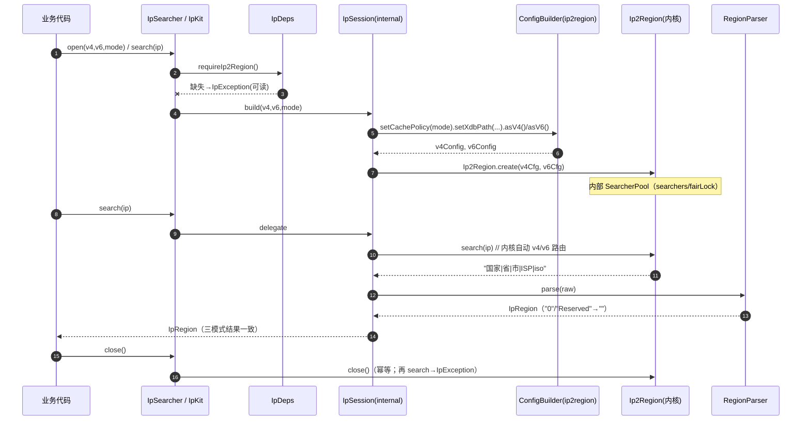
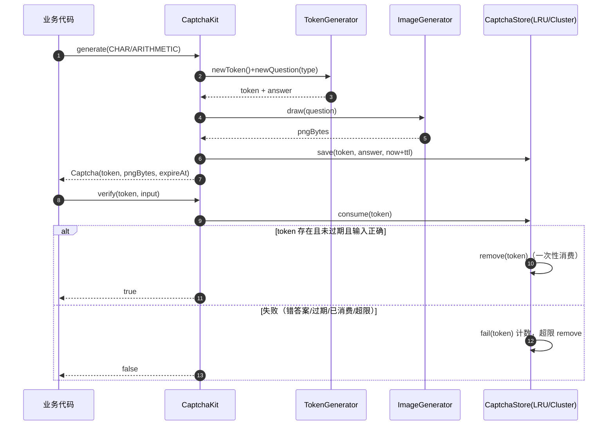
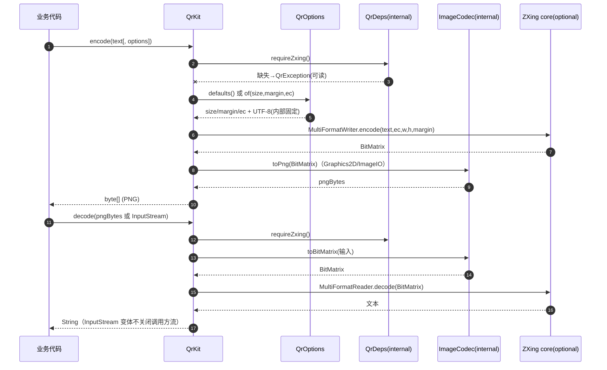
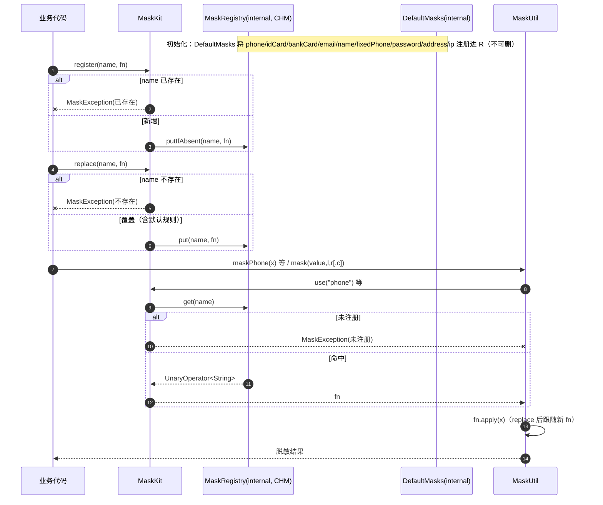

# aifei-tools 设计文档

> 本文是 `aifei-tools` 模块的契约与设计决策事实来源，供开发 / 测试 / 发布共同遵守。
> 关联需求：`../docs/需求/aifei-tools.md`（任务输入，其第七节所列问题已在本文 §8 逐项定档）。
> 模块坐标：`io.github.gollyhu:aifei-tools:1.0.0-SNAPSHOT`，包名 `cn.hg.aifei.tools`，Java 8（class major 52）。

## 0. 选型实证记录（CRITICAL，先于一切设计）

### 0.1 ip2region Maven 版本实证（当场实测，非记忆）

| 实证项 | 结论 | 证据来源 |
| --- | --- | --- |
| Maven 坐标 | `org.lionsoul:ip2region` | https://repo1.maven.org/maven2/org/lionsoul/ip2region/ |
| 3.x 可用版本 | 13 个：3.1.0 / 3.1.1 / 3.2.0 / 3.2.1 / 3.3.0～3.3.8（最高 3.3.8，2026-11-10） | 同上目录页 `maven-metadata.xml` |
| **Java 基线分水岭** | 3.1.0 / 3.3.0 / **3.3.7**：POM `source=target=1.8`，无 `release` → Java 8；**3.3.8**：`source=target=release=11`（`jdk11+` profile）→ **Java 11** | 逐个 POM：`.../3.3.7/ip2region-3.3.7.pom`、`.../3.3.8/ip2region-3.3.8.pom` |
| **class major 实测** | 下载 3.3.7 jar，`javap` 读 `service/Ip2Region.class` → **major version 52** ✓ | 本地 Python 下载 + `javap -verbose`（临时文件已删） |
| **Git tag ≠ Maven 版本**（重要） | `v3.19.0` 是**数据版本 tag**，不是 Maven 坐标；Java binding 走独立 3.3.x 体系，交叉点 `v3.11.1 ↔ maven 3.3.1`。需求「tag v3.19.0 仅线索」得到证实 | GitHub Releases https://github.com/lionsoul2014/ip2region/releases |

**版本决策（需求七-1 定档）**：选 **`org.lionsoul:ip2region:3.3.7`**，`optional`，pom 用属性 `<ip2region.version>3.3.7</ip2region.version>` 管理（便于将来统一升级）。**弃用 3.3.8 有实证**：它已切 Java 11 基线（class major 55），违反本仓库「Java 8 / class major 52」硬基线（根 AGENTS.md §技术基线）。需求「不得写死小版本」的正确解读是「设计阶段须实测后定档，不得凭记忆写 3.x」——定档后 pom 锁精确版本，与全部已交付模块一致。

### 0.2 内核 API 实证（重大发现，推翻需求按 2.x 的描述）

`javap`/`jar tf` 实测 3.3.7 jar（18 个 class）：**没有**老 `org.lionsoul.ip2region.Searcher`（2.x API），真实形态是：

- `org.lionsoul.ip2region.service.Ip2Region`（并发安全服务，`create(Config,Config)` / `create(String,String)` / `create(File,File)`、`search(String)`、`close()`/`close(long)`）
- `service.Config`：`NoCache` / `VIndexCache` / `BufferCache` / `FullCache` 四种缓存策略 + `searchers` / `fairLock` 字段；`ConfigBuilder.setCachePolicy/setXdbPath/setXdbFile/setXdbInputStream/setSearchers/setFairLock/asV4/asV6`
- `org.lionsoul.ip2region.xdb.Searcher`（底层**非线程安全**）+ `xdb.*`（Version/Header/Util/LongByteArray）
- 双库原生支持：`Ip2Region.create(v4Config, v6Config)` 两个参数即 v4+v6，`search()` 内部 `v4Search`/`v6Search` 自动路由；内核自带 `SearcherPool`（searchers 数量、fairLock 可配）。

**影响**：三模式需求（fileOnly/vectorIndex/content）须映射到内核四策略；IPv4/IPv6 路由与并发策略应顺应内核 `service.Ip2Region`，**不得**自建 ThreadLocal 或裸用 `xdb.Searcher`。region 五段格式有内核事实依据：v3.13.0 = `国家|省份|城市|ISP|iso码`、保留段 `Reserved|Reserved|Reserved|0|0`；v3.14.0 查不到 IP 返回空串（来源同 Releases 页）。

### 0.3 ZXing Maven 版本实证（本轮查证 Maven Central POM，非记忆）

| 实证项 | 结论 | 证据来源 |
| --- | --- | --- |
| Maven 坐标 | `com.google.zxing:core`（core 为纯编码/解码内核） | https://repo1.maven.org/maven2/com/google/zxing/core/3.5.3/ |
| 3.5.3 POM 依赖 | POM 仅 `junit`(test)，对下游**零传递依赖** | https://repo1.maven.org/maven2/com/google/zxing/core/3.5.3/core-3.5.3.pom |
| **Java 基线（已实测 class major 52 ✓）** | POM 未显式声明 `source`/`target`/`release`，Java 基线由父 POM `zxing-parent:3.5.3` 决定；**实现期已 `javap` 实测 class major 52**（开发工程师回执，与 Java 8 硬基线一致），选型闭环 | 同上 core POM + 实现期 `javap` 实测回执 |
| **javase 弃用实证** | `com.google.zxing:javase:3.5.3` 会拖入 `com.beust:jcommander:1.82`(compile) + `com.github.jai-imageio:jai-imageio-core:1.4.0`(runtime)，与「不引无关依赖」冲突，**不引**。PNG 渲染复用 captcha 的 `Graphics2D`/`ImageIO` 路线，自写 `BitMatrix`→`BufferedImage` | https://repo1.maven.org/maven2/com/google/zxing/javase/3.5.3/javase-3.5.3.pom |

**版本决策**：选 **`com.google.zxing:core:3.5.3`**，`optional`，pom 用属性 `<zxing.version>3.5.3</zxing.version>` 管理（对齐 §0.1 ip2region 的写法）。Java 8 兼容性**已由实现期 `javap` 实测确认 class major 52 ✓**（开发工程师回执，§8-A6 关闭），与 Java 8 硬基线一致，选型闭环、无需重走决策。

## 1. 实现方案

### 1.1 模块划分（库模块／无 Plugin 门面型）
`io.github.gollyhu:aifei-tools:1.0.0-SNAPSHOT`（五子包基线，详见 §10.7），包名 `cn.hg.aifei.tools`，Java 8（class major 52），无根聚合 pom、独立构建。定位「极简工具集」：**根包零公共类型**，工具按子包隔离、各自独立可用、无跨工具抽象。工具清单（当前 5 个）：

| 子包 | 公共类型 | internal（非承诺） |
| --- | --- | --- |
| `cn.hg.aifei.tools.ipdb` | `IpSearcher` / `IpKit` / `IpRegion` / `IpException` / `IpQueryMode`（N=5） | `IpDeps` / `IpErrors` / `IpSession` / `RegionParser` |
| `cn.hg.aifei.tools.captcha` | `Captcha` / `CaptchaKit` / `CaptchaType` / `CaptchaException`（N=4） | `CaptchaStore` / `LruCaptchaStore` / `ClusterCaptchaStore` / `CaptchaDeps` / `CaptchaErrors` / `TokenGenerator` / `ImageGenerator` |
| `cn.hg.aifei.tools.qr` | `QrKit` / `QrOptions` / `QrErrorCorrection` / `QrException`（N=4） | `QrDeps` / `QrErrors` / `ImageCodec` |
| `cn.hg.aifei.tools.mask` | `MaskUtil` / `MaskKit` / `MaskException`（N=3） | `MaskRegistry` / `MaskErrors` / `DefaultMasks` |
| `cn.hg.aifei.tools.kdf` | `KdfKit` / `KdfSpec` / `KdfHash` / `KdfException`（N=4） | `KdfErrors` / `HkdfEngine` / `Pbkdf2Engine` / `HmacEngine` |

五子包共 **20 个公共类型**（ipdb 5 + captcha 4 + qr 4 + mask 3 + kdf 4）。kdf 子包形态对齐 `qr`（门面 + 值对象 + 枚举 + 异常，4 类型）；internal 放三个算法实现 + `KdfErrors` 消息唯一定义点（前缀 `kdf: `）。kdf 是**纯 JDK 零第三方**工具：HKDF（RFC 5869 extract+expand，`javax.crypto.Mac`）、PBKDF2（RFC 8018，`javax.crypto.SecretKeyFactory` + `PBEKeySpec`）、HMAC（`javax.crypto.Mac`，作派生原语 `HMAC(secret,challenge)→key`）；哈希档位 SHA-256 + SHA-512（`KdfHash` 枚举，`java.security.MessageDigest`）。`javax.crypto.*` / `java.security.*` import 仅允许出现在 `kdf/internal/`（门禁⑱边界断言）。

无 Plugin、无配置键、无 SPI、无 `aifei` 接入包、零 `cn.aifei.*` 引用、零日志绑定、无 DB／Web 面（对齐 `aifei-excel`/`aifei-trace` 的不适用章节声明）。

> **扩展指针**：后续追加第 6、第 7 … 个工具时，一律按 §10「后续工具扩展约定」执行——新增子包 + 门禁纯追加 + 不改既有签名 + 四文档同步；当前五子包 / 20 公共类型 / 21 例门禁不因此变动（kdf 已按 §10 落地，门禁 17 → 21，见 §6.2）。

### 1.2 技术选型
- 语言/构建：Java 8 + Maven（`source/target=1.8`、UTF-8、surefire `workingDirectory=${project.basedir}`）。
- ip 内核：`org.lionsoul:ip2region:3.3.7`（optional，实证见 §0）。
- captcha：纯 JDK `Graphics2D` + `ImageIO` 生成 PNG；`SecureRandom` 生成 token；默认进程内 LRU，集群存储走 optional `aifei-cache:1.1.0`。
- qr：`com.google.zxing:core:3.5.3`（optional，实证见 §0.3），不引 javase；`BitMatrix`→PNG 自写。mask：纯 JDK + `ConcurrentHashMap`（零第三方）。
- 图形/随机数零第三方；各内核依赖缺失均抛可读模块异常，不裸抛 `NoClassDefFoundError`。

### 1.3 数据流概述
- **ip**：调用方显式传 v4/v6 xdb 路径 + 模式 → `IpSearcher` 会话内部 `IpSession` 用 `ConfigBuilder` 构建双 Config → `Ip2Region.create(v4Cfg,v6Cfg)` → `search(ip)` 内核自动路由 → 原始 region 字符串 → `RegionParser`（唯一定义点）解析五段、`"0"`/`"Reserved"` 归空串 → `IpRegion`。
- **captcha**：`CaptchaKit.generate(type)` → `TokenGenerator`（SecureRandom token + 字符/算式题及答案）→ `ImageGenerator`（Graphics2D PNG）→ 存答案进 `CaptchaStore`（默认 LRU / 可切集群）→ 返回 `Captcha`；`verify(token,input)` → 取答案比对（一次性消费，成功即删、失败计数超限失效）→ boolean。
- **qr**：`QrKit.encode(text[, options])` → `QrDeps.requireZxing()`（缺失→可读 `QrException`）→ `QrOptions.defaults()`/`of(...)`（size=300/margin=4/EC=M，UTF-8 内部固定）→ ZXing `MultiFormatWriter` 出 `BitMatrix` → `ImageCodec.toPng(BitMatrix)`（`Graphics2D`/`ImageIO`）→ `byte[]` PNG；`decode(byte[]|InputStream)` → `ImageCodec` 还原 `BitMatrix` → ZXing `MultiFormatReader` → 文本（InputStream 变体**不关闭调用方流**）。
- **mask**：`DefaultMasks` 初始化时把 `phone`/`idCard`/`bankCard`/`email`/`name`/`fixedPhone`/`password`/`address`/`ip` 九个默认规则注册进 `MaskRegistry`（唯一 `ConcurrentHashMap`）→ 业务 `MaskKit.register/replace/use` 操作注册表 → `MaskUtil.maskXxx(x)` 转发 `use("xxx").apply(x)`（`replace` 后默认规则自动跟随）；通用 `mask(value,keepLeft,keepRight[,maskChar])` 直接按保留位数打码。
- **kdf**：`KdfKit.derive(spec, ikm[, data])` 按 `KdfSpec` 的 algorithm 维分派到 internal 引擎——HKDF 走 `HkdfEngine`（extract: `HMAC(salt, IKM)` 得 PRK；expand: `HMAC(PRK, info||counter)` 按 RFC 5869 循环生成长度，`javax.crypto.Mac.getInstance("HmacSHA256"/"HmacSHA512")`）、PBKDF2 走 `Pbkdf2Engine`（**手动 HMAC PRF 循环 RFC 8018 §5.2**：`Mac.getInstance("Hmac"+hash)` + `SecretKeySpec(password, ...)`，`DK = T_1‖…‖T_l`，`T_i = F(P, S, c, i) = U_1‖…‖U_c`，`U_1 = HMAC(P, S‖INT_32_BE(i))`、`U_j = HMAC(P, U_{j-1})`；纯 JDK 零第三方，输出满足任意 keyLen；**不使用 `SecretKeyFactory` 路线**——SunJCE 的 `PBKDF2SecretKey.getEncoded()` 返回 key 长度受 PBE cipher 约束，无法满足"任意 keyLen 输出"契约，偏离点见 §8-F1'）、HMAC 走 `HmacEngine`（`Mac.getInstance("HmacSHA256"/"HmacSHA512")`，`HMAC(secret, data)→key`，作最小派生原语；secret=ikm、data=第三入参，对齐 RFC 2104 `HMAC(K, text)` 两入参形态）；`KdfHash` 决定 `Mac`/`MessageDigest` 的算法名后缀；`KdfErrors` 是全部 `kdf: ` 消息与 `KdfException` 构造的唯一定义点；算法名非法/参数非法（salt 长度、iterations ≤0、keyLen ≤0、info null 等）抛可读 `KdfException`。

## 2. 文件清单（相对 `aifei-tools/`，每个文件恰好归属一个任务，见 §5）

```
aifei-tools/
├── pom.xml                                   [T01] Java8；aifei-all provided；ip2region/aifei-cache/zxing optional（属性 ip2region.version/zxing.version）；junit test；零日志绑定
├── docs/
│   ├── design.md                             [T01] ★本文（本轮产出，主理人汇编落盘）
│   ├── testing.md                            [T11] 测试策略与用例（素材见 §7）
│   └── THIRD_PARTY_NOTICES.md                [T11] 第三方许可署名声明（**发布工程师产出**；T11 文档四件套补充项；内容口径见 §8-A4，不列许可全文）
├── README.md                                 [T11] 用法/边界/optional 警告；§6 双许可署名条目与 §7 文档索引指向 THIRD_PARTY_NOTICES.md（发布工程师落地，见 §8-A4）
├── AGENTS.md                                 [T11] 模块硬约束（素材见 §6 门禁）
└── src/
    ├── main/java/cn/hg/aifei/tools/          [T01] 根包：空（不创建任何 .java）
    │   ├── ipdb/
    │   │   ├── IpSearcher.java                [T04] 有状态会话（工厂+search+close）
    │   │   ├── IpKit.java                     [T04] 便捷门面
    │   │   ├── IpRegion.java                  [T04] 五段结果值对象
    │   │   ├── IpException.java               [T04] 统一异常
    │   │   ├── IpQueryMode.java               [T04] 模式枚举
    │   │   └── internal/
    │   │       ├── IpDeps.java                [T02] 依赖探测（Class.forName 唯一点）
    │   │       ├── IpErrors.java              [T02] 异常唯一构造点+消息
    │   │       ├── IpSession.java             [T03] Config 构建+Ip2Region 封装+close 幂等
    │   │       └── RegionParser.java          [T03] region 五段解析唯一定义点
    │   └── captcha/
    │       ├── Captcha.java                   [T07] 结果值对象
    │       ├── CaptchaKit.java                [T07] 门面
    │       ├── CaptchaType.java               [T07] 枚举 CHAR/ARITHMETIC
    │       ├── CaptchaException.java          [T07] 统一异常
    │       └── internal/
    │           ├── CaptchaStore.java          [T05] 存储接口
    │           ├── LruCaptchaStore.java       [T05] 默认进程内 LRU
    │           ├── ClusterCaptchaStore.java   [T05] aifei-cache 共享存储
    │           ├── CaptchaDeps.java           [T05] aifei-cache 探测
    │           ├── CaptchaErrors.java         [T05] 异常唯一构造点+消息
    │           ├── TokenGenerator.java        [T06] SecureRandom token+题目/答案
    │           └── ImageGenerator.java        [T06] Graphics2D PNG
    │   ├── qr/
    │   │   ├── QrKit.java                     [T14] 全静态门面（encode/decode）
    │   │   ├── QrOptions.java                 [T14] 值对象 defaults()/of() + 3 getter
    │   │   ├── QrErrorCorrection.java         [T14] 枚举 L/M/Q/H
    │   │   ├── QrException.java               [T14] 统一异常
    │   │   └── internal/
    │   │       ├── QrDeps.java                [T13] ZXing 缺失探测（唯一探测点）
    │   │       ├── QrErrors.java              [T13] 异常唯一构造点+消息（前缀 qr: ）
    │   │       └── ImageCodec.java            [T13] BitMatrix↔BufferedImage/PNG（Graphics2D/ImageIO）
    │   └── mask/
    │       ├── MaskUtil.java                  [T16] 无状态工具（通用 mask + 9 默认规则转发）
    │       ├── MaskKit.java                   [T16] 注册表门面 register/replace/use（全 static）
    │       ├── MaskException.java             [T16] 统一异常
    │       └── internal/
    │           ├── MaskRegistry.java          [T15] ConcurrentHashMap 唯一持有者
    │           ├── MaskErrors.java            [T15] 异常唯一构造点+消息（前缀 mask: ）
    │           └── DefaultMasks.java          [T15] 9 默认规则初始注册唯一定义点
    │   └── kdf/
    │       ├── KdfKit.java                    [T21] 全静态门面 derive(spec,ikm) 两参 + derive(spec,ikm,data) 三参（无状态，对齐 QrKit）
    │       ├── KdfSpec.java                   [T21] 派生参数值对象（algorithm+hash+salt+iterations+info+keyLen）
    │       ├── KdfHash.java                   [T21] 枚举 SHA256/SHA512
    │       ├── KdfException.java              [T21] 统一异常
    │       └── internal/
    │           ├── KdfErrors.java             [T20] 异常唯一构造点+消息（前缀 kdf: ）
    │           ├── HkdfEngine.java            [T20] HKDF RFC5869 extract+expand（javax.crypto.Mac）
    │           ├── Pbkdf2Engine.java          [T20] PBKDF2 手动 HMAC PRF 循环 RFC8018 §5.2（Mac+SecretKeySpec，非 SecretKeyFactory，§8-F1'）
    │           └── HmacEngine.java            [T20] HMAC 派生原语 RFC2104（javax.crypto.Mac，secret=ikm、data=第三入参，§8-F10）
    └── test/java/cn/hg/aifei/tools/
        ├── ArchitectureBoundaryTest.java      [T10] 门禁 21 例（原17 + kdf追加4）
        ├── ipdb/
        │   ├── IpSearcherTest.java            [T08] 三模式一致/命中/close 幂等/非法参数/依赖缺失/并发
        │   ├── IpRegionTest.java              [T08] 五段解析/"0"→空串/查不到全空
        │   ├── IpKitTest.java                 [T08] 便捷门面默认模式
        │   └── PublicApiContractIpTest.java   [T08] 公共面形态与签名
        ├── captcha/
        │   ├── CaptchaKitTest.java            [T09] 生成/校验/一次性消费/TTL/错误次数/token 安全
        │   ├── CaptchaStoreTest.java          [T09] LRU 淘汰/集群存储(mock)
        │   └── PublicApiContractCaptchaTest.java [T09] 公共面形态与签名
        ├── qr/
        │   ├── QrKitTest.java                 [T17] 生成/识别闭环/options 默认值/流不关闭/依赖缺失
        │   └── PublicApiContractQrTest.java   [T17] 公共面形态与签名
        ├── mask/
        │   ├── MaskUtilTest.java              [T18] 通用 mask + 9 默认规则 + replace 跟随
        │   ├── MaskKitTest.java               [T18] register/replace/use 三态 + 默认规则在册不可删
        │   └── PublicApiContractMaskTest.java [T18] 公共面形态与签名
        ├── kdf/
        │   ├── HkdfTest.java                  [T22] HKDF RFC5869 附录A向量（SHA256/SHA512，逐字比对字节）
        │   ├── Pbkdf2Test.java                [T22] PBKDF2 RFC8018/RFC6070向量（HmacSHA256/HmacSHA512）
        │   ├── HmacTest.java                  [T22] HMAC RFC4231测试向量
        │   ├── KdfKitTest.java                [T22] 三算法门面分派+参数非法+keyLen任意长度
        │   └── PublicApiContractKdfTest.java  [T22] 公共面形态与签名
        └── support/
            └── IpSampleData.java              [T08] 内嵌 base64 最小 v4/v6 xdb 样本常量（不提交二进制）

（**本轮不做**，后续可选）aifei-tools-demo/ [T12，端口 18160]：pom.xml · DemoApp · DemoAppConfig · demo/arch/**（自写 HIO）· service/ToolsDemoService · webapp/view/tools/index.html · assets/{js,css} · start-demo.bat · stop-demo.bat
根目录 README.md 模块表新增 aifei-tools 条目 [T11]。
```

## 3. 数据与接口设计（公共类型精确签名，编码角色照抄）

> 四子包公共层共 **16 个公共类型**（ipdb 5 + captcha 4 + qr 4 + mask 3）；签名只含 JDK 类型 + 本模块类型，**零** `org.lionsoul.*`／`com.google.zxing.*`／`cn.aifei.*`／`cn.hg.aifei.cache.*`。全部公共方法不写 `throws` 子句（各异常均为 `RuntimeException`），但 javadoc 写全 `@param/@return/@throws`。

### 3.1 ipdb 子包（N=5）

```java
public final class IpSearcher implements AutoCloseable {         // 搜索器会话对象（名词，命名例外，对齐 Excel）
    public static IpSearcher open(String v4Xdb, String v6Xdb);
    public static IpSearcher open(String v4Xdb, String v6Xdb, IpQueryMode mode);
    public IpRegion search(String ip);                            // 内核自动按 IP 版本路由双库
    public void close();                                          // 幂等
}
public final class IpKit {                                        // 便捷门面（全 static，操作会话）
    private IpKit();
    public static IpRegion search(String v4Xdb, String v6Xdb, String ip);                 // 默认 VECTOR_INDEX
    public static IpRegion search(String v4Xdb, String v6Xdb, String ip, IpQueryMode mode);
}
public final class IpRegion {                                     // 五段值对象，字段永不为 null
    public static IpRegion of(String country, String province, String city, String isp, String isoCode); // 静态工厂：供 ipdb.internal 构造公共值对象；5 参 null 归一为 ""、空白串属合法内容原样保留，不暴露构造器（决策 §8-E1）
    public String getCountry();  public String getProvince(); public String getCity();
    public String getIsp();      public String getIsoCode();
}
public enum IpQueryMode { FILE_ONLY, VECTOR_INDEX, CONTENT }     // → 内核 NoCache / VIndexCache / FullCache
public final class IpException extends RuntimeException {
    public IpException(String message);
    public IpException(String message, Throwable cause);
}
```
> 公共面方法级补充（决策 §8-E1）：`IpRegion.of(...)` 是供 `ipdb.internal` 构造公共值对象的静态工厂，五个 getter 与「字段永不为 null」契约不变；公共类型数仍为 16，门禁②③⑮⑰ 判定口径不变。

三模式→内核策略映射：**FILE_ONLY=NoCache**（每次磁盘 IO）、**VECTOR_INDEX=VIndexCache**（512KiB 索引缓存）、**CONTENT=FullCache**（全文件内存）。`IpSession` 负责 `ConfigBuilder`→`Config`→`Ip2Region.create(v4,v6)` 与 `close()` 幂等（`AtomicBoolean`）+ 内核 `IOException/InterruptedException` 包装。

### 3.2 captcha 子包（N=4）

```java
public final class Captcha {                                      // 生成结果值对象
    public String getToken(); public byte[] getImageBytes(); public long getExpireAt();
}
public final class CaptchaKit {                                   // 门面（全 static；操作有生命周期的存储）
    private CaptchaKit();
    public static Captcha generate();                             // 默认 CHAR
    public static Captcha generate(CaptchaType type);
    public static boolean verify(String token, String input);     // 一次性消费；业务失败返回 false
    public static void setTtlSeconds(int ttl);                    // 默认 120
    public static void setCapacity(int capacity);                 // LRU 容量，默认 10000
    public static void setMaxFailures(int maxFailures);           // 默认 5
    public static void enableClusterStore();                      // 切 aifei-cache 共享存储；缺失抛 CaptchaException
}
public enum CaptchaType { CHAR, ARITHMETIC }
public final class CaptchaException extends RuntimeException {
    public CaptchaException(String message);
    public CaptchaException(String message, Throwable cause);
}
```
存储接口 `CaptchaStore`（internal）四方法：`save(token,answer,expireAt)` / `consume(token)` / `fail(token)` / `default remove(token)`（默认空实现，两个真实存储均覆盖；决策 §8-E2）；`LruCaptchaStore`（LinkedHashMap+TTL+失败计数）为默认，`ClusterCaptchaStore` 经 `aifei-cache` 的 `Cache` 存 answers。token = `SecureRandom` 32 字节 → Base64 URL 无填充（不可从图片/token 反推）。

### 3.3 qr 子包（N=4）

```java
public final class QrKit {                                        // 全静态门面（无状态，对齐 IpKit/CaptchaKit）
    private QrKit();
    public static byte[] encode(String text);                     // 默认 QrOptions.defaults()，返回 PNG 字节
    public static byte[] encode(String text, QrOptions options);
    public static String decode(byte[] imageBytes);
    public static String decode(InputStream in);                  // 不关闭调用方流
}
public final class QrOptions {                                    // 值对象；UTF-8 内部固定，不暴露
    public static QrOptions defaults();                           // size=300 / margin=4 / EC=M
    public static QrOptions of(int size, int margin, QrErrorCorrection ec);
    public int getSize();
    public int getMargin();
    public QrErrorCorrection getErrorCorrection();
}
public enum QrErrorCorrection { L, M, Q, H }
public final class QrException extends RuntimeException {
    public QrException(String message);
    public QrException(String message, Throwable cause);
}
```
`decode(InputStream)` 为 `java.io.InputStream`（JDK 类型）。

### 3.4 mask 子包（N=3）

```java
public final class MaskUtil {                                     // 无状态工具（全 static）
    private MaskUtil();
    public static String mask(String value, int keepLeft, int keepRight);
    public static String mask(String value, int keepLeft, int keepRight, char maskChar);
    public static String maskPhone(String value);                 // ≡ MaskKit.use("phone").apply(value)
    public static String maskIdCard(String value);                // ≡ use("idCard")
    public static String maskBankCard(String value);              // ≡ use("bankCard")
    public static String maskEmail(String value);                 // ≡ use("email")
    public static String maskName(String value);                  // ≡ use("name")
    public static String maskFixedPhone(String value);            // ≡ use("fixedPhone")；保留区号(含 -)+后 4 位，中间等长 *，无 - 退化为前 4 后 4（0571-88886666→0571-****6666）
    public static String maskPassword(String value);              // ≡ use("password")；恒定 ******，不保留原长度、不泄露位数（abc123→******）
    public static String maskAddress(String value);               // ≡ use("address")；保留前 6 字符、其余等长 *，长度 ≤6 全打码（浙江省杭州市金城坊街2号→浙江省杭州市******）
    public static String maskIp(String value);                    // ≡ use("ip")；保留首段、其余每段一个 *；IPv4 按 . 分段，IPv6 按 : 分段且 :: 先展开为完整 8 段再打码；等价写法结果一致（压缩式 2001:db8:85a3::8a2e:370:7334 与展开式 2001:db8:85a3:0:0:8a2e:370:7334 均→2001:*:*:*:*:*:*:*，7 个 *）；展开对畸形输入健壮、不抛异常（按 §8-D14 宽松退化）；192.168.2.1→192.*.*.*
}
public final class MaskKit {                                      // 注册表门面（全 static）
    private MaskKit();
    public static void register(String name, UnaryOperator<String> fn);  // 已存在→MaskException
    public static void replace(String name, UnaryOperator<String> fn);   // 不存在→MaskException
    public static UnaryOperator<String> use(String name);                // 未注册→MaskException
}
public final class MaskException extends RuntimeException {
    public MaskException(String message);
    public MaskException(String message, Throwable cause);
}
```
`UnaryOperator` 为 `java.util.function.UnaryOperator`（JDK 类型）；九个默认规则 `maskXxx` 均转发注册表，故 `replace` 后自动跟随（冻结契约）。

### 3.5 kdf 子包（N=4）

> 算法名以 `String` 常量表达（`KdfSpec` 内校验合法值集合 {`"HKDF"`, `"PBKDF2"`, `"HMAC"`}），档位以 `KdfHash` 枚举表达——这是 Q2 裁决的**参数组合形态**（algorithm + hash 两维），不采用 `HKDF_SHA256` 笛卡尔枚举。理由：① 三算法入参集合异构（HKDF 需 salt+info、PBKDF2 需 salt+iterations、HMAC 仅需 secret），单枚举常量无法承载差异；② 扩档位只加 `KdfHash` 一行，不爆笛卡尔积；③ 与需求文档默认假设一致。algorithm 合法值集合在 `KdfSpec` 内以常量校验，`KdfErrors` 抛出非法值。

```java
public final class KdfKit {                                        // 全静态门面（无状态，对齐 QrKit 命名例外）
    private KdfKit();
    public static byte[] derive(KdfSpec spec, byte[] ikm);         // 两参重载：data 传 null；HKDF/PBKDF2 忽略 data、HMAC 视 data 为空字节（HMAC(ikm, "")）
    public static byte[] derive(KdfSpec spec, byte[] ikm, byte[] data);  // 三参重载：按 spec.algorithm 分派；ikm = 输入密钥材料（HKDF 的 IKM / PBKDF2 的 password / HMAC 的 secret=K）；data = HMAC 的 message=text（对齐 RFC 2104 HMAC(K,text) 两入参），HKDF 传 null 忽略、PBKDF2 传 null 忽略、HMAC 传 null 视为空字节；返回 keyLen 字节密钥
}
public final class KdfSpec {                                       // 派生参数值对象（algorithm + hash + salt + iterations + info + keyLen）
    public static KdfSpec hkdf(KdfHash hash, byte[] salt, byte[] info, int keyLen);              // HKDF：salt 可空（RFC5869 默认全0 HashLen 字节）、info 可空（作空字节）、keyLen > 0 且 ≤ 255×HashLen
    public static KdfSpec pbkdf2(KdfHash hash, byte[] salt, int iterations, int keyLen);          // PBKDF2：salt 不可空、iterations > 0、keyLen > 0
    public static KdfSpec hmac(KdfHash hash, int keyLen);                                         // HMAC 派生原语：HMAC(secret=ikm, data)→key；secret 经 KdfKit.derive 入参 ikm 传入、data 经第三入参传入（spec 不持运行期 secret/data，只持 hash+keyLen）
    public String getAlgorithm();                                  // "HKDF"/"PBKDF2"/"HMAC"
    public KdfHash getHash();                                      // SHA256/SHA512
    public byte[] getSalt();                                       // HKDF 可空；PBKDF2 非空；HMAC 返回 null
    public int getIterations();                                    // 仅 PBKDF2 用；HKDF/HMAC 返回 0
    public byte[] getInfo();                                       // 仅 HKDF 用；PBKDF2/HMAC 返回 null
    public int getKeyLen();                                        // 输出密钥字节长度，> 0；HMAC 模式 keyLen≤HashLen 截取前 keyLen 字节、keyLen>HashLen 按 RFC5869 expand 风格循环扩展（HMAC 作 PRF）
}
public enum KdfHash { SHA256, SHA512 }                             // → HmacSHA256/HmacSHA512（Mac 算法名后缀）；PBKDF2 手动 PRF 循环用同一 Mac 算法名
public final class KdfException extends RuntimeException {
    public KdfException(String message);
    public KdfException(String message, Throwable cause);
}
```

> **HMAC 派生原语签名裁决（§8-F10，层B阻塞项）**：`KdfKit.derive` 提供**两参与三参两个重载**。三参重载 `(spec, ikm, data)` 的 `data` 是 HMAC 的 message（RFC 2104 `HMAC(K, text)` 的 text），供层B `KDF(sn, challenge)` 传入 `ikm=sn`（secret）、`data=challenge`（message）。两参重载 `(spec, ikm)` 是便捷形式，等价于 `data=null`——HMAC 视为空字节 `HMAC(ikm, "")`，HKDF/PBKDF2 忽略 data。**不采用方案②（spec 持 challenge）**：challenge 是运行期握手数据、每次握手都变，值对象不应持有运行期数据；**不采用方案③（ikm=sn‖challenge）**：拼接是 hack、边界歧义、与 RFC 2104 两入参定义不符。HMAC 的 keyLen 语义：原始输出 = HashLen（SHA-256=32/SHA-512=64），keyLen≤HashLen 截取前 keyLen 字节、keyLen>HashLen 按 RFC 5869 expand 风格循环扩展（HMAC 作 PRF），与 §9"任意 keyLen 输出"一致。

**Q1 裁决**：kdf 公共面精确 **N=4**，类型为 `KdfKit` / `KdfSpec` / `KdfHash` / `KdfException`（门面 + 值对象 + 枚举 + 异常，对齐 `qr` 子包 4 类型范式）。不单设 `KdfAlgorithm` 枚举——algorithm 用 `String` + `KdfSpec` 内校验，避免与 `KdfHash` 形成笛卡尔耦合（详见 Q2）。

**Q2 裁决**：**参数组合**（algorithm + hash 两维），不采用 `HKDF_SHA256` 笛卡尔枚举。算法名以 `String` 表达、档位以 `KdfHash` 枚举表达。理由见本节首段。

`KdfKit.derive` 是唯一公共入口（两参与三参两个重载），按 `spec.getAlgorithm()` 分派到 `HkdfEngine` / `Pbkdf2Engine` / `HmacEngine`（internal，非承诺）。三引擎均用 `javax.crypto.Mac`（HKDF/HMAC 直接用、PBKDF2 手动 PRF 循环用），PBKDF2 不使用 `SecretKeyFactory` 路线（偏离点 §8-F1'）。`javax.crypto.*` / `java.security.*` import 仅允许 `kdf/internal/`（`java.security.` 放宽至 captcha/internal，门禁⑲）。`KdfSpec` 三个静态工厂 `hkdf` / `pbkdf2` / `hmac` 是构造唯一入口（私有构造器，值对象不可变；getIterations 在非 PBKDF2 算法返回 0、getInfo 在非 HKDF 算法返回 null、getSalt 在 HMAC 返回 null，便于调用方无差别读）。`KdfErrors` 是 `KdfException` 构造与全部 `kdf: ` 消息的唯一定义点（门禁⑳扩充覆盖 `kdf: ` 前缀，归入门禁⑪）。

## 4. 调用流程（Mermaid）

### 4.1 ip 查询三模式（同一入口，模式只影响 Config 策略）



### 4.2 captcha 生成→校验（一次性消费）



### 4.3 qr 生成→识别



### 4.4 mask 注册→取用→脱敏



### 4.5 kdf 密钥派生（三算法分派）

```mermaid
sequenceDiagram
    autonumber
    participant Biz as 业务代码
    participant Kit as KdfKit
    participant Spec as KdfSpec
    participant Err as KdfErrors(internal)
    participant H as HkdfEngine(internal)
    participant P as Pbkdf2Engine(internal)
    participant M as HmacEngine(internal)
    participant JCE as javax.crypto.Mac (JDK)
    Biz->>Spec: hkdf(hash,salt,info,keyLen) / pbkdf2(hash,salt,iters,keyLen) / hmac(hash,keyLen)
    Spec-->>Biz: KdfSpec（值对象，校验合法值，不持运行期 ikm/data）
    Biz->>Kit: derive(spec, ikm) 或 derive(spec, ikm, data)
    Kit->>Err: 校验 spec/ikm 非空（缺失→KdfException 可读）
    alt algorithm = HKDF
        Kit->>H: derive(spec, ikm)（data 忽略）
        H->>JCE: Mac.getInstance("Hmac"+hash)
        H->>H: extract: HMAC(salt, IKM) → PRK（salt 空则全0 HashLen 字节）
        H->>H: expand: HMAC(PRK, info‖counter) 循环到 keyLen（RFC5869）
        H-->>Kit: keyLen 字节密钥
    else algorithm = PBKDF2
        Kit->>P: derive(spec, ikm)（data 忽略）
        P->>JCE: Mac.getInstance("Hmac"+hash) + SecretKeySpec(ikm, ...)
        P->>P: 手动 PRF 循环 RFC8018 §5.2：DK=T_1‖…‖T_l，T_i=F(P,S,c,i)
        Note over P: U_1=HMAC(P,S‖INT_32_BE(i))、U_j=HMAC(P,U_{j-1})；纯 JDK，任意 keyLen
        P-->>Kit: keyLen 字节密钥
    else algorithm = HMAC
        Kit->>M: derive(spec, ikm, data)（data 传 null→空字节）
        M->>JCE: Mac.getInstance("Hmac"+hash)
        M->>JCE: init(SecretKeySpec(ikm=secret, ...)); doFinal(data=message)
        Note over M: 对齐 RFC2104 HMAC(K,text)：ikm=K、data=text；层B KDF(sn,challenge)→ikm=sn、data=challenge
        M->>M: keyLen≤HashLen 截取前 keyLen；keyLen>HashLen 按 RFC5869 expand 风格循环扩展
        M-->>Kit: keyLen 字节密钥
    end
    Kit-->>Biz: byte[] 密钥
```

## 5. 任务列表（T01…T22，逐步依赖；每文件恰好一个任务；T19 预留不用）

| 任务 | 内容（文件，见 §2 标签） | 依赖 | 优先级 | 验收 |
| --- | --- | --- | --- | --- |
| **T01 基础设施** | `pom.xml` + `docs/design.md`（本文，主理人落盘）+ 根包空目录骨架 | — | P0 | `mvn -q -DskipTests compile` 通过；class major 52；`dependency:tree` 仅 §6 清单 |
| T02 ip 异常与依赖探测 | `IpDeps.java` · `IpErrors.java` | T01 | P0 | `IpDeps` 用 `Class.forName(name,false,loader)`；缺依赖场景可读 `IpException`（门禁 ⑩⑪） |
| T03 ip 内核 | `IpSession.java` · `RegionParser.java` | T02 | P0 | 三模式 Config 构建正确；五段解析/归空串唯一定义点；`close()` 幂等 |
| T04 ip 公共面 | `IpSearcher.java` · `IpKit.java` · `IpRegion.java` · `IpException.java` · `IpQueryMode.java` | T03 | P0 | §3.1 签名逐字一致；三模式同 IP 同 xdb 结果一致；并发无串扰 |
| T05 captcha 存储内核 | `CaptchaStore.java` · `LruCaptchaStore.java` · `ClusterCaptchaStore.java` · `CaptchaDeps.java` · `CaptchaErrors.java` | T01 | P0 | LRU 容量淘汰 + TTL + 失败计数；集群存储缺失依赖可读异常（门禁 ⑩⑪） |
| T06 captcha 生成内核 | `TokenGenerator.java` · `ImageGenerator.java` | T05 | P0 | token 不可猜（SecureRandom）；字符/算式 PNG 可解析；算式答案正确 |
| T07 captcha 公共面 | `Captcha.java` · `CaptchaKit.java` · `CaptchaType.java` · `CaptchaException.java` | T06 | P0 | §3.2 签名逐字一致；一次性消费/超限失效/TTL 到期 |
| T08 ip 测试 | `IpSearcherTest.java` · `IpRegionTest.java` · `IpKitTest.java` · `PublicApiContractIpTest.java` · `support/IpSampleData.java` | T04 | P0 | P0 验收覆盖；base64 样本解码到 target/；全离线 |
| T09 captcha 测试 | `CaptchaKitTest.java` · `CaptchaStoreTest.java` · `PublicApiContractCaptchaTest.java` | T07 | P0 | §7 captcha 用例覆盖；token 不重复、不可反推 |
| T10 门禁 | `ArchitectureBoundaryTest.java`（17 例） | T02–T09、T13–T18 | P0 | 17 例全绿；不得放宽；模块根执行 |
| T11 文档四件套（+署名补充） | `README.md` · `AGENTS.md` · `docs/testing.md` · `THIRD_PARTY_NOTICES.md`（发布工程师产出，口径见 §8-A4）+ 根 README 模块表条目 | T10 | P1 | README 含本期不做/optional 警告；AGENTS 对齐 17 例门禁；README §6 双许可署名条目与 §7 文档索引指向 `THIRD_PARTY_NOTICES.md`；署名声明覆盖两个第三方运行内核且不粘贴许可全文 |
| T12 demo（**本轮不做**，后续可选） | `aifei-tools-demo/**`（平级工程） | T04、T07 | P1 | 本轮不纳入交付；如后续立项：端口 18160，captcha 生成/校验、ip 查询（用内嵌样本）、state 端点真实可跑，零外网 |
| T13 qr 内核 | `QrDeps.java` · `QrErrors.java` · `ImageCodec.java` | T01 | P0 | ZXing 缺失可读 `QrException`；`BitMatrix`→PNG 正确；class major 52 实测（§0.3） |
| T14 qr 公共面 | `QrKit.java` · `QrOptions.java` · `QrErrorCorrection.java` · `QrException.java` | T13 | P0 | §3.3 签名逐字一致；`defaults()`=300/4/M；`decode(InputStream)` 不关闭流；encode→decode 闭环 |
| T15 mask 内核 | `MaskRegistry.java` · `MaskErrors.java` · `DefaultMasks.java` | T01 | P0 | `ConcurrentHashMap` 唯一持有；9 默认规则初始在册不可删；异常唯一构造点 |
| T16 mask 公共面 | `MaskUtil.java` · `MaskKit.java` · `MaskException.java` | T15 | P0 | §3.4 签名逐字一致；register/replace/use 三态正确；`maskXxx≡use(...).apply`；replace 后跟随 |
| T17 qr 测试 | `QrKitTest.java` · `PublicApiContractQrTest.java` | T14 | P0 | §9 qr 验收覆盖；全离线；decode 闭环与"不关闭调用方流"用例按 §8-C1/§8-C3 已定档口径实施 |
| T18 mask 测试 | `MaskUtilTest.java` · `MaskKitTest.java` · `PublicApiContractMaskTest.java` | T16 | P0 | §9 mask 验收覆盖；默认规则在册与 replace 跟随 |
| **T20 kdf 内核** | `KdfErrors.java` · `HkdfEngine.java` · `Pbkdf2Engine.java` · `HmacEngine.java` | T01 | P0 | `KdfErrors` 为 `KdfException` 构造与全部 `kdf: ` 消息唯一定义点（门禁⑪扩充）；`HkdfEngine` 按 RFC5869 extract(`HMAC(salt,IKM)→PRK`)+expand(`HMAC(PRK,info‖counter)` 循环到 keyLen)；`Pbkdf2Engine` **手动 HMAC PRF 循环 RFC8018 §5.2**（`Mac+SecretKeySpec`，DK=T_1‖…‖T_l，T_i=F(P,S,c,i)，非 SecretKeyFactory 路线，§8-F1'）；`HmacEngine` 用 `Mac.getInstance("Hmac"+hash)`，`HMAC(secret=ikm, data=第三入参)` 对齐 RFC2104（§8-F10）；`javax.crypto` 仅 `kdf/internal/`、`java.security` 仅 `kdf/internal/`+`captcha/internal/`（门禁⑲，§8-F11） |
| **T21 kdf 公共面** | `KdfKit.java` · `KdfSpec.java` · `KdfHash.java` · `KdfException.java` | T20 | P0 | §3.5 签名逐字一致；`KdfKit.derive` 两参+三参两重载，按 algorithm 分派三引擎；`KdfSpec` 三静态工厂 `hkdf`/`pbkdf2`/`hmac` 是构造唯一入口、值对象不可变；algorithm 合法值集合 {HKDF,PBKDF2,HMAC} 在 `KdfSpec` 校验、非法抛 `KdfException`；公共签名零第三方（门禁⑧扩充覆盖 kdf 公共层） |
| **T22 kdf 测试** | `HkdfTest.java` · `Pbkdf2Test.java` · `HmacTest.java` · `KdfKitTest.java` · `PublicApiContractKdfTest.java` | T21 | P0 | HKDF 对标 RFC5869 附录A向量（SHA256/SHA512 两档，逐字比对输出字节）；PBKDF2 对标 RFC7914 §B.1（PBKDF2-HMAC-SHA256 官方向量，不使用 RFC6070 那是 PBKDF1，§8-F7）；HMAC 对标 RFC4231 + 三参重载 derive(spec,ikm,data) 的 data=message 路径（§8-F10）；`KdfKitTest` 覆盖三算法门面分派 + 参数非法（keyLen≤0/iterations≤0/salt null/algorithm 非法）+ 任意 keyLen 输出（PBKDF2 手动 PRF，§8-F1'）；全离线零联网 |

> 实现期硬纪律：T02–T09、T13–T18、T20–T22 不得改公共面签名（§8-E1 已定档的 `IpRegion.of(...)` 方法级补充为唯一例外）；发现签名不可行须先回写本文 §3 再改代码（根 AGENTS.md）。
> qr 的 `decode` 相关实现与测试（T14/T17）所依赖的行为口径已于 §8-C1/§8-C3 定档（保留 decode、失败抛 `QrException` 且保留 cause、不返回 null），按此开工；null/空输入语义见 §8-C2 与 §7.2。
> kdf 的实现与测试（T20–T22）按 §3.5 公共签名与 §6.2 门禁 ⑱⑲⑳⑳'（追加4例）开工；三算法实现要点见 §3.5 与 §1.3；测试对标 RFC5869/RFC8018/RFC6070/RFC4231 标准向量逐字比对（§九 P0 映射）。

## 6. 依赖与门禁

### 6.1 依赖清单（精确到 artifact/version/scope）
| 依赖 | scope | 用途 |
| --- | --- | --- |
| `cn.aifei:aifei-all:1.1.2` | **provided** | 生态统一底座；本模块源码零引用，消费方自带、不传递 |
| `org.lionsoul:ip2region:3.3.7` | **optional** | ip 内核，经 `ipdb/internal` 引用；阻断传递；缺失→`IpException` |
| `io.github.gollyhu:aifei-cache:1.1.0` | **optional** | captcha 集群存储，经 `captcha/internal` 反射探测；阻断传递；缺失→`CaptchaException` |
| `com.google.zxing:core:3.5.3` | **optional** | qr 内核，经 `qr/internal` 引用；零传递依赖（实证 §0.3）；阻断传递；缺失→`QrException`；**不引 javase** |
| `junit:junit:4.13.2` | **test** | 单测 + 门禁 |

pom 属性：`<ip2region.version>3.3.7</ip2region.version>` 与 `<zxing.version>3.5.3</zxing.version>` 并列管理。

零日志绑定（禁 slf4j/logback/log4j）、零 DB、零 Web。**根 AGENTS.md 无需新增登记**（公共面零框架/第三方类型、无 compile 例外），同 `aifei-excel`。

> **kdf 子包依赖**：纯 JDK 工具，**不新增任何第三方依赖**（HKDF/PBKDF2/HMAC 均用 JDK 8 自带 `javax.crypto.Mac` / `javax.crypto.SecretKeyFactory` + `javax.crypto.spec.PBEKeySpec` / `java.security.MessageDigest`，无 optional 内核）；pom 依赖清单不变，版本号 `1.0.0`。

### 6.2 门禁 `ArchitectureBoundaryTest` 断言清单（21 例：原 17 + kdf 追加 4，正式定档需求三推荐口径 + §10 扩展约定）

| # | 方法 | 判定口径 |
| --- | --- | --- |
| ① | `rootPackageEmpty` | 根包 `cn/hg/aifei/tools/` 直接子级 `.java` **精确 0**（不创建 package-info.java；若存在则显式排除并说明） |
| ② | `ipPublicSurfaceExact` | `ipdb/` 直接子 `.java` 精确 5 且集合 = {IpSearcher,IpKit,IpRegion,IpException,IpQueryMode}（集合相等，防同名替换） |
| ③ | `captchaPublicSurfaceExact` | `captcha/` 直接子 `.java` 精确 4 且集合 = {Captcha,CaptchaKit,CaptchaType,CaptchaException} |
| ④ | `ip2regionOnlyInIpInternal` | `import org.lionsoul.` 仅允许 `ipdb/internal/` 下文件（ip2region 依赖边界） |
| ⑤ | `cacheOnlyInCaptchaInternal` | `import cn.hg.aifei.cache.` 仅允许 `captcha/internal/` 下文件 |
| ⑥ | `noFrameworkReference` | 全模块禁止 `import cn.aifei.`（无接入包、无 log 例外） |
| ⑦ | `noWebSqlOrLogBinding` | 禁 `io.undertow.`/`java.sql.`/`org.slf4j.`；pom 不声明 logback/log4j/slf4j-simple |
| ⑧ | `publicSignaturesNoThirdParty` | 四子包公共层（非 internal）源码不得出现 `org.lionsoul.`/`com.google.zxing.`/`cn.aifei.`/`cn.hg.aifei.cache.` 字面量 |
| ⑨ | `java8Compatibility` | 禁 `List.of(`/`Map.of(`/`Set.of(`/`record `/`var `/`"""`/`sealed `/`instanceof` 模式匹配 |
| ⑩ | `classForNameOnlyInDeps` | `Class.forName` 仅允许 `IpDeps.java`/`CaptchaDeps.java` |
| ⑪ | `errorMessagesOnlyInErrors` | `ip: `/`captcha: `/`qr: `/`mask: ` 消息前缀仅允许 `IpErrors.java`/`CaptchaErrors.java`/`QrErrors.java`/`MaskErrors.java`（测试断言与公共 javadoc 除外）——本轮收紧：仅扩充覆盖范围，不删减原 14 例任何断言 |
| ⑫ | `regionParsingOnlyInParser` | region 分隔符 `\|` 及 `"0"`/`"Reserved"` 归空串的唯一实现只在 `RegionParser.java` |
| ⑬ | `noServiceProvider` | 禁 `ServiceLoader`/`META-INF/services`（无 SPI） |
| ⑭ | `testSourcesOfflineOnly` | 测试源 URL host 仅 `127.0.0.1`/`localhost`；`IpSampleData` 的 base64 常量允许 |
| ⑮ | `qrPublicSurfaceExact` | `qr/` 直接子 `.java` 精确 4 且集合 = {QrKit,QrOptions,QrErrorCorrection,QrException} |
| ⑯ | `zxingOnlyInQrInternal` | `import com.google.zxing.` 仅允许 `qr/internal/` 下文件 |
| ⑰ | `maskPublicSurfaceExact` | `mask/` 直接子 `.java` 精确 3 且集合 = {MaskUtil,MaskKit,MaskException} |
| ⑱ | `kdfPublicSurfaceExact` | `kdf/` 直接子 `.java` 精确 4 且集合 = {KdfKit,KdfSpec,KdfHash,KdfException}（集合相等，防同名替换；口径对齐门禁②③⑮⑰） |
| ⑲ | `cryptoOnlyInKdfInternal` | `import javax.crypto.` 仅允许 `kdf/internal/` 下文件；`import java.security.` 仅允许 `kdf/internal/` 与 `captcha/internal/`（captcha 既有 `SecureRandom` 合法用法，1.0.0 既有代码不破坏）。JDK 加密 API 边界；kdf 是纯 JDK 工具、无第三方内核，故无 `org.lionsoul.` 等第三方边界断言，但有 JDK 加密包边界。门禁⑳′仍守护 kdf 公共层零 `java.security.`/`javax.crypto.` |
| ⑳ | `kdfPrefixOnlyInErrors` | `kdf: ` 消息前缀仅允许 `KdfErrors.java`（测试断言与公共 javadoc 除外）——扩充门禁⑪覆盖 `kdf: ` 前缀，原 `ip: `/`captcha: `/`qr: `/`mask: ` 四组断言逐字保留，只收不放 |
| ⑳′ | `publicSignaturesNoThirdPartyKdf` | `kdf/` 公共层（非 internal）源码不得出现 `javax.crypto.`/`java.security.`/`org.lionsoul.`/`com.google.zxing.`/`cn.aifei.`/`cn.hg.aifei.cache.` 字面量——kdf 公共签名零 JDK 加密类型、零第三方，扩充门禁⑧扫描覆盖 kdf 公共层，原四子包断言不变 |

门禁例数 **17 → 21**（追加 4 例 ⑱⑲⑳⑳′；⑪⑧为扩充既有断言覆盖范围、不新增方法数）。验证命令期望例数同步改写：`mvn clean verify` 期望 0 failure / 0 error（含架构门禁 21 例）；`mvn test -Dtest=ArchitectureBoundaryTest` 期望 21 例。

> **门禁纯追加纪律（kdf）**：原 17 例的全部断言逐字保留、一律不删改、不放宽、不绕过；⑪与⑧仅扩充覆盖范围（`kdf: ` 前缀、kdf 公共层扫描），不删减原 `ip: `/`captcha: `/`qr: `/`mask: ` 四组断言与原四子包扫描断言。新增 4 例 `@Test` 方法与既有 17 例同风格（小驼峰、见名知义）。§6.2 门禁表与 `AGENTS.md`「包边界与门禁」表同步追加行并更新例数，**不得重排或改写既有 17 行**。

## 7. 跨文件约定 + 异常语义 + 测试样本

### 7.1 命名与唯一定义点
- 后缀：`IpSearcher`/`Captcha` 会话对象与值对象用名词（命名例外，对齐 `Excel`/`HttpClient`）；`IpKit`/`CaptchaKit` = 有状态门面（操作有生命周期的会话/存储，全 static，无 Plugin 装配期——对齐 `TraceKit` 命名例外）；`QrKit` = 全静态门面（无状态，对齐 `IpKit`）；`QrOptions` 值对象；`MaskUtil` 无状态工具（全 static）；`MaskKit` 注册表门面（全 static，操作 `ConcurrentHashMap`）；`XxxException`/`XxxType`/`XxxMode`/`XxxRegion` 按 Java 习惯；internal 用 `Deps/Errors/Session/Parser/Store/Generator/Registry/Codec/Masks`。kdf：`KdfKit` = 全静态门面（无状态，KDF 是纯函数，对齐 `QrKit` 全静态门面命名例外）；`KdfSpec` = 派生参数值对象（algorithm + hash + salt + iterations + info + keyLen）；`KdfHash` = 枚举；internal 用 `Errors/Engine`（`HkdfEngine`/`Pbkdf2Engine`/`HmacEngine`）。
- 唯一定义点：依赖探测=`*Deps`；异常构造与消息=`*Errors`；region 五段解析=`RegionParser`；Config 构建与 close 幂等=`IpSession`；token 随机与题目生成=`TokenGenerator`；ZXing 依赖探测=`QrDeps`；`BitMatrix`↔PNG 编解码=`ImageCodec`；mask 注册表（唯一 `ConcurrentHashMap`）=`MaskRegistry`；9 默认规则初始注册=`DefaultMasks`。kdf：`KdfException` 构造与全部 `kdf: ` 消息=`KdfErrors`；HKDF extract+expand=`HkdfEngine`；PBKDF2=`Pbkdf2Engine`；HMAC 派生原语=`HmacEngine`（三引擎均非公共 API、对外不可见；`KdfKit.derive` 按 `KdfSpec.getAlgorithm()` 分派）。
- 冻结契约落实点：默认规则名 `phone`/`idCard`/`bankCard`/`email`/`name`/`fixedPhone`/`password`/`address`/`ip` 初始在册、不可删（唯一在 `DefaultMasks`）；`maskPhone(x)≡use("phone").apply(x)` 及 `replace` 后跟随（其余 8 条同构），落实在 `DefaultMasks` + `MaskUtil` 转发；`register`/`replace`/`use` 全拼写。
- 每类规则只一处；公共 javadoc 简体中文、写全标签；文件头统一版权块；CRLF + UTF-8。

### 7.2 异常语义表（定档，唯一措辞来源 `*Errors`）

**ip（前缀 `ip: `）**
| 场景 | 行为/消息 | cause |
| --- | --- | --- |
| null 参数（路径/ip/mode） | `ip: {method} argument {name} must not be null` | — |
| v4、v6 路径都为 null | `ip: at least one of v4/v6 xdb path must be provided` | — |
| 非法 IP 文本 | `ip: invalid ip address "{ip}"` | `InetAddressException` |
| xdb 不可读 | `ip: xdb file not readable: {path}` | IO 异常 |
| 依赖缺失 | `ip: org.lionsoul:ip2region:3.3.7 is required, add it to your dependencies` | 链接错误 |
| 会话已 close 后再 search | `ip: session is closed, create a new IpSearcher` | — |
| 解析失败 / 搜索异常 | `ip: failed to parse region "{raw}"` / `ip: search failed for "{ip}", cause: {msg}` | 原异常 |

**captcha（前缀 `captcha: `）**
| 场景 | 行为/消息 |
| --- | --- |
| ttl/capacity/maxFailures ≤ 0 | `captcha: {name} must be positive, but was: {n}` |
| 启用集群存储但无 aifei-cache | `captcha: io.github.gollyhu:aifei-cache:1.1.0 is required for cluster store` |
| token 无效/已消费/过期/错误次数超限 | `verify` 返回 `false`（不抛异常） |
| 系统级错误（存储不可用等） | 抛 `CaptchaException` 并保留 cause |

**qr（前缀 `qr: `，消息措辞由 `QrErrors` 唯一定义）**
| 场景 | 行为/消息 | cause |
| --- | --- | --- |
| ZXing 依赖缺失 | `qr: com.google.zxing:core:3.5.3 is required, add it to your dependencies` | 链接错误 |
| encode 失败（内容过长/EC 不匹配等） | `qr: failed to encode text, cause: {msg}` | 原异常 |
| `encode(null)` | 抛可读 `QrException`：`qr: text must not be null`（`QrErrors` 唯一定义） | — |
| `decode(null)` / `decode(空 byte[])` | 抛可读 `QrException`：`qr: image bytes must not be null or empty`（`QrErrors` 唯一定义） | — |
| 空串 `""` 输入 | 合法内容：`encode("")` 正常出图，`decode` 还原为空串 `""`（不抛异常、不返回 null） | — |
| decode 失败（无法识别/格式非法等） | 抛 `QrException` 并保留 cause，**不返回 null**（错误不静默吞，对齐 `aifei-excel` 收敛先例）；消息 `qr: failed to decode image, cause: {msg}` | 原异常 |

**mask（前缀 `mask: `，消息措辞由 `MaskErrors` 唯一定义）**
| 场景 | 行为/消息 |
| --- | --- |
| register 同名已存在 | `mask: rule "{name}" already registered` |
| replace 同名不存在 | `mask: rule "{name}" is not registered` |
| use 未注册 | `mask: rule "{name}" is not registered` |
| name/fn 为 null | `mask: rule name must not be null` / `mask: mask function must not be null` |
| value 为 null（通用 `mask` + 9 默认规则统一口径） | 返回 `null`（不抛异常） |
| value 为空串 `""`（通用 `mask` + 9 默认规则统一口径） | 返回空串 `""` |
| `keepLeft` / `keepRight` 为负数 | 抛可读 `MaskException`：`mask: keepLeft and keepRight must not be negative` |
| `maskIp` 文本分段 | 按分隔符特征打码：含 `.` 按 `.` 分段；含 `:` 视为 IPv6，`::` 先展开为完整 8 段再分段（保留首段，其余每段一个 `*`）；**等价写法结果一致**——压缩式 `2001:db8:85a3::8a2e:370:7334` 与展开式 `2001:db8:85a3:0:0:8a2e:370:7334` 均 → `2001:*:*:*:*:*:*:*`（7 个 `*`）；**展开对畸形输入健壮、不抛异常**（多 `::`、段数越界、非法字符等按 §8-D14 宽松退化）；两者皆无则退化为"保留首字符 + 其余等长 `*`"。内容文本非法一律不抛异常，`MaskException` 仅用于规则注册与 `keepLeft`/`keepRight` 非法（见 §8-D14 澄清） |

**kdf（前缀 `kdf: `，消息措辞由 `KdfErrors` 唯一定义）**
| 场景 | 行为/消息 | cause |
| --- | --- | --- |
| spec 为 null | `kdf: spec must not be null` | — |
| ikm 为 null | `kdf: input key material must not be null` | — |
| hash 为 null（`KdfSpec` 的 `KdfHash` 档位缺失） | `kdf: hash must not be null` | — |
| algorithm 非法（非 HKDF/PBKDF2/HMAC） | `kdf: unknown algorithm "{alg}", expected one of: HKDF, PBKDF2, HMAC` | — |
| keyLen ≤ 0 | `kdf: keyLen must be positive, but was: {n}` | — |
| PBKDF2 salt 为 null | `kdf: salt must not be null for PBKDF2` | — |
| PBKDF2 iterations ≤ 0 | `kdf: iterations must be positive, but was: {n}` | — |
| HKDF keyLen 超过 255 × HashLen（RFC5869 上限） | `kdf: keyLen {n} exceeds RFC5869 maximum {max} for {hash}` | — |
| 底层 JDK 算法不可用（`Mac.getInstance("Hmac"+hash)` 抛 `NoSuchAlgorithmException`，三算法均用 Mac） | `kdf: algorithm "{alg}" not available in this JDK, cause: {msg}` | `NoSuchAlgorithmException` |
| 派生过程运行时异常 | `kdf: derive failed for {alg}-{hash}, cause: {msg}` | 原异常 |

**region「0」语义（需求七-6 定档）**：五段字段**永不为 null**；raw 值为 `"0"` 或 `"Reserved"` → 归一为**空串 `""`**（不是 "0"、不是 null、不是占位符）；查不到 IP（内核返回 null/空串）→ 返回 `IpRegion` 五字段全 `""` 的非 null 对象，javadoc 写明。理由：对外语义干净，与内核 v3.14.0「查不到返回空串」一致，调用方无需识别内核哨兵。

### 7.3 查询模式默认值与并发默认值（需求七-5 定档）
- **默认模式 `VECTOR_INDEX`**：512KiB 固定索引缓存、约 100µs，内存/性能折中最佳（FILE_ONLY 每次磁盘 IO 太慢，CONTENT 全文件驻留浪费）；`IpKit` 两参重载与 `IpSearcher.open` 两参重载均用它。
- **并发 = 实例独占 + 内核 `SearcherPool`**：每个 `IpSearcher` 会话独占一个 `Ip2Region`，线程安全由内核池保证（searchers = `availableProcessors()`、fairLock=false，internal 设定，不暴露公共配置项）。**不自建 ThreadLocal、不裸用 `xdb.Searcher`**——内核已是 v3.2.0+ 并发安全服务（实证 §0.2），这同时消解需求对「Searcher 非线程安全」的担忧。close 后查询抛 §7.2 的 `IpException`。

### 7.4 测试样本策略（需求七-4 定档）
**定档：内嵌 base64 最小 xdb 样本 → 测试期解码到 `target/`**（`support/IpSampleData.java` 存 base64 字符串常量）。理由：完全离线、可重复、零外链生产数据、不提交二进制文件（根 AGENTS.md 安全条款）。样本须覆盖：境内 IPv4 段（中文五段）、境外 IPv4 段（英文）、保留段（`Reserved…0`）、一个 IPv6 段。样本一次性用 ip2region maker（版本对齐 3.3.7）生成后 base64 固化；maker 坐标见 §8-A1（处理路径已定档，实现期确认）。退化方案（若 maker 不可用）：`RegionParser` 用固定字符串向量测试，真实 xdb 端到端用例改为默认关闭的集成测试（需外部提供 xdb，开启后连不上必须失败）。

## 8. 已定档决策记录（主理人拍板 + 实现期确认路径）

> 本章记录本轮全部决策的最终口径，均为**已定档**事实。标注「实现期确认」的条目只是把实证动作推迟到实现/测试期，处理路径已在此定死，不构成悬空项；任何人不得在未回写本文的前提下改动下列口径。

### A. 实现期确认项（处理路径已定档，不阻塞设计与开工）
1. **maker 生成最小 xdb 的 Maven 坐标与命令**（一次性，用于 base64 固化）——实现期确认；退化方案已在 §7.4 给出（region 固定向量测试 + 默认关闭的 xdb 集成测试），照此兜底。
2. **三模式返回一致性**：设计契约要求 FILE_ONLY/VECTOR_INDEX/CONTENT 对同 IP 同 xdb 结果逐字一致；移到实现/测试期用 §7.4 样本实测验证，不阻塞设计定档。
3. **`aifei-cache` 共享存储 API 确切签名**（`Cache.put(key,value,expire)`/`get`/`remove` 及 TTL 单位）——实现期读 `aifei-cache/AGENTS.md` 与 `docs/design.md` 确认，不臆造。
4. **双许可署名 / 第三方许可署名声明（已定档，主理人拍板）**：「不复制许可全文」与「提供署名声明」是并存的两件事，**不矛盾**——
   - **系统口径**：新增 `THIRD_PARTY_NOTICES.md`（发布工程师产出，T11 文档四件套补充项，见 §2），逐一记录每个**第三方运行内核**的①版权归属、②许可 **SPDX 标识**、③来源地址，以及④ ip2region 的 **Apache-2.0 OR MIT 双许可选择说明**（消费方可任选其一，按所选许可履行署名义务）；但**不粘贴 Apache-2.0 / MIT 许可全文**——全文随各依赖 jar 自带（`META-INF/LICENSE*`），本模块不复制、不镜像。消费方**正式分发时据此署名**。
   - **署名覆盖范围（仅两个第三方运行内核）**：
     | 依赖 | 许可 SPDX | 列入署名声明 |
     | --- | --- | --- |
     | `org.lionsoul:ip2region:3.3.7` | `Apache-2.0 OR MIT` | ✅ 列入（含双许可选择说明） |
     | `com.google.zxing:core:3.5.3` | `Apache-2.0` | ✅ 列入 |
     | `io.github.gollyhu:aifei-cache:1.1.0` | `Apache-2.0` | ❌ 不列入：本生态自家模块（同 `cn.aifei` 体系），非第三方 |
     | `junit:junit:4.13.2` | 不适用（不列入） | ❌ 不列入：仅 `test` scope，不随发布产物分发 |
   - **README 引用要求（发布工程师落地，本文只定要求）**：README §6「注意事项与技术难点」的**双许可署名条目**改为「口径摘要 + 指向 `THIRD_PARTY_NOTICES.md`」；README §7「参考 → 文档索引」新增一行指向 `THIRD_PARTY_NOTICES.md`。两处均由发布工程师在产出署名声明文件时同步落地，不在设计关改 README。
5. **3.3.8 弃用是「当前时点」结论**（Java 11 基线）：登记为非阻塞假设；若将来放宽 Java 基线须重走设计决策。
6. **ZXing core:3.5.3 Java 基线（已闭环）**：实现期 `javap` 实测 **class major 52 ✓**（开发工程师回执，与门禁⑨一致），Java 8 兼容性确认，§0.3 选型闭环，无需回写重走决策。
7. **QrDeps 探测方式（已定档）**：用「方法内延迟符号解析 + `catch NoClassDefFoundError`/`LinkageError` → `QrException`」，探测逻辑放 `QrDeps`；**不得用 `Class.forName`**。门禁⑩保持原样（`Class.forName` 仅允许 `IpDeps`/`CaptchaDeps`），本方案不触碰⑩。

### B. 主理人拍板项（全部已裁决，按此执行）
1. **demo（B1）**：**本轮不配 `aifei-tools-demo`**，T12 不纳入本轮交付；保留后续可选说明，不删 §2 附录段落。
2. **公共面 N 值（B2）**：定档 **ipdb N=5 / captcha N=4 / qr N=4 / mask N=3，合计 16**，作为门禁常量（§6.2 门禁②③⑮⑰）。
3. **规划文档措辞（B3）**：**不擅改** `docs/计划/` 规划文档的「首个工具／1 周」历史措辞；根 `README.md` 模块总览按 T11 新增 aifei-tools 条目即可。
4. **默认值（B4）**：默认模式 **VECTOR_INDEX**；并发 = **实例独占 + 内核 `SearcherPool`**（searchers = `availableProcessors()`，fairLock=false，internal 设定、不暴露公共配置项），详见 §7.3。
5. **发布元数据（B5）**：本轮 pom **不含 Central 发布 profile**（对齐除 `aifei-cache` 外各模块现状）。
6. **门禁例数（B6）**：裁定 **17 例**，不删减任何断言（原 14 例 + `qrPublicSurfaceExact`/`zxingOnlyInQrInternal`/`maskPublicSurfaceExact` 三条）。
7. **T10 扩展（B7）**：3 条新断言追加到 `ArchitectureBoundaryTest.java`（**纯追加、原 14 例不变**，文件归属仍 T10，验收 17 例）。
8. **门禁⑪（B8）**：**收紧**——扩充覆盖 `qr: `/`mask: ` 前缀的消息唯一性断言（§6.2 门禁⑪），只收不放、不删减原断言。

### C. qr 行为契约（原 5 项，全部已定档；T14/T17 据此开工）
1. **decode 是否保留（C1）**：**保留**。需求 §六冻结公共面含 `decode(byte[])` 与 `decode(InputStream)`，验收要点要求 decode 闭环与"不关闭调用方流"；公共面不删减。
2. **null/空输入语义（C2）**：`encode(null)` / `decode(null)` / `decode(空 byte[])` 抛可读 `QrException`（消息在 `QrErrors` 唯一点，见 §7.2）；空串 `""` 是合法内容，`encode("")` 正常出图、`decode` 还原为空串。
   - **空串往返的实现手法（实现期实证，主理人裁定接受）**：`ImageCodec` 用 Unicode 私有区单字符 `\uE000`（U+E000）作内部哨兵——`encode` 时若 `text.isEmpty()` 则把内容替换为该哨兵再编码；`decode` 时仅当解码结果恰好等于该单字符时才归一为空串 `""`。据此空串可正常往返，C2 契约满足。
   - **已知限制（设计契约未覆盖，不列入验收）**：若正常文本恰好是**单个 U+E000 字符**，`decode` 会将其误归一为空串。主理人裁定接受此边缘行为：U+E000 属 Unicode 私有区，按定义不作为常规文本内容；引入完整转义方案会显著增加复杂度、与极简工具定位相悖。故「单个 U+E000 字符的往返」不列入验收范围，QA 不对此落断言。
3. **decode 失败语义（C3）**：抛 `QrException` 并**保留 cause**，**不返回 null**（错误不静默吞，对齐 `aifei-excel` 收敛先例）。
4. **QrOptions 是否扩展（C4）**：**不扩展**，签名冻结为 size/margin/EC 三项 + `defaults()`/`of()`，不加前景/背景色等。
5. **流式输出（C5）**：**不加**，公共面签名冻结（无 encode 到 `OutputStream` 的重载）。

### D. mask 边界语义（原需求九-13/14，已定档）
1. **null/空串（D13）**：9 个默认规则与通用 `mask` 统一口径——value 为 `null` 返回 `null`、空串返回空串；`keepLeft`/`keepRight` 为负数抛可读 `MaskException`（消息见 §7.2）。
2. **maskIp 文本分段（D14，含实现期澄清与主理人裁决）**：按分隔符特征打码——含 `.` 按 `.` 分段；含 `:` 视为 IPv6，`::` 压缩形式**先展开为完整 8 段**再分段（保留首段，其余每段一个 `*`），故 `2001:db8:85a3::8a2e:370:7334` → `2001:*:*:*:*:*:*:*`（**7 个 `*`**）。**等价写法结果一致**：同一 IPv6 地址的压缩式与展开式展开后段数相同，打码结果必须相同——`2001:db8:85a3::8a2e:370:7334` 与 `2001:db8:85a3:0:0:8a2e:370:7334` 均 → `2001:*:*:*:*:*:*:*`（均为首段 + 7 个 `*`）。**畸形输入健壮**：展开逻辑对多 `::`、段数越界（超过 8 段）、非法字符等畸形文本不得抛异常，一律按本条宽松退化（无分隔符特征则退化为"保留首字符 + 其余等长 `*`"）。两者皆无的非法文本同样退化；**全场景不抛异常**（mask 是宽松文本脱敏工具：内容文本非法一律不抛异常；`MaskException` 用于规则注册及 `keepLeft`/`keepRight` 非法，见 D13）。
   - **澄清依据（实现期实证）**：原措辞「含 `:` 按 `:` 分段」按字面 `split(":")` 得 7 段 → 6 个 `*`，与需求 §七「默认规则格式」及 §八「验收要点」两处冻结示例的 **7 个 `*`** 冲突。示例在需求文档中出现两次且是 QA 固定向量，为权威口径；「按 `:` 分段」只是设计转述、未覆盖 `::` 压缩。故确认以示例为准：先展开 `::` 为 8 段再打码。此澄清不改示例、不改公共 API、不改需求文档，仅收紧规则措辞使其与冻结示例逐字一致（开发已按 7 个 `*` 实现）。
   - **实现期实测向量（开发回执，QA 可直接用作固定断言样本）**：
     - 等价写法一致（均 → `2001:*:*:*:*:*:*:*`，7 个 `*`）：`2001:db8:85a3::8a2e:370:7334`（压缩式）、`2001:0db8:85a3:0000:0000:8a2e:0370:7334`（逐段补全式）。
     - 畸形输入健壮（以下均正常返回脱敏串、零异常，验证「全场景不抛异常」）：`::`、`:::`、`:a::b`、`1:2:3:4:5:6:7:8:9::a`、`garbage`、`a.b.c`。
     - 无分隔符特征者（如 `garbage`）按 §8-D14 宽松退化：保留首字符 + 其余等长 `*`。
     - 本条仅固化已实测边界输入，不改变 D14 任何规则口径、公共面、门禁或示例串。

### E. 实现期 API 细化（已定档，源码已落地；本节为设计同步回写）

> 开发工程师在实现期遇到两处本文原稿未覆盖的构造/状态流转缺口。按「发现签名不可行须先回写本文 §3 再改代码」纪律补录如下决策。两项均为**方法级补充**：公共类型数仍为 16（门禁②③⑮⑰ 不变），签名只含 JDK 与本模块类型（门禁⑧不变），17 例门禁判定口径整体不变。

1. **`IpRegion.of(...)` 静态工厂（E1，公共面方法级补充）**：
   - **决策**：在既有公共值对象 `IpRegion` 上新增 `public static IpRegion of(String country, String province, String city, String isp, String isoCode)`；五个 getter 与「字段永不为 null」契约逐字不变。
   - **理由**：`RegionParser` 位于 `ipdb.internal`，与 `IpRegion` 不同包，无法访问其包级构造器；门禁②禁止在 `ipdb/` 直接子级新增第 6 个 `.java`，无法靠「再建一个公共装配类」解决。工厂在唯一定义点内把 5 个入参的 null 归一为空串；空白串属合法内容、原样保留；兑现「字段永不为 null」（源码：`x == null ? "" : x` 五段同构）。
   - **否决方案**：让 `RegionParser` 返回内部 DTO / `String[]` 再由 `IpSearcher` 转装——虽可不加公共方法，但额外引入数据载体与转装层；在「极简工具集」定位下，对值对象补一个惯用静态工厂更直接，且非 null 归一可集中一处。留痕备查。
   - **QA 对接**：`PublicApiContractIpTest` 补断言——工厂存在、5 getter 签名为冻结形态、传入 null 时 5 字段均为 `""`、传入空白串（如 `" "`）时原样保留（不 trim、不归一）。

2. **`CaptchaStore.remove(String token)` 默认方法（E2，internal 契约补口）**：
   - **决策**：internal 接口 `CaptchaStore` 在 `save/consume/fail` 之外新增 `default void remove(String token)`（默认空实现）；`LruCaptchaStore` / `ClusterCaptchaStore` 均覆盖。
   - **理由**：本文 §4.2 时序图原本就画了 `remove(token)`（成功即删、失败仅计数、超限删除）三态，但 §3.2 只列三方法，属设计文档自相矛盾；补 `remove` 是修复该缺口，不是新增能力。默认方法使匿名桩只需实现原三方法即可编译。
   - **QA 对接**：`CaptchaStoreTest` 覆盖三态——校验成功删 token、失败不消费只计数、超限删除；`LruCaptchaStore` 与 `ClusterCaptchaStore` 各自验证。

### F. kdf 子包决策记录（层A 增量，本轮新增；需求 `aifei-auth-handshake.md` §三决策2 / §四层A / §七层A / §八 Q1/Q2）

> 本节为 kdf 子包的已定档决策，逐条对齐需求文档 `docs/需求/aifei-auth-handshake.md` 与 `AGENTS.md`「扩展新工具」四步硬动作。改动须先回写本节再改代码。

1. **算法选型（F1，需求 §三决策2 不可推翻）**：纳入 HKDF（RFC 5869 extract+expand）、PBKDF2（RFC 8018 口令+盐+迭代）、HMAC（作派生原语 `HMAC(secret, data)→key`，对齐 RFC 2104 `HMAC(K, text)` 两入参）；哈希档位 SHA-256 + SHA-512。不纳入 scrypt/Argon2/BCrypt（需第三方）、SHA-1（不安全）、SHA-384（边际低）、KDF1/KDF2/SP800-108/TLS PRF（小众遗留）。全部 JDK 8 零第三方：HKDF/HMAC 用 `javax.crypto.Mac.getInstance("HmacSHA256"/"HmacSHA512")`、PBKDF2 用**手动 HMAC PRF 循环 RFC 8018 §5.2**（`Mac.getInstance("Hmac"+hash)` + `SecretKeySpec(password, ...)`，DK=T_1‖…‖T_l，T_i=F(P,S,c,i)，纯 JDK 零第三方、满足任意 keyLen，偏离点见 F1'）、哈希长度查询用 `java.security.MessageDigest.getInstance("SHA-256"/"SHA-512").getDigestLength()`。
2. **公共面 N=4 与命名（F2 = Q1 裁决）**：定档 **N=4**，类型 `KdfKit` / `KdfSpec` / `KdfHash` / `KdfException`（门面 + 值对象 + 枚举 + 异常，对齐 `qr` 子包 4 类型范式）。`KdfKit` 为全静态门面（无状态，KDF 是纯函数，对齐 `QrKit` 全静态门面命名例外，§7.1 已登记）。不单设 `KdfAlgorithm` 枚举——algorithm 用 `String` 表达，避免与 `KdfHash` 形成笛卡尔耦合（详见 F3）。
3. **形态裁决（F3 = Q2 裁决）**：**参数组合**（algorithm + hash 两维），不采用 `HKDF_SHA256` 笛卡尔枚举。algorithm 以 `String` 表达、档位以 `KdfHash` 枚举表达。理由：① 三算法入参集合异构（HKDF 需 salt+info、PBKDF2 需 salt+iterations、HMAC 需 secret+data），单枚举常量无法承载差异，必须靠 `KdfSpec` 值对象承载；② 扩档位只加 `KdfHash` 一行，不爆笛卡尔积；③ 与需求文档 §八 Q2 默认假设一致。algorithm 合法值集合 {`"HKDF"`, `"PBKDF2"`, `"HMAC"`} 在 `KdfSpec` 内以常量校验，非法值抛 `KdfException`（消息见 §7.2）。
4. **`KdfSpec` 值对象形态（F4）**：三静态工厂 `hkdf(KdfHash, byte[] salt, byte[] info, int keyLen)` / `pbkdf2(KdfHash, byte[] salt, int iterations, int keyLen)` / `hmac(KdfHash, int keyLen)` 是构造唯一入口（私有构造器、值对象不可变）。HKDF 的 salt 可空（RFC 5869 默认全 0 HashLen 字节）、info 可空（作空字节）；PBKDF2 的 salt 不可空、iterations > 0；HMAC 无 salt/iterations（getSalt 返回 null、getIterations 返回 0，便于调用方无差别读）；**HMAC 的 secret/data 是运行期输入、经 `KdfKit.derive` 入参传入，不进 spec**（见 F10）。六个 getter 全暴露（algorithm/hash/salt/iterations/info/keyLen）。校验在工厂内完成，`KdfKit.derive` 不重复校验 spec 合法性（spec 已不可变且工厂已校验），只校验 spec/ikm 非空。
5. **门禁追加 4 例（F5，纯追加原 17 不变）**：追加 ⑱`kdfPublicSurfaceExact`（精确 4 + 集合相等 {KdfKit,KdfSpec,KdfHash,KdfException}）、⑲`cryptoOnlyInKdfInternal`（`javax.crypto.` 仅 `kdf/internal/`；`java.security.` 仅 `kdf/internal/` 与 `captcha/internal/`——captcha 既有 `SecureRandom` 合法用法不破坏，偏离点见 F11）、⑳`kdfPrefixOnlyInErrors`（`kdf: ` 前缀仅 `KdfErrors.java`，扩充门禁⑪）、⑳′`publicSignaturesNoThirdPartyKdf`（kdf 公共层零 JDK 加密类型、零第三方字面量，扩充门禁⑧）。门禁 17 → 21。kdf 纯 JDK 无第三方内核，故无 `org.lionsoul.` 等第三方边界断言；但 JDK 加密 API（`javax.crypto`/`java.security`）需独立边界断言⑲，守护「公共签名零 JDK 加密类型」契约，门禁⑳′仍守护 kdf 公共层零 `java.security.`/`javax.crypto.`。
6. **依赖（F6）**：纯 JDK 工具，**不新增任何第三方依赖**（HKDF/PBKDF2/HMAC 均用 JDK 8 自带 `javax.crypto`/`java.security`）。pom 依赖清单不变，版本号 `1.0.0`。`THIRD_PARTY_NOTICES.md` 不新增条目（kdf 无第三方内核）。
7. **测试对标（F7，需求 §七层A 验收）**：HKDF 对标 RFC 5869 附录 A 测试向量（SHA-256 / SHA-512 两档，逐字比对输出字节，不得模糊匹配）；PBKDF2 对标 **RFC 7914 §B.1**（PBKDF2-HMAC-SHA256 官方向量，寇戴码实测逐字一致）与 RFC 8018 §5.2 算法描述（**不使用 RFC 6070**——那是 PBKDF1 向量，不适用 PBKDF2，原设计误引已修正）；HMAC 对标 RFC 4231 测试向量。`KdfKitTest` 覆盖三算法门面分派 + 参数非法路径 + 任意 keyLen 输出。全离线零联网（KDF 是纯函数，无 IO 无状态）。
8. **CHANGELOG 建立（F8，§10.7）**：本模块首次新增工具，建立 `aifei-tools/CHANGELOG.md`，记录版本 `1.0.0`、新增 kdf 子包、公共类型 16 → 20、门禁 17 → 21、依赖无变化。由发布工程师落地，设计关只定口径。
9. **待明确事项（F9，转交寇戴码/策市袁实证，不阻塞设计）**：
   - **F9-a**（已闭环）：原担忧 PBKDF2 `PBKDF2WithHmacSHA512` provider 可用性——因改手动 HMAC PRF 循环（F1'），不再依赖 `SecretKeyFactory`，`HmacSHA512` 是 JDK 标准算法名、全发行版可用，此项已消解。
   - **F9-b**：RFC 测试向量在测试源码中以硬编码 byte[]/hex 字符串常量表达（不联网拉取、不引入测试向量库）；寇戴码照抄 RFC 文本，策市袁断言逐字比对。
10. **HMAC 派生原语签名裁决（F10，层B阻塞项，主理人退回裁决）**：`KdfKit.derive` 改为**两参与三参两个重载**：`derive(KdfSpec spec, byte[] ikm)` 与 `derive(KdfSpec spec, byte[] ikm, byte[] data)`。三参重载的 `data` 是 HMAC 的 message（RFC 2104 `HMAC(K, text)` 的 text），供层B `KDF(sn, challenge)` 传入 `ikm=sn`（secret=K）、`data=challenge`（message=text）。两参重载等价 `data=null`——HMAC 视为空字节 `HMAC(ikm, "")`，HKDF/PBKDF2 忽略 data。**裁决方案①**（改签名加 data 第三入参），否决方案②（spec 持 challenge：值对象不应持运行期数据、challenge 每次握手都变）与方案③（ikm=sn‖challenge：拼接 hack、边界歧义、与 RFC 2104 两入参定义不符）。HMAC 的 keyLen 语义：原始输出 = HashLen（SHA-256=32/SHA-512=64），keyLen≤HashLen 截取前 keyLen 字节、keyLen>HashLen 按 RFC 5869 expand 风格循环扩展（HMAC 作 PRF），与 §9"任意 keyLen 输出"一致。寇戴码改 `HmacEngine` + `HmacTest`，策市袁补测 `(spec, ikm, data)` 三参路径。
11. **PBKDF2 实现手法偏离（F1'，主理人批准）**：原设计 F1/§1.3/§3.5 写 PBKDF2 用 `SecretKeyFactory.getInstance("PBKDF2WithHmac"+hash)` + `PBEKeySpec` + `generateSecret().getEncoded()`。寇戴码实现期实测：SunJCE 的 `PBKDF2SecretKey.getEncoded()` 返回 key 长度受 PBE cipher 约束（keyLen=32 返回 4 字节、keyLen=64 返回 8 字节），不满足"任意 keyLen 输出"契约（§9 P0 验收）。实际实现改为**手动 HMAC PRF 循环 RFC 8018 §5.2**：`Mac.getInstance("Hmac"+hash)` + `SecretKeySpec(password, ...)`，`DK = T_1‖…‖T_l`，`T_i = F(P, S, c, i) = U_1 ⊕ … ⊕ U_c`，`U_1 = HMAC(P, S‖INT_32_BE(i))`、`U_j = HMAC(P, U_{j-1})`；纯 JDK 零第三方，输出与 RFC 7914 §B.1 官方向量逐字一致。主理人批准此偏离。§1.3/§3.5/§4.5/F1 已同步回写。
12. **门禁⑲口径偏离（F11，主理人批准）**：原设计 F5/§6.2 门禁⑲写 `javax.crypto.`/`java.security.` 仅 `kdf/internal/`。寇戴码实现期实测：`captcha/internal` 既有的 `TokenGenerator`/`ImageGenerator` 已用 `java.security.SecureRandom`（1.0.0 既有代码，token 随机数），门禁⑲原口径会破坏既有 captcha 测试。实际实现：`javax.crypto.` 仅 `kdf/internal/`（不变）；`java.security.` 放宽至 `kdf/internal/` + `captcha/internal/`（captcha 既有 `SecureRandom` 合法用法）。门禁⑳′（kdf 公共层零 `java.security.`）仍守护 kdf 公共签名契约。主理人批准此偏离（新门禁不应破坏既有代码）。§6.2 门禁⑲行已同步回写。

## 9. P0 验收覆盖映射（需求六 → 设计/任务/门禁）
| 需求验收要点 | 落点 |
| --- | --- |
| 生成→校验成功→同 token 二次失败 | §3.2/§4.2/§7.2；T06/T07/T09 `CaptchaKitTest` |
| TTL 到期、超错误次数失效、token 不可反推 | §7.2；T05/T09；`TokenGenerator`(SecureRandom) |
| 未引 aifei-cache 单机可用、引入后集群校验 | §1.3/§6.1；T05 `LruCaptchaStore`/`ClusterCaptchaStore`；T09 |
| 门禁：根包零类型 + 各子包精确 N | §6.2 门禁①③；T10 |
| 文档四件套 + 根 README 补条目 + 第三方许可署名声明 | §2 T11（`THIRD_PARTY_NOTICES.md` 发布工程师产出）/ §8-A4 |
| 三模式同 IP 同 xdb 结果一致 | §3.1/§7.3；T04；T08 `IpSearcherTest`；样本实测见 §8-A2 |
| v4/v6 双库命中、境内中文境外英文、未知段语义 | §3.1/§7.2；T08 `IpSearcherTest`/`IpRegionTest`/样本 |
| 非法 IP/null/文件缺失/依赖缺失均抛可读 IpException | §7.2；T02/T03；T08 |
| 并发无串扰 | §7.3；T04；T08 |
| close 幂等 + 关闭后可读异常 | §3.1/§7.2/§7.3；T03；T08 |
| 测试不提交 xdb 二进制、样本策略 | §7.4；T08 `support/IpSampleData.java` |
| qr 生成→识别闭环（encode 文本→decode 还原一致） | §3.3/§4.3；T14/T17 `QrKitTest`；decode 保留与失败语义见 §8-C1/§8-C3（已定档） |
| QrOptions 默认值 size=300/margin=4/EC=M、UTF-8 内部固定 | §3.3；T14/T17 `PublicApiContractQrTest` |
| decode(InputStream) 不关闭调用方流 | §3.3/§4.3；T14/T17 |
| qr null/空输入语义：null 与空 byte[] 抛可读 QrException、空串 "" 合法且可 encode→decode 往返（哨兵实现与 U+E000 已知限制见 §8-C2，该边界不列入验收） | §7.2/§8-C2；T14/T17 `QrKitTest` |
| ZXing 缺失首次调用抛可读 QrException、不裸抛、不引 javase | §0.3/§6.1/§7.2；T13/T17；§8-A6 Java 基线已实测 class major 52 ✓ |
| qr 公共面精确 4、zxing 仅 internal | §6.2 门禁⑮⑯；T10/T14 |
| mask 通用 mask + 9 默认规则（phone/idCard/bankCard/email/name/fixedPhone/password/address/ip） | §3.4/§4.4；T15/T16/T18 |
| 新增 maskFixedPhone：座机保留区号(含 -)+后 4 位、中间等长 *，无 - 退化为前 4 后 4 | §3.4/§4.4；T15/T16/T18 `MaskUtilTest`；0571-88886666→0571-****6666 |
| 新增 maskPassword：恒定 ******，不保留原长度、不泄露位数 | §3.4/§4.4；T15/T16/T18 `MaskUtilTest`；abc123→****** |
| 新增 maskAddress：保留前 6 字符、其余等长 *，长度 ≤6 全打码 | §3.4/§4.4；T15/T16/T18 `MaskUtilTest`；浙江省杭州市金城坊街2号→浙江省杭州市****** |
| 新增 maskIp：保留首段、其余每段一个 *，IPv4 按 . / IPv6 按 : 分段（`::` 先展开为完整 8 段、等价写法结果一致、畸形输入健壮不抛异常，详见 §8-D14 澄清） | §3.4/§4.4/§8-D14；T15/T16/T18 `MaskUtilTest`；192.168.2.1→192.*.*.*；2001:db8:85a3::8a2e:370:7334→2001:*:*:*:*:*:*:*（7 个 `*`）；等价式 2001:db8:85a3:0:0:8a2e:370:7334 结果相同；畸形输入不抛异常 |
| mask null/空串统一口径（null→null、空串→空串）与 keepLeft/keepRight 负数抛 MaskException | §7.2/§8-D13；T16/T18 `MaskUtilTest` |
| maskIp 文本按分隔符特征打码（IPv6 `::` 展开后分段）、无分隔符退化为保留首字符+等长*且不抛异常 | §7.2/§8-D14；T16/T18 `MaskUtilTest` |
| 默认规则初始在册不可删、maskPhone≡use("phone").apply、replace 后跟随 | §3.4/§7.1；T15/T16；`MaskKitTest` |
| register 已存在抛 / replace 不存在抛 / use 未注册抛 | §3.4/§7.2；T16/T18 |
| mask 公共面精确 3 | §6.2 门禁⑰；T10/T16 |
| 四工具无 Plugin/配置键、公共签名零第三方/框架类型、零日志绑定、根包仍零类型 | §1.1/§3.3/§3.4；T10/T13–T18 |
| 实现期 API 细化：`IpRegion.of(...)` 工厂（5 getter 冻结、null→空串且空白串原样保留）+ `CaptchaStore.remove` 三态（成功删/失败计数/超限删） | §3.1/§3.2/§8-E；T04/T05/T08/T09 `PublicApiContractIpTest`/`CaptchaStoreTest` |
| **kdf HKDF 对标 RFC5869 附录A测试向量（SHA256/SHA512 两档，逐字比对输出字节）** | §1.3/§3.5；T20/T22 `HkdfTest` |
| **kdf PBKDF2 对标 RFC7914 §B.1测试向量（PBKDF2-HMAC-SHA256 官方向量，寇戴码实测逐字一致；不使用 RFC6070——那是 PBKDF1 不适用 PBKDF2）** | §1.3/§3.5/§8-F1'；T20/T22 `Pbkdf2Test` |
| **kdf HMAC 对标 RFC4231测试向量 + 三参重载 derive(spec,ikm,data) 的 data=message 路径（层B KDF(sn,challenge) 用 ikm=sn、data=challenge）** | §1.3/§3.5/§8-F10；T20/T22 `HmacTest` |
| **kdf 三算法门面分派 + 参数非法（algorithm 非法/keyLen≤0/iterations≤0/salt null 等）抛可读 KdfException + 任意 keyLen 输出（PBKDF2 手动 PRF 循环，非 SecretKeyFactory 路线）** | §3.5/§7.2/§8-F1'；T21/T22 `KdfKitTest` |
| **kdf 纯 JDK 零第三方（dependency:tree 不新增、import 仅 java.*/javax.crypto.*/java.security.* 限 kdf/internal）** | §1.1/§6.1/§6.2 门禁⑲；T10/T20 |
| **kdf 门禁纯追加（原17例不变 + 追加4例 ⑱⑲⑳⑳′，公共面精确4 + 集合相等 + javax.crypto/java.security边界 + kdf: 前缀唯一定义点 + 公共签名零第三方扩充）** | §6.2 门禁⑱⑲⑳⑳′；T10 |
| **kdf 公共面精确 4（KdfKit/KdfSpec/KdfHash/KdfException）** | §6.2 门禁⑱；T10/T21 |
| **kdf 公共签名零第三方/框架类型（含零 JDK 加密类型，javax.crypto/java.security 仅 kdf/internal）** | §3.5/§6.2 门禁⑲⑳′；T10/T21 |
| **文档四同步：design.md（本文 kdf 章节）+ README.md + AGENTS.md + docs/testing.md；CHANGELOG.md 首次建立记录版本 1.0.0** | §10.5/§10.7；T11 文档四件套补充 kdf + CHANGELOG 建立 |

> 一句话总览：`aifei-tools` 单模块——根包零公共类型，五子包共 20 公共类型（`ipdb` 5 / `captcha` 4 / `qr` 4 / `mask` 3 / `kdf` 4）；ipdb 走实测锁定的 `ip2region:3.3.7`（Java 8 class 52，弃用 Java 11 的 3.3.8 有实证）双库自动路由、三模式映射内核四策略、默认 VECTOR_INDEX + 内核池化并发、region `"0"`→空串；captcha 纯 JDK 绘 PNG + 一次性消费 + LRU/可选 aifei-cache 双存储；qr 走 `zxing:core:3.5.3`（optional，Java 基线已 javap 实测 class major 52 ✓）+ 自写 `BitMatrix`→PNG；mask 走 `ConcurrentHashMap` 注册表 + 9 默认规则（phone/idCard/bankCard/email/name/fixedPhone/password/address/ip）；kdf 走纯 JDK（`javax.crypto.Mac`/`MessageDigest`）HKDF+PBKDF2（手动 PRF 循环 RFC8018 §5.2）+HMAC（RFC2104 两入参，derive 两参/三参重载）三算法 + SHA256/SHA512 两档；五子包公共面零第三方/框架类型，21 例门禁守护（原 17 + kdf 追加 4）。

## 10. 后续工具扩展约定（追加第 5、第 6 … 个极简工具）

> **本章性质**：这是**流程契约**，规定「将来如何安全追加新工具」，**不改变**当前五子包 / 20 公共类型 / 21 例门禁 / §8 已定档决策的任何口径，也不扩大现有公共 API。kdf 子包已按本章约定落地（门禁 17 → 21，见 §6.2；公共类型 16 → 20，见 §1.1）；下述动作在「新增某工具」的立项中执行。
> **不变边界**：无论工具数量如何增长，「根包零公共类型 + 子包隔离 + 各自独立可用 + 无跨工具抽象」恒定（§1.1、AGENTS.md「交付性质」）；唯一承受变化的是**每个新工具自身**的公共面、internal 实现、依赖、门禁与测试。

### 10.1 新增工具 = 新增子包（结构约定）

- **落点**：新工具落 `cn.hg.aifei.tools.<新工具>` 子包（全小写、见名知义，沿用 `ipdb`/`qr` 的缩写风格）。**公共类型一律放子包直接子级**，**internal 实现一律放 `<子包>/internal/`**；根包 `cn.hg.aifei.tools/` 直接子级**永不创建 `.java`**（门禁①恒定，包括 `package-info.java`）。
- **同构骨架**（模板示意，非本轮文件清单条目；`<Tool>` 为新工具代号）：

| 层 | 类型 | 职责与约定 |
| --- | --- | --- |
| 公共层（子包直接子级） | `<Tool>Util` / `<Tool>Kit` | 无状态工具 / 有状态门面，按 §10.3 判定后缀 |
| 公共层 | `<Tool>Exception` | 模块统一异常，`extends RuntimeException`，公共方法不写 `throws` |
| 公共层 | 值对象 / 枚举（按需） | 名词性命名；签名只含 JDK + 本模块类型 |
| internal（非承诺） | `<Tool>Deps` / `<Tool>Errors` / 核心实现类 | 依赖探测唯一入口、异常唯一构造点与消息、核心实现；对外不可见 |

- 每个新子包自成闭环；`<新工具>/internal` 不得被其它子包 import（§10.6）。

### 10.2 门禁同步扩展（纯追加，例数 17 → N）

新增工具**必须**在 `ArchitectureBoundaryTest.java` 追加门禁断言（该文件在新增工具立项中的任务归属按 §2 ↔ §5 一一对应重新登记，门禁职责沿用 T10 口径）；**原 17 例的全部断言逐字保留、一律不删改、不放宽、不绕过**，只做纯追加：

| 追加动作 | 门禁方法数 | 判定口径 |
| --- | --- | --- |
| 新子包公共面精确 N 断言 | **+1**（新方法 `<tool>PublicSurfaceExact`） | `<新工具>/` 直接子级 `.java` **精确 N** 且**集合相等**（防数量相同但同名替换）；N 为该工具公共类型数，在 §3/§6.2 定档为门禁常量，口径对齐门禁②③⑮⑰ |
| 新内核 import 边界断言 | **+1**（仅当引入新第三方内核；新方法 `<kernel>OnlyIn<Tool>Internal`） | `import <新内核包前缀>.` 仅允许 `<新工具>/internal/` 下文件，口径对齐门禁④⑤⑯；纯 JDK 工具不加本条 |
| 公共签名零第三方覆盖扩充 | **+0**（扩充既有 `publicSignaturesNoThirdParty`） | 将新子包公共层纳入门禁⑧扫描，原四子包断言不变 |
| 消息前缀唯一性纳入门禁⑪ | **+0**（扩充既有 `errorMessagesOnlyInErrors`） | 在门禁⑪内追加新前缀 `<前缀>: ` 仅在 `<新工具>` 的 `<Tool>Errors` 出现的断言；原 `ip: `/`captcha: `/`qr: `/`mask: ` 四组断言及例外（测试断言、公共 javadoc）逐字保留——只收不放 |

- **例数口径**：无新内核时 17 → 18；有新内核时 17 → 19；此后每加一工具按同规则累加，N 为累加后的方法总数。验证命令（`mvn clean verify` / `mvn test -Dtest=ArchitectureBoundaryTest`）的期望例数同步改写。
  - **kdf 实证**：kdf 为纯 JDK 工具（无第三方内核），但因其公共签名零 JDK 加密类型的要求需要独立的「`javax.crypto`/`java.security` 边界」断言，故追加 4 例（⑱公共面精确 + ⑲JDK 加密包边界 + ⑳`kdf: `前缀 + ⑳′公共签名零第三方扩充），门禁 17 → 21（详见 §6.2）。此为 kdf 特例：纯 JDK 工具若需守护 JDK 加密 API 不外泄至公共层，仍可加边界断言；后续纯 JDK 工具按实际需要追加，不强制 1 例或 4 例。
    - **门禁⑲口径偏离（§8-F11）**：`javax.crypto.` 仅 `kdf/internal/`；`java.security.` 放宽至 `kdf/internal/` + `captcha/internal/`（captcha 既有 `SecureRandom` 合法用法，1.0.0 既有代码不破坏）。新门禁不应破坏既有代码；门禁⑳′仍守护 kdf 公共层零 `java.security.`/`javax.crypto.`。
- 新 `@Test` 方法与既有 17 例同风格（小驼峰、见名知义）；§6.2 门禁表与 AGENTS.md「包边界与门禁」表同步追加行并更新例数，**不得重排或改写既有 17 行**。

### 10.3 公共面纪律

- 新工具公共签名**只含 JDK + 本模块类型**，零第三方 / 零框架类型：公共层源码不得出现新内核包前缀，也不得出现 `org.lionsoul.`/`com.google.zxing.`/`cn.aifei.`/`cn.hg.aifei.cache.` 等字面量（门禁⑧覆盖随之扩充）。
- 公共方法**不写 `throws` 子句**（受检与运行期异常均不声明），失败一律抛该工具的可读模块异常；公共类型与公共成员 javadoc 写全 `@param` / `@return`，运行期异常语义用 `@throws` 在 javadoc 内描述——对齐 §3、§7.1 与 AGENTS.md「注释规范」。
- **命名后缀**遵循根 `AGENTS.md`「命名约定（类型后缀语义）」与本模块 §7.1：无状态工具类 → `XxxUtil`；有状态门面 → `XxxKit`；接口 / 实现类 / 值对象按 Java 名词性习惯，不另立 `XxxHelper` / `XxxSupport` / `XxxTool` 等语义重叠后缀。
- 公共类型数 N 在 §3 逐字列签名、在 §6.2 定档；定档即冻结，改动须先回写设计再改门禁期望集合。

### 10.4 依赖策略

- 新能力内核一律 **`optional`**（阻断传递），版本用独立 pom 属性管理（对齐 `<ip2region.version>` / `<zxing.version>`）；第三方署名同步 `THIRD_PARTY_NOTICES.md`（对齐 §8-A4）。
- 内核缺失时**首次调用**抛该工具的可读模块异常（如 `<Tool>Exception`），不得裸抛 `NoClassDefFoundError` / `LinkageError`；探测逻辑集中在该工具 internal 的 `<Tool>Deps`，对齐 §6.1 与 `aifei-excel` 的可选依赖先例。纯 JDK 工具不加任何新依赖。
- `aifei-all` 仍 **provided**、源码零引用；**零日志绑定**（`slf4j` / `logback` / `log4j` 一律禁止，门禁⑦）；不得引入无关传递依赖（参照 ZXing 不引 javase 的实证，§0.3）。

### 10.5 文档与测试同步（四同步，缺一不可）

- **design.md**：§1.1 子包表追加一行（公共类型 + internal 清单）、§2 文件清单逐文件落位并归属任务、§3 追加逐字公共签名、§5 任务表追加对应任务、§6.2 门禁表追加新断言行并更新例数、§9 P0 映射追加需求→落点行；§1.3 / §7 / §8 仅在新工具引入新契约时补充，既有四工具的条目保持原样。
- **README.md**：追加该工具的用法、边界与 optional 依赖缺失警告，文档索引同步。
- **AGENTS.md**：「公共面收敛」清单追加该子包公共类型行、「包结构与依赖方向」追加子包行、「包边界与门禁」追加新门禁行与例数、「唯一定义点清单」追加该工具的探测/异常/核心实现点，「已定档行为契约红线」与「冻结契约 vs 可演进」按新契约补充。
- **testing.md**：按四子包同构——`PublicApiContract<Tool>Test`（公共面形态与签名断言）+ 功能测试（成功/边界/失败路径与可读异常逐字消息）+ internal 单测（依赖探测、错误构造、核心实现）；断言消息照抄 §7.2 消息表与 `*Errors` 逐字措辞；测试零联网、可重复。

> 同步纪律：一律「**先回写设计、后改门禁与代码**」；追加后 §2 文件清单 ↔ §5 任务表的一一对应关系仍须成立。

### 10.6 不做跨工具抽象（设计边界）

- **不为多工具引入统一 `Tool` 接口、公共基类、`common/` 抽象层或共享注册表**；工具之间零依赖、零互相引用，`<新工具>/internal` 亦不得被其它子包 import。
- 允许复用的只有**约定与范式**（本章的结构、门禁、命名、异常、文档模板），不复用**代码抽象**；重复的骨架宁可各自同构，也不抽公共层——这是「极简工具集」的定位边界，遵循根 `AGENTS.md`「命名约定」反对语义重叠抽象的精神。
- 若某需求确需跨工具能力（如两个工具共享同一内核），须作为**新设计决策**回写 §8 并过主理人，不得在追加中默认引入。

### 10.7 版本策略

- **版本策略**：当前基线 `io.github.gollyhu:aifei-tools:1.0.0-SNAPSHOT`（五子包基线）。后续能力扩展走 minor 递增（`1.1.0`、`1.2.0`…）、缺陷修复走 patch、破坏性变更走 major（本模块公共面冻结，原则上不发生）。
- **CHANGELOG**：本模块当前无 CHANGELOG；约定**首次新增工具时建立** `aifei-tools/CHANGELOG.md`（沿用仓库文档语言与行尾规范），记录版本号、日期、新增工具与公共面、门禁例数变化、依赖变化；此后每次发布同步追加。
- 版本与 CHANGELOG 由发布工程师落地，设计关只定口径；坐标版本变更同步 `pom.xml` 与 README/文档索引等引用处。
