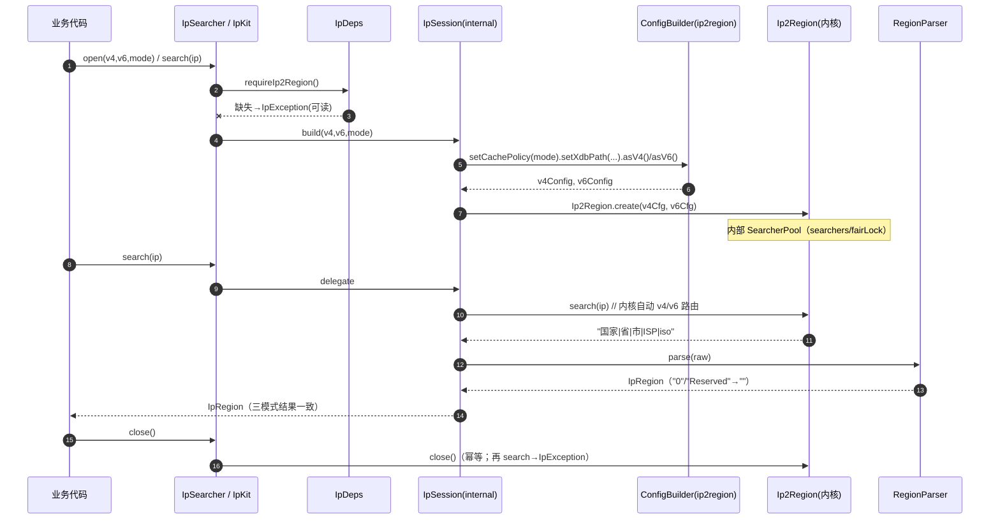
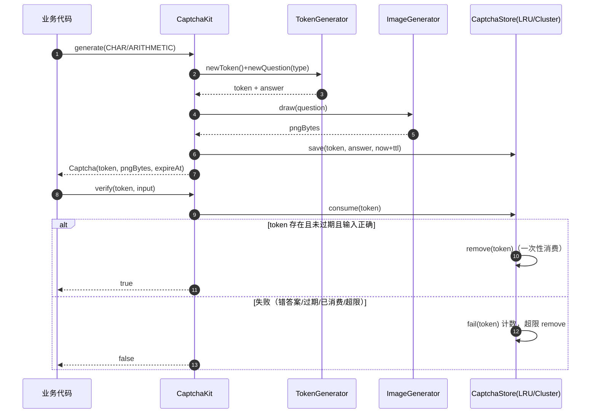
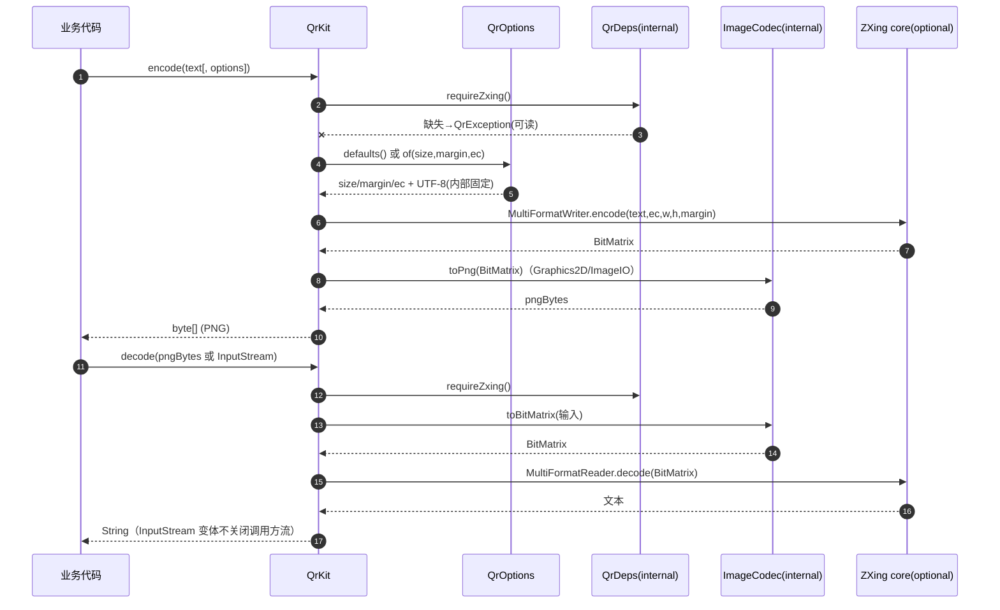
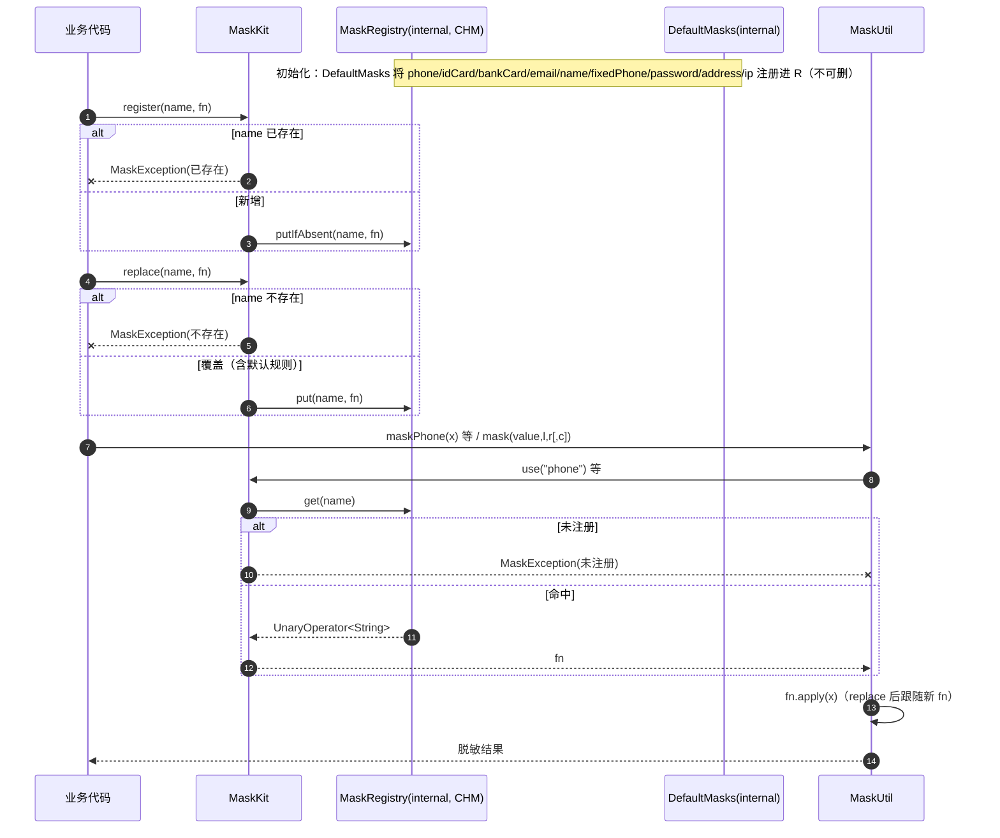

# aifei-tools 设计文档

> 本文是 `aifei-tools` 模块的设计事实来源，供开发、测试、发布共同遵守。
> 模块坐标：`io.github.gollyhu:aifei-tools:1.0.0-SNAPSHOT`，包名 `cn.hg.aifei.tools`，Java 8（class major 52）。

## 1. 实现方案

### 1.1 模块划分（库模块／无 Plugin 门面型）
`io.github.gollyhu:aifei-tools:1.0.0-SNAPSHOT`（五子包基线，详见 §10.7），包名 `cn.hg.aifei.tools`，Java 8（class major 52），由仓库根 pom 聚合，并通过 import 根 BOM 统一依赖版本；模块仍可独立构建。定位「极简工具集」：**根包零公共类型**，工具按子包隔离、各自独立可用、无跨工具抽象。工具清单（当前 5 个）：

| 子包 | 公共类型 | internal（非承诺） |
| --- | --- | --- |
| `cn.hg.aifei.tools.ipdb` | `IpSearcher` / `IpKit` / `IpRegion` / `IpException` / `IpQueryMode`（N=5） | `IpDeps` / `IpErrors` / `IpSession` / `RegionParser` |
| `cn.hg.aifei.tools.captcha` | `Captcha` / `CaptchaKit` / `CaptchaType` / `CaptchaException`（N=4） | `CaptchaStore` / `LruCaptchaStore` / `ClusterCaptchaStore` / `CaptchaDeps` / `CaptchaErrors` / `TokenGenerator` / `ImageGenerator` |
| `cn.hg.aifei.tools.qr` | `QrKit` / `QrOptions` / `QrErrorCorrection` / `QrException`（N=4） | `QrDeps` / `QrErrors` / `ImageCodec` |
| `cn.hg.aifei.tools.mask` | `MaskUtil` / `MaskKit` / `MaskException`（N=3） | `MaskRegistry` / `MaskErrors` / `DefaultMasks` |
| `cn.hg.aifei.tools.kdf` | `KdfKit` / `KdfSpec` / `KdfHash` / `KdfException`（N=4） | `KdfErrors` / `HkdfEngine` / `Pbkdf2Engine` / `HmacEngine` |

五子包共 **20 个公共类型**（ipdb 5 + captcha 4 + qr 4 + mask 3 + kdf 4）。kdf 子包形态对齐 `qr`（门面 + 值对象 + 枚举 + 异常，4 类型）；internal 放三个算法实现 + `KdfErrors` 消息唯一定义点（前缀 `kdf: `）。kdf 是**纯 JDK 零第三方**工具：HKDF（RFC 5869 extract+expand，`javax.crypto.Mac`）、PBKDF2（RFC 8018，`javax.crypto.SecretKeyFactory` + `PBEKeySpec`）、HMAC（`javax.crypto.Mac`，作派生原语 `HMAC(secret,challenge)→key`）；哈希档位 SHA-256 + SHA-512（`KdfHash` 枚举，`java.security.MessageDigest`）。`javax.crypto.*` / `java.security.*` import 仅允许出现在 `kdf/internal/`（门禁⑱边界断言）。

无 Plugin、无配置键、无 SPI、无 `aifei` 接入包、零 `cn.aifei.*` 引用、零日志绑定、无 DB／Web 面。

> **扩展指针**：后续追加新工具时，一律按 §10「后续工具扩展约定」执行——新增子包 + 门禁纯追加 + 不改既有签名 + 四文档同步。当前九子包 / 28 公共类型 / 33 例门禁（kdf 落地门禁 17 → 21、crypto/random/xml/codec 落地 21 → 33，见 §6.2 / §11.7）。

### 1.2 技术选型
- 语言/构建：Java 8 + Maven（`source/target=1.8`、UTF-8、surefire `workingDirectory=${project.basedir}`）。
- ip 内核：`org.lionsoul:ip2region:3.3.7`（optional）。
- captcha：纯 JDK `Graphics2D` + `ImageIO` 生成 PNG；`SecureRandom` 生成 token；默认进程内 LRU，集群存储走 optional `aifei-cache:1.2.0-SNAPSHOT`。
- qr：`com.google.zxing:core:3.5.3`（optional），不引 javase；`BitMatrix`→PNG 自写。mask：纯 JDK + `ConcurrentHashMap`（零第三方）。
- 图形/随机数零第三方；各内核依赖缺失均抛可读模块异常，不裸抛 `NoClassDefFoundError`。

### 1.3 数据流概述
- **ip**：调用方显式传 v4/v6 xdb 路径 + 模式 → `IpSearcher` 会话内部 `IpSession` 用 `ConfigBuilder` 构建双 Config → `Ip2Region.create(v4Cfg,v6Cfg)` → `search(ip)` 内核自动路由 → 原始 region 字符串 → `RegionParser`（唯一定义点）解析五段、`"0"`/`"Reserved"` 归空串 → `IpRegion`。
- **captcha**：`CaptchaKit.generate(type)` → `TokenGenerator`（SecureRandom token + 字符/算式题及答案）→ `ImageGenerator`（Graphics2D PNG）→ 存答案进 `CaptchaStore`（默认 LRU / 可切集群）→ 返回 `Captcha`；`verify(token,input)` → 取答案比对（一次性消费，成功即删、失败计数超限失效）→ boolean。
- **qr**：`QrKit.encode(text[, options])` → `QrDeps.requireZxing()`（缺失→可读 `QrException`）→ `QrOptions.defaults()`/`of(...)`（size=300/margin=4/EC=M，UTF-8 内部固定）→ ZXing `MultiFormatWriter` 出 `BitMatrix` → `ImageCodec.toPng(BitMatrix)`（`Graphics2D`/`ImageIO`）→ `byte[]` PNG；`decode(byte[]|InputStream)` → `ImageCodec` 还原 `BitMatrix` → ZXing `MultiFormatReader` → 文本（InputStream 变体**不关闭调用方流**）。
- **mask**：`DefaultMasks` 初始化时把 `phone`/`idCard`/`bankCard`/`email`/`name`/`fixedPhone`/`password`/`address`/`ip` 九个默认规则注册进 `MaskRegistry`（唯一 `ConcurrentHashMap`）→ 业务 `MaskKit.register/replace/use` 操作注册表 → `MaskUtil.maskXxx(x)` 转发 `use("xxx").apply(x)`（`replace` 后默认规则自动跟随）；通用 `mask(value,keepLeft,keepRight[,maskChar])` 直接按保留位数打码。
- **kdf**：`KdfKit.derive(spec, ikm[, data])` 按 `KdfSpec` 的 algorithm 维分派到 internal 引擎——HKDF 走 `HkdfEngine`（extract: `HMAC(salt, IKM)` 得 PRK；expand: `HMAC(PRK, info||counter)` 按 RFC 5869 循环生成长度，`javax.crypto.Mac.getInstance("HmacSHA256"/"HmacSHA512")`）、PBKDF2 走 `Pbkdf2Engine`（**手动 HMAC PRF 循环 RFC 8018 §5.2**：`Mac.getInstance("Hmac"+hash)` + `SecretKeySpec(password, ...)`，`DK = T_1‖…‖T_l`，`T_i = F(P, S, c, i) = U_1‖…‖U_c`，`U_1 = HMAC(P, S‖INT_32_BE(i))`、`U_j = HMAC(P, U_{j-1})`；纯 JDK 零第三方，输出满足任意 keyLen；**不使用 `SecretKeyFactory` 路线**——SunJCE 的 `PBKDF2SecretKey.getEncoded()` 返回 key 长度受 PBE cipher 约束，无法满足"任意 keyLen 输出"契约）、HMAC 走 `HmacEngine`（`Mac.getInstance("HmacSHA256"/"HmacSHA512")`，`HMAC(secret, data)→key`，作最小派生原语；secret=ikm、data=第三入参，对齐 RFC 2104 `HMAC(K, text)` 两入参形态）；`KdfHash` 决定 `Mac`/`MessageDigest` 的算法名后缀；`KdfErrors` 是全部 `kdf: ` 消息与 `KdfException` 构造的唯一定义点；算法名非法/参数非法（salt 长度、iterations ≤0、keyLen ≤0、info null 等）抛可读 `KdfException`。

## 2. 目录结构

```
aifei-tools/
├── pom.xml Java8；aifei provided；ip2region/aifei-cache/zxing optional（属性 ip2region.version/zxing.version）；junit test；零日志绑定
├── docs/
│   ├── design.md ★本文（契约事实来源）
│   ├── testing.md 测试策略与用例（素材见 §7）
│   └── THIRD_PARTY_NOTICES.md 第三方许可署名声明（内容口径见 §6.1，不列许可全文）
├── README.md 用法/边界/optional 警告；§6 双许可署名条目与 §7 文档索引指向 THIRD_PARTY_NOTICES.md（见 §6.1）
├── AGENTS.md 模块硬约束（素材见 §6 门禁）
└── src/
    ├── main/java/cn/hg/aifei/tools/ 根包：空（不创建任何 .java）
    │   ├── ipdb/
    │   │   ├── IpSearcher.java 有状态会话（工厂+search+close）
    │   │   ├── IpKit.java 便捷门面
    │   │   ├── IpRegion.java 五段结果值对象
    │   │   ├── IpException.java 统一异常
    │   │   ├── IpQueryMode.java 模式枚举
    │   │   └── internal/
    │   │       ├── IpDeps.java 依赖探测（Class.forName 唯一点）
    │   │       ├── IpErrors.java 异常唯一构造点+消息
    │   │       ├── IpSession.java Config 构建+Ip2Region 封装+close 幂等
    │   │       └── RegionParser.java region 五段解析唯一定义点
    │   └── captcha/
    │       ├── Captcha.java 结果值对象
    │       ├── CaptchaKit.java 门面
    │       ├── CaptchaType.java 枚举 CHAR/ARITHMETIC
    │       ├── CaptchaException.java 统一异常
    │       └── internal/
    │           ├── CaptchaStore.java 存储接口
    │           ├── LruCaptchaStore.java 默认进程内 LRU
    │           ├── ClusterCaptchaStore.java aifei-cache 共享存储
    │           ├── CaptchaDeps.java aifei-cache 探测
    │           ├── CaptchaErrors.java 异常唯一构造点+消息
    │           ├── TokenGenerator.java SecureRandom token+题目/答案
    │           └── ImageGenerator.java Graphics2D PNG
    │   ├── qr/
    │   │   ├── QrKit.java 全静态门面（encode/decode）
    │   │   ├── QrOptions.java 值对象 defaults()/of() + 3 getter
    │   │   ├── QrErrorCorrection.java 枚举 L/M/Q/H
    │   │   ├── QrException.java 统一异常
    │   │   └── internal/
    │   │       ├── QrDeps.java ZXing 缺失探测（唯一探测点）
    │   │       ├── QrErrors.java 异常唯一构造点+消息（前缀 qr: ）
    │   │       └── ImageCodec.java BitMatrix↔BufferedImage/PNG（Graphics2D/ImageIO）
    │   └── mask/
    │       ├── MaskUtil.java 无状态工具（通用 mask + 9 默认规则转发）
    │       ├── MaskKit.java 注册表门面 register/replace/use（全 static）
    │       ├── MaskException.java 统一异常
    │       └── internal/
    │           ├── MaskRegistry.java ConcurrentHashMap 唯一持有者
    │           ├── MaskErrors.java 异常唯一构造点+消息（前缀 mask: ）
    │           └── DefaultMasks.java 9 默认规则初始注册唯一定义点
    │   └── kdf/
    │       ├── KdfKit.java 全静态门面 derive(spec,ikm) 两参 + derive(spec,ikm,data) 三参（无状态，对齐 QrKit）
    │       ├── KdfSpec.java 派生参数值对象（algorithm+hash+salt+iterations+info+keyLen）
    │       ├── KdfHash.java 枚举 SHA256/SHA512
    │       ├── KdfException.java 统一异常
    │       └── internal/
    │           ├── KdfErrors.java 异常唯一构造点+消息（前缀 kdf: ）
    │           ├── HkdfEngine.java HKDF RFC5869 extract+expand（javax.crypto.Mac）
    │           ├── Pbkdf2Engine.java PBKDF2 手动 HMAC PRF 循环 RFC8018 §5.2（Mac+SecretKeySpec，非 SecretKeyFactory）
    │           └── HmacEngine.java HMAC 派生原语 RFC2104（javax.crypto.Mac，secret=ikm、data=第三入参）
    └── test/java/cn/hg/aifei/tools/
        ├── ArchitectureBoundaryTest.java 门禁 21 例（原17 + kdf追加4）
        ├── ipdb/
        │   ├── IpSearcherTest.java 三模式一致/命中/close 幂等/非法参数/依赖缺失/并发
        │   ├── IpRegionTest.java 五段解析/"0"→空串/查不到全空
        │   ├── IpKitTest.java 便捷门面默认模式
        │   └── PublicApiContractIpTest.java 公共面形态与签名
        ├── captcha/
        │   ├── CaptchaKitTest.java 生成/校验/一次性消费/TTL/错误次数/token 安全
        │   ├── CaptchaStoreTest.java LRU 淘汰/集群存储(mock)
        │   └── PublicApiContractCaptchaTest.java 公共面形态与签名
        ├── qr/
        │   ├── QrKitTest.java 生成/识别闭环/options 默认值/流不关闭/依赖缺失
        │   └── PublicApiContractQrTest.java 公共面形态与签名
        ├── mask/
        │   ├── MaskUtilTest.java 通用 mask + 9 默认规则 + replace 跟随
        │   ├── MaskKitTest.java register/replace/use 三态 + 默认规则在册不可删
        │   └── PublicApiContractMaskTest.java 公共面形态与签名
        ├── kdf/
        │   ├── HkdfTest.java HKDF RFC5869 附录A向量（SHA256/SHA512，逐字比对字节）
        │   ├── Pbkdf2Test.java PBKDF2 RFC8018/RFC6070向量（HmacSHA256/HmacSHA512）
        │   ├── HmacTest.java HMAC RFC4231测试向量
        │   ├── KdfKitTest.java 三算法门面分派+参数非法+keyLen任意长度
        │   └── PublicApiContractKdfTest.java 公共面形态与签名
        └── support/
            └── IpSampleData.java 内嵌 base64 最小 v4/v6 xdb 样本常量（不提交二进制）

（**本轮不做**，后续可选）aifei-tools-demo/：pom.xml · DemoApp · DemoAppConfig · demo/arch/**（自写 HIO）· service/ToolsDemoService · webapp/view/tools/index.html · assets/{js,css} · start-demo.bat · stop-demo.bat
根目录 README.md 模块表新增 aifei-tools 条目。
```

## 3. 数据与接口设计（公共类型精确签名）

> 四子包公共层共 **16 个公共类型**（ipdb 5 + captcha 4 + qr 4 + mask 3）；签名只含 JDK 类型 + 本模块类型，**零** `org.lionsoul.*`／`com.google.zxing.*`／`cn.aifei.*`／`cn.hg.aifei.cache.*`。全部公共方法不写 `throws` 子句（各异常均为 `RuntimeException`），但 javadoc 写全 `@param/@return/@throws`。

### 3.1 ipdb 子包（N=5）

```java
public final class IpSearcher implements AutoCloseable {         // 搜索器会话对象（名词，命名例外，对齐 Excel）
    public static IpSearcher open(String v4Xdb, String v6Xdb);
    public static IpSearcher open(String v4Xdb, String v6Xdb, IpQueryMode mode);
    public IpRegion search(String ip);                            // 内核自动按 IP 版本路由双库
    public void close();                                          // 幂等
}
public final class IpKit {                                        // 便捷门面（全 static，操作会话）
    private IpKit();
    public static IpRegion search(String v4Xdb, String v6Xdb, String ip);                 // 默认 VECTOR_INDEX
    public static IpRegion search(String v4Xdb, String v6Xdb, String ip, IpQueryMode mode);
}
public final class IpRegion {                                     // 五段值对象，字段永不为 null
    public static IpRegion of(String country, String province, String city, String isp, String isoCode); // 静态工厂：供 ipdb.internal 构造公共值对象；5 参 null 归一为 ""、空白串属合法内容原样保留，不暴露构造器
    public String getCountry();  public String getProvince(); public String getCity();
    public String getIsp();      public String getIsoCode();
}
public enum IpQueryMode { FILE_ONLY, VECTOR_INDEX, CONTENT }     // → 内核 NoCache / VIndexCache / FullCache
public final class IpException extends RuntimeException {
    public IpException(String message);
    public IpException(String message, Throwable cause);
}
```
> 公共面方法级补充：`IpRegion.of(...)` 是供 `ipdb.internal` 构造公共值对象的静态工厂，五个 getter 与「字段永不为 null」契约不变；公共类型数仍为 16，门禁②③⑮⑰ 判定口径不变。

三模式→内核策略映射：**FILE_ONLY=NoCache**（每次磁盘 IO）、**VECTOR_INDEX=VIndexCache**（512KiB 索引缓存）、**CONTENT=FullCache**（全文件内存）。`IpSession` 负责 `ConfigBuilder`→`Config`→`Ip2Region.create(v4,v6)` 与 `close()` 幂等（`AtomicBoolean`）+ 内核 `IOException/InterruptedException` 包装。

### 3.2 captcha 子包（N=4）

```java
public final class Captcha {                                      // 生成结果值对象
    public String getToken(); public byte[] getImageBytes(); public long getExpireAt();
}
public final class CaptchaKit {                                   // 门面（全 static；操作有生命周期的存储）
    private CaptchaKit();
    public static Captcha generate();                             // 默认 CHAR
    public static Captcha generate(CaptchaType type);
    public static boolean verify(String token, String input);     // 一次性消费；业务失败返回 false
    public static void setTtlSeconds(int ttl);                    // 默认 120
    public static void setCapacity(int capacity);                 // LRU 容量，默认 10000
    public static void setMaxFailures(int maxFailures);           // 默认 5
    public static void enableClusterStore();                      // 切 aifei-cache 共享存储；缺失抛 CaptchaException
}
public enum CaptchaType { CHAR, ARITHMETIC }
public final class CaptchaException extends RuntimeException {
    public CaptchaException(String message);
    public CaptchaException(String message, Throwable cause);
}
```
存储接口 `CaptchaStore`（internal）四方法：`save(token,answer,expireAt)` / `consume(token)` / `fail(token)` / `default remove(token)`（默认空实现，两个真实存储均覆盖）；`LruCaptchaStore`（LinkedHashMap+TTL+失败计数）为默认，`ClusterCaptchaStore` 经 `aifei-cache` 的 `Cache` 存 answers。token = `SecureRandom` 32 字节 → Base64 URL 无填充（不可从图片/token 反推）。

### 3.3 qr 子包（N=4）

```java
public final class QrKit {                                        // 全静态门面（无状态，对齐 IpKit/CaptchaKit）
    private QrKit();
    public static byte[] encode(String text);                     // 默认 QrOptions.defaults()，返回 PNG 字节
    public static byte[] encode(String text, QrOptions options);
    public static String decode(byte[] imageBytes);
    public static String decode(InputStream in);                  // 不关闭调用方流
}
public final class QrOptions {                                    // 值对象；UTF-8 内部固定，不暴露
    public static QrOptions defaults();                           // size=300 / margin=4 / EC=M
    public static QrOptions of(int size, int margin, QrErrorCorrection ec);
    public int getSize();
    public int getMargin();
    public QrErrorCorrection getErrorCorrection();
}
public enum QrErrorCorrection { L, M, Q, H }
public final class QrException extends RuntimeException {
    public QrException(String message);
    public QrException(String message, Throwable cause);
}
```
`decode(InputStream)` 为 `java.io.InputStream`（JDK 类型）。

### 3.4 mask 子包（N=3）

```java
public final class MaskUtil {                                     // 无状态工具（全 static）
    private MaskUtil();
    public static String mask(String value, int keepLeft, int keepRight);
    public static String mask(String value, int keepLeft, int keepRight, char maskChar);
    public static String maskPhone(String value);                 // ≡ MaskKit.use("phone").apply(value)
    public static String maskIdCard(String value);                // ≡ use("idCard")
    public static String maskBankCard(String value);              // ≡ use("bankCard")
    public static String maskEmail(String value);                 // ≡ use("email")
    public static String maskName(String value);                  // ≡ use("name")
    public static String maskFixedPhone(String value);            // ≡ use("fixedPhone")；保留区号(含 -)+后 4 位，中间等长 *，无 - 退化为前 4 后 4（0571-88886666→0571-****6666）
    public static String maskPassword(String value);              // ≡ use("password")；恒定 ******，不保留原长度、不泄露位数（abc123→******）
    public static String maskAddress(String value);               // ≡ use("address")；保留前 6 字符、其余等长 *，长度 ≤6 全打码（浙江省杭州市金城坊街2号→浙江省杭州市******）
    public static String maskIp(String value);                    // ≡ use("ip")；保留首段、其余每段一个 *；IPv4 按 . 分段，IPv6 按 : 分段且 :: 先展开为完整 8 段再打码；等价写法结果一致（压缩式 2001:db8:85a3::8a2e:370:7334 与展开式 2001:db8:85a3:0:0:8a2e:370:7334 均→2001:*:*:*:*:*:*:*，7 个 *）；展开对畸形输入健壮、不抛异常（按宽松退化规则处理）；192.168.2.1→192.*.*.*
}
public final class MaskKit {                                      // 注册表门面（全 static）
    private MaskKit();
    public static void register(String name, UnaryOperator<String> fn);  // 已存在→MaskException
    public static void replace(String name, UnaryOperator<String> fn);   // 不存在→MaskException
    public static UnaryOperator<String> use(String name);                // 未注册→MaskException
}
public final class MaskException extends RuntimeException {
    public MaskException(String message);
    public MaskException(String message, Throwable cause);
}
```
`UnaryOperator` 为 `java.util.function.UnaryOperator`（JDK 类型）；九个默认规则 `maskXxx` 均转发注册表，故 `replace` 后自动跟随（冻结契约）。

### 3.5 kdf 子包（N=4）

> 算法名以 `String` 常量表达（`KdfSpec` 内校验合法值集合 {`"HKDF"`, `"PBKDF2"`, `"HMAC"`}），档位以 `KdfHash` 枚举表达——这是**参数组合形态**（algorithm + hash 两维），不采用 `HKDF_SHA256` 笛卡尔枚举。理由：① 三算法入参集合异构（HKDF 需 salt+info、PBKDF2 需 salt+iterations、HMAC 仅需 secret），单枚举常量无法承载差异；② 扩档位只加 `KdfHash` 一行，不爆笛卡尔积；③ 与需求文档默认假设一致。algorithm 合法值集合在 `KdfSpec` 内以常量校验，`KdfErrors` 抛出非法值。

```java
public final class KdfKit {                                        // 全静态门面（无状态，对齐 QrKit 命名例外）
    private KdfKit();
    public static byte[] derive(KdfSpec spec, byte[] ikm);         // 两参重载：data 传 null；HKDF/PBKDF2 忽略 data、HMAC 视 data 为空字节（HMAC(ikm, "")）
    public static byte[] derive(KdfSpec spec, byte[] ikm, byte[] data);  // 三参重载：按 spec.algorithm 分派；ikm = 输入密钥材料（HKDF 的 IKM / PBKDF2 的 password / HMAC 的 secret=K）；data = HMAC 的 message=text（对齐 RFC 2104 HMAC(K,text) 两入参），HKDF 传 null 忽略、PBKDF2 传 null 忽略、HMAC 传 null 视为空字节；返回 keyLen 字节密钥
}
public final class KdfSpec {                                       // 派生参数值对象（algorithm + hash + salt + iterations + info + keyLen）
    public static KdfSpec hkdf(KdfHash hash, byte[] salt, byte[] info, int keyLen);              // HKDF：salt 可空（RFC5869 默认全0 HashLen 字节）、info 可空（作空字节）、keyLen > 0 且 ≤ 255×HashLen
    public static KdfSpec pbkdf2(KdfHash hash, byte[] salt, int iterations, int keyLen);          // PBKDF2：salt 不可空、iterations > 0、keyLen > 0
    public static KdfSpec hmac(KdfHash hash, int keyLen);                                         // HMAC 派生原语：HMAC(secret=ikm, data)→key；secret 经 KdfKit.derive 入参 ikm 传入、data 经第三入参传入（spec 不持运行期 secret/data，只持 hash+keyLen）
    public String getAlgorithm();                                  // "HKDF"/"PBKDF2"/"HMAC"
    public KdfHash getHash();                                      // SHA256/SHA512
    public byte[] getSalt();                                       // HKDF 可空；PBKDF2 非空；HMAC 返回 null
    public int getIterations();                                    // 仅 PBKDF2 用；HKDF/HMAC 返回 0
    public byte[] getInfo();                                       // 仅 HKDF 用；PBKDF2/HMAC 返回 null
    public int getKeyLen();                                        // 输出密钥字节长度，> 0；HMAC 模式 keyLen≤HashLen 截取前 keyLen 字节、keyLen>HashLen 按 RFC5869 expand 风格循环扩展（HMAC 作 PRF）
}
public enum KdfHash { SHA256, SHA512 }                             // → HmacSHA256/HmacSHA512（Mac 算法名后缀）；PBKDF2 手动 PRF 循环用同一 Mac 算法名
public final class KdfException extends RuntimeException {
    public KdfException(String message);
    public KdfException(String message, Throwable cause);
}
```

> **HMAC 派生原语签名**：`KdfKit.derive` 提供**两参与三参两个重载**。三参重载 `(spec, ikm, data)` 的 `data` 是 HMAC 的 message（RFC 2104 `HMAC(K, text)` 的 text），供层B `KDF(sn, challenge)` 传入 `ikm=sn`（secret）、`data=challenge`（message）。两参重载 `(spec, ikm)` 是便捷形式，等价于 `data=null`——HMAC 视为空字节 `HMAC(ikm, "")`，HKDF/PBKDF2 忽略 data。**不采用方案②（spec 持 challenge）**：challenge 是运行期握手数据、每次握手都变，值对象不应持有运行期数据；**不采用方案③（ikm=sn‖challenge）**：拼接是 hack、边界歧义、与 RFC 2104 两入参定义不符。HMAC 的 keyLen 语义：原始输出 = HashLen（SHA-256=32/SHA-512=64），keyLen≤HashLen 截取前 keyLen 字节、keyLen>HashLen 按 RFC 5869 expand 风格循环扩展（HMAC 作 PRF），与 §9"任意 keyLen 输出"一致。

kdf 公共面精确 **N=4**，类型为 `KdfKit` / `KdfSpec` / `KdfHash` / `KdfException`（门面 + 值对象 + 枚举 + 异常，对齐 `qr` 子包 4 类型范式）。不单设 `KdfAlgorithm` 枚举——algorithm 用 `String` + `KdfSpec` 内校验，避免与 `KdfHash` 形成笛卡尔耦合。

**参数组合**（algorithm + hash 两维），不采用 `HKDF_SHA256` 笛卡尔枚举。算法名以 `String` 表达、档位以 `KdfHash` 枚举表达。理由见本节前文。

`KdfKit.derive` 是唯一公共入口（两参与三参两个重载），按 `spec.getAlgorithm()` 分派到 `HkdfEngine` / `Pbkdf2Engine` / `HmacEngine`（internal，非承诺）。三引擎均用 `javax.crypto.Mac`（HKDF/HMAC 直接用、PBKDF2 手动 PRF 循环用），PBKDF2 不使用 `SecretKeyFactory` 路线。`javax.crypto.*` / `java.security.*` import 仅允许 `kdf/internal/`（`java.security.` 放宽至 captcha/internal，门禁⑲）。`KdfSpec` 三个静态工厂 `hkdf` / `pbkdf2` / `hmac` 是构造唯一入口（私有构造器，值对象不可变；getIterations 在非 PBKDF2 算法返回 0、getInfo 在非 HKDF 算法返回 null、getSalt 在 HMAC 返回 null，便于调用方无差别读）。`KdfErrors` 是 `KdfException` 构造与全部 `kdf: ` 消息的唯一定义点（门禁⑳扩充覆盖 `kdf: ` 前缀，归入门禁⑪）。

## 4. 调用流程（Mermaid）

### 4.1 ip 查询三模式（同一入口，模式只影响 Config 策略）



### 4.2 captcha 生成→校验（一次性消费）



### 4.3 qr 生成→识别



### 4.4 mask 注册→取用→脱敏



### 4.5 kdf 密钥派生（三算法分派）

```mermaid
sequenceDiagram
    autonumber
    participant Biz as 业务代码
    participant Kit as KdfKit
    participant Spec as KdfSpec
    participant Err as KdfErrors(internal)
    participant H as HkdfEngine(internal)
    participant P as Pbkdf2Engine(internal)
    participant M as HmacEngine(internal)
    participant JCE as javax.crypto.Mac (JDK)
    Biz->>Spec: hkdf(hash,salt,info,keyLen) / pbkdf2(hash,salt,iters,keyLen) / hmac(hash,keyLen)
    Spec-->>Biz: KdfSpec（值对象，校验合法值，不持运行期 ikm/data）
    Biz->>Kit: derive(spec, ikm) 或 derive(spec, ikm, data)
    Kit->>Err: 校验 spec/ikm 非空（缺失→KdfException 可读）
    alt algorithm = HKDF
        Kit->>H: derive(spec, ikm)（data 忽略）
        H->>JCE: Mac.getInstance("Hmac"+hash)
        H->>H: extract: HMAC(salt, IKM) → PRK（salt 空则全0 HashLen 字节）
        H->>H: expand: HMAC(PRK, info‖counter) 循环到 keyLen（RFC5869）
        H-->>Kit: keyLen 字节密钥
    else algorithm = PBKDF2
        Kit->>P: derive(spec, ikm)（data 忽略）
        P->>JCE: Mac.getInstance("Hmac"+hash) + SecretKeySpec(ikm, ...)
        P->>P: 手动 PRF 循环 RFC8018 §5.2：DK=T_1‖…‖T_l，T_i=F(P,S,c,i)
        Note over P: U_1=HMAC(P,S‖INT_32_BE(i))、U_j=HMAC(P,U_{j-1})；纯 JDK，任意 keyLen
        P-->>Kit: keyLen 字节密钥
    else algorithm = HMAC
        Kit->>M: derive(spec, ikm, data)（data 传 null→空字节）
        M->>JCE: Mac.getInstance("Hmac"+hash)
        M->>JCE: init(SecretKeySpec(ikm=secret, ...)); doFinal(data=message)
        Note over M: 对齐 RFC2104 HMAC(K,text)：ikm=K、data=text；层B KDF(sn,challenge)→ikm=sn、data=challenge
        M->>M: keyLen≤HashLen 截取前 keyLen；keyLen>HashLen 按 RFC5869 expand 风格循环扩展
        M-->>Kit: keyLen 字节密钥
    end
    Kit-->>Biz: byte[] 密钥
```

## 6. 依赖与门禁

### 6.1 依赖清单（精确到 artifact/version/scope）
| 依赖 | scope | 用途 |
| --- | --- | --- |
| `cn.aifei:aifei:1.1.2` | **provided** | 生态统一底座；本模块源码零引用，消费方自带、不传递 |
| `org.lionsoul:ip2region:3.3.7` | **optional** | ip 内核，经 `ipdb/internal` 引用；阻断传递；缺失→`IpException` |
| `io.github.gollyhu:aifei-cache:1.2.0-SNAPSHOT` | **optional** | captcha 集群存储，经 `captcha/internal` 反射探测；阻断传递；缺失→`CaptchaException` |
| `com.google.zxing:core:3.5.3` | **optional** | qr 内核，经 `qr/internal` 引用；零传递依赖；阻断传递；缺失→`QrException`；**不引 javase** |
| `junit:junit:4.13.2` | **test** | 单测 + 门禁 |

pom 属性：`<ip2region.version>3.3.7</ip2region.version>` 与 `<zxing.version>3.5.3</zxing.version>` 并列管理。

零日志绑定（禁 slf4j/logback/log4j）、零 DB、零 Web。**根 AGENTS.md 无需新增登记**（公共面零框架/第三方类型、无 compile 例外），同 `aifei-excel`。

> **kdf 子包依赖**：纯 JDK 工具，**不新增任何第三方依赖**（HKDF/PBKDF2/HMAC 均用 JDK 8 自带 `javax.crypto.Mac` / `javax.crypto.SecretKeyFactory` + `javax.crypto.spec.PBEKeySpec` / `java.security.MessageDigest`，无 optional 内核）；pom 依赖清单不变，版本号 `1.0.0`。

**第三方许可署名**：`THIRD_PARTY_NOTICES.md` 逐一记录每个第三方运行内核的版权归属、许可 **SPDX 标识**、来源地址，以及 ip2region 的 **Apache-2.0 OR MIT 双许可选择说明**；**不粘贴许可全文**（全文随各依赖 jar 自带 `META-INF/LICENSE*`）。署名范围：`org.lionsoul:ip2region:3.3.7`（`Apache-2.0 OR MIT`）、`com.google.zxing:core:3.5.3`（`Apache-2.0`）；`io.github.gollyhu:aifei-cache` 为生态自家模块、`junit` 仅 `test` scope，均不列入。

### 6.2 门禁 `ArchitectureBoundaryTest` 断言清单（21 例：原 17 + kdf 追加 4）

| # | 方法 | 判定口径 |
| --- | --- | --- |
| ① | `rootPackageEmpty` | 根包 `cn/hg/aifei/tools/` 直接子级 `.java` **精确 0**（不创建 package-info.java；若存在则显式排除并说明） |
| ② | `ipPublicSurfaceExact` | `ipdb/` 直接子 `.java` 精确 5 且集合 = {IpSearcher,IpKit,IpRegion,IpException,IpQueryMode}（集合相等，防同名替换） |
| ③ | `captchaPublicSurfaceExact` | `captcha/` 直接子 `.java` 精确 4 且集合 = {Captcha,CaptchaKit,CaptchaType,CaptchaException} |
| ④ | `ip2regionOnlyInIpInternal` | `import org.lionsoul.` 仅允许 `ipdb/internal/` 下文件（ip2region 依赖边界） |
| ⑤ | `cacheOnlyInCaptchaInternal` | `import cn.hg.aifei.cache.` 仅允许 `captcha/internal/` 下文件 |
| ⑥ | `noFrameworkReference` | 全模块禁止 `import cn.aifei.`（无接入包、无 log 例外） |
| ⑦ | `noWebSqlOrLogBinding` | 禁 `io.undertow.`/`java.sql.`/`org.slf4j.`；pom 不声明 logback/log4j/slf4j-simple |
| ⑧ | `publicSignaturesNoThirdParty` | 四子包公共层（非 internal）源码不得出现 `org.lionsoul.`/`com.google.zxing.`/`cn.aifei.`/`cn.hg.aifei.cache.` 字面量 |
| ⑨ | `java8Compatibility` | 禁 `List.of(`/`Map.of(`/`Set.of(`/`record `/`var `/`"""`/`sealed `/`instanceof` 模式匹配 |
| ⑩ | `classForNameOnlyInDeps` | `Class.forName` 仅允许 `IpDeps.java`/`CaptchaDeps.java` |
| ⑪ | `errorMessagesOnlyInErrors` | `ip: `/`captcha: `/`qr: `/`mask: ` 消息前缀仅允许 `IpErrors.java`/`CaptchaErrors.java`/`QrErrors.java`/`MaskErrors.java`（测试断言与公共 javadoc 除外）——本轮收紧：仅扩充覆盖范围，不删减原 14 例任何断言 |
| ⑫ | `regionParsingOnlyInParser` | region 分隔符 `\|` 及 `"0"`/`"Reserved"` 归空串的唯一实现只在 `RegionParser.java` |
| ⑬ | `noServiceProvider` | 禁 `ServiceLoader`/`META-INF/services`（无 SPI） |
| ⑭ | `testSourcesOfflineOnly` | 测试源 URL host 仅 `127.0.0.1`/`localhost`；`IpSampleData` 的 base64 常量允许 |
| ⑮ | `qrPublicSurfaceExact` | `qr/` 直接子 `.java` 精确 4 且集合 = {QrKit,QrOptions,QrErrorCorrection,QrException} |
| ⑯ | `zxingOnlyInQrInternal` | `import com.google.zxing.` 仅允许 `qr/internal/` 下文件 |
| ⑰ | `maskPublicSurfaceExact` | `mask/` 直接子 `.java` 精确 3 且集合 = {MaskUtil,MaskKit,MaskException} |
| ⑱ | `kdfPublicSurfaceExact` | `kdf/` 直接子 `.java` 精确 4 且集合 = {KdfKit,KdfSpec,KdfHash,KdfException}（集合相等，防同名替换；口径对齐门禁②③⑮⑰） |
| ⑲ | `cryptoOnlyInKdfInternal` | `import javax.crypto.` 仅允许 `kdf/internal/` 下文件；`import java.security.` 仅允许 `kdf/internal/` 与 `captcha/internal/`（captcha 既有 `SecureRandom` 合法用法，1.0.0 既有代码不破坏）。JDK 加密 API 边界；kdf 是纯 JDK 工具、无第三方内核，故无 `org.lionsoul.` 等第三方边界断言，但有 JDK 加密包边界。门禁⑳′仍守护 kdf 公共层零 `java.security.`/`javax.crypto.` |
| ⑳ | `kdfPrefixOnlyInErrors` | `kdf: ` 消息前缀仅允许 `KdfErrors.java`（测试断言与公共 javadoc 除外）——扩充门禁⑪覆盖 `kdf: ` 前缀，原 `ip: `/`captcha: `/`qr: `/`mask: ` 四组断言逐字保留，只收不放 |
| ⑳′ | `publicSignaturesNoThirdPartyKdf` | `kdf/` 公共层（非 internal）源码不得出现 `javax.crypto.`/`java.security.`/`org.lionsoul.`/`com.google.zxing.`/`cn.aifei.`/`cn.hg.aifei.cache.` 字面量——kdf 公共签名零 JDK 加密类型、零第三方，扩充门禁⑧扫描覆盖 kdf 公共层，原四子包断言不变 |

门禁例数 **17 → 21**（追加 4 例 ⑱⑲⑳⑳′；⑪⑧为扩充既有断言覆盖范围、不新增方法数）。验证命令期望例数同步改写：`mvn clean verify` 期望 0 failure / 0 error（含架构门禁 21 例）；`mvn test -Dtest=ArchitectureBoundaryTest` 期望 21 例。

> **门禁纯追加纪律（kdf）**：原 17 例的全部断言逐字保留、一律不删改、不放宽、不绕过；⑪与⑧仅扩充覆盖范围（`kdf: ` 前缀、kdf 公共层扫描），不删减原 `ip: `/`captcha: `/`qr: `/`mask: ` 四组断言与原四子包扫描断言。新增 4 例 `@Test` 方法与既有 17 例同风格（小驼峰、见名知义）。§6.2 门禁表与 `AGENTS.md`「包边界与门禁」表同步追加行并更新例数，**不得重排或改写既有 17 行**。

## 7. 跨文件约定 + 异常语义 + 测试样本

### 7.1 命名与唯一定义点
- 后缀：`IpSearcher`/`Captcha` 会话对象与值对象用名词（命名例外，对齐 `Excel`/`HttpClient`）；`IpKit`/`CaptchaKit` = 有状态门面（操作有生命周期的会话/存储，全 static，无 Plugin 装配期——对齐 `TraceKit` 命名例外）；`QrKit` = 全静态门面（无状态，对齐 `IpKit`）；`QrOptions` 值对象；`MaskUtil` 无状态工具（全 static）；`MaskKit` 注册表门面（全 static，操作 `ConcurrentHashMap`）；`XxxException`/`XxxType`/`XxxMode`/`XxxRegion` 按 Java 习惯；internal 用 `Deps/Errors/Session/Parser/Store/Generator/Registry/Codec/Masks`。kdf：`KdfKit` = 全静态门面（无状态，KDF 是纯函数，对齐 `QrKit` 全静态门面命名例外）；`KdfSpec` = 派生参数值对象（algorithm + hash + salt + iterations + info + keyLen）；`KdfHash` = 枚举；internal 用 `Errors/Engine`（`HkdfEngine`/`Pbkdf2Engine`/`HmacEngine`）。
- 唯一定义点：依赖探测=`*Deps`；异常构造与消息=`*Errors`；region 五段解析=`RegionParser`；Config 构建与 close 幂等=`IpSession`；token 随机与题目生成=`TokenGenerator`；ZXing 依赖探测=`QrDeps`；`BitMatrix`↔PNG 编解码=`ImageCodec`；mask 注册表（唯一 `ConcurrentHashMap`）=`MaskRegistry`；9 默认规则初始注册=`DefaultMasks`。kdf：`KdfException` 构造与全部 `kdf: ` 消息=`KdfErrors`；HKDF extract+expand=`HkdfEngine`；PBKDF2=`Pbkdf2Engine`；HMAC 派生原语=`HmacEngine`（三引擎均非公共 API、对外不可见；`KdfKit.derive` 按 `KdfSpec.getAlgorithm()` 分派）。
- 冻结契约落实点：默认规则名 `phone`/`idCard`/`bankCard`/`email`/`name`/`fixedPhone`/`password`/`address`/`ip` 初始在册、不可删（唯一在 `DefaultMasks`）；`maskPhone(x)≡use("phone").apply(x)` 及 `replace` 后跟随（其余 8 条同构），落实在 `DefaultMasks` + `MaskUtil` 转发；`register`/`replace`/`use` 全拼写。
- 每类规则只一处；公共 javadoc 简体中文、写全标签；文件头统一版权块；CRLF + UTF-8。

### 7.2 异常语义表（唯一措辞来源 `*Errors`）

**ip（前缀 `ip: `）**
| 场景 | 行为/消息 | cause |
| --- | --- | --- |
| null 参数（路径/ip/mode） | `ip: {method} argument {name} must not be null` | — |
| v4、v6 路径都为 null | `ip: at least one of v4/v6 xdb path must be provided` | — |
| 非法 IP 文本 | `ip: invalid ip address "{ip}"` | `InetAddressException` |
| xdb 不可读 | `ip: xdb file not readable: {path}` | IO 异常 |
| 依赖缺失 | `ip: org.lionsoul:ip2region:3.3.7 is required, add it to your dependencies` | 链接错误 |
| 会话已 close 后再 search | `ip: session is closed, create a new IpSearcher` | — |
| 解析失败 / 搜索异常 | `ip: failed to parse region "{raw}"` / `ip: search failed for "{ip}", cause: {msg}` | 原异常 |

**captcha（前缀 `captcha: `）**
| 场景 | 行为/消息 |
| --- | --- |
| ttl/capacity/maxFailures ≤ 0 | `captcha: {name} must be positive, but was: {n}` |
| 启用集群存储但无 aifei-cache | `captcha: io.github.gollyhu:aifei-cache:1.2.0-SNAPSHOT is required for cluster store` |
| token 无效/已消费/过期/错误次数超限 | `verify` 返回 `false`（不抛异常） |
| 系统级错误（存储不可用等） | 抛 `CaptchaException` 并保留 cause |

**qr（前缀 `qr: `，消息措辞由 `QrErrors` 唯一定义）**
| 场景 | 行为/消息 | cause |
| --- | --- | --- |
| ZXing 依赖缺失 | `qr: com.google.zxing:core:3.5.3 is required, add it to your dependencies` | 链接错误 |
| encode 失败（内容过长/EC 不匹配等） | `qr: failed to encode text, cause: {msg}` | 原异常 |
| `encode(null)` | 抛可读 `QrException`：`qr: text must not be null`（`QrErrors` 唯一定义） | — |
| `decode(null)` / `decode(空 byte[])` | 抛可读 `QrException`：`qr: image bytes must not be null or empty`（`QrErrors` 唯一定义） | — |
| 空串 `""` 输入 | 合法内容：`encode("")` 正常出图，`decode` 还原为空串 `""`（不抛异常、不返回 null） | — |
| decode 失败（无法识别/格式非法等） | 抛 `QrException` 并保留 cause，**不返回 null**（错误不静默吞，对齐 `aifei-excel` 收敛先例）；消息 `qr: failed to decode image, cause: {msg}` | 原异常 |

**空串往返实现**：`ImageCodec` 以 Unicode 私有区单字符 `\uE000`（U+E000）作内部哨兵——`encode` 遇空串时替换为该哨兵再编码，`decode` 仅当结果恰为该单字符时归一为空串。已知边界：正常文本恰为单个 U+E000 时会被误归一为空串，该私有区字符不作常规文本，此边界不列入验收。

**mask（前缀 `mask: `，消息措辞由 `MaskErrors` 唯一定义）**
| 场景 | 行为/消息 |
| --- | --- |
| register 同名已存在 | `mask: rule "{name}" already registered` |
| replace 同名不存在 | `mask: rule "{name}" is not registered` |
| use 未注册 | `mask: rule "{name}" is not registered` |
| name/fn 为 null | `mask: rule name must not be null` / `mask: mask function must not be null` |
| value 为 null（通用 `mask` + 9 默认规则统一口径） | 返回 `null`（不抛异常） |
| value 为空串 `""`（通用 `mask` + 9 默认规则统一口径） | 返回空串 `""` |
| `keepLeft` / `keepRight` 为负数 | 抛可读 `MaskException`：`mask: keepLeft and keepRight must not be negative` |
| `maskIp` 文本分段 | 按分隔符特征打码：含 `.` 按 `.` 分段；含 `:` 视为 IPv6，`::` 先展开为完整 8 段再分段（保留首段，其余每段一个 `*`）；**等价写法结果一致**——压缩式 `2001:db8:85a3::8a2e:370:7334` 与展开式 `2001:db8:85a3:0:0:8a2e:370:7334` 均 → `2001:*:*:*:*:*:*:*`（7 个 `*`）；**展开对畸形输入健壮、不抛异常**（多 `::`、段数越界、非法字符等按宽松退化规则处理）；两者皆无则退化为"保留首字符 + 其余等长 `*`"。内容文本非法一律不抛异常，`MaskException` 仅用于规则注册与 `keepLeft`/`keepRight` 非法 |

**kdf（前缀 `kdf: `，消息措辞由 `KdfErrors` 唯一定义）**
| 场景 | 行为/消息 | cause |
| --- | --- | --- |
| spec 为 null | `kdf: spec must not be null` | — |
| ikm 为 null | `kdf: input key material must not be null` | — |
| hash 为 null（`KdfSpec` 的 `KdfHash` 档位缺失） | `kdf: hash must not be null` | — |
| algorithm 非法（非 HKDF/PBKDF2/HMAC） | `kdf: unknown algorithm "{alg}", expected one of: HKDF, PBKDF2, HMAC` | — |
| keyLen ≤ 0 | `kdf: keyLen must be positive, but was: {n}` | — |
| PBKDF2 salt 为 null | `kdf: salt must not be null for PBKDF2` | — |
| PBKDF2 iterations ≤ 0 | `kdf: iterations must be positive, but was: {n}` | — |
| HKDF keyLen 超过 255 × HashLen（RFC5869 上限） | `kdf: keyLen {n} exceeds RFC5869 maximum {max} for {hash}` | — |
| 底层 JDK 算法不可用（`Mac.getInstance("Hmac"+hash)` 抛 `NoSuchAlgorithmException`，三算法均用 Mac） | `kdf: algorithm "{alg}" not available in this JDK, cause: {msg}` | `NoSuchAlgorithmException` |
| 派生过程运行时异常 | `kdf: derive failed for {alg}-{hash}, cause: {msg}` | 原异常 |

**region「0」语义**：五段字段**永不为 null**；raw 值为 `"0"` 或 `"Reserved"` → 归一为**空串 `""`**（不是 "0"、不是 null、不是占位符）；查不到 IP（内核返回 null/空串）→ 返回 `IpRegion` 五字段全 `""` 的非 null 对象，javadoc 写明。理由：对外语义干净，与内核 v3.14.0「查不到返回空串」一致，调用方无需识别内核哨兵。

### 7.3 查询模式默认值与并发默认值
- **默认模式 `VECTOR_INDEX`**：512KiB 固定索引缓存、约 100µs，内存/性能折中最佳（FILE_ONLY 每次磁盘 IO 太慢，CONTENT 全文件驻留浪费）；`IpKit` 两参重载与 `IpSearcher.open` 两参重载均用它。
- **并发 = 实例独占 + 内核 `SearcherPool`**：每个 `IpSearcher` 会话独占一个 `Ip2Region`，线程安全由内核池保证（searchers = `availableProcessors()`、fairLock=false，internal 设定，不暴露公共配置项）。**不自建 ThreadLocal、不裸用 `xdb.Searcher`**——内核已是 v3.2.0+ 并发安全服务，这同时消解对「Searcher 非线程安全」的担忧。close 后查询抛 §7.2 的 `IpException`。

### 7.4 测试样本策略
**内嵌 base64 最小 xdb 样本 → 测试期解码到 `target/`**（`support/IpSampleData.java` 存 base64 字符串常量）。理由：完全离线、可重复、零外链生产数据、不提交二进制文件（根 AGENTS.md 安全条款）。样本须覆盖：境内 IPv4 段（中文五段）、境外 IPv4 段（英文）、保留段（`Reserved…0`）、一个 IPv6 段。样本一次性用 ip2region maker（版本对齐 3.3.7）生成后 base64 固化；maker 版本对齐 3.3.7，生成后 base64 固化。退化方案（若 maker 不可用）：`RegionParser` 用固定字符串向量测试，真实 xdb 端到端用例改为默认关闭的集成测试（需外部提供 xdb，开启后连不上必须失败）。

## 9. P0 验收覆盖映射
| 需求验收要点 | 落点 |
| --- | --- |
| 生成→校验成功→同 token 二次失败 | §3.2/§4.2/§7.2；T06/T07/T09 `CaptchaKitTest` |
| TTL 到期、超错误次数失效、token 不可反推 | §7.2；T05/T09；`TokenGenerator`(SecureRandom) |
| 未引 aifei-cache 单机可用、引入后集群校验 | §1.3/§6.1；T05 `LruCaptchaStore`/`ClusterCaptchaStore`；T09 |
| 门禁：根包零类型 + 各子包精确 N | §6.2 门禁①③；T10 |
| 文档四件套 + 根 README 补条目 + 第三方许可署名声明 | `THIRD_PARTY_NOTICES.md`（见 §6.1 第三方许可署名） |
| 三模式同 IP 同 xdb 结果一致 | §3.1/§7.3；T08 `IpSearcherTest`；样本实测见 §7.4 |
| v4/v6 双库命中、境内中文境外英文、未知段语义 | §3.1/§7.2；T08 `IpSearcherTest`/`IpRegionTest`/样本 |
| 非法 IP/null/文件缺失/依赖缺失均抛可读 IpException | §7.2；T02/T03；T08 |
| 并发无串扰 | §7.3；T08 |
| close 幂等 + 关闭后可读异常 | §3.1/§7.2/§7.3；T03；T08 |
| 测试不提交 xdb 二进制、样本策略 | §7.4；T08 `support/IpSampleData.java` |
| qr 生成→识别闭环（encode 文本→decode 还原一致） | §3.3/§4.3；T14/T17 `QrKitTest`；decode 保留与失败语义见 §7.2 |
| QrOptions 默认值 size=300/margin=4/EC=M、UTF-8 内部固定 | §3.3；T14/T17 `PublicApiContractQrTest` |
| decode(InputStream) 不关闭调用方流 | §3.3/§4.3；T14/T17 |
| qr null/空输入语义：null 与空 byte[] 抛可读 QrException、空串 "" 合法且可 encode→decode 往返（空串往返哨兵实现与 U+E000 已知限制见 §7.2，该边界不列入验收） | §7.2；T14/T17 `QrKitTest` |
| ZXing 缺失首次调用抛可读 QrException、不裸抛、不引 javase | §6.1/§7.2；T13/T17；§6.1 ZXing 内核 Java 基线为 class major 52 |
| qr 公共面精确 4、zxing 仅 internal | §6.2 门禁⑮⑯；T10/T14 |
| mask 通用 mask + 9 默认规则（phone/idCard/bankCard/email/name/fixedPhone/password/address/ip） | §3.4/§4.4；T15/T16/T18 |
| 新增 maskFixedPhone：座机保留区号(含 -)+后 4 位、中间等长 *，无 - 退化为前 4 后 4 | §3.4/§4.4；T15/T16/T18 `MaskUtilTest`；0571-88886666→0571-****6666 |
| 新增 maskPassword：恒定 ******，不保留原长度、不泄露位数 | §3.4/§4.4；T15/T16/T18 `MaskUtilTest`；abc123→****** |
| 新增 maskAddress：保留前 6 字符、其余等长 *，长度 ≤6 全打码 | §3.4/§4.4；T15/T16/T18 `MaskUtilTest`；浙江省杭州市金城坊街2号→浙江省杭州市****** |
| 新增 maskIp：保留首段、其余每段一个 *，IPv4 按 . / IPv6 按 : 分段（`::` 先展开为完整 8 段、等价写法结果一致、畸形输入健壮不抛异常，见 §7.2） | §3.4/§4.4/§7.2；T15/T16/T18 `MaskUtilTest`；192.168.2.1→192.*.*.*；2001:db8:85a3::8a2e:370:7334→2001:*:*:*:*:*:*:*（7 个 `*`）；等价式 2001:db8:85a3:0:0:8a2e:370:7334 结果相同；畸形输入不抛异常 |
| mask null/空串统一口径（null→null、空串→空串）与 keepLeft/keepRight 负数抛 MaskException | §7.2；T16/T18 `MaskUtilTest` |
| maskIp 文本按分隔符特征打码（IPv6 `::` 展开后分段）、无分隔符退化为保留首字符+等长*且不抛异常 | §7.2；T16/T18 `MaskUtilTest` |
| 默认规则初始在册不可删、maskPhone≡use("phone").apply、replace 后跟随 | §3.4/§7.1；T15/T16；`MaskKitTest` |
| register 已存在抛 / replace 不存在抛 / use 未注册抛 | §3.4/§7.2；T16/T18 |
| mask 公共面精确 3 | §6.2 门禁⑰；T10/T16 |
| 四工具无 Plugin/配置键、公共签名零第三方/框架类型、零日志绑定、根包仍零类型 | §1.1/§3.3/§3.4；T10/T13–T18 |
| 实现期 API 细化：`IpRegion.of(...)` 工厂（5 getter 冻结、null→空串且空白串原样保留）+ `CaptchaStore.remove` 三态（成功删/失败计数/超限删） | §3.1/§3.2；T05/T08/T09 `PublicApiContractIpTest`/`CaptchaStoreTest` |
| **kdf HKDF 对标 RFC5869 附录A测试向量（SHA256/SHA512 两档，逐字比对输出字节）** | §1.3/§3.5；T20/T22 `HkdfTest` |
| **kdf PBKDF2 对标 RFC7914 §B.1 测试向量（PBKDF2-HMAC-SHA256 官方向量；不使用 RFC6070——那是 PBKDF1 不适用 PBKDF2）** | §1.3/§3.5；T20/T22 `Pbkdf2Test` |
| **kdf HMAC 对标 RFC4231测试向量 + 三参重载 derive(spec,ikm,data) 的 data=message 路径（层B KDF(sn,challenge) 用 ikm=sn、data=challenge）** | §1.3/§3.5；T20/T22 `HmacTest` |
| **kdf 三算法门面分派 + 参数非法（algorithm 非法/keyLen≤0/iterations≤0/salt null 等）抛可读 KdfException + 任意 keyLen 输出（PBKDF2 手动 PRF 循环，非 SecretKeyFactory 路线）** | §3.5/§7.2；T21/T22 `KdfKitTest` |
| **kdf 纯 JDK 零第三方（dependency:tree 不新增、import 仅 java.*/javax.crypto.*/java.security.* 限 kdf/internal）** | §1.1/§6.1/§6.2 门禁⑲；T10/T20 |
| **kdf 门禁纯追加（原17例不变 + 追加4例 ⑱⑲⑳⑳′，公共面精确4 + 集合相等 + javax.crypto/java.security边界 + kdf: 前缀唯一定义点 + 公共签名零第三方扩充）** | §6.2 门禁⑱⑲⑳⑳′；T10 |
| **kdf 公共面精确 4（KdfKit/KdfSpec/KdfHash/KdfException）** | §6.2 门禁⑱；T10/T21 |
| **kdf 公共签名零第三方/框架类型（含零 JDK 加密类型，javax.crypto/java.security 仅 kdf/internal）** | §3.5/§6.2 门禁⑲⑳′；T10/T21 |
| **文档四同步：design.md（本文 kdf 章节）+ README.md + AGENTS.md + docs/testing.md；CHANGELOG.md 首次建立记录版本 1.0.0** | §10.5/§10.7；T11 文档四件套补充 kdf + CHANGELOG 建立 |

> 一句话总览：`aifei-tools` 单模块——根包零公共类型，九子包共 28 公共类型（`ipdb` 5 / `captcha` 4 / `qr` 4 / `mask` 3 / `kdf` 4 / `crypto` 2 / `random` 2 / `xml` 2 / `codec` 2）；ipdb 走 `ip2region:3.3.7`（Java 8 class 52，Java 11 基线的 3.3.8 不适用）双库自动路由、三模式映射内核四策略、默认 VECTOR_INDEX + 内核池化并发、region `"0"`→空串；captcha 纯 JDK 绘 PNG + 一次性消费 + LRU/可选 aifei-cache 双存储；qr 走 `zxing:core:3.5.3`（optional，Java 基线 class major 52）+ 自写 `BitMatrix`→PNG；mask 走 `ConcurrentHashMap` 注册表 + 9 默认规则（phone/idCard/bankCard/email/name/fixedPhone/password/address/ip）；kdf 走纯 JDK（`javax.crypto.Mac`/`MessageDigest`）HKDF+PBKDF2（手动 PRF 循环 RFC8018 §5.2）+HMAC（RFC2104 两入参，derive 两参/三参重载）三算法 + SHA256/SHA512 两档；crypto/random/xml/codec 为纯 JDK 通用原语子包；九子包公共面零第三方/框架类型，33 例门禁守护。

## 10. 后续工具扩展约定（追加第 5、第 6 … 个极简工具）

> 本章规定如何安全追加新工具，不改变当前子包 / 公共类型 / 门禁口径，也不扩大现有公共 API。kdf 子包已按本章约定落地（门禁 17 → 21，见 §6.2；公共类型 16 → 20，见 §1.1）。
> **不变边界**：无论工具数量如何增长，「根包零公共类型 + 子包隔离 + 各自独立可用 + 无跨工具抽象」恒定（§1.1）；唯一承受变化的是**每个新工具自身**的公共面、internal 实现、依赖、门禁与测试。

### 10.1 新增工具 = 新增子包（结构约定）

- **落点**：新工具落 `cn.hg.aifei.tools.<新工具>` 子包（全小写、见名知义，沿用 `ipdb`/`qr` 的缩写风格）。**公共类型一律放子包直接子级**，**internal 实现一律放 `<子包>/internal/`**；根包 `cn.hg.aifei.tools/` 直接子级**永不创建 `.java`**（门禁①恒定，包括 `package-info.java`）。
- **同构骨架**（模板示意，非本轮文件清单条目；`<Tool>` 为新工具代号）：

| 层 | 类型 | 职责与约定 |
| --- | --- | --- |
| 公共层（子包直接子级） | `<Tool>Util` / `<Tool>Kit` | 无状态工具 / 有状态门面，按 §10.3 判定后缀 |
| 公共层 | `<Tool>Exception` | 模块统一异常，`extends RuntimeException`，公共方法不写 `throws` |
| 公共层 | 值对象 / 枚举（按需） | 名词性命名；签名只含 JDK + 本模块类型 |
| internal（非承诺） | `<Tool>Deps` / `<Tool>Errors` / 核心实现类 | 依赖探测唯一入口、异常唯一构造点与消息、核心实现；对外不可见 |

- 每个新子包自成闭环；`<新工具>/internal` 不得被其它子包 import（§10.6）。

### 10.2 门禁同步扩展（纯追加，例数 17 → N）

新增工具**必须**在 `ArchitectureBoundaryTest.java` 追加门禁断言（门禁职责沿用既有口径）；**原 17 例的全部断言逐字保留、一律不删改、不放宽、不绕过**，只做纯追加：

| 追加动作 | 门禁方法数 | 判定口径 |
| --- | --- | --- |
| 新子包公共面精确 N 断言 | **+1**（新方法 `<tool>PublicSurfaceExact`） | `<新工具>/` 直接子级 `.java` **精确 N** 且**集合相等**（防数量相同但同名替换）；N 为该工具公共类型数，在 §3/§6.2 定义为门禁常量，口径对齐门禁②③⑮⑰ |
| 新内核 import 边界断言 | **+1**（仅当引入新第三方内核；新方法 `<kernel>OnlyIn<Tool>Internal`） | `import <新内核包前缀>.` 仅允许 `<新工具>/internal/` 下文件，口径对齐门禁④⑤⑯；纯 JDK 工具不加本条 |
| 公共签名零第三方覆盖扩充 | **+0**（扩充既有 `publicSignaturesNoThirdParty`） | 将新子包公共层纳入门禁⑧扫描，原四子包断言不变 |
| 消息前缀唯一性纳入门禁⑪ | **+0**（扩充既有 `errorMessagesOnlyInErrors`） | 在门禁⑪内追加新前缀 `<前缀>: ` 仅在 `<新工具>` 的 `<Tool>Errors` 出现的断言；原 `ip: `/`captcha: `/`qr: `/`mask: ` 四组断言及例外（测试断言、公共 javadoc）逐字保留——只收不放 |

- **例数口径**：无新内核时 17 → 18；有新内核时 17 → 19；此后每加一工具按同规则累加，N 为累加后的方法总数。验证命令（`mvn clean verify` / `mvn test -Dtest=ArchitectureBoundaryTest`）的期望例数同步改写。
  - **kdf 实证**：kdf 为纯 JDK 工具（无第三方内核），但因其公共签名零 JDK 加密类型的要求需要独立的「`javax.crypto`/`java.security` 边界」断言，故追加 4 例（⑱公共面精确 + ⑲JDK 加密包边界 + ⑳`kdf: `前缀 + ⑳′公共签名零第三方扩充），门禁 17 → 21（详见 §6.2）。此为 kdf 特例：纯 JDK 工具若需守护 JDK 加密 API 不外泄至公共层，仍可加边界断言；后续纯 JDK 工具按实际需要追加，不强制 1 例或 4 例。
    - **门禁⑲口径**（`java.security.` 放宽至 `kdf/internal/` + `captcha/internal/`，captcha 既有 `SecureRandom` 合法用法不破坏；门禁⑳′仍守护 kdf 公共层零 `java.security.`/`javax.crypto.`）：`javax.crypto.` 仅 `kdf/internal/`；`java.security.` 放宽至 `kdf/internal/` + `captcha/internal/`（captcha 既有 `SecureRandom` 合法用法，1.0.0 既有代码不破坏）。新门禁不应破坏既有代码；门禁⑳′仍守护 kdf 公共层零 `java.security.`/`javax.crypto.`。
- 新 `@Test` 方法与既有 17 例同风格（小驼峰、见名知义）；§6.2 门禁表与 AGENTS.md「包边界与门禁」表同步追加行并更新例数，**不得重排或改写既有 17 行**。

### 10.3 公共面纪律

- 新工具公共签名**只含 JDK + 本模块类型**，零第三方 / 零框架类型：公共层源码不得出现新内核包前缀，也不得出现 `org.lionsoul.`/`com.google.zxing.`/`cn.aifei.`/`cn.hg.aifei.cache.` 等字面量（门禁⑧覆盖随之扩充）。
- 公共方法**不写 `throws` 子句**（受检与运行期异常均不声明），失败一律抛该工具的可读模块异常；公共类型与公共成员 javadoc 写全 `@param` / `@return`，运行期异常语义用 `@throws` 在 javadoc 内描述——对齐 §3、§7.1 与 AGENTS.md「注释规范」。
- **命名后缀**遵循根 `AGENTS.md`「命名约定（类型后缀语义）」与本模块 §7.1：无状态工具类 → `XxxUtil`；有状态门面 → `XxxKit`；接口 / 实现类 / 值对象按 Java 名词性习惯，不另立 `XxxHelper` / `XxxSupport` / `XxxTool` 等语义重叠后缀。
- 公共类型数 N 在 §3 逐字列签名、在 §6.2 定义；该值冻结，改动须先回写设计再改门禁期望集合。

### 10.4 依赖策略

- 新能力内核一律 **`optional`**（阻断传递），版本用独立 pom 属性管理（对齐 `<ip2region.version>` / `<zxing.version>`）；第三方署名同步 `THIRD_PARTY_NOTICES.md`（见 §6.1）。
- 内核缺失时**首次调用**抛该工具的可读模块异常（如 `<Tool>Exception`），不得裸抛 `NoClassDefFoundError` / `LinkageError`；探测逻辑集中在该工具 internal 的 `<Tool>Deps`，对齐 §6.1 与 `aifei-excel` 的可选依赖先例。纯 JDK 工具不加任何新依赖。
- **不声明任何 `cn.aifei` 依赖**（源码零引用）；**零日志绑定**（`slf4j` / `logback` / `log4j` 一律禁止，门禁⑦）；不得引入无关传递依赖（参照 ZXing 不引 javase 的依赖纪律）。

### 10.5 文档与测试同步（四同步，缺一不可）

- **design.md**：§1.1 子包表追加一行（公共类型 + internal 清单）、§2 目录结构追加文件落位、§3 追加逐字公共签名、§6.2 门禁表追加新断言行并更新例数、§9 验收映射追加落点行；§1.3 / §7 仅在新工具引入新契约时补充，既有条目保持原样。
- **README.md**：追加该工具的用法、边界与 optional 依赖缺失警告，文档索引同步。
- **AGENTS.md**：「公共面收敛」清单追加该子包公共类型行、「包结构与依赖方向」追加子包行、「包边界与门禁」追加新门禁行与例数、「唯一定义点清单」追加该工具的探测/异常/核心实现点，行为契约红线与「冻结契约 vs 可演进」按新契约补充。
- **testing.md**：按四子包同构——`PublicApiContract<Tool>Test`（公共面形态与签名断言）+ 功能测试（成功/边界/失败路径与可读异常逐字消息）+ internal 单测（依赖探测、错误构造、核心实现）；断言消息照抄 §7.2 消息表与 `*Errors` 逐字措辞；测试零联网、可重复。

> 同步纪律：一律「**先回写设计、后改门禁与代码**」。

### 10.6 不做跨工具抽象（设计边界）

- **不为多工具引入统一 `Tool` 接口、公共基类、`common/` 抽象层或共享注册表**；工具之间零依赖、零互相引用，`<新工具>/internal` 亦不得被其它子包 import。
- 允许复用的只有**约定与范式**（本章的结构、门禁、命名、异常、文档模板），不复用**代码抽象**；重复的骨架宁可各自同构，也不抽公共层——这是「极简工具集」的定位边界，遵循根 `AGENTS.md`「命名约定」反对语义重叠抽象的精神。
- 若某需求确需跨工具能力（如两个工具共享同一内核），须先回写本设计文档公共面与门禁契约，不得在追加中默认引入。

### 10.7 版本策略

- **版本策略**：当前基线 `io.github.gollyhu:aifei-tools:1.0.0-SNAPSHOT`（五子包基线）。后续能力扩展走 minor 递增（`1.1.0`、`1.2.0`…）、缺陷修复走 patch、破坏性变更走 major（本模块公共面冻结，原则上不发生）。**SNAPSHOT 未定版阶段不适用升位，以根 `AGENTS.md`「版本纪律（SNAPSHOT 不升位）」为准（`.codebuddy/rules/engineering-standards.md` §7 为本地细则）**：功能新增 / 缺陷修复 / 重构 / 文档与门禁调整一律保持 `1.0.0-SNAPSHOT` 不变。
- **CHANGELOG**：本模块当前无 CHANGELOG；约定**首次新增工具时建立** `aifei-tools/CHANGELOG.md`（沿用仓库文档语言与行尾规范），记录版本号、日期、新增工具与公共面、门禁例数变化、依赖变化；此后每次发布同步追加。
- 版本与 CHANGELOG 随发布流程落地；坐标版本变更同步 `pom.xml` 与 README/文档索引等引用处。

## 11. 通用原语子包

> 本章是本次「通用加密 / 随机 / XML / gzip 原语收敛」的**设计事实来源**，优先级高于 §1–§10 中与本章冲突的表述。本章只新增四个子包，**既有五子包（ipdb / captcha / qr / mask / kdf）的公共类型集合、逐字签名、行为契约、依赖与门禁断言均不改**；根包 `cn.hg.aifei.tools` 仍精确 0 公共类型。

### 11.1 范围摘要

| 项 | 口径 |
| --- | --- |
| 新增子包 | **四个独立子包**：`cn.hg.aifei.tools.crypto` / `.random` / `.xml` / `.codec`（codec 只放 gzip 解压）。不并入 codec、不建统一门面 / 共享接口 / 基类 / `common/` 层。 |
| 子包总数 | 既有 5 子包 → 最终 **9 子包**：`ipdb` / `captcha` / `qr` / `mask` / `kdf` / `crypto` / `random` / `xml` / `codec`（既有 5 + 新增 4）。P0-1 的「4→5 补 kdf」仅为执行过程的**中间态**，**最终文档口径一律 9 子包**，避免根 README / 规划文档再次漂移。 |
| 公共类型增量 | 每子包 **N=2**（`XxxUtil` 无状态工具 + `XxxException` 统一异常），共新增 **8 个公共类型**；全模块公共类型 20 → **28**。 |
| 公共原语 | crypto 5 个、random 2 个、xml 2 个、codec 1 个，共 **10 个公共方法**。 |
| 参数 / 返回值类型 | **仅 `String` / `byte[]` / `boolean` / `int` / `java.util.Map<String,String>`**（均为 JDK 类型）；公共层零 `javax.crypto.` / `java.security.` / 第三方 / 框架字面量。 |
| 技术基线 | Java 8（`source`/`target`=1.8、class major 52）、UTF-8、CRLF（`.md`）、纯 JDK、零新增依赖、零配置键、零 Plugin / SPI、零日志绑定、零 DB / Web 面。 |
| 本期不做 | 不迁移协议语义（微信 `sortedSign` 字典序拼接 / RFC6455 GUID / 阿里云 canonical 串与 `signature` 字段名 / 微信 `<xml>` 根节点与字段名 / `http.gzip` 配置键 / `Accept-Encoding` 决策）；不迁移整块模块能力；captcha 题目 / 答案生成仍留 `captcha/internal`，既有 captcha 公共集合与签名不变。 |

### 11.2 授权与版权复核结论

**结论：不复制来源源码文件，按通用算法与公开规范自行重写实现。**

| 来源文件 | 来源授权声明 | 处置 |
| --- | --- | --- |
| `aifei-weixin/.../encrypt/Sha1Util.java` | `Copyright 2011-2035 詹波 (aifei.cn)` / `授权：aifei vip 订阅用户` | 不复制源码 / 注释 / 方法名 `sortedSign`；仅按 SHA-1 公开算法重写 → `crypto` |
| `aifei-weixin/.../encrypt/RandomUtil.java` | 同上 | 不复制源码 / 注释 / 字符集常量声明形态；仅按「SecureRandom + 62 字符集」通用算法重写 → `random` |
| `aifei-weixin/.../util/XmlUtil.java` | 同上 | 不复制源码 / 注释 / `<xml>` 根节点与微信字段名；仅按 DOM + XXE 硬化公开规范重写 → `xml` |
| `aifei-weixin/.../util/XmlBuilder.java` | 同上 | 只取 `& < > " '` 五实体转义这一通用规则自行重写 → `xml`；CDATA / `open`/`close`/`raw` 的构建器能力不迁入 |
| `aifei-websocket/.../Rfc6455Handshake.java` | 仓库统一原创版权头 | 不复制 GUID 字面量 / 头名 / 协议串；只取 `Base64(SHA1(bytes))` 通用计算形态 → `crypto.sha1Base64` |
| `aifei-sms/.../AliyunReceiptVerifier.java` | 仓库统一原创版权头 | 不复制 canonical 串拼装 / `signature` 字段名；只取 `HMAC-SHA1` + 常量时间比较通用算法 → `crypto` |
| `aifei-http/.../HttpGzip.java` | 仓库统一原创版权头 | 不复制 `http.gzip` 配置键 / `Accept-Encoding` 决策 / `HttpConfig` 依赖；只取「null/空原样返回 + GZIPInputStream 解压 + 失败抛可读异常」通用算法 → `codec` |

**版权头要求**：四个新子包的**全部** `.java`（公共层 + internal + 测试）使用仓库统一原创版权头：

```java
/*
 * Copyright 2014-2026 糊搞 (3722711@qq.com)
 *
 * https://gitee.com/gollyhu
 */
```

不得出现 `aifei vip 订阅用户` / `詹波` / `aifei.cn` / `Copyright 2011-2035`。`aifei-tools/pom.xml` 保持 Apache-2.0 声明不变。**静态合规检查**落点见 §11.9 与 `docs/testing.md` §3.11。

### 11.3 新增子包公共面精确定义

> 四个新子包公共层各 **2 个类型**（`XxxUtil` / `XxxException`），internal 为非承诺实现。所有公共类型 `final`、工具类私有构造、异常仅两个公共构造（`(String)` / `(String, Throwable)`）、`serialVersionUID=1L`。公共方法**不写 `throws` 子句**，失败一律抛本子包可读异常。公共类型与公共成员**必须有完整简体中文 javadoc**（`@param` / `@return` / `@throws` 写全，空值 / 默认值 / 异常 / 线程安全语义写入 javadoc）。

#### 11.3.1 crypto 子包（N=2）

| 公共类型 | 文件名 | 职责 |
| --- | --- | --- |
| `CryptoUtil` | `CryptoUtil.java` | 无状态摘要 / MAC / 常量时间比较工具（全 static） |
| `CryptoException` | `CryptoException.java` | 统一异常，收敛参数非法与算法不可用 |

```java
public final class CryptoUtil {                                  // 无状态工具（全 static）
    private CryptoUtil();
    public static String sha1Hex(String text);                   // SHA-1 → 40 位小写十六进制
    public static String sha1Base64(String text);                // SHA-1 → 标准 Base64
    public static String hmacSha1(String key, String data);      // HMAC-SHA1 → 标准 Base64
    public static String hmacSha256(String key, String data);    // HMAC-SHA256 → 标准 Base64
    public static boolean constantTimeEquals(String expected, String actual); // 常量时间比较
}
public final class CryptoException extends RuntimeException {
    public CryptoException(String message);
    public CryptoException(String message, Throwable cause);
}
```

internal（非承诺）：`CryptoErrors`（`crypto: ` 消息与异常构造唯一定义点）、`Sha1Engine`（`sha1Hex` / `sha1Base64`）、`HmacEngine`（`hmacSha1` / `hmacSha256`）、`ConstantTimeEngine`（`constantTimeEquals`）。

**参数 / 返回值 / null 语义**

- 字符编码统一 `StandardCharsets.UTF_8`（`String` ↔ `byte[]`）；**不暴露字符集参数**。
- `sha1Hex(text)`：对 `"abc"` 返回 `a9993e364706816aba3e25717850c26c9cd0d89d`，40 位小写十六进制（逐字符 `Character.forDigit((b>>4)&0x0F,16)` + `Character.forDigit(b&0x0F,16)`，与 `Sha1Util.sha1` 逐字节一致）；`text` 为 null → `crypto: text must not be null`；`text=""` 合法（返回空串的 SHA-1）。
- `sha1Base64(text)`：`Base64.getEncoder().encodeToString(SHA1(UTF8(text)))`（标准 Base64、带填充）；与 `Rfc6455Handshake.acceptFor(key)` 的关系是 `sha1Base64(key + GUID)` **逐字节等于** `acceptFor(key)`——GUID 由调用方拼接、**不迁入本子包**；`text` 为 null → `crypto: text must not be null`。
- `hmacSha1(key, data)` / `hmacSha256(key, data)`：`Mac.getInstance("HmacSHA1"/"HmacSHA256")` + `SecretKeySpec(UTF8(key), alg)`，`doFinal(UTF8(data))`，返回**标准 Base64 字符串**。参数顺序遵循 RFC 2104 `HMAC(K, text)`：`key`=K、`data`=text。`key` 为 null → `crypto: key must not be null`；`data` 为 null → `crypto: data must not be null`；`data=""` 合法（空消息 HMAC）。
- `constantTimeEquals(expected, actual)`：`MessageDigest.isEqual(UTF8(expected), UTF8(actual))`，`expected`/`actual` 任一为 null → **返回 false（不抛异常）**，对齐 `AliyunReceiptVerifier`「签名缺失 → false」口径；相等（含两个空串）→ true；长度不同也走常量时间路径、不提前返回。
- 算法不可用（JDK 缺失 SHA-1 / HmacSHA1 / HmacSHA256）→ `crypto: algorithm "{alg}" not available in this JDK, cause: {msg}`，保留 `NoSuchAlgorithmException` cause；`InvalidKeyException` → `crypto: hmac failed, cause: {msg}`，保留 cause。

#### 11.3.2 random 子包（N=2）

| 公共类型 | 文件名 | 职责 |
| --- | --- | --- |
| `RandomUtil` | `RandomUtil.java` | 无状态安全随机工具（全 static） |
| `RandomException` | `RandomException.java` | 统一异常，收敛非法长度 |

```java
public final class RandomUtil {                                  // 无状态工具（全 static）
    private RandomUtil();
    public static String randomString(int length);               // [A-Za-z0-9] 安全随机串，length = 字符数
    public static String token();                                // 32 字节 SecureRandom → Base64URL 无填充
}
public final class RandomException extends RuntimeException {
    public RandomException(String message);
    public RandomException(String message, Throwable cause);
}
```

internal（非承诺）：`RandomErrors`（`random: ` 消息与异常构造唯一定义点）、`RandomEngine`（唯一持有 `SecureRandom`、字符集表与 Base64URL 编码）。

**参数 / 返回值 / null 语义**

- `randomString(length)`：字符集固定 `"ABCDEFGHIJKLMNOPQRSTUVWXYZabcdefghijklmnopqrstuvwxyz0123456789"`（62 个 ASCII 字符，与来源 `RandomUtil.CHARS` 同内容但**自行重写声明**，不复制注释与文件头）；逐字符 `SecureRandom.nextInt(62)` 取样；`length >= 0`，`length=0` → 返回空串 `""`；`length < 0` → `random: length must not be negative, but was: {n}`。无 null 入参（基本类型）。
- `token()`：固定 32 字节 `SecureRandom.nextBytes` → `Base64.getUrlEncoder().withoutPadding().encodeToString(bytes)`（Base64URL、无 `=` 填充，43 字符）；与 captcha 既有 token 形态一致但**不引用 captcha 任何类型 / internal**。
- 线程安全：`RandomEngine` 内单个 `static final SecureRandom`（JDK 保证线程安全），无其它可变静态状态；两个方法均可多线程并发调用。
- captcha 题目 / 答案生成仍在 `captcha/internal/TokenGenerator`，**不迁入本子包**；`captcha` 公共面（4 类型）与全部签名冻结不变。

#### 11.3.3 xml 子包（N=2）

| 公共类型 | 文件名 | 职责 |
| --- | --- | --- |
| `XmlUtil` | `XmlUtil.java` | 无状态 XXE 安全解析与实体转义工具（全 static） |
| `XmlException` | `XmlException.java` | 统一异常，收敛空内容、解析失败与参数非法 |

```java
public final class XmlUtil {                                     // 无状态工具（全 static）
    private XmlUtil();
    public static Map<String, String> parse(String xml);         // XXE 安全 DOM 解析：根节点直接子元素名 → 文本
    public static String escape(String text);                    // 文本节点实体转义 & < > " '
}
public final class XmlException extends RuntimeException {
    public XmlException(String message);
    public XmlException(String message, Throwable cause);
}
```

internal（非承诺）：`XmlErrors`（`xml: ` 消息与异常构造唯一定义点）、`XmlParser`（`DocumentBuilderFactory` XXE 硬化唯一定义点）。

**参数 / 返回值 / null 语义**

- `parse(xml)`：用 `javax.xml.parsers.DocumentBuilderFactory` + `org.w3c.dom` 解析；返回 `LinkedHashMap<String,String>`（**JDK 类型**，保序）——根节点下**直接子元素**的节点名 → `getTextContent()`；同名节点**保留首个**（`!ret.containsKey(name)`）；非元素节点（文本 / 注释）跳过；`<xml>` 根节点与微信字段名**不硬编码**，不迁入任何协议语义。
- `xml` 为 null 或 `trim().isEmpty()` → `xml: content must not be null or empty`；`builder.parse` 失败（含 DOCTYPE / XXE 命中 / 非法 XML）→ `xml: failed to parse content, cause: {msg}`（保留 cause）；根节点为 null → `xml: missing root element`；`DocumentBuilderFactory` 不支持硬化特性 → `xml: XXE protection feature not supported, cause: {msg}`（保留 cause）。
- XXE 硬化（**唯一定义点 `XmlParser`**）：`disallow-doctype-decl=true`（DOCTYPE 输入**抛异常，不展开**）、`external-general-entities=false`、`external-parameter-entities=false`、`load-external-dtd=false`、`setXIncludeAware(false)`、`setExpandEntityReferences(false)`、`ACCESS_EXTERNAL_DTD=""`、`ACCESS_EXTERNAL_SCHEMA=""`；对老 JDK 不支持的 `XMLConstants` 属性以 `IllegalArgumentException` 忽略（前六项在 JDK 8+ 已足够）。
- `escape(text)`：逐字符替换 `&`→`&amp;`、`<`→`&lt;`、`>`→`&gt;`、`"`→`&quot;`、`'`→`&apos;`（顺序先 `&` 后其余，避免二次转义），其余字符原样；`text=""` → `""`；`text` 为 null → `xml: text must not be null`；**不含 CDATA / 构建器能力**（`cdata` / `open` / `close` / `raw` / `build` 不迁入）。
- 线程安全：每次 `parse` 新建 `DocumentBuilderFactory` / `DocumentBuilder`（`DocumentBuilder` 非线程安全，**不缓存共享实例**）；`escape` 为纯函数；两类方法均可并发调用。

#### 11.3.4 codec 子包（N=2）

| 公共类型 | 文件名 | 职责 |
| --- | --- | --- |
| `CodecUtil` | `CodecUtil.java` | 无状态 gzip 解压工具（全 static） |
| `CodecException` | `CodecException.java` | 统一异常，收敛解压失败 |

```java
public final class CodecUtil {                                   // 无状态工具（全 static）
    private CodecUtil();
    public static byte[] gunzip(byte[] raw);                     // gzip 解压；null/空原样返回；失败抛 CodecException
}
public final class CodecException extends RuntimeException {
    public CodecException(String message);
    public CodecException(String message, Throwable cause);
}
```

internal（非承诺）：`CodecErrors`（`codec: ` 消息与异常构造唯一定义点）、`GzipEngine`（`java.util.zip.GZIPInputStream` 解压唯一定义点）。

**参数 / 返回值 / null 语义**

- `gunzip(raw)`：`raw == null` 或 `raw.length == 0` → **原样返回 `raw`**（null 返回 null、空数组返回该空数组）；否则 `new GZIPInputStream(new ByteArrayInputStream(raw))`，8192 字节缓冲循环读出到 `ByteArrayOutputStream`，返回解压后 `byte[]`。
- 解压失败（`IOException`，含非 gzip 字节 / 截断流 / CRC 错）→ `codec: gunzip failed, cause: {msg}`，保留 cause；不返回 null、不静默吞错。
- 纯 JDK `java.util.zip`，零第三方；`http.gzip` 配置键、`Accept-Encoding` 决策、`HttpConfig` 依赖**不迁入**（调用方自行决定是否传压缩字节）。
- 线程安全：`gunzip` 为纯函数（局部流与缓冲），可并发调用。

### 11.4 异常语义表（增量，消息前缀唯一定义点 `*Errors.java`）

| 前缀 | 唯一定义点 | 场景 → 消息 |
| --- | --- | --- |
| `crypto: ` | `crypto/internal/CryptoErrors.java` | `text must not be null`；`key must not be null`；`data must not be null`；`algorithm "{alg}" not available in this JDK, cause: {msg}`；`hmac failed, cause: {msg}` |
| `random: ` | `random/internal/RandomErrors.java` | `length must not be negative, but was: {n}` |
| `xml: ` | `xml/internal/XmlErrors.java` | `content must not be null or empty`；`failed to parse content, cause: {msg}`；`missing root element`；`XXE protection feature not supported, cause: {msg}`；`text must not be null` |
| `codec: ` | `codec/internal/CodecErrors.java` | `gunzip failed, cause: {msg}` |

以上四组前缀纳入门禁⑪的**扩充覆盖**（以新增同构门禁方法实现，既有 `ip: `/`captcha: `/`qr: `/`mask: `/`kdf: ` 五组断言逐字不改，见 §11.7）。

### 11.5 依赖与线程安全口径

- **零新增依赖**：pom 依赖清单（§6.1）不变，`aifei` 仍 provided，三个内核仍 optional，junit 仍 test；`THIRD_PARTY_NOTICES.md` 不新增条目（四新子包均为纯 JDK 工具）。
- **JDK 包边界（门禁⑲扩充）**：`javax.crypto.` / `java.security.` 允许出现在 `kdf/internal`、`captcha/internal`（既有）、新增的 `crypto/internal`、`random/internal`；**其余位置一律禁止**。`javax.xml.parsers.` / `org.w3c.dom.` 仅允许 `xml/internal`；`java.util.zip.` 仅允许 `codec/internal`（二者当前无门禁约束，本轮**不新增** import 边界门禁以避免过度设计，由公共层零字面量门禁守护）。
- **无状态**：四个 `XxxUtil` 全 static、无实例字段；`RandomEngine` 的 `SecureRandom` 是 JDK 保证线程安全的唯一共享状态；`XmlParser` 每次新建 `DocumentBuilder`。所有公共方法均可并发调用。
- **公共签名类型白名单**：`String` / `byte[]` / `boolean` / `int` / `Map<String,String>` + 本模块类型；零第三方 / 零框架 / 零 JDK 加密类型。

### 11.6 与既有子包的边界（兼容性）

- 既有五子包 **20 个公共类型、§3 逐字签名、§7 全部行为契约、§6.2 原 21 例门禁文本与集合完全不变**；新子包不修改、不扩展、不转发既有子包任何公共类型。
- 新子包之间**零互相引用**；`crypto/internal` / `random/internal` / `xml/internal` / `codec/internal` 均不得被其它子包 import（延续 §10.6「不做跨工具抽象」）。
- `captcha` 的 token 仍由 `captcha/internal/TokenGenerator` 生成（既有 32 字节 Base64URL 无填充口径不变），**不改为调用 `RandomUtil.token()`**；其公共集合（4 类型）与签名冻结。
- 根 `README.md:36` / `README.md:307` 与 `docs/计划/aifei-eco-modules 模块规划与排期.md:37,67,82,176` 最终统一为 **9 子包**口径并**列出全部九个子包名**：`ipdb` / `captcha` / `qr` / `mask` / `kdf` / `crypto` / `random` / `xml` / `codec`（既有 5 + 新增 4）。其中 `kdf` 是本次纠错补入；P0-1 的「4→5 补 kdf」只是执行过程**中间态**，不得作为最终文档口径，否则会再次漂移。**公共 API 描述 / 依赖声明 / 配置键不改**；四个新子包的用法写入 `aifei-tools/README.md`，不在根 README / 规划文档新增能力描述。

### 11.7 门禁扩充（ArchitectureBoundaryTest，21 → 33 例）

**纯追加纪律**：既有 21 例的方法体、断言消息文本、期望集合**逐字不改**；唯一例外是按 PRD P0-5 **放宽** `cryptoOnlyInKdfInternal`（原 ⑲）的 import 白名单。新 `@Test` 方法小驼峰、见名知义、同风格。

| 类别 | 新增方法（每子包一个） | 判定口径 |
| --- | --- | --- |
| 公共面精确（+4） | `cryptoPublicSurfaceExact` / `randomPublicSurfaceExact` / `xmlPublicSurfaceExact` / `codecPublicSurfaceExact` | `assertPublicSurface(..., 2, 子包名)`：对应子包直接子级 `.java` **精确 2** 且集合相等 = {`XxxUtil.java`, `XxxException.java`}（复用 §6.2 口径，防同名替换） |
| 消息前缀唯一（+4） | `cryptoPrefixOnlyInErrors` / `randomPrefixOnlyInErrors` / `xmlPrefixOnlyInErrors` / `codecPrefixOnlyInErrors` | `<前缀>: ` 仅允许对应 `<Tool>Errors.java`（测试断言与公共 javadoc 除外），且 Errors 文件必须承载该前缀；口径同 ⑳ |
| 公共层零字面量（+4） | `publicSignaturesNoThirdPartyCrypto` / `...Random` / `...Xml` / `...Codec` | 各子包**公共层**（非 internal）源码不得出现 `javax.crypto.` / `java.security.` / `org.lionsoul.` / `com.google.zxing.` / `cn.aifei.` / `cn.hg.aifei.cache.`；另按子包追加协议串禁用：crypto 禁 GUID 串 / `sortedSign` / `canonical` / `"signature"`；xml 禁 `"<xml>"` / `ToUserName` / `FromUserName`；codec 禁 `http.gzip` / `Accept-Encoding` / `HttpConfig`；random 禁 `Captcha` / `TokenGenerator` / `ImageGenerator` |
| import 边界放宽（+0） | 修改 `cryptoOnlyInKdfInternal`（原 ⑲） | `javax.crypto.` / `java.security.` 由「仅 kdf/internal（+captcha/internal 的 java.security. 既有放宽）」放宽为「kdf/internal、captcha/internal、**crypto/internal、random/internal**」；方法名与既有断言文本不改，仅扩展允许路径 |
| 根包恒定（+0） | 复用 `rootPackageEmpty`（①） | 根包仍精确 0；不创建 `package-info.java` |

**门禁 ⑧/⑳′ 的覆盖扩充以新增同构方法实现**（`publicSignaturesNoThirdPartyXxx` 四例），原 ⑧ `publicSignaturesNoThirdParty` 与 ⑳′ `publicSignaturesNoThirdPartyKdf` 的方法体 / `publicFiles` 集合 / 断言文本**逐字不改**，避免触碰既有断言集合。验证命令期望例数同步改写：`mvn clean verify` 期望 0 failure / 0 error（含门禁 **33** 例）；`mvn test -Dtest=ArchitectureBoundaryTest` 期望 **33** 例。全量回归期望 **178（原）+ 新增功能例** 全绿。

### 11.9 跨文件约定

1. **命名**：无状态工具 → `XxxUtil`（`CryptoUtil` / `RandomUtil` / `XmlUtil` / `CodecUtil`）；有状态门面 → `XxxKit`（本轮**不新增**）；异常 → `XxxException`；internal → `Errors` / `Engine` / `Parser`。不另立 `XxxHelper` / `XxxSupport` / `XxxTool`。
2. **版权头**：四新子包全部 `.java`（含测试）首部用 §11.2 统一版权头；`SourceReuseComplianceTest` 静态断言禁用 `aifei vip 订阅用户` / `詹波` / `aifei.cn` / `Copyright 2011-2035`。
3. **消息前缀**：`crypto: ` / `random: ` / `xml: ` / `codec: ` **仅**在对应 `*Errors.java` 构造；公共 javadoc 可提及但须为注释（门禁 `stripComments` 会剥离）；测试逐字断言消息全文，不得用常量拼期望值。
4. **JDK 加密字面量**：`javax.crypto.` / `java.security.` **只**出现在 `crypto/internal` / `random/internal`（及既有 `kdf/internal` / `captcha/internal`）；公共层零这类字面量。XML 用 `javax.xml.parsers.` / `org.w3c.dom.`，gzip 用 `java.util.zip.`，均只在各自 internal。
5. **协议语义隔离**：新子包源码（公共层与 internal）不得出现 `sortedSign` / RFC6455 GUID 串 / `canonical` / `"signature"` / `"<xml>"` / `ToUserName` / `FromUserName` / `http.gzip` / `Accept-Encoding` / `HttpConfig` / `Captcha` / `TokenGenerator` / `ImageGenerator` 等来源协议串或类型名（测试参考实现除外，测试不扫此门禁）。
6. **门禁写法**：复用 `assertPublicSurface(packagePath, expectedSet, 2, label)`；新集合以 `new LinkedHashSet<String>(Arrays.asList(...))` 声明，与既有五组同构；新 `@Test` 方法逐字追加，**不重排、不改写、不放宽**既有 21 例；唯一放宽是 ⑲ 的 import 允许路径（§11.7）。
7. **Java 8 / 行尾**：禁 `var` / `record` / `List.of` / `Map.of` / `Set.of` / text block / `sealed` / `instanceof` 模式匹配；`.md` 用 CRLF；源码 UTF-8、4 空格缩进、简体中文注释 / javadoc。
8. **测试离线**：全部新测试零联网；gzip 样本用 `GZIPOutputStream` 内存生成，XML 样本为内嵌字符串常量，不引测试向量库、不落外部文件。

### 11.10 与来源实现的向量一致性口径

| 新增原语 | 权威参考 | 一致性要求 |
| --- | --- | --- |
| `sha1Hex` | `Sha1Util.sha1(String)` + SHA-1 标准向量 | 同一非 null 入参输出**逐字符相等**（40 位小写十六进制）；`"abc"` → `a9993e364706816aba3e25717850c26c9cd0d89d` |
| `sha1Base64` | `Rfc6455Handshake.acceptFor(key)` 的 `Base64(SHA1(...))` 部分 | `sha1Base64(key + GUID)` 与 `acceptFor(key)` **逐字节相等**；另以 JDK `MessageDigest`+`Base64` 独立参考与 RFC 6455 标准 key/accept 向量双重断言 |
| `hmacSha1` | `AliyunReceiptVerifier.verify` 的 `HMAC-SHA1` 摘要 | 同 key/data 的 Base64 输出与 JDK `Mac("HmacSHA1")`+`Base64` 独立参考逐字节相等；另用 RFC 4231 HMAC-SHA1 向量 |
| `hmacSha256` | RFC 4231 HMAC-SHA256 官方向量 | 与 JDK `Mac("HmacSHA256")`+`Base64` 独立参考逐字节相等 |
| `constantTimeEquals` | `AliyunReceiptVerifier.verify` 的 `MessageDigest.isEqual` 比较 | 与 JDK `MessageDigest.isEqual(UTF8(a), UTF8(b))` 结果逐位一致；null 语义按 §11.3.1 |
| `randomString` / `token` | `RandomUtil.randomStr` / captcha token 形态（非固定向量） | 断言字符集、长度、唯一性、Base64URL 无填充；**不断言具体随机值** |
| `parse` / `escape` | `XmlUtil.parse` / `XmlBuilder.escape`（仅通用算法） | `escape` 五实体结果与来源**逐字符相等**；`parse` 仅比对通用 DOM 行为（保序 / 同名取首 / XXE 拒绝），**不比对微信字段名** |
| `gunzip` | `HttpGzip.decode`（仅通用算法） | 同压缩字节解压结果**逐字节相等**；null/空原样返回；失败抛可读异常 |

> 来源模块的公共 API / 协议串 / 字段名**不进入 aifei-tools 依赖与源码**；向量一致性由测试内 JDK 独立参考实现与公开 RFC 向量保证，而非复制来源代码。
## 12. 跨模块原语复用与版本口径统一

> 本章定义来源模块如何复用 aifei-tools 通用原语、依赖如何声明、版本如何统一。§11 定义「工具怎么造」，本章定义「来源模块怎么用」。本章不新增 aifei-tools 公共类型、不改任何既有公共签名、不放宽任何门禁、不改来源版权头、不复制来源源码、不迁移任何协议语义。

### 12.2 逐文件委托改造点（协议语义全部留在来源模块）

> 统一动作：在来源方法体内调用 aifei-tools 公共原语，异常经**来源模块内部私有助手**适配（§12.3）；tools 侧不新增兼容方法、不扩大公共面。下表「保留」列即行为向量冻结清单，逐项由来源模块既有测试钉住。

| 来源文件 / 方法 | 委托到 aifei-tools | 必须原样保留（协议串 / 拼接 / 行为向量） |
| --- | --- | --- |
| `aifei-weixin/.../encrypt/Sha1Util.java` `sha1(String)`（`Sha1Util.java:41`） | `cn.hg.aifei.tools.crypto.CryptoUtil.sha1Hex(text)` 取代 `MessageDigest("SHA-1")` + 逐字节 `Character.forDigit` 十六进制拼装 | `sortedSign(String...)` 的 `Arrays.copyOf` → `Arrays.sort` → `StringBuilder` 直接拼接（微信字典序签名串）整段不动；40 位小写十六进制输出；`sha1` 的 `throws` 面（无受检异常）与 null / 算法不可用语义（§12.3） |
| `aifei-weixin/.../encrypt/RandomUtil.java` `randomStr(int)`（`RandomUtil.java:30`） | `cn.hg.aifei.tools.random.RandomUtil.randomString(length)` 取代本地 62 字符表 + `SecureRandom.nextInt` 取样 | `randomStr()` 仍 `return randomStr(16)`（默认 16 不变）；`StringBuilder(length)` 形态的负长度语义（§12.3）；来源文件不再声明 `CHARS` / `RANDOM` 字段（tools `random` 为唯一随机源定义点） |
| `aifei-weixin/.../util/XmlUtil.java` `parse(String)`（`XmlUtil.java:40`） | `cn.hg.aifei.tools.xml.XmlUtil.parse(xml)` 取代本地 `DocumentBuilderFactory` + XXE 硬化 + DOM 遍历 | null / 空白拒绝、DOCTYPE 拒绝且不展开、JDK `LinkedHashMap` 保序、同名子元素取首、非元素节点跳过——由 tools `xml` 对齐（§11.3.3 / §11.10），来源侧只做异常适配；`<xml>` 根节点与 `ToUserName` 等微信字段名不进入 tools |
| `aifei-weixin/.../util/XmlBuilder.java` `escape(String)`（`XmlBuilder.java:76`） | `cn.hg.aifei.tools.xml.XmlUtil.escape(str)` 取代本地逐字符 `switch` 五实体替换 | `<xml>` 根节点拼装（`new XmlBuilder()` / `build()`）、`text` / `cdata` / `open` / `close` / `raw` 全部逐字不动；`]]>` → `]]]]><![CDATA[>` 的 CDATA 拆分留在来源；`text()` 继续调用本类 `escape`（链路不变）；五实体结果与改前逐字符相等 |
| `aifei-websocket/.../jdk/Rfc6455Handshake.java` `acceptFor(String)`（`Rfc6455Handshake.java:95`） | `cn.hg.aifei.tools.crypto.CryptoUtil.sha1Base64(key + GUID)` 取代 `MessageDigest("SHA-1")` + `Base64` | `GUID` 字面量、`HEADER_KEY` / `HEADER_ACCEPT` 头名、`VERSION = "13"` 全部留在来源；`newKey()` / `writeRequest` / `readRequest` / `requireKey` / `writeResponse` / `writeBadRequest` / `readResponse` / `verifyResponse` 与 `Request` / `Response` 嵌套类型逐字不动；`throws IOException`、null 前置检查与算法不可用语义（§12.3）不变；US-ASCII 编码差异由 tools `sha1Base64` 的 UTF-8 覆盖（GUID 与 key 均为 ASCII，输出逐字节相等） |
| `aifei-sms/.../sms4j/AliyunReceiptVerifier.java` `verify(...)`（`AliyunReceiptVerifier.java:38`） | `cn.hg.aifei.tools.crypto.CryptoUtil.hmacSha1(accessKeySecret, canonical.toString())` 与 `CryptoUtil.constantTimeEquals(expected, provided)` 取代本地 `Mac` + `SecretKeySpec` + `Base64` + `MessageDigest.isEqual` | `SIGNATURE_KEY = "signature"` / `SIGNATURE_KEY_ALT = "Signature"` 键名与取值顺序、`ALGORITHM = "HmacSHA1"` 字面量（保留声明，不因委托而删）、剔除两个签名字段后 `Collections.sort(keys)` 再 `key+value` 拼 canonical 串、参数 / 密钥 / 签名缺失返回 `false`、异常返回 `false` 的流程逐字不动；`verify` 仍为实例方法且签名不变 |
| `aifei-http/.../internal/HttpGzip.java` `decode(byte[])`（`HttpGzip.java:52`） | `cn.hg.aifei.tools.codec.CodecUtil.gunzip(raw)` 取代 `GZIPInputStream` + 8192 缓冲循环；**以全限定名调用、不写 import**（理由见 §12.8 第 6 条） | `acceptEncoding(HttpConfig)`、`http.gzip` 开关、`Accept-Encoding` 决策、`BUFFER_SIZE = 8192`、null / 空原样返回、`HttpException` 对外类型与消息「gzip 解压失败」逐字不动 |

**本轮明确不做**（与 §11.1「本期不做」一致，逐项不得越界）：不迁移字典序拼接 / RFC6455 GUID / 阿里云 canonical 串与 `signature` 字段名 / `<xml>` 根节点与微信字段名 / `http.gzip` 配置键 / `Accept-Encoding` 头名；不改既有公共 API 签名；不复制来源源码；不把 `kdf` 并入 `crypto`；不重命名任何公共类型；不新增第三方依赖 / 配置键 / Plugin / SPI / 日志绑定；不调整 aifei-tools 既有五子包公共面；不执行 deploy / 正式发布。

### 12.3 适配层异常转换口径

**总口径**：异常适配逻辑一律放在**来源模块内部的私有静态助手方法**（如 `private static String sha1ViaTools(String text)`），来源公共方法签名与 `throws` 声明零变化；aifei-tools 不新增任何兼容方法、不扩展公共面。下表「对外语义」列即改造前语义，必须逐字保持；`cause` 一律保留 tools 异常的底层 cause（若存在），不裸抛 `CryptoException` / `XmlException` / `RandomException` / `CodecException` 到来源模块公共边界。

| 来源方法 | 改造前对外语义（冻结） | tools 异常 | 私有助手映射 |
| --- | --- | --- | --- |
| `Sha1Util.sha1(text)` | `text == null` → `NullPointerException`（`getBytes`）；SHA-1 不可用 → `IllegalStateException("JDK 不支持 SHA-1", NoSuchAlgorithmException)` | `CryptoException`：`crypto: text must not be null` / `crypto: algorithm "SHA-1" not available in this JDK, cause: {msg}` | null 由助手前置触发 NPE（无消息，同改前）；捕获 `CryptoException` → `new IllegalStateException("JDK 不支持 SHA-1", ce.getCause() != null ? ce.getCause() : ce)` |
| `RandomUtil.randomStr(int)` | `length < 0` → `NegativeArraySizeException`（`new StringBuilder(negative)`，无消息）；正常返回 62 字符集随机串 | `RandomException`：`random: length must not be negative, but was: {n}` | 捕获 `RandomException` → `new NegativeArraySizeException()`（无消息，同改前）；非负数直接返回 tools 结果 |
| `XmlUtil.parse(xml)` | null / 空白 → `IllegalArgumentException("XML 内容为空")`；解析失败 / DOCTYPE → `IllegalArgumentException("XML 解析失败", e)`；根节点缺失 → `IllegalArgumentException("XML 缺少根节点")`；硬化特性不可用 → `IllegalStateException("XML 解析器不支持 XXE 防护特性", e)` | `XmlException` 四条前缀消息（§11.4） | 按消息前缀分流：`content must not be null or empty` → `IllegalArgumentException("XML 内容为空")`；`failed to parse content` → `IllegalArgumentException("XML 解析失败", xe.getCause())`；`missing root element` → `IllegalArgumentException("XML 缺少根节点")`；`XXE protection feature not supported` → `IllegalStateException("XML 解析器不支持 XXE 防护特性", xe.getCause())` |
| `XmlBuilder.escape(str)` | `str == null` → `NullPointerException`（`str.length()`）；其余逐字符五实体替换 | `XmlException`：`xml: text must not be null` | null 由助手前置触发 NPE（无消息）；其余返回 tools `escape` 结果，逐字符相等 |
| `Rfc6455Handshake.acceptFor(key)` | `key == null` → `IllegalArgumentException("key can not be null")`；SHA-1 不可用 → `IOException("SHA-1 is not available", NoSuchAlgorithmException)`；返回标准 Base64 | `CryptoException`（算法不可用；null 分支不会触发，因来源先做 null 检查并拼 GUID） | null 检查保留在调用前；捕获 `CryptoException` → `new IOException("SHA-1 is not available", ce.getCause() != null ? ce.getCause() : ce)` |
| `AliyunReceiptVerifier.verify(...)` | 参数 / 密钥 / 签名缺失 → `false`；`GeneralSecurityException` → `false`；验签用常量时间比较 | `CryptoException`（key/data null、算法不可用）；`constantTimeEquals` 自身 null → `false` 不抛 | 将 `hmacSha1` 与 `constantTimeEquals` 一并置于既有 `try` 块内，捕获 `CryptoException` → `return false`（对齐改前 `GeneralSecurityException → false` 口径）；canonical 串构造与缺失判断不改动 |
| `HttpGzip.decode(raw)` | null / 空 → 原样返回；解压失败 → `HttpException("gzip 解压失败", IOException)` | `CodecException`：`codec: gunzip failed, cause: {msg}` | 捕获 `CodecException` → `new HttpException("gzip 解压失败", ce.getCause() != null ? ce.getCause() : ce)`；null / 空可前置判断或由 tools 原样返回，结果一致 |

**可选依赖缺失的新失败路径**：私有助手统一捕获 `NoClassDefFoundError`（消费方未显式声明 aifei-tools 导致 tools 类不可加载）→ 转换为**来源模块自身异常族**的可读错误，消息固定含 `缺少可选依赖 io.github.gollyhu:aifei-tools；使用本能力时消费方须显式声明`，保留原 cause。各模块落点：weixin → `IllegalStateException`；websocket → `IOException`（与 `acceptFor` 签名一致）；sms → `return false`（与既有「异常即验签失败」一致）；http → `HttpException`。该映射只覆盖「依赖缺失」这一新路径，**不改写上表任何既有正常路径的异常类型与消息**；实现不得因此给 aifei-tools 增加兼容方法。

### 12.4 optional 依赖与消费方声明

1. **G2-a 依赖声明**：四个来源模块 pom 各**仅新增一条**依赖：`io.github.gollyhu:aifei-tools:1.0.0-SNAPSHOT`，`<optional>true</optional>`（无 `scope`，即模块自身 compile 期可见）。沿用仓库 `aifei-lock → aifei-cache` 等既有可选同仓模块先例。`mvn dependency:tree` 中该依赖标 `optional`、**不向下游传递**；来源模块自身编译正常。
2. **G2-b 零新增**：除上述一条依赖外，四个来源模块零新增依赖；`aifei-tools` 自身依赖清单（§6.1：`aifei` provided + `ip2region` / `aifei-cache` / `zxing` optional + `junit` test）逐字不变；不新增配置键、Plugin、SPI、日志绑定、第三方库。
3. **G2-c 消费方契约**：未显式声明 aifei-tools 的下游**构建不因 optional 不传递而失败**；其未触及受影响能力的运行路径不失败。消费方**使用任一受影响能力时必须显式声明** `io.github.gollyhu:aifei-tools:1.0.0-SNAPSHOT`；缺失时按 §12.3 末段给可读错误（不裸抛 `NoClassDefFoundError`），或按仓库既有 optional 契约处理。**不得改为强依赖，不得复制 tools 源码到来源模块。**
4. **门禁适配例外（唯一）**：`aifei-http` 门禁① `noThirdPartyReference` 的 import 白名单为 `java.` / `javax.` / `cn.aifei.` / `cn.hg.aifei.http.`，不含 `cn.hg.aifei.tools.`。为保证「既有门禁逐字不改、不放宽、来源模块既有测试不删改」，`HttpGzip.decode` 对 tools 采用**全限定名调用且不写 import**；该写法不触碰任何断言文本、不触碰公共面、不引入第三方类型（aifei-tools 为同仓一手模块，非第三方）。其它三个来源模块的门禁均不禁止 `cn.hg.aifei.tools.*`，按常规 `import` 书写即可。

### 12.5 版本统一口径

`-SNAPSHOT` 表示未定版，**SNAPSHOT 阶段不升位**：aifei-tools 当前版本维持 **`io.github.gollyhu:aifei-tools:1.0.0-SNAPSHOT`**，保持 `-SNAPSHOT`，**不执行 deploy / 正式发布**；为使 G4-a「`pom.xml` 与 `CHANGELOG.md` 表示同一版本」成立且 G4-b 保持 `-SNAPSHOT`，CHANGELOG 最新条目标题为 `## [1.0.0-SNAPSHOT] - 2026-11-27`（不新增条目、不升位）；该最新条目正文中的 aifei-tools 坐标示例统一写为 `io.github.gollyhu:aifei-tools:1.0.0-SNAPSHOT`。`[1.0.0] - 2026-11-24` 历史段（含其中的坐标示例 `1.0.0-SNAPSHOT`）属历史记录，**不改**。SNAPSHOT 期间的功能新增、缺陷修复、重构、文档与门禁调整一律写入同一版本条目，不新建更高版本条目；以根 `AGENTS.md`「版本纪律（SNAPSHOT 不升位）」为准（`.codebuddy/rules/engineering-standards.md` §7 为本地细则）。

| 文件 | 位置 | 动作 |
| --- | --- | --- |
| `aifei-tools/pom.xml` | `:9` `<version>` | 保持 `1.0.0-SNAPSHOT` 不变（SNAPSHOT 未定版，不升位）；其它属性 / 依赖 / 插件（含 javadoc `excludePackageNames`）不动 |
| `aifei-tools/README.md` | `:7` 坐标说明、`:21` Maven 坐标示例 | 两处保持 `1.0.0-SNAPSHOT`；`aifei-cache:1.2.0-SNAPSHOT` 等其它坐标不动 |
| 仓库根 `README.md` | `:36` 模块表 `aifei-tools` 坐标列 | 保持 `1.0.0-SNAPSHOT`；该行「9 子包」描述不动 |
| 四个来源模块 `pom.xml` | 新增的 aifei-tools 依赖 `<version>` | 一律保持 `1.0.0-SNAPSHOT`（与被引模块 pom 当前版本一致）；模块自身 `<version>1.0.0-SNAPSHOT</version>` 不动 |
| `aifei-tools/CHANGELOG.md` | 最新条目标题 `## [1.0.0-SNAPSHOT] - 2026-11-27`；该条目正文坐标示例 | 标题保持 `[1.0.0-SNAPSHOT] - 2026-11-27`，正文坐标示例写为 `io.github.gollyhu:aifei-tools:1.0.0-SNAPSHOT`；不新建条目、不升版本；`[1.0.0] - 2026-11-24` 历史段不动 |
| 四个来源模块 `CHANGELOG.md` | — | 本轮不更新 |

### 12.6 咨询结论一：`kdf` 不并入 `cn.hg.aifei.tools.crypto`

`kdf` 不并入 `cn.hg.aifei.tools.crypto`，`crypto` 中不新增任何 kdf 转发 / 别名 / 兼容类型。未来如需整合须作为破坏性 major 变更并附迁移方案。

理由（四条，均为硬约束）：

1. **门禁与计数破坏**：§11.1 / §11.6 定义九子包、28 公共类型；`ArchitectureBoundaryTest#cryptoPublicSurfaceExact` 断言 `crypto` 直接子级**精确 2**（`CryptoUtil.java` / `CryptoException.java`），`kdfPublicSurfaceExact` 断言 `kdf` **精确 4**。并入后 crypto 变 6、子包数变 8，必须改门禁期望集合——直接违反「门禁不得放宽 / 既有断言逐字不改」与 §10「纯追加纪律」。
2. **语义不同族**：`crypto` 是无状态消息摘要 / MAC / 常量时间比较（入参 `String`，出参 `String` / `boolean`）；`kdf` 是 HKDF / PBKDF2 / HMAC 密钥派生，带 `KdfSpec` / `KdfHash` / `KdfKit` 公共协作模型与 `byte[]` 出参，属「带 Spec/Hash 协作类型的门面」语义。§12.7 的命名约定明确区分二者。
3. **公共 API 破坏**：移动包名会破坏既有 `cn.hg.aifei.tools.kdf.*` 公共 API（§3.5 逐字签名冻结），造成下游源码与二进制双重不兼容；本轮硬约束是「公共 API 零变化」。
4. **门禁与构建配置绑定**：`cryptoOnlyInKdfInternal`（原⑲）的 import 白名单与 `aifei-tools/pom.xml` 的 javadoc `excludePackageNames` 排除清单均绑定 `kdf.internal`；移动需同步改多处断言与排除清单，代价与风险都超出本期。

约束：本轮 `kdf` 四个公共类型、`kdf/internal` 全部实现与 §3.5 签名原样保留；`crypto` 公共面精确 2 不变；跨子包零引用（§11.6）继续成立。

### 12.7 咨询结论二：`XxxUtil` 与 `XxxKit` 均合规，且已是仓库既定惯例，本期不改名

两种后缀均合规，按职责二选一；既有公共类型不改名，新增四子包用 `Util`。 该约定自本章起作为 aifei-tools 及本仓各库模块的**后续扩展命名约定**：

| 后缀 | 定义 | 仓库既有示例 | 判定要点 |
| --- | --- | --- | --- |
| `XxxUtil` | **无状态静态函数集合**：公共静态方法、无实例字段、私有构造；失败抛本子包统一异常 | `CryptoUtil` / `RandomUtil` / `XmlUtil` / `CodecUtil` / `MaskUtil` | 本轮新增四子包全部命中此类，用 `Util` 正确 |
| `XxxKit` | **带 `Options` / `Spec` / `Hash` 等协作类型，或实例风格 / 有状态门面 API** 的门面 | `KdfKit`（`KdfSpec` / `KdfHash`）、`QrKit`（`QrOptions` / `QrErrorCorrection`）、`HttpKit` / `SmsKit`（有状态门面） | 存在协作类型或装配生命周期时用 `Kit`，不用 `Util` |

约束：不新增 `XxxHelper` / `XxxSupport` / `XxxTool` 等第三类后缀；不把 `Util` 改名为 `Kit` 或反之（会破坏公共 API 冻结）；`internal` 下的 `Errors` / `Engine` / `Parser` 命名沿用 §11.9；任何新增公共类型必须先在设计文档登记职责与后缀归属再实现。

### 12.8 跨文件约定（供实现与测试共同遵守）

1. **来源版权头逐字保留**：8 个来源 `.java` 的头部注释块（含 `Copyright 2011-2035 詹波 (aifei.cn)` / `授权：aifei vip 订阅用户` 与统一原创版权头）一字不改，不因委托改造而替换；aifei-tools 四新子包仍按 §11.2 用统一原创版权头、不得出现来源声明。
2. **协议串隔离**：所有协议串 / 业务语义留在来源模块：`sortedSign` 字典序拼接、RFC6455 GUID 与头名、阿里云 `signature` 字段名与 canonical 串、`<xml>` 根节点与微信字段名、`http.gzip` / `Accept-Encoding` / `HttpConfig`。tools 侧源码（公共层与 internal）不得出现这些字面量（§11.9 第 5 条继续有效）。
3. **公共 API 冻结**：四个来源模块的公共类型集合、逐字签名、`throws` 声明与 `aifei-tools` 九子包 28 公共类型全部冻结；适配只发生在方法体与 private 助手；不得新增公共类 / 公共方法 / 公共字段（含常量提升）；`ALGORITHM` 等既有私有常量即使委托后不再参与计算也保留声明。
4. **门禁不得放宽**：aifei-tools 33 例、weixin 4 例、websocket 5 例、sms 14 例、http 10 例的方法体 / 断言消息 / 期望集合逐字不改；本轮**零门禁改动**（含 http 门禁①——见第 6 条用 FQN 规避 import，不是改门禁）。任何实现若发现门禁失败，先回写本章再改代码，严禁改断言放行。
5. **测试与回归策略**：来源模块既有测试**不删改**（尤其 `HttpGzipTest` 的「gzip 解压失败」消息断言、`XmlUtilTest` 的「XML 解析失败」断言、`Rfc6455HandshakeTest` 的 RFC 向量断言）；不复制来源实现做参考实现。回归准入：aifei-tools `mvn clean verify` 235 例（门禁 33 + 功能 202）0 failure / 0 error；weixin / websocket / sms / http 各自 `mvn clean verify` 0 failure / 0 error，用例数与改前一致；`javap` 抽查 tools 公共类 major = 52；四个来源模块 `mvn dependency:tree` 仅比改前多一条 optional 的 aifei-tools；全部离线。
6. **aifei-http 引用写法**：仅 `HttpGzip.java` 的 `decode` 内使用 `cn.hg.aifei.tools.codec.CodecUtil.gunzip(raw)` 全限定名调用，**不新增 import**，以保持门禁①白名单与断言文本逐字不变；其它三个模块按常规 import 书写。禁止为图省事改门禁①白名单。
7. **零新增依赖 / Java 8 / 行尾**：依赖清单按 §12.4；Java 8 双约束（语法 + API，class major 52），禁 `var` / `record` / `List.of` / text block 等；`.md` 一律 CRLF，源码 UTF-8、4 空格缩进、简体中文注释；不新增配置键 / Plugin / SPI / 日志绑定。
8. **异常映射唯一口径**：§12.3 表是来源侧异常转换的**唯一事实来源**；实现不得在多个方法重复写映射（用 private 助手收敛），不得让 tools 异常穿透到来源公共边界；测试逐字断言改前的异常类型与消息（消息前缀/措辞不得用 tools 的 `crypto: ` / `xml: ` / `codec: ` / `random: ` 替代）。
