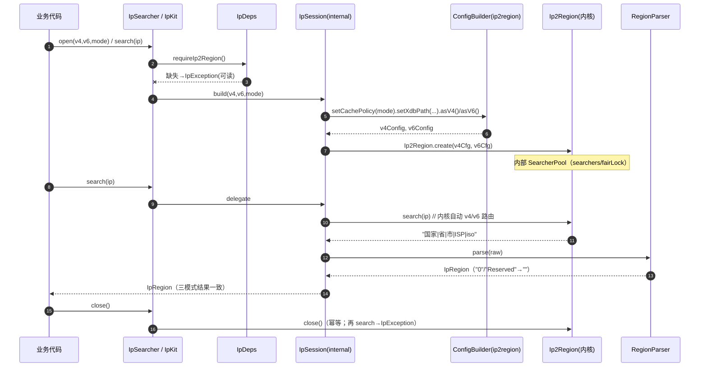
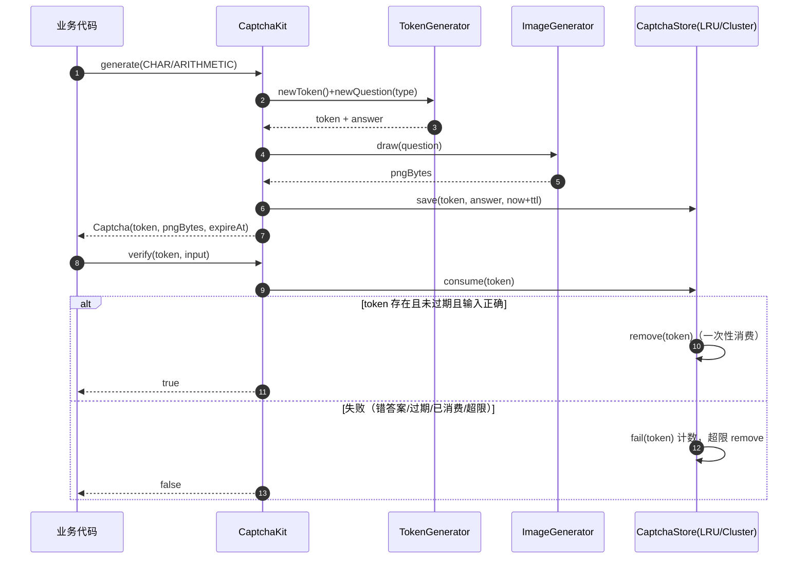
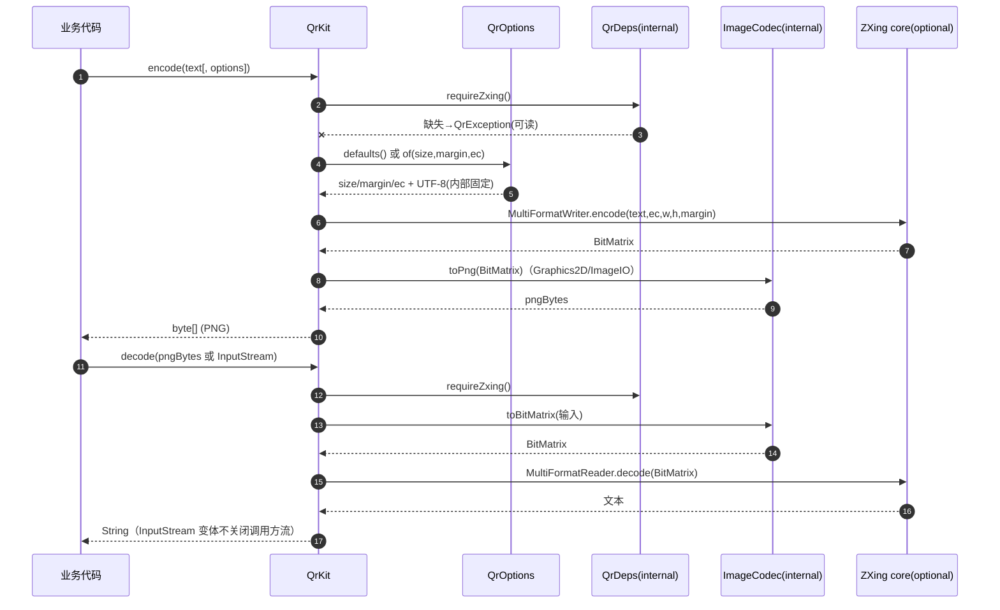
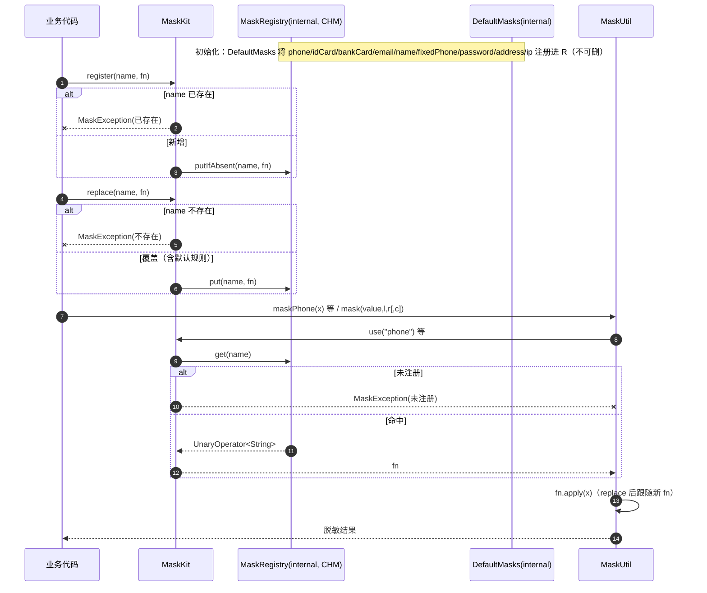

# aifei-tools 设计文档

> 本文是 `aifei-tools` 模块的契约与设计决策事实来源，供开发 / 测试 / 发布共同遵守。
> 关联需求：`../docs/需求/aifei-tools.md`（任务输入，含「七、待确认问题」——本文 §8 已逐项定档）。
> 模块坐标：`io.github.gollyhu:aifei-tools:1.0.0`，包名 `cn.hg.aifei.tools`，Java 8（class major 52）。

## 0. 选型实证记录（CRITICAL，先于一切设计）

### 0.1 ip2region Maven 版本实证（当场实测，非记忆）

| 实证项 | 结论 | 证据来源 |
| --- | --- | --- |
| Maven 坐标 | `org.lionsoul:ip2region` | https://repo1.maven.org/maven2/org/lionsoul/ip2region/ |
| 3.x 可用版本 | 13 个：3.1.0 / 3.1.1 / 3.2.0 / 3.2.1 / 3.3.0～3.3.8（最高 3.3.8，2026-11-10） | 同上目录页 `maven-metadata.xml` |
| **Java 基线分水岭** | 3.1.0 / 3.3.0 / **3.3.7**：POM `source=target=1.8`，无 `release` → Java 8；**3.3.8**：`source=target=release=11`（`jdk11+` profile）→ **Java 11** | 逐个 POM：`.../3.3.7/ip2region-3.3.7.pom`、`.../3.3.8/ip2region-3.3.8.pom` |
| **class major 实测** | 下载 3.3.7 jar，`javap` 读 `service/Ip2Region.class` → **major version 52** ✓ | 本地 Python 下载 + `javap -verbose`（临时文件已删） |
| **Git tag ≠ Maven 版本**（重要） | `v3.19.0` 是**数据版本 tag**，不是 Maven 坐标；Java binding 走独立 3.3.x 体系，交叉点 `v3.11.1 ↔ maven 3.3.1`。需求「tag v3.19.0 仅线索」得到证实 | GitHub Releases https://github.com/lionsoul2014/ip2region/releases |

**版本决策（需求七-1 定档）**：选 **`org.lionsoul:ip2region:3.3.7`**，`optional`，pom 用属性 `<ip2region.version>3.3.7</ip2region.version>` 管理（便于将来统一升级）。**弃用 3.3.8 有实证**：它已切 Java 11 基线（class major 55），违反本仓库「Java 8 / class major 52」硬基线（根 AGENTS.md §技术基线）。需求「不得写死小版本」的正确解读是「设计阶段须实测后定档，不得凭记忆写 3.x」——定档后 pom 锁精确版本，与全部已交付模块一致。

### 0.2 内核 API 实证（重大发现，推翻需求按 2.x 的描述）

`javap`/`jar tf` 实测 3.3.7 jar（18 个 class）：**没有**老 `org.lionsoul.ip2region.Searcher`（2.x API），真实形态是：

- `org.lionsoul.ip2region.service.Ip2Region`（并发安全服务，`create(Config,Config)` / `create(String,String)` / `create(File,File)`、`search(String)`、`close()`/`close(long)`）
- `service.Config`：`NoCache` / `VIndexCache` / `BufferCache` / `FullCache` 四种缓存策略 + `searchers` / `fairLock` 字段；`ConfigBuilder.setCachePolicy/setXdbPath/setXdbFile/setXdbInputStream/setSearchers/setFairLock/asV4/asV6`
- `org.lionsoul.ip2region.xdb.Searcher`（底层**非线程安全**）+ `xdb.*`（Version/Header/Util/LongByteArray）
- 双库原生支持：`Ip2Region.create(v4Config, v6Config)` 两个参数即 v4+v6，`search()` 内部 `v4Search`/`v6Search` 自动路由；内核自带 `SearcherPool`（searchers 数量、fairLock 可配）。

**影响**：三模式需求（fileOnly/vectorIndex/content）须映射到内核四策略；IPv4/IPv6 路由与并发策略应顺应内核 `service.Ip2Region`，**不得**自建 ThreadLocal 或裸用 `xdb.Searcher`。region 五段格式有内核事实依据：v3.13.0 = `国家|省份|城市|ISP|iso码`、保留段 `Reserved|Reserved|Reserved|0|0`；v3.14.0 查不到 IP 返回空串（来源同 Releases 页）。

### 0.3 ZXing Maven 版本实证（本轮查证 Maven Central POM，非记忆）

| 实证项 | 结论 | 证据来源 |
| --- | --- | --- |
| Maven 坐标 | `com.google.zxing:core`（core 为纯编码/解码内核） | https://repo1.maven.org/maven2/com/google/zxing/core/3.5.3/ |
| 3.5.3 POM 依赖 | POM 仅 `junit`(test)，对下游**零传递依赖** | https://repo1.maven.org/maven2/com/google/zxing/core/3.5.3/core-3.5.3.pom |
| **Java 基线（未实证）** | POM 未显式声明 `source`/`target`/`release`，Java 基线由父 POM `zxing-parent:3.5.3` 决定；**实现期须当场下载 jar + `javap` 实测 class major 52**（不得凭记忆断言 Java 8 兼容）。列 §8 未实证项 | 同上 core POM |
| **javase 弃用实证** | `com.google.zxing:javase:3.5.3` 会拖入 `com.beust:jcommander:1.82`(compile) + `com.github.jai-imageio:jai-imageio-core:1.4.0`(runtime)，与「不引无关依赖」冲突，**不引**。PNG 渲染复用 captcha 的 `Graphics2D`/`ImageIO` 路线，自写 `BitMatrix`→`BufferedImage` | https://repo1.maven.org/maven2/com/google/zxing/javase/3.5.3/javase-3.5.3.pom |

**版本决策**：选 **`com.google.zxing:core:3.5.3`**，`optional`，pom 用属性 `<zxing.version>3.5.3</zxing.version>` 管理（对齐 §0.1 ip2region 的写法）。Java 8 兼容**未实证**（class major 52 待实现期 `javap` 实测），若实测非 52 须回写本文重走设计决策。

## 1. 实现方案

### 1.1 模块划分（库模块／无 Plugin 门面型）
`io.github.gollyhu:aifei-tools:1.0.0`，包名 `cn.hg.aifei.tools`，Java 8（class major 52），无根聚合 pom、独立构建。定位「极简工具集」：**根包零公共类型**，工具按子包隔离、各自独立可用、无跨工具抽象。工具清单（当前 4 个）：

| 子包 | 公共类型 | internal（非承诺） |
| --- | --- | --- |
| `cn.hg.aifei.tools.ipdb` | `IpSearcher` / `IpKit` / `IpRegion` / `IpException` / `IpQueryMode`（N=5） | `IpDeps` / `IpErrors` / `IpSession` / `RegionParser` |
| `cn.hg.aifei.tools.captcha` | `Captcha` / `CaptchaKit` / `CaptchaType` / `CaptchaException`（N=4） | `CaptchaStore` / `LruCaptchaStore` / `ClusterCaptchaStore` / `CaptchaDeps` / `CaptchaErrors` / `TokenGenerator` / `ImageGenerator` |
| `cn.hg.aifei.tools.qr` | `QrKit` / `QrOptions` / `QrErrorCorrection` / `QrException`（N=4） | `QrDeps` / `QrErrors` / `ImageCodec` |
| `cn.hg.aifei.tools.mask` | `MaskUtil` / `MaskKit` / `MaskException`（N=3） | `MaskRegistry` / `MaskErrors` / `DefaultMasks` |

无 Plugin、无配置键、无 SPI、无 `aifei` 接入包、零 `cn.aifei.*` 引用、零日志绑定、无 DB／Web 面（对齐 `aifei-excel`/`aifei-trace` 的不适用章节声明）。

### 1.2 技术选型
- 语言/构建：Java 8 + Maven（`source/target=1.8`、UTF-8、surefire `workingDirectory=${project.basedir}`）。
- ip 内核：`org.lionsoul:ip2region:3.3.7`（optional，实证见 §0）。
- captcha：纯 JDK `Graphics2D` + `ImageIO` 生成 PNG；`SecureRandom` 生成 token；默认进程内 LRU，集群存储走 optional `aifei-cache:1.1.0`。
- qr：`com.google.zxing:core:3.5.3`（optional，实证见 §0.3），不引 javase；`BitMatrix`→PNG 自写。mask：纯 JDK + `ConcurrentHashMap`（零第三方）。
- 图形/随机数零第三方；各内核依赖缺失均抛可读模块异常，不裸抛 `NoClassDefFoundError`。

### 1.3 数据流概述
- **ip**：调用方显式传 v4/v6 xdb 路径 + 模式 → `IpSearcher` 会话内部 `IpSession` 用 `ConfigBuilder` 构建双 Config → `Ip2Region.create(v4Cfg,v6Cfg)` → `search(ip)` 内核自动路由 → 原始 region 字符串 → `RegionParser`（唯一定义点）解析五段、`"0"`/`"Reserved"` 归空串 → `IpRegion`。
- **captcha**：`CaptchaKit.generate(type)` → `TokenGenerator`（SecureRandom token + 字符/算式题及答案）→ `ImageGenerator`（Graphics2D PNG）→ 存答案进 `CaptchaStore`（默认 LRU / 可切集群）→ 返回 `Captcha`；`verify(token,input)` → 取答案比对（一次性消费，成功即删、失败计数超限失效）→ boolean。
- **qr**：`QrKit.encode(text[, options])` → `QrDeps.requireZxing()`（缺失→可读 `QrException`）→ `QrOptions.defaults()`/`of(...)`（size=300/margin=4/EC=M，UTF-8 内部固定）→ ZXing `MultiFormatWriter` 出 `BitMatrix` → `ImageCodec.toPng(BitMatrix)`（`Graphics2D`/`ImageIO`）→ `byte[]` PNG；`decode(byte[]|InputStream)` → `ImageCodec` 还原 `BitMatrix` → ZXing `MultiFormatReader` → 文本（InputStream 变体**不关闭调用方流**）。
- **mask**：`DefaultMasks` 初始化时把 `phone`/`idCard`/`bankCard`/`email`/`name`/`fixedPhone`/`password`/`address`/`ip` 九个默认规则注册进 `MaskRegistry`（唯一 `ConcurrentHashMap`）→ 业务 `MaskKit.register/replace/use` 操作注册表 → `MaskUtil.maskXxx(x)` 转发 `use("xxx").apply(x)`（`replace` 后默认规则自动跟随）；通用 `mask(value,keepLeft,keepRight[,maskChar])` 直接按保留位数打码。

## 2. 文件清单（相对 `aifei-tools/`，每个文件恰好归属一个任务，见 §5）

```
aifei-tools/
├── pom.xml                                   [T01] Java8；aifei-all provided；ip2region/aifei-cache/zxing optional（属性 ip2region.version/zxing.version）；junit test；零日志绑定
├── docs/
│   ├── design.md                             [T01] ★本文（本轮产出，主理人汇编落盘）
│   └── testing.md                            [T11] 测试策略与用例（素材见 §7）
├── README.md                                 [T11] 用法/边界/optional 警告
├── AGENTS.md                                 [T11] 模块硬约束（素材见 §6 门禁）
└── src/
    ├── main/java/cn/hg/aifei/tools/          [T01] 根包：空（不创建任何 .java）
    │   ├── ipdb/
    │   │   ├── IpSearcher.java                [T04] 有状态会话（工厂+search+close）
    │   │   ├── IpKit.java                     [T04] 便捷门面
    │   │   ├── IpRegion.java                  [T04] 五段结果值对象
    │   │   ├── IpException.java               [T04] 统一异常
    │   │   ├── IpQueryMode.java               [T04] 模式枚举
    │   │   └── internal/
    │   │       ├── IpDeps.java                [T02] 依赖探测（Class.forName 唯一点）
    │   │       ├── IpErrors.java              [T02] 异常唯一构造点+消息
    │   │       ├── IpSession.java             [T03] Config 构建+Ip2Region 封装+close 幂等
    │   │       └── RegionParser.java          [T03] region 五段解析唯一定义点
    │   └── captcha/
    │       ├── Captcha.java                   [T07] 结果值对象
    │       ├── CaptchaKit.java                [T07] 门面
    │       ├── CaptchaType.java               [T07] 枚举 CHAR/ARITHMETIC
    │       ├── CaptchaException.java          [T07] 统一异常
    │       └── internal/
    │           ├── CaptchaStore.java          [T05] 存储接口
    │           ├── LruCaptchaStore.java       [T05] 默认进程内 LRU
    │           ├── ClusterCaptchaStore.java   [T05] aifei-cache 共享存储
    │           ├── CaptchaDeps.java           [T05] aifei-cache 探测
    │           ├── CaptchaErrors.java         [T05] 异常唯一构造点+消息
    │           ├── TokenGenerator.java        [T06] SecureRandom token+题目/答案
    │           └── ImageGenerator.java        [T06] Graphics2D PNG
    │   ├── qr/
    │   │   ├── QrKit.java                     [T14] 全静态门面（encode/decode）
    │   │   ├── QrOptions.java                 [T14] 值对象 defaults()/of() + 3 getter
    │   │   ├── QrErrorCorrection.java         [T14] 枚举 L/M/Q/H
    │   │   ├── QrException.java               [T14] 统一异常
    │   │   └── internal/
    │   │       ├── QrDeps.java                [T13] ZXing 缺失探测（唯一探测点）
    │   │       ├── QrErrors.java              [T13] 异常唯一构造点+消息（前缀 qr: ）
    │   │       └── ImageCodec.java            [T13] BitMatrix↔BufferedImage/PNG（Graphics2D/ImageIO）
    │   └── mask/
    │       ├── MaskUtil.java                  [T16] 无状态工具（通用 mask + 9 默认规则转发）
    │       ├── MaskKit.java                   [T16] 注册表门面 register/replace/use（全 static）
    │       ├── MaskException.java             [T16] 统一异常
    │       └── internal/
    │           ├── MaskRegistry.java          [T15] ConcurrentHashMap 唯一持有者
    │           ├── MaskErrors.java            [T15] 异常唯一构造点+消息（前缀 mask: ）
    │           └── DefaultMasks.java          [T15] 9 默认规则初始注册唯一定义点
    └── test/java/cn/hg/aifei/tools/
        ├── ArchitectureBoundaryTest.java      [T10] 门禁 17 例
        ├── ipdb/
        │   ├── IpSearcherTest.java            [T08] 三模式一致/命中/close 幂等/非法参数/依赖缺失/并发
        │   ├── IpRegionTest.java              [T08] 五段解析/"0"→空串/查不到全空
        │   ├── IpKitTest.java                 [T08] 便捷门面默认模式
        │   └── PublicApiContractIpTest.java   [T08] 公共面形态与签名
        ├── captcha/
        │   ├── CaptchaKitTest.java            [T09] 生成/校验/一次性消费/TTL/错误次数/token 安全
        │   ├── CaptchaStoreTest.java          [T09] LRU 淘汰/集群存储(mock)
        │   └── PublicApiContractCaptchaTest.java [T09] 公共面形态与签名
        ├── qr/
        │   ├── QrKitTest.java                 [T17] 生成/识别闭环/options 默认值/流不关闭/依赖缺失
        │   └── PublicApiContractQrTest.java   [T17] 公共面形态与签名
        ├── mask/
        │   ├── MaskUtilTest.java              [T18] 通用 mask + 9 默认规则 + replace 跟随
        │   ├── MaskKitTest.java               [T18] register/replace/use 三态 + 默认规则在册不可删
        │   └── PublicApiContractMaskTest.java [T18] 公共面形态与签名
        └── support/
            └── IpSampleData.java              [T08] 内嵌 base64 最小 v4/v6 xdb 样本常量（不提交二进制）

（建议、非本轮立项）aifei-tools-demo/ [T12，端口 18160]：pom.xml · DemoApp · DemoAppConfig · demo/arch/**（自写 HIO）· service/ToolsDemoService · webapp/view/tools/index.html · assets/{js,css} · start-demo.bat · stop-demo.bat
根目录 README.md 模块表新增 aifei-tools 条目 [T11]。
```

## 3. 数据与接口设计（公共类型精确签名，编码角色照抄）

> 四子包公共层共 **16 个公共类型**（ipdb 5 + captcha 4 + qr 4 + mask 3）；签名只含 JDK 类型 + 本模块类型，**零** `org.lionsoul.*`／`com.google.zxing.*`／`cn.aifei.*`／`cn.hg.aifei.cache.*`。全部公共方法不写 `throws` 子句（各异常均为 `RuntimeException`），但 javadoc 写全 `@param/@return/@throws`。

### 3.1 ipdb 子包（N=5）

```java
public final class IpSearcher implements AutoCloseable {         // 搜索器会话对象（名词，命名例外，对齐 Excel）
    public static IpSearcher open(String v4Xdb, String v6Xdb);
    public static IpSearcher open(String v4Xdb, String v6Xdb, IpQueryMode mode);
    public IpRegion search(String ip);                            // 内核自动按 IP 版本路由双库
    public void close();                                          // 幂等
}
public final class IpKit {                                        // 便捷门面（全 static，操作会话）
    private IpKit();
    public static IpRegion search(String v4Xdb, String v6Xdb, String ip);                 // 默认 VECTOR_INDEX
    public static IpRegion search(String v4Xdb, String v6Xdb, String ip, IpQueryMode mode);
}
public final class IpRegion {                                     // 五段值对象，字段永不为 null
    public String getCountry();  public String getProvince(); public String getCity();
    public String getIsp();      public String getIsoCode();
}
public enum IpQueryMode { FILE_ONLY, VECTOR_INDEX, CONTENT }     // → 内核 NoCache / VIndexCache / FullCache
public final class IpException extends RuntimeException {
    public IpException(String message);
    public IpException(String message, Throwable cause);
}
```
三模式→内核策略映射：**FILE_ONLY=NoCache**（每次磁盘 IO）、**VECTOR_INDEX=VIndexCache**（512KiB 索引缓存）、**CONTENT=FullCache**（全文件内存）。`IpSession` 负责 `ConfigBuilder`→`Config`→`Ip2Region.create(v4,v6)` 与 `close()` 幂等（`AtomicBoolean`）+ 内核 `IOException/InterruptedException` 包装。

### 3.2 captcha 子包（N=4）

```java
public final class Captcha {                                      // 生成结果值对象
    public String getToken(); public byte[] getImageBytes(); public long getExpireAt();
}
public final class CaptchaKit {                                   // 门面（全 static；操作有生命周期的存储）
    private CaptchaKit();
    public static Captcha generate();                             // 默认 CHAR
    public static Captcha generate(CaptchaType type);
    public static boolean verify(String token, String input);     // 一次性消费；业务失败返回 false
    public static void setTtlSeconds(int ttl);                    // 默认 120
    public static void setCapacity(int capacity);                 // LRU 容量，默认 10000
    public static void setMaxFailures(int maxFailures);           // 默认 5
    public static void enableClusterStore();                      // 切 aifei-cache 共享存储；缺失抛 CaptchaException
}
public enum CaptchaType { CHAR, ARITHMETIC }
public final class CaptchaException extends RuntimeException {
    public CaptchaException(String message);
    public CaptchaException(String message, Throwable cause);
}
```
存储接口 `CaptchaStore`（internal）三方法：`save(token,answer,expireAt)` / `consume(token)` / `fail(token)`；`LruCaptchaStore`（LinkedHashMap+TTL+失败计数）为默认，`ClusterCaptchaStore` 经 `aifei-cache` 的 `Cache` 存 answers。token = `SecureRandom` 32 字节 → Base64 URL 无填充（不可从图片/token 反推）。

### 3.3 qr 子包（N=4）

```java
public final class QrKit {                                        // 全静态门面（无状态，对齐 IpKit/CaptchaKit）
    private QrKit();
    public static byte[] encode(String text);                     // 默认 QrOptions.defaults()，返回 PNG 字节
    public static byte[] encode(String text, QrOptions options);
    public static String decode(byte[] imageBytes);
    public static String decode(InputStream in);                  // 不关闭调用方流
}
public final class QrOptions {                                    // 值对象；UTF-8 内部固定，不暴露
    public static QrOptions defaults();                           // size=300 / margin=4 / EC=M
    public static QrOptions of(int size, int margin, QrErrorCorrection ec);
    public int getSize();
    public int getMargin();
    public QrErrorCorrection getErrorCorrection();
}
public enum QrErrorCorrection { L, M, Q, H }
public final class QrException extends RuntimeException {
    public QrException(String message);
    public QrException(String message, Throwable cause);
}
```
`decode(InputStream)` 为 `java.io.InputStream`（JDK 类型）。

### 3.4 mask 子包（N=3）

```java
public final class MaskUtil {                                     // 无状态工具（全 static）
    private MaskUtil();
    public static String mask(String value, int keepLeft, int keepRight);
    public static String mask(String value, int keepLeft, int keepRight, char maskChar);
    public static String maskPhone(String value);                 // ≡ MaskKit.use("phone").apply(value)
    public static String maskIdCard(String value);                // ≡ use("idCard")
    public static String maskBankCard(String value);              // ≡ use("bankCard")
    public static String maskEmail(String value);                 // ≡ use("email")
    public static String maskName(String value);                  // ≡ use("name")
    public static String maskFixedPhone(String value);            // ≡ use("fixedPhone")；保留区号(含 -)+后 4 位，中间等长 *，无 - 退化为前 4 后 4（0571-88886666→0571-****6666）
    public static String maskPassword(String value);              // ≡ use("password")；恒定 ******，不保留原长度、不泄露位数（abc123→******）
    public static String maskAddress(String value);               // ≡ use("address")；保留前 6 字符、其余等长 *，长度 ≤6 全打码（浙江省杭州市金城坊街2号→浙江省杭州市******）
    public static String maskIp(String value);                    // ≡ use("ip")；保留首段、其余每段一个 *，IPv4 按 . / IPv6 按 : 分段（192.168.2.1→192.*.*.*；2001:db8:85a3::8a2e:370:7334→2001:*:*:*:*:*:*:*）
}
public final class MaskKit {                                      // 注册表门面（全 static）
    private MaskKit();
    public static void register(String name, UnaryOperator<String> fn);  // 已存在→MaskException
    public static void replace(String name, UnaryOperator<String> fn);   // 不存在→MaskException
    public static UnaryOperator<String> use(String name);                // 未注册→MaskException
}
public final class MaskException extends RuntimeException {
    public MaskException(String message);
    public MaskException(String message, Throwable cause);
}
```
`UnaryOperator` 为 `java.util.function.UnaryOperator`（JDK 类型）；九个默认规则 `maskXxx` 均转发注册表，故 `replace` 后自动跟随（冻结契约）。

## 4. 调用流程（Mermaid）

### 4.1 ip 查询三模式（同一入口，模式只影响 Config 策略）



### 4.2 captcha 生成→校验（一次性消费）



### 4.3 qr 生成→识别



### 4.4 mask 注册→取用→脱敏



## 5. 任务列表（T01…T18，逐步依赖；每文件恰好一个任务）

| 任务 | 内容（文件，见 §2 标签） | 依赖 | 优先级 | 验收 |
| --- | --- | --- | --- | --- |
| **T01 基础设施** | `pom.xml` + `docs/design.md`（本文，主理人落盘）+ 根包空目录骨架 | — | P0 | `mvn -q -DskipTests compile` 通过；class major 52；`dependency:tree` 仅 §6 清单 |
| T02 ip 异常与依赖探测 | `IpDeps.java` · `IpErrors.java` | T01 | P0 | `IpDeps` 用 `Class.forName(name,false,loader)`；缺依赖场景可读 `IpException`（门禁 ⑩⑪） |
| T03 ip 内核 | `IpSession.java` · `RegionParser.java` | T02 | P0 | 三模式 Config 构建正确；五段解析/归空串唯一定义点；`close()` 幂等 |
| T04 ip 公共面 | `IpSearcher.java` · `IpKit.java` · `IpRegion.java` · `IpException.java` · `IpQueryMode.java` | T03 | P0 | §3.1 签名逐字一致；三模式同 IP 同 xdb 结果一致；并发无串扰 |
| T05 captcha 存储内核 | `CaptchaStore.java` · `LruCaptchaStore.java` · `ClusterCaptchaStore.java` · `CaptchaDeps.java` · `CaptchaErrors.java` | T01 | P0 | LRU 容量淘汰 + TTL + 失败计数；集群存储缺失依赖可读异常（门禁 ⑩⑪） |
| T06 captcha 生成内核 | `TokenGenerator.java` · `ImageGenerator.java` | T05 | P0 | token 不可猜（SecureRandom）；字符/算式 PNG 可解析；算式答案正确 |
| T07 captcha 公共面 | `Captcha.java` · `CaptchaKit.java` · `CaptchaType.java` · `CaptchaException.java` | T06 | P0 | §3.2 签名逐字一致；一次性消费/超限失效/TTL 到期 |
| T08 ip 测试 | `IpSearcherTest.java` · `IpRegionTest.java` · `IpKitTest.java` · `PublicApiContractIpTest.java` · `support/IpSampleData.java` | T04 | P0 | P0 验收覆盖；base64 样本解码到 target/；全离线 |
| T09 captcha 测试 | `CaptchaKitTest.java` · `CaptchaStoreTest.java` · `PublicApiContractCaptchaTest.java` | T07 | P0 | §7 captcha 用例覆盖；token 不重复、不可反推 |
| T10 门禁 | `ArchitectureBoundaryTest.java`（17 例） | T02–T09、T13–T18 | P0 | 17 例全绿；不得放宽；模块根执行 |
| T11 文档四件套 | `README.md` · `AGENTS.md` · `docs/testing.md` + 根 README 模块表条目 | T10 | P1 | README 含本期不做/optional 警告；AGENTS 对齐 17 例门禁 |
| T12 demo（建议，主理人拍板） | `aifei-tools-demo/**`（平级工程） | T04、T07 | P1 | 端口 18160；captcha 生成/校验、ip 查询（用内嵌样本）、state 端点真实可跑；零外网 |
| T13 qr 内核 | `QrDeps.java` · `QrErrors.java` · `ImageCodec.java` | T01 | P0 | ZXing 缺失可读 `QrException`；`BitMatrix`→PNG 正确；class major 52 实测（§0.3） |
| T14 qr 公共面 | `QrKit.java` · `QrOptions.java` · `QrErrorCorrection.java` · `QrException.java` | T13 | P0 | §3.3 签名逐字一致；`defaults()`=300/4/M；`decode(InputStream)` 不关闭流；encode→decode 闭环 |
| T15 mask 内核 | `MaskRegistry.java` · `MaskErrors.java` · `DefaultMasks.java` | T01 | P0 | `ConcurrentHashMap` 唯一持有；9 默认规则初始在册不可删；异常唯一构造点 |
| T16 mask 公共面 | `MaskUtil.java` · `MaskKit.java` · `MaskException.java` | T15 | P0 | §3.4 签名逐字一致；register/replace/use 三态正确；`maskXxx≡use(...).apply`；replace 后跟随 |
| T17 qr 测试 | `QrKitTest.java` · `PublicApiContractQrTest.java` | T14 | P0 | §9 qr 验收覆盖；全离线；decode 相关用例受 §8-C 分歧点 1/3 定档约束 |
| T18 mask 测试 | `MaskUtilTest.java` · `MaskKitTest.java` · `PublicApiContractMaskTest.java` | T16 | P0 | §9 mask 验收覆盖；默认规则在册与 replace 跟随 |

> 实现期硬纪律：T02–T09、T13–T18 不得改公共面签名；发现签名不可行须先回写本文 §3 再改代码（根 AGENTS.md）。
> qr 的 `decode` 相关实现与测试（T14/T17）受 §8-C 分歧点 1/3 定档约束，未定档前不得开工。

## 6. 依赖与门禁

### 6.1 依赖清单（精确到 artifact/version/scope）
| 依赖 | scope | 用途 |
| --- | --- | --- |
| `cn.aifei:aifei-all:1.1.2` | **provided** | 生态统一底座；本模块源码零引用，消费方自带、不传递 |
| `org.lionsoul:ip2region:3.3.7` | **optional** | ip 内核，经 `ipdb/internal` 引用；阻断传递；缺失→`IpException` |
| `io.github.gollyhu:aifei-cache:1.1.0` | **optional** | captcha 集群存储，经 `captcha/internal` 反射探测；阻断传递；缺失→`CaptchaException` |
| `com.google.zxing:core:3.5.3` | **optional** | qr 内核，经 `qr/internal` 引用；零传递依赖（实证 §0.3）；阻断传递；缺失→`QrException`；**不引 javase** |
| `junit:junit:4.13.2` | **test** | 单测 + 门禁 |

pom 属性：`<ip2region.version>3.3.7</ip2region.version>` 与 `<zxing.version>3.5.3</zxing.version>` 并列管理。

零日志绑定（禁 slf4j/logback/log4j）、零 DB、零 Web。**根 AGENTS.md 需登记清单为空**（公共面零框架/第三方类型、无 compile 例外），同 `aifei-excel`——请主理人确认。

### 6.2 门禁 `ArchitectureBoundaryTest` 断言清单（17 例，正式定档需求三推荐口径）

| # | 方法 | 判定口径 |
| --- | --- | --- |
| ① | `rootPackageEmpty` | 根包 `cn/hg/aifei/tools/` 直接子级 `.java` **精确 0**（不创建 package-info.java；若存在则显式排除并说明） |
| ② | `ipPublicSurfaceExact` | `ipdb/` 直接子 `.java` 精确 5 且集合 = {IpSearcher,IpKit,IpRegion,IpException,IpQueryMode}（集合相等，防同名替换） |
| ③ | `captchaPublicSurfaceExact` | `captcha/` 直接子 `.java` 精确 4 且集合 = {Captcha,CaptchaKit,CaptchaType,CaptchaException} |
| ④ | `ip2regionOnlyInIpInternal` | `import org.lionsoul.` 仅允许 `ipdb/internal/` 下文件（ip2region 依赖边界） |
| ⑤ | `cacheOnlyInCaptchaInternal` | `import cn.hg.aifei.cache.` 仅允许 `captcha/internal/` 下文件 |
| ⑥ | `noFrameworkReference` | 全模块禁止 `import cn.aifei.`（无接入包、无 log 例外） |
| ⑦ | `noWebSqlOrLogBinding` | 禁 `io.undertow.`/`java.sql.`/`org.slf4j.`；pom 不声明 logback/log4j/slf4j-simple |
| ⑧ | `publicSignaturesNoThirdParty` | 四子包公共层（非 internal）源码不得出现 `org.lionsoul.`/`com.google.zxing.`/`cn.aifei.`/`cn.hg.aifei.cache.` 字面量 |
| ⑨ | `java8Compatibility` | 禁 `List.of(`/`Map.of(`/`Set.of(`/`record `/`var `/`"""`/`sealed `/`instanceof` 模式匹配 |
| ⑩ | `classForNameOnlyInDeps` | `Class.forName` 仅允许 `IpDeps.java`/`CaptchaDeps.java` |
| ⑪ | `errorMessagesOnlyInErrors` | `ip: `/`captcha: ` 消息前缀仅允许 `IpErrors.java`/`CaptchaErrors.java`（测试断言与公共 javadoc 除外） |
| ⑫ | `regionParsingOnlyInParser` | region 分隔符 `\|` 及 `"0"`/`"Reserved"` 归空串的唯一实现只在 `RegionParser.java` |
| ⑬ | `noServiceProvider` | 禁 `ServiceLoader`/`META-INF/services`（无 SPI） |
| ⑭ | `testSourcesOfflineOnly` | 测试源 URL host 仅 `127.0.0.1`/`localhost`；`IpSampleData` 的 base64 常量允许 |
| ⑮ | `qrPublicSurfaceExact` | `qr/` 直接子 `.java` 精确 4 且集合 = {QrKit,QrOptions,QrErrorCorrection,QrException} |
| ⑯ | `zxingOnlyInQrInternal` | `import com.google.zxing.` 仅允许 `qr/internal/` 下文件 |
| ⑰ | `maskPublicSurfaceExact` | `mask/` 直接子 `.java` 精确 3 且集合 = {MaskUtil,MaskKit,MaskException} |

构建期断言（门禁外）：主 JAR 全 class major=52（`javap` 抽查 `IpSearcher`/`IpKit`/`IpSession`/`CaptchaKit`/`QrKit`/`QrDeps`/`MaskKit`）；`mvn dependency:tree` 仅出现 §6.1 清单（含 zxing 且无 javase/jcommander/jai-imageio）。

## 7. 跨文件约定 + 异常语义 + 测试样本

### 7.1 命名与唯一定义点
- 后缀：`IpSearcher`/`Captcha` 会话对象与值对象用名词（命名例外，对齐 `Excel`/`HttpClient`）；`IpKit`/`CaptchaKit` = 有状态门面（操作有生命周期的会话/存储，全 static，无 Plugin 装配期——对齐 `TraceKit` 命名例外）；`QrKit` = 全静态门面（无状态，对齐 `IpKit`）；`QrOptions` 值对象；`MaskUtil` 无状态工具（全 static）；`MaskKit` 注册表门面（全 static，操作 `ConcurrentHashMap`）；`XxxException`/`XxxType`/`XxxMode`/`XxxRegion` 按 Java 习惯；internal 用 `Deps/Errors/Session/Parser/Store/Generator/Registry/Codec/Masks`。
- 唯一定义点：依赖探测=`*Deps`；异常构造与消息=`*Errors`；region 五段解析=`RegionParser`；Config 构建与 close 幂等=`IpSession`；token 随机与题目生成=`TokenGenerator`；ZXing 依赖探测=`QrDeps`；`BitMatrix`↔PNG 编解码=`ImageCodec`；mask 注册表（唯一 `ConcurrentHashMap`）=`MaskRegistry`；9 默认规则初始注册=`DefaultMasks`。
- 冻结契约落实点：默认规则名 `phone`/`idCard`/`bankCard`/`email`/`name`/`fixedPhone`/`password`/`address`/`ip` 初始在册、不可删（唯一在 `DefaultMasks`）；`maskPhone(x)≡use("phone").apply(x)` 及 `replace` 后跟随（其余 8 条同构），落实在 `DefaultMasks` + `MaskUtil` 转发；`register`/`replace`/`use` 全拼写。
- 每类规则只一处；公共 javadoc 简体中文、写全标签；文件头统一版权块；CRLF + UTF-8。

### 7.2 异常语义表（定档，唯一措辞来源 `*Errors`）

**ip（前缀 `ip: `）**
| 场景 | 行为/消息 | cause |
| --- | --- | --- |
| null 参数（路径/ip/mode） | `ip: {method} argument {name} must not be null` | — |
| v4、v6 路径都为 null | `ip: at least one of v4/v6 xdb path must be provided` | — |
| 非法 IP 文本 | `ip: invalid ip address "{ip}"` | `InetAddressException` |
| xdb 不可读 | `ip: xdb file not readable: {path}` | IO 异常 |
| 依赖缺失 | `ip: org.lionsoul:ip2region:3.3.7 is required, add it to your dependencies` | 链接错误 |
| 会话已 close 后再 search | `ip: session is closed, create a new IpSearcher` | — |
| 解析失败 / 搜索异常 | `ip: failed to parse region "{raw}"` / `ip: search failed for "{ip}", cause: {msg}` | 原异常 |

**captcha（前缀 `captcha: `）**
| 场景 | 行为/消息 |
| --- | --- |
| ttl/capacity/maxFailures ≤ 0 | `captcha: {name} must be positive, but was: {n}` |
| 启用集群存储但无 aifei-cache | `captcha: io.github.gollyhu:aifei-cache:1.1.0 is required for cluster store` |
| token 无效/已消费/过期/错误次数超限 | `verify` 返回 `false`（不抛异常） |
| 系统级错误（存储不可用等） | 抛 `CaptchaException` 并保留 cause |

**qr（前缀 `qr: `，消息措辞由 `QrErrors` 唯一定义）**
| 场景 | 行为/消息 | cause |
| --- | --- | --- |
| ZXing 依赖缺失 | `qr: com.google.zxing:core:3.5.3 is required, add it to your dependencies` | 链接错误 |
| encode 失败（内容过长/EC 不匹配等） | `qr: failed to encode text, cause: {msg}` | 原异常 |
| null/空输入语义 | 待定档（见 §8-C 分歧点 2） | — |
| decode 失败语义 | 待定档（见 §8-C 分歧点 3） | — |

**mask（前缀 `mask: `，消息措辞由 `MaskErrors` 唯一定义）**
| 场景 | 行为/消息 |
| --- | --- |
| register 同名已存在 | `mask: rule "{name}" already registered` |
| replace 同名不存在 | `mask: rule "{name}" is not registered` |
| use 未注册 | `mask: rule "{name}" is not registered` |
| name/fn 为 null | `mask: rule name must not be null` / `mask: mask function must not be null` |

**region「0」语义（需求七-6 定档）**：五段字段**永不为 null**；raw 值为 `"0"` 或 `"Reserved"` → 归一为**空串 `""`**（不是 "0"、不是 null、不是占位符）；查不到 IP（内核返回 null/空串）→ 返回 `IpRegion` 五字段全 `""` 的非 null 对象，javadoc 写明。理由：对外语义干净，与内核 v3.14.0「查不到返回空串」一致，调用方无需识别内核哨兵。

### 7.3 查询模式默认值与并发默认值（需求七-5 定档）
- **默认模式 `VECTOR_INDEX`**：512KiB 固定索引缓存、约 100µs，内存/性能折中最佳（FILE_ONLY 每次磁盘 IO 太慢，CONTENT 全文件驻留浪费）；`IpKit` 两参重载与 `IpSearcher.open` 两参重载均用它。
- **并发 = 实例独占 + 内核 `SearcherPool`**：每个 `IpSearcher` 会话独占一个 `Ip2Region`，线程安全由内核池保证（searchers = `availableProcessors()`、fairLock=false，internal 设定，不暴露公共配置项）。**不自建 ThreadLocal、不裸用 `xdb.Searcher`**——内核已是 v3.2.0+ 并发安全服务（实证 §0.2），这同时消解需求对「Searcher 非线程安全」的担忧。close 后查询抛 §7.2 的 `IpException`。

### 7.4 测试样本策略（需求七-4 定档）
**定档：内嵌 base64 最小 xdb 样本 → 测试期解码到 `target/`**（`support/IpSampleData.java` 存 base64 字符串常量）。理由：完全离线、可重复、零外链生产数据、不提交二进制文件（根 AGENTS.md 安全条款）。样本须覆盖：境内 IPv4 段（中文五段）、境外 IPv4 段（英文）、保留段（`Reserved…0`）、一个 IPv6 段。样本一次性用 ip2region maker（版本对齐 3.3.7）生成后 base64 固化；maker 坐标见 §8 未实证项。退化方案（若 maker 不可用）：`RegionParser` 用固定字符串向量测试，真实 xdb 端到端用例改为默认关闭的集成测试（需外部提供 xdb，开启后连不上必须失败）。

## 8. 待明确事项（按要求分列）

### A. 未实证项（实现期确认，不阻塞设计定档）
1. **maker 生成最小 xdb 的 Maven 坐标与命令**（一次性，用于 base64 固化）——实现期确认；退化方案已在 §7.4 给出。
2. **三模式返回一致性需样本实测**：设计契约要求 FILE_ONLY/VECTOR_INDEX/CONTENT 对同 IP 同 xdb 结果逐字一致；内核实现细节无法在设计层断言，实现期用样本验证。
3. **`aifei-cache` 共享存储 API 确切签名**（`Cache.put(key,value,expire)`/`get`/`remove` 及 TTL 单位）——实现期读 `aifei-cache/AGENTS.md` 与 `docs/design.md` 确认，不臆造。
4. **双许可署名留痕**：ip2region 为 Apache-2.0 OR MIT，署名与许可说明在 README/design 记录；具体 LICENSE 文本由主理人定。
5. **3.3.8 弃用是「当前时点」结论**（Java 11 基线）；若将来放宽 Java 基线需重走设计决策，登记为非阻塞假设。
6. **ZXing core:3.5.3 Java 基线未实证**：POM 未声明 `source`/`target`/`release`，须实现期下载 jar + `javap` 实测 class major 52，不得凭记忆断言 Java 8 兼容（与门禁⑨关联）；若非 52 须回写设计重走决策。
7. **QrDeps 探测方式与门禁⑩的交互（非阻塞，建议方案）**：原门禁⑩「`Class.forName` 仅允许 `IpDeps.java`/`CaptchaDeps.java`」不改为前提下，qr 探测改用「方法内延迟符号解析 + `catch NoClassDefFoundError/LinkageError` → `QrException`」（探测逻辑放 `QrDeps`，不触碰⑩），**不得用 `Class.forName`**。请主理人确认此实现口径。

### B. 需主理人拍板项（本设计只给建议，不擅自扩张）
1. **是否配 `aifei-tools-demo`**：架构师**建议配**（仓库惯例：库模块原则配 demo），端口建议 18160，ip 演示用内嵌样本；最终立项请主理人定。
2. **公共面精确 N 值**：ip N=5、captcha N=4 已定档，请确认后作为门禁常量（若调整须先改 design §3/§6）。
3. **规划文档措辞**：§6.2/§3.3「首个工具／1 周」是否更新为「首批两个工具」——本设计不擅改规划文档，请主理人定。
4. **默认值确认**：默认模式 `VECTOR_INDEX`、默认并发（实例独占 + 内核池化，searchers=CPU 核数，fairLock=false）——设计定档，请确认。
5. **发布元数据**：本轮 pom 不含 Central 发布 profile；是否加入 licenses/developers/scm 由主理人定（仓库各模块不统一）。
6. **门禁例数：16 vs 17**：需求/口述曾提「16 例」，本轮新增断言实为 3 条（`qrPublicSurfaceExact`/`zxingOnlyInQrInternal`/`maskPublicSurfaceExact`），14+3=**17**。本文按 17 例落盘，未删减任何断言凑 16——三条分别守 qr 公共面精确、ZXing 依赖边界、mask 公共面精确，缺一不可，不建议删减。请主理人裁决。
7. **T10 任务扩展**：3 条断言追加到 T10 的 `ArchitectureBoundaryTest.java`（同文件纯追加、原 14 例不变、文件归属仍 T10、验收改 17 例），请确认。
8. **门禁⑪未覆盖新前缀**：原⑪只守 `ip: `/`captcha: `，qr 的 `qr: `/mask 的 `mask: ` 前缀唯一性本轮未加门禁断言，仅靠 §7.1 约定 + `*Errors` 唯一定义点守护（依「原 14 例不改」）。是否扩充⑪，请主理人定。

### C. 本轮新增未定档项（qr，原样列入，不裁决）
qr 5 个行为分歧点，未定档前 T14/T17 的 decode 相关实现与测试不得开工：
1. `decode` 是否保留（是否提供解码能力，还是只 encode）。
2. null/空输入语义。
3. decode 失败语义（抛 `QrException` vs 返回 null）。
4. `QrOptions` 是否扩展（除 size/margin/EC 外是否加前景/背景色等）。
5. 是否加流式输出（encode 到 `OutputStream`）。

## 9. P0 验收覆盖映射（需求六 → 设计/任务/门禁）
| 需求验收要点 | 落点 |
| --- | --- |
| 生成→校验成功→同 token 二次失败 | §3.2/§4.2/§7.2；T06/T07/T09 `CaptchaKitTest` |
| TTL 到期、超错误次数失效、token 不可反推 | §7.2；T05/T09；`TokenGenerator`(SecureRandom) |
| 未引 aifei-cache 单机可用、引入后集群校验 | §1.3/§6.1；T05 `LruCaptchaStore`/`ClusterCaptchaStore`；T09 |
| 门禁：根包零类型 + 各子包精确 N | §6.2 门禁①③；T10 |
| 文档四件套 + 根 README 补条目 | §2 T11 |
| 三模式同 IP 同 xdb 结果一致 | §3.1/§7.3；T04；T08 `IpSearcherTest`；未实证项 2 |
| v4/v6 双库命中、境内中文境外英文、未知段语义 | §3.1/§7.2；T08 `IpSearcherTest`/`IpRegionTest`/样本 |
| 非法 IP/null/文件缺失/依赖缺失均抛可读 IpException | §7.2；T02/T03；T08 |
| 并发无串扰 | §7.3；T04；T08 |
| close 幂等 + 关闭后可读异常 | §3.1/§7.2/§7.3；T03；T08 |
| 测试不提交 xdb 二进制、样本策略 | §7.4；T08 `support/IpSampleData.java` |
| qr 生成→识别闭环（encode 文本→decode 还原一致） | §3.3/§4.3；T14/T17 `QrKitTest`；受 §8-C 分歧点 1/3 定档约束 |
| QrOptions 默认值 size=300/margin=4/EC=M、UTF-8 内部固定 | §3.3；T14/T17 `PublicApiContractQrTest` |
| decode(InputStream) 不关闭调用方流 | §3.3/§4.3；T14/T17 |
| ZXing 缺失首次调用抛可读 QrException、不裸抛、不引 javase | §0.3/§6.1/§7.2；T13/T17；§8-A6 Java 基线实证 |
| qr 公共面精确 4、zxing 仅 internal | §6.2 门禁⑮⑯；T10/T14 |
| mask 通用 mask + 9 默认规则（phone/idCard/bankCard/email/name/fixedPhone/password/address/ip） | §3.4/§4.4；T15/T16/T18 |
| 新增 maskFixedPhone：座机保留区号(含 -)+后 4 位、中间等长 *，无 - 退化为前 4 后 4 | §3.4/§4.4；T15/T16/T18 `MaskUtilTest`；0571-88886666→0571-****6666 |
| 新增 maskPassword：恒定 ******，不保留原长度、不泄露位数 | §3.4/§4.4；T15/T16/T18 `MaskUtilTest`；abc123→****** |
| 新增 maskAddress：保留前 6 字符、其余等长 *，长度 ≤6 全打码 | §3.4/§4.4；T15/T16/T18 `MaskUtilTest`；浙江省杭州市金城坊街2号→浙江省杭州市****** |
| 新增 maskIp：保留首段、其余每段一个 *，IPv4 按 . / IPv6 按 : 分段 | §3.4/§4.4；T15/T16/T18 `MaskUtilTest`；192.168.2.1→192.*.*.*；2001:db8:85a3::8a2e:370:7334→2001:*:*:*:*:*:*:* |
| 默认规则初始在册不可删、maskPhone≡use("phone").apply、replace 后跟随 | §3.4/§7.1；T15/T16；`MaskKitTest` |
| register 已存在抛 / replace 不存在抛 / use 未注册抛 | §3.4/§7.2；T16/T18 |
| mask 公共面精确 3 | §6.2 门禁⑰；T10/T16 |
| 两工具无 Plugin/配置键、公共签名零第三方/框架类型、零日志绑定、根包仍零类型 | §1.1/§3.3/§3.4；T10/T13–T18 |

> 一句话总览：`aifei-tools` 单模块——根包零公共类型，四子包共 16 公共类型（`ipdb` 5 / `captcha` 4 / `qr` 4 / `mask` 3）；ipdb 走实测锁定的 `ip2region:3.3.7`（Java 8 class 52，弃用 Java 11 的 3.3.8 有实证）双库自动路由、三模式映射内核四策略、默认 VECTOR_INDEX + 内核池化并发、region `"0"`→空串；captcha 纯 JDK 绘 PNG + 一次性消费 + LRU/可选 aifei-cache 双存储；qr 走 `zxing:core:3.5.3`（optional，Java 基线待实测）+ 自写 `BitMatrix`→PNG；mask 走 `ConcurrentHashMap` 注册表 + 9 默认规则（phone/idCard/bankCard/email/name/fixedPhone/password/address/ip）；四子包公共面零第三方/框架类型，17 例门禁守护。
