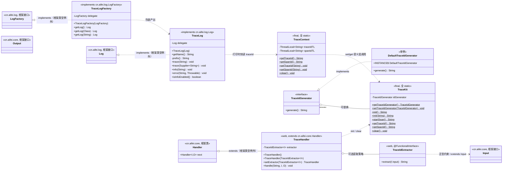
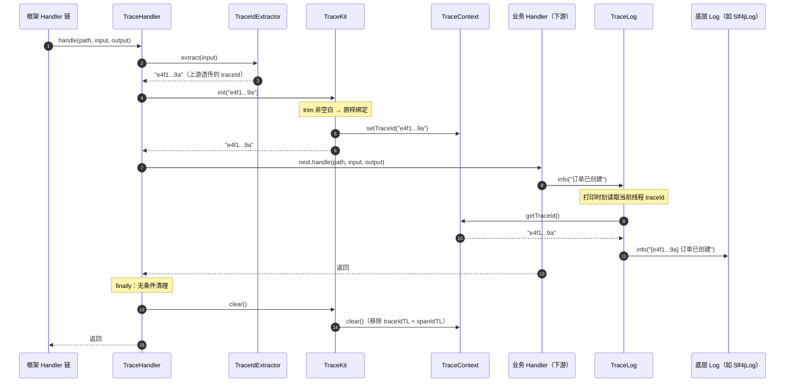
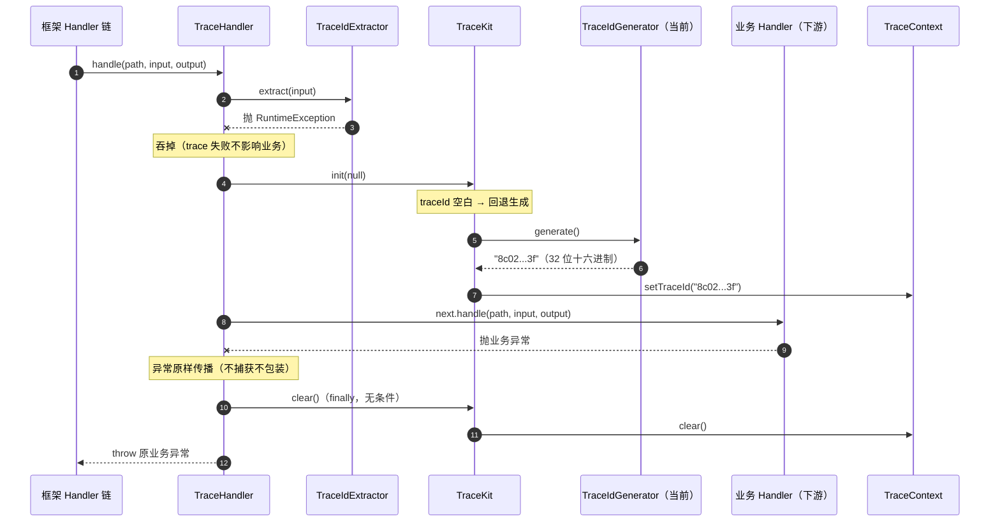
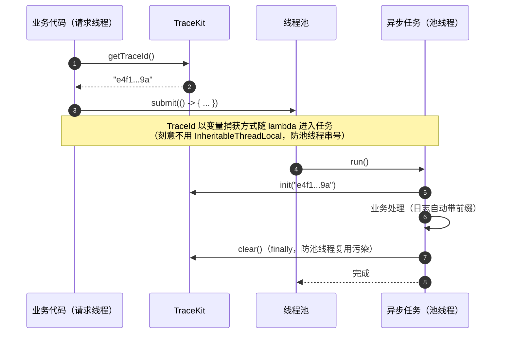

# aifei-trace 设计文档

本文是 `aifei-trace` 的**设计事实来源（契约）**：公共 API 逐字签名、包结构与门禁、行为契约、异常语义与验收标准以本文为准。面向使用者的用法见 `README.md`；面向开发代理的约束见模块 `AGENTS.md`；测试策略与用例清单见 `docs/testing.md`。

> **坐标**：`io.github.gollyhu:aifei-trace:1.0.0-SNAPSHOT`（`packaging=jar`）；包名 `cn.hg.aifei.trace`；**Java 8**（语法与 API 双约束，主 JAR class major = 52）；**零第三方**（pom 仅 `cn.aifei:aifei` provided + junit test）。
>
>

---

## 1. 模块定位与边界

### 1.1 定位

aifei 生态缺少**请求链路贯穿能力**：一次请求跨 Handler → Service → 线程池 → 日志输出，日志里看不到同一条链路。本模块补齐三件事，一件一个落点：

| # | 目标 | 落点 |
| --- | --- | --- |
| 1 | **链路上下文**：当前线程持有 traceId / spanId，随取随用 | `TraceContext`（ThreadLocal 唯一持有点）+ `TraceKit`（全静态门面） |
| 2 | **日志贯通**：任意 LogFactory 产出的日志自动携带 `[traceId] ` 前缀 | `TraceLog`（Log 装饰器）+ `TraceLogFactory`（LogFactory 装饰器） |
| 3 | **Web 入口**：请求进入绑定、请求结束清理，杜绝线程池串号 | `web.TraceHandler`（extends `cn.aifei.core.Handler`，finally 保证 clear） |

与生态的关系：`aifei-mq`（消息头）/ `aifei-websocket`（帧头）/ `aifei-job`（事件字段）的**跨模块传播在 v1.0.0 范围之外**；未来由各消费模块自行读取 `TraceKit.getTraceId()` 写入其协议字段，本模块**零生态模块依赖**。

### 1.3 公共面收敛纪律（硬约束）

| # | 纪律 |
| --- | --- |
| 1 | **根包公共 API 精确 6 个类型**：`TraceKit` / `TraceContext` / `TraceIdGenerator` / `DefaultTraceIdGenerator` / `TraceLog` / `TraceLogFactory`；**`web` 包精确 2 个**：`TraceHandler` / `TraceIdExtractor`。**不得增删、不得改名**；变更须先改本文 §5 并过设计决策 |
| 2 | 公共面出现 `cn.aifei.log.Log` / `LogFactory`（TraceLog / TraceLogFactory 签名）与 `cn.aifei.core.Handler` / `Input` / `Output`（web 包签名）属**框架类型例外**；除这两组外，公共面**零第三方类型** |
| 3 | **零第三方依赖**：pom 只有 `cn.aifei:aifei`（`provided`）+ `junit`（`test`）；**不声明 `cn.aifei:aifei-log`**（其 `Log` / `LogFactory` 接口定义在框架内核 `cn.aifei:aifei`，随 `aifei` 提供，已核实本地仓库 1.1.2 内含 `cn/aifei/log/{Log,LogFactory,LogKit}.class`） |
| 4 | **无 internal 包**：全模块 8 公共类型即全部实现，是对 aifei-http 范式（根包公共 + internal 实现）的**有意偏离** |
| 5 | 每类规则只有一个定义点（§6.4），实现类不得复制 |
| 6 | Java 8 语法与 API 双约束；主 JAR class major = 52 |

> 第 1、2、3、6 条由架构门禁 `ArchitectureBoundaryTest`（§10）强制，**不得放宽或绕过**。

### 1.4 v1 不做清单（能力边界）

**不做跨线程自动传播**（刻意不用 `InheritableThreadLocal`，防线程池串号——官方既定语义）；**不做 Span 树**（`startSpan()` 覆盖旧值，单层 span）；**不做 TraceException**（官方 1.1.1 无此类型，本模块也无业务失败场景）；**不做 MDC 注入**（aifei-log 无 MDC 上下文能力，已核实；`[traceId] ` 前缀是唯一日志贯通形态）；**不做跨模块传播**（MQ 消息头 / WS 帧头 / Job 事件字段）；**不做 Plugin / 配置键 / SPI**；**不做采样率、上报、存储**（本模块只负责「标识与贯通」，不做任何遥测后端对接）；**不做异步日志通道**（TraceLog 同步在调用线程拼前缀）。

---

## 3. 术语表

| 术语 | 含义 | 归属 |
| --- | --- | --- |
| **TraceId** | 一次完整请求链路的唯一标识；32 位小写十六进制；同链路所有环节恒等 | `TraceIdGenerator`（生成）/ `TraceContext`（持有） |
| **SpanId** | 链路内**单层**片段标识；`startSpan()` 生成并覆盖旧值，**不做 Span 树** | 同上 |
| **链路上下文** | 当前线程绑定的 traceId + spanId（两个独立 ThreadLocal） | `TraceContext` |
| **生成器 TraceIdGenerator** | TraceId 生成策略接口；默认实现 `DefaultTraceIdGenerator` | 根包（公共接口 + 默认实现） |
| **提取器 TraceIdExtractor** | 请求进入时从上游提取 traceId 的策略（函数式接口）；失败/空白回退生成 | `web` 包（公共接口） |
| **接入处理器 TraceHandler** | 挂 Handler 链的入口构件：绑定 → 透传下游 → finally 清理 | `web` 包（公共类） |
| **日志装饰器 TraceLog** | 在打印时刻拼 `[traceId] ` 前缀的 `cn.aifei.log.Log` 包装实现 | 根包（公共类） |
| **日志工厂装饰器 TraceLogFactory** | 把任意 `cn.aifei.log.LogFactory` 产出的 Log 包装为 TraceLog | 根包（公共类） |
| **回退生成 fallback** | 提取结果 null/空白或提取抛异常时，改用生成器产出新 TraceId 的语义 | `TraceKit#init` / `TraceHandler#handle` |

---

## 5. 公共 API 契约（根包精确 6 + web 包精确 2）

根包 `cn.hg.aifei.trace` 与子包 `cn.hg.aifei.trace.web` 共 **8 个公共类型**，为本节与门禁 `EXPECTED_ROOT_TYPES` / `EXPECTED_WEB_TYPES` 的**唯一事实来源**。逐字签名如下（`static` 与否、返回类型、异常声明均不得改动）。

### 5.1 `TraceKit`（公共静态门面，`final`）

```java
public final class TraceKit {

    public static TraceIdGenerator getTraceIdGenerator();

    public static void setTraceIdGenerator(TraceIdGenerator generator);

    public static String init();

    public static String init(String traceId);

    public static String startSpan();

    public static String getTraceId();

    public static String getSpanId();

    public static void clear();
}
```

| 方法 | 契约 | 非法入参 |
| --- | --- | --- |
| `getTraceIdGenerator()` | 返回当前生成器（初始为 `DefaultTraceIdGenerator.INSTANCE`） | — |
| `setTraceIdGenerator(generator)` | 替换生成器；**建议仅启动期调用**（运行期替换无锁，不保证原子可见性，javadoc 声明） | `null` → `IllegalArgumentException` |
| `init()` | 等价 `init(null)`：生成并绑定新 TraceId，返回该 TraceId | — |
| `init(traceId)` | 绑定 TraceId：`traceId` **先 trim**，trim 后非空白则原样绑定并返回该值；为 null / 空白 → 回退调用生成器产出新 TraceId 并绑定；返回**最终生效**的 TraceId | 无（null/空白是合法输入，走回退分支） |
| `startSpan()` | 生成新 SpanId 并绑定，返回该 SpanId；**同一请求内多次调用覆盖旧值**，不做 Span 树 | — |
| `getTraceId()` | 当前线程绑定的 TraceId，**未绑定返回 null**（不抛异常） | — |
| `getSpanId()` | 同上，SpanId | — |
| `clear()` | 清理当前线程全部链路上下文（TraceId 与 SpanId）；重复调用安全 | — |

- **命名例外**：本类无装配生命周期、任何时刻调用成立，属 Kit 命名例外；**永不抛「未装配」类异常**。
- 内部持有 `static TraceIdGenerator idGenerator`（**包级可见、非 final**，官方同形态）：字段本身是 internal 细节，唯一写入点是 `setTraceIdGenerator`，**不得升为 public**。

### 5.2 `TraceContext`（公共上下文持有器，`final`）

```java
public final class TraceContext {

    public static String getTraceId();

    public static String getSpanId();

    public static void setTraceId(String traceId);

    public static void setSpanId(String spanId);

    public static void clear();
}
```

| 方法 | 契约 |
| --- | --- |
| `getTraceId()` / `getSpanId()` | 当前线程绑定值，未绑定返回 null |
| `setTraceId(traceId)` | 绑定；**传 null 等价于移除**（官方语义：`ThreadLocal.remove`） |
| `setSpanId(spanId)` | 同上 |
| `clear()` | 移除两个 ThreadLocal，防线程池复用串号 |

- **全模块 ThreadLocal 唯一持有点**（门禁 ⑥ 断言）：两个字段 `private static final ThreadLocal<String> traceIdTL` / `spanIdTL`。
- **普通 `ThreadLocal`，刻意不用 `InheritableThreadLocal`**：防线程池复用线程导致 TraceId 串号；跨线程传播须业务手动（§8.3）。
- 与 `TraceKit` 的分工：TraceContext 是**原始持有器**（只做 set/get/remove，零业务语义）；TraceKit 是**语义门面**（trim、回退、生成）。业务日常只用 TraceKit。

### 5.3 `TraceIdGenerator`（公共接口）

```java
public interface TraceIdGenerator {

    String generate();
}
```

- **契约**（javadoc 强约束，模块运行期不校验）：返回值**非空**、全局趋势唯一、仅含 `[0-9a-f]`、**固定 32 位**小写十六进制——保证日志检索与展示格式对齐。
- 唯一方法无参数；实现应无状态或自行保证线程安全（默认实现无状态）。

### 5.4 `DefaultTraceIdGenerator`（公共默认实现，单例）

```java
public class DefaultTraceIdGenerator implements TraceIdGenerator {

    public static final DefaultTraceIdGenerator INSTANCE;

    private DefaultTraceIdGenerator();

    @Override
    public String generate();
}
```

- `generate()` = `UUID.randomUUID().toString().replace("-", "")`：32 位小写十六进制。
- **私有构造 + 唯一单例 `INSTANCE`**（官方同形态）：外部无法另建实例；替换生成器时传入 `INSTANCE` 即恢复默认。
- **全模块 `UUID` 唯一出现点**（门禁 ⑦ 断言）。

### 5.5 `TraceLog`（公共 Log 装饰器，`implements cn.aifei.log.Log`）——框架类型例外

```java
public class TraceLog implements Log {

    public TraceLog(Log delegate);

    @Override
    public String getName();

    // ---- 每个级别（trace / debug / info / warn / error）各 6 个方法，共 30 个 + 5 个 isXxxEnabled ----
    @Override
    public boolean isTraceEnabled();
    @Override
    public void trace(String msg);
    @Override
    public void trace(String msg, Throwable t);
    @Override
    public void trace(String format, Object arg);
    @Override
    public void trace(String format, Object arg1, Object arg2);
    @Override
    public void trace(String format, Object... arguments);
    @Override
    public void trace(Supplier<String> messageSupplier);
    // debug / info / warn / error 与 trace 同构（略——签名逐字对齐 cn.aifei.log.Log 接口）
}
```

| 项 | 契约 |
| --- | --- |
| 构造 | `delegate == null` → `IllegalArgumentException`（对官方 NPE 的有意偏离，对齐仓库口径） |
| **前缀拼装**（唯一定义点，§6.4） | 打印时刻计算 `prefix()`：`TraceContext.getTraceId()` 非 null → `"[" + traceId + "] "`，**缺失 → 空串**（消息原样透出） |
| String 消息变体 | `delegate.方法(prefix() + msg, ...)` —— 前缀在**调用时刻**拼接 |
| `Supplier<String>` 变体 | **懒求值**：`delegate.方法(() -> prefix() + messageSupplier.get())` —— 前缀在**打印时刻**读取链路上下文，保证异步日志取到打印线程的 TraceId |
| `isXxxEnabled()` / `getName()` | 纯透传 delegate，不拼前缀 |
| 格式变体 | 前缀只拼在 **format 串**上（`prefix() + format`），占位参数原样传递 |
| 可变性 | 无状态（只有 `final delegate` 字段），线程安全 |

### 5.6 `TraceLogFactory`（公共 LogFactory 装饰器，`implements cn.aifei.log.LogFactory`）——框架类型例外

```java
public class TraceLogFactory implements LogFactory {

    public TraceLogFactory(LogFactory delegate);

    @Override
    public Log getLog();

    @Override
    public Log getLog(Class<?> clazz);

    @Override
    public Log getLog(String name);
}
```

| 项 | 契约 |
| --- | --- |
| 构造 | `delegate == null` → `IllegalArgumentException`；**delegate 必须显式给定**（javadoc 声明：避免自包装造成无限递归——`new TraceLogFactory(new TraceLogFactory(...))` 或包自身工厂属使用方错误，模块不检测不防护） |
| 三个 `getLog` | 返回 `new TraceLog(delegate.getLog(...))`——每次取用新建装饰器（TraceLog 无状态，成本为零） |
| 用法 | `settings.setLogFactory(new TraceLogFactory(new Slf4jLogFactory()))` / `new TraceLogFactory(new Log4jLogFactory())`——与 aifei-log 各工厂天然兼容；适配器由消费方经 aifei 自带，本模块不造日志 |

### 5.7 `web.TraceHandler`（公共接入处理器，`extends cn.aifei.core.Handler`）——框架类型例外

```java
public class TraceHandler<I extends Input, O extends Output> extends Handler<I, O> {

    public TraceHandler();

    public TraceHandler(TraceIdExtractor<I> extractor);

    public TraceHandler<I, O> setExtractor(TraceIdExtractor<I> extractor);

    @Override
    public void handle(String path, I input, O output) throws Exception;
}
```

| 项 | 契约 |
| --- | --- |
| 泛型 | `<I extends Input, O extends Output>` 保留（必须与 `Handler<I,O>` 对齐才能 override `handle`）；`TraceIdExtractor` 只保留 `I`（提取只读 Input，与 O 无关，官方同形态） |
| 构造 | 无参 = **纯生成模式**（不提取，直接生成新 TraceId）；带 extractor = 提取模式；`setExtractor` 返回 `this` 支持链式，传 `null` 等价纯生成模式 |
| `handle` 执行序 | ① extractor 非 null 时调 `extractor.extract(input)`；② `TraceKit.init(traceId)` 绑定（含回退语义）；③ `next != null` 时透传下游；④ **finally 中 `TraceKit.clear()`** |
| extractor 异常 | **吞掉并回退为生成新 TraceId**——任何路径下 trace 失败不影响业务请求 |
| 下游异常 | **原样向上传播**（不捕获、不包装）；finally 照常清理 |
| `next == null` | 安全结束（框架 `Handler` 的 `next` 为 protected 字段（aifei-all 1.1.2），子类跨包可直接访问，官方同形态） |
| 链上位置 | **必须第一个 addHandler**，才能覆盖全部下游 Handler（javadoc 与 README 写明） |
| 静态资源 | 静态资源在 undertow IO 线程即被拦截，不进 Dispatcher，天然不产生 TraceId，无需排除（javadoc 注明，官方同口径） |

### 5.8 `web.TraceIdExtractor`（公共函数式接口）

```java
@FunctionalInterface
public interface TraceIdExtractor<I extends Input> {

    String extract(I input);
}
```

- 语义：从请求中提取上游透传的 TraceId（如 `input -> input.getHeader("X-Trace-Id")`）；**无法提取返回 null**。
- `cn.aifei.core.Input` 公开接口**只有参数读取能力，无 header 访问**（官方已核实）：跨服务透传需业务侧自定义 Input 实现暴露 header 后提取——此边界写入 javadoc 与 README 注意事项。
- 抛出的任何异常被 TraceHandler 吞掉回退生成（§5.7）。

### 5.9 公共面计数口径（供门禁复用）

「根包公共类型」= `src/main/java/cn/hg/aifei/trace/` 目录**直接子级的 `.java` 文件**（不含子包）：

`TraceKit.java` / `TraceContext.java` / `TraceIdGenerator.java` / `DefaultTraceIdGenerator.java` / `TraceLog.java` / `TraceLogFactory.java` —— **精确 6 个**。

「web 包公共类型」= `src/main/java/cn/hg/aifei/trace/web/` 目录**直接子级 `.java` 文件**：`TraceHandler.java` / `TraceIdExtractor.java` —— **精确 2 个**。

### 5.10 命名依据（`Kit` / 接口 / 实现前缀 / 异常缺席）

| 类型 | 形态 | 命名依据（仓库根 `AGENTS.md`「命名约定」+ 本设计决策） |
| --- | --- | --- |
| `TraceKit` | `public final` + 私有构造 + 全 `static` | **有状态门面**（操作 ThreadLocal 上下文与可替换生成器）；「无装配生命周期」属显式命名例外（对齐官方 LogKit / TraceKit 门面形态与冻结术语） |
| `TraceContext` | `public final` + 私有构造 + 全 `static` | 上下文**持有器**名词；官方同名，非 Kit/Util 语义（无装配、无业务语义，纯存取） |
| `TraceIdGenerator` | `public interface` | 策略接口名词性后缀 `-Generator` |
| `DefaultTraceIdGenerator` | `public class implements TraceIdGenerator` | 实现类冠实现前缀 `Default`（仓库惯例） |
| `TraceLog` / `TraceLogFactory` | `public class implements cn.aifei.log.Log / LogFactory` | 装饰器：被装饰类型名 + 前缀（对齐官方与 aifei-log 的 `Slf4jLog` / `Slf4jLogFactory` 命名法） |
| `TraceHandler` / `TraceIdExtractor` | `web` 包公共类型 | 对齐框架 `cn.aifei.core.Handler` 与官方同名 |
| （缺席）`TraceException` | **不使用** | 全部失败路径为静默回退/吞掉，无抛出场景 |

---

## 6. 内部结构

### 6.1 包结构与依赖方向

```text
cn.hg.aifei.trace          根包：6 公共类型（上下文 + 门面 + 生成策略 + 日志桥接）
cn.hg.aifei.trace.web      接入包：2 公共类型（Handler 链接入）

依赖方向（门禁 ② 强制）：
  web 包 ──→ 根包（TraceKit / TraceContext）
  根包 ──→ cn.aifei.log（仅 TraceLog / TraceLogFactory 两个文件）
  web 包 ──→ cn.aifei.core（仅 TraceHandler / TraceIdExtractor 两个文件）
  根包其余 4 类型 ──→ 纯 JDK（java.lang / java.util）
  禁止：web 包 import cn.aifei.log.*；根包 import cn.aifei.core.*；
        任何文件 import cn.aifei.plugin.* / cn.aifei.aop.* / cn.aifei.util.* 等其他框架包
```

无 internal 包、无 Plugin、无 SPI。

### 6.2 各类型职责（★ 后为唯一职责点）

| 类型 | 职责 |
| --- | --- |
| `TraceContext` | **★ ThreadLocal 持有唯一定义点**：两个字段、set（null=移除）/ get / clear，零业务语义 |
| `TraceKit` | **★ init trim/回退语义唯一定义点** + **★ 生成器替换入口唯一定义点**：idGenerator 字段、setter 校验、init 生成与绑定、startSpan 覆盖语义 |
| `TraceIdGenerator` | 生成契约声明（javadoc 唯一定义点） |
| `DefaultTraceIdGenerator` | **★ TraceId 生成算法唯一定义点**（UUID 去横线；全模块唯一 `UUID` 出现点） |
| `TraceLog` | **★ `[traceId] ` 前缀拼装唯一定义点**（`prefix()` 私有方法）：30 个打印方法 + 5 个透传开关 + getName |
| `TraceLogFactory` | **★ 日志工厂装饰唯一定义点**：3 个 getLog 包装 |
| `web.TraceHandler` | **★ 提取异常吞并回退 + finally 清理唯一定义点**：handle 执行序 |
| `web.TraceIdExtractor` | 提取契约声明（javadoc 唯一定义点：null 语义、Input 无 header 能力边界、异常被吞） |

### 6.3 唯一定义点清单（实现类不得复制）

| 规则 | 唯一定义点 |
| --- | --- |
| ThreadLocal 字段与 set/get/remove（null = 移除） | `TraceContext` |
| `init` 的 trim 与空白回退生成语义、`startSpan` 覆盖语义 | `TraceKit#init` / `TraceKit#startSpan` |
| 生成器字段、替换入口与 null 校验 | `TraceKit#setTraceIdGenerator` |
| TraceId 生成算法（UUID 去横线） | `DefaultTraceIdGenerator#generate` |
| 生成格式契约（非空 / `[0-9a-f]` / 32 位） | `TraceIdGenerator` javadoc |
| `[traceId] ` 前缀拼装与「缺失 → 空串」 | `TraceLog#prefix` |
| Supplier 懒求值包装形态 | `TraceLog` 各 Supplier 变体 |
| LogFactory 装饰与「显式 delegate 防自包装」约定 | `TraceLogFactory` |
| extractor 异常吞并回退、finally 清理、`next == null` 安全结束 | `web.TraceHandler#handle` |
| 提取契约（null 语义、Input 无 header 边界） | `web.TraceIdExtractor` javadoc |
| `IllegalArgumentException` 消息措辞 | §7 异常语义表（各抛出点按表逐字实现，不各写措辞） |

---

## 7. 行为契约要点与异常语义表

### 7.1 行为契约要点速查

- **ThreadLocal 刻意不继承**：`InheritableThreadLocal` 被否决（线程池复用串号）；跨线程必须手动传递（§8.3）。
- **请求结束必须 clear**：`TraceHandler` 在 finally 保证；手动 `init` 的场景（异步任务）业务自行 try/finally `TraceKit.clear()`。
- **traceId 绑定前 trim**：`init("  abc  ")` 绑定 `"abc"`；`init("   ")` 走回退生成。
- **spanId 单层覆盖**：`startSpan()` 再次调用覆盖旧 spanId，**不影响 traceId**；不做栈式 Span。
- **前缀拼装在打印时刻**：Supplier 变体懒求值；String 变体在调用时刻拼接——同一 Log 实例跨线程使用时各自读到各自线程的 TraceId（TraceLog 无状态）。
- **TraceId 缺失时日志原样透出**：不加空前缀，不报错，不打警告（高频路径零开销）。
- **TraceHandler 链上位置**：必须第一个 addHandler；下游异常原样传播；finally 清理无条件执行。

### 7.2 异常语义表（全部失败路径，无遗漏）

| # | 场景 | 行为 | 异常 |
| --- | --- | --- | --- |
| 1 | `TraceKit.setTraceIdGenerator(null)` | 拒绝 | `IllegalArgumentException`（消息含参数语义，见 §7.3） |
| 2 | `TraceKit.init(null)` / `init("")` / `init("   ")` | **回退**：调用生成器产出新 TraceId 并绑定 | 无 |
| 3 | `TraceKit.init(" abc ")` | trim 后绑定 `"abc"` | 无 |
| 4 | `extractor.extract(input)` 返回 null / 空白 | **回退生成**（经 `TraceKit.init` 语义） | 无 |
| 5 | `extractor.extract(input)` 抛任何异常 | **吞掉并回退生成**；trace 失败不影响业务 | 无（被吞） |
| 6 | 下游 Handler 抛异常 | **原样向上传播**；finally 中 `TraceKit.clear()` 照常执行 | 原异常 |
| 7 | `TraceKit.getTraceId()` / `getSpanId()` 未绑定 | 返回 null | 无 |
| 8 | `TraceLog` 打印时 TraceId 未绑定 | 消息原样透出（空前缀） | 无 |
| 9 | `new TraceLog(null)` / `new TraceLogFactory(null)` | 拒绝 | `IllegalArgumentException` |
| 10 | 替换生成器产出格式违例（非 32 位十六进制等） | **模块不校验、不拦截**，按原值绑定（契约由 javadoc 约定，替换方自担） | 无 |
| 11 | `TraceKit` / `TraceContext` 未做任何配置直接调用 | 正常工作（生成器有默认值） | 无 |
| 12 | `TraceHandler.next == null` | 安全结束（无下游可传） | 无 |
| 13 | 重复 `TraceKit.clear()` / 对未绑定线程 clear | 幂等安全（`ThreadLocal.remove`） | 无 |

### 7.3 `IllegalArgumentException` 消息格式（唯一措辞来源）

| 场景 | 消息（逐字） |
| --- | --- |
| `setTraceIdGenerator(null)` | `generator can not be null.` |
| `new TraceLog(null)` | `delegate can not be null.` |
| `new TraceLogFactory(null)` | `delegate can not be null.` |

> **对官方的有意偏离声明**：官方对上述三处以 `Objects.requireNonNull` 抛 `NullPointerException`；本模块按仓库「调用方参数写错 → IllegalArgumentException」口径改为 `IllegalArgumentException`（含 cause 语义等价：消息即 NPE 的 message）。已在门禁测试中按本表断言。

---

## 8. 使用链路与手动传递指引（README 素材，唯一来源）

### 8.1 请求链路（自动）

```text
请求进入 → TraceHandler.handle:
  ① extractor.extract(input)          （可 null / 可抛异常 → 回退）
  ② TraceKit.init(traceId)            （绑定，返回生效值）
  ③ next.handle(path, input, output)  （业务全程可 TraceKit.getTraceId() / TraceLog 自动前缀）
  ④ finally TraceKit.clear()
```

### 8.2 日志贯通（装配期一次性）

```text
AppConfig.config(Settings): settings.setLogFactory(new TraceLogFactory(new Slf4jLogFactory()))
→ 全应用所有 Log 产出自动带 "[traceId] " 前缀（当前线程有绑定值时）
```

### 8.3 手动传递（线程池 / 异步 / 跨模块，v1 唯一形态）

- **线程池 / 异步**：提交前 `String tid = TraceKit.getTraceId();`，任务体内 `try { TraceKit.init(tid); ... } finally { TraceKit.clear(); }`。
- **MQ / WS / Job（未来）**：发送端把 `TraceKit.getTraceId()` 写入消息属性/帧头/事件字段（由各模块自身的协议结构承载）；消费端取出后 `TraceKit.init(值)`，处理完 finally clear。**本模块不提供写入口**。
- **刻意不自动传播的原因**：`InheritableThreadLocal` 在线程池复用下串号（上一任务残留），以及自动传播无法区分「延续链路」与「新链路」——语义决定权必须在提交/消费代码里显式表达。

---

## 9. 类图与关键时序图

### 9.1 类图



> 类图事实要点：8 个公共类型 + 4 个框架类型（`Log` / `LogFactory` / `Handler` / `Input`，均属框架类型例外）。**没有** Plugin / internal / SPI / 配置类；`TraceLog` 与 `TraceLogFactory` 是纯无状态装饰器，`TraceContext` 是唯一的可变全局状态（ThreadLocal）。

### 9.2 时序图 ①：一次请求经 TraceHandler 绑定 → 业务 → 清理（提取成功路径）



### 9.3 时序图 ②：提取失败回退 + 下游异常（finally 仍清理）



### 9.4 时序图 ③：线程池手动传递（异步任务恢复链路）



---

## 10. 架构门禁设计（`ArchitectureBoundaryTest`）

- **位置 / 机制**：`src/test/java/cn/hg/aifei/trace/ArchitectureBoundaryTest.java`；`Files.walk(Paths.get("src/main/java"))` 收集全部 `.java`，按**源码文本**断言（路径分隔符归一化为 `/`）。
- **执行位置**：**必须在 `aifei-trace/` 根目录**（依赖相对路径 `src/main/java`），不得放宽断言。
- **关键常量**：

```java
private static final Path    SOURCE_ROOT      = Paths.get("src/main/java");
private static final Path    TEST_ROOT        = Paths.get("src/test/java");
private static final String  ROOT_PACKAGE     = "cn/hg/aifei/trace/";
private static final String  WEB_PACKAGE      = "cn/hg/aifei/trace/web/";
private static final int     EXPECTED_PUBLIC_TYPES = 6;
private static final int     EXPECTED_WEB_TYPES    = 2;
private static final Set<String> EXPECTED_ROOT_TYPES = new LinkedHashSet<>(Arrays.asList(
        "TraceKit.java", "TraceContext.java", "TraceIdGenerator.java",
        "DefaultTraceIdGenerator.java", "TraceLog.java", "TraceLogFactory.java"));
private static final Set<String> EXPECTED_WEB_TYPES_SET = new LinkedHashSet<>(Arrays.asList(
        "TraceHandler.java", "TraceIdExtractor.java"));
```

### 10.1 断言清单（**10 例**）

| # | 测试方法 | 判定口径 | 风险针对 |
| --- | --- | --- | --- |
| ① | `noThirdPartyReference` | 每个 `.java` 的每条 `import` 必须以 `java.` / `javax.` / `cn.aifei.` / `cn.hg.aifei.trace.` 之一开头（本模块**零第三方**，无放行包） | 第三方依赖蔓延 |
| ② | `frameworkScopeRules` | `import cn.aifei.core.*` → 文件路径必须含 `WEB_PACKAGE`；`import cn.aifei.log.*` → 文件路径必须含 `ROOT_PACKAGE` **且**不含 `WEB_PACKAGE`；`import cn.aifei.*` 其余任何框架包（`plugin` / `aop` / `util` / `core` 之外的）→ 一律失败 | 框架类型例外被滥用 / Plugin 被偷引 |
| ③ | `publicSurfaceExact` | 根包直接子文件数**精确等于 6** 且文件名集合**精确等于** `EXPECTED_ROOT_TYPES`；`web` 直接子文件数**精确等于 2** 且等于 `EXPECTED_WEB_TYPES_SET` | 同名替换 / 悄悄增删公共类型 |
| ④ | `noSqlReference` | 全模块任何 `.java` 不得出现 `import java.sql.` | 零 DB 底线 |
| ⑤ | `noJvmGlobalPropertyWrite` | 不得出现 `System.setProperty` / `System.getProperties().put` / `System.setErr` / `System.setOut` | JVM 全局状态写改 |
| ⑥ | `threadLocalOnlyInTraceContext` | `ThreadLocal` 字面量只允许出现在 `TraceContext.java`（上下文持有单点）；其余任何文件出现即失败 | ThreadLocal 被复制到别处造成第二状态源 |
| ⑦ | `uuidOnlyInDefaultGenerator` | `UUID` 字面量只允许出现在 `DefaultTraceIdGenerator.java`（生成算法单点） | 第二生成算法 / 前缀里夹带生成逻辑 |
| ⑧ | `java8Compatibility` | 不得出现 `List.of(` / `Map.of(` / `Set.of(` / `record ` 声明 / `var ` 局部声明 / text block `"""` / `sealed ` / `instanceof` 模式匹配等 Java 8 后语法与 API | Java 8 兼容底线 |
| ⑨ | `noServiceProvider` | 全模块不得出现 `ServiceLoader`、`META-INF/services` 字面量；`src/main/resources` 下不得存在 `META-INF/services/` 目录 | 无 Plugin / 无 SPI 决策被绕过（暗装自动装配） |
| ⑩ | `testSourcesOfflineOnly` | 扫描 `src/test/java` 全部 `.java`：出现的 `http://` / `https://` 字面量，其 host 只能是 `127.0.0.1` 或 `localhost`（本模块测试本就零联网，断言防蔓延） | 测试联网 |

- 门禁**不得为兼容错误用法而放宽或绕过**；例外面（框架类型）已按文件级白名单编码进 ②，新增例外必须先改本文公共 API 契约再改 ②。

---

## 11. 依赖与构建

| 依赖 | 范围 | 用途 |
| --- | --- | --- |
| `cn.aifei:aifei:1.1.2` | **`provided`** | 框架内核：`cn.aifei.log.Log` / `LogFactory`（TraceLog / TraceLogFactory 实现）+ `cn.aifei.core.Handler` / `Input` / `Output`（web 包）。**不向下游传递**，消费方必须自带（README 声明）。**不声明 `cn.aifei:aifei-log`**——其 Log/LogFactory 接口在内核 `cn.aifei:aifei` 中，随 aifei 提供（已核实本地仓库 1.1.2 内含 `cn/aifei/log/{Log,LogFactory,LogKit}.class`） |
| `junit:junit:4.13.2` | `test` | 单元测试与架构门禁 |

- **零第三方 compile / optional**：不引入任何日志绑定（`slf4j` / `logback` / `log4j` 一律禁止——模块只面向 `cn.aifei.log` 接口）。
- **零 DB**：全模块禁 `import java.sql.`。
- pom 对齐 `aifei-http/pom.xml` 模板：`maven-compiler-plugin`（source/target 1.8、UTF-8）+ `maven-surefire-plugin`（`workingDirectory = ${project.basedir}`，门禁依赖相对路径）。
- **验证命令**（模块根目录）：

```bash
cd aifei-trace
mvn clean verify                                     # 必须 0 failure / 0 error
mvn test -Dtest=ArchitectureBoundaryTest             # 仅跑架构门禁（10 例）
mvn dependency:tree                                  # 断言：仅 aifei(provided) + junit(test)
```

---

## 13. `aifei-trace-demo`（示例工程，平级目录，不随模块发布）

- **位置**：`aifei-trace-demo/`（仓库根、与 `aifei-trace/` 平级）；端口 **18130**（18110 job-demo / 18120 http-demo 顺延）；依赖 `io.github.gollyhu:aifei-trace:1.0.0-SNAPSHOT` + `cn.aifei:aifei`（demo 自带，验证模块 `provided` 口径）+ junit 无关（demo 无测试要求）。
- **形态**：`aifei-http-demo` 同款——零构建静态层单页（`src/main/webapp/view/demo/index.html` + `assets/{js,css}`）+ HIO + `DemoService` + `DemoAppConfig`；`start-demo.bat` / `stop-demo.bat`。
- **演示场景（4 个）**：
  1. **当前请求 traceId / spanId 实时展示**：`DemoService` 经 HIO 返回 `TraceKit.getTraceId()` / `getSpanId()`，页面显示——验证 TraceHandler 绑定与 finally 清理（刷新页面 traceId 每次变化）。
  2. **TraceLogFactory 装配演示**：`DemoAppConfig` 中 `settings.setLogFactory(new TraceLogFactory(new ConsoleLogFactory()))`；`ConsoleLog` / `ConsoleLogFactory` 为 demo 内部极简实现（`System.out` 输出，**不引任何 slf4j/log4j 绑定**）；页面触发一条业务日志并展示控制台输出样本——验证 `[traceId] ` 前缀贯通。
  3. **线程池手动传递演示**：页面触发异步任务，任务内 `TraceKit.init(parentTraceId)` 后返回子线程视角 traceId——验证 §8.3 指引可行性与「同一 traceId」结果。
  4. **提取演示**：demo 的 Input 实现暴露 `X-Trace-Id` 请求头，页面提供「携带自定义 X-Trace-Id 发请求」入口——验证 extractor 提取上游透传 + 空白/缺失回退生成两条路径。
- **离线可跑**：页面零外网请求；启动即用，无外部服务依赖。
- **不经过原型与 QA 基线门禁**；**不得**因页面需求回头要求模块新增公共 API。

---

## 15. 验收标准（AC）

| # | 判定条件 | 验证通道 |
| --- | --- | --- |
| AC-01 | 根包顶层 public 类型集合恰等于 6 个、web 包恰等于 2 个 | 门禁 **③ `publicSurfaceExact`**（数量 + 文件名集合精确相等） |
| AC-02 | 除 `aifei`（provided）外零第三方依赖；`mvn dependency:tree` 仅两节点 | `dependency:tree` + 门禁 **①** + **②** |
| AC-03 | 全部 class major = 52；无 Java 8 后语法 / API | pom（source/target 1.8）+ 门禁 **⑧** + 构建后 `javap -verbose` 批量断言 |
| AC-04 | `init(null/空白)` 回退生成；`init(" abc ")` 绑定 `"abc"`；返回值恒为最终生效 traceId | `TraceKitTest` |
| AC-05 | `startSpan()` 覆盖旧 spanId 且不影响 traceId；`getSpanId()` 未绑定返回 null | `TraceKitTest` |
| AC-06 | `setTraceIdGenerator(null)` → `IllegalArgumentException`；替换后 `init()` 走新生成器；`getTraceIdGenerator()` 返回当前值 | `TraceKitTest` |
| AC-07 | `DefaultTraceIdGenerator.generate()`：非空、32 位、仅 `[0-9a-f]`、多次生成互不相等 | `DefaultTraceIdGeneratorTest`（固定格式断言） |
| AC-08 | `TraceContext.set(null)` 等价移除；`clear()` 幂等；两 ThreadLocal 独立存取 | `TraceContextTest` |
| AC-09 | `TraceLog`：String 变体拼前缀；Supplier 变体**打印时刻**读上下文（先绑定后打印 vs 先打印后绑定结果不同）；TraceId 缺失时消息原样；`isXxxEnabled` / `getName` 透传；30+5 方法全覆盖 | `TraceLogTest`（伪 Log 记录器） |
| AC-10 | `TraceLogFactory`：三个 getLog 均返回包装 TraceLog；null delegate 拒绝 | `TraceLogFactoryTest`（伪 LogFactory） |
| AC-11 | `TraceHandler`：extractor null（纯生成）；提取值绑定；null/空白回退生成；**提取异常吞掉回退**；下游异常**原样传播**且 **finally 清理**（清后 `getTraceId()==null`）；`next==null` 安全结束 | `TraceHandlerTest`（伪 Handler 链 + 伪 Input/Output） |
| AC-12 | `ThreadLocal` 字面量仅在 `TraceContext`；`UUID` 仅在 `DefaultTraceIdGenerator` | 门禁 **⑥** + **⑦** |
| AC-13 | `cn.aifei.core.*` 仅 web 包；`cn.aifei.log.*` 仅根包 TraceLog/TraceLogFactory；无其他框架包引用 | 门禁 **② `frameworkScopeRules`** |
| AC-14 | 无 SPI / ServiceLoader / `META-INF/services`；无 Plugin | 门禁 **⑨ `noServiceProvider`** |
| AC-15 | 断网可跑全绿；测试源 URL host 仅 `127.0.0.1` / `localhost`；无秒级 `Thread.sleep` | 门禁 **⑩** + CI 断网 `mvn clean verify` |
| AC-16 | demo 4 场景可见、零外网、端口 18130、`start/stop-demo.bat` 可用 | `aifei-trace-demo` 实测 |

---

> **一句话总览**：`io.github.gollyhu:aifei-trace:1.0.0-SNAPSHOT` 单模块 —— 对齐官方 8 公共类型（`TraceKit` / `TraceContext` / `TraceIdGenerator` / `DefaultTraceIdGenerator` / `TraceLog` / `TraceLogFactory` + `web.TraceHandler` / `web.TraceIdExtractor`），无 Plugin、无配置、无 internal、无异常体系；ThreadLocal 上下文唯一持有、UUID 生成唯一算法、前缀拼装唯一定义；日志经 `TraceLogFactory` 装饰任意 LogFactory 贯通，Web 经 `TraceHandler` 绑定/清理；跨模块传播 v1 不做，手动传递指引进 README。
