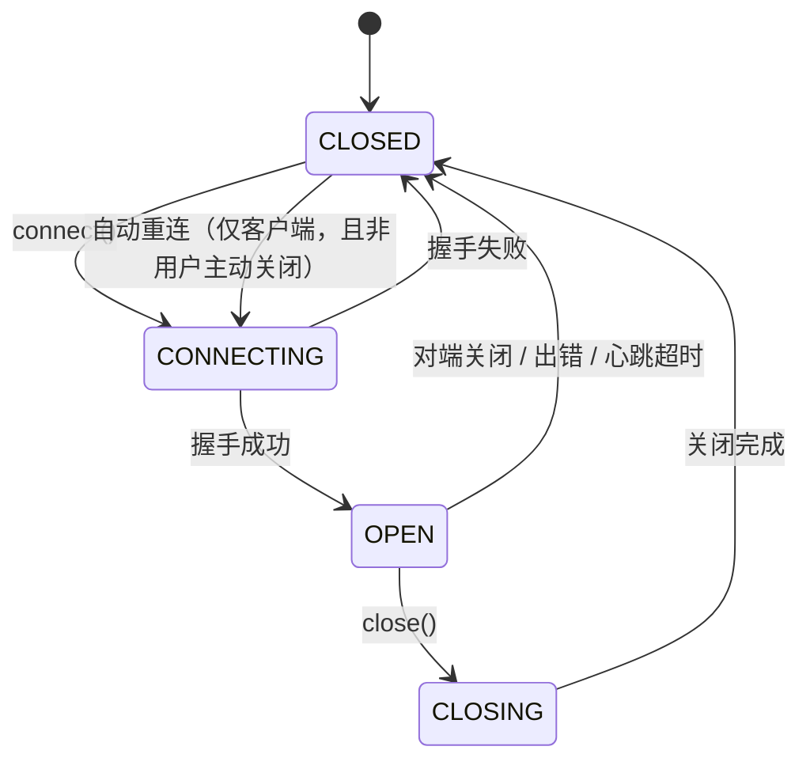
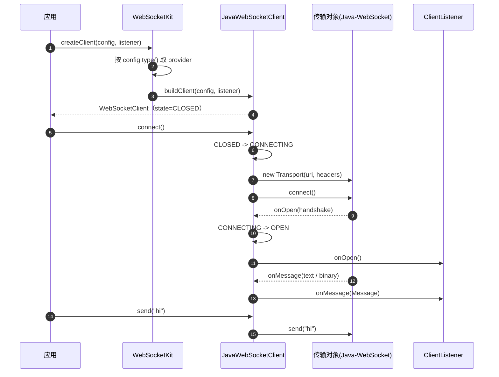
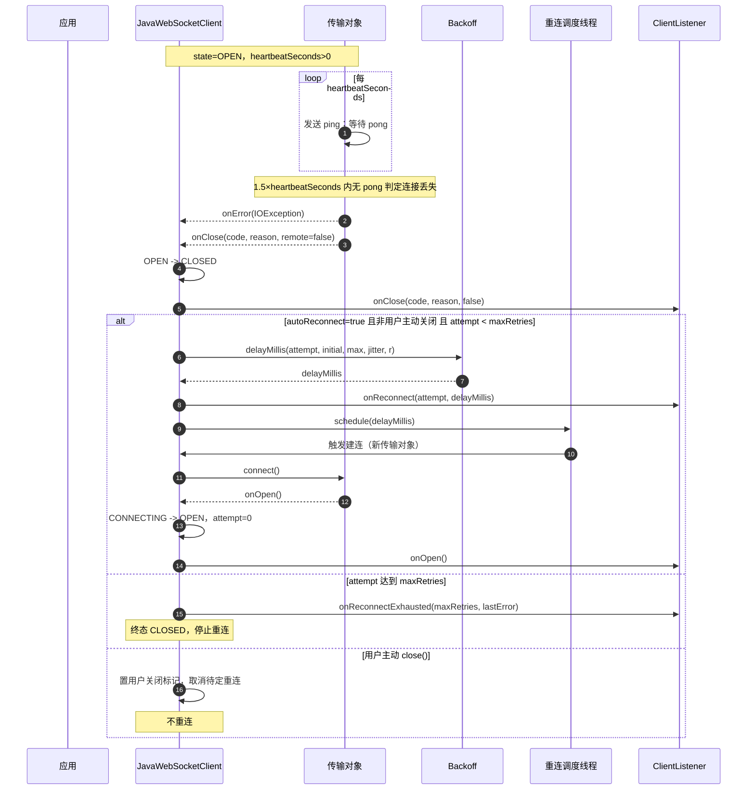
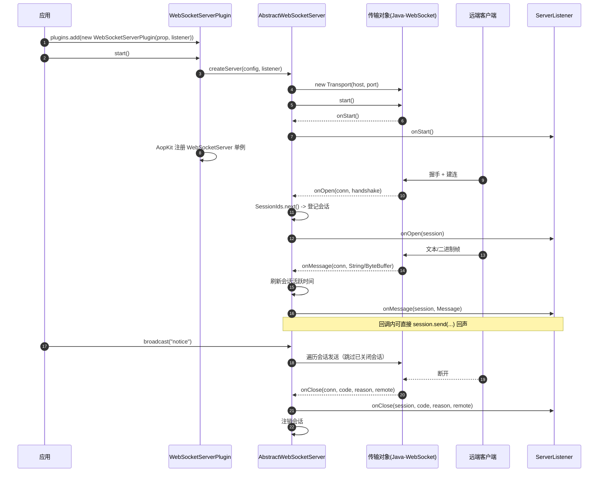
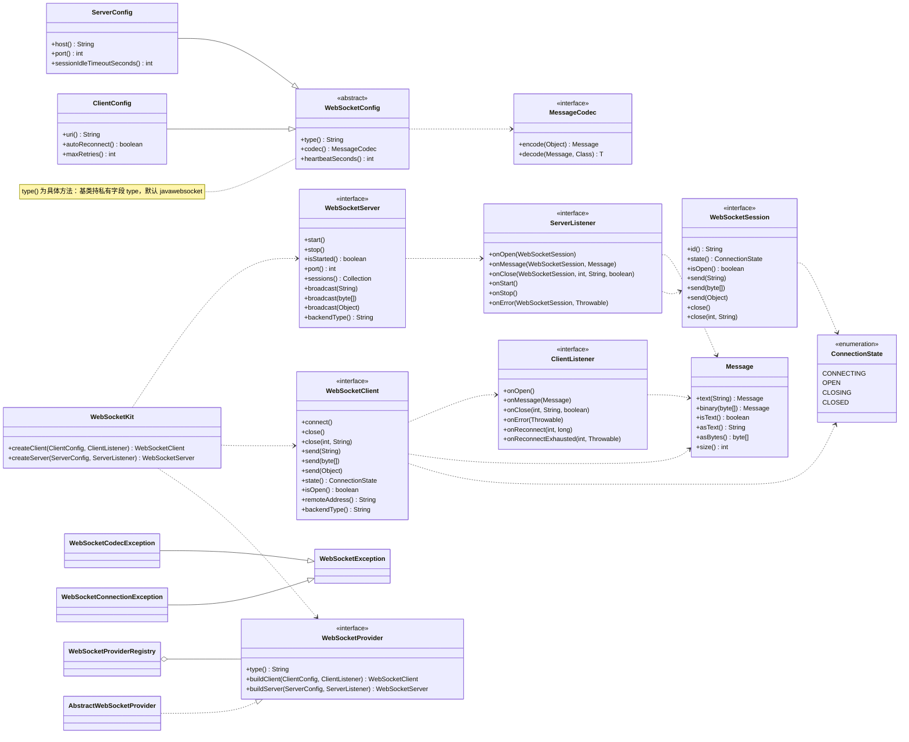

# aifei-websocket 设计文档

本文是 `aifei-websocket` 的**设计事实来源**：定位、契约、决策与验收以本文为准。面向使用者（安装 / 用法 / 配置）的说明另见 `README.md`；面向开发代理的约束另见模块 `AGENTS.md`。

> **文档状态**：1.0.0 已实现，**尚未发布到任何仓库**。行为语义分两类：**已定档**（§11 的裁决结论，尚未发布；发布后冻结）与**可自主演进**（未定档的其余行为）。已定档项在发布前如需变更，**必须先更新 §11** 并进入新的设计决策。

---

## 1. 模块定位与设计原则

### 1.1 定位

`aifei-websocket` 是 Aifei 的**基础能力模块**：为 Aifei 应用补齐框架未覆盖的 WebSocket 基础能力，含两个子能力：

- **client（客户端能力）**：应用主动出站连接第三方 WS 服务，含心跳保活与自动重连。
- **server（服务端能力）**：Aifei 应用接收 WS 连接，管理会话与广播。

**WebSocket 不在 Aifei 框架白名单内**（依据 `.codebuddy/skills/aifei-dev/references/capability-scope.md`：框架自身零第三方依赖、服务端为 Undertow）。因此本模块是**自研能力模块**：第三方传输库一律 `optional`，公共 API 零第三方类型、零框架类型。

### 1.2 为什么「双向合一模块」

客户端与服务端**共享**下列资产，拆成两个 Maven 模块会导致这些资产被复制或需要第三块公共模块：

| 共享资产 | 说明 |
| --- | --- |
| 消息模型 | `Message`（文本 + 二进制统一承载）两端完全一致 |
| 编解码 SPI | `MessageCodec` 两端同一契约 |
| 传输后端扩展点 | `WebSocketProvider` / 注册表：一个后端（如 Java-WebSocket）同时提供 client 与 server |
| 异常模型 | 同一条「用户错误 / 运行态故障」分线 |
| 连接状态与生命周期约定 | `ConnectionState`、线程与回调约定两端一致 |

因此：**同一 Maven 模块、两个包域（`client` 语义落在根包接口 + `javawebsocket` 实现）、两个独立装配入口**（`WebSocketClientPlugin` / `WebSocketServerPlugin`）。二者**不共用一个接口**：客户端是"主动发起并维持出站连接"，服务端是"被动接收并管理会话"，语义不同，硬塞进一个接口会迫使实现方实现一半方法。

### 1.3 为什么多后端可替换

传输后端（Java-WebSocket / 未来的 Netty、Undertow、自研）属于**可替换的基础设施**，与 aifei-cache 的 Caffeine / Jedis 同类。因此：

- 默认只带 **Java-WebSocket** 一个后端；
- 提供 provider 扩展点 + 注册表（对齐 aifei-cache 的 `CacheProvider` / `CacheProviderRegistry` / `AbstractCacheProvider`）；
- **新增后端 = 新增一个 provider 实现 + 注册表静态初始化里注册一行**，不回头改装配逻辑。

### 1.4 公共面收敛纪律（硬约束）

| # | 纪律 |
| --- | --- |
| 1 | **公共 API 零第三方类型**：`org.java_websocket.*` 只允许出现在 `cn.hg.aifei.websocket.javawebsocket` 包 |
| 2 | **公共 API 零框架类型**：`cn.aifei.*`（除本模块 `cn.hg.aifei.websocket.*`）只允许出现在 `cn.hg.aifei.websocket.aifei` 接入包 |
| 3 | 根包公共类型**逐个列出并说明职责**；新增公共类型必须先过设计决策 |
| 4 | 第三方依赖一律 `<optional>true</optional>`，由消费方按需自带 |
| 5 | Java 8 语法与 API；主 JAR class major version = 52 |
| 6 | 每类规则只有一个定义点（校验 / 退避 / 状态迁移 / 回调保护 / 会话登记 / 编解码） |

> 第 1、2 条由**架构门禁测试** `ArchitectureBoundaryTest` 强制（见 §6.8 与 §10），不得放宽或绕过。

### 1.5 设计原则六条

1. **接口极简、实现无关**：使用者只依赖根包接口与 `WebSocketKit` 工厂；通过 `@Inject` 取装配好的实例。
2. **实现可替换**：换后端只改配置 `websocket.{client|server}.type`，不改业务代码。
3. **双向解耦**：client 与 server 各自独立装配、独立生命周期，只装其中一个不需要另一个。
4. **行为契约可测**：状态机、退避、重连联动、空闲回收等全部精确到「可写断言」的程度。
5. **保持极简**：不做未被需求驱动的抽象；一次性的小能力不引入多余层次。
6. **兼容 Java 8**：代码、依赖与公开 API 均以 Java 8 为基线。

---

## 2. 术语表

对齐 aifei-cache「实例名 / 缓存名 / 命名空间」三层命名的清晰度，本模块各层各管一件事：

| 术语 | 含义 | 归属 |
| --- | --- | --- |
| **子能力名** | `client` / `server`：模块内的两个子能力 | §1.1 |
| **传输后端名** | 配置项 `websocket.{client\|server}.type` 的取值，本模块默认 `javawebsocket` | provider 注册表 |
| **消息** | `Message`：一次 WS 数据载荷，文本或二进制二选一 | 根包 |
| **编解码器** | `MessageCodec`：业务对象 ↔ `Message` 的转换实现，由消费方注入 | `spi` |
| **会话** | `WebSocketSession`：服务端侧一条已建立的连接 | 根包 |
| **会话标识** | `WebSocketSession.id()`：服务端实例内唯一、连接存续期间稳定的字符串 | 实现层生成 |
| **连接状态** | `ConnectionState`：`CONNECTING` / `OPEN` / `CLOSING` / `CLOSED`，客户端与会话共用 | 根包 |
| **心跳** | RFC6455 ping/pong **控制帧**，由传输后端按 `heartbeatSeconds` 自动收发；不进入 `Message` | 传输后端 |
| **探活超时** | 传输后端在 `1.5 × heartbeatSeconds` 内未收到 pong 即判定连接丢失并关闭 | 传输后端 |
| **自动重连** | 客户端在连接丢失后按**指数退避 + 抖动**重新建连；**用户主动 `close()` 不触发** | 客户端 |
| **空闲会话** | 服务端侧长时间未收到任何入站帧的会话，按 `sessionIdleTimeoutSeconds` 回收 | 服务端 |

> 术语在 README、design、AGENTS、代码注释中必须一致，不得各写一套叫法。

---

## 3. 包结构设计

```
cn.hg.aifei.websocket                    根包：公共 API（零第三方类型 / 零框架类型）
cn.hg.aifei.websocket.spi                扩展点：编解码 SPI + 传输后端 SPI（零第三方类型 / 零框架类型）
cn.hg.aifei.websocket.internal           非承诺 API：跨后端共享逻辑与工具
cn.hg.aifei.websocket.javawebsocket      实现包：Java-WebSocket 后端（★ 唯一允许出现 org.java_websocket.* 的包）
cn.hg.aifei.websocket.aifei              接入包：aifei 装配入口（★ 唯一允许出现 cn.aifei.* 框架类型的包）
```

### 3.1 根包公共类型（14 个，逐个说明职责）

| 类型 | 修饰 | 职责 |
| --- | --- | --- |
| `WebSocketClient` | interface | 客户端能力接口：建连 / 发消息 / 关闭 / 状态自述 |
| `ClientListener` | interface | 客户端回调：`onOpen` / `onMessage` / `onClose` / `onError` + 重连事件 |
| `WebSocketServer` | interface | 服务端能力接口：启停 / 会话集合 / 广播 |
| `ServerListener` | interface | 服务端回调：服务器级 + 会话级（会话随回调传入，不另立 `SessionListener`） |
| `WebSocketSession` | interface | 服务端侧单条连接：标识 / 状态 / 收发 / 关闭 |
| `ConnectionState` | enum | 连接状态枚举，客户端与会话共用 |
| `Message` | final class | 文本 + 二进制统一消息载体（不可变） |
| `WebSocketConfig` | abstract class | 两端公共配置：后端类型 / 编解码器 / 心跳 |
| `ClientConfig` | final class | 客户端配置：URI / 连接超时 / 自动重连参数 / 请求头 |
| `ServerConfig` | final class | 服务端配置：监听地址 / 端口 / 空闲回收 / 连接参数 |
| `WebSocketException` | class | 运行态故障**基类**（非用户错误） |
| `WebSocketConnectionException` | class | 建连、传输、收发失败（运行态故障） |
| `WebSocketCodecException` | class | 编解码失败（运行态故障） |
| `WebSocketKit` | final class | 程序化工厂：由 `ClientConfig` / `ServerConfig` 创建客户端 / 服务端（免 Prop、免框架） |

### 3.2 `spi` 包（3 个）

| 类型 | 职责 |
| --- | --- |
| `MessageCodec` | 编解码 SPI：业务对象 ↔ `Message`；由消费方实现并注入 |
| `WebSocketProvider` | 传输后端 SPI：`type()` + `buildClient` + `buildServer` |
| `AbstractWebSocketProvider` | provider 装配基类：无状态、承载公共装配校验（配置非空、类型一致） |

### 3.3 `internal` 包（非承诺 API，8 个）

| 类型 | 职责 |
| --- | --- |
| `AbstractWebSocketClient` | **跨后端共享的客户端骨架**：状态机、发送前置校验、回调保护、自动重连编排（退避 + 调度）；子类只实现传输钩子；对象编解码经 `MessageCodecs` |
| `AbstractWebSocketServer` | **跨后端共享的服务端骨架**：会话登记 / 注销、广播、空闲回收调度、回调保护；子类只实现传输钩子；对象编解码经 `MessageCodecs` |
| `WebSocketProviderRegistry` | 后端注册表：`type` → 无状态 provider（组合根，引用 `javawebsocket` 包） |
| `Backoff` | 指数退避 + 抖动的**纯函数**（可独立单测） |
| `ListenerGuard` | 回调保护：吞掉监听器异常并转投 `onError`，保证不污染传输线程 |
| `SessionIds` | 会话标识生成（进程内唯一） |
| `WebSocketValidator` | 参数 / 配置校验的**唯一定义点**（完整方法清单见 §10 B2） |
| `MessageCodecs` | 业务对象 → `Message` 的编码入口，`send(Object)` / `broadcast(Object)` 的**唯一编解码定义点** |

### 3.4 实现包 `javawebsocket`（5 个）

| 类型 | 职责 |
| --- | --- |
| `JavaWebSocketProvider` | 后端装配：由配置构造 Java-WebSocket 后端实现 |
| `JavaWebSocketClient` | 客户端实现：继承 `AbstractWebSocketClient`，包装 Java-WebSocket 客户端（**每次建连新建传输对象**） |
| `JavaWebSocketServer` | 服务端实现：继承 `AbstractWebSocketServer`，包装 Java-WebSocket 服务端 |
| `JavaWebSocketSession` | 会话实现：包装 Java-WebSocket `WebSocket` |
| `JavaWebSocketSupport` | 适配工具：`ReadyState` ↔ `ConnectionState` 映射、`ByteBuffer` → `byte[]` 拷贝、正常关闭码取值、地址格式化 |

### 3.5 接入包 `aifei`（3 个）

| 类型 | 修饰 | 职责 |
| --- | --- | --- |
| `WebSocketClientPlugin` | public | 客户端装配入口：读 `Prop` → 构建 → 建连 → `@Inject` 注册 |
| `WebSocketServerPlugin` | public | 服务端装配入口：读 `Prop` → 构建 → 启动 → `@Inject` 注册 |
| `WebSocketConfigLoader` | 包级私有 | `Prop` → `WebSocketConfig` 的**唯一定义点**（键名与解析集中于此） |

### 3.6 第三方类型 / 框架类型的允许包（门禁断言对象）

| 类型族 | 允许出现的包 | 断言 |
| --- | --- | --- |
| `org.java_websocket.*` | 仅 `cn.hg.aifei.websocket.javawebsocket` | `ArchitectureBoundaryTest#thirdPartyOnlyInImplPackage` |
| `cn.aifei.*`（除 `cn.hg.aifei.websocket.*`） | 仅 `cn.hg.aifei.websocket.aifei` | `ArchitectureBoundaryTest#frameworkOnlyInBridgePackage` |
| `io.undertow.*` / `java.sql.*` | **全模块禁止** | `ArchitectureBoundaryTest#noUndertowOrSqlReference` |
| 接入包 `cn.hg.aifei.websocket.aifei`（存在性） | 必须存在且非空（`WebSocketClientPlugin.java` / `WebSocketServerPlugin.java` 齐备） | `ArchitectureBoundaryTest#aifeiBridgePackageExists` |

---

## 4. 公共接口契约

> 全部签名以 **Java 8** 为准。公共成员必须书写 javadoc（`@param` / `@return` / `@throws`），本文只给契约要点。

### 4.1 客户端：`WebSocketClient`

```java
public interface WebSocketClient {

    void connect();

    void close();

    void close(int code, String reason);

    void send(String text);

    void send(byte[] bytes);

    void send(Object payload);

    ConnectionState state();

    boolean isOpen();

    String remoteAddress();

    String backendType();
}
```

**契约**

- `connect()`：**异步**。立即返回，建连结果经 `ClientListener` 回调。状态 `CLOSED → CONNECTING →`（成功）`OPEN` /（失败）`CLOSED`。
  - 允许从 `CLOSED`（含初始态、以及先前被关闭后）发起；**重复**在 `CONNECTING` / `OPEN` / `CLOSING` 期间调用抛 `IllegalStateException`（用户错误）。
  - 每次调用都**新建传输对象**（底层库的客户端对象不可复用）。
- `close()`：**异步、幂等**。发出正常关闭握手（关闭码 `1000`），状态 `→ CLOSING → CLOSED`；已在 `CLOSED` 时为无操作；在 `CONNECTING` 期间调用则中止本次建连并回到 `CLOSED`。**`close()` 之后不得再触发自动重连**。
- `close(int code, String reason)`：带关闭码与原因的关闭。`code` 必须在 `[1000, 4999]`，否则抛 `IllegalArgumentException`。
- `send(String)` / `send(byte[])`：**仅 `OPEN` 时成功**；否则抛 `IllegalStateException`（用户错误），消息**不进任何队列、被丢弃**。参数为 `null` 抛 `IllegalArgumentException`。
- `send(Object payload)`：经 `internal.MessageCodecs` 用配置的 `MessageCodec` 编码为 `Message` 再发送；未配置编解码器时抛 `IllegalStateException`（aifei 装配路径由 §4.12 的 3 参构造器配置）；编码失败抛 `WebSocketCodecException`。
  - `payload` 为 `null` 抛 `IllegalArgumentException`。
- `state()`：当前连接状态（见 §6.4）。
- `isOpen()`：`state() == OPEN` 的便捷方法。
- `remoteAddress()`：远端地址的字符串形式（如 `192.0.2.10:54321`）；未连接返回 `null`。
- `backendType()`：后端类型自述（配置 `type`），如 `"javawebsocket"`。
- **线程安全**：本接口所有方法可从任意线程调用（含回调线程，见 §6.7）。
- **阻塞等待**：不提供 `connectBlocking` / `closeBlocking`；调用方用 `ClientListener` + `CountDownLatch` 自行等待（README 给出示例）。

### 4.2 客户端回调：`ClientListener`

```java
public interface ClientListener {

    void onOpen();

    void onMessage(Message message);

    void onClose(int code, String reason, boolean remote);

    void onError(Throwable error);

    default void onReconnect(int attempt, long delayMillis) {
    }

    default void onReconnectExhausted(int attempts, Throwable lastError) {
    }
}
```

**契约**

- `onOpen`：连接（含重连）建立成功时触发一次；**每次成功建连都会触发**。
- `onMessage`：收到一条文本或二进制数据帧时触发；参数永不为 `null`。
- `onClose`：连接关闭时触发一次。`remote` 为 `true` 表示由对端发起。**无论是否重连、无论用户主动还是异常（含初始握手失败），都恰好触发一次**；所有连接尝试的终结都走同一条关闭收敛路径，无可用关闭帧时 `code = -1`。
- `onError`：运行态故障（连接失败、传输 IO 错误、协议错误）触发；参数为 `WebSocketConnectionException`（对底层异常类型的包装，**不外泄第三方类型**）。
- `onReconnect(int attempt, long delayMillis)`：**默认空实现**。即将进行第 `attempt` 次重连（从 `1` 起）且已算出退避时长 `delayMillis` 时触发。
- `onReconnectExhausted(int attempts, Throwable lastError)`：**默认空实现**。连续 `attempts` 次重连仍失败、放弃重连时触发一次；此后不再重试，直到再次显式 `connect()`。
- **触发次序**：一次连接丢失的完整回调次序为 `onError`（若有）`→ onClose → onReconnect`（若重连）`→`（成功）`onOpen` /（耗尽）`onReconnectExhausted`。
- **监听器异常**：回调内抛出的异常被 `ListenerGuard` 捕获并转投 `onError`，**不传播到传输线程**（后续回调不受影响）。

### 4.3 服务端：`WebSocketServer`

```java
public interface WebSocketServer {

    void start();

    void stop();

    boolean isStarted();

    int port();

    Collection<WebSocketSession> sessions();

    void broadcast(String text);

    void broadcast(byte[] bytes);

    void broadcast(Object payload);

    String backendType();
}
```

**契约**

- `start()`：绑定并开始接受连接。`CONFIG` 中 `port = 0` 表示由系统分配随机端口，实际端口经 `port()` 读取。重复 `start()` 抛 `IllegalStateException`。
- `stop()`：停止接受新连接，向全部会话发出关闭帧（关闭码 `1001`，即 RFC6455 的 GOING_AWAY）并释放监听端口。**幂等**；未启动时为无操作。底层 `InterruptedException` 被包装为 `WebSocketException`（不抛受检异常）。
- `isStarted()`：是否已启动且未停止。
- `port()`：实际绑定端口；未启动返回 `0`。
- `sessions()`：当前**已登记**会话的**不可变快照**；可能包含正在关闭中的会话。
- `broadcast(String)` / `broadcast(byte[])`：向**全部会话**广播；对**已关闭会话静默跳过**（不抛异常）。无会话时为无操作。参数为 `null` 抛 `IllegalArgumentException`。
- `broadcast(Object payload)`：经 `internal.MessageCodecs` 用服务端配置的编解码器编码后广播；未配置编解码器抛 `IllegalStateException`（aifei 装配路径由 §4.12 的 3 参构造器配置）；编码失败抛 `WebSocketCodecException`；`payload` 为 `null` 抛 `IllegalArgumentException`。
- `backendType()`：后端类型自述。
- **线程安全**：所有方法可从任意线程调用；**禁止在服务端回调内调用 `stop()`**（见 §6.7）。

### 4.4 服务端回调：`ServerListener`

```java
public interface ServerListener {

    void onOpen(WebSocketSession session);

    void onMessage(WebSocketSession session, Message message);

    void onClose(WebSocketSession session, int code, String reason, boolean remote);

    default void onStart() {
    }

    default void onStop() {
    }

    default void onError(WebSocketSession session, Throwable error) {
    }
}
```

**契约**

- `onOpen`：新会话登记完成、可收发后触发一次。
- `onMessage`：该会话收到一条数据帧时触发；典型的"回声"写法（在回调内 `session.send(text)`）安全。
- `onClose`：会话注销前触发一次；`session` 仍可读取 `id()` / `remoteAddress()`，但 `send` 会失败。
- `onStart()`：**默认空实现**。服务端绑定成功、开始接受连接时触发。
- `onStop()`：**默认空实现**。服务端停止完成后触发。
- `onError(WebSocketSession session, Throwable error)`：**默认空实现**。`session` 为相关会话；服务器级错误（`session == null`）时也为 `null`。
- **不设独立 `SessionListener`**：会话级回调全部随 `session` 参数传入，独立接口会复制全部签名而无额外能力。
- **监听器异常**：同 `ClientListener`，由 `ListenerGuard` 捕获并转投 `onError`。

### 4.5 会话：`WebSocketSession`

```java
public interface WebSocketSession {

    String id();

    ConnectionState state();

    boolean isOpen();

    String remoteAddress();

    void send(String text);

    void send(byte[] bytes);

    void send(Object payload);

    void close();

    void close(int code, String reason);
}
```

**契约**

- `id()`：本服务端实例内唯一、连接存续期间稳定的标识（实现层生成，格式不承诺）。
- `state()` / `isOpen()`：该会话的连接状态；语义与客户端同源。
- `remoteAddress()`：远端地址字符串；不可用时返回 `null`。
- `send*`：**仅 `OPEN` 时成功**，否则抛 `IllegalStateException`；语义与 `WebSocketClient#send*` 一致（含 `send(Object)` 经 `MessageCodecs` 的编码规则）；`send(String)` / `send(byte[])` 参数为 `null` 抛 `IllegalArgumentException`。
- `close()` / `close(int, String)`：关闭该会话；幂等；语义与客户端 `close*` 一致（关闭码范围 `[1000, 4999]`）。服务端侧**不做自动重连**。

### 4.6 连接状态：`ConnectionState`

```java
public enum ConnectionState {
    CONNECTING,
    OPEN,
    CLOSING,
    CLOSED
}
```

- 客户端与会话**共用**同一枚举。
- 语义与 W3C / RFC6455 一致：`CONNECTING`（握手进行中）、`OPEN`（可收发）、`CLOSING`（关闭握手进行中）、`CLOSED`（已关闭或从未连接）。
- > **命名说明（已定档）**：需求草案取名 `ClientState`。本设计统一为 `ConnectionState` 以同时服务客户端与服务端会话、避免两个近义枚举，**不另立 `SessionState`**（定档见 §11，尚未发布；发布后冻结）。

### 4.7 消息：`Message`

```java
public final class Message {

    public static Message text(String text);

    public static Message binary(byte[] bytes);

    public boolean isText();

    public String asText();

    public byte[] asBytes();

    public int size();
}
```

**契约**

- **不可变**：`binary(byte[])` 对入参做**防御性拷贝**，`asBytes()` 返回**副本**；`text(String)` 要求非 `null`。
- `isText()`：是否为文本消息。
- `asText()`：返回文本内容；**二进制消息时抛 `IllegalStateException`**。
- `asBytes()`：返回二进制内容；**文本消息时抛 `IllegalStateException`**。
- `size()`：载荷字节数（文本为 UTF-8 编码后长度）。
- `equals` / `hashCode` / `toString` 按「类型 + 内容」实现，便于测试断言。
- **零第三方类型**：不暴露 `ByteBuffer`、不暴露任何 JSON 库类型。

### 4.8 编解码 SPI：`MessageCodec`

```java
public interface MessageCodec {

    Message encode(Object payload);

    <T> T decode(Message message, Class<T> type);
}
```

**契约**

- `encode`：业务对象 → 线缆消息（文本或二进制由实现决定）。`payload` 为 `null` 抛 `IllegalArgumentException`；编码失败抛 `WebSocketCodecException`。
- `decode`：线缆消息 → 业务对象。`message` 或 `type` 为 `null` 抛 `IllegalArgumentException`；解码失败抛 `WebSocketCodecException`。
- **本模块不内置任何 JSON 实现**（不引入 fastjson2 / jackson）。消费方自行实现（例如基于 `aifei-json`），经 `ClientConfig#setCodec` / `ServerConfig#setCodec` 注入。契约签名不含第三方类型，因此实现类可用任意库。

### 4.9 配置：`WebSocketConfig` / `ClientConfig` / `ServerConfig`

```java
public abstract class WebSocketConfig {

    // 基类持私有字段 type（默认 "javawebsocket"）；type() 为具体方法，setType 写该字段

    public String type();

    public MessageCodec codec();

    public int heartbeatSeconds();

    public WebSocketConfig setType(String type);

    public WebSocketConfig setCodec(MessageCodec codec);

    public WebSocketConfig setHeartbeatSeconds(int seconds);
}
```

- `type`：传输后端名，对应 `websocket.{client|server}.type`。**基类具体方法**（非 `abstract`），返回基类私有字段 `type`；默认 `"javawebsocket"`。`setType` 写该字段并返回 `this`（返回类型仍为 `WebSocketConfig`）；基类仍为 `abstract class`，不可直接实例化。
- `codec`：编解码器，可为 `null`（表示不使用对象编解码）。**两条注入路径**：程序化（`WebSocketKit`）经 `setCodec` 注入；aifei 装配路径经 §4.12 的 **3 参构造器**注入（`WebSocketConfigLoader` 不解析 codec）。
- `heartbeatSeconds`：心跳间隔（秒），`0` 表示禁用。取值范围 `[0, 2147483]`（对齐底层库以秒为单位的连接丢失检测上限；超限抛 `IllegalArgumentException`）。

```java
public final class ClientConfig extends WebSocketConfig {

    // uri (String, 必填, ws:// 或 wss://)
    // connectTimeoutMillis (int, 默认 5000, 范围 [1, ...])
    // autoReconnect (boolean, 默认 false)
    // maxRetries (int, 默认 5, 范围 [1, 2147483])          连续失败重试上限
    // initialRetryDelayMillis (long, 默认 500, 范围 [1, ...])
    // maxRetryDelayMillis (long, 默认 30000, 范围 [>= initialRetryDelayMillis])
    // retryJitterRatio (double, 默认 0.2, 范围 [0.0, 1.0])
    // headers (Map<String,String>, 默认空; 握手附加请求头)

    public String uri();
    public ClientConfig setUri(String uri);
    public int connectTimeoutMillis();
    public ClientConfig setConnectTimeoutMillis(int millis);
    public boolean autoReconnect();
    public ClientConfig setAutoReconnect(boolean autoReconnect);
    public int maxRetries();
    public ClientConfig setMaxRetries(int maxRetries);
    public long initialRetryDelayMillis();
    public ClientConfig setInitialRetryDelayMillis(long millis);
    public long maxRetryDelayMillis();
    public ClientConfig setMaxRetryDelayMillis(long millis);
    public double retryJitterRatio();
    public ClientConfig setRetryJitterRatio(double ratio);
    public Map<String, String> headers();
    public ClientConfig setHeaders(Map<String, String> headers);
}
```

```java
public final class ServerConfig extends WebSocketConfig {

    // host (String, 默认 "0.0.0.0")
    // port (int, 默认 0 = 由系统分配随机端口, 范围 [0, 65535])
    // reuseAddress (boolean, 默认 true)
    // sessionIdleTimeoutSeconds (int, 默认 0 表示禁用, 范围 [0, ...])
    // maxPendingConnections (int, 默认 -1 表示不设置, 范围 [-1, 65535])

    public String host();
    public ServerConfig setHost(String host);
    public int port();
    public ServerConfig setPort(int port);
    public boolean reuseAddress();
    public ServerConfig setReuseAddress(boolean reuseAddress);
    public int sessionIdleTimeoutSeconds();
    public ServerConfig setSessionIdleTimeoutSeconds(int seconds);
    public int maxPendingConnections();
    public ServerConfig setMaxPendingConnections(int maxPendingConnections);
}
```

**契约**

- 配置对象是**可变 POJO**，但只在「构建实例」时被读取一次；构建完成后**再修改配置对象不影响已构建的实例**（等价于装配后不可变）。
- 字段级校验在 setter 内完成（`WebSocketValidator` 是唯一定义点）；跨字段校验（如 `maxRetryDelayMillis ≥ initialRetryDelayMillis`、`uri` 协议合法）在**构建时**完成。
- **`ServerConfig.port` 的「必填」语义下沉到接入层**：API 层 `port` 默认 `0`（= 由系统分配随机端口），setter 仅校验 `[0, 65535]`，**不做必填判定**；配置键 `websocket.server.port` 缺失时由 `WebSocketConfigLoader` 抛错，表现为**应用启动失败**（见 §4.12）。

### 4.10 工厂：`WebSocketKit`

```java
public final class WebSocketKit {

    public static WebSocketClient createClient(ClientConfig config, ClientListener listener);

    public static WebSocketServer createServer(ServerConfig config, ServerListener listener);

    private WebSocketKit() {
    }
}
```

**契约**

- 由 `config.type()` 从注册表取 provider 并构建实例（与装配入口走同一条路径）。
- `config` / `listener` 为 `null` 抛 `IllegalArgumentException`；后端类型未注册抛 `IllegalArgumentException`（消息含已注册类型集合）。
- 返回的实例**不会自动 `connect` / `start`**：由调用方决定（装配入口会替你 connect / start）。
- 供「非 aifei 环境」或「程序化、多连接」场景使用；**程序化路径可自行创建任意多个实例**（多连接 / 多实例定档：本期 aifei 装配路径为单客户端 + 单服务端，不引入实例名与 `use(name)` 门面，见 §11，尚未发布；发布后冻结）。
- **对象编解码**经 `config.setCodec(...)` 注入；未配置时 `send(Object)` / `broadcast(Object)` 按 §4.1 / §4.3 抛 `IllegalStateException`（aifei 装配路径由 §4.12 的 3 参构造器配置）。

### 4.11 异常模型

```
RuntimeException
└─ WebSocketException                （运行态故障基类）
   ├─ WebSocketConnectionException   （建连 / 传输 / 收发失败）
   └─ WebSocketCodecException        （编解码失败）
```

**用户错误 vs 运行态故障的分线**

| 类别 | 异常 | 触发场景（示例） |
| --- | --- | --- |
| **用户错误** | `IllegalArgumentException` | 参数为 `null`、`uri` 协议非法、`port` 越界、`retryJitterRatio` 越界、关闭码越界、后端类型未注册 |
| **用户错误** | `IllegalStateException` | 重复 `connect`、`send` 时非 `OPEN`、未配置编解码器却调 `send(Object)`、`Message.asText()` 类型不符、重复 `start` |
| **运行态故障** | `WebSocketConnectionException` | 建连失败、传输 IO 错误、协议错误、`send` 时传输层报错 |
| **运行态故障** | `WebSocketCodecException` | `MessageCodec.encode` / `decode` 抛错 |
| **运行态故障** | `WebSocketException` | 其它运行态故障（如 `stop` 时的线程中断包装） |

- **不外泄第三方异常**：底层库的 `WebsocketNotConnectedException`、`IOException` 等一律包装为上述类型后再交给调用方或 `onError`。
- 异常消息中**不得**包含任何第三方类型名（保证公共面零第三方类型）。

### 4.12 装配入口：两个 `Plugin`

```java
public class WebSocketClientPlugin implements cn.aifei.plugin.Plugin {

    // 2 参：不使用对象编解码（语义等价 codec = null）
    public WebSocketClientPlugin(Prop prop, ClientListener listener);

    // 3 参：注入 MessageCodec（对象编解码）
    public WebSocketClientPlugin(Prop prop, ClientListener listener, MessageCodec codec);
}
```

```java
public class WebSocketServerPlugin implements cn.aifei.plugin.Plugin {

    // 2 参：不使用对象编解码（语义等价 codec = null）
    public WebSocketServerPlugin(Prop prop, ServerListener listener);

    // 3 参：注入 MessageCodec（对象编解码）
    public WebSocketServerPlugin(Prop prop, ServerListener listener, MessageCodec codec);
}
```

**论证：为什么是两个入口而不是一个 `WebSocketPlugin`**

- 两个子能力**生命周期独立**：只出站连第三方服务的应用不需要监听端口；只做服务端的应用不需要出站连接。合成一个入口会强制二者同时配置。
- 配置域独立：`websocket.client.*` 与 `websocket.server.*` 互不依赖。
- 与 aifei-cache「一个 `Plugin` = 一件被装配的事」的粒度一致：这里就是「装配一个客户端」+「装配一个服务端」两件事。
- **每个入口各有 2 参 / 3 参两个构造器**：监听器与编解码器都是**对象引用**（`Prop` 里表达不了），因此都走构造参数；3 参版用于注入 `MessageCodec`。

**`Plugin` 契约（对齐 aifei-cache，均实测自框架源码 `cn.aifei.plugin.Plugin`：仅 `start()` / `stop()` 两个方法）**

- 构造函数**只保留 `Prop` / 监听器 / 编解码器的引用**（仅守卫 `null`），不解析、不校验、不建连、不监听端口，也不把 `codec` 写进配置对象；配置错误的表现是**应用启动失败**。
- `websocket.server.port` 为**接入层必填键**：缺失时由 `WebSocketConfigLoader` 抛错，表现为**应用启动失败**（API 层 `port` 默认 `0` 表示随机端口，见 §4.9；「必填」只在接入层施加）。
- `start()` 内：解析配置 → **若 `codec != null` 则先 `setCodec` 进配置对象** → 取 provider → 构建实例 → **建连（客户端）/ 启动（服务端）** → 写入 `AopKit` 单例（使 `@Inject WebSocketClient` / `@Inject WebSocketServer` 生效）。
- `start()` / `stop()` **幂等**；`stop()` 关闭对应实例。
- 客户端监听器 / 服务端监听器分别为**构造参数**（配置里表达不了对象引用）；这是本模块相对 aifei-cache 的唯一形态差异。
- **单实例已定档**：aifei 装配路径每类注册**一个**单例（`@Inject WebSocketClient` / `@Inject WebSocketServer` 各一个），**不引入实例名与 `use(name)` 门面**；多连接 / 多实例场景走 `WebSocketKit` 程序化路径（见 §11，尚未发布；发布后冻结）。
- **`MessageCodec` 同属对象引用，走同一条路**：两个 `Plugin` 各提供 **2 参 / 3 参两个构造器**：
  - `(Prop prop, XxxListener listener)`：**语义等价于 `codec = null`**（不使用对象编解码）；此路径下 `send(Object)` / `broadcast(Object)` 会因未配置编解码器而抛 `IllegalStateException`。
  - `(Prop prop, XxxListener listener, MessageCodec codec)`：用于注入 `MessageCodec`。**若在 aifei 装配路径需要对象编解码，必须使用 3 参构造器**。
- `WebSocketConfigLoader` **不解析 codec**（codec 不由 `Prop` 表达），其 `codec()` 恒为 `null`；上述「编解码相关」断言的唯一展开点在本节，§4.1 / §4.3 / §6.5 只做指向。

---

## 5. provider 扩展点设计

### 5.1 `WebSocketProvider`（`spi` 包）

```java
public interface WebSocketProvider {

    String type();

    WebSocketClient buildClient(ClientConfig config, ClientListener listener);

    WebSocketServer buildServer(ServerConfig config, ServerListener listener);
}
```

- **统一为一个 provider 接口**（而非 `ClientProvider` + `ServerProvider`）：使「新增后端 = 一个实现 + 注册表一行」成立；一个传输家族（如 Java-WebSocket）天然同时提供两端。
- 签名中**只有本模块类型**，无第三方类型、无框架类型。
- **统一单接口已定档**；若未来出现「只能做一端」的后端，由其对应方法抛 `WebSocketException` 表达，**如未来出现再走一次设计决策**（定档见 §11，尚未发布；发布后冻结）。

### 5.2 `AbstractWebSocketProvider`（`spi` 包）

```java
public abstract class AbstractWebSocketProvider implements WebSocketProvider {

    @Override
    public abstract String type();

    @Override
    public abstract WebSocketClient buildClient(ClientConfig config, ClientListener listener);

    @Override
    public abstract WebSocketServer buildServer(ServerConfig config, ServerListener listener);

    protected final void requireConfig(WebSocketConfig config);

    protected final void requireTypeMatches(WebSocketConfig config);
}
```

- 只承载公共装配校验（配置非空、`config.type()` 与 `provider.type()` 一致），**不得承载传输逻辑**。
- **provider 必须无状态**：不得声明实例字段保存配置或实例；配置在 `buildXxx` 内经构造参数现读现用。
- **实例由各子类在自己的 `buildXxx` 内创建**；基类不提供实例创建钩子。

### 5.3 `WebSocketProviderRegistry`（`internal` 包）

```java
public final class WebSocketProviderRegistry {

    private static final Map<String, WebSocketProvider> PROVIDERS = new LinkedHashMap<>();

    static {
        PROVIDERS.put("javawebsocket", new JavaWebSocketProvider());
    }

    public void register(String type, WebSocketProvider provider);

    public WebSocketProvider getProvider(String type);

    public Set<String> types();
}
```

- 组合根落在此处（引用 `javawebsocket` 包），**方法签名不含第三方类型**，故不破坏 `optional` 隔离。
- `type` 的允许取值由 `types()` 派生，不得硬编码到别处。
- 同类型重复注册抛 `IllegalStateException`；取未注册类型抛 `IllegalArgumentException`（消息含已注册类型集合）。

### 5.4 新增一个后端的完整步骤

1. 在 `cn.hg.aifei.websocket.<newbackend>` 包内新增 `XxxProvider extends AbstractWebSocketProvider`，实现 `type()` / `buildClient` / `buildServer`，并在此包内实现客户端 / 服务端 / 会话（第三方类型只允许出现在本实现包）。
2. 在 `WebSocketProviderRegistry` 的 `static` 初始化块里**增加一行** `PROVIDERS.put("<newbackend>", new XxxProvider());`。
3. 消费方把配置 `websocket.{client|server}.type` 改为 `<newbackend>`，并自带该后端所需的第三方依赖。

> **不得**回头修改 `WebSocketKit`、两个 `Plugin` 或注册表之外的任何装配逻辑。

---

## 6. 行为契约（本次设计重点）

### 6.1 建连与关闭语义

| 场景 | 行为 |
| --- | --- |
| 初始态（新建实例） | `state() == CLOSED`；未发起任何连接 |
| `connect()`（`CLOSED` 时） | `CLOSED → CONNECTING`，异步建连；成功 `→ OPEN` 并触发 `onOpen`，失败 `→ CLOSED` 并触发 `onError`（若开启自动重连则进入重连流程） |
| `connect()`（`CONNECTING` / `OPEN` / `CLOSING` 时） | 抛 `IllegalStateException` |
| 握手成功 | `CONNECTING → OPEN`，`onOpen` |
| 握手失败（含初始握手） | `CONNECTING → CLOSED`，触发 `onError`；**所有连接尝试的终结（含初始握手失败）都走同一条关闭收敛路径，保证 `onClose` 恰好一次**，自动重连据此续推；无可用关闭帧时 `code = -1` |
| `close()`（`OPEN` / `CONNECTING` 时） | `→ CLOSING → CLOSED`；置「用户主动关闭」标记，**终止一切待定的重连**；关闭完成触发 `onClose` |
| `close()`（`CLOSED` 时） | 无操作（幂等），**不再触发** `onClose` |
| `close()`（`CLOSING` 时） | 无操作（幂等） |
| 对端关闭 / 传输错误 | `OPEN → CLOSED`，触发 `onClose`（`remote=true` 表示对端发起）；非用户主动关闭且开启自动重连时进入重连 |
| `send()` 于 `CONNECTING` / `CLOSING` / `CLOSED` | 抛 `IllegalStateException`；**消息不进队列、直接丢弃**（见 §6.6） |
| `close()` 之后再次 `connect()` | 允许；`attempt` 计数复位，可重新建连（"用户主动关闭不重连"仅在 `close()` 之后**自动**生效，显式 `connect()` 不受限） |

> **关闭收敛统一路径**：无论「握手成功后关闭」还是「初始握手失败」，连接尝试的终结都收敛到同一条关闭路径，**`onClose` 恰好一次**；缺少可用关闭帧时以 `code = -1` 表达（见 §4.2）。

### 6.2 心跳保活

- **参数**：`heartbeatSeconds`（客户端与服务端各自配置）。`0` = 禁用，是本模块的**默认值**（**已定档**：默认关闭，需显式配置开启；见 §11，尚未发布；发布后冻结）。
- **机制**：由传输后端使用 RFC6455 **ping/pong 控制帧**实现，映射为底层库的「连接丢失检测」。客户端与服务端**都**以 `heartbeatSeconds` 为周期发送 ping，并期望在 **`1.5 × heartbeatSeconds`** 内收到 pong。
- **ping/pong 归属**：
  - **客户端主动 ping**：客户端按周期发出 ping，维持连接穿越代理 / NAT 的保活，并借 pong 判定服务端存活。
  - **服务端探活**：服务端同样按周期发 ping，未按时收到 pong 的会话被判为死连接并关闭。
  - **控制帧不上浮**：ping / pong **不**作为 `Message` 投递给 `onMessage`，也不产生任何监听器回调；它们是传输层的内部机制。
- **pong 计入活跃（服务端活跃刷新）**：pong 不上浮为 `Message`，但服务端实现**覆写底层非 final 的 `onWebsocketPong`** 并调用活跃刷新入口 `AbstractWebSocketServer#refreshSessionActivity`，把 pong 计入会话活跃时间（供 §6.6 空闲回收判活），使「只回 pong、不发数据帧的存活会话」不被误判。该结论的实证责任落在测试批次 **B5**：`LoopbackTest` 须包含「静默但正常回 pong 的会话在超过空闲阈值后仍未被回收」的用例；若实测发现底层未把 pong 送达该回调，须回报并据此修订本结论（不得默认成立）。
- **超时判活**：在 `1.5 × heartbeatSeconds` 内未收到对端 pong 即判定连接丢失，由传输层关闭连接（触发 `onClose`）。
- **与自动重连的联动**：连接丢失检测触发的关闭走正常 `onClose` 路径，因此**客户端在开启自动重连时会对心跳超时导致的中断执行重连**（若无心跳，则依赖 TCP 层最终报错，发现更慢）。
- **不做应用层心跳报文**（**已定档**：仅用 RFC6455 协议层 ping/pong 控制帧，不留应用层心跳扩展点；见 §11，尚未发布；发布后冻结）；`heartbeatSeconds` 的单位是**秒**（与底层库一致，避免毫秒 → 秒的取整歧义）。

### 6.3 自动重连

仅**客户端**具备；服务端不重连（会话断了就是断了）。

**参数（`ClientConfig`）与默认值**

| 参数 | 默认值 | 含义 |
| --- | --- | --- |
| `autoReconnect` | `false` | 是否自动重连（**已定档**默认关闭，显式开启；见 §11，尚未发布；发布后冻结） |
| `maxRetries` | `5` | 连续失败重试上限 |
| `initialRetryDelayMillis` | `500` | 首次重试延迟（毫秒） |
| `maxRetryDelayMillis` | `30000` | 单次重试延迟上限（毫秒） |
| `retryJitterRatio` | `0.2` | 抖动比例，取值 `[0.0, 1.0]` |

**退避算法（指数退避 + 抖动）** —— 定义点为 `internal.Backoff`：

```
delayMillis(attempt, initial, max, jitter, r)      // attempt 从 1 起；r ∈ [0.0, 1.0)
    base   = initial * 2^(attempt-1)               // 溢出保护：一旦超过 max 直接取 max
    capped = min(base, max)
    factor = 1 - jitter + 2 * jitter * r
    return round(capped * factor)
```

- 结果下界 `capped × (1 - jitter)`，上界 `capped × (1 + jitter)`；`r` 由实现的伪随机源提供（测试可注入固定序列）。
- 默认参数下（`r` 取中值）延迟序列约为：`500 / 1000 / 2000 / 4000 / 8000` 毫秒。
- **溢出保护**：`2^(attempt-1)` 在 `attempt` 较大时溢出，实现必须用「逐次左移并检查是否已 ≥ max」的方式计算，禁止直接做 `long` 位移后比较。

**重连流程与终态**

1. 连接丢失（`onClose` 且**非用户主动关闭**）且 `autoReconnect == true` 且 `attempt < maxRetries` → `attempt++`，算出 `delayMillis`，触发 `onReconnect(attempt, delayMillis)`，在客户端**自有调度线程**上延迟执行下一次 `connect()`。
2. 重连成功（`onOpen`）→ `attempt` **复位为 0**。
3. 连续失败达到 `maxRetries` → 进入**终态**：`state() == CLOSED`，触发一次 `onReconnectExhausted(maxRetries, lastError)`，**停止重连**；直到调用方**显式** `connect()`（会复位 `attempt`）才重新开始。
4. **用户主动 `close()` → 永不触发重连**（硬约束）：`close()` 置「用户主动关闭」标记并取消待定重连任务；该标记在下次显式 `connect()` 时清除。
5. 重连执行**不在传输回调线程内**（避免底层库在自身 I/O 线程内重入而失败），一律经调度线程发起。

### 6.4 连接状态机



**合法迁移表**

| 当前 | 事件 | 目标 |
| --- | --- | --- |
| `CLOSED` | `connect()` | `CONNECTING` |
| `CONNECTING` | 握手成功 | `OPEN` |
| `CONNECTING` | 握手失败 / `close()` | `CLOSED` |
| `OPEN` | `close()` | `CLOSING` |
| `OPEN` | 对端关闭 / 传输错误 / 心跳超时 | `CLOSED` |
| `CLOSING` | 关闭完成 | `CLOSED` |
| `CLOSED` | 自动重连发起 | `CONNECTING` |

**非法迁移的处理**

- `CONNECTING` / `OPEN` / `CLOSING` 期间 `connect()`：抛 `IllegalStateException`（不改变状态）。
- `CLOSED` 期间 `close()`：无操作（幂等，不抛异常）。
- 任何时刻 `send()` 而当前非 `OPEN`：抛 `IllegalStateException`（不改变状态）。
- 状态变更必须是**原子**的（实现层使用同步或原子引用）；并发事件下以「先到者胜，后到者按上表裁剪」为准则，不得出现 `OPEN` 与 `CLOSED` 同时可见以外的中间态泄漏。

### 6.5 消息收发

- **文本与二进制都支持**：`send(String)` / `send(byte[])` / 收到的 `Message` 均如此。
- **收到消息**：文本帧 → `Message.text`，二进制帧 → `Message.binary`；分片帧由底层库聚合后一次性上浮（不暴露分片概念）。
- **发送队列与背压**：**本模块不提供自有发送队列**（**已定档**：不提供自有发送队列与背压；见 §11，尚未发布；发布后冻结）。
  - `send*` 仅在 `OPEN` 时成功，否则抛 `IllegalStateException` 且消息被丢弃。
  - 是否在没有可用连接时「排队」由**调用方**决定（例如在自动重连期间，调用方自行缓冲业务消息，待 `onOpen` 后重放）。这样避免在模块内引入无界队列与背压策略。
  - 底层库自身可能对已发出的帧有写缓冲，但其语义不在本模块契约内。
- **发送失败的处理**：
  - 状态不符 → `IllegalStateException`（不进入传输层）。
  - 传输层报错（例如连接在发送瞬间中断）→ 包装为 `WebSocketConnectionException` 抛出；随后连接状态由封闭路径收敛（`onClose`）。
- `send(Object)` / `broadcast(Object)` 的编码统一经 `internal.MessageCodecs`（业务对象 → `Message` 的唯一定义点）；编码失败 → `WebSocketCodecException`，消息不发出；未配置编解码器时抛 `IllegalStateException`（aifei 装配路径由 §4.12 的 3 参构造器配置）。

### 6.6 服务端会话管理

- **会话登记**：连接握手完成后由实现层生成 `id`（`internal.SessionIds`）登记；**`onClose` 回调先触发，随后注销会话**（与会话级回调可见状态保持一致：`onClose` 内 `send` 会失败）。
- **`sessions()`**：返回当前登记会话的不可变快照。
- **广播语义**：向快照内全部会话发送；**对已关闭 / 正在关闭的会话静默跳过**（不抛异常、不中断广播）。
- **空闲会话回收**（`sessionIdleTimeoutSeconds`，默认 `0` = 禁用）：
  - 定义：「空闲」= 会话在 `sessionIdleTimeoutSeconds` 内**没有任何入站帧**（数据帧与 pong 控制帧都算活跃）。
  - **pong 计入活跃（可观测性）**：服务端实现**覆写底层 `onWebsocketPong`** 并调用活跃刷新入口 `AbstractWebSocketServer#refreshSessionActivity`，使「只回 pong、不发数据帧的存活会话」**不被**空闲回收误判。该结论的实证责任落在测试批次 **B5**：`LoopbackTest` 须包含「静默但正常回 pong 的会话在超过空闲阈值后仍未被回收」的用例；若实测发现底层未把 pong 送达该回调，须回报并据此修订本节（不得默认成立）。
  - 实现：服务端持有单线程调度器，按 `max(1, sessionIdleTimeoutSeconds)` 秒为周期扫描；某会话空闲时长 ≥ 阈值即以关闭码 `1000`（正常关闭）关闭并注销。
  - 最坏情况回收延迟约为 `2 × sessionIdleTimeoutSeconds`（扫描周期 + 阈值），此点写入 README。
  - 与心跳的关系：心跳检测的是**死连接**（不回 pong），空闲回收检测的是**活着但不说话**的连接；两者独立、可同时启用。

### 6.7 统一约定（线程 / 回调 / 安全）

| 项 | 约定 |
| --- | --- |
| **线程安全** | 根包全部类型的方法均可从任意线程并发调用 |
| **回调执行线程** | 客户端回调在**底层库的读 / 连接线程**上执行；服务端回调在**底层库的工作线程**上执行；重连调度在**客户端自有调度线程**上执行 |
| **回调内再调 `send` / `close`** | **允许且安全**（客户端与服务端会话均支持；服务端"回调内回声"是推荐写法） |
| **回调内调 `connect()`** | 禁止（可能重入底层 I/O 线程）；自动重连已由调度线程完成 |
| **回调内调 `server.stop()`** | 禁止（底层 `stop` 会 join 选择器线程，可能死锁）；如需停止，投递到外部线程 |
| **回调阻塞** | 回调内**不得**做耗时阻塞操作；耗时任务请自行投递到业务线程池 |
| **回调不得抛异常** | 允许抛，但会被 `ListenerGuard` 捕获并转投 `onError`，不会中断传输线程 |
| **回调顺序** | 单连接的 `onOpen` / `onMessage` / `onClose` 顺序保证；`onClose` 恰好一次 |
| **`null` 参数** | 非空参数传 `null` 抛 `IllegalArgumentException` |

### 6.8 架构门禁（可写测试的断言）

`ArchitectureBoundaryTest` 断言（扫描 `src/main/java` 下全部 `.java`）：

1. `org.java_websocket` 字符串**只**出现在 `cn/hg/aifei/websocket/javawebsocket/` 下（第三方类型只允许出现在实现包）。
2. `import cn.aifei.` 且**不是** `import cn.hg.aifei.websocket.` 的语句**只**出现在 `cn/hg/aifei/websocket/aifei/` 下（框架类型只允许出现在接入包）。
3. 全模块不出现 `io.undertow.` 与 `import java.sql.`。
4. 接入包非空，且 `WebSocketClientPlugin.java` / `WebSocketServerPlugin.java` 存在。

> 与 aifei-weixin 的 `KernelBindingTest` 同源纪律：**不得**为兼容错误用法而放宽断言。

---

## 7. Maven 依赖与 `optional` 声明

### 7.1 `aifei-websocket/pom.xml`

```xml
<project xmlns="http://maven.apache.org/POM/4.0.0"
         xmlns:xsi="http://www.w3.org/2001/XMLSchema-instance"
         xsi:schemaLocation="http://maven.apache.org/POM/4.0.0 https://maven.apache.org/xsd/maven-4.0.0.xsd">
    <modelVersion>4.0.0</modelVersion>

    <groupId>io.github.gollyhu</groupId>
    <artifactId>aifei-websocket</artifactId>
    <version>1.0.0</version>
    <packaging>jar</packaging>

    <name>aifei-websocket</name>
    <description>WebSocket client/server capability for aifei applications.</description>

    <properties>
        <maven.compiler.source>1.8</maven.compiler.source>
        <maven.compiler.target>1.8</maven.compiler.target>
        <project.build.sourceEncoding>UTF-8</project.build.sourceEncoding>
        <aifei.version>1.1.1</aifei.version>
        <javawebsocket.version>1.6.0</javawebsocket.version>
        <junit.version>4.13.2</junit.version>
    </properties>

    <dependencies>
        <!-- 框架内核：provided，消费方自带，不向下游传递 -->
        <dependency>
            <groupId>cn.aifei</groupId>
            <artifactId>aifei-all</artifactId>
            <version>${aifei.version}</version>
            <scope>provided</scope>
        </dependency>

        <!-- 默认传输后端：optional，只在本模块实现包使用；消费方按需自带 -->
        <dependency>
            <groupId>org.java-websocket</groupId>
            <artifactId>Java-WebSocket</artifactId>
            <version>${javawebsocket.version}</version>
            <optional>true</optional>
        </dependency>

        <dependency>
            <groupId>junit</groupId>
            <artifactId>junit</artifactId>
            <version>${junit.version}</version>
            <scope>test</scope>
        </dependency>

        <!-- 测试期日志绑定（Java-WebSocket 经 SLF4J 门面记日志，不自带实现） -->
        <dependency>
            <groupId>org.slf4j</groupId>
            <artifactId>slf4j-simple</artifactId>
            <version>2.0.13</version>
            <scope>test</scope>
        </dependency>
    </dependencies>

    <build>
        <plugins>
            <plugin>
                <groupId>org.apache.maven.plugins</groupId>
                <artifactId>maven-compiler-plugin</artifactId>
                <version>3.15.0</version>
                <configuration>
                    <source>${maven.compiler.source}</source>
                    <target>${maven.compiler.target}</target>
                    <encoding>${project.build.sourceEncoding}</encoding>
                </configuration>
            </plugin>
            <plugin>
                <groupId>org.apache.maven.plugins</groupId>
                <artifactId>maven-surefire-plugin</artifactId>
                <version>3.2.5</version>
            </plugin>
        </plugins>
    </build>
</project>
```

**依赖清单与理由**

| 坐标 | 版本 | scope / optional | 用途 |
| --- | --- | --- | --- |
| `cn.aifei:aifei-all` | 1.1.1 | `provided` | `Plugin` / `Prop` / `AopKit`（对齐 aifei-weixin：消费方自带） |
| `org.java-websocket:Java-WebSocket` | 1.6.0 | `optional` | 默认传输后端（要求 Java 8+，走 SLF4J 门面） |
| `junit:junit` | 4.13.2 | `test` | 单元 / 契约 / 回环测试 |
| `org.slf4j:slf4j-simple` | 2.0.13 | `test` | 测试期日志绑定（**已定档**：模块不自带日志绑定，仅测试期使用；版本已对齐 Java-WebSocket 传递的 `slf4j-api 2.0.13`；见 §11，尚未发布；发布后冻结） |

- **Java 8 编译目标**：`source` / `target` = `1.8`，主 JAR class major version = 52。
- `<optional>true</optional>` 使 `org.java-websocket` **不向消费方传递**：消费方必须自己声明该依赖（及 `slf4j-api` + 一个绑定）。这是刻意的——换后端时消费方只需换依赖。
- **发布 profile 已定档**：本期**不含** Maven Central 发布 profile（无 `central-release`、无 GPG、无 Central Portal 配置）；只保证 `mvn clean install` 装入本地仓库供消费方使用（见 §11，尚未发布；发布后冻结）。
- **日志绑定已定档**：模块**不自带**日志绑定，消费方自带 `slf4j-api` + 任一 binding；模块测试期使用 `slf4j-simple 2.0.13`（见 §11，尚未发布；发布后冻结）。

### 7.2 `aifei-websocket-demo/pom.xml`

```xml
<project xmlns="http://maven.apache.org/POM/4.0.0"
         xmlns:xsi="http://www.w3.org/2001/XMLSchema-instance"
         xsi:schemaLocation="http://maven.apache.org/POM/4.0.0 https://maven.apache.org/xsd/maven-4.0.0.xsd">
    <modelVersion>4.0.0</modelVersion>

    <groupId>io.github.gollyhu</groupId>
    <artifactId>aifei-websocket-demo</artifactId>
    <version>1.0.0</version>
    <packaging>jar</packaging>

    <name>aifei-websocket-demo</name>
    <description>本地回环示例：验证 aifei-websocket 建连 / 收发 / 断线重连</description>

    <properties>
        <maven.compiler.source>1.8</maven.compiler.source>
        <maven.compiler.target>1.8</maven.compiler.target>
        <project.build.sourceEncoding>UTF-8</project.build.sourceEncoding>
        <aifei.version>1.1.1</aifei.version>
        <javawebsocket.version>1.6.0</javawebsocket.version>
        <undertow.version>2.2.39.Final</undertow.version>
        <log4j.version>2.26.0</log4j.version>
    </properties>

    <dependencies>
        <dependency>
            <groupId>cn.aifei</groupId>
            <artifactId>aifei-all</artifactId>
            <version>${aifei.version}</version>
        </dependency>

        <dependency>
            <groupId>io.github.gollyhu</groupId>
            <artifactId>aifei-websocket</artifactId>
            <version>1.0.0</version>
        </dependency>

        <!-- 模块内为 optional、不传递，消费方必须自带传输后端 -->
        <dependency>
            <groupId>org.java-websocket</groupId>
            <artifactId>Java-WebSocket</artifactId>
            <version>${javawebsocket.version}</version>
        </dependency>

        <dependency>
            <groupId>io.undertow</groupId>
            <artifactId>undertow-core</artifactId>
            <version>${undertow.version}</version>
        </dependency>

        <dependency>
            <groupId>org.apache.logging.log4j</groupId>
            <artifactId>log4j-core</artifactId>
            <version>${log4j.version}</version>
        </dependency>
    </dependencies>

    <build>
        <plugins>
            <plugin>
                <groupId>org.apache.maven.plugins</groupId>
                <artifactId>maven-compiler-plugin</artifactId>
                <version>3.15.0</version>
                <configuration>
                    <source>${maven.compiler.source}</source>
                    <target>${maven.compiler.target}</target>
                    <encoding>${project.build.sourceEncoding}</encoding>
                    <!-- 保留方法参数名，否则 action 参数名退化为 arg0，反射注入取不到值 -->
                    <parameters>true</parameters>
                </configuration>
            </plugin>
        </plugins>
    </build>
</project>
```

> demo 组织方式对齐 `aifei-sentinel-demo`：`DemoApp` → `Aifei.start(DemoAppConfig)`，自写 HIO + 一个 Service，Windows 批处理 `start-demo.bat` / `stop-demo.bat`，`app-config.txt` 提供端口与 `websocket.*` 配置；demo 内自带一个**本地回环服务端**（用本模块 server 能力）与一个**本地客户端**（用本模块 client 能力），可现场演示建连、收发、以及杀掉服务端触发断线重连。

### 7.3 消费方额外需要提供的依赖（README 明确写出）

| 坐标 | 说明 |
| --- | --- |
| `org.java-websocket:Java-WebSocket:1.6.0` | 传输后端本体（模块内 optional 不传递） |
| `org.slf4j:slf4j-api` + 任一日志绑定 | Java-WebSocket 经 SLF4J 门面记日志，需消费方提供 binding（**已定档**：模块不自带日志绑定；测试期由 `slf4j-simple 2.0.13` 承担，消费方自行选 binding；见 §11，尚未发布；发布后冻结） |

---

## 8. 文件清单（实现层照抄）

> 路径相对 `aifei-websocket/`。`（已存在）` 指本次交付物。

```
aifei-websocket/
├── pom.xml                                                                    # §7.1
├── README.md                                                                  # 面向使用者：安装/用法/配置（B6）
├── AGENTS.md                                                                  # 面向开发代理：硬约束/门禁/验证命令（B6）
├── docs/
│   └── design.md                                                              # 本文（已存在）
└── src/
    ├── main/java/cn/hg/aifei/websocket/
    │   ├── WebSocketClient.java                 # 客户端能力接口
    │   ├── ClientListener.java                  # 客户端回调（含重连事件）
    │   ├── WebSocketServer.java                 # 服务端能力接口
    │   ├── ServerListener.java                  # 服务端回调（服务器级 + 会话级）
    │   ├── WebSocketSession.java                # 服务端侧单条连接
    │   ├── ConnectionState.java                 # 连接状态枚举（客户端与会话共用）
    │   ├── Message.java                         # 文本+二进制统一消息（不可变）
    │   ├── WebSocketConfig.java                 # 两端公共配置基类
    │   ├── ClientConfig.java                    # 客户端配置
    │   ├── ServerConfig.java                    # 服务端配置
    │   ├── WebSocketException.java              # 运行态故障基类
    │   ├── WebSocketConnectionException.java    # 建连/传输/收发失败
    │   ├── WebSocketCodecException.java         # 编解码失败
    │   ├── WebSocketKit.java                    # 程序化工厂（免 Prop、免框架）
    │   ├── spi/
    │   │   ├── MessageCodec.java                # 编解码 SPI
    │   │   ├── WebSocketProvider.java           # 传输后端 SPI
    │   │   └── AbstractWebSocketProvider.java   # provider 装配基类（无状态）
    │   ├── internal/
    │   │   ├── AbstractWebSocketClient.java     # 跨后端共享客户端骨架（状态机/发送校验/重连编排）
    │   │   ├── AbstractWebSocketServer.java     # 跨后端共享服务端骨架（会话登记/广播/空闲回收）
    │   │   ├── WebSocketProviderRegistry.java   # 后端注册表（组合根）
    │   │   ├── Backoff.java                     # 指数退避 + 抖动（纯函数）
    │   │   ├── ListenerGuard.java               # 回调保护（异常转投 onError）
    │   │   ├── SessionIds.java                  # 会话标识生成
    │   │   ├── WebSocketValidator.java          # 参数/配置校验唯一定义点
    │   │   └── MessageCodecs.java               # 业务对象→Message 编码入口（B3）
    │   ├── javawebsocket/
    │   │   ├── JavaWebSocketProvider.java       # 后端装配（★ org.java_websocket.* 允许区）
    │   │   ├── JavaWebSocketClient.java         # 客户端实现（每次建连新建传输对象）
    │   │   ├── JavaWebSocketServer.java         # 服务端实现
    │   │   ├── JavaWebSocketSession.java        # 会话实现
    │   │   └── JavaWebSocketSupport.java        # 适配工具（状态映射/ByteBuffer 拷贝/正常关闭码取值）
    │   └── aifei/                               # ★ cn.aifei.* 框架类型唯一允许区
    │       ├── WebSocketClientPlugin.java       # 客户端装配入口（implements Plugin）
    │       ├── WebSocketServerPlugin.java       # 服务端装配入口（implements Plugin）
    │       └── WebSocketConfigLoader.java       # Prop → 配置（包级私有，键名唯一定义点）
    └── test/java/cn/hg/aifei/websocket/
        ├── ArchitectureBoundaryTest.java        # 架构门禁（§6.8）
        ├── MessageTest.java                     # Message 不可变 / 类型判定 / 拷贝
        ├── BackoffTest.java                     # 退避上下界 / 溢出保护
        ├── ConnectionStateTest.java             # 合法/非法迁移
        ├── ClientContractTest.java              # 客户端契约测试基类（抽象）
        ├── ServerContractTest.java              # 服务端契约测试基类（抽象）
        ├── aifei/WebSocketConfigLoaderTest.java # Prop 解析与默认值/越界（与被测的包级私有 WebSocketConfigLoader 同包）
        ├── javawebsocket/JavaWebSocketClientTest.java   # 客户端实现（继承契约基类）
        ├── javawebsocket/JavaWebSocketServerTest.java   # 服务端实现（继承契约基类）
        └── javawebsocket/LoopbackTest.java      # 本地回环端到端（建连/收发/重连）
```

**文件计数**：主代码 + 构建 = 34（`pom.xml` 1 + 根包 14 + `spi` 3 + `internal` 8 + `javawebsocket` 5 + `aifei` 3）；测试 = 10；模块文档 = 2（`README.md` + `AGENTS.md`）；合计 **46 个新文件**（不含本文）。

---

## 9. 用例建模

### 9.1 客户端建连时序



### 9.2 客户端心跳与断线重连时序（含退避）



### 9.3 服务端接收连接与消息分发时序



### 9.4 类图（公共面 + provider 层）



### 9.5 状态机（补充图）

见 §6.4 的 `stateDiagram-v2`。

---

## 10. 有序任务列表（含依赖）

供实现层分批落盘。批次之间为单向依赖。**B1 不是可编译的最小闭环**：其公开面契约的字段级校验委托 `internal.WebSocketValidator`（B2，见 §4.9 与下方 B2 说明），`WebSocketKit` 调用 `internal.WebSocketProviderRegistry`（B3）；因此 **B1 单独无法 `mvn compile`**，`mvn -DskipTests compile` 的首次可编译点是 **B3 完成后**，B2 及之后各批完成后可编译。

| 批 | 名称 | 依赖 | 源文件（相对 `aifei-websocket/`） | 文件数 | 建议执行者 |
| --- | --- | --- | --- | --- | --- |
| **B1** | 构建骨架 + 公开面 | 无 | `pom.xml`；根包 14 个类型（`WebSocketClient` / `ClientListener` / `WebSocketServer` / `ServerListener` / `WebSocketSession` / `ConnectionState` / `Message` / `WebSocketConfig` / `ClientConfig` / `ServerConfig` / `WebSocketException` / `WebSocketConnectionException` / `WebSocketCodecException` / `WebSocketKit`）；`spi` 3 个（`MessageCodec` / `WebSocketProvider` / `AbstractWebSocketProvider`） | **18** | `aifei-core-engineer` |
| **B2** | 内部共享抽象与工具 | B1 | `internal/AbstractWebSocketClient`、`internal/AbstractWebSocketServer`、`internal/Backoff`、`internal/ListenerGuard`、`internal/SessionIds`、`internal/WebSocketValidator` | **6** | `aifei-core-engineer` |
| **B3** | 注册表 + MessageCodecs + Java-WebSocket 后端 | B2 | `internal/WebSocketProviderRegistry`、`internal/MessageCodecs`；`javawebsocket/JavaWebSocketProvider`、`JavaWebSocketClient`、`JavaWebSocketServer`、`JavaWebSocketSession`、`JavaWebSocketSupport` | **7** | `aifei-core-engineer` |
| **B4** | aifei 接入层 | B3 | `aifei/WebSocketClientPlugin`、`aifei/WebSocketServerPlugin`、`aifei/WebSocketConfigLoader` | **3** | `aifei-service-engineer` |
| **B5** | 测试与门禁 | B1（单测可早启动）/ B4（回环） | `ArchitectureBoundaryTest`、`MessageTest`、`BackoffTest`、`ConnectionStateTest`、`WebSocketConfigLoaderTest`、`ClientContractTest`、`ServerContractTest`、`javawebsocket/JavaWebSocketClientTest`、`javawebsocket/JavaWebSocketServerTest`、`javawebsocket/LoopbackTest` | **10** | `aifei-qa-engineer` |
| **B6** | 文档三件套 | B5 | `README.md`、`AGENTS.md` | **2** | `aifei-service-engineer` |

**批次说明**

- **B1 是「公开面契约」批次**：落盘 `pom.xml` + 根包 14 类型 + `spi` 3 类型（共 18 文件），确定公共 API 字形。因其配置类 setter 的字段级校验委托 `internal.WebSocketValidator`（B2，见 §4.9）、`WebSocketKit` 又调用 `internal.WebSocketProviderRegistry`（B3），**B1 单独无法 `mvn compile`**：公开面骨架需 **B2（校验器）+ B3（注册表）齐备**后才编译通过，即 `mvn -DskipTests compile` 的首次可编译点是 **B3 完成后**。
- **B2 是「跨后端共享逻辑」的唯一落点**：状态机、发送校验、回调保护、退避、校验规则只在这里实现一次（对应 §1.4 纪律 6）。
- **B2 必须提供 `WebSocketValidator` 的完整方法清单**（§4.9 唯一定义点）：
  - **字段级（12 个，返回校验后的值，越界抛 `IllegalArgumentException`）**：`requireType` / `requireHeartbeatSeconds` / `requireUri` / `requireConnectTimeoutMillis` / `requireMaxRetries` / `requireInitialRetryDelayMillis` / `requireRetryJitterRatio` / `requireHeaders` / `requireHost` / `requirePort` / `requireSessionIdleTimeoutSeconds` / `requireMaxPendingConnections`。
  - **追加（关闭码，来自 §4.1 的 `[1000, 4999]`，越界抛 `IllegalArgumentException`）**：`requireCloseCode(int)`。
  - **构建期跨字段（2 个）**：`requireUriScheme(String)`（`ws` / `wss`）、`requireMaxRetryDelayMillis(long initial, long max)`（`max ≥ initial`）。
- **B3 是「第三方类型唯一落点」**：`org.java_websocket.*` 只出现在本批的实现包；**B3 完成后 `mvn -DskipTests compile` 首次通过**（本模块首个可编译点）。
- **B4 的两个 `Plugin` 各含 2 参 / 3 参两个构造器**：2 参 = 不使用对象编解码（语义等价 `codec = null`）；3 参用于注入 `MessageCodec`（aifei 装配路径需要对象编解码时用，见 §4.12）。文件数不变（仍 3 个）。
- **B5 的契约测试基类**（`ClientContractTest` / `ServerContractTest`）在 B2/B3 之后即可写，各实现继承运行（对齐「公共接口 + 多实现 → 契约测试基类」规范）。`LoopbackTest` 依赖 B4 的装配链路。
- **B6 是模块文档三件套的补齐批**：`README.md`（面向使用者：安装、消费方需自带的依赖、`@Inject` 用法、程序化 `WebSocketKit` 用法、完整 `app-config.txt` 配置项表含默认值、客户端 / 服务端使用示例、自动重连与心跳说明、常见问题）与 `AGENTS.md`（面向开发代理：模块硬约束、门禁断言、唯一定义点清单、验证命令、文档同步要求）。文档分工见仓库根 `AGENTS.md`「适用范围与文档分工」。
- **demo 模块（`aifei-websocket-demo`）** 属独立交付批次，不在本模块文件清单内；其依赖与组织见 §7.2（建议在 B4 之后另起一批，文件数约 6～10）。

**验证命令（模块目录内执行）**

```bat
cd aifei-websocket && mvn clean verify   # 必须 0 failure / 0 error
mvn test -Dtest=BackoffTest#bounds       # 单用例：类名#方法名
```

---

## 11. 已定档决策（原待确认项的裁决结果）

**本章为定档项**：下列 8 条均已裁决定档，措辞统一为「**已定档（尚未发布；发布后冻结）**」。后续如需变更，**必须先更新本节**并进入新的设计决策，不得在正文中就地改动。

### 11.1 枚举命名

- **原待确认项**：枚举命名 `ClientState` vs `ConnectionState`
- **定档结论**：定档 **`ConnectionState`**：客户端与会话**共用**该枚举，**不另立 `SessionState`**。
- **定档日期**：2026-10-14

### 11.2 保活默认值

- **原待确认项**：保活默认值
- **定档结论**：定档 **默认关闭**：`heartbeatSeconds = 0`（禁用）、`autoReconnect = false`（禁用）；需显式配置开启。
- **定档日期**：2026-10-14

### 11.3 发送是否排队 / 背压

- **原待确认项**：发送是否排队 / 背压
- **定档结论**：定档 **不提供自有发送队列与背压**：非 `OPEN` 时 `send` 抛 `IllegalStateException` 且消息**丢弃**；缓冲与重放由**调用方**负责。
- **定档日期**：2026-10-14

### 11.4 多连接 / 多实例

- **原待确认项**：多连接 / 多实例
- **定档结论**：定档 **本期为单客户端 + 单服务端**（各 `@Inject` 一个）；多连接 / 多实例场景走 `WebSocketKit` 程序化路径（可自行创建任意多个实例），**不引入实例名与 `use(name)` 门面**。
- **定档日期**：2026-10-14

### 11.5 日志绑定

- **原待确认项**：日志绑定
- **定档结论**：定档 **模块不自带日志绑定**：消费方自带 `slf4j-api` + 任一 binding；模块测试期使用 `slf4j-simple`（版本已对齐 Java-WebSocket 传递的 `slf4j-api 2.0.13`）。
- **定档日期**：2026-10-14

### 11.6 应用层心跳报文

- **原待确认项**：应用层心跳报文
- **定档结论**：定档 **不做**：仅使用 RFC6455 协议层 ping/pong 控制帧；**不为应用层心跳预留扩展点**。
- **定档日期**：2026-10-14

### 11.7 provider 单接口 vs 双接口

- **原待确认项**：provider 单接口 vs 双接口
- **定档结论**：定档 **统一单接口 `WebSocketProvider`**（一个实现同时提供两端）；若未来出现只能做一端的后端，在其对应方法抛 `WebSocketException`，**如未来出现再走一次设计决策**。
- **定档日期**：2026-10-14

### 11.8 Maven Central 发布 profile

- **原待确认项**：Maven Central 发布 profile
- **定档结论**：定档 **本期不含** `central-release`（无 GPG、无 Central Portal 配置）；只保证 `mvn clean install` 装入本地仓库供消费方使用。
- **定档日期**：2026-10-14

以上 8 条为定档基线；正文其余未标注「已定档」的行为语义**可自主演进**。

> 附记（非定档项）：`JavaWebSocketSupport` 中原有的公共常量 `GOING_AWAY`（`1001`）因无任何引用，已随内核改动移除；关闭帧的 `1001` 关闭码由底层实现直接发出（见 §4.3）。

---

## 附：本文引用的既有事实来源（均为实地核实）

| 事实 | 出处 |
| --- | --- |
| `cn.aifei.plugin.Plugin` 仅 `start()` / `stop()` 两个方法 | 框架源码 `aifei/src/main/java/cn/aifei/plugin/Plugin.java` |
| `Prop#get(String)` / `get(String, String)` / `getInt` / `getBoolean` / `containsKey` | 框架源码 `aifei/src/main/java/cn/aifei/util/Prop.java` |
| 装配模式：构造期只持有 `Prop`，解析/建连在 `start()`，`AopKit.get().addSingletonObject` 注册 `@Inject` 单例 | `aifei-cache` 源码 `CachePlugin.java` |
| provider 扩展点模式：`CacheProvider` + `CacheProviderRegistry` + `AbstractCacheProvider`，provider 无状态，新增后端 = 实现 + 注册表一行 | `aifei-cache` 源码 `internal/` |
| 门禁测试纪律：包边界自动化断言（第三方类型 / 框架类型分布） | `aifei-weixin/src/test/java/cn/aifei/weixin/KernelBindingTest.java`、`aifei-sa-token/src/test/java/cn/aifei/satoken/KernelBindingTest.java` |
| `aifei-all` 以 `provided` 引入 | `aifei-weixin/pom.xml`、`aifei-sentinel/pom.xml` |
| demo 组织方式（`DemoApp` → `Aifei.start` + 自写 HIO + 批处理） | `aifei-sentinel-demo/` |
| Java-WebSocket 客户端 API（`connect` / `close` / `send(String)` / `send(byte[])` / `sendPing` / `getReadyState` / `isOpen` / 抽象回调 `onOpen(ServerHandshake)` / `onMessage(String)` / `onMessage(ByteBuffer)` / `onClose(int,String,boolean)` / `onError(Exception)`；客户端对象不可复用） | 官方仓库 `TooTallNate/Java-WebSocket` `client/WebSocketClient.java` |
| Java-WebSocket 服务端 API（`start` / `stop` / `stop(int)` / `broadcast(String)` / `broadcast(byte[])` / `getConnections` / `getPort`；抽象回调 `onOpen(WebSocket,ClientHandshake)` / `onMessage(WebSocket,String)` / `onMessage(WebSocket,ByteBuffer)` / `onClose(WebSocket,int,String,boolean)` / `onError(WebSocket,Exception)` / `onStart`） | 官方仓库 `server/WebSocketServer.java` |
| `setConnectionLostTimeout(int)`（**秒**，默认 60，`0`/负数禁用；检测周期 = 该值，超时阈值 = 1.5×该值；未按时 pong 则以 `ABNORMAL_CLOSE` 关闭） | 官方仓库 `AbstractWebSocket.java` |
| `WebSocket` 接口：`send` / `close` / `isOpen` / `getReadyState` / `getRemoteSocketAddress`；`ReadyState` 取值 `CONNECTING/OPEN/CLOSING/CLOSED` | 官方仓库 `WebSocket.java` |
| 构件坐标 `org.java-websocket:Java-WebSocket:1.6.0`，要求 Java 8+，经 SLF4J 门面且不自带绑定 | Java-WebSocket 官方 README |
