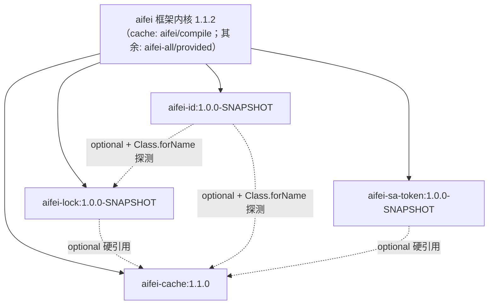

# aifei-eco-modules 模块规划与排期

> 状态：**滚动更新的规划基线**，事实随仓库现状校准，不是一次性建议稿。
> 编制：2026-11-10　|　最近校准：2026-11-26　|　工期口径：单人估算（人周），不含需求评审与外部联调等待。
> 事实来源：各模块 `pom.xml`、源码引用、架构门禁测试、`需求` 任务输入；现状口径截至 2026-11-26（sms / pay 及 sms-demo 已交付，email 设计定档待实现，校准计数见 §2.1 / §2.2）。

## 一、编制依据

1. **框架内核已覆盖，不得重复建设**：HTTP/Undertow、AOP/DI、路由与 Handler、JSON、Log、Enjoy 模板、`aifei-db`（ORM）。
2. **官方 `jfinal/aifei-eco` 生态近乎空白**：只有 `aifei-doc`、`aifei-demo`、`aifei-cache`、`aifei-redis`（官方已建议改用 cache）、`aifei-cron4j`（仅 5 段式 cron）。缺口由本仓库定义。
3. **仓库纪律对每个新模块一律生效**：Java 8（class major 52）、公共 API 零框架类型/零第三方类型（已登记例外除外）、根包公共类型数量精确且由架构门禁断言、`aifei-all` 为 `provided`、第三方 SDK 为 `optional`、原则上配 `demo`（不发布）与文档四件套（README / design / AGENTS / testing）。
4. **版本与例外以事实来源为准**：依赖 scope、公共面数量、已登记例外见各模块 `pom.xml`、`docs/design.md` 与根 `../../AGENTS.md`；本文件只记结论与指针，不复述细节。

## 二、现状全景

### 2.1 已交付模块

18 个库模块、12 个 demo，均独立构建、独立发版，仓库根无聚合 pom。

| 模块 | 版本 | 首次入库 | 定位 |
| --- | --- | --- | --- |
| `aifei-cache` | 1.1.0 | 2026-10-12 | 多实例缓存与计数；含 CAS 条件操作；唯一正式发布的基线（配置 Maven Central 发布 profile） |
| `aifei-sentinel` | 1.0.0 | 2026-10-12 | Sentinel 流控/熔断/系统保护接入 |
| `aifei-weixin` | 1.0.0 | 2026-10-12 | 公众号 / 小程序 / 微信支付 V3 |
| `aifei-sa-token` | 1.0.0 | 2026-10-13 | 认证鉴权；`aifei-cache` 可作可选持久层 |
| `aifei-websocket` | 1.0.0 | 2026-10-14 | 客户端出站 + 服务端接收；JDK 自实现 RFC6455 |
| `aifei-mq` | 1.0.0 | 2026-10-16 | 异步消息，7 个后端（含进程内 memory） |
| `aifei-oss` | 1.0.0 | 2026-10-16 | X File Storage 多平台对象存储 |
| `aifei-lock` | 1.0.0 | 2026-11-06 | 分布式锁，基于 cache 的 CAS 实现 |
| `aifei-job` | 1.0.0 | 2026-11-10 | 应用内定时任务，复用 Quartz `CronExpression` 做表达式校验与触发计算 |
| `aifei-http` | 1.0.0 | 2026-11-11 | 出站 HTTP 统一客户端，纯 JDK 实现 |
| `aifei-id` | 1.0.0 | 2026-11-11 | 雪花 / 号段分布式 ID |
| `aifei-trace` | 1.0.0 | 2026-11-11 | traceId 链路上下文 + 日志贯通 + Web 入口绑定清理 |
| `aifei-excel` | 1.0.0 | 2026-11-18 | Excel 注解映射与流式读写，EasyExcel 为 `optional` |
| `aifei-audit` | 1.0.0 | 2026-11-18 | 注解式操作审计：结构化事件 + `AuditSink` SPI，零生态依赖 |
| `aifei-i18n` | 1.0.0 | 2026-11-19 | 国际化：开放来源扩展 + 3 默认来源 + 单条取文案/整包导出 + Enjoy 三条模板指令 |
| `aifei-tools` | 1.0.0 | 2026-11-20 | 极简工具集：9 子包（`ipdb` / `captcha` / `qr` / `mask` / `kdf` / `crypto` / `random` / `xml` / `codec`），子包隔离、内核 `optional` |
| `aifei-sms` | 1.0.0 | 2026-11-26 | 短信通道：sms4j-core 二次封装，模板发送 + 回执验签，`optional` 内核 |
| `aifei-pay` | 1.0.0 | 2026-11-26 | 支付宝支付：IJPay V3 内核 `optional`，下单 / 查单 / 退款 / 回调验签 |

12 个 demo（不发布）：`aifei-sentinel-demo` / `aifei-websocket-demo` / `aifei-mq-demo` / `aifei-oss-demo` / `aifei-job-demo` / `aifei-id-demo` / `aifei-http-demo` / `aifei-trace-demo` / `aifei-excel-demo` / `aifei-i18n-demo` / `aifei-audit-demo` / `aifei-sms-demo`。`aifei-cache` / `aifei-lock` / `aifei-sa-token` / `aifei-weixin` / `aifei-tools` / `aifei-pay` 无独立 demo。

框架内核基线：`aifei-cache` 依赖 `cn.aifei:aifei:1.1.2`（无 scope），其余库模块依赖 `cn.aifei:aifei-all:1.1.2`（`provided`）。

### 2.2 需求输入与文档规范

- `需求` 下任务输入：`../需求/aifei-cache-1.1.0.md`、`aifei-http.md`、`aifei-job.md`、`aifei-lock.md`、`aifei-audit.md`、`aifei-i18n.md`、`aifei-tools.md`、`aifei-sms.md`、`aifei-pay.md`、`aifei-email.md`、`archive/aifei-mq.md`、`archive/aifei-excel.md`，以及本文件（`aifei-i18n-directive.md` 已废弃归档，唯一现行版本为 `aifei-i18n.md` §11）。
- 文档四件套：18 个已交付库模块中，除 `aifei-lock` 外均具备 `../../README.md` / `docs/design.md` / `AGENTS.md` / `docs/testing.md`；`aifei-lock` 按其设计决策不单设 `docs/testing.md`，测试策略与用例清单位于其 `docs/design.md` §7 与 `AGENTS.md`；12 个 demo 均有 `README.md`。`aifei-email` 仅有 `需求` 与 `docs/design.md`，未计入已交付模块。
- 已登记例外见根 `../../AGENTS.md`：4 项 `compile`（`aifei-oss` 的 x-file-storage-core、`aifei-sa-token` 的 sa-token-core、`aifei-job` 的 quartz 与 slf4j-api）、1 项公共面框架类型（`aifei-trace`）。`aifei-sentinel` 的 sentinel-core / parameter-flow-control / datasource-extension 三项为 `compile`，**已作为例外登记于根 `AGENTS.md`**（随 SDK 传递，与根 `README.md`「依赖说明」口径一致），理由见 `aifei-sentinel/docs/design.md` §3.3。

### 2.3 能力缺口盘点

| 能力域 | 现状 | 结论 |
| --- | --- | --- |
| 入站 HTTP | 框架 `aifei-undertow` + HIO | 框架覆盖，不建 |
| 出站 HTTP | `aifei-http` 已交付 | 已覆盖 |
| 数据文件 | `aifei-excel` 已交付 | 已覆盖 |
| 标识生成 | `aifei-id` 已交付 | 已覆盖 |
| 可观测 | `aifei-trace` 已交付（链路 traceId）；`aifei-log` 仅日志门面；指标无暴露端点 | 链路已覆盖；指标待建 `aifei-metrics` |
| 第三方通道 | `aifei-weixin`（公众号/小程序/支付）、`aifei-sms`（短信）、`aifei-pay`（支付宝支付）已交付；邮件 `aifei-email` 设计定档待实现；APP 推送无 | 邮件待建；APP 推送未排期 |
| 流量治理 | `aifei-sentinel` | 已覆盖 |
| 异步消息 | `aifei-mq`（7 后端） | 已覆盖 |
| 调度 | `aifei-job` 1.0.0 已交付；v1.1 集群互斥未启动 | 应用内调度已覆盖 |
| 认证鉴权 | `aifei-sa-token` | 已覆盖 |
| 操作审计 | `aifei-audit` 1.0.0 已交付（注解式事件 + `AuditSink` SPI） | 已覆盖 |
| 多语言 | `aifei-i18n` 1.0.0 已交付（开放来源 + 3 默认来源 + 整包导出 + Enjoy 三条指令） | 已覆盖 |
| 运维小工具 | `aifei-tools` 1.0.0 已交付（ipdb / captcha / qr / mask / kdf / crypto / random / xml / codec 九子包，kdf 为纠错补入、后四个为本次新增） | 已覆盖 |

## 三、建设结论与模块清单

### 3.1 第一档：已交付（2026-11-10 ~ 11-26）

| 模块 | 坐标 | 补的缺口 | 公共面（实际） | 依赖策略 |
| --- | --- | --- | --- | --- |
| `aifei-http` | `io.github.gollyhu:aifei-http:1.0.0-SNAPSHOT` | 出站 HTTP：超时、重试、拦截器、请求/响应编解码 | 根包 6 类：`HttpClient` / `HttpRequest` / `HttpResponse` / `HttpKit` / `HttpException` / `HttpInterceptor` | 零第三方；纯 JDK `HttpURLConnection` |
| `aifei-excel` | `io.github.gollyhu:aifei-excel:1.0.0-SNAPSHOT` | Excel 读写：注解映射、一次性与流式分批 | 根包 5 类：`Excel` / `ExcelKit` / `ExcelException` / `ExcelColumn` / `ExcelIgnore` | EasyExcel `optional` |
| `aifei-id` | `io.github.gollyhu:aifei-id:1.0.0-SNAPSHOT` | 分布式 ID：雪花 + 号段 | 4 类：`IdGenerator` / `IdKit` / `IdException` + `aifei.IdPlugin` | 零第三方；`aifei-cache` / `aifei-lock` 均 `optional` |
| `aifei-trace` | `io.github.gollyhu:aifei-trace:1.0.0-SNAPSHOT` | traceId 全链路贯穿 | 8 类：根包 6 类 + `web` 2 类（`TraceHandler` / `TraceIdExtractor`） | 零第三方；依赖 `aifei-log` 门面（已登记例外） |
| `aifei-job` | `io.github.gollyhu:aifei-job:1.0.0-SNAPSHOT` | 应用内定时任务 | 根包 7 类 | quartz + slf4j-api `compile`（已登记例外） |
| `aifei-audit` | `io.github.gollyhu:aifei-audit:1.0.0-SNAPSHOT` | 注解式操作审计：结构化事件 + 落点 SPI | 根包 + `spi` 3 类 + `aifei` 插件 | 零第三方 compile/runtime（junit 仅 test） |
| `aifei-i18n` | `io.github.gollyhu:aifei-i18n:1.0.0-SNAPSHOT` | 多语言：后端取文案 + 前端语言包下发 + Enjoy 三指令 | 根包 7 + `web` 2 + `aifei` 1 = 精确 10 类 | 零第三方；`aifei-cache` 为 `optional`（KV 来源） |
| `aifei-tools` | `io.github.gollyhu:aifei-tools:1.0.0-SNAPSHOT` | 极简工具集：IP 归属地 / 验证码 / 二维码 / 脱敏 / 密钥派生 / 摘要与认证码 / 安全随机 / XML 解析 / gzip 解压（九子包 ipdb / captcha / qr / mask / kdf / crypto / random / xml / codec） | 根包零类型，公共 API 全在 `ipdb` / `captcha` / `qr` / `mask` / `kdf` / `crypto` / `random` / `xml` / `codec` 九个子包 | ip2region `3.3.7` / ZXing core `3.5.3` / aifei-cache 均 `optional` |
| `aifei-sms` | `io.github.gollyhu:aifei-sms:1.0.0-SNAPSHOT` | 短信通道：模板化发送 + 回执接收验签 | 根包 5 类 + `spi` 2 类 | sms4j-core `3.3.6` 为 `optional`；同步发送、零存储 |
| `aifei-pay` | `io.github.gollyhu:aifei-pay:1.0.0-SNAPSHOT` | 支付宝支付：扫码 / H5 / PC 下单 + 查单 / 退款 + 回调验签 | 根包 4 类 + `model` 4 类 | IJPay AliPay V3 等 4 项均 `optional`；零存储、不做幂等 |

> **`aifei-http` 依赖口径已定档（2026-11-10）**：零第三方纯 JDK，不引入 okhttp、不设 provider 扩展点；同路线经验参考 `aifei-weixin` 的 `core.http.JdkHttpClient` / `pay.JdkPayHttpClient`（multipart、文件下载、mTLS），非代码复用。四条能力边界：① 不支持 HTTP/2；② 连接池受 JVM 全局属性 `http.maxConnections` / `http.keepAlive` 约束、不可按实例调参，模块不得改写；③ 超时仅 connect / read 两段，无整体 deadline、不可取消在途请求；④ gzip、Cookie、重定向自行实现。资源名唯一拼装点 `internal.HttpResource`，模块零 `aifei-sentinel` 依赖。

### 3.2 第二档：待建设（设计已定档，按排期实现）

| 模块 | 坐标 | 补的缺口 | 公共面（设计口径 / 预估） | 依赖策略 | 工期 |
| --- | --- | --- | --- | --- | --- |
| `aifei-metrics` | `io.github.gollyhu:aifei-metrics:1.0.0-SNAPSHOT` | 运行指标采集 + Prometheus 文本端点 | `MetricsKit` / `Metric` / `MetricsException` | 零第三方（自实现文本格式） | 2 周 |
| `aifei-email` | `io.github.gollyhu:aifei-email:1.0.0-SNAPSHOT` | 出站邮件：SMTP 多配置池 + 纯文本 / HTML / 附件 | 根包 5 类 + `spi` 1 类 | sms4j-Email-core `3.3.6` 为 `optional`；禁 starter / solon | 2 周（含 demo） |

> 原列本档的 `aifei-sms` / `aifei-pay` 已于 2026-11-26 交付，移入 §3.1 已交付清单；`aifei-i18n` 已于 2026-11-19 交付，其范式对齐 `aifei-cache` 的 provider 扩展点，而非 `aifei-weixin` 的通道接入。

### 3.3 第三档：待定（需先验证或设计决策，不预先承诺）

| 模块 | 价值 | 前置风险 | 结论 |
| --- | --- | --- | --- |
| `aifei-openapi` | 接口文档生成 | 依赖 aifei 路由反射元数据是否足够，未验证 | **先做 3 天可行性验证**，通过才立项 |

> 原列本档的 `aifei-audit`（2026-11-18 交付）与 `aifei-tools`（2026-11-20 交付）均已落地，移入 §3.1 已交付清单。

## 四、依赖关系与关联分析

### 4.1 模块角色分层

| 层级 | 模块 |
| --- | --- |
| 库模块（SDK，18 个） | `aifei-cache` `aifei-lock` `aifei-sentinel` `aifei-weixin` `aifei-sa-token` `aifei-websocket` `aifei-mq` `aifei-oss` `aifei-job` `aifei-http` `aifei-excel` `aifei-id` `aifei-trace` `aifei-audit` `aifei-i18n` `aifei-tools` `aifei-sms` `aifei-pay` |
| 示例工程（12 个，不发布） | `aifei-sentinel-demo` `aifei-websocket-demo` `aifei-mq-demo` `aifei-oss-demo` `aifei-job-demo` `aifei-id-demo` `aifei-http-demo` `aifei-trace-demo` `aifei-excel-demo` `aifei-i18n-demo` `aifei-audit-demo` `aifei-sms-demo` |

### 4.2 已落地的代码级依赖（3 条，全部 `optional`）



| 依赖方 | 被依赖方 | 性质 | 代码证据 |
| --- | --- | --- | --- |
| `aifei-lock` | `aifei-cache` | `optional`，硬引用 | `CacheLockStore` 引用 `Cache` / `CacheKit`，基于 `putIfAbsent` / `removeIfEquals` / `expireIfEquals` / `supportsCas` 实现原子锁 |
| `aifei-id` | `aifei-cache` + `aifei-lock` | `optional`，运行期按配置探测 | `IdDeps` 用 `Class.forName(name, false, loader)` 探测 `CounterKit` / `LockKit`，仅 `id.segment.store=cache` 或 `id.worker.source=cache/lock` 时需要 |
| `aifei-sa-token` | `aifei-cache` | `optional`，硬引用 | `SaTokenDaoForCache` 实现 `SaTokenDao`，以 `Cache` 作登录态持久层 |

`cache` 是事实上的底层基座，`lock` / `id` / `sa-token` 只向它单向依赖，`cache` 从不反向引用兄弟模块。所有跨模块依赖均为 `optional`、阻断传递，缺失时由 `IdDeps` / `LockErrors` 给出可读错误，而非直接 `NoClassDefFoundError`。`sms` / `pay` 的 sms4j / IJPay 内核依赖同为第三方 `optional`（缺失时经 `SmsPlugin` / `AliPayPlugin` 给可读错误），不构成生态模块间依赖。

### 4.3 规划中 / 契约级关联（非代码依赖）

| 关联 | 当前状态 | 耦合方式 |
| --- | --- | --- |
| `aifei-lock` → `aifei-job:1.1.0` | 未启动（集群互斥） | `job.cluster.enabled=true` 时 `optional` 探测；锁语义完全交给 lock，本模块不复制 |
| `aifei-http` ↔ `aifei-sentinel` | 契约已定档、http 已交付 | sentinel 资源名 = http 接口标识；`HttpRequest.resource` 缺省为 `METHOD + " " + host + path`（去 query），规则 JSON 的 `resource` 须严格一致 |
| `aifei-trace` 贯通 `http` / `mq` / `websocket` / `job` | trace 已交付，仅 Web 入口绑定清理 | trace 零生态模块依赖；跨模块传播走 HTTP 头 / MQ 消息头 / WS 帧头 / Job 事件，由各消费模块自行承载 |
| `aifei-weixin` → `aifei-pay` | pay 已交付（11-26），仅语义对齐、无代码依赖 | 两侧支付动作语义对齐；支付宝走 pay，微信支付走 weixin，模块间无 import |
| `aifei-sms` → `aifei-email` | email 设计定档、待实现 | 同为 sms4j 插件二次封装；邮件走 `sms4j-Email-core` 与 `internal.smtp` 适配层，不复用短信收发代码 |
| `aifei-oss` ↔ `aifei-excel` | excel 已交付，oss 独立 | 导入源 / 导出落盘的组合关系，两者无代码依赖 |
| `aifei-http` ↔ `aifei-weixin` | 技术路线一致（非运行时依赖） | 同为纯 JDK `HttpURLConnection` 路线，http 参考 weixin 的实现经验 |

另有架构同构关系：`aifei-mq` / `aifei-websocket` / `aifei-cache` 共享「Provider 扩展点 + 静态注册表 + 命名实例」范式（http / excel 不设 provider）；`aifei-sentinel` / `aifei-sa-token` 都通过 `cn.aifei.aop.Interceptor` 挂接横切逻辑。这些是模式复用而非代码依赖，由 `ArchitectureBoundaryTest` / `KernelBindingTest` 守护边界。

### 4.4 依赖形成与约束判断

1. **方向只能自底向上**：`cache` → `lock` → `job` / `id` / `sa-token` 这条链单向。任何让 `cache` 反向引用上层模块的改动都会引入循环依赖，破坏其基座定位。
2. **`optional` + 探测是刻意取舍**：跨模块依赖不向下传递，消费者必须显式声明所需坐标。"能形成依赖"不等于"自动获得依赖"——例如 `aifei-id-demo` 只声明 `aifei-id`，雪花模式可跑，号段模式还需引入 `aifei-cache`，否则启动期给出可读错误，属于契约式关联而非隐式耦合。
3. **能力协同不应升级为代码依赖**：`trace` 贯通 `mq` / `ws` / `job`、`http` 对齐 `sentinel`，正确做法是通过公共数据契约（消息头 / 帧头 / 资源名字符串）解耦，而非库模块互相 `import`——否则会撞上「公共 API 零第三方类型、零框架类型、根包公共类型数量精确」的门禁。
4. **版本管理风险**：`aifei-cache` 已是 `1.1.0`，其余 17 个库模块为 `1.0.0-SNAPSHOT`；`lock` / `sa-token` / `id` 的 pom 各自写死 `<aifei-cache.version>1.1.0</aifei-cache.version>`，仓库根无聚合 pom，后续升级 cache 需逐个同步，存在遗漏风险。

## 五、排期

### 5.1 已完成（2026-11-10 ~ 11-26）

| 模块 | 入库日期 | 交付情况 |
| --- | --- | --- |
| `aifei-job` | 11-10 | 库模块 + demo + 设计文档 + 门禁测试 |
| `aifei-http` | 11-11 | 库模块 + demo + 设计文档 + 门禁测试 |
| `aifei-id` | 11-11 | 库模块 + demo + 设计文档 + 门禁测试 |
| `aifei-trace` | 11-11 | 库模块 + demo + 设计文档 + 门禁测试 |
| `aifei-audit` | 11-18 | 库模块 + demo + 设计文档 + 门禁测试 |
| `aifei-excel` | 11-18 | 库模块 + demo + 设计文档 + 门禁测试 |
| `aifei-i18n` | 11-19 | 库模块 + demo（指令 3 条）+ 设计文档 + 门禁测试 |
| `aifei-tools` | 11-20 | 库模块（ipdb / captcha / qr / mask / kdf / crypto / random / xml / codec 九子包）+ 设计文档 + 门禁测试 |
| `aifei-sms` | 11-26 | 库模块 + demo（六场景，零外网）+ 设计文档 + 门禁测试 |
| `aifei-pay` | 11-26 | 库模块 + 设计文档 + 门禁测试 + 发布文档（无 demo） |

原 P0 前置验证已随交付闭环：`aifei-log` 上下文能力由 `TraceLogFactory` 包装解决（不注入 MDC）；`aifei-http` 资源名规则已定档落地，余下 `aifei-openapi` 可行性验证仍未启动。`aifei-email` 需求与设计已定档（11-26），实现与 demo 未启动。

### 5.2 待推进（起算日 2026-11-30，周一）

| 阶段 | 周次 | 时间 | 内容 | 阶段里程碑 |
| --- | --- | --- | --- | --- |
| P0 可行性 | W1 前半 | 11/30 – 12/02 | `aifei-openapi` 路由反射元数据验证（3 天，不阻塞第二档） | 结论写入 `需求`，决定是否立项 |
| P1 运维 | W1 – W2 | 11/30 – 12/11 | `aifei-metrics` 全量交付（含 demo） | `mvn clean verify` 0/0；门禁通过；可发布 1.0.0 |
| P1 通道 | W3 – W4 | 12/14 – 12/25 | `aifei-email` 全量交付（库模块 + demo，按已定档设计实现） | 同上；门禁 14 例、端点契约与第三方许可证声明齐全 |
| — 假期 — | — | 02/06 – 02/14 | 春节，不排期 | — |
| 待定 | — | 视 P0 与设计决策 | `aifei-openapi`（通过后 3 周）、`aifei-job:1.1.0` 集群互斥 | — |

> `aifei-sms` / `aifei-pay` 已于 2026-11-26 交付（见 §5.1），不再属本表待推进项。

### 5.3 待推进依赖关系

```text
P0 openapi 可行性验证 ─→ aifei-openapi（决定是否立项）

aifei-email（设计定档）─→ 库模块 + aifei-email-demo（待实现）

aifei-lock 1.0.0 ─→ aifei-job:1.1.0（集群互斥，未启动）

aifei-weixin（PayApi 契约）─→ aifei-pay（已交付，仅语义对齐、无代码依赖）
aifei-log ─→ aifei-trace（已交付，后续跨模块传播由消费模块承载）
```

## 六、明确不建议建设

| 候选 | 不建理由 |
| --- | --- |
| `aifei-event`（进程内事件总线） | `aifei-mq` 的 memory 后端已是进程内总线；**2026-11-18 预研结论：不立项**，详见下方预研详述 |
| `aifei-redis` | 官方已建议用 `aifei-cache` 替代 |
| `aifei-session` | `aifei-sa-token` 已覆盖登录态与跨实例共享 |
| `aifei-tenant`（多租户） | 需改 SQL 生成、侵入 `aifei-db` 内部，违反「公共 API 实现无关」且无法用门禁守护 |
| 注册中心 / 配置中心 / 网关 / 工作流 DAG | 属基础设施另立；工作流已被 `aifei-job` 的边界明确排除 |
| `aifei-state` | 轻量替代（枚举 + 迁移表）够用，不进入排期；`aifei-i18n` / `aifei-captcha` 已于 2026-11-18 复评，见 6.2 |

### 6.1 `aifei-event` 预研详述（2026-11-18，结论：不立项）

目标形态假设：JFinal-event / Guava EventBus 风格的进程内事件总线（强类型事件对象 + 注解订阅 + 类型分发）。逐条差距判定如下：

1. **能力已被 aifei-mq memory 后端覆盖**：多订阅者按登记顺序回调、监听器异常就地隔离（不中断其余订阅者、不上抛发布方）、动态 `subscribe` / `unsubscribe`（按实例身份、幂等 no-op）、无订阅者 `send` 仍成功——这些主干语义均属 aifei-mq 跨后端共同底线（`aifei-mq/docs/design.md` §5.6 A），且已写入门禁测试。异常隔离一项甚至优于 Guava EventBus 默认行为。
2. **差距属「体验债」而非「能力缺口」**：无强类型事件对象（`byte[]` 载荷手动序列化）、无注解订阅（topic 两端字符串手工对齐）这两条是主要痛点，但一个几百行的薄封装（`EventBus` 门面 + `@Subscribe` 注解扫描，内部转 `ProducerKit` / `ConsumerKit`）即可抹平，不需要独立模块；继承分发、`order` / `condition` 属低频需求。
3. **唯一硬缺口（异步分发）不该用新模块解决**：同步投递 + 零线程池是 aifei-mq 定档契约（design.md §5.1），若真有异步需求，正确动作是先评估修改 aifei-mq 契约（先改文档再改代码），而非另起模块造成同一进程两套线程模型。
4. **纪律依据**：新模块固定成本（公共面精确 N 类型 + 架构门禁 + 文档四件套 + demo）无真实需求支撑，违反「不做未被需求驱动的抽象」。
5. **复评门槛（命中任一再走设计决策）**：① 薄封装被 ≥2 个应用复制使用；② 出现真实的继承分发场景；③ 出现真实异步分发需求。届时立项也须定位为 **aifei-mq 之上的类型化门面**（复用其投递内核与异常隔离契约），不自带投递实现与线程模型。

### 6.2 `aifei-i18n` / `aifei-captcha` 复评（2026-11-18，结论：i18n 立项、captcha 并入 tools）

1. **`aifei-i18n` 需求升级**：目标形态为「前后端一并支持的多语言能力」，多语言来源不再单一依赖 properties，可接数据库与 KV。原「价值偏低」判断失效——裸 `ResourceBundle` 只解决「编译期打包的静态文案」，解决不了运行期可改、多来源叠加与前端语言包下发。**撤销不建结论，转入第二档**，需求见 `../需求/aifei-i18n.md`。
2. **`aifei-captcha` 并入工具集**：图片生成 + 答案校验的单体能力过薄，独立成模块的固定成本（公共面 + 门禁 + 文档四件套 + demo）不划算。并入 `aifei-tools`（极简工具集），作为首个工具落 `cn.hg.aifei.tools.captcha` 子包，不独立发布、不独立版本号，需求见 `../需求/aifei-tools.md`。
3. **`aifei-tools` 的障碍在纪律而非能力**：仓库要求「根包公共类型数量精确且由架构门禁断言」，杂项模块的公共面必然随工具增加而变动。须先定档门禁口径（推荐「根包零类型，公共 API 全部在工具子包，门禁按子包分别断言」）才可启动，故只入第三档待定。
4. **`aifei-state` 维持不建**：业务以枚举 + 迁移表表达状态流转已足够，且易与已排除的工作流 DAG 边界纠缠。

> **交付状态更新（截至 2026-11-20）**：本节为 2026-11-18 的历史复评留痕。其中 `aifei-i18n` 已于 11-19 交付、`aifei-tools`（含 captcha）已于 11-20 交付，均已移入 §2.1 / §3.1 / §5.1 已交付清单；门禁口径按「根包零公共类型、公共 API 全部落工具子包」定档落地。`aifei-state` 维持不建结论不变。

> **交付状态更新（截至 2026-11-26）**：`aifei-sms` / `aifei-pay` 及 `aifei-sms-demo` 已交付（§2.1 / §3.1 / §5.1）；`aifei-email` 需求与设计已定档、实现未启动，归入 §3.2 / §5.2 待建设。本节历史复评结论不变。
