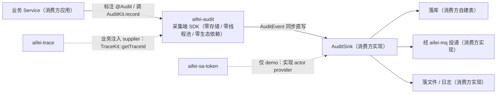

# aifei-audit 模块需求（任务输入）

> 本文件是**任务输入**（需求 + 验收标准），不是 `design.md`、不是 PRD 补充、不是任务分解。公共 API 逐字签名、包结构与门禁细则、行为契约细节，由 `aifei-audit/docs/design.md` 定稿，本文只给能力诉求与可验收边界。
> 关联：`docs/计划/aifei-eco-modules 模块规划与排期.md` §3.3（`aifei-audit` 立项判词：注解式操作审计；与业务日志边界模糊；落库 / 落 MQ 的职责切分需定档；**定档后 1.5 周**）；同构范本 `docs/需求/aifei-http.md`、`docs/需求/aifei-job.md`。
> 坐标与基线：`io.github.gollyhu:aifei-audit:1.0.0`；包名 `cn.hg.aifei.audit`；Java 8（class major 52）；`cn.aifei:aifei-all` 为 `provided`；零第三方 compile / runtime 依赖。

## 〇、交付物性质声明（先读，门禁口径依赖此节）

**本次交付物是库模块（可被应用依赖的 SDK），不是业务应用工程。** 三份 PRD 常规章节在本模块 **不适用**：

| 章节 | 结论 | 理由 |
| --- | --- | --- |
| 表结构草案 | **不适用** | 本模块**零存储**：无表、无 DDL、无 `Db+Row`、无 `Generator`、运行期不连任何数据源。审计落库是**消费方**在其 `AuditSink` 实现里的事，不属于本模块交付物。门禁反向断言主源码（`src/main/java`）禁止 `import java.sql.`。**不得为凑齐模板而编造表。** |
| Service 方法清单 | **不适用** | 模块本体无 `@Path` / Service（那是应用工程的事）。根包 / `spi` / 接入包的公共面**类型清单为预估**（见 §5.9），须过设计决策、由架构师在 `design.md` 定稿；本文**不代写公共面签名**。 |
| 低保真 UI 原型 | **不适用** | 本模块跳过 PM 原型与 QA 基线门禁；`aifei-audit-demo` 的演示页面由前端直接实装（见第八节），不经原型评审。 |

## 一、缺口与目标

### 1.1 三条缺口论证（本模块为什么必须独立存在）

| # | 替代方案 | 为何不成立 |
| --- | --- | --- |
| 1 | **业务日志** | **无结构**：自由文本由每个业务方法手写，字段有无、顺序、取值格式逐处漂移，同一动作在不同模块的记录形状不同。**不可按维度查**：「谁在何时对什么做了什么、结果如何」中，操作人、动作码、目标对象、结果、耗时没有独立承载位，无法作为查询维度建立索引或过滤。**混存不可分级留存**：审计留存期（合规、追责）与排障日志留存期（容量导向）是两套生命周期，同一份输出里无法分别归档、分别清理、分别授权访问。**逐处手写必漏**：采集靠开发者自觉在业务方法里追加记录代码，漏写无任何检测手段，新增业务动作不会自动纳入审计面。 |
| 2 | **`aifei-mq`** | mq 只是**通道**：① **无事件模型**——payload 是 `byte[]` / `String`，审计要素由各业务自行拼装与解析，字段语义无统一约束；② **无注解**——发送须显式调用 `Producer#send(...)`，与「声明式采集、业务方法零侵入」相反；③ **无落点抽象**——订阅与消费属另一套装配，SDK 侧不存在「把一条结构化事件交给业务实现的落点」这一概念；④ **无失败隔离**——未启动 / 已停止时调用抛 `IllegalStateException`，投递失败会伤到业务方法本身；⑤ 业务必须**显式依赖** mq 与具体后端（memory / MQTT / Kafka / RocketMQ …），审计能力被绑死在消息中间件的选型与可用性上。mq 只在消费方 `AuditSink` 实现内部被投递使用（见 §5.8），不是本模块的依赖。 |
| 3 | **`aifei-sa-token`** | 它只回答「**能不能做**」（登录态、角色、权限校验），不回答「**做过什么**」（没有动作码、目标对象、结果、耗时、入参摘要、失败原因）。把审计绑上去，等于把「操作留痕」与「鉴权实现」两件事绑死：不用 sa-token 的应用得不到审计，换鉴权方案要重写审计。操作人身份只是审计事件的一个字段，由 `AuditActorProvider` 取值即可（demo 中演示从 sa-token 取，模块零依赖）。 |

### 1.2 四个目标（对应四件事）

| # | 目标 | 具体含义 |
| --- | --- | --- |
| 1 | **统一事件模型** | 一次操作产出一条结构化 `AuditEvent`：谁、何时、对什么、做了什么、结果如何、耗时多少、属于哪条链路，字段语义全仓唯一 |
| 2 | **声明式采集** | 方法上标一个注解即被采集，业务方法体零侵入；另留一个手动埋点入口，与注解共用同一事件模型 |
| 3 | **落点可替换** | 模块只产事件 + `AuditSink` SPI，落 DB / 落 MQ / 落日志 / 落内存由消费方自己实现，换落点不改业务代码 |
| 4 | **失败不伤业务** | 采集链路（sink / actor / judge）的任何异常就地隔离，业务方法的返回值与异常语义保持不变 |

### 1.3 使用角色与用户故事

- 作为**业务开发者**，我希望在业务方法上标一个注解就把这次操作留痕，以便不用在方法体里手写记录代码、也不会漏写。
- 作为**平台维护者**，我希望审计事件有统一字段，以便把「谁对哪个订单做了什么、成败与耗时」做成可查询的结构化流水。
- 作为**应用集成者**，我希望审计落点由我自己实现（落库 / 投递 MQ / 落文件），以便沿用现有的存储与消费链路，不被模块绑定。
- 作为**线上排障者**，我希望审计事件带上 `traceId`，以便把一次操作与同链路的日志、消息串起来定位。

## 二、非目标（能力边界，已定档，不得推翻）

| # | 边界 | 后果（README 与 `design.md` 必须声明） | 模块责任 |
| --- | --- | --- | --- |
| 1 | **审计存储与建表** | 模块不建表、不写库、不提供任何 DAO；落库由消费方 `AuditSink` 实现 | 零 `java.sql`、零 `aifei-db` 依赖 |
| 2 | **查询与展示** | 无查询 API、无管理页、无统计聚合；demo 的展示页属示例工程，不是模块能力 | 不提供任何读接口 |
| 3 | **归档与合规报表** | 留存周期、分级留存、导出报表、合规口径全部由消费方负责 | 模块只保证事件字段够用 |
| 4 | **采样** | 不做采样率、不做按动作 / 按用户抽样；每条被采集的操作都产出一条事件 | 不提供采样开关 |
| 5 | **异步队列与背压** | 无内部队列、无线程池、无背压策略；落点慢就等于业务方法慢（见 §5.4） | 零线程创建（门禁断言） |
| 6 | **批量落库** | 不做攒批、不做 flush 周期、不做批量写入 | 单条事件交付 |
| 7 | **重试** | sink 失败不重试、不入死信、不补偿 | 失败即记模块日志后丢弃 |
| 8 | **与 sa-token / mq / trace 的硬依赖** | 模块不 import 任何生态模块；操作人、链路、投递分别经 SPI / supplier / sink 由消费方提供 | 单向不依赖（见 §5.8） |
| 9 | **入参深度脱敏规则引擎** | 不做字段注解递归、不做正则规则库、不做嵌套对象遍历；只做「默认不记录 + 显式开启 + 按参数位剔除 + 长度截断」 | 脱敏规则停在参数位粒度 |
| 10 | **注解取值表达式** | 注解属性只接受字面量，不做 SpEL / OGNL 一类求值，不从入参里取字段拼描述 | 注解属性为常量 |
| 11 | **多实例协调** | 不做选主、不做全局序号分配、不做幂等去重；多实例各采各的 | 事件号仅需模块内唯一 |
| 12 | **审计链路完整性对账** | 不做「应记录条数 vs 实际条数」的对账，不检测漏采（前置验证项除外，见 §九 Q1） | 采集失败只留日志 |

## 三、已定档前提（需求约束，设计不得推翻）

以下五条为上一轮与用户确认的定档取向。**每条在第九节都给出了可被否决的默认假设**，未获否决即按此执行。

| # | 前提 | 需求含义 |
| --- | --- | --- |
| 1 | **落点职责：只产事件 + `AuditSink` SPI** | 模块内**零 `java.sql`、零生态依赖**；落 DB / 落 MQ / 落日志 / 落内存全部由消费方实现 `AuditSink`。模块不含任何存储选型、不含任何 MQ 后端概念（连「topic 名」这类字段也不进公共面） |
| 2 | **操作人：`AuditActorProvider` SPI** | 模块**不依赖 `aifei-sa-token`**；操作人 id / 名由消费方实现 provider 提供（demo 演示从 sa-token 取）。未提供 provider 时事件仍记录，操作人字段为空 |
| 3 | **成败判定：异常即失败** | 抛异常 = 失败，正常返回 = 成功；`Out.fail(...)` 一类「HTTP 200 + 业务码失败」由**可选** `AuditResultJudge` SPI 判定；**模块不得 `import cn.aifei.vip.Out`**（仓库既有门禁口径：`cn.aifei.vip.*` 零引用） |
| 4 | **交付语义：同步直写、零线程池** | 事件在业务方法返回（或抛出）后的同一线程内直写 sink；sink 异常**默认吞掉**并记模块日志，不阻断业务（`fail-fast` 默认 `false`） |
| 5 | **参数记录：默认不记录入参** | 默认 `args=false`，事件不含任何入参值；显式开启后按 `mask` 剔除指定参数，其余可见；参数摘要设长度上限，超限截断**不抛错** |

**其余已定档基线**（与仓库底线一致，无需再议）：Java 8 语法与 API 双约束、class major 52、`aifei-all` 为 `provided`（不传递，消费方自带）、零第三方 compile / runtime 依赖、不引入任何日志绑定（模块自身记录走 `cn.aifei.log.Log`）、公共 API 实现无关。

## 四、功能需求

需求池分级：**R-01 至 R-09 全部为 P0**（缺一不算交付），每条在第七节均有对应可机械验证的 AC；P1 清单见本节末。编号固定，后续只允许在其后追加，不得重排或改号。

| 需求编号 | 能力 | 说明 |
| --- | --- | --- |
| `R-01` | **审计事件模型** | 一条事件承载 **14 个字段 / 13 类要素**（计数口径：「操作人 id」与「操作人名」在 §5.1 为两个字段、合并计为一类要素，其余字段与要素一一对应）：事件号、发生时刻、动作码、业务模块、描述、操作人 id / 名、目标对象标识、脱敏后入参摘要、结果（成功 / 失败）、错误码与消息、耗时毫秒、`traceId`、客户端标识。要素语义、可空性、取值来源见 §5.1；事件为值对象，交给 sink 后调用方不可再改（不可变由 `design.md` 定稿实现方式） |
| `R-02` | **注解式采集** | 提供 `@Audit(action / desc / args / mask)`；被标注方法执行时产出一条事件；**未标注的方法不产事件**。`args` 为该方法的参数记录开关，`mask` 为被剔除的参数位；失败语义（抛异常）仍产出事件 |
| `R-03` | **手动埋点** | `AuditKit.record(...)` 供无法加注解的场景（异步回调、非 AOP 覆盖的代码、批处理循环）使用，**与注解共用同一事件模型与同一 sink**，字段口径一致 |
| `R-04` | **落点交付 `AuditSink`** | 事件经 `AuditSink` SPI 交给消费方；同一时刻只有一个生效 sink，切换实现不改业务代码。**未装配 sink 时的行为见 §5.4.1 三态表**（默认假设见 §九 Q7） |
| `R-05` | **操作人 SPI** | `AuditActorProvider` 提供操作人 id / 名；provider 缺失时**事件仍记录、不阻断**，操作人字段为空 |
| `R-06` | **脱敏与截断** | 默认不记录入参；开启后按 `mask` 剔除指定参数位，其余参数可见；入参摘要设长度上限，超限**截断而非抛错**；脱敏与截断是**唯一定义点**，注解采集与手动埋点共用 |
| `R-07` | **失败隔离** | `sink` / `actorProvider` / `resultJudge` 任一处抛异常**一律吞掉**并记模块日志，业务方法的返回值与异常语义不变；`fail-fast=true` 时例外语义见 §5.6 |
| `R-08` | **装配与配置** | `AuditPlugin` 完成装配，配置前缀 `audit.*`；配置非法**启动即失败**（消息含键名与原值）；重复 `start()` / `stop()` 幂等 |
| `R-09` | **与 `aifei-trace` 协同** | 事件带 `traceId`；建议由业务注入 supplier（如 `TraceKit::getTraceId`），**模块零 `aifei-trace` 依赖**；未注入时字段为空且不抛异常 |

**配置能力诉求**（键名与默认值由 `design.md` 定稿，本表只约束**必须可配**的能力与建议默认）：

| 能力 | 建议默认 | 约束 |
| --- | --- | --- |
| 采集总开关 | 开（`true`） | 关闭时不产事件，业务不受影响 |
| `fail-fast` | `false` | sink 异常是否上抛，见 §5.6 |
| 参数记录默认开关 | `false`（不记录入参） | 注解 `args` 可逐方法覆盖 |
| 参数摘要长度上限 | `512` 字符 | ≥ 0（`0` = 只留占位）；超限截断 |
| 是否采集客户端标识 | `false` | 开启后由可选 supplier 取值，模块不自行读 HTTP 上下文 |
| sink 实现来源 | 从容器按类型取（单一实现） | 缺失时的行为见 §九 Q7 |
| 操作人 provider 来源 | 从容器按类型取（可选） | 缺失即无操作人，不启动失败 |
| 结果判定 judge 来源 | 从容器按类型取（可选） | 缺失即「异常 = 失败、正常返回 = 成功」 |
| 业务模块标识（事件要素之一） | 空 | 供多应用共用一个审计流水时区分来源 |

**P1（本次不做）**：异步 / 批量投递、sink 重试与死信、采样、SPI 多实现分发与排序、注解取值表达式、入参的嵌套结构与集合元素级脱敏、字段注解式脱敏（`@Mask` 之类）、审计查询 API 与统计、多实例事件号全局唯一、与 `aifei-metrics` 的指标联动、审计事件的内置序列化格式（JSON 结构由消费方自定）。

## 五、关键契约

### 5.1 事件模型要素（`R-01`）

> **计数口径**：下表共 **14 行（字段）**；「操作人 id」与「操作人名」是两类来源相同但取值不同的字段，在概述（§四 R-01、PRD §3.1）中合并计为「操作人 id / 名」一类，故概述口径为 **13 类要素**。两种说法指同一事件模型，不增不减字段。

| 要素 | 语义 | 可空 | 取值来源 |
| --- | --- | --- | --- |
| 事件号 | 本次采集的唯一标识，仅需模块内唯一（不承诺跨实例全局唯一） | 否 | 模块内生成，生成方式见 §九 Q8 |
| 发生时刻 | 一次操作的时间点（epoch 毫秒），**取动作开始时刻**（不取采集时刻，见 §九 Q9） | 否 | 模块采样 |
| 动作码 | 动作的稳定标识（如 `order.cancel`），供查询与分类统计 | 否 | 注解 `action` 属性 / 手动埋点入参 |
| 业务模块 | 事件来源的应用或业务域标识 | 是 | 配置 `audit.module`，未配置为空 |
| 描述 | 人读的动作说明 | 是 | 注解 `desc` 属性 / 手动埋点入参 |
| 操作人 id | 操作主体的稳定标识 | 是 | `AuditActorProvider` |
| 操作人名 | 操作主体的可读名称 | 是 | `AuditActorProvider` |
| 目标对象标识 | 被操作对象的标识（如订单号），**不由模块从入参自动推导**（注解取值表达式属非目标） | 是 | 手动埋点入参 / 由消费方在 sink 侧补全 |
| 入参摘要 | 脱敏并截断后的入参文本，默认不记录 | 是 | §5.3 |
| 结果 | 成功 / 失败（二值）；承载为**枚举**而非字符串，枚举归属见 §5.9 / §九 Q17 | 否 | §5.2 |
| 错误码与消息 | 失败时的异常类型名与消息；成功时为空 | 是 | 抛出的异常 |
| 耗时毫秒 | 动作执行耗时，`≥ 0`；采集自身耗时不计入 | 否 | 模块采样（单调时钟差值） |
| `traceId` | 当前链路的链路标识，用于与日志 / 消息关联 | 是 | 可选 supplier（§5.8） |
| 客户端标识 | 发起端的标识（如 IP / UA），由消费方决定取什么 | 是 | 可选 supplier，默认不采集 |

**事件模型纪律**：事件是**交付给 sink 的值**，不是消费方可以留着改的活对象——sink 拿到后调用方不再持有可变引用，字段全 `final`、无 setter（具体实现方式由 `design.md` 定稿）。**当前事件模型全部字段为标量**（`String` / `long` / 布尔 / 枚举，见上表），不存在集合字段，故不涉及「集合活视图」问题；若 `design.md` 后续引入集合字段，须同步回写本节与 `AC-05` 并补不可变断言。

### 5.2 采集语义（`R-02` / `R-03`）

| 场景 | 约定 |
| --- | --- |
| 未标注 `@Audit` 的方法 | **不产事件**（零开销路径，不做「先采集再丢弃」） |
| 标注方法的 `action` 为空串 | 属**配置期错误，不在采集期处理**：`AuditPlugin.start()` 内完成注解扫描校验并启动失败（§5.7 / `AC-29`），启动失败后不存在可用采集状态。`PV-03` 结论为否（启动期拿不到全部被标注方法）时，降级为**首次采集即发现 `action` 为空串时抛模块异常且不产事件**，并回写本节 / §5.7 / `AC-29` |
| 标注方法正常返回 | 产出 **1 条**事件，结果为成功，错误码 / 消息为空 |
| 标注方法抛异常 | 产出 **1 条**事件，结果为失败，错误码 / 消息取自该异常；**异常原样上抛**（不捕获、不包装、不替换类型、不改消息） |
| 判定为「业务码失败」 | 仅在装配了 `AuditResultJudge` 时生效：judge 读完返回值后可把结果改写为失败；未装配时「正常返回 = 成功」（注解不得 import `cn.aifei.vip.Out`） |
| 同一方法被采集多次（循环 / 重试） | 每次调用各产出一条事件，动作码相同、事件号不同 |
| 手动埋点 `AuditKit.record(...)` | 与注解路径**共用**事件构造、脱敏截断、失败隔离与 sink 交付；不要求方法上有注解；**业务异常场景由调用方自行在 catch 内埋点**（模块不会替手动埋点捕获异常） |
| 采集发生在哪一层 | 采集构件须位于业务方法**外层**才能读到「结果 + 异常 + 耗时」；注册顺序依赖须前置验证（§九 Q2） |
| 嵌套采集（被标注方法调用另一个被标注方法） | 各出一层事件（内层先出、外层后出）；不做去重、不做父子关系建模（非目标：链路树） |

### 5.3 脱敏与截断（`R-06`）

| 项 | 约定 |
| --- | --- |
| 默认行为 | **不记录任何入参值**：事件入参摘要为空，事件上不出现参数原文（不得「先拼好再清空」留下残留） |
| 开启方式 | 全局配置开关打开，或注解 `args=true` 逐方法打开 |
| 剔除口径 | `mask` 指定**参数位（下标，0-based）**：`mask={1}` 表示剔除索引 1 即第二个参数。被指定参数在摘要中不出现原文；其余参数可见。**`mask` 不做按名匹配**（Java 8 编译期参数名不可靠，见 §九 Q10） |
| 长度上限 | 摘要总长超过上限即截断，**截断不抛错**、不影响返回 1 条事件；截断后是否附省略标记由 `design.md` 定稿 |
| 唯一定义点 | 脱敏与截断只有一处实现，注解路径与手动埋点路径都走它，不得各写一套 |
| 不做 | 嵌套对象遍历、集合元素级剔除、正则规则库、字段注解（均属非目标 §二-9） |

### 5.4 落点交付语义（`R-04`）

| 项 | 约定 |
| --- | --- |
| 调用线程 | sink 在**业务方法所在线程**同步调用，无线程池、无内部队列、无异步派发 |
| 调用时机 | 业务方法已产生结果（正常返回或抛出异常）之后；**sink 的返回值不被业务使用**（sink 是通知型 SPI，不参与结果） |
| 慢 sink 的后果 | 落点变慢即业务方法变慢——这是**已定档的取舍**，README 必须显式警告（要快就由消费方在 sink 内自行异步，模块不代劳） |
| 可替换 | 同一时刻只有一个生效 sink；换实现只改装配，不改业务代码 |
| 未装配 sink | 见 §5.4.1 三态表（默认假设 §九 Q7）；必须保证：**插件已启动而无 sink 时不抛异常、不影响业务返回值** |
| 投递内容 | 只投一条事件（单条交付），不攒批、不重试、不入死信 |
| 消费方在 sink 里做什么 | 落库 / 投递 mq / 写文件 / 攒内存——模块不关心，也不提供这些实现的任何封装 |

### 5.4.1 插件三态与 sink 缺失的行为矩阵（`R-04` / `R-08` 收敛口径）

「插件未启动 / 已停止」与「已启动但无 sink」是**两种不同状态**，实现者不得混为一谈：前者门面不可用（手动埋点必须让调用方感知），后者装配完整但落点缺失（静默丢弃 + 启动告警）。

| 状态 | 注解路径（`@Audit`） | 手动埋点 `AuditKit.record(...)` | 模块日志 | 对应 AC |
| --- | --- | --- | --- | --- |
| ① **插件未启动**（未 `start()`，或 `start()` 因配置非法失败且无残留态） | 不采集、不抛异常、业务返回值不变（消费方未注册拦截器时根本不进入采集代码） | **抛模块异常**，消息含「插件未启动或已停止」 | 注解路径不记（避免每次调用刷屏）；手动埋点由抛出的异常本身告知，不额外记日志 | `AC-09b` |
| ② **已启动、容器内无 `AuditSink` 实现** | 不构造事件、直接返回，业务返回值不变（Q7：无落点的事件无处可去） | 同左，与注解路径一致，不抛异常 | `start()` 阶段恰记一条启动告警（「已启用审计但无 sink 实现，事件将被丢弃」），运行期不重复记 | `AC-09` |
| ③ **已停止**（`stop()` 之后） | 不再产事件，业务返回值不变 | **抛模块异常**，消息含「插件未启动或已停止」 | 同 ① | `AC-18`（注解路径）/ `AC-18b`（手动埋点） |

### 5.5 SPI 共同底线

三个 SPI 均属**公共承诺 API**（消费方实现、模块调用），须满足同一组底线；同时明确「允许差异」不适用（各自职责单一）：

| 项 | 共同底线 |
| --- | --- |
| 线程安全 | 实现须可被多线程并发调用（同一实例被并发业务线程命中），模块不为其加锁 |
| 有状态实现 | 实现自管状态与生命周期，模块不注入容器以外的资源，不做 `init` / `close` 回调（装配卸载由实现方自己处理） |
| 返回值 | 不得返回 `null` 事件或 `null` sink 结果占位；`AuditActorProvider` 可返回「无操作人」的表达（具体约定由 `design.md` 定稿） |
| 异常 | 实现内抛出的异常由模块隔离（`R-07`），不得指望模块重试或补偿 |
| 不得做的事 | 在 SPI 实现里回调业务方法、再触发一次采集（会造成递归采集，README 声明） |

### 5.6 失败隔离矩阵（`R-07`）

| 环节 | 抛异常时（`fail-fast=false`，默认） | 抛异常时（`fail-fast=true`） |
| --- | --- | --- |
| `AuditSink` | 吞掉 + 记模块日志一条告警；业务返回值 / 异常不变 | 异常向调用方传播：业务正常返回时上抛 sink 异常（覆盖原返回值，`AC-17a`）；业务本就抛异常时**业务原异常优先**、sink 异常吞掉并记一条日志（`AC-17b`，Q12 默认假设） |
| `AuditActorProvider` | 吞掉 + 记模块日志；事件仍产生，操作人字段为空；业务不变 | **不受 `fail-fast` 影响**：操作人属附属信息，恒不阻断业务 |
| `AuditResultJudge` | 吞掉 + 记模块日志；结果按「异常 = 失败、正常返回 = 成功」兜底；业务不变 | **不受 `fail-fast` 影响**：判定失败即退回默认口径，恒不阻断业务 |
| 事件构造 / 脱敏截断（模块自身） | 视为模块缺陷：吞掉 + 记模块日志，业务不变；不得把内部异常抛给业务 | 同左（`fail-fast` 只覆盖 sink 契约违约，不覆盖模块内部缺陷） |
| 业务方法自身抛异常 | 照常上抛，与是否采集无关 | 同左 |

**「记模块日志」的口径**：走 `cn.aifei.log.Log`（惰性获取，晚于 `LogFactory` 装配），不引任何日志绑定、不用 `System.err`；一次失败**只记一条**，不重复记录（避免 sink 异常刷屏）。

### 5.7 装配与配置（`R-08`）

| 项 | 约定 |
| --- | --- |
| 装配形态 | 提供 `AuditPlugin`（与 `MqPlugin` / `JobPlugin` / `HttpPlugin` 同构：构造期只持配置源引用，解析与校验全部在 `start()`） |
| 配置前缀 | `audit.*` |
| 取用方式 | 采集构件的注册（AOP 拦截器 / 路由链）由消费方在自身 `AppConfig` 内完成（与 `SentinelInterceptor` 的 `routes.scan(...)` 用法同类）；SPI 实现从容器按类型取 |
| 启动期校验 | 配置非法（长度上限 < 0、开关取值非布尔、`fail-fast` 取值非布尔等）→ **启动即失败**，抛模块异常，消息含**键名与原值** |
| 启动期注解校验 | 存在 `action` 为空串的 `@Audit` 标注方法 → 同样在 `start()` 内**启动失败**，抛模块异常，消息含该方法签名 `类名#方法名`（全限定类名 + `#` + 方法名，与仓库既有资源名口径一致，可直接反查）。**校验输入来源**：消费方装配 `AuditPlugin` 时须提供扫描范围（包名 / 类清单），模块不自造扫描范围；「启动期能否拿到全部被标注方法」属待实证假设 `PV-03`（§七），结论为否时按 §5.2 的降级口径回写本行与 `AC-29` |
| 半装配 | 启动失败不留半装配状态（已写入的静态引用 / 已注册的对象 / 已登记的注解索引须清除），再次以合法配置 `start()` 可正常工作（`AC-19` / `AC-29`） |
| 幂等 | 重复 `start()` / 重复 `stop()` 幂等、不抛异常 |
| 停止后行为 | `stop()` 后注解路径不再产事件、业务方法不受影响；手动埋点路径抛模块异常（见 §5.4.1 三态 ③） |
| 门面形态 | `AuditKit` 属 **Kit**（有状态门面：需要先装配才能干活），不得改名为 `Util`；未装配 / 已停止时的调用语义见 §5.4.1 三态表（默认假设 §九 Q11） |

### 5.8 与 `aifei-trace` / `aifei-sa-token` / `aifei-mq` 的协同边界（`R-09`）

| 协同对象 | 关系 | 硬约束 |
| --- | --- | --- |
| `aifei-trace` | **仅值传递**：事件 `traceId` 由业务注入 supplier 取值（demo 中即为 `TraceKit::getTraceId`） | 模块**零 `aifei-trace` 依赖**、不 import、不读 `TraceContext`；未注入即字段为空。**模块单测同样不得 import `cn.hg.aifei.trace.*`**（`G-06` / `AC-25`）：单测注入返回固定字符串的 lambda，`TraceKit::getTraceId` 只出现在 `aifei-audit-demo` 的集成验证（见 `AC-20`） |
| `aifei-sa-token` | **仅 demo 演示**：demo 用 sa-token 的当前登录身份实现一个 `AuditActorProvider` | 模块**零 `aifei-sa-token` 依赖**；provider 接口不得出现 sa-token 类型 |
| `aifei-mq` | **仅消费方 sink 内部**：demo 演示「sink 把事件投递到 mq」 | 模块**零 `aifei-mq` 依赖**；公共面不得出现 topic / group / 后端类型等概念 |

实线为代码依赖方向，**箭头只从 audit 指向消费方 SPI 实现**；虚线为「由业务注入的值 / 仅 demo 使用」，不构成模块间代码依赖。

### 5.9 公共面预估（**须过设计决策，由架构师在 `design.md` 定稿**）

本表只是**能力分区与命名口径**，不是签名清单；类型个数为预估，逐字签名、方法形态、构造器、包内分布一律由 `aifei-audit/docs/design.md` 定稿，本文不代写。

| 包 | 预估类型 | 性质 |
| --- | --- | --- |
| 根包 `cn.hg.aifei.audit`（约 4 类） | `Audit`（注解）/ `AuditEvent` / `AuditKit` / `AuditException` | 公共承诺 API；注解属性集见 `R-02` |
| `cn.hg.aifei.audit.spi`（约 3 类） | `AuditSink` / `AuditActorProvider` / `AuditResultJudge` | 公共承诺 API（消费方实现） |
| `cn.hg.aifei.audit.aifei`（2 类） | `AuditInterceptor` / `AuditPlugin` | 接入构件，**非承诺 API**（与 `aifei-sentinel` / `aifei-sa-token` 的 `aifei` 包同口径） |

**命名口径**：`AuditKit` 属 **Kit**（需先装配才能干活），不得改叫 `AuditUtil`；`AuditException` 的职责边界（启动期唯一异常类型 / 是否运行期抛出）由 `design.md` 定档，本文只要求「启动期配置非法必抛它且消息含键名与原值」。

**`Result`（成功 / 失败）的归属（已定档，2026-11-18 用户裁决，见 §九 Q17）**：定为 `AuditEvent` 的**嵌套 public 枚举**（如 `AuditEvent.Result`），不算作上表「根包约 4 类」之外的第五个顶层类型——按 `G-01`「嵌套类型不单独计数」，根包顶层 public 类型集合仍以 `Audit` / `AuditEvent` / `AuditKit` / `AuditException` 为准（`AC-22`）。已裁决为嵌套枚举；如未来改为顶层类型，须回写 `G-01` 名单 / §5.9 本段 / `AC-22` 三处。

## 六、非功能与硬约束

| 项 | 要求 |
| --- | --- |
| Java 8 | `source` / `target` 均 `1.8`；主 JAR 内全部 class major **52**；不使用 Java 8 之后的语法（`var` / `record` / `switch` 表达式 / text block）与 API（`List.of` / `Map.of` 等） |
| 公共 API 实现无关 | 根包与 `spi` 包零第三方类型、零具体实现类型（无 Caffeine / Jedis / Jackson / okhttp 等）；`AuditEvent` 字段以 `String` / `long` / 布尔 / 枚举为主 |
| 依赖 | `cn.aifei:aifei-all` **provided**（不传递 → 消费方必须自带，README 声明）；**零第三方** compile / runtime 依赖；**不引入任何日志绑定**（test scope 同样不得引入，2026-11-18 用户确认，见 `AC-25`）；模块自身记录经 `cn.aifei.log.Log`（惰性获取，晚于 `LogFactory` 装配） |
| 零存储 | `src/main/java` 禁 `import java.sql.`；不依赖 `aifei-db`；不出现任何 SQL / 表名 / 数据源概念 |
| 零线程 | `src/main/java` 不创建线程与线程池：禁 `new Thread(`、`Executors.`、`ThreadPoolExecutor`、`ForkJoinPool`、定时器；不引入 `CompletableFuture` 式异步派发。测试代码允许建线程（`AC-06` 并发用例），见 §6.1 扫描范围 |
| 零生态依赖 | 禁 `cn.aifei.vip.*`；禁 import 其它 `cn.hg.aifei.<module>`（satoken / mq / trace / cache …）。`cn.aifei.*` 只允许出现在 `aifei` 接入包，**或**出现在 `internal` 失败隔离实现文件的 `cn.aifei.log.*` 日志记录点（白名单由 `design.md` 逐条登记「文件 + 方法名」，见 §6.1 `G-03`）。`cn.aifei.vip.*` 与生态模块包引用对 `src/test/java` 同样生效 |
| 唯一定义点 | 事件构造、脱敏与截断、成败判定兜底、失败隔离 `catch`、事件号生成、耗时采样、配置域常量与默认值、注解属性读取，各自只有一处定义点，实现类不得复制 |
| 契约测试基类 | `AuditSink` / `AuditActorProvider` / `AuditResultJudge` 属「公共接口 + 多实现」情形（消费方实现，模块内自带内存 / 伪实现用于测试），须按仓库底线提供共同的契约底线说明；允许差异清单不适用（单实现职责） |
| 测试须先装配日志工厂 | `Log.get(...)` 依赖 `LogFactory`：非集成用例在 `@BeforeClass` 装配 Noop 实现（参考 `aifei-weixin` 的 `support/NoopLogFactory`），测试替身不引入任何日志绑定依赖 |
| 测试不依赖真实时钟等待 | 耗时断言用宽松口径（`≥ 0` 且与人为延迟同数量级）；禁秒级 `Thread.sleep` 堆叠 |
| 文档四件套 | `README.md`（用法与能力边界声明）、`docs/design.md`（契约事实来源，含公共面定稿）、`docs/testing.md`（测试策略与用例清单）、模块 `AGENTS.md`（开发约束） |
| 构建 | 模块目录内 `mvn clean verify` 0 failure / 0 error |

### 6.1 架构门禁断言清单（`ArchitectureBoundaryTest`，源码文本扫描，须在模块根目录执行，不得放宽）

| 编号 | 断言 |
| --- | --- |
| `G-01` | 根包 `cn.hg.aifei.audit` **顶层 public 类型集合精确等于** `design.md` 定稿名单（多一个或少一个即失败；嵌套类型不单独计数） |
| `G-02` | `spi` 包顶层 public 类型集合精确等于 `AuditSink` / `AuditActorProvider` / `AuditResultJudge` |
| `G-03` | `aifei` 接入包存在 `AuditPlugin` 与 `AuditInterceptor`；`cn.aifei.*` 只允许出现在该包，**例外**为 `internal` 失败隔离实现文件中的 `cn.aifei.log.*` 日志记录点（白名单由 `design.md` 逐条登记「文件 + 方法名」，不得为其它 `internal` 类型开口子） |
| `G-04` | `src/main/java` 无 `java.sql.`（零存储） |
| `G-05` | `src/main/java` **与** `src/test/java` 无 `cn.aifei.vip.` |
| `G-06` | `src/main/java` **与** `src/test/java` 无其它生态模块包引用（`cn.hg.aifei.satoken` / `.mq` / `.trace` / `.cache` / `.lock` / `.sentinel` / `.weixin` / `.oss` / `.job` / `.http` / `.id` / `.excel` / `.websocket`） |
| `G-07` | `src/main/java` 无线程 / 线程池创建（`new Thread(`、`Executors.`、`ThreadPoolExecutor`、`ForkJoinPool`、`Timer`）；测试代码建线程不受本门禁约束（`AC-06`） |
| `G-08` | 脱敏与截断逻辑只在 `src/main/java` 的 `internal` 单一实现文件出现（其余位置不得出现截断比较与剔除逻辑） |
| `G-09` | 失败隔离 `catch` 只在 `src/main/java` 的 `internal` 单一实现文件出现；`spi` / 根包实现类不得自行 `catch` 后静默继续 |
| `G-10` | `src/main/java` 无 `System.out` / `System.err` / `printStackTrace` |
| `G-11` | `src/main/java` 无 `org.slf4j.` / `log4j` / `logback` 引用（日志绑定零引用；test scope 的绑定由 `AC-25` 依赖树把关） |
| `G-12` | 根包与 `spi` 包源码不得 import 任何具体实现类型；`AuditKit` 类型名不得改名（断言存在且不叫 `AuditUtil`） |
| `G-13` | demo 源码与静态资源中出现的 URL host 只能是 `127.0.0.1` / `localhost`（离线可跑） |

**扫描范围（统一口径，不得各自解释）**：

| 门禁 | 范围 | 理由 |
| --- | --- | --- |
| `G-01` / `G-02` / `G-03` / `G-12` | `src/main/java`（源码 + 编译产物类型集合） | 描述的是模块公共面与装配构件，测试类不属公共面 |
| `G-04` / `G-07` / `G-08` / `G-09` / `G-10` / `G-11` | **只覆盖 `src/main/java`** | 测试代码必须能 `new Thread(` / `Executors.`（`AC-06` 的并发 4 线程用例）、必须能 `System.out` 调试、必须能用测试期日志替身；这些由 `AC-25`（依赖树含 test scope）与 `AC-26`（主 JAR class major 52）约束，不重复纳入文本门禁 |
| `G-05` / `G-06` | **`src/main/java` + `src/test/java`** | 生态零引用是能守住的底线：放宽到测试等于给「测试里偷引 trace / mq」开口子，`AC-20` 一类用例会绕过零依赖口径 |
| `G-13` | demo 源码与静态资源 | demo 离线可跑 |

因此 `AC-06`（测试内并发建线程）与 `G-07`（主源码零线程）不冲突：二者作用域不同。

**门禁可执行性（`G-08` / `G-09`）**：「截断比较」「剔除逻辑」「失败隔离 `catch`」是语义概念，纯文本扫描会误报（任意位置出现 `if (s.length() > max)` 都可能被误判）。可执行判据由 `design.md` 定稿为**方法级白名单**（例如「`Truncator.truncate` 是唯一允许同时出现 `length() >` 与 `substring(` 的方法；`SafeInvoker.guard` 是唯一允许 `catch (Throwable` 的方法」），门禁按白名单落地，避免误报也避免漏放。本文只锁定契约：各自只有**一个**定义点，实现类不得复制。

**`AC-26` 的门禁是兜底不是主防线**：`source` / `target=1.8` 下 `var` / `record` / `List.of(` / `Map.of(` 会被编译器直接拒绝，正则门禁属双保险；真正必要的是 `javap` 断言的 class major **52**。

## 七、验收标准（AC，门禁输入）

每条均**可机械验证**：能被单测、门禁断言或 `mvn dependency:tree` / `javap` 类命令固定判定的。禁止「体验良好」「合理」一类措辞。

| AC 编号 | 对应需求 | 判定条件（可度量） | 验证方式 | 依赖定档项 |
| --- | --- | --- | --- | --- |
| `AC-01` | `R-02` | 调用**未标注** `@Audit` 的方法 → sink 收到 **0** 条事件；同一测试类中标注方法被调用 → 恰 1 条（同批次断言，证明不是 sink 未装配导致的 0） | 单测（计数 sink） | — |
| `AC-02` | `R-02` | 标注方法正常返回 `"ok"` → sink 恰收 **1** 条；结果为成功；操作人 id / 名等于 provider 返回值；耗时 `≥ 0`；错误码与消息为空 | 单测 | — |
| `AC-03` | `R-02` | 标注方法抛 `IllegalStateException("boom")` → sink 恰收 **1** 条、结果为失败、错误码含 `IllegalStateException`、消息含 `boom`；调用方捕获到的异常与原始抛出实例 `assertSame`（未被包装 / 替换类型 / 改消息） | 单测 | — |
| `AC-04` | `R-01` | **9 类核心要素逐项断言**：事件号非空、发生时刻 > 0、动作码等于注解 `action`、业务模块等于配置值、描述等于注解 `desc`、目标对象标识可空、耗时 `≥ 0`、结果非空、`traceId` 可空（其余 4 类分别由 AC-02 操作人 id/名、AC-03 错误码与消息、AC-13~15 入参摘要、AC-32 客户端标识覆盖） | 单测 | — |
| `AC-05` | `R-01` | 事件对象无 setter、全部字段 `final`、构造后不可变（反射断言：试图置值抛异常）。**当前事件模型无集合字段**（§5.1 全标量为准），故不设「集合活视图」断言；若 `design.md` 引入集合字段，须回到本 AC 补不可变断言 | 单测 + 反射 | — |
| `AC-06` | `R-01` | 连续采集 100 次（含并发 4 线程各 25 次，测试代码内建线程池）→ 收集到的 100 个事件号去重后 `size == 100` | 单测 | — |
| `AC-07` | `R-03` | `AuditKit.record(...)` 产生 1 条事件，且与注解路径落到**同一个 sink**、字段口径一致（同一 `AuditEvent` 类型、动作码 / 描述 / 结果可赋同值）；手动埋点无需注解 | 单测 | — |
| `AC-08` | `R-04` | 装配 sink A → 全部事件进 A（计数 == N）、B 计数 == 0；换装配 sink B 后业务代码零改动、事件全进 B | 单测 | — |
| `AC-09` | `R-04` | **插件已启动但容器内无 `AuditSink` 实现**时：不构造事件、业务方法正常返回原值、无异常外泄、`start()` 阶段有且仅有一条启动告警、运行期不重复记日志（§5.4.1 三态 ②） | 单测 | `Q7` |
| `AC-09b` | `R-04` / `R-08` | **插件未启动**（未 `start()`，或 `start()` 因配置非法失败）时调 `AuditKit.record(...)` → 抛模块异常，消息含「插件未启动或已停止」；同一状态下注解路径不产事件、业务返回值不变（§5.4.1 三态 ①） | 单测 | `Q11` |
| `AC-10` | `R-05` | 容器内**无** `AuditActorProvider` → 事件仍产生 1 条、操作人字段为空、业务返回值不变 | 单测 | — |
| `AC-11` | `R-07` | provider 抛 `RuntimeException` → 事件仍产生 1 条、操作人字段为空、业务返回值不变、模块日志一条告警 | 单测 | — |
| `AC-12` | `R-07` | judge 抛 `RuntimeException` → 事件仍产生、结果按「异常 = 失败 / 正常返回 = 成功」兜底、业务返回值不变、模块日志一条告警 | 单测 | — |
| `AC-13` | `R-06` | 默认配置下用含哨兵串 `SECRET-XYZ` 的入参调用 → 事件的入参摘要为空；**事件类必须覆写 `toString()`**（若沿用 `Object#toString`，本断言会假绿），显式断言 `toString()` 输出不含 `SECRET-XYZ`、且含要素标识（如动作码 / 事件号） | 单测（字面量断言） | — |
| `AC-14` | `R-06` | 开启参数记录 + `mask={1}`（0-based：剔除索引 1 即第二个参数）→ 摘要不含该参数原文、仍含索引 0（第一个参数）原文（两个哨兵串分别断言） | 单测 | `Q10`（下标 0-based） |
| `AC-15` | `R-06` | 单参数 10000 字符 + 上限 512 → 摘要长度 `≤ 512`、方法正常返回、事件仍产出 1 条、无异常 | 单测 | `Q15`（默认上限 512） |
| `AC-16` | `R-07` | sink 抛 `RuntimeException` 且 `fail-fast=false` → 业务返回值与无 sink 时**完全相同**、无异常外泄、模块日志**恰一条**告警（不重复记录） | 单测 | `Q6`（默认 `false`） |
| `AC-17a` | `R-07` | `fail-fast=true` + 业务方法**正常返回** + sink 抛 `RuntimeException` → 调用方收到该 sink 异常；且事件已构造完成并已交付 sink（先交付、后上抛的顺序断言） | 单测 | `Q12` |
| `AC-17b` | `R-07` | `fail-fast=true` + 业务方法**抛业务异常** + sink 同时抛异常 → 调用方 `assertSame` 收到**业务原异常**（sink 异常被吞掉并记一条模块日志） | 单测 | `Q12` |
| `AC-18` | `R-08` | `AuditPlugin.start()` 后注解路径采集生效；`stop()` 后注解路径不再产事件且业务方法不受影响；连续 `start()` 两次 / `stop()` 两次均无异常、状态不叠加 | 集成测试 | `Q11`（停止后注解路径） |
| `AC-18b` | `R-08` / `R-03` | `AuditPlugin.stop()` 后调 `AuditKit.record(...)` → 抛模块异常，消息含「插件未启动或已停止」；注解路径同步不产事件、业务返回值不变（§5.4.1 三态 ③） | 单测 | `Q11` |
| `AC-19` | `R-08` | 摘要上限传 `-1`、`fail-fast` 传非法值 → `start()` 抛模块异常，消息含**键名与原值**；失败后无残留态（再次以合法配置 `start()` 可正常工作） | 单测 | `Q15`（键名与默认值） |
| `AC-20` | `R-09` | 注入一个返回固定字符串（如 `trace-fixed-001`）的 supplier lambda → 事件 `traceId` 与该字符串逐字符相等；未注入 → 事件 `traceId` 为空且不抛异常。`TraceKit::getTraceId` 的注入只出现在 `aifei-audit-demo` 集成验证；模块单测不得 import `cn.hg.aifei.trace.*`（`AC-25` / `G-06` / §5.8） | 单测 + demo 集成验证 | — |
| `AC-21` | §5.2 | 审计采集构件注册在链首、内层拦截器抛异常时，仍产出 1 条失败事件（证明采集位于外层、能捕获异常与返回值）；注册顺序依赖的验证用例须随实现固化 | 单测 | `PV-02` / `Q2` |
| `AC-22` | `G-01` / §5.9 | 根包顶层 public 类型集合**恰好等于** `design.md` 定稿名单（编译产物反射扫描与门禁名单一致，超集 / 子集均失败）；`Result` 为 `AuditEvent` 嵌套枚举时不计入该名单（嵌套枚举口径已由 2026-11-18 用户裁决，见 §5.9 / `Q17`） | 门禁 `G-01` + 反射 | —（已裁决） |
| `AC-23` | `G-02` / `G-03` | `spi` 包顶层 public 类型集合精确等于 3 个；`aifei` 包存在 `AuditPlugin` 与 `AuditInterceptor`；`cn.aifei.*` 出现位置仅限 `aifei` 包与 `design.md` 白名单登记的 `internal` 日志记录点 | 门禁 `G-02` / `G-03` | — |
| `AC-24` | 零存储 / `G-04` / `G-07` | **`src/main/java`** 源码无 `java.sql.`、无线程与线程池创建字面量（`src/test/java` 不纳入本门禁，测试允许建线程，见 §6.1 扫描范围）；`dependency:tree` 无 `aifei-db` | 门禁 `G-04` / `G-07` + `dependency:tree` | — |
| `AC-25` | 零生态依赖 / `G-05` / `G-06` | 源码（**`src/main/java` 与 `src/test/java`**）无 `cn.aifei.vip.`、无其它 `cn.hg.aifei.<module>` 包引用；`mvn dependency:tree` 除 `cn.aifei:aifei-all`（provided）外**无任何**第三方 compile / runtime 依赖，且 test scope 不含任何日志绑定实现（2026-11-18 用户确认，约束不放宽） | 门禁 + `dependency:tree` | —（已裁决） |
| `AC-26` | Java 8 | 主 JAR 内全部 class major == **52**；源码无 `var` / `record` / `switch` 表达式 / text block / `List.of(` / `Map.of(`（正则门禁为编译期拦截的兜底，见 §6.1） | `javap -verbose` 批量断言 + 门禁正则 | — |
| `AC-27` | 构建 | 模块目录内 `mvn clean verify` **0 failure / 0 error** | 构建 | — |
| `AC-28` | 唯一定义点 / `G-08` / `G-09` / `G-11` | 脱敏截断与失败隔离各自只在 `src/main/java` 的一个实现文件出现（方法级判据见 §6.1）；主源码无日志绑定与 `System.out` / `System.err` / `printStackTrace` | 门禁 `G-08` / `G-09` / `G-10` / `G-11` | — |
| `AC-29` | `R-02` 注解属性 / §5.2 / §5.7 | `@Audit` 具备 `action` / `desc` / `args` / `mask` 四个属性且可编译期使用（`@Retention` 覆盖运行期读取）；存在 `action` 为空串的标注方法时，`AuditPlugin.start()` 抛模块异常、**启动失败**，异常消息含该方法签名 `类名#方法名`（全限定类名 + `#` + 方法名）；启动失败后**不进入半装配状态**（已写入静态引用 / 已注册对象 / 已登记注解索引清除，再次以合法配置 `start()` 可正常启动并采集生效）；启动期校验的输入来源为消费方装配时提供的扫描范围（包名 / 类清单），校验发生在 `start()` 内、模块不自造扫描范围 | 单测（`start()` 失败用例 + 失败后再启动用例）+ 编译用例 | `PV-03`（启动期能否拿到全部被标注方法） |
| `AC-30` | demo | `aifei-audit-demo` 端口 **18160** 可启动；第八节 8 个场景均可见；页面与源码零外网 host（门禁 `G-13`） | 实测 + 门禁 | `Q16` |
| `AC-31` | §5.9 命名纪律 | 门禁断言存在 `AuditKit` 类型且全模块不存在 `AuditUtil` 类型名 | 门禁 `G-12` | — |
| `AC-32` | `R-01` / §5.1 客户端标识 | 注入一个返回固定字符串（如 `client-fixed-001`）的客户端标识 supplier 并开启采集 → sink 收到事件的「客户端标识」字段与该字符串逐字符相等；未注入 / 未开启 → 该字段为空且不抛异常；模块不自行读 HTTP 上下文（与 `traceId` supplier 同构，见 AC-20） | 单测 | `Q13` |

**AC 与门禁映射**：`AC-22` / `AC-23` / `AC-24` / `AC-25` / `AC-26` / `AC-28` / `AC-31` 由 `ArchitectureBoundaryTest` 承载；新增的 `AC-09b` / `AC-17a` / `AC-17b` / `AC-18b` 由单测承载（不进门禁清单，验证通道与其余 AC 一致，`Q11` / `Q12` 被否决时同步重写这四条）；其余由单测 / 集成用例承载。`AC-29` 的启动期注解校验用例属单测通道，其形态以 `PV-03` 结论为准（结论为否时用例改写为「首次采集抛模块异常」，见 §5.2 / §5.7）。用例清单写入 `docs/testing.md`，交付门禁按「AC 编号 ↔ 用例 ↔ 结果」三列映射。

**前置验证项（不属模块 AC，但阻塞实现，共 3 条；`PV-01` / `PV-02` 见 §九 Q1 / Q2，`PV-03` 见 `AC-29`）**：

| 编号 | 内容 | 结论若为否的后果 |
| --- | --- | --- |
| `PV-01` | 用最小用例验证 `Invocation` 能读到方法入参（`getArgs()` / `getArg(int)`） | `R-02` 的 `args` 参数记录能力降级为「仅手动埋点可带入参」，须回写本文 §四 / §5.3 与 §七 |
| `PV-02` | 验证采集构件在路由链中的注册位置能保证「审计在外层、可捕获业务异常与返回值」 | 注册位置与顺序须在 `design.md` 定档并给出消费方接线要求，`AC-21` 的用例形态随之调整 |
| `PV-03` | 验证 `AuditPlugin.start()` 内**能否拿到全部被标注 `@Audit` 的方法**（前提：消费方装配时提供扫描范围即包名 / 类清单；须确认框架侧是否提供类扫描能力、扫描范围与启动顺序是否允许） | `AC-29` 的「启动失败」口径降级为「**首次采集时发现 `action` 为空串即抛模块异常且不产事件**」，须回写 `AC-29` 与 §5.2 / §5.7（该降级只改校验时机，不放宽「空 `action` 不得静默成功」的约束） |

## 八、`aifei-audit-demo` 场景清单

形态与 `aifei-http-demo` / `aifei-trace-demo` 同款：平级工程、自写 HIO、`start-demo.bat` / `stop-demo.bat`、**端口 18160**（18100 mq / 18110 job / 18120 http / 18130 trace / 18140 id / 18150 excel 已占）、**离线可跑、零外网**、单页、不经原型基线门禁。

| # | 场景 | 必须可见的演示点 |
| --- | --- | --- |
| 1 | 注解采集 | 页面上点一个「被标注的业务动作」→ 事件列表新增 1 条，展示 14 个字段（13 类要素）；旁边放一个**未标注**的动作，点击后列表不新增（对照可见） |
| 2 | 手动埋点 | 一个不经过注解的动作（如循环批处理）经 `AuditKit.record(...)` 产出事件，字段形状与场景 1 一致 |
| 3 | 脱敏前后对照 | 同一动作两种配置（`args=false` / `args=true` + `mask`）分别触发，事件卡片上并列展示「摘要为空」与「部分参数被剔除、其余可见」 |
| 4 | sink 切换 | 下拉切换落点：内存 sink / 控制台 sink / 经 `aifei-mq`（memory 后端）投递的 sink；切换后同一动作的演示结果落点不同、业务代码不变；可展示 sink 侧的计数 |
| 5 | 业务异常失败事件 | 触发一个必抛异常的动作 → 事件结果为失败、展示错误码与消息；页面同时展示「业务异常原样抛给调用方」的证据（异常面板） |
| 6 | `traceId` 关联 | 经 `aifei-trace` 的链路展示当前请求 `traceId`，事件卡片上展示同一值（证明 supplier 注入生效） |
| 7 | 空态 | 首次进入、未触发动作时事件列表显示占位文案，不残留上一次数据 |
| 8 | 错误态 | 演示「sink 抛异常」开关：业务返回值不变、页面提示「已按失败隔离吞掉、记一条模块日志」；与成功态视觉可区分 |

约束：demo 自带内存 sink 与伪 sink 不引入任何第三方依赖；经 mq 投递的 sink 只演示「消费方自己怎么写」，模块 pom 不因此新增依赖（demo 直接依赖 `aifei-mq` 属示例工程行为）。

## 九、待确认问题

本节共 **17** 条：**16 条待确认**（`Q1`–`Q16`）+ **1 条已裁决**（`Q17`，2026-11-18 用户裁决）。待确认各条均给**默认假设**：未获否决即按此执行；若被否决，须同步回写本文对应小节与 AC。

| # | 问题 | 默认假设（未获否决即按此执行）/ 已裁决结论 |
| --- | --- | --- |
| `Q1` | **`Invocation` 能否读到方法入参？** 本仓库既有代码**只实证过** `getMethod()` / `getMethodName()` / `getReturnValue()` / `setReturnValue()` / `invoke()`（`SentinelInterceptor`、`SaAnnotationInterceptor`）；`getArgs()` / `getArg(int)` / `getTarget()` **在本仓库源码中从未被使用**（仅见于 JFinal 同源 API 文档）。注意：`Invocation` 构造器确实接受 `Object[] args`（`aifei-sentinel` 的 `SentinelInterceptorTest` 实测），但**读取端是否可用未实证** | **列为待实证假设，不是已定档事实**。实现前先做最小用例（`PV-01`）：拦截器内取到被拦截方法的实际入参数组。若不可用，`R-02` 的 `args` 降级为「注解只标采集意图、入参摘要仅由手动埋点携带」，并回写本文 §四 / §5.3 / §七 |
| `Q2` | **采集构件的注册位置与顺序**如何保证「审计在外层、能捕获业务异常与返回值」？框架 AOP 拦截器按 `routes.scan(pkg, interceptor...)` 传入顺序生效（`aifei-sentinel-demo` 实测「限流拦截器放最前」），但「多个拦截器时谁在外层」尚未对审计场景实证 | **列为待实证假设**（`PV-02`）：注册在最前 = 最外层。实现前用最小用例（业务拦截器内层抛异常，审计仍记录失败事件）验证；结论写入 `design.md`，并在 README 给出「审计拦截器必须首个注册」的接线要求 |
| `Q3` | 落点职责切分（§三-1）：模块是否只产事件 + SPI、落 DB / MQ 完全交给消费方？ | **按 §三-1 执行**（模块零 `java.sql`、零生态依赖）。否决影响：需新增内置落点实现与相应依赖，`AC-24` / `AC-25` 须重写，工期不再适用 1.5 周 |
| `Q4` | 操作人是否只经 `AuditActorProvider` SPI，模块不依赖 sa-token？ | **按 §三-2 执行**。否决影响：公共面出现 sa-token 类型，违反「公共 API 实现无关」，须登记新的公共面框架类型例外 |
| `Q5` | 成败判定是否「异常 = 失败、正常返回 = 成功」+ 可选 `AuditResultJudge`，模块不 import `cn.aifei.vip.Out`？ | **按 §三-3 执行**（`cn.aifei.vip.*` 是本仓库既有门禁的零引用项）。否决影响：`AC-03` / `AC-12` 语义改变，且新增 `cn.aifei.vip.*` 门禁例外登记 |
| `Q6` | 交付是否同步直写、零线程池？sink 异常是否默认吞掉（`fail-fast=false`）？ | **按 §三-4 执行**。否决影响：需引入内部队列与停机收敛语义（工期显著增加，`AC-16` / `AC-17a` / `AC-17b` 重写） |
| `Q7` | **插件已启动、容器内无 `AuditSink` 实现时的行为**？ 注意本问只管「已启动但无 sink」，与 Q11 的「未启动 / 已停止」是两种状态（三态汇总见 §5.4.1） | **不采集**：不构造事件、直接返回，`AuditPlugin.start()` 时记一条启动告警（「已启用审计但无 sink 实现，事件将被丢弃」）；手动埋点与注解路径一致，均不抛异常。理由：无落点的事件无处可去，构造后丢弃纯属浪费。备选（若否决）：构造事件后丢弃并每次记日志（易刷屏，不推荐） |
| `Q8` | 事件号生成方式？ | 模块内生成、零依赖：`UUID` 去横线（32 位十六进制）；不加时间戳前缀、不依赖 `aifei-id`、不承诺跨实例全局唯一（非目标 §二-11） |
| `Q9` | 发生时刻与耗时的采样口径？ | 发生时刻 = **动作开始时刻**（拦截器进入业务调用前采样）；耗时 = 结束时刻 − 开始时刻，取单调时钟差转毫秒（`≥ 0`，不受系统时间回调影响）；采集与 sink 自身耗时不计入 |
| `Q10` | `mask` 的表达形式：参数位还是参数名？ | **参数位（下标），下标 0-based**：`mask={1}` 表示剔除索引 1 即第二个参数（`AC-14` 按此措辞校验）。理由：Java 8 未开 `-parameters` 时参数名不可靠，按名匹配会静默失配；按位无歧义、可静态校验（下标越界在采集期即忽略该位，不抛错） |
| `Q11` | `AuditKit` 未启动 / 已停止时调用的语义？ | 注解路径：无操作（不采集，不抛）。手动埋点路径：**抛模块异常**（调用方显式写下的采集语句失败应被感知），异常消息含「插件未启动或已停止」。与 Q7（已启动但无 sink：静默丢弃 + 启动告警）严格区分，三态对照见 §5.4.1；二者差异须在 README 分写 |
| `Q12` | `fail-fast=true` 且业务方法本身已抛异常、同时 sink 也抛异常时，哪个异常上抛？ | **业务原异常优先**：sink 异常被吞并记日志（业务失败语义不得被可观测设施替换），对应 `AC-17b`。若业务正常返回而 sink 抛异常，则上抛 sink 异常（`fail-fast=true` 的唯一体现），对应 `AC-17a` |
| `Q13` | 客户端标识是否需要、默认采集什么？ | **默认不采集**（`audit.client.enabled=false`）；开启后由可选 supplier 提供字符串，模块不读任何 HTTP / Undertow 上下文（不引入接入层依赖） |
| `Q14` | SPI 实现的来源：容器按类型取，还是配置类名反射？ | **从容器按类型取**（与 `MqPlugin` / `JobPlugin` 同通道）；同一类型多实现视为配置错误并启动失败（框架按类型注册，无排序依据）；`audit.spi.*` 类名配置作为备选，由 `design.md` 决定是否提供 |
| `Q15` | 参数摘要长度上限默认值？ | **512 字符**（`audit.args.max-length`），`0` 表示只留占位符；超限截断不抛错 |
| `Q16` | demo 端口与范围？ | **18160**；第八节 8 个场景；demo 自带 `aifei-trace` / `aifei-sa-token` / `aifei-mq` 依赖属示例工程行为，不影响模块零依赖口径 |
| `Q17` | **`Result`（成功 / 失败）的归属**：顶层 public 枚举还是 `AuditEvent` 的嵌套枚举？ | **已裁决（2026-11-18 用户裁决）**：作为 `AuditEvent` 的**嵌套 public 枚举**（`AuditEvent.Result`），不立根包第五个顶层类型，也不引入第三方类型。理由：结果只是事件的一个字段，独立成顶层类型会虚增根包公共面。按 `G-01`「嵌套类型不单独计数」，§5.9 根包仍为 4 类、`AC-22` 名单不变；已裁决为嵌套枚举，如未来改为顶层类型，须回写 `G-01` 名单 / §5.9 / `AC-22`。两种取向下字段承载都是枚举（§5.1） |

## 十、参考资产

| 用途 | 位置 |
| --- | --- |
| 注解式拦截的**既有实证**（只用到 `getMethod()` / `getMethodName()` / `getReturnValue()` / `setReturnValue()` / `invoke()`） | `aifei-sentinel/src/main/java/cn/hg/aifei/sentinel/aifei/SentinelInterceptor.java`、`aifei-sa-token/src/main/java/cn/hg/aifei/satoken/aifei/SaAnnotationInterceptor.java` |
| 拦截器注册位置与顺序的实证（「限流拦截器放最前」） | `aifei-sentinel-demo/src/main/java/cn/hg/aifei/sentinel/demo/common/DemoAppConfig.java`（`routes.scan(pkg, new SentinelInterceptor(...))`） |
| `Invocation` 构造形态与 `getReturnValue()` 用法 | `aifei-sentinel/src/test/java/cn/hg/aifei/sentinel/aifei/SentinelInterceptorTest.java`、`core/SentinelRuleWatchTest.java` |
| 异常隔离与 `finally` 清理写法（接入构件范式） | `aifei-trace/src/main/java/cn/hg/aifei/trace/web/TraceHandler.java` |
| 「无 Plugin 门面型」例外写法、决策表写法、公共面收敛纪律 | `aifei-trace/docs/design.md` §1–§2 |
| `traceId` 取值接口（supplier 注入源） | `aifei-trace/docs/design.md` §5.1（`TraceKit.getTraceId()`） |
| 审计流水作为「独立消费组」的落点场景说明 | `aifei-mq/README.md` §4.8 |
| 装配与门面范式（`Prop` 构造期只持引用、`start()` 内解析校验、失败不留半装配、`AopKit` 注册） | `aifei-mq` 的 `MqPlugin`、`aifei-http` 的 `HttpPlugin`、`aifei-job` 的 `JobPlugin` |
| 门禁骨架 | `aifei-websocket` 的 `ArchitectureBoundaryTest` |
| 任务输入与文档范本（章节顺序、AC 编号化、待确认问题带默认假设） | `docs/需求/aifei-http.md`、`docs/需求/aifei-job.md` |
| 立项依据与工期 | `docs/计划/aifei-eco-modules 模块规划与排期.md` §3.3（定档后 1.5 周） |
| demo 组织方式 | `aifei-trace-demo` / `aifei-http-demo`（自写 HIO、`start-demo.bat` / `stop-demo.bat`、离线零外网） |
| 全体底线 | 仓库根 `AGENTS.md`（命名约定、Java 8、公共 API 实现无关、门禁不得放宽） |

## 十一、执行方式

- 本文件是**任务输入**：§三 的五条已定档取向、§二 的非目标清单、§五 的契约口径不得推翻；**公共面逐字签名、包内分布、异常类型职责、事件不可变实现方式、配置键名**由架构师在 `aifei-audit/docs/design.md` 定稿，定稿后本文 AC 的验证通道按定稿位置固化。
- **前置验证先行**：`PV-01`（入参可读性）、`PV-02`（拦截器在外层）与 `PV-03`（`start()` 内能否拿到全部被标注方法）必须在模块实现前完成并给出结论；结论为否时先回写本文（`PV-01` / `PV-02` 回写 §四 / §5.3 / §七，`PV-03` 回写 §5.2 / §5.7 / `AC-29`），再进入实现。
- 本文不提供任务分解与实施顺序（属架构与排期职责）。工期口径引用规划：**定档后 1.5 周**（模块 + demo + 文档 + 门禁）。
- 回写纪律：AC 定稿后同步 `docs/testing.md`（用例清单与 AC 编号一一对应，含 `AC-09b` / `AC-17a` / `AC-17b` / `AC-18b`）、`README.md`（能力边界、消费方自带 `aifei-all`、§5.4.1 三态行为分写）、`design.md`（`Q1`–`Q17` 的定档结论 + `G-03` 白名单与 `G-08` / `G-09` 方法级判据）。

---

## 需求关 DoD 自检

| # | 检查项 | 结论 |
| --- | --- | --- |
| 1 | 目标可一句话说清 | **通过**：`aifei-audit` 把「谁在何时对什么做了什么、结果如何」采集为结构化事件，交给消费方实现的落点——模块自身零存储、零线程池、零生态依赖。 |
| 2 | 每条 P0 需求都有可测 AC | **通过**：`R-01`–`R-09` 共 9 条 P0 全部映射到第七节 AC，共 **35** 条（`AC-01`–`AC-31` 原编号不变，另含新增 `AC-09b` / `AC-17a` / `AC-17b` / `AC-18b` / `AC-32`），每条均给出可机械验证的判定条件、验证方式与「依赖定档项」列；`PV-01` / `PV-02` / `PV-03` 作为前置验证单列（**3** 条），未混入 AC。 |
| 3 | 本期不做清单明确 | **通过**：§二 12 条非目标（含后果与模块责任）+ §四 末 P1 清单，逐条写死；范围蔓延有明确拦截点。 |
| 4 | 假设与待确认问题显式标注、无臆造业务规则 | **通过**：§九共 **17** 条 = **16 条待确认**（`Q1`–`Q16`，各带「默认假设」）+ **1 条已裁决**（`Q17`，2026-11-18 用户裁决：`Result` 为 `AuditEvent` 嵌套枚举）；`Q1`（入参可读性）/ `Q2`（拦截器顺序）明确标注为**待实证假设**而非定档事实，新增 `PV-03`（启动期注解扫描可行性）同为待实证假设；插件三态（未启动 / 已启动无 sink / 已停止）已收敛为 §5.4.1 唯一口径表，`Q7` 与 `Q11` 不再交叉表述；本文未引入用户未表达的业务规则，配置键名为建议项并声明由 `design.md` 定稿。 |
