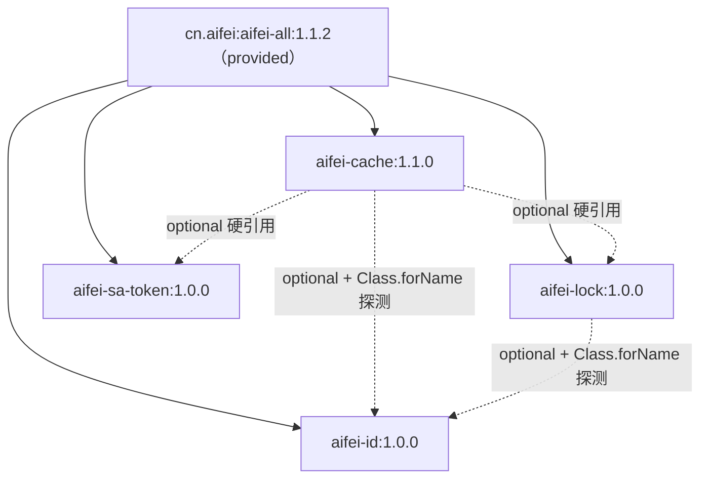

# aifei-eco-modules 模块规划与排期（2026-11）

> 状态：**建议稿**，不是仓库既有规划文档（`docs/需求/` 当前只有 `aifei-cache-1.1.0` / `aifei-lock` / `aifei-job` 三份任务输入）。
> 编制日期：2026-11-10　|　工期口径：单人估算（人周），不含需求评审与外部联调等待。

## 一、编制依据

1. **框架内核已覆盖，不得重复建设**：HTTP/Undertow、AOP/DI、路由与 Handler、JSON、Log、Enjoy 模板、`aifei-db`（ORM）。
2. **官方 `jfinal/aifei-eco` 生态近乎空白**：只有 `aifei-doc`、`aifei-demo`、`aifei-cache`、`aifei-redis`（官方已建议改用 cache）、`aifei-cron4j`（仅 5 段式 cron）。缺口由本仓库定义。
3. **本仓库已发布 8 个模块**：`aifei-cache` / `aifei-lock` / `aifei-sentinel` / `aifei-weixin` / `aifei-sa-token` / `aifei-websocket` / `aifei-mq` / `aifei-oss`。
4. **`aifei-job` 独立推进**：按 `docs/需求/aifei-job.md` 执行，不计入本排期；其 v1.1 集群互斥依赖 `aifei-lock`（已发布）。
5. **仓库纪律对每个新模块一律生效**：Java 8（class major 52）、公共 API 零框架类型/零第三方类型、根包公共类型数量精确、`ArchitectureBoundaryTest` 门禁、`aifei-all` 为 `provided`、第三方 SDK 为 `optional`、必配 `demo`（不发布）与文档四件套。

## 二、能力缺口盘点

| 能力域 | 现状 | 缺口 |
| --- | --- | --- |
| 入站 HTTP | 框架 `aifei-undertow` + HIO | 无（不建） |
| 出站 HTTP | 无 | **第三方 API 调用无统一客户端**：超时/重试/拦截/序列化各写各的 |
| 数据文件 | `aifei-oss` 只管存 | **Excel 导入导出无能力**，业务普遍裸用 POI |
| 标识生成 | 无 | **分布式 ID 无能力**，雪花实现散落各业务 |
| 可观测 | `aifei-log` 只有日志门面 | **请求链路无 traceId 贯穿**；**运行指标无暴露端点** |
| 第三方通道 | `aifei-weixin`（公众号/小程序/微信支付） | **短信、支付宝支付、APP 推送** 均无 |
| 流量治理 | `aifei-sentinel` | 无（已覆盖） |
| 异步消息 | `aifei-mq`（7 后端） | 无（已覆盖，含进程内 memory 后端） |
| 调度 | `aifei-job`（在研） | 无 |
| 认证鉴权 | `aifei-sa-token` | 无（已覆盖） |

## 三、推荐模块（三档）

### 第一档：优先建设（缺口明确、协同强、成本可控）

| 模块 | 坐标 | 补的缺口 | 与现有模块协同 | 公共面预估（须过设计决策） | 依赖策略 | 工期 |
| --- | --- | --- | --- | --- | --- | --- |
| `aifei-http` | `io.github.gollyhu:aifei-http:1.0.0` | 出站 HTTP：超时、重试、拦截器、请求/响应编解码 | 与 `aifei-sentinel` 咬合（资源名=接口标识）；`aifei-mq`/`aifei-job` 中的外部调用统一走它 | `HttpClient` / `HttpRequest` / `HttpResponse` / `HttpKit` / `HttpException` | 零第三方；纯 JDK `HttpURLConnection` 实现（口径见下方定档说明） | 3 周 |
| `aifei-excel` | `io.github.gollyhu:aifei-excel:1.0.0` | Excel 读写：注解表头映射、流式大文件 | 与 `aifei-oss` 组合（导入源 / 导出落盘） | `Excel` / `ExcelKit` / `ExcelException` + 1~2 注解 | EasyExcel `optional` | 2 周 |
| `aifei-id` | `io.github.gollyhu:aifei-id:1.0.0` | 分布式 ID：雪花 + 号段 | 号段复用 `aifei-cache#putIfAbsent`；workerId 分配复用 `aifei-lock` | `IdGenerator` / `IdKit` / `IdException` | 零第三方；`aifei-cache` / `aifei-lock` 均 `optional` | 2 周 |
| `aifei-trace` | `io.github.gollyhu:aifei-trace:1.0.0` | traceId 全链路贯穿 | HTTP 入口 → Service → `aifei-mq` 消息头 → `aifei-websocket` 帧头 → `aifei-job` 事件 | `TraceKit` / `TraceContext` / `TraceException` | 零第三方；依赖 `aifei-log` 上下文能力（**须前置验证**） | 2 周 |

> **`aifei-http` 依赖口径已定档（2026-11-10）**：走**零第三方纯 JDK**——不引入 okhttp、不设 provider 后端扩展点，传输实现只用 `HttpURLConnection`（Java 8 无 `java.net.http.HttpClient`，不存在第二条纯 JDK 路径）。技术底稿复用 `aifei-weixin` 的 `core.http.JdkHttpClient` / `pay.JdkPayHttpClient`（同路线已验证，含 multipart、文件下载、mTLS）。设计决策须明写四条能力边界：① 不支持 HTTP/2；② 连接池受 JVM 全局属性 `http.maxConnections` / `http.keepAlive` 约束、不可按实例调参，且模块**不得改写这些全局属性**（会波及同进程的 `aifei-weixin`）；③ 超时仅 connect / read 两段，无整体 deadline、不可取消在途请求；④ gzip、Cookie、重定向需自行实现。传输层保留一个仅供单测注入的内部接口，不作对外扩展点。

### 第二档：按业务需要排期（通道接入型，范式已被 `aifei-weixin` 验证）

| 模块 | 坐标 | 补的缺口 | 协同 | 公共面预估 | 依赖策略 | 工期 |
| --- | --- | --- | --- | --- | --- | --- |
| `aifei-metrics` | `io.github.gollyhu:aifei-metrics:1.0.0` | 运行指标采集 + Prometheus 文本端点 | 挂 `Handler` 暴露；与 `aifei-sentinel` 指标互补 | `MetricsKit` / `Metric` / `MetricsException` | 零第三方（自实现文本格式） | 2 周 |
| `aifei-sms` | `io.github.gollyhu:aifei-sms:1.0.0` | 短信通道：模板化发送 + 回执 | 与 `aifei-weixin` 同构（provider 白名单 + SDK `optional`） | `SmsClient` / `SmsKit` / `SmsMessage` / `SmsException` | 阿里云/腾讯云/华为云 SDK 均 `optional` | 2 周 |
| `aifei-pay` | `io.github.gollyhu:aifei-pay:1.0.0` | 支付宝支付：下单/查单/退款/回调验签 | 与 `aifei-weixin` 的 `PayApi` 契约对齐，便于业务两侧切换 | `AliPayClient` / `AliPayKit` / `AliPayNotifyUtil` / `AliPayException` | 纯 JDK 签名，零第三方 | 3 周 |

### 第三档：待定（需先验证可行性，不预先承诺）

| 模块 | 价值 | 前置风险 | 结论 |
| --- | --- | --- | --- |
| `aifei-audit` | 注解式操作审计 | 与业务日志边界模糊，落库/落 MQ 的职责切分需定档 | 待设计决策后再排 |
| `aifei-openapi` | 接口文档生成 | 依赖 aifei 路由反射元数据是否足够，未验证 | **先做 3 天可行性验证**，通过才立项 |

## 四、明确不建议建设

| 候选 | 不建理由 |
| --- | --- |
| `aifei-event`（进程内事件总线） | `aifei-mq` 的 memory 后端已是进程内总线；除非能说清「同步事件 + 事务内发布」这个 memory MQ 覆盖不了的语义 |
| `aifei-redis` | 官方已建议用 `aifei-cache` 替代 |
| `aifei-session` | `aifei-sa-token` 已覆盖登录态与跨实例共享 |
| `aifei-tenant`（多租户） | 需改 SQL 生成、侵入 `aifei-db` 内部，违反「公共 API 实现无关」且无法用门禁守护 |
| 注册中心 / 配置中心 / 网关 / 工作流 DAG | 属基础设施另立；工作流已被 `aifei-job` 的边界明确排除 |
| `aifei-i18n` / `aifei-captcha` / `aifei-state` | 价值偏低或已有轻量替代，不进入排期 |

## 五、排期

参考起算日：**2026-11-16（周一）**，共 18 周；各模块独立发版，可并行，工期不可直接相加。

| 阶段 | 周次 | 时间 | 内容 | 阶段里程碑 |
| --- | --- | --- | --- | --- |
| P0 前置验证 | W1 | 11/16 – 11/20 | ① `aifei-log` 是否支持 MDC 类上下文的 trace 注入；② `aifei-http` 的资源名规则如何与 `aifei-sentinel` 对齐；③ `aifei-openapi` 路由元数据可行性（3 天） | 三份结论写入 `docs/需求/`，决定 trace / openapi 是否立项 |
| P1 低风险闭环 | W2 – W3 | 11/23 – 12/04 | `aifei-id` 全量交付（含 demo） | `mvn clean verify` 0/0；门禁通过；可发布 1.0.0 |
| P1 低风险闭环 | W4 – W5 | 12/07 – 12/18 | `aifei-excel` 全量交付（含 demo） | 同上 |
| P2 业务刚需 | W6 – W8 | 12/21 – 01/08 | `aifei-http` 全量交付（跨元旦，含 `aifei-sentinel` 协同用例） | 同上；sentinel 资源名规则定档 |
| P2 业务刚需 | W9 – W10 | 01/11 – 01/22 | `aifei-trace` 全量交付（**P0 通过才启动**） | 同上；四类埋点（HTTP/MQ/WS/Job）用例齐全 |
| P3 运维与通道 | W11 – W12 | 01/25 – 02/05 | `aifei-metrics` 全量交付 | 同上 |
| — 假期 — | W13 | 02/06 – 02/14 | 春节，不排期 | — |
| P3 运维与通道 | W14 – W15 | 02/15 – 02/26 | `aifei-sms` 全量交付（先落地 1 家通道，其余按 `provider` 追加） | 同上 |
| P4 通道补齐 | W16 – W18 | 03/01 – 03/19 | `aifei-pay`（支付宝）全量交付 | 同上；回调验签与证书轮换用例齐全 |
| 待定 | — | 视 P0 结论 | `aifei-openapi`（可行性通过后 3 周）、`aifei-audit`（定档后 1.5 周） | — |

### 排期依赖关系

```text
P0 前置验证 ──┬─→ aifei-trace（必需）
              ├─→ aifei-openapi（决定是否立项）
              └─→ aifei-http 的资源名规则（影响设计决策）

aifei-cache ≥ 1.1.0 ─┐
aifei-lock           ┴─→ aifei-id（号段 + workerId）

aifei-weixin（PayApi 契约）─→ aifei-pay（支付宝侧对齐）
aifei-log ─→ aifei-trace
```

## 六、现有模块依赖关系与关联分析

> 本节基于各模块 `pom.xml`、源码引用与关卡测试实测梳理，作为第一至五节规划的依赖基线；口径截至 2026-11-17。

### 6.1 模块全景（按角色分两层）

| 层级 | 模块 | 说明 |
| --- | --- | --- |
| 库模块（SDK，12 个） | `aifei-cache` `aifei-lock` `aifei-sentinel` `aifei-weixin` `aifei-sa-token` `aifei-websocket` `aifei-mq` `aifei-oss` `aifei-job` `aifei-id` `aifei-trace` `aifei-http` | 可被应用依赖，坐标统一 `io.github.gollyhu:*`，Java 8 |
| 示例工程（8 个，不发布） | `aifei-sentinel-demo` / `aifei-websocket-demo` / `aifei-mq-demo` / `aifei-job-demo` / `aifei-id-demo` / `aifei-trace-demo` / `aifei-http-demo` / `aifei-oss-demo` | 各依赖对应库模块，并以 `compile` 声明 `aifei-all` |

共同底座：全部库模块均以 `provided` 依赖 `cn.aifei:aifei-all:1.1.2`，共享 Plugin 装配范式、`Prop` 配置、`@Inject` 单例、AOP 拦截与日志门面 `cn.aifei.log.Log`。`CODEBUDDY.md` 的模块表尚未列入 `aifei-lock` 与 `aifei-oss-demo`，需同步校准。

### 6.2 已落地的代码级依赖（3 条，全部 `optional`）



| 依赖方 | 被依赖方 | 性质 | 代码证据 |
| --- | --- | --- | --- |
| `aifei-lock` | `aifei-cache` | `optional`，硬引用 | `CacheLockStore` 直接引用 `Cache` / `CacheKit`，基于 `putIfAbsent` / `removeIfEquals` / `expireIfEquals` / `supportsCas` 实现原子锁 |
| `aifei-id` | `aifei-cache` + `aifei-lock` | `optional`，运行期按配置探测 | `IdDeps` 用 `Class.forName(name, false, loader)` 探测 `CounterKit` / `LockKit`，仅 `id.segment.store=cache` 或 `id.worker.source=cache/lock` 时需要 |
| `aifei-sa-token` | `aifei-cache` | `optional`，硬引用 | `SaTokenDaoForCache` 实现 `SaTokenDao`，以 `Cache` 作登录态持久层（纯缓存 / 缓存加速 + 权威委托两种形态） |

依赖方向的关键设计：`cache` 是事实上的底层基座，`lock` / `id` / `sa-token` 只向它单向依赖，`cache` 从不反向引用兄弟模块。所有跨模块依赖均为 `optional`、阻断传递，缺失时由 `IdDeps` / `LockErrors` 给出可读错误，而非直接 `NoClassDefFoundError`。

### 6.3 规划中 / 契约级关联（非代码依赖）

| 关联 | 当前状态 | 耦合方式 |
| --- | --- | --- |
| `aifei-lock` → `aifei-job:1.1.0` | 规划中（集群互斥） | `job.cluster.enabled=true` 时 `optional` 探测；锁语义完全交给 lock，本模块不复制 |
| `aifei-http` ↔ `aifei-sentinel` | 契约对齐（非代码依赖） | sentinel 资源名 = http 接口标识，规则 JSON 的 `resource` 须严格一致 |
| `aifei-trace` 贯通 `http` / `mq` / `websocket` / `job` | 规划中；`trace:1.0.0` 仅做 Web 入口绑定清理，零第三方、无 Plugin | 未来经 HTTP 头 / MQ 消息头 / WS 帧头 / Job 事件传播 traceId |
| `aifei-weixin` → `aifei-pay` | 未立项 | 复用 `PayApi` 契约，便于业务两侧切换 |
| `aifei-oss` ↔ `aifei-excel` | 未立项 | 导入源 / 导出落盘的组合关系 |
| `aifei-http` ↔ `aifei-weixin` | 技术底稿复用（非运行时依赖） | 同为纯 JDK `HttpURLConnection` 路线，http 复用 weixin 的 JdkHttpClient 实现经验 |

另有一组架构同构关系：`aifei-mq` / `aifei-websocket` / `aifei-cache` 共享「Provider 扩展点 + 静态注册表 + 命名实例」的装配范式；`aifei-sentinel` / `aifei-sa-token` 都通过 `cn.aifei.aop.Interceptor` 挂接横切逻辑。这些是模式复用而非代码依赖，由 `ArchitectureBoundaryTest` / `KernelBindingTest` 守护边界。

### 6.4 依赖形成与约束判断

1. **方向只能自底向上**：`cache` → `lock` → `job` / `id` / `sa-token` 这条链单向。任何让 `cache` 反向引用上层模块的改动都会引入循环依赖，破坏其基座定位。
2. **`optional` + 探测是刻意取舍**：跨模块依赖不向下传递，消费者必须显式声明所需坐标。"能形成依赖"不等于"自动获得依赖"——例如 `aifei-id-demo` 只声明 `aifei-id`，雪花模式可跑，号段模式还需引入 `aifei-cache`，否则启动期给出可读错误，属于契约式关联而非隐式耦合。
3. **能力协同不应升级为代码依赖**：`trace` 贯通 `mq` / `ws` / `job`、`http` 对齐 `sentinel`，正确做法是通过公共数据契约（消息头 / 帧头 / 资源名字符串）解耦，而非库模块互相 `import`——否则会撞上「公共 API 零第三方类型、零框架类型、根包公共类型数量精确」的门禁。
4. **版本管理风险**：`aifei-cache` 已是 `1.1.0`，其余库模块为 `1.0.0`；`lock` / `sa-token` / `id` 的 pom 各自写死 `<aifei-cache.version>1.1.0</aifei-cache.version>`，仓库根无聚合 pom，后续升级 cache 需逐个同步，存在遗漏风险。