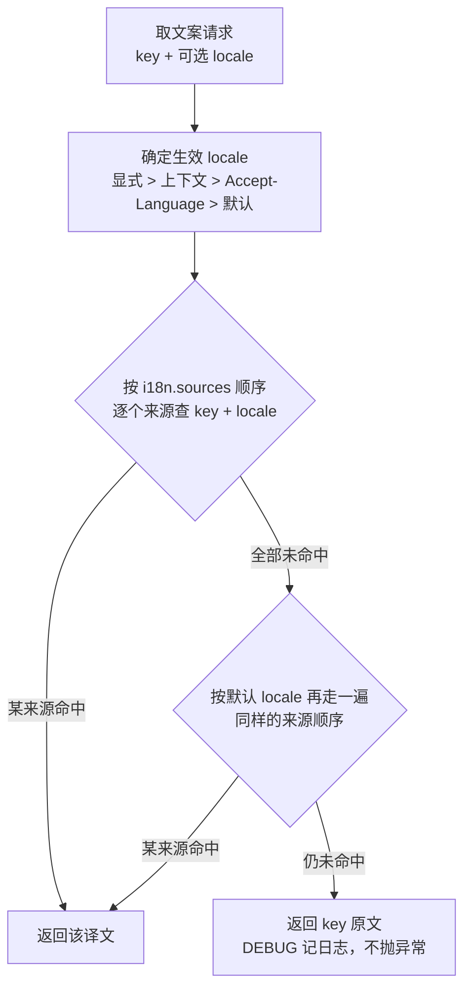
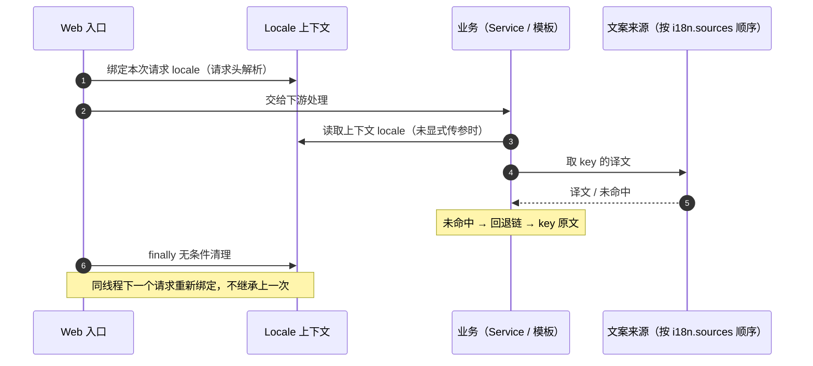
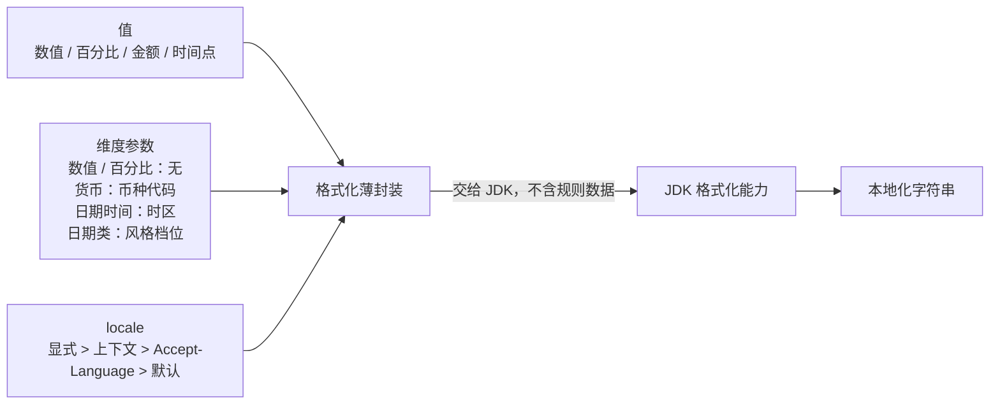
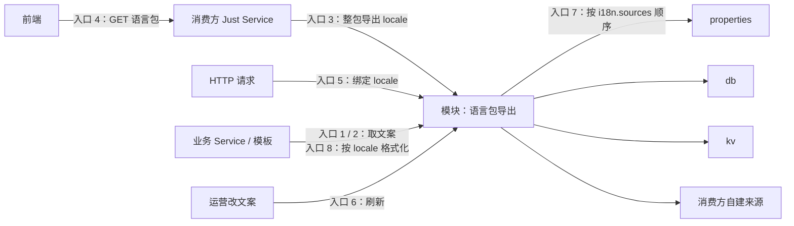

# aifei-i18n 模块需求文档

> **文件定位**：本文是 `aifei-i18n` 的**需求事实来源**（产品目标、范围边界、P0 验收标准）。接口签名、类名、包结构、扩展点装载机制属设计内容，由 `docs/design.md` 定档；本文只声明「必须支持什么、如何验收」。
> **关联**：`aifei-cache`（KV 来源，`optional`）；`aifei-trace`（Web 入口上下文绑定 + `finally` 清理的同构先例）。
> **决策出处**：`docs/计划/aifei-eco-modules 模块规划与排期.md` §6.2（2026-11-18 复评，撤销原「不建」结论）。
> **本轮修订（第一轮 2026-11-18）**：① 来源由「三种」封闭枚举改为**开放扩展点 + 3 个默认实现**；② 整包列举提为独立能力并单列验收；③ 新增「单点取文案与整包导出取值必须一致」约束；④ 缺失依赖语义由「kv 专属」泛化为「所有来源统一」；⑤ 补入 i18n 核心数据的分层归属边界与语言包契约补充点；⑥ §四 验收要点逐条转为 Given/When/Then。§一~§四 中已成立的决策全部保留，未推翻任何既有结论。
> **第二轮修订（2026-11-18，需求关核对后）**：① 修正 3 处实质缺陷（AC-03-1 与回退链自相矛盾、AC-10-1 未限定可列举来源范围、AC-14-3 引用错位）；② Q1~Q8 **全部裁决并转正为已定档契约**（下发 `dir` / `localeName`、不可列举来源「跳过 + WARN」、运行期故障「继续回退 + WARN」、配置键必填与默认值口径、整包下发原文、不新建 demo、非法 BCP 47 处置）；③ 依 Q4 裁决，「来源运行期故障容错」由 P1 升为 **P0（REQ-P0-15）**；④ **locale 规范化定档**（`zh_CN` → `zh-CN`、`zh-hant-tw` → `zh-Hant-TW`）并登记唯一定义点；⑤ **locale 语言级宽松匹配（`zh` ↔ `zh-CN`）降为 P1（REQ-P1-03）**，P0 只做规范化后精确匹配；⑥ 假设清单精简为 4 条，§10 改为裁决留痕。
> **第三轮修订（2026-11-18，格式化纳入 P0）**：① 数值 / 货币 / 日期 / 日期时间四项格式化**纳入本期并定为 P0**（新增 REQ-P0-16，6 条 AC）；② 格式化定性为**「Locale 贯通的薄门面」**——不实现任何格式规则数据，只把生效 Locale 交给 JDK（§1.1、§5.8）；③ `dir` 的 RTL 判定**禁止自建语言码集合**，只能走 JDK 公开 API，不可用时降级 `ltr` + WARN（Q9、§5.6、AC-14-5）；④ §3.2 第 7 条改写（规则数据仍不进来源）+ 补两条「不做」（度量换算 / 反向解析）、原第 10 条转为「边界澄清」，§3.3 ② / ⑤ 行同步改写；⑤ 既有已定档结论（回退链、来源开放、15 条 P0 及其 AC、locale 规范化、Q1~Q8 裁决）**全部保留、无一条被推翻**。
> **第四轮修订（2026-11-18，需求关核对后定档）**：① 新增 §5.8 ⑧ **日期类风格四档**（SHORT / MEDIUM / LONG / FULL，与 JDK `FormatStyle` 一一对应），**默认 MEDIUM 为硬编码契约**（不新增配置键）；② **禁止 pattern 透传**（§3.2 第 13 条，需求池留 REQ-P2-06）；③ **百分比并入「数值」子集纳入 P0**（AC-16-7）；④ **紧凑数字格式显式列入不做**（§3.2 第 12 条，理由：Java 8 无 JDK 原生 API，自建表违反 §3.3）；⑤ AC-16-2 / AC-16-3 改为**跨 provider 稳定的断言**（不写死货币符号字符、不比对完整日期串），新增 AC-16-8（默认档位）/ AC-16-9（非法档位与 `null` 口径），并删除「值类型与维度不匹配」这一在静态类型下不成立的异常项；⑥ P0 仍为 16 条，仅补 AC。
> **文档合并（2026-11-19）**：独立的「Enjoy 模板指令增量 PRD」（原独立增量文档，已随本次合并删除）已并入本文 **§十一 Enjoy 模板指令增量需求**。基础 PRD **§一~§十 章节号保持不变**，全仓库对 §6.1 / §5.7 / §5.5 等既有引用继续有效；原增量文档的 §一~§十 已降为本文 §11.1~§11.10 并重写交叉引用。本次合并只追加章节，不改写历史修订记录与任何既有结论。

## 一、产品目标

**一句话**：为 aifei 应用提供「后端按 Locale 取单条文案、前端按 Locale 取整包语言包」的统一能力，并把「当前生效 Locale」贯通到 JDK 的数值 / 货币 / 日期格式化（薄封装，不实现格式规则）；文案来源开放可扩展（模块自带 `properties` / `db` / `kv` 三个默认来源，保证开箱可用；消费方可按需接入任意符合契约要素的来源并按声明顺序叠加），运行期可刷新。

- **给谁用**：需要多语言的产品应用（Java 8 + aifei）的后端开发者、前端开发者、以及维护文案的运营/翻译人员。
- **成功标准**：① 消费方不自己写「Locale 解析 + 来源叠加 + 回退 + 缓存 + 语言包导出 + 格式化样板」六类逻辑即可同时服务后端与前端；② 改一条文案**不需要重新发版**（发版前置条件由来源形态决定，非模块限制）；③ 后端与前端文案来自**同一份数据源**，不出现两套数据失配；④ 模块不存在也不承诺的功能（复数 / 性别 / 序数规则、度量单位换算、反向解析、紧凑数字格式、自定义格式串透传、翻译流程）有明确边界，不被误当作缺功能；⑤ 消费方渲染数值 / 金额 / 日期时不必自己记「币种是独立参数、时区是独立参数、locale 只决定写法」。

### 1.1 格式化能力的定位：Locale 贯通的薄门面

第三轮把格式化纳入 P0，但**定性不是「实现格式化能力」，而是「把 Locale 贯通到 JDK 的格式化 API」**。这个定性决定了模块的边界与体量：

- **模块不实现任何格式化规则**：不复制 CLDR 的日期 / 数字模式字符串，不建货币符号表，不建语言码→书写方向表，不落库、不进来源（§3.2 第 7 条、§3.3 ②）。
- **模块只做一件事**：把「本次调用生效的 Locale」正确传给 JDK 的格式化能力，并统一「值 + 维度参数 + locale」的三参形态（§5.8）。
- **价值主张**：Locale 贯通在本模块已经解决（显式 > 上下文 > `Accept-Language` > `i18n.defaultLocale`，§5.5）；而消费方自己写格式化时，最容易出错的恰恰是这一步——忘记传 locale 而落到 JVM 默认、用 locale 反推币种、把时区与 locale 混为一谈、每次调用重复构造格式化器。这类样板代码没人愿意重复写一遍，也很难在评审里被看住。
- **明确不做**：ICU 复数 / 性别 / 序数规则；度量单位换算（公制 / 英制）；时区数据库维护；`NumberFormat.parse()` 之类的反向宽松解析；紧凑数字格式；自定义格式串（pattern）透传（均见 §3.2、§6.3）。

## 二、背景与问题

框架与现有生态模块均无国际化构件。业务侧替代只有 JDK `ResourceBundle`，四条硬限制：

1. 文案编译期打包进 classpath，改一条文案须重新发版；
2. 来源唯一，无法接数据库或 KV，更无法接远程翻译服务等其它形态；
3. 前端语言包需另建一条导出通道，与后端文案两套数据源易失配；
4. Locale 无贯通口径，请求头 → 服务 → 模板各写一套解析。

`aifei-trace` 已证明「Web 入口绑定上下文 + `finally` 清理」在本仓库可行且必要（线程复用不得串数据），Locale 上下文与之同构，本模块沿用同一形态。

## 三、范围

### 3.1 交付范围（本期做）

- 交付 `io.github.gollyhu:aifei-i18n:1.0.0-SNAPSHOT`，包名 `cn.hg.aifei.i18n`，Java 8（class major 52）。
- **文案来源：1 个扩展点 + 3 个默认实现**。`properties`（零依赖默认，classpath）/ `db`（框架内核数据库能力，只读）/ `kv`（`aifei-cache`，`optional`）是**随模块附送的默认件**，不是可选集合的封闭枚举。
- **来源数量由消费方决定**：任何满足「来源基本要素」（§5.2）的实现都可接入并按序参与叠加，**无需修改模块代码、无需改 pom、无需新增配置键**。
- 后端取单条文案能力 + 前端语言包整包导出能力；**模块本身不提供 HTTP 端点**，下发由消费方的 Just Service 一行完成（JSON 契约写进 `README.md` 与 `docs/design.md`）。
- **最小格式化能力（Locale 贯通的薄封装）**：数值（含百分比）/ 货币 / 日期 / 日期时间四项，locale 复用同一解析优先级；日期类支持 SHORT / MEDIUM / LONG / FULL 四档风格（默认 MEDIUM）；不含任何格式规则数据（§5.8、REQ-P0-16）。
- 公共 API 零第三方类型、零框架类型；根包公共类型数量精确并由架构门禁断言（数量由设计关定档，本文不承诺）。
- `aifei-all` 为 `provided`，消费方自带。

### 3.2 本期不做（边界，防范围蔓延）

1. **前端 i18n SDK 与语言包运行时**：本仓库是后端 Java 生态仓库，前端消费方式只交付 JSON 契约文档。
2. **翻译管理后台、审校流程、机器翻译接入**。
3. **ICU 复数 / 性别 / 序数规则**：v1 只做 `MessageFormat` 风格 `{0}` 位置占位（见 §5.6 与 §6.3 的破坏性变更声明）。
4. **多租户维度**（`aifei-tenant` 已明确不建）：分租户文案用 key 前缀规避。
5. **运行期建表与数据库迁移**：`db` 来源只读，建表 SQL 随文档给出，模块不执行 DDL。
6. **文案版本号与增量下发**：v1 整包全量导出。
7. **格式化规则数据**（日期 / 数字 / 货币的格式模式字符串、货币符号表，源数据来自 CLDR）：仍**不进来源、不落库、不自建**。本期新增的只是**一层 Locale 贯通的薄封装**——把生效 Locale 交给 JDK，自身不含任何规则数据（§5.8、REQ-P0-16）。度量单位换算与反向解析仍不做（见第 10、11 条）。
8. **语言语法与形态规则**（复数 / 性别 / 序数的规则数据）：同上，委托 JDK / ICU，不进来源。
9. **文化与布局**（排序规则 / 文化特定内容 / 文化相关的布局约定）：不承载。**例外**：某语言的「书写方向（LTR / RTL）」作为一个 locale 元数据标记随语言包下发（已定档，见 §6.1 REQ-P0-14）；该标记的判定同样不自建数据（§5.6、Q9）。
10. **度量单位换算**（公制 / 英制，CLDR units）：不做。单位换算涉及物理量与舍入策略，与「按同一 locale 呈现」不是同一件事，且 JDK 无稳定公开 API。
11. **反向解析**（`NumberFormat.parse()` 等宽松解析）：不做。`1,234` 的两种解读只能静默择一，错误不会被调用方察觉，风险高于收益（§6.3 REQ-P2-04）。
12. **紧凑数字格式**（`12K` / `1.2万`，CLDR compact decimal）：**不做，且不得以自建规则表实现**。理由：`NumberFormat.getCompactNumberInstance` 是 **Java 12+** 的 API，本项目基线为 **Java 8，无任何 JDK 原生能力**；唯一的实现路径是自建「单位词 + 阈值 + 舍入」规则表，直接违反 §3.3「不自建标准数据」硬边界。待基线抬升到 Java 12+ 后再评估（§6.3 REQ-P2-07）。
13. **自定义格式串（pattern）透传**：不做。允许透传 `yyyy-MM-dd` 这类模式串会让调用方自行写死格式，与「按 locale 呈现」的定位冲突，且模块将退化为 JDK 的转发壳；自定义格式串消费方直接用 JDK 即可，无需本模块封装（§6.3 REQ-P2-06）。

**边界澄清（不属「不做」项）**：**后端按 locale 做格式化输出**已定为本期 P0，承诺**最小格式化子集**——数值（含百分比）/ 货币 / 日期 / 日期时间四项（REQ-P0-16）；日期类的风格档位只提供 SHORT / MEDIUM / LONG / FULL 四档、默认 MEDIUM（§5.8 ⑧）；一致性口径为**同一 JDK 内行为稳定、跨 JDK 差异由 JDK 自带的 locale 数据决定**（见 §8「兼容性」）。此条列此仅作口径澄清，避免与「不做」清单混淆。

### 3.3 i18n 核心数据的分层与归属（范围校准）

市面 i18n 核心数据分五类，性质不同，归属必须分清，防止后续把标准数据塞进来源：

| # | 数据类别 | 内容举例 | 性质 | 归属 |
| --- | --- | --- | --- | --- |
| ① | 文本与消息资源 | 按钮文案、提示语、错误消息、页面标题 | **业务可编辑，须建存储** | **本模块承载的唯一业务数据**（来源 + 语言包） |
| ② | 格式与解析规则 | 日期 / 数字 / 货币格式模式、货币符号表 | 只读标准数据（CLDR） | 平台能力（JDK / ICU），**只做 Locale 贯通的薄封装，不自建任何格式规则数据** |
| ③ | 语言语法与形态规则 | 复数、性别、序数 | 只读标准数据 | 平台能力（JDK / ICU），**不做** |
| ④ | 区域设置元数据 | Locale 标识符、语言/国家的本地化名称 | JDK 内置 | **只做 BCP 47 合法性校验**，不自建元数据表 |
| ⑤ | 文化与布局 | 排序规则（Collator）、布局方向、文化特定内容 | 部分标准数据 + 部分人工决策 | 平台能力 / 前端承担；**仅「书写方向」作为元数据下发**（已定档），且 `dir` **只经 JDK 公开 API 判定、禁自建方向表**（§5.6、Q9） |

结论：**只有 ① 进来源**。②③⑤ 不得以「CLDR 数据表」「格式化规则表」「方向映射表」等形式进入来源或落库——② 的薄封装与 ⑤ 的 `dir` 都只**读取平台判定结果**，自身不携带任何规则数据；④ 只校验标识符合法性，不复制语言/国家译名表。

## 四、用户故事

- 作为**后端开发者**，我希望用 `key + locale` 取到译文并自带回退，以便业务代码不出现任何 `if (locale=="zh")` 分支，也绝不因缺翻译而 500。
- 作为**后端开发者**，我希望请求进入时自动确定 Locale 并在请求结束时清理，以便同线程复用时不会串语言，我不用手写解析与清理。
- 作为**前端开发者**，我希望一次拿到某语言的整包文案（结构固定、key 顺序稳定），以便做静态资源与 diff，且与后端取到的是同一份数据。
- 作为**运营 / 翻译人员**，我希望改一条文案不需要开发发版，改动后由系统刷新即生效。
- 作为**接入方架构师 / 开发者**，我希望把公司自有的文案来源（如远程翻译服务、运营后台快照、内存测试替身）接进同一套叠加与回退机制，而不修改模块代码。
- 作为**后端开发者**，我希望按当前生效 Locale 把数值、金额、日期直接渲染成用户可读的字符串，以便我不用自己拼 Locale 解析、不用记「币种该传哪儿、时区该传哪儿」。
- 作为**模块维护者**，我希望模块边界清晰（不碰格式规则数据、不碰翻译流程），以便长期维护成本可控。

## 五、核心概念与已定档契约

### 5.1 术语

| 术语 | 含义 |
| --- | --- |
| **文案（message）** | 一条可翻译文本，以 `key` 定位、以 `locale` 区分语种 |
| **来源（source）** | 提供文案的实体；存储型 / 快照型 / 代理型 / 计算型 / 组合型 / 测试替身皆可，只要满足 §5.2 要素 |
| **稳定名** | 来源的唯一定位名，供配置项 `i18n.sources` 引用，清单与日志均以此名出现 |
| **默认来源** | 随模块附送的 `properties` / `db` / `kv`，开箱可用，不享有任何特殊地位 |
| **单点命中** | 给定 `key + locale` 返回该来源的译文，或明确返回「无译文」 |
| **整包列举** | 给定 `locale` 返回该来源掌握的全部 `key → 文案` 对 |
| **语言包（bundle）** | 一次导出的 JSON 结果：`locale` + 元数据 + 有序 `messages` |
| **回退链** | 未命中时的固定降级路径：按 locale 查来源 → 默认 locale 再查 → 返回 key 原文 |
| **上下文 Locale** | 当前线程绑定的 Locale，Web 入口绑定、请求结束清理 |

### 5.2 文案来源的基本要素（开放集合）

来源是**开放集合**：模块只约束「必须满足什么才算来源」，不限定实现形态、不限定数量、不限定后端技术。

**必修要素（三条，缺任一即不构成合法来源）**

| # | 要素 | 含义 | 为什么必修 |
| --- | --- | --- | --- |
| ① | **唯一定位** | 有稳定名，可在 `i18n.sources` 中被引用；重名必须能报错 | 叠加顺序、错误定位、日志都靠它 |
| ② | **单点命中** | 给定 `key + locale`，返回译文或明确「无译文」 | 单条取文案的唯一基础 |
| ③ | **未命中可区分** | 「没有译文」必须能与「译文是空串」区分开 | 否则空串会被误当未命中而错误回退到默认 locale / key 原文 |

**选修要素（两条，缺失时降级而非失败）**

| # | 要素 | 缺失后果 |
| --- | --- | --- |
| ④ | **整包列举** | 该来源不参与整包导出（如远程翻译服务通常只能按 key 查） |
| ⑤ | **运行期刷新** | 该来源的 `refresh()` 视为无操作（如 `properties` 改值须重启） |

```mermaid
flowchart LR
    subgraph 合法来源 = 必修 x3
        A1[唯一定位<br/>稳定名]
        A2[单点命中<br/>key + locale]
        A3[未命中可区分<br/>无译文 ≠ 空串]
    end
    subgraph 选修能力
        B1[整包列举<br/>缺→不参与导出]
        B2[运行期刷新<br/>缺→refresh 无操作]
    end
    合法来源 --> 默认件1[properties]
    合法来源 --> 默认件2[db]
    合法来源 --> 默认件3[kv]
    合法来源 --> 自定义[消费方自建来源<br/>存储/快照/代理/计算/组合/测试替身]
```

### 5.3 叠加、回退与跨路径一致性

- 叠加顺序：由配置项 `i18n.sources` 的**声明顺序**决定，**先命中先返回**（已定档，不可配其它语义）。
- 回退链**唯一且不可配**：`按 locale 逐来源 → 默认 locale 逐来源 → 返回 key 原文`。未命中返回 key、**不抛异常**（缺翻译不得让接口 500），DEBUG 级记日志；**不提供 strict 模式**（避免两套语义）。
- **跨路径一致**：同一 `key` 在多个来源都有值时，「单条取文案」与「整包导出」**必须取同一来源的值**，不得出现「单点取到 A、整包导出是 B」。
- **来源运行期故障不中断**：来源抛异常（DB 超时、KV 不可用）视为该来源本次无译文并继续回退，不向上抛，WARN 记日志（已定档，Q4；见 REQ-P0-15）。



### 5.4 缓存与刷新（已定档）

- `properties` 启动期全量载入内存；`db` / `kv` 按 key 懒加载并本地缓存，默认 TTL **60s**，可配。
- 刷新入口 `refresh()` 显式**全清**，供后台改文案后立即生效。
- `properties` 改值须重启（README 必须声明），这是「选修要素 ⑤ 运行期刷新」的缺失表现，不是缺陷。

### 5.5 Locale 解析与上下文（已定档）

- 解析优先级：**显式传参 > 上下文 Locale > 请求头 `Accept-Language` > `i18n.defaultLocale`**。
- 该优先级是**唯一定义点**：格式化路径（§5.8）复用同一实现的同一优先级，**不得在格式化入口另写一套解析**（否则同一请求里「文案是 `zh-CN`、金额是 `en-US`」）。
- **locale 规范化（已定档）**：任何入参先规范化，再参与后续全部动作（匹配、缓存 key 拼装、导出 `locale` 字段）：`_` 归一为 `-`、语言码小写、地区码大写、脚本码首字母大写（`zh_CN` → `zh-CN`、`zh-hant-tw` → `zh-Hant-TW`）。这是对 DB 存量数据与跨生态惯例（下划线写法常见）的必要兼容；规范化规则只有一个定义点（见 §8）。
- **匹配粒度（已定档）**：P0 在规范化后与 `i18n.locales` 做**精确匹配**；语言级宽松匹配（`zh` ↔ `zh-CN`）不属 P0（见 §6.2 REQ-P1-03），P0 下不匹配时按回退链落到默认 locale。
- 上下文 Locale 由 Web 入口绑定、**`finally` 清理**（对齐 `aifei-trace` 的 Handler 模式，线程复用不得串语言）；下游抛异常时清理照常执行。
- 整包导出入口**必须显式传 locale，不受上下文影响**（导出是「给哪个语言打一份包」，与「当前请求是什么语言」无关）。



### 5.6 语言包契约（已定档，含本轮补充）

- JSON 形状固定，`messages` 为有序映射：

```json
{
  "locale": "zh-CN",
  "localeName": "中文（中国）",
  "dir": "ltr",
  "messages": { "login.title": "登录", "login.submit": "提交" }
}
```

- `locale`、`messages`、`localeName`、`dir` 四个字段均为**已定档契约**（Q1 / Q3 已于 2026-11-18 裁决）；`locale` 为**规范化后**的取值（见 §5.5）。
- `localeName` 必须由 JDK 内置 locale 能力直接得到（该语言在该语言中的名称），**不引入任何语言名译名表**（呼应 §3.3 ④）。
- `dir` 的取值**只能来自 JDK 公开 API**（`ComponentOrientation.getOrientation(Locale)` 或等价 JDK 公开能力），**不得内置语言码→方向的映射表**（Q9 硬边界，呼应 §3.3 ⑤）。
- 该判定能力在运行环境不可用时，`dir` **降级为 `ltr` 并产生 WARN 日志**：导出仍然成功、JSON 契约不变、不导致启动失败（该裁决的模块依赖代价见 §8「兼容性」）。
- `messages` 的 key 顺序**稳定**以便前端 diff（建议按 key 的字典序升序；顺序规则一旦定档不得随实现变化）。
- `value` 类型**恒为字符串**：v1 不支持 ICU 复数/变体；未来引入会同时改变存储格式与 JSON 契约，属**破坏性变更**。
- 整包导出下发的是**文案原文（含 `{0}` 占位符）**，占位符替换只在单条取文案时发生（已定档，Q6）。

### 5.7 装配与配置（已定档）

配置键最小集，共 4 个，**无「启用开关」**（不装配即不用，对齐 `aifei-lock`）：

| 配置键 | 含义 | 必填 / 默认值 |
| --- | --- | --- |
| `i18n.defaultLocale` | 回退链的终点语种；也是无显式/上下文/请求头时的生效语种 | **必填**；缺失即启动失败 |
| `i18n.locales` | 支持的语种列表（用于请求头 `Accept-Language` 匹配；**不阻断显式 locale 的整包导出**） | 可选；未配置 = 不做白名单限制（接受任意合法 BCP 47） |
| `i18n.sources` | 来源稳定名的有序清单，顺序即叠加与回退顺序 | 可选；未配置默认仅 `properties` |
| `i18n.cache.ttlMillis` | 缓存 TTL | 可选；默认 60000；`≤ 0` 视为不缓存 |

### 5.8 格式化契约（已定档，第三轮新增）

本期把「数值（含百分比）/ 货币 / 日期 / 日期时间」四项格式化纳入 P0，形态是**Locale 贯通的薄封装**：模块不复制任何格式规则数据（无 CLDR 模式字符串、无货币符号表、无方向表），只负责把「本次调用生效的 Locale」交给 JDK 的格式化能力，并统一参数形态。

**① 三参形态，各维度正交**

所有格式化入口的输入恒为**值 + 维度参数 + locale** 三个彼此正交的维度，**不得合并**为「一个 locale 决定一切」；日期类在此基础上多一个**显式档位参数**（见 ⑧），同样独立、不与其它维度合并：

| 维度 | 含义 | 按能力展开 |
| --- | --- | --- |
| **值** | 待格式化的原始值 | 数值（含百分比比例）/ 金额 / 时间点 |
| **维度参数** | 该能力独有的业务参数 | **数值 / 百分比：无额外维度**；**货币：币种代码是独立参数**；**日期 / 日期时间：时区是独立参数** |
| **风格档位**（仅日期类） | 输出的详细程度 | SHORT / MEDIUM / LONG / FULL，默认 MEDIUM（见 ⑧）；数值 / 货币 / 百分比无此维度 |
| **locale** | 决定数字字形、千位与小数分隔符、月份与星期名称、日期字段顺序 | 复用 §5.5 的解析优先级 |

- **币种与 locale 正交**：同一个 `zh-CN` 用户会看 USD 价格。以 locale 推断币种（`getCurrencyInstance(locale)` 默认取该 locale 本国货币）是**典型错误来源**，本期要求币种单独传入。
- **时区与 locale 正交**：时区只决定「是哪一刻」，locale 只决定「怎么写」，两者不能互相推导。
- **小数位由币种决定，不由 locale 决定**：JPY / KRW 为 0 位，多数币种 2 位，BHD / KWD 为 3 位。
- **百分比属「数值」的自然子集**：`0.85` → `85%`（折扣、税率、进度的高频场景）。百分号位置、是否留空格、小数位一律由 JDK 按 locale 决定，模块不自建任何百分比写法规则。



**② locale 解析不重复实现**：格式化路径的 locale 解析复用 §5.5 的**同一套优先级与同一实现**，这是唯一定义点（见 AC-16-4）。

**③ 数字字形由 JDK 决定，模块不干预**：`ar-EG` 输出阿拉伯-印度数字（`١٢٣٤٫٥`），`ar-SA` 输出拉丁数字。差异来自 JDK 的 locale 数据，模块**不做归一化、不提供「强制拉丁数字」选项**。

**④ 不提供反向解析**：宽松解析会静默吞错（`1,234` 到底是千位还是小数只有猜），风险高于收益，故格式化是**单向**的，`parse` 能力属本期不做（§3.2 第 11 条、§6.3 REQ-P2-04）。

**⑤ 跨 JDK 一致性口径**：**同一 JDK 内**同一输入同一 locale 输出稳定；**跨 JDK** 的差异由 JDK 自带的 locale 数据决定，模块**不承诺字节级一致**。`README.md` 须推荐以 `-Djava.locale.providers=CLDR` 统一行为（Java 8 默认 provider 为 JRE，Java 9+ 默认 CLDR，见 §8）。

**⑥ 异常语义**

- 显式传入**非法币种代码**（如 `XYZ`）或**非法时区 ID**（如 `Mars/Base`）→ `IllegalArgumentException`，与 AC-08-7 同口径：显式传参写错由调用方负责，不静默降级。
- 显式传入**档位枚举之外的取值** → `IllegalArgumentException`（若设计关采用枚举类型，则该错误由编译期类型检查承担；本文以运行期断言为准，二者取其一即可，不得两者都不做）。
- **传 `null` 值 → `IllegalArgumentException`**：显式传参错误，**不静默返回空串、不输出字面量 `"null"`**；`null` 币种代码、`null` 时区同样 → `IllegalArgumentException`。
- **无显式 locale 且上下文为空** → 落 `i18n.defaultLocale` 输出，**不抛异常**（与取文案同一优先级）。

**⑦ 不新增配置键**：不提供默认格式模式、不提供小数位覆盖、不提供「是否启用格式化」开关；配置键仍为 §5.7 的 4 个（AC-12-1 不变）。默认风格档位 MEDIUM 属**硬编码契约**，不可配置。

**⑧ 风格档位（仅日期 / 日期时间 / 时间）**

JDK 对同一时刻有四档风格，同一 `en-US` 分别产出 `11/18/26`、`Nov 18, 2026`、`November 18, 2026`、`Wednesday, November 18, 2026`——只约束「字段顺序」无法写出可断言的验收标准，故档位必须定档：

- 日期、日期时间、时间三类各提供 **SHORT / MEDIUM / LONG / FULL 四档**，与 JDK 的 `FormatStyle` **一一对应**；模块不自定义档位语义、不提供中间档、不改变档位含义。
- **默认档位 = MEDIUM**：不传档位时取该值，等值于显式传 MEDIUM 的输出。该默认值**属已定档契约的一部分**，硬编码、不可配置（不新增配置键，AC-12-1 不变）。
- 档位是**入口的显式参数**，与 locale、维度参数**并列正交**：档位不参与 locale 解析优先级，locale 也不影响档位含义。
- **不接受任意模式串（pattern）**：P0 只有上述四档枚举，无 `yyyy-MM-dd` 这类透传通道。理由：pattern 透传会让调用方自行写死格式，与「按 locale 呈现」的定位直接冲突，模块会退化成 JDK 的转发壳；需要自定义格式串的消费方直接用 JDK 即可（§3.2 第 13 条、§6.3 REQ-P2-06）。
- 数值 / 货币 / 百分比**不受档位影响**（无此参数）。

## 六、需求池

### 6.1 P0（本期必须，缺了不算交付）

#### REQ-P0-01 单条文案取用

按 `key + locale` 返回译文；`db` / `kv` 未命中当前 locale 时按回退链处理；支持 `{0}` 风格位置占位。

- **AC-01-1** Given 某来源对 `key=login.title` / `locale=zh-CN` 有译文「登录」，When 以该 key 与 locale 取文案，Then 返回「登录」。
- **AC-01-2** Given 译文为 `hello {0}`，When 取文案并传入参数 `Bob`，Then 返回 `hello Bob`；Given 传入参数少于占位符个数，Then 缺参的占位符**原样保留**、不抛异常。
- **AC-01-3** Given 同一线程并发多次取不同 locale 的同一 key，When 全部返回，Then 每条结果与所请求 locale 严格对应，无串语言。

#### REQ-P0-02 未命中不抛异常

- **AC-02-1** Given 所有来源对 `key=no.such.key` 均无该 locale 译文，When 取文案，Then 返回字符串 `no.such.key` 本身，**不抛任何异常**。
- **AC-02-2** Given 未命中，When 查看日志，Then 有 DEBUG 级记录（含 key 与 locale），无 WARN / ERROR。
- **AC-02-3** Given 某来源对某 key 的译文是**空串**，When 取文案，Then 返回空串且**视为命中**——不回退到默认 locale、不返回 key（要素 ③ 的直接验收点）。

#### REQ-P0-03 回退链唯一且不可配

- **AC-03-1** Given `i18n.defaultLocale=en`、`i18n.sources=db,properties`，key 在两个来源**均无** `zh-CN` 译文、仅在 `properties` 有 `en` 译文，When 以 `zh-CN` 取文案，Then 走默认 locale 逐来源命中 `properties` 的 `en` 值。
- **AC-03-2** Given 同一 key 在 `db`（顺序 1）与 `properties`（顺序 2）都有 `zh-CN` 译文，When 以 `zh-CN` 取文案，Then 返回 `db` 的值。
- **AC-03-3** Given 配置中不存在任何可切换回退语义的开关，When 尝试配置 strict / 抛出模式，Then 该配置键不被识别（启动时按未知键处理，不产生第二种语义）。

#### REQ-P0-04 来源开放扩展

任何满足 §5.2 必修要素的实现都可接入并按序参与叠加，**不改模块代码**。

- **AC-04-1** Given 消费方实现一个新来源（如远程翻译服务代理），When 在 `i18n.sources` 中按其稳定名声明，Then 该来源参与叠加与回退，模块源码与 pom 均无需改动。
- **AC-04-2** Given 该来源只满足必修要素、不满足「整包列举」，Then 单条取文案正常，整包导出按 REQ-P0-09 的降级规则处理（不导致启动失败）。
- **AC-04-3** Given 两个实现形态截然不同的来源（如存储型与计算型），When 走同一套契约用例，Then 行为一致（契约与形态无关）。
- **AC-04-4** Given 两个来源使用同一稳定名，When 启动，Then 启动失败，消息含该稳定名与「重复」语义。

#### REQ-P0-05 叠加顺序生效

- **AC-05-1** Given `i18n.sources=kv,properties` 与 `i18n.sources=properties,kv` 两种配置，同一 key 两者都有值，When 分别启动并取文案，Then 返回值分别为 `kv` 与 `properties` 的值。
- **AC-05-2** Given 顺序中靠前的来源未命中，When 取文案，Then 继续查询其后的来源，不中断。

#### REQ-P0-06 三个默认来源开箱可用

`properties` / `db` / `kv` 各自可单独使用，也可任意组合。

- **AC-06-1** Given 仅装配 `properties` 来源（零外部依赖），When 取文案，Then 命中 classpath 资源中的文案；该来源**零第三方依赖**，启动期一次全量载入。
- **AC-06-2** Given 仅装配 `db` 来源，When 取文案，Then 通过只读查询命中；**模块不执行任何 DDL**，建表 SQL 随文档交付且已声明「只读」。
- **AC-06-3** Given 仅装配 `kv` 来源且 classpath 含 `aifei-cache`，When 取文案，Then 命中缓存中的文案。
- **AC-06-4** Given 三个默认来源与一个自建来源混合声明，When 取文案，Then 按声明顺序统一参与叠加（默认来源不享有特殊优先级）。

#### REQ-P0-07 缓存与刷新

- **AC-07-1** Given `db` / `kv` 来源被某个 key 查询一次，When 在 TTL 内再次查询同一 key，Then 来源只被调用一次（本地缓存命中）。
- **AC-07-2** Given TTL 配置为很短值（测试可测范围内），When 超过 TTL 后再次查询，Then 重新回到来源取值。
- **AC-07-3** Given 后台已改文案，When 调用刷新入口 `refresh()` 后再次取文案，Then 返回新值；`refresh()` **全清**所有来源的缓存。
- **AC-07-4** Given `properties` 来源的 classpath 资源在运行期被改动，When 取文案，Then 仍返回启动期载入的旧值；该「须重启」语义在 `README.md` 中明确声明。

#### REQ-P0-08 Locale 解析与上下文贯通

- **AC-08-1** Given 显式传 `zh-CN` 而上下文已绑定 `en`，When 取文案，Then 以显式传参为准。
- **AC-08-2** Given 未显式传参、上下文已绑定 `en`，When 取文案，Then 用 `en`。
- **AC-08-3** Given 无显式传参且无上下文、请求头 `Accept-Language: zh-CN,en;q=0.8`，When 取文案，Then 用 `i18n.locales` 中首个受支持语种（本场景为 `zh-CN`）。
- **AC-08-4** Given 显式、上下文、请求头全部缺失或无法解析，When 取文案，Then 用 `i18n.defaultLocale`。
- **AC-08-5** Given 同一 Web 线程先后处理两个 `Accept-Language` 不同的请求，When 两次取文案，Then 各自返回对应语种结果，第二个请求**不继承**第一个请求的 locale（`finally` 清理生效）。
- **AC-08-6** Given 下游业务抛异常，When 请求结束，Then 上下文仍被清理（清理后同线程读取上下文为空）。
- **AC-08-7** Given **显式传入**非法 locale 标识（如 `zh_CN_`、空串），When 取文案，Then 抛 `IllegalArgumentException`（调用方写错，不静默吞掉）。
- **AC-08-8** Given 请求头 `Accept-Language` 含非法片段（如 `zh_CN_`），When 解析，Then **静默忽略该片段**并在其余片段中继续精确匹配；全部不可用时按回退链落到 `i18n.defaultLocale`，不抛异常。
- **AC-08-9** Given 以 `zh_CN`（下划线）取文案且来源以规范值 `zh-CN` 存有译文，When 返回，Then 命中该译文（规范化先于匹配）。

#### REQ-P0-09 语言包整包导出

- **AC-09-1** Given 两个**可列举**来源分别提供不同 key，When 导出某 locale 的整包，Then `messages` 含两者全部 key。
- **AC-09-2** Given 同一 key 在多个可列举来源都有值，When 导出，Then 取叠加顺序最靠前者（与 REQ-P0-10 一致）。
- **AC-09-3** Given 同一 locale 连续导出两次（内容未变），When 比对，Then key 顺序逐字一致（稳定排序）。
- **AC-09-4** Given 上下文已绑定 `en`，When 显式以 `zh-CN` 导出，Then 输出 `locale` 为 `zh-CN`（导出结果与上下文无关）。
- **AC-09-5** Given `messages` 中每个 value，When 校验类型，Then 全部为字符串，且数值/布尔/嵌套结构一律不被导出为原生类型。
- **AC-09-6** Given 某来源不支持整包列举（选修要素 ④ 缺失），When 导出，Then 导出**仍然成功**、跳过该来源、产生一条含来源稳定名的 WARN 日志（已定档，Q2）。

#### REQ-P0-10 单点取文案与整包导出取值一致

- **AC-10-1** Given `zh-CN` 下由**至少一个可列举来源**覆盖的 key 集合 K，When 对 K 中每个 key 分别执行「单条取文案」与「整包导出后读取」，Then 两路径返回同一来源的同一值（逐 key 比对相等）。
- **AC-10-2** Given 缓存已存在、TTL 未到期，When 分别执行两路径，Then 仍一致（缓存不得造成路径分叉）。
- **AC-10-3** Given 调用过 `refresh()`，When 再次比对两路径，Then 仍一致。
- **AC-10-4** Given 某 key **仅存在于不可列举来源**，When 分别执行两路径，Then 单条取文案能命中该值、整包导出**不含**该 key；该差异由 Q2 的「跳过 + WARN」规则解释，**不视为违反一致性约束**。

#### REQ-P0-11 来源依赖缺失即启动失败（语义统一）

适用于**所有**来源，不限于 `kv`：来源的运行时依赖缺失或来源无法实例化，即启动失败，**不静默降级**。

- **AC-11-1** Given `i18n.sources` 声明了 `kv` 而 classpath 无 `aifei-cache`，When 应用启动，Then 启动失败，错误消息**含来源稳定名 `kv`** 与缺失依赖提示；**不得**静默退回 `properties`。
- **AC-11-2** Given `i18n.sources=foo` 而 `foo` 未注册，When 启动，Then 启动失败，消息含 `foo`。
- **AC-11-3** Given 某来源的依赖缺失但该来源**未被 `i18n.sources` 声明**，When 启动，Then 启动成功（未声明即不参与，不连带失败）。
- **AC-11-4** Given 启动失败，When 查看错误消息，Then 可据此判断「哪个来源挂了」（含稳定名），无需翻代码。

#### REQ-P0-12 配置键最小集与无启用开关

- **AC-12-1** Given 配置全文，When 统计模块识别的配置键，Then 恰为 §5.7 的 4 个键，无第五个可调项。
- **AC-12-2** Given 配置中不存在任何「启用/禁用」键，When 不装配模块，Then 取文案能力不可用且不产生副作用（不装配即不用）。
- **AC-12-3** Given `i18n.cache.ttlMillis` 未配置，When 查询，Then 生效值 60000；Given 显式配置其他合法值，Then 以配置为准。
- **AC-12-4** Given 未配置 `i18n.defaultLocale`，When 应用启动，Then 启动失败，消息指明缺少该键（回退链没有终点，语义不成立）。
- **AC-12-5** Given 未配置 `i18n.sources`，When 取文案，Then 默认仅使用 `properties` 来源（开箱可用、零外部依赖）。
- **AC-12-6** Given 未配置 `i18n.locales`，When 以任意合法 BCP 47（如 `fr-FR`）取文案，Then 不被白名单拒绝；Given 显式配置 `i18n.locales=zh-CN,en`，Then 白名单生效（`fr-FR` 视为不可用并按回退链落到默认 locale）。
- **AC-12-7** Given `i18n.cache.ttlMillis=0`（或负值），When 连续两次取同一 key，Then 每次都回源（不缓存）。

#### REQ-P0-13 公共面收敛

- **AC-13-1** Given 公共 API 全量签名，When 审查，Then 零第三方类型、零框架类型（`cn.aifei.*` 不出现在公共签名）。
- **AC-13-2** Given 模块源码，When 运行架构门禁，Then 根包公共类型数量精确等于设计关定档的数量且集合精确匹配；门禁以源码文本扫描断言，不得放宽。
- **AC-13-3** Given 编译产物，When 检查，Then 全部 class major = 52（Java 8 语法与 API 双约束）。

#### REQ-P0-14 语言包 locale 元数据

- **AC-14-1** Given 导出 `zh-CN` 的整包，When 校验，Then 含 `localeName` 且取值等于 JDK 内置能力给出的「该语言在该语言中的名称」；模块**不含任何语言名译名表**（源码中无语言名映射集合）。
- **AC-14-2** Given 导出 `ar`（阿拉伯语，RTL 语系）与 `zh-CN`，When 校验，Then `dir` 分别为 `rtl` / `ltr`（已定档，Q1）；且该判定**只来自 JDK 公开 API**——源码审查可断言模块内**不存在语言码→方向的映射表**（Q9 硬边界）。
- **AC-14-3** Given **显式传入**不符合 BCP 47 的 locale 标识（如 `zh_CN_`），When 取其语言包，Then 抛 `IllegalArgumentException`，不产生半合法 `locale` 字段；Given `Accept-Language` 头含同类非法片段，Then 忽略该片段并按回退链处理、不抛异常（已定档，Q8）。
- **AC-14-4** Given 以 `zh_CN`（下划线写法）取语言包，When 返回，Then 输出 `locale` 为规范化后的 `zh-CN`，且与以 `zh-CN` 取到的结果逐字一致（`messages` 内容与 key 序均相同）。
- **AC-14-5** Given 运行环境中 `dir` 判定能力不可用（测试可通过隔离 / 替换该能力构造），When 导出整包，Then 导出**仍然成功**、`dir` 为 `ltr`，并产生一条 WARN 日志；不抛异常、不改变 JSON 形状、不影响应用启动。

#### REQ-P0-15 来源运行期故障不中断取文案

（由 P1 升为 P0，Q4 已裁决）来源在**运行期**抛异常（DB 超时、KV 不可用等）时，按「该来源本次无译文」继续回退，**不向上抛**，WARN 级记日志；理由与 REQ-P0-02 同源：取文案路径不得让业务接口 500。

- **AC-15-1** Given `i18n.sources=db,properties`，`db` 对某 key 抛运行时异常而 `properties` 有该 key 译文，When 取文案，Then 返回 `properties` 的译文、不抛异常，并产生一条含稳定名 `db` 的 WARN 日志。
- **AC-15-2** Given 全部来源对某 key 均抛异常，When 取文案，Then 返回 key 原文、不抛任何异常（与 REQ-P0-02 一致）。
- **AC-15-3** Given `db` 对 `zh-CN` 抛异常，而默认 locale `en` 下 `properties` 有译文，When 以 `zh-CN` 取文案，Then 走回退链命中该 `en` 译文。
- **AC-15-4** Given 某来源抛异常，When 查看日志，Then 级别为 **WARN**（区别于未命中的 DEBUG），内容含来源稳定名与 key，以便定位故障来源。
- **AC-15-5** Given 整包导出期间某**可列举**来源抛异常，When 导出，Then 跳过该来源、导出仍成功、产生含来源稳定名的 WARN 日志（与 AC-09-6 同处置口径）。

#### REQ-P0-16 最小格式化能力（Locale 贯通薄封装）

（第三轮纳入，2026-11-18 用户拍板为 P0）按「值 + 维度参数 + locale」三参形态提供**数值（含百分比）/ 货币 / 日期 / 日期时间**四项格式化；日期类另接受 SHORT / MEDIUM / LONG / FULL 档位（不传时取 MEDIUM，见 §5.8 ⑧）；locale 复用 §5.5 的解析优先级，规则数据完全由 JDK 提供，模块**不自建任何格式规则数据**（契约见 §5.8）。

- **AC-16-1** Given 同一数值 `1234.5`，When 分别在 `de-DE` 与 `en-US` 下格式化，Then `de-DE` 结果中千位分隔符为 `.`、小数分隔符为 `,`（`1.234,5` 风格），`en-US` 为 `,` 与 `.`（`1,234.5` 风格），两者互不混用。
- **AC-16-2** Given 同一 locale `zh-CN`，When 分别以币种 `USD` 与 `CNY` 格式化同一金额，Then 两次输出**互不相等**且各自含对应币种的可辨识符号（只断言「不相等 + 含本币种符号」这类**跨 provider 稳定**的性质，**不写死符号字符**——`US$` 是 JRE provider 的产物，CLDR provider 下可能不同，见 §5.8 ⑤）；Given 同一金额以 `JPY` 格式化，Then 输出**0 位小数**（USD / CNY 为 2 位），小数位由**币种**决定而**非 locale**；Given 同一币种分别在 `zh-CN` 与 `en-US` 下格式化，Then 符号位置与写法遵循各自 locale，两次输出**不相同**。
- **AC-16-3** Given 同一时刻且同为 MEDIUM 档，When 分别在 `en-US` 与 `en-GB` 下格式化日期，Then 以**月份名（如 `Nov`）为锚点**断言位置——`en-US` 中月份出现在「日」**之前**，`en-GB` 中月份出现在「日」**之后**（不比对完整字符串，避免 `18-Nov-2026` / `18 Nov 2026` 的跨 JDK 差异造成误报）；Given 同一时刻分别在时区 `Asia/Shanghai` 与 `Europe/Berlin` 下格式化（locale 与档位均不变），Then 两者输出的**时刻不同**（时区正交于 locale）。
- **AC-16-4** Given 未显式传 locale 且上下文已绑定 `en`，When 格式化，Then 按 `en` 输出；Given 未显式传 locale 且上下文为空，Then 用 `i18n.defaultLocale`——与取文案**同一优先级、同一实现**，不得另起一套解析。
- **AC-16-5** Given 显式传入非法币种代码（如 `XYZ`）或非法时区（如 `Mars/Base`），When 格式化，Then 抛 `IllegalArgumentException`；Given 无显式 locale 且上下文为空，When 格式化，Then 落 `i18n.defaultLocale` 正常输出、**不抛异常**。
- **AC-16-6** Given 模块源码，When 审查，Then **不存在**格式模式字符串常量表、货币符号映射表、语言码→方向映射表；格式化行为完全由 JDK 提供（与 AC-13-1 / AC-13-2 同属公共面与边界门禁，可交叉引用）。
- **AC-16-7** Given 同一比例 `0.85`，When 分别在 `de-DE` 与 `en-US` 下以百分比格式化，Then 两者均输出等价于 `85%` 的写法，且**百分号位置与数字分隔符各自符合该 locale**（两次输出**不相同**，仅断言「写法随 locale 变化」这类跨 provider 稳定的性质）；百分比写法完全由 JDK 按 locale 决定，模块源码不含任何百分比格式规则（与 AC-16-6 同一门禁）。
- **AC-16-8** Given 同一时刻与同一 locale，When **不传档位**格式化，Then 输出与**显式传 MEDIUM** 逐字一致；该默认值来自硬编码契约，**不出现在任何配置项**中（AC-12-1 仍为 4 个配置键）。
- **AC-16-9** Given 传入四档之外的档位取值（或设计关采用枚举类型时等价的非法构造），When 格式化，Then 抛 `IllegalArgumentException`；Given 传入 `null` 值、`null` 币种代码或 `null` 时区，Then 同样抛 `IllegalArgumentException`，**不返回空串、不输出字面量 `"null"`**。

### 6.2 P1（应做，资源允许则做）

| 编号 | 需求 | 说明 |
| --- | --- | --- |
| REQ-P1-01 | `Accept-Language` 多值按 q 权重择优 | P0 只取「首个受支持语种」；P1 补完整权重排序与通配（`*`）处理 |
| REQ-P1-03 | locale 语言级宽松匹配 | P0 只做规范化后**精确匹配**；P1 补「请求语种与配置语种同语言、仅地区不同」时的宽松匹配（`zh` ↔ `zh-CN`） |

> REQ-P1-02（运行期来源故障容错）已依 Q4 裁决升为 P0（REQ-P0-15），编号留空、不复用。

### 6.3 P2（明确延后）

| 编号 | 需求 | 延后原因 |
| --- | --- | --- |
| REQ-P2-01 | ICU 复数 / 性别 / 序数 | 与 §5.6 冲突：`value` 恒为字符串；引入需改存储格式与 JSON 契约，属破坏性变更 |
| REQ-P2-02 | 文案版本号与增量下发 | v1 整包全量导出，增量下发需前端协商协议 |
| REQ-P2-03 | `properties` 来源热重载（文件变更自动生效） | v1 明确「改值须重启」，与选修要素 ⑤ 的降级表现一致 |
| REQ-P2-04 | `NumberFormat.parse()` 等反向宽松解析 | 宽松解析会静默吞错（`1,234` 的两种解读只能猜一个），错误不可被调用方察觉；风险高于收益，格式化本期只做单向 |
| REQ-P2-05 | 度量单位换算（公制 / 英制，CLDR units） | 涉及物理量与舍入策略，与「按 locale 呈现」不是同一件事；JDK 无稳定公开 API，需自建换算表（触碰「不自建标准数据」边界） |
| REQ-P2-06 | 自定义格式串（pattern）透传 | 透传会让调用方写死 `yyyy-MM-dd`，与「按 locale 呈现」的定位冲突，模块退化为 JDK 转发壳；P0 只提供四档风格（§5.8 ⑧），需要自定义格式串的消费方直接用 JDK |
| REQ-P2-07 | 紧凑数字格式（`12K` / `1.2万`） | `getCompactNumberInstance` 为 **Java 12+** API，Java 8 基线无原生能力；只能自建「单位词 + 阈值 + 舍入」规则表，违反 §3.3 边界。待基线抬升后重评 |

## 七、界面与交互要点（入口清单）

本模块**无 UI 页面、无 HTTP 端点**。需交付的「入口」清单如下：

| # | 入口 | 使用者 | 关键交互 | 归属 |
| --- | --- | --- | --- | --- |
| 1 | 单条取文案入口 | 后端 Service / Handler（同线程） | `key` + 可选 locale → 译文；未命中返回 key | 模块公共 API |
| 2 | 模板渲染取文案入口（Enjoy） | 模板层（服务端渲染） | 与 1 同一入口、同一回退语义 | 模块公共 API + 消费方模板函数 |
| 3 | 整包导出入口 | 后端 → 前端 | 显式 locale → 固定 JSON；不依赖上下文 | 模块公共 API |
| 4 | 语言包下发端点 | 前端 | `GET` 语言包 JSON | **消费方 Just Service 一行实现**，模块不提供 |
| 5 | Web 入口 Locale 绑定 | 框架 Handler 链 | 请求进入绑定、结束清理 | 模块接入构件 |
| 6 | 刷新入口 | 运维 / 后台改文案后 | 全清缓存，立即生效 | 模块公共 API |
| 7 | 来源接入点 | 消费方架构师 | 自建来源 + 按稳定名声明顺序 | 模块扩展点 |
| 8 | 格式化入口 | 后端 Service / 模板 / 导出 | 值 + 维度参数（币种 / 时区 / 风格档位，默认 MEDIUM）+ 可选 locale → 本地化字符串 | 模块公共 API |



## 八、非功能要求

**性能**

- 单条取文案命中本地缓存时无外部 I/O；未命中时按来源顺序最多各一次往返（默认 3 个来源 → 最多 3 次，回退到默认 locale 再至多 3 次）。语料规模与吞吐指标：**默认**（模块不设 KPI，由消费方按需评估）。
- 格式化**不引入额外 I/O**：纯 JDK 计算（无网络、无磁盘、无外部服务），单次成本与直接使用 JDK 原生格式化器同级。

**安全**

- `db` 来源只读、SQL 参数化，不执行 DDL；建表 SQL 由消费方自行执行。
- `Accept-Language` 与 locale 入参视为**不可信输入**：必须做 BCP 47 合法性校验后才参与匹配与缓存 key 拼装，防注入与缓存污染。
- 错误消息不得回显数据库连接串等敏感配置，仅含来源稳定名与必要提示。

**兼容性**

- Java 8（语法与 API 双约束，class major 52）；`aifei-all` 为 `provided`，消费方自带。
- **格式化的一致性口径（第三轮改写）**：本期**承诺**数值 / 货币 / 日期 / 日期时间的**最小格式化子集**（REQ-P0-16）。**同一 JDK 内行为稳定**；**跨 JDK 的差异由 JDK 自带的 locale 数据决定**，模块不承诺字节级一致。成因明确：Java 8 默认 locale provider 为 JRE 而非 CLDR（Java 9+ 才默认 CLDR），故 `README.md` 推荐 `-Djava.locale.providers=CLDR`；该差异是定位差异，不属模块缺陷。
- **`dir` 判定的模块依赖代价（已知风险）**：`dir` 只允许经 JDK 公开 API（`ComponentOrientation.getOrientation(Locale)`）判定（Q9）。该 API 位于 `java.desktop` 模块，**Java 9+ 在 `jlink` 裁剪环境中须保留 `java.desktop`**，否则判定不可用；Java 8 无模块系统不受影响。这是「禁止自建方向表」裁决的**已知代价**，须在 `README.md` 的 `jlink` 说明中显式记录，并保证不可用时按 §5.6 降级 `ltr` + WARN。
- 默认来源 `properties` 零第三方依赖；`db` 依赖框架内核数据库能力（随 `aifei-all`）；`kv` 依赖 `aifei-cache`（`optional`，消费方须显式引入）。

**质量与交付**

- **每类规则唯一定义点**：回退链、叠加顺序、locale 解析优先级、**locale 规范化**（`_`→`-`、语言码小写、地区码大写、脚本码首字母大写）、JSON 形状、缓存键拼装、错误消息构造、**格式化 locale 解析**（复用同一优先级，不得在格式化路径重写）、**币种 / 时区参数的校验与传递**，各只有一个定义点，实现类不得复制。
- **`i18n.locales` 白名单作用域唯一定义点**：白名单**仅作用于请求头 `Accept-Language` 解析**（命中后按 §5.5 优先级参与生效 locale 选择），**不得用于整包导出路径的合法性判断**——导出入口显式传入的 locale 一律放行（AC-09-4 / AC-12-6），实现层不得复制或另设导出白名单，避免出现「单点可取、整包导不出」的路径分叉。
- **交付物 D-01**：文档四件套齐备（`README.md` / `docs/design.md` / `AGENTS.md` / `docs/testing.md`），根 `README.md` 模块总览补条目；`db` 来源建表 SQL 随文档交付。
- **交付物 D-02**：验收用例须覆盖两条消费路径各一例端到端用例——**服务层取文案**、**模板渲染（Enjoy）取文案**（已定档，Q7：不新建 demo 工程，用例落在模块测试内，以「模板渲染等价的输出断言」实现）；另须一例「同线程两次请求不串语言」的 Web 入口清理用例。
- **交付物 D-03**：格式化验收用例须覆盖三参正交（分隔符随 locale、币种正交于 locale、时区正交于 locale）、百分比、风格四档与默认 MEDIUM（AC-16-1~16-9），以及「零自建规则数据」的源码审查断言；`dir` 的数据源审查与降级用例（AC-14-2 / AC-14-5）并入同一门禁。**断言口径约束**：涉及 JDK 输出字面量的用例只断言跨 provider 稳定的性质（不相等 / 含本币种符号 / 月份名与「日」的相对位置 / 小数位），不得写死符号字符与完整日期字符串。
- 模块目录内 `mvn clean verify` 0 failure / 0 error；测试零联网、零外部服务依赖（`kv` 类集成测试默认关闭，开启后连不上必须失败）。

## 九、假设清单

| # | 假设 | 影响面 |
| --- | --- | --- |
| A-1 | 「空串译文」视为**命中**（由要素 ③ 直接推出） | REQ-P0-02 AC-02-3 |
| A-2 | `messages` key 排序采用**字典序（Unicode 码点）升序**；若设计关选其它确定性序，须在契约文档写明且稳定 | REQ-P0-09 AC-09-3 |
| A-3 | 公共面类型清单与数量（排期表预估 `I18nKit` / `MessageSource` / `I18nException`）由设计关定档，本文不承诺类型名与数量，只承诺能力与验收；第三轮新增格式化入口后公共面预计扩充，同样由设计关定档 | REQ-P0-13、REQ-P0-16 |
| A-4 | P0 只做规范化后**精确匹配**、不做语言级宽松匹配：配置 `zh-CN` 而浏览器只发 `zh`（或反之）时会落到默认 locale，属**已知取舍**而非缺陷 | REQ-P0-08、REQ-P1-03 |
| A-5 | `dir` 的判定 API（`ComponentOrientation.getOrientation(Locale)`）在目标运行环境可用；不可用时按 §5.6 降级 `ltr` + WARN，不阻断导出 | REQ-P0-14 AC-14-2 / AC-14-5 |
| A-6 | 货币符号与小数位取自 JDK 的 `Currency` 元数据，模块不自建任何货币表；该元数据的 JDK 版本差异归入「跨 JDK 差异」范畴，不做抹平 | REQ-P0-16 AC-16-2 / AC-16-6 |

> 原第一轮的 A-3/A-4/A-5/A-6/A-7/A-9 已随 Q2/Q1/Q6/Q5/Q7 裁决**转正为已定档契约**，内容已并入 §5.5 / §5.6 / §5.7 / §8 与对应 AC，不再留在假设表。

## 十、待确认问题（已裁决，待用户复核）

> 保留问题原文与建议理由以便留痕；裁决已全部回写正文与 AC，本轮不再有阻塞项。

| # | 问题 | 建议倾向 | 裁决（2026-11-18） |
| --- | --- | --- | --- |
| **Q1** | 语言包是否随包下发 `dir`（LTR / RTL）？ | **建议本期下发**。前端做 RTL 镜像必须有它；后加属破坏性契约变更（前端需同步改解析），成本远高于现在带上。若确认，REQ-P0-14 AC-14-2 转正 | **裁决：下发 `dir`**（转正为已定档，见 §5.6、AC-14-2）；**数据源约束见 Q9** |
| **Q2** | 整包导出遇到**不支持整包列举**的来源时：跳过 + 记日志，还是直接报错？ | **建议「跳过 + WARN 记日志」**。远程翻译服务普遍只能按 key 查，报错会让这类来源彻底不能接入；且整包导出的用途是「给前端一份尽量全的包」，局部缺失可接受、可观测。报错的代价是把「选修要素缺失」升级成「装配失败」，与要素分层矛盾 | **裁决：跳过 + WARN 记日志**，导出不失败（见 AC-09-6、AC-10-4） |
| **Q3** | 是否随包下发 `localeName`（该语言在该语言中的名称）？ | **建议下发**。JDK 内置能力可直接得到（零维护成本），前端语言切换器直接可用；须同时明确「不引入语言名译名表」 | **裁决：下发 `localeName`**，且不引入语言名译名表（见 §5.6、AC-14-1） |
| **Q4** | 运行期来源故障（DB 超时 / KV 不可用）在**取文案**路径上如何处理：抛异常、还是按「未命中」继续回退并 WARN？ | **建议「继续回退 + WARN」**，理由：取文案路径不得让业务接口 500（已定档的未命中原则的延伸）；但须承认这会掩盖故障，故要求 WARN 日志含来源稳定名。**替代意见**：整包导出路径可更严格（跳过 + WARN 已由 Q2 覆盖）。此项影响 REQ-P1-02 是否升为 P0 | **裁决：继续回退 + WARN，且 REQ-P1-02 升为 P0**（新增 REQ-P0-15，见 AC-15-1~15-5） |
| **Q5** | 配置键的必填与默认值口径：`i18n.defaultLocale` 缺失是否启动失败？`i18n.sources` 未配置时默认取什么？`i18n.locales` 未配置时是否等于「不做白名单限制」？ | **建议**：`i18n.defaultLocale` **必填**（缺失即启动失败，回退链没有终点则语义不成立）；`i18n.sources` 未配置默认仅 `properties`（保证开箱可用、无外部依赖）；`i18n.locales` 未配置则接受任意合法 BCP 47（白名单只在显式配置时生效）。同时确认 `ttlMillis ≤ 0` 为「不缓存」 | **裁决：按建议全部采纳**（见 §5.7 必填/默认值列、AC-12-4~12-7） |
| **Q6** | 整包导出下发的 value 是**原文（含 `{0}`）**还是已替换后的串？ | **建议原文**。前端有自己的一套插值约定，后端预替换会与前端参数化冲突；且导出无参数上下文，替换本身不可行 | **裁决：下发原文（占位符不替换）**（见 §5.6） |
| **Q7** | 两条端到端用例（服务层 / 模板渲染）是否需要在单独的 demo 工程里验证？ | **建议不新建 demo**：模块测试内以「模板渲染等价的输出断言」覆盖即可；若要求真实模板引擎跑通，需用户明确后另立 demo 任务（涉及端口与示例工程排期） | **裁决：不新建 demo 工程**，用例落在模块测试内（见 §8 D-02） |
| **Q8** | 非法 BCP 47 入参（如 `zh_CN_`、空串）的处置：抛 `IllegalArgumentException`，还是按不可用继续回退？ | **建议**：显式传参非法 → `IllegalArgumentException`（调用方写错）；`Accept-Language` 头非法 → 静默忽略并继续回退（外部输入不可抛）。两种来源的错误性质不同，不宜统一 | **裁决：按建议采纳**——显式传参非法抛 `IllegalArgumentException`，请求头非法静默忽略并继续回退（见 AC-08-7 / AC-08-8 / AC-14-3） |
| **Q9** | `dir` 的 RTL 判定是否允许内置语言码集合（如「语言码 → LTR / RTL」映射表）？ | **不建议**。内置集合属「自建标准数据」，与 §3.3「不自建标准数据」的硬边界直接冲突；且语言与地区的书写方向会变化（同一语言不同地区、脚本混写），自建表会长期失修。应只走 JDK 公开 API，不可用时降级并留 WARN，而非用一张手写表兜住 | **裁决：不做自建集合，只能走 JDK 公开 API；不可用时降级 `ltr` + WARN**（2026-11-18，用户拍板）——见 §5.6、AC-14-2 / AC-14-5，依赖代价见 §8 |

> 另：需求关核对指出的两处缺口已于本轮定档——**locale 规范化**见 §5.5 与 AC-08-9 / AC-14-4（§8 已登记唯一定义点）；**语言级宽松匹配**按要求降为 P1，见 §6.2 REQ-P1-03 与 §9 A-4。
>
> 第三轮（2026-11-18）：**Q9** 为本轮新增裁决；**格式化纳入 P0** 系用户直接裁决（非需求池推导），已落 §1.1 / §5.8 / REQ-P0-16，并回写 §3.2 / §3.3 / §8。

---

## 十一、Enjoy 模板指令增量需求

> **本章定位**：本章是对本文 §一~§十（第四轮定档 PRD）的**增量需求**——新增三条 Enjoy 模板指令，并**显式突破本文 §十 Q7 定档边界**。本文 §十 Q1~Q9 裁决与 §6.1 的 16 条 P0 / 75 条 AC，除本章明确变更处外全部继续有效。
> **来源留痕**：本章原载于独立的「Enjoy 模板指令增量 PRD」（2026-11-19 合并入本文，原文件已删除），本章即其完整内容，交叉引用已按本文章节号重写。
> **关联**：实现模块 `aifei-i18n/`；模板内核 `aifei-enjoy`（框架自身模块，已内含于 `aifei-all:1.1.2`）。
> **状态**：Enjoy 指令 API spike **已成立**（2026-11-19，结论见 §11.7），方案不需回退；Demo 进入「先原型确认、后实现」两阶段（见 §11.9）。

---

### 11.1 增量目标与范围

**一句话**：为服务端 Enjoy 模板提供 `#i18n(...)` / `#lang()` / `#dir()` 三条指令，让页面渲染既能用页面默认语言、也能对单条文案局部指定语言取文案，并输出页面的语言与方向元数据。

**给谁用**：使用 aifei + Enjoy 做服务端渲染的应用开发者。

**成功标准**（3 条）：
1. 三条指令在**真实 Enjoy 引擎**中跑通，`lang` 具名参数位置无关提取的规则单一、可测试；
2. 指令层只做「抽 `lang` + 切位置 + 分发到 `I18nKit` 新 API（`local` 链式 / `message` 默认 local）」，零新增解析逻辑；
3. 模块公共面精确 10 类型与「公共签名零第三方类型」约束不变。

**本期做**：三条指令 + 参数解析规则 + 页面级/局部语言分层 + 真实 Enjoy 端到端用例（含 demo）。

**本期不做**：前端运行时指令（前端仍走语言包 JSON）、格式化指令（复用 `FormatKit` 由 Service 侧调用，模板层本期不暴露）、`lang=` 之外的具名参数、整包导出指令。

---

### 11.2 Q7 定档边界突破声明（核心变更）

本文 §十 Q7 / §8 D-02 已于 2026-11-18 裁决定档为「**不新建 demo 工程 + 不引入 Enjoy 依赖**」，以测试内模拟函数 `Function tpl = k -> I18nKit.local(locale).message(k)` 做等价输出断言。本章在该裁决**已成立**的前提下，于「Enjoy 模板指令」这一新增范围内**显式突破**这两条（并非 Q7 从未裁决），理由与影响如下：

| 原定档 | 本章决策 | 突破理由 | 影响面 |
| --- | --- | --- | --- |
| 不新建 demo，模板用例落模块测试内 | **新增 `aifei-i18n-demo` 示例工程**，以真实 Enjoy 渲染验证指令（端口与排期由设计关定） | 指令契约的核心是「具名参数与位置参数混排、位置无关提取」，模拟函数无法覆盖指令解析行为，必须真实引擎跑通 | D-02 升级；demo 为示例工程、不发布 |
| 不引入 Enjoy 依赖，零第三方 | **复用 `aifei-all:1.1.2` 已内含的 `aifei-enjoy`**（spike 实证：aifei-all 的 shade 配置已打包 aifei-enjoy），**零新增依赖坐标、零 pom 改动** | 真实指令必须依赖引擎才能注册与解析；框架已把引擎打进既有 provided 依赖，无需另引 | 「零第三方」口径明确为「零**非 aifei 生态**第三方」；Enjoy 类型仅在指令实现与 demo 内可见，**不进入任何公共 API 签名**，根包零第三方类型约束不变 |

**变更效力**：本文 §十 Q7 裁决**仅在本章增量范围内失效**（对其余范围仍然有效）；其余 Q1~Q9 裁决与 §6.1 的 16 条 P0 / 75 条 AC 保持不变。原「同一入口、同一回退语义」的根本约束继承——所有指令最终都走 `I18nKit` 新 API（`local` 链式 / `message` 默认 local），不另起解析。

---

### 11.3 指令契约（精简）

#### 11.3.1 `#i18n(...)` —— 取文案

**参数解析规则（单一、位置无关）**：
1. 扫描所有实参，抽出唯一的具名参数 `lang=`；
2. 剩余实参按原顺序：**第一个 = key，第二个起 = args...**（`{0}` 位置参数）；
3. 未给 `lang` → 用当前页面/请求 locale。

**三式等价**（必须全部成立）：

```
#i18n('hello', lang='zh-CN', 'Bob')
#i18n(lang='zh-CN', 'hello', 'Bob')
#i18n('hello', 'Bob', lang='zh-CN')
→ 均为 key=hello, lang=zh-CN, args=[Bob]
```

**分发映射**（薄封装，零新逻辑；`effLang` = 局部 lang 或当前生效 locale）：

| 解析结果 | 分发到 |
| --- | --- |
| 有 lang（局部） | `I18nKit.local(lang).message(key[, args...])` |
| 无 lang（当前生效 locale） | `I18nKit.local(effLang).message(key[, args...])` |

语言取值经 `effectivePageLang()` 选出后统一走 `local(effLang)` 绑定；有 args 用 `message(key, args...)` 插值，无 args 用 `message(key)`。

> **旧 API 形态已废弃（2026-11-19 重构）**：`message(key, lang, args...)` / `message(key, lang)` / `message(key, null, args...)` 这类「把 locale 作为独立入参」的签名**已随 I18nKit 重构为 `local` 链式入口而废弃，不得再引用**——`I18nKit` 的 public API 仅有 `local(String)` / `message(String, Object...)` / `bundle(String)` / `refresh()`，`Localizer` 仅有 `message(key)` / `message(key, args...)`；`message(key, localeTag, args...)` 仅存在于内部 `I18nEngine`，非承诺 API。指令实现与文档一律以本节两入口为准。

**边界**：`lang` 重复 → IAE；`lang` 非法（`''` / `zh_CN_` 等）→ IAE（沿用 §6.1 AC-08-7 口径），`zh_CN` 合法并规范化为 `zh-CN`；缺 key → IAE；字符串字面量中的 `lang=` 文本不得被误判为具名参数。

#### 11.3.2 `#lang()` / `#lang('xxx')` —— 页面语言（读写对称）

- `#lang()` → 读当前渲染页面生效 locale；
- `#lang('zh-CN')` → **设置页面级默认语言**，其后无 `lang` 的 `#i18n` 均跟随该值；非法 BCP 47 → IAE。

#### 11.3.3 `#dir()` / `#dir('xxx')` —— 页面方向（读写对称）

- `#dir()` → 读当前 dir（`ltr` / `rtl`）；
- `#dir('rtl')` → **显式覆盖页面方向**，仅接受 `ltr` / `rtl`，其它 → IAE；判定只走 JDK 公开 API，禁自建方向表（沿用 Q9）。

**分层（关键）**：`#lang('xxx')` / `#dir('xxx')` 是**页面级默认**；`#i18n(..., lang='xxx')` 是**单条局部覆盖**，不改变页面默认值。二者互补，不可相互替代。

#### 11.3.4 语言取值优先级（唯一定义点）

语言取值遵循**唯一优先级链**，指令层与实现层不得另起一套：

`#i18n(..., lang='xxx')`（单条局部具名参数，只影响该条文案、不改页面默认值） > `#lang('xxx')`（页面级默认语言） > `#lang()`（无参读值 = 当前生效 locale，即请求头 / defaultLocale 等既有四级优先级的结果）

- 高优先级存在即命中、不再向下回退：局部未给 `lang` 才取页面级默认，页面级未设置才落到当前生效 locale。
- 本链只决定「选用哪一层语言值」；选中底层 locale 后，其四级解析优先级、回退链与 locale 规范化仍走本文 §5.3 / §5.5 / §8 的既有唯一定义点（本章约束见 §11.6），指令层不得复制或另设。

---

### 11.4 场景举例（精简）

**场景 1｜中文页嵌入一条阿拉伯语文案**（局部覆盖，页面仍是中文）：

```
#lang('zh-CN')                          // 页面默认中文
<h1>#i18n('page.title')</h1>            // 中文（跟随页面默认）
<aside dir="rtl">#i18n('hello', lang='ar-SA', 'Bob')</aside>  // 仅此条阿拉伯语
```

**场景 2｜带 `{0}` 参数、lang 位置无关**：

```
#i18n('hello', lang='zh-CN', 'Bob')   // "你好，Bob"
#lang('zh-CN') → #i18n('hello', 'Bob', lang='zh-CN')  // 与上逐字等价
```

**优先级**：两场景共同体现 §11.3.4 的取值顺序——局部 `lang=` > 页面级 `#lang('xxx')` > 当前生效 locale；局部覆盖只影响该条，`#lang()` 读回的仍是页面默认值。

---

### 11.5 增量 P0 需求与验收标准

| 编号 | 需求 | AC（Given / When / Then 要点） |
| --- | --- | --- |
| **REQ-INC-P0-01** | 具名参数位置无关 | AC-INC-01：Given §11.3.1 三式写法；When 各取同一 key；Then 三者输出逐字相等<br>AC-INC-02：Given `lang` 置于首/中/尾；When 解析；Then 均提取到 lang、剩余参数顺序不变 |
| **REQ-INC-P0-02** | 参数分发与插值 | AC-INC-03：Given `hello {0}` + args=[Bob]；When 取文案；Then 返回 `hello Bob`，缺参占位符原样保留（沿用 §6.1 AC-01-2）<br>AC-INC-04：Given 无 lang；When 取文案；Then 走当前页面/请求 locale |
| **REQ-INC-P0-03** | 页面级与局部语言分层 | AC-INC-05：Given `#lang('zh-CN')`；When 取无 lang 文案；Then 跟随 zh-CN<br>AC-INC-06：Given 页面 lang=zh-CN 且单条 `lang='ar-SA'`；When 两者都取；Then 单条为阿拉伯语且 `#lang()` 仍为 zh-CN（页面值未被污染）<br>AC-INC-13：Given 同页同时存在 `#i18n('hello', lang='ar-SA')`、`#lang('zh-CN')` 且请求头 locale=en-US；When 取局部条、无 lang 条并 `#lang()` 读值；Then 局部条=ar-SA、无 lang 条与 `#lang()` 均=zh-CN，按 §11.3.4 优先级命中且高优先级存在时不向下回退 |
| **REQ-INC-P0-04** | `#dir()` 读写与降级 | AC-INC-07：Given `#dir('rtl')`；When `#dir()`；Then 返回 rtl；非法值 → IAE<br>AC-INC-08：Given dir 判定能力不可用；When 渲染；Then dir=ltr + WARN，不抛（沿用 §6.1 AC-14-5） |
| **REQ-INC-P0-05** | 异常与边界 | AC-INC-09：Given `lang` 重复 / 非法 / 缺 key；When 渲染；Then IAE，消息可定位<br>AC-INC-10：Given args 中含字符串字面量 `"lang='x'"`；When 解析；Then 该串视为普通参数、不被当作具名参数 |
| **REQ-INC-P0-06** | 真实引擎端到端 | AC-INC-11：Given demo 内真实 Enjoy 渲染 §11.4 场景；When 发起多语言请求；Then 输出与预期逐字相等，零联网<br>AC-INC-12：Given 同线程两次不同语言请求；When 渲染；Then 各自语言正确、不串（沿用 §6.1 AC-08-5 finally 清理） |

---

### 11.6 关键约束与唯一定义点

- **薄封装**：指令只抽 `lang`、切位置、分发到 `I18nKit` 新 API（`local` 链式 / `message` 默认 local）；回退链、locale 规范化、locale 解析优先级、消息插值各仍只有原唯一定义点，指令层不得复制。
- **dir 数据源**：只走 JDK `ComponentOrientation`，禁语言码→方向映射表；`#dir('xxx')` 的显式覆盖仅作用于本次页面渲染的元数据输出，**不改变** `I18nKit.bundle(...)` 导出语言包的 `dir` 值。
- **公共面不变**：指令类置于 `internal/`（非承诺 API，可 public 供注册），不计入根/web/aifei 三包的公共面 10 类型门禁；Enjoy 类型不出现在任何公共签名。
- **依赖口径**：Enjoy 仅作指令实现与 demo 的依赖，不向消费方传递；不引非 aifei 生态第三方。
- **异常语义**：全部沿用既有 IAE / WARN / DEBUG 口径，不为模板另设一套。

---

### 11.7 Enjoy 指令 API 结论（spike 已完成，2026-11-19）

结论：§11.3 契约在真实 Enjoy 1.1.2 中全部成立，无需退回 `#i18nArgs` 方案；下列 API 为实现依据。

**取证路径（版本收口留痕，2026-11-19 逐字核对已完成）**：本地构件 sources jar `D:/Apache/MavenRepository/cn/aifei/aifei-enjoy/1.1.2/aifei-enjoy-1.1.2-sources.jar`（`Assign.getId()` / `Assign.getRight()` / `Directive` / `RenderDirective` 逐字确认）+ Gitee 官方源码 `jfinal/aifei` 的 `aifei-enjoy/src/main/java/cn/aifei/enjoy/`。原独立增量文档列为「待明确」的「1.1.2 版本逐字核对」由此闭环，不再列为待办。

| 结论项 | 结论 |
| --- | --- |
| ① 具名参数 `lang=` | 具名参数即 `Assign` 赋值表达式，原生支持声明与取值 |
| ② 混合参数与顺序 | `exprList` 保留书写顺序，按 `instanceof Assign` 逐个判别具名参数，`evalExprList(scope)` 按序求值返回 `Object[]` |
| ③ 字符串字面量不误判 | `"lang='x'"` 是字符串常量表达式而非 `Assign` 节点，天然不误判（满足 §11.5 AC-INC-10） |
| ④ 基类与注册入口 | 基类 `cn.aifei.enjoy.Directive extends Stat`；注册 `Engine.addDirective(name, Class<? extends Directive>, keepLineBlank)`；具名参数名取 `Assign.getId()`，值取 `Assign.getRight().eval(scope)` |

**派生结论**：
- **零依赖改动**：`aifei-all:1.1.2` 的 shade 配置已打包 `cn.aifei:aifei-enjoy`，现有 `aifei-all(provided)` 已提供全部 Enjoy 类型，无需新增依赖坐标或改 pom。
- **实现路径清晰**：指令继承 `Directive` → `setExprList` 中用 `instanceof Assign && getId().equals("lang")` 抽 lang（重复则 IAE）、其余按位置切 key/args → `exec` 调 `I18nKit.local(effLang).message(...)` → `writer.write(...)` 输出，与 §11.3 分发映射吻合。
- **具名参数语义提醒**：`Assign.eval(scope)` 会把值写入 scope（wisdom/local/global）；取 lang 值必须走 `getRight().eval(scope)` 读值，避免具名参数污染页面作用域（`#render` 用 `Ctrl.setLocalAssignment()` 包裹求值同理）。

---

### 11.8 待明确事项（降级为设计细节，不阻塞）

1. **demo 端口与排期**：`aifei-i18n-demo` 端口、启动脚本，与仓库现有 demo 端口不冲突；按 §11.9 先出原型、确认后再实现。
2. **`#dir('xxx')` 与导出 dir 的一致性**：本文已定档「显式覆盖仅影响页面渲染、不影响 bundle 导出」；若需改变须显式裁决并回写。

---

### 11.9 Demo 交付流程（新增要求：先原型确认，后实现）

`aifei-i18n-demo` 不再直接编码，改为**两阶段交付**——原型确认是 Demo 实现的前置门禁，未确认不得进入编码：

**阶段一｜页面原型（本次先做）**
- 用 UI/UX 原型能力生成 demo 页面原型，覆盖指令能力的可视化演示场景：
  1. 页面默认语言切换（对应 `#lang('xxx')`）——同一页面在中文 / 阿拉伯语下整体渲染差异（含 RTL 镜像）；
  2. 单条局部语言覆盖（对应 `#i18n(..., lang='xxx')`）——中文页中嵌入阿拉伯语/英文的个别文案，页面其余部分不变；
  3. `{0}` 参数插值 + `lang` 位置无关——带人名的问候语，展示三种等价写法输出一致；
  4. 语言包元数据展示——`locale` / `localeName` / `dir` 的呈现（对应 `#lang()` / `#dir()` 读值）。
- 原型产物：页面结构、布局、状态（语言切换前/后）、文案占位，供用户确认。
- **确认门禁**：用户确认原型后，才进入阶段二；原型被修改则回写本节「原型需求规格」。

**原型需求规格（P-01 ~ P-06）**

> 上方 4 类抽象场景是「指令能力视角」归类，以下 P-01~P-06 是用户给定的「页面视觉与交互视角」具体需求，二者为同一原型的不同切面、内容不冲突。原型须覆盖上述全部需求（P-01~P-06），确认门禁按这些条目逐条核对；原型被修改则回写本规格（即本节 P-01~P-06）。

**P-01｜默认加载语言取 `i18n.defaultLocale`**
- 要点：页面默认加载时使用配置项 `i18n.defaultLocale` 指定的语言渲染，不依赖用户手动选择。该落点与 §11.3.4 中 `#lang()` 无参读值（当前生效 locale，含 defaultLocale 的既有优先级结果）一致，交叉引用 §11.3.4。
- 验收观察点：Given `i18n.defaultLocale=zh-CN`；When 首次打开页面且未做任何选择；Then 页面整体文案为中文。无 `#lang('xxx')` 设置时 `#lang()` 读回值与 `i18n.defaultLocale` 一致。

**P-02｜醒目位置展示 `locale` / `localeName` / `dir`**
- 要点：在页面醒目位置同时展示当前页面的 `locale`、`localeName`、`dir` 三项信息。对应 `#lang()` / `#dir()` 读值与整包元数据，交叉引用 §11.3.2 / §11.3.3。
- 验收观察点：三项在固定醒目区域同时可见；切换语言 / 方向后随之更新；`locale` 形如 `zh-CN`，`localeName` 为可读语言名称，`dir` 取 `ltr` / `rtl` 且与页面方向表现一致。

**P-03｜中 / 英 / 日下拉菜单动态切换语言**
- 要点：Demo 内置中文、英文、日文三种语言，通过下拉菜单选择并动态切换当前页面语言。对应 `#lang('xxx')` 设置页面级默认语言，交叉引用 §11.3.2 / §11.3.4。
- 验收观察点：下拉菜单含中文 / 英文 / 日文三个选项；选中任一语言后当前页面语言即时切换，页面整体文案（含 P-05 控件文案）同步更新；页面级默认语言被设为所选项。

**P-04｜iframe 内中东文字 RTL 展示**
- 要点：页面内嵌一个 iframe，用于展示中东文字从右到左（RTL）的排列效果，内容使用 `#lang('xxx')` 方式渲染（按用户原文如实记录）。
- 待确认：现有契约中 `#lang('xxx')` 表示「设置页面级语言」（§11.3.2），取文案由 `#i18n(...)` 承担（§11.3.1）。iframe 内究竟是先以 `#lang('ar-SA')` 设页面语言、再以 `#i18n(key)` 取文案呈现 RTL，还是用户另有含义——请用户确认；不改动 §11.3 契约文字来迁就这句表述。
- 验收观察点：页面内存在 iframe；其中东文字内容呈 RTL 右起排列，方向表现为 `rtl`。

**P-05｜表单与表格控件（文案随语言切换同步更新）**
- 要点：页面展示下列控件，所有控件文案随语言切换（P-03）同步更新；上方表单作为查询筛选条件，表格 Demo 仅呈现外观、不实现查询逻辑。
- 表单控件（逐项列全）：
  1. 输入框的 `placeholder` 属性；
  2. 下拉选择框的「请选择」项；
  3. 日期选择控件中的各文字；
  4. 复选框；
  5. 单选框；
  6. 开关；
  7. 货币值输入框（用于展示货币，英文环境下显示美元符）；
  8. 「查询」与「重置」按钮。
- 表格子项（仅外观）：
  1. 表头；
  2. 无记录时的提示；
  3. 分页。
- 实现口径（与 §11.1「本期不做」对齐，不改写其契约文字）：控件文案走语言包 JSON（前端仍走语言包 JSON，模板层本期不新增格式化指令）；货币值输入框的货币展示由 Service 侧调用 `FormatKit` 实现，英文环境显示美元符；表格仅外观、不实现查询逻辑。
- 验收观察点：随 P-03 切换语言，上述表单 8 项与表格 3 项文案同步更新；英文环境下货币值输入框显示美元符；表格呈现表头 / 空记录提示 / 分页外观，点击「查询」「重置」不触发实际查询。

**P-06｜`#i18n(lang='xxx')` 优先级效果**
- 要点：在同一页面展示 `#i18n(lang='xxx')` 的优先级效果，体现 §11.3.4 唯一优先级链 `#i18n(..., lang='xxx')` > `#lang('xxx')` > `#lang()`，交叉引用 §11.3.4。
- 验收观察点：同页并列呈现局部 `lang=` 文案、页面级 `#lang('xxx')` 文案、无参 `#lang()` 文案三者，取值符合 §11.3.4 顺序；局部覆盖只影响该条文案，`#lang()` 读回仍为页面级默认值；高优先级存在时不向下回退。

**阶段二｜Demo 实现（原型确认后）**
- 按确认的原型实现 `aifei-i18n-demo`（真实 Enjoy 渲染，示例工程不发布）；
- 端口与启动脚本对齐仓库现有 demo 风格，零外网依赖；
- 验收：§11.5 AC-INC-11 / AC-INC-12 在 demo 中通过。

**本阶段产物状态**：本次仅落盘「阶段一」的原型需求（本节）与指令 API 结论（§11.7）；原型本身待生成，Demo 编码待原型确认。

---

### 11.10 交付物（增量）

- 增量设计文档（含指令类清单、参数分发伪码、AC↔实现映射）；
- **阶段一产物**：demo 页面原型（待用户确认，须覆盖 §11.9 P-01~P-06 原型需求规格并逐条核对）；
- **阶段二产物**：`aifei-i18n-demo` 示例工程（原型确认后实现，真实 Enjoy 渲染验证，示例工程不发布）；
- `aifei-i18n` 模块内新增指令实现 + 测试，更新 `README.md` / `docs/design.md` / `docs/testing.md`；
- 模块目录内 `mvn clean verify` 0 failure / 0 error；demo 真实渲染用例通过。
